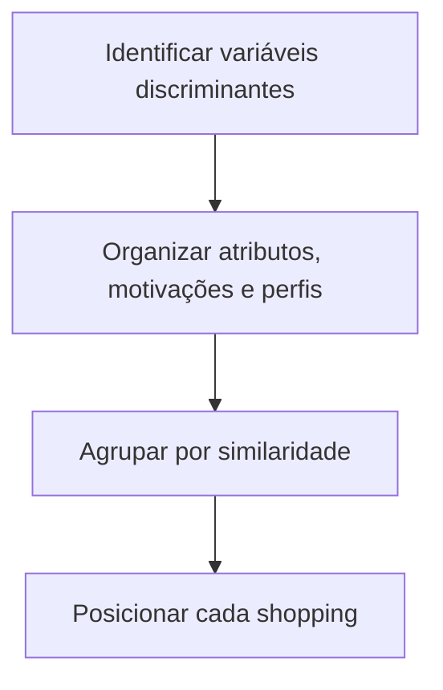

# Clusterização e Posicionamento de Shoppings

> [!info] Função deste documento
> Fornecer a lógica de segmentação de shoppings, interpretação de comportamento do consumidor, construção de clusters e definição de posicionamento estratégico.

---

## 1. Definição Central

Clusterização é um **processo estratégico de agrupamento de shoppings** com base em similaridades e diferenças relevantes, visando maximizar:

- Eficiência operacional
- Clareza de proposta de valor
- Competitividade

---

## 2. Objetivos

- [ ] Aumentar competitividade
- [ ] Tornar a proposta de valor clara
- [ ] Otimizar investimentos
- [ ] Criar sinergia operacional e comercial
- [ ] Organizar portfólio em escala

---

## 3. Lógica do Modelo



---

## 4. Framework de Análise

### Imagem
| Dimensão | Exemplos |
|----------|----------|
| Imagem percebida | Sofisticado · Familiar · Descolado · Conveniente |

### Atributos
Acessibilidade · Variedade · Segurança · Gastronomia · Tendência · Conforto · Serviços

### Perfis de Consumidor
Condômino · Jetsetter · Shoppaholic · Turista · Prático · Pragmático

> [!tip] Insight-chave
> **Atributos + Imagem determinam a escolha do shopping.**

---

## 5. Clusters

| Cluster | Link |
|---------|------|
| 🏆 Sofisticados | [[Cluster — Sofisticados]] |
| 💎 Compactos de Alto Padrão | [[Cluster — Compactos de Alto Padrão]] |
| 🎡 Entretenimento | [[Cluster — Entretenimento]] |
| 👨‍👩‍👧 Passeio Familiar | [[Cluster — Passeio Familiar]] |
| 🛒 Convenientes | [[Cluster — Convenientes]] |

---

## 6. Posicionamento

### Funções
- Definir o **significado da marca**
- Garantir **consistência**
- Guiar **decisões**

### Estrutura do Posicionamento

| Componente | Descrição |
|------------|-----------|
| Essência | Núcleo da marca |
| Target | Público prioritário |
| Benefícios | O que entrega |
| Diferenciais | O que só ele tem |
| RTBs | Lojas · Gastronomia · Lazer · Serviços · Ambiente |
| Personalidade | Tom e comportamento |
| Herança | História e origem |
| Evolução | Direção futura |

---

## 7. Execução do Agente

```
1. Interpretar o shopping
2. Classificar cluster
3. Avaliar coerência
4. Identificar desalinhamentos
5. Sugerir correções
```

---

## 8. Regras Críticas

> [!warning] Atenção
> - ❌ Não classificar apenas por **tamanho**
> - ✅ Cruzar **atributos** e **comportamento**
> - 🔒 Cluster deve ser **único** por shopping
> - ✅ Posicionamento deve ser **coerente com a operação**

---

## 9. Princípio Final

> [!quote]
> Um shopping compete **dentro do seu cluster**.
> Erro de clusterização é um **erro estratégico estrutural**.

---

## Relacionamentos

- [[Framework de Batalhas]]
- [[Underwriting Comercial]]
- [[Proposta de Valor por Cluster]]
- [[Mandamentos de Prospecção]]
