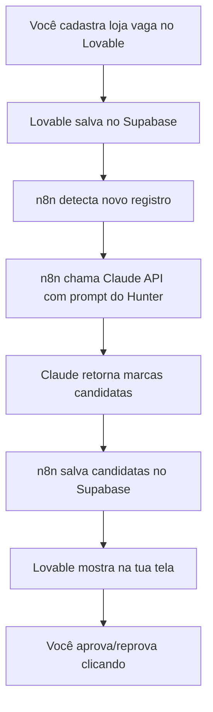

---
tags:
  - curso
  - ai-orchestrator
  - shopping-inteligente
  - mvp
created: 2026-05-19
status: em-andamento
---

# Curso AI Orchestrator do Zero — Shopping Inteligente

> Curso prático de 8 semanas para construir o MVP do Shopping Inteligente OS sem precisar ser programador.

## Sumário

- [[#Parte 1 — O conceito antes das ferramentas]]
- [[#Parte 2 — As ferramentas, uma por uma]]
- [[#Parte 3 — Como tudo se encaixa]]
- [[#Parte 4 — Onde cada ferramenta entra no curso]]
- [[#Parte 5 — Dois conceitos técnicos essenciais]]
- [[#Por onde começar amanhã]]
- [[#Setup da Semana 1 — Passo a passo]]

---

## Parte 1 — O conceito antes das ferramentas

### O que é um "AI Orchestrator"

Imagina um maestro de orquestra. Ele não toca nenhum instrumento, mas sabe qual músico chamar, em que ordem, e por quanto tempo. Um **AI Orchestrator** faz isso com ferramentas de IA: você decide *qual IA faz qual tarefa, em que ordem, usando quais dados*.

No teu caso: o **Hunter** precisa achar lojas no Google Maps, depois o **Farmer** precisa achar um investidor no teu banco de dados, depois o **KA** cruza os dois. Você é o maestro que monta esse fluxo.

### Por que isso virou possível agora

Porque as IAs (Claude, ChatGPT) hoje conseguem **ler instruções em português, decidir o que fazer, e devolver resultado estruturado**. Antes você precisava programar tudo na mão. Hoje você descreve em texto e a IA executa.

### Os 3 tipos de ferramenta que você vai usar

Pensa numa cozinha:

1. **Copiloto** = o chef que conversa com você enquanto cozinha. Te ajuda a pensar. (Claude e ChatGPT no navegador)
2. **Agente** = um robô que faz UMA tarefa específica bem feita, sozinho. (Claude via API, Claude Code)
3. **Workflow** = a esteira da cozinha industrial que conecta vários robôs em sequência. (n8n, Make)

Você precisa dos três. Cada um tem um momento.

---

## Parte 2 — As ferramentas, uma por uma

### Claude (claude.ai) — copiloto principal

**O que é:** um chatbot, igual ao ChatGPT. Você abre no navegador, escreve uma pergunta, ele responde.

**Por que importa:** o Claude é particularmente bom em raciocínio longo, escrever código e seguir instruções complexas. Para o teu projeto, ele vai ser teu "sócio de pensamento".

**Quando usar:**
- *"Claude, me explica o que é uma API REST como se eu tivesse 12 anos"*
- *"Claude, olha esse documento e me diz se faz sentido"*
- *"Claude, escreve o prompt do agente Hunter"*

**Como começar:** vai em [claude.ai](https://claude.ai), cria conta, assina o Pro (~US$20/mês). O plano grátis trava rápido.

---

### ChatGPT — copiloto secundário

**O que é:** mesma coisa que o Claude, feito pela OpenAI.

**Por que ter os dois:** quando você está em dúvida sobre uma resposta do Claude, joga a mesma pergunta no ChatGPT e compara. Funciona como segunda opinião médica. Modelos diferentes erram em coisas diferentes.

**Quando usar:** validação cruzada, brainstorming alternativo, quando o Claude trava num assunto.

---

### Claude Code — o agente que mexe nos teus arquivos

**O que é:** um programa que roda no **Terminal** do teu computador (aquela tela preta com texto que faz programador parecer hacker em filme). Você escreve em português o que quer e ele cria, edita e deleta arquivos no teu projeto sozinho.

**Diferença pro Claude do navegador:** o Claude do navegador *te diz* o código. O Claude Code *executa* o código por você, escrevendo direto nos arquivos.

> [!tip] Analogia
> Claude do navegador é um arquiteto que te entrega a planta. Claude Code é o pedreiro que constrói a parede enquanto você assiste.

**Quando usar:** *"cria um projeto novo de cockpit"*, *"conecta esse projeto ao Supabase"*, *"implementa o agente Hunter"*. Tarefas grandes que envolvem vários arquivos.

**Como começar:** depois que você tiver o Cursor instalado, o Claude Code se instala com um comando único no terminal. A documentação da Anthropic tem o passo a passo.

---

### Cursor — editor de código com IA embutida

**O que é:** um programa onde você abre os arquivos do teu projeto pra editar. Igual ao Word, mas pra código. A diferença: o Cursor tem IA dentro dele, então enquanto você digita, ele sugere o próximo trecho, e você pode pedir *"explica essa linha"* ou *"refatora isso"* sem sair do editor.

**Por que não usar bloco de notas:** porque você vai trabalhar com dezenas de arquivos. Cursor organiza, destaca erros em vermelho, e tem o atalho mágico:

- **Cmd+K** (Mac) ou **Ctrl+K** (Windows) abre uma caixinha onde você pede em português pra IA mudar o código selecionado.

**Quando usar:** edição fina, ajustes pontuais, ler código pra entender.

**Como começar:** baixa em [cursor.com](https://cursor.com), instala, abre a pasta do teu projeto.

---

### Lovable — fábrica de app pronto, sem código

**O que é:** um site onde você descreve em português o app que quer (*"um cockpit pra shopping com kanban de oportunidades"*) e ele gera o app inteiro funcionando, com tela bonita e tudo.

**Por que parece mágica e quase é:** o Lovable usa IA pra escrever todo o código por trás. Você só vê o resultado e fala *"muda isso, adiciona aquilo"*.

**Limitações reais:** ele acerta o básico fácil, mas em coisas muito específicas você precisa entrar no código (que ele mostra) e ajustar. Por isso o Cursor importa.

**Quando usar:** pra construir a tela onde teu usuário (executivo do shopping) vai clicar. O *"front-end"*, como chamam.

**Como começar:** [lovable.dev](https://lovable.dev), descreve teu app, ele constrói. Conecta com Supabase em 2 cliques.

---

### v0 — irmão do Lovable, feito pela Vercel

**O que é:** mesma ideia, focado mais em **componentes** (pedaços de tela) do que app inteiro. Você pede *"um card de oportunidade com score colorido"* e ele entrega.

**Quando usar em vez do Lovable:** quando você só precisa de uma peça isolada, não um app completo.

> [!note] Honestamente
> Começa com Lovable. v0 é complemento.

---

### Bolt — outro irmão da família

**O que é:** parecido com Lovable, da empresa StackBlitz.

**Quando usar:** pra protótipo descartável de 1 hora. *"Quero ver como ficaria essa ideia"*. Não pra produto final.

---

### n8n — a esteira que conecta tudo

**O que é:** imagina o jogo de tabuleiro onde você liga blocos com setas. Cada bloco é uma ação (*"buscar no Google"*, *"perguntar pro Claude"*, *"salvar no banco"*). As setas definem a ordem. Isso é n8n.

**Por que isso existe:** sem n8n, você precisaria programar manualmente cada conexão. Com n8n, você arrasta blocos, conecta com setas, e a esteira roda sozinha 24h por dia.

**Caso teu:** quando uma loja fica vaga no teu shopping, o n8n pode automaticamente:

1. Detectar a vacância
2. Chamar o Hunter pra buscar marcas
3. Chamar o Farmer pra achar investidor
4. Salvar tudo no banco
5. Mandar notificação no teu celular

Sem você fazer nada. Esse é o pulo do gato.

**Como começar:** [n8n.io](https://n8n.io), plano cloud (mais fácil) ou self-hosted (mais barato, mais técnico).

---

### Make — primo do n8n

**O que é:** mesma coisa que n8n, mais bonito visualmente, um pouco menos flexível.

**Qual escolher:** n8n é melhor para o teu caso porque permite escrever pedacinhos de código JavaScript dentro dos blocos quando você precisa de algo específico (e você vai precisar, pros cálculos de score). Make trava nisso.

---

### Supabase — o banco de dados

**O que é um banco de dados:** uma planilha gigante, organizada, que várias pessoas e programas podem ler e escrever ao mesmo tempo sem dar pau. Tipo um Excel com superpoderes.

**O que o Supabase faz:** te entrega esse banco pronto, na nuvem, com tela de administração, autenticação de usuário (login/senha), e uma "API" automática (jeito do teu app conversar com o banco).

**Por que ele e não o Excel:** Excel quebra com mais de 10 mil linhas, não tem login, não conecta com app. Banco resolve.

**Como começar:** [supabase.com](https://supabase.com), cria projeto, ele te dá um link e umas chaves. Você usa essas chaves no Lovable e no n8n pra todos conversarem com a mesma base.

---

### Airtable — alternativa mais simples

**O que é:** uma planilha online turbinada, parecida com Excel, mas que funciona como banco de dados leve.

**Por que NÃO usar no teu caso:** trava em volume e não tem regras de segurança boas. Supabase é mais trabalhoso de aprender mas é o certo. Airtable serve pra protótipo de 1 semana.

---

## Parte 3 — Como tudo se encaixa

Imagina o fluxo de uma oportunidade real no teu shopping:

Você nunca toca em nada técnico depois de montado. Só usa o app.

---

## Parte 4 — Onde cada ferramenta entra no curso

| Semana | Foco | Ferramenta principal |
|--------|------|----------------------|
| 1 | Entender o todo, criar contas | Claude web, ChatGPT |
| 2 | Montar o banco | Supabase (com Claude te ensinando) |
| 3–4 | Escrever os prompts dos agentes | Claude web + Cursor |
| 5–6 | Montar a esteira | n8n |
| 7 | Montar a tela | Lovable |
| 8 | Juntar tudo e testar | Claude Code pra ajustes finos |

---

## Parte 5 — Dois conceitos técnicos essenciais

> [!important] API
> É o "telefone" que um programa usa pra falar com outro. Quando o n8n "chama o Claude", ele liga pra API do Claude. Você não precisa entender como funciona por dentro, só saber que existe e que você vai precisar de uma **API key** (uma senha longa) pra usar.

> [!important] Prompt
> É a instrução em português que você dá pra IA. *"Você é o Hunter, sua missão é encontrar marcas..."* é um prompt. A qualidade do teu prompt define a qualidade da resposta. **Engenharia de prompt é 50% do teu trabalho.**

---

## Por onde começar amanhã

- [ ] Abrir [claude.ai](https://claude.ai) e assinar o Pro
- [ ] Criar conta no [Supabase](https://supabase.com) (grátis)
- [ ] Criar conta no [Lovable](https://lovable.dev) (tem trial)
- [ ] Baixar o [Cursor](https://cursor.com) (grátis pra começar)
- [ ] Pegar o doc `01_SYSTEM_PROMPT_MASTER` e colar no Claude pedindo: *"me explica esse documento como se eu fosse leigo, em 3 parágrafos"*

Esse último passo é o **teste do limiar** — se você entende a resposta, está pronto pra Semana 1. Se não, pergunta de novo até entender.

---

## Setup da Semana 1 — Passo a passo

> Esta seção tem o detalhamento operacional. Cada passo abaixo é executável hoje.

Ver nota separada: [[Setup Semana 1 - Passo a Passo]]

---

## Links relacionados

- [[Setup Semana 1 - Passo a Passo]]
- [[Glossário Técnico]]
- [[Mandamentos Zé Roberto Levy]]
- [[Princípios Sam Zell]]

---

## Ressalvas e confiança

**Confiança geral: 8/10.**

Pontos onde tenho menos certeza:

- Preço exato e features mais novas das ferramentas no-code (Lovable, v0, Bolt) podem ter mudado nas últimas semanas — vale conferir
- Curva de aprendizado real depende do teu background (se já mexeu com fórmula de Excel complexa, vai ser mais rápido)
- n8n vs Make é uma escolha que outros engenheiros podem discordar — ambos funcionam, n8n é minha aposta

**O que eu não sei sobre você** e mudaria a recomendação: se você já programa minimamente, se tem ajuda técnica disponível, se o orçamento mensal pra ferramentas (~US$100–200) é confortável.
