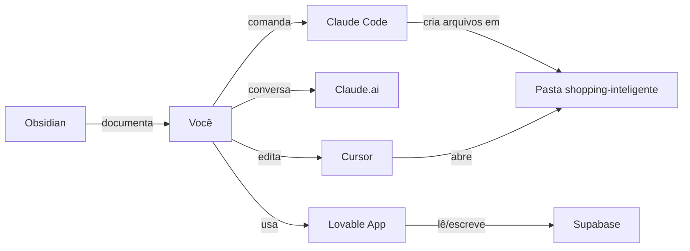

---
tags:
  - curso
  - setup
  - semana-1
  - ai-orchestrator
created: 2026-05-19
status: pronto-para-executar
parent: "[[Curso_AI_Orchestrator_Shopping_Inteligente]]"
---

# Setup Semana 1 — Passo a Passo

> Roteiro operacional para sair do zero até ter todas as contas, ferramentas instaladas e o primeiro "Olá Mundo" rodando. Tempo estimado: **6 a 10 horas distribuídas em 5 dias**.

## Objetivo da semana

Ao final da semana 1, você deve ter:

- [ ] Todas as contas criadas
- [ ] Cursor + Claude Code funcionando no teu computador
- [ ] Um projeto Supabase vazio criado
- [ ] Uma API key da Anthropic gerada e guardada
- [ ] Um primeiro app de teste no Lovable conectado ao Supabase
- [ ] Um cofre no Obsidian organizado pro projeto

> [!warning] Regra de ouro da semana
> **Não pula etapa**. Cada passo destrava o seguinte. Se travar, abre o Claude e cola o erro literal — ele te ajuda a desbloquear.

---

## Dia 1 — Contas e fundação (1,5h)

### Passo 1.1 — Criar conta Anthropic (Claude Pro)

1. Acessa [claude.ai](https://claude.ai)
2. Clica em "Sign up", usa teu email principal
3. Confirma o email
4. Vai em **Settings → Plans** e assina o **Pro** (~US$20/mês)

> [!tip] Por que Pro
> O plano grátis trava em 5–10 mensagens longas. Você vai colar documentos grandes do v5 nele — precisa do Pro.

### Passo 1.2 — Criar conta OpenAI (ChatGPT Plus)

1. Acessa [chatgpt.com](https://chatgpt.com)
2. Sign up com Google ou email
3. Assina o **Plus** (US$20/mês) — opcional na semana 1, mas útil pra validação cruzada

> [!note] Pode pular?
> Se o orçamento aperta, pula essa por enquanto. Volta depois.

### Passo 1.3 — Criar conta Supabase

1. Acessa [supabase.com](https://supabase.com)
2. Clica em "Start your project", entra com GitHub (cria conta GitHub se não tiver)
3. Não cria projeto ainda — só a conta

> [!info] GitHub
> GitHub é onde código fica guardado online. Você vai precisar dele pra Supabase, Cursor, Lovable. Cria com teu email principal e guarda a senha.

### Passo 1.4 — Criar conta Lovable

1. Acessa [lovable.dev](https://lovable.dev)
2. Sign up com GitHub
3. Pega o trial — você vai usar de verdade só na Semana 7, mas já cria

### Passo 1.5 — Criar conta n8n

1. Acessa [n8n.io](https://n8n.io)
2. Clica em "Get started", escolhe **Cloud** (mais simples) e pega o trial de 14 dias
3. Mesma lógica: só cria, usa de verdade na Semana 5

### Checkpoint do Dia 1

- [ ] Claude.ai logado e Pro ativo
- [ ] (Opcional) ChatGPT Plus ativo
- [ ] Supabase logado via GitHub
- [ ] Lovable logado
- [ ] n8n logado

---

## Dia 2 — Instalar Cursor e organizar Obsidian (2h)

### Passo 2.1 — Baixar e instalar Cursor

1. Vai em [cursor.com](https://cursor.com)
2. Baixa pra teu sistema (Mac, Windows ou Linux)
3. Instala (igual qualquer programa)
4. Abre o Cursor pela primeira vez:
   - Faz login com a conta (pode usar Google)
   - Aceita configurações padrão
   - Quando perguntar sobre extensões do VS Code, deixa importar tudo

### Passo 2.2 — Configurar o Cursor com Claude

1. No Cursor, aperta **Cmd+Shift+P** (Mac) ou **Ctrl+Shift+P** (Windows) — abre a paleta de comandos
2. Digita "Cursor Settings" e abre
3. Em **Models**, garante que `claude-sonnet-4` ou `claude-opus-4` esteja habilitado
4. Define como modelo padrão pro Tab e pro Chat

### Passo 2.3 — Criar pasta do projeto

1. No teu computador, cria uma pasta chamada `shopping-inteligente` em local fácil (Desktop ou Documentos)
2. No Cursor, **File → Open Folder** e abre essa pasta
3. Vais ver a tela vazia — é normal

### Passo 2.4 — Organizar o vault do Obsidian

> [!info] Se ainda não tem Obsidian
> Baixa em [obsidian.md](https://obsidian.md), instala. É um app de notas em markdown, totalmente local.

Cria um vault novo chamado `Shopping Inteligente` com a seguinte estrutura:

```
Shopping Inteligente/
├── 00 - Inbox/
├── 01 - Curso/
│   ├── Curso_AI_Orchestrator_Shopping_Inteligente.md
│   └── Setup Semana 1 - Passo a Passo.md
├── 02 - Sistema v5/
│   └── (copia os 10 docs do v5 pra cá)
├── 03 - Skills/
├── 04 - Workflows/
├── 05 - Logs/
│   └── 2026-05-19.md (diário de hoje)
└── 99 - Templates/
```

> [!tip] Por que essa estrutura
> Inbox é onde caem notas rápidas. Logs é teu diário (1 nota por dia). Templates poupa tempo. O resto é por domínio.

### Checkpoint do Dia 2

- [ ] Cursor instalado e abrindo
- [ ] Cursor configurado com modelo Claude
- [ ] Pasta `shopping-inteligente` criada e aberta no Cursor
- [ ] Vault Obsidian criado e estruturado
- [ ] Esta nota e a do curso colocadas no vault

---

## Dia 3 — Anthropic API key e Claude Code (1,5h)

### Passo 3.1 — Pegar API key da Anthropic

1. Acessa [console.anthropic.com](https://console.anthropic.com)
2. Faz login com a mesma conta do claude.ai
3. Vai em **Settings → API Keys**
4. Clica em **Create Key**, nomeia como `shopping-inteligente-dev`
5. **COPIA a chave imediatamente** — começa com `sk-ant-...` e some pra sempre se você fechar

> [!danger] Segurança
> Essa chave é como senha de banco. Quem tiver ela gasta créditos teus. Nunca cola em chat público, GitHub público ou print de tela.

### Passo 3.2 — Comprar créditos API

1. Mesmo console Anthropic, vai em **Plans & Billing**
2. Adiciona US$20 de créditos pra começar (vai sobrar muito)

### Passo 3.3 — Guardar a API key com segurança

Cria um arquivo no teu computador chamado `.env` dentro da pasta `shopping-inteligente`:

```bash
ANTHROPIC_API_KEY=sk-ant-sua-chave-aqui
```

> [!warning] Importante
> Cria também um arquivo `.gitignore` na mesma pasta com o conteúdo:
> ```
> .env
> node_modules/
> .DS_Store
> ```
> Isso evita que tua chave vaze quando você subir código pro GitHub.

### Passo 3.4 — Instalar Claude Code

1. Abre o Terminal do teu computador:
   - **Mac**: aperta Cmd+Espaço, digita "Terminal", abre
   - **Windows**: abre o "Terminal" ou "PowerShell" pelo menu Iniciar
2. Vai precisar do Node.js. Pra verificar se já tem:
   ```bash
   node --version
   ```
   Se der erro, baixa em [nodejs.org](https://nodejs.org) versão LTS e instala.
3. Instala o Claude Code:
   ```bash
   npm install -g @anthropic-ai/claude-code
   ```
4. Roda pela primeira vez na pasta do projeto:
   ```bash
   cd ~/Desktop/shopping-inteligente
   claude
   ```
5. Ele vai pedir pra autenticar — segue as instruções na tela

> [!note] Confiança
> O nome exato do pacote npm pode ter mudado. Se o comando acima falhar, busca no Google "claude code install npm" pra pegar o atual. **Confiança nesse comando: 7/10.**

### Passo 3.5 — Primeiro teste com Claude Code

Ainda no Terminal, com o Claude Code aberto, digita:

```
Cria um arquivo README.md nessa pasta com o título "Shopping Inteligente OS - MVP" e uma breve descrição do projeto.
```

Ele deve criar o arquivo. Abre no Cursor pra ver.

### Checkpoint do Dia 3

- [ ] API key Anthropic gerada e guardada no `.env`
- [ ] US$20 de créditos comprados
- [ ] `.gitignore` criado com `.env` listado
- [ ] Claude Code instalado e funcionando
- [ ] Primeiro README.md criado pelo Claude Code

---

## Dia 4 — Supabase: primeiro projeto (2h)

### Passo 4.1 — Criar projeto Supabase

1. Logado no [supabase.com](https://supabase.com), clica em **New Project**
2. Preenche:
   - **Name**: `shopping-inteligente-dev`
   - **Database Password**: clica em "Generate" e **salva no .env** assim:
     ```
     SUPABASE_DB_PASSWORD=senha-gerada-aqui
     ```
   - **Region**: `South America (São Paulo)` — mais próximo, mais rápido
   - **Pricing Plan**: Free
3. Clica em **Create new project** — demora ~2 minutos pra provisionar

### Passo 4.2 — Pegar as chaves do Supabase

Quando o projeto subir:

1. Vai em **Project Settings → API**
2. Copia 3 coisas pro teu `.env`:
   ```bash
   SUPABASE_URL=https://xxxx.supabase.co
   SUPABASE_ANON_KEY=eyJhbGc...
   SUPABASE_SERVICE_ROLE_KEY=eyJhbGc...
   ```

> [!danger] Service Role Key
> Essa é a chave de admin do banco. **NUNCA** coloca em frontend, app público, ou compartilha. Só usa em backend/n8n.

### Passo 4.3 — Criar primeira tabela de teste

1. No painel Supabase, vai em **Table Editor → New Table**
2. Cria uma tabela chamada `teste_conexao`:
   - Campo `id`: int8, primary key, auto-increment (já vem por padrão)
   - Campo `mensagem`: text
   - Campo `criado_em`: timestamptz, default `now()`
3. Salva
4. Adiciona uma linha manualmente com `mensagem = "Funcionou"`

### Passo 4.4 — Testar conexão via SQL Editor

1. Vai em **SQL Editor → New query**
2. Roda:
   ```sql
   SELECT * FROM teste_conexao;
   ```
3. Deve ver a linha que você criou

### Checkpoint do Dia 4

- [ ] Projeto Supabase rodando
- [ ] 3 chaves do Supabase salvas no `.env`
- [ ] Tabela `teste_conexao` criada
- [ ] Query SQL funcionando

---

## Dia 5 — Lovable: primeiro app conectado (2h)

### Passo 5.1 — Criar primeiro projeto Lovable

1. Em [lovable.dev](https://lovable.dev), clica em **New Project**
2. No campo de prompt inicial, cola:

```
Crie um app simples de painel administrativo para shopping centers.
Tem que ter:
- Página de login (email/senha)
- Página inicial com mensagem "Bem-vindo ao Shopping Inteligente"
- Uma página /teste que lista todos os registros da tabela "teste_conexao" do Supabase
Use design clean, profissional, paleta neutra (cinza, azul escuro, branco).
```

3. Aguarda ele gerar (3–5 minutos)

### Passo 5.2 — Conectar Lovable ao Supabase

1. No Lovable, procura o botão **Integrations** ou **Connect Supabase**
2. Cola a `SUPABASE_URL` e a `SUPABASE_ANON_KEY` (não a service role!)
3. Ele detecta as tabelas automaticamente

### Passo 5.3 — Testar end-to-end

1. Abre a preview do app
2. Cria um usuário de teste (email/senha qualquer)
3. Navega pra `/teste`
4. Deve ver a mensagem "Funcionou" da tabela

> [!success] Se chegou aqui
> Você tem o **circuito mínimo viável** funcionando: banco (Supabase) → app (Lovable) → usuário (você). Esse é o esqueleto do MVP.

### Passo 5.4 — Diário no Obsidian

Abre `05 - Logs/2026-05-19.md` e escreve:

- O que fez hoje
- O que travou
- O que aprendeu
- Próximo passo

> [!tip] Hábito de logs
> Esse diário é o que separa quem termina em 8 semanas de quem desiste na 3. Você não vai lembrar de tudo. O log lembra por você.

### Checkpoint do Dia 5

- [ ] App Lovable criado e funcionando
- [ ] Lovable conectado ao Supabase
- [ ] Login funcionando
- [ ] Tela `/teste` mostra dados do banco
- [ ] Log do dia escrito no Obsidian

---

## Resumo da Semana 1

Ao final desses 5 dias, você tem:



**Você não programou nada ainda.** Só montou a fundação. As próximas semanas é que vão construir os agentes.

---

## Troubleshooting comum

> [!question] "Claude Code não instala"
> Verifica versão do Node (`node --version`). Precisa ser 18+. Se for menor, atualiza.

> [!question] "Supabase não conecta no Lovable"
> Confere se copiou a **anon key**, não a service role. Confere se a URL termina em `.supabase.co` sem barra final.

> [!question] "Cursor está lento"
> Desliga indexação automática em Settings → Features → Codebase Indexing pra projetos pequenos.

> [!question] "Não sei o que escrever no diário"
> Template mínimo: 3 bullet points. *Fiz X. Travou em Y. Amanhã faço Z.* Pronto.

---

## Próxima semana

[[Semana 2 - Modelagem do Banco]] (a criar) — vamos transformar as 4 tabelas críticas do v5 (`pontos_vagos`, `investidores`, `marcas`, `deal_pipeline`) em SQL real no Supabase, com os campos de score já calculados.

---

## Ressalvas e confiança

**Confiança no roteiro: 7/10.**

Pontos frágeis:

- **Comando exato de instalação do Claude Code** pode ter mudado — confere a doc oficial da Anthropic se travar
- **Interface do Lovable** muda quase semanalmente — botões podem estar em outro lugar
- **Tempo estimado de 6–10h** assume zero travas; na vida real, espera 12–15h se você é leigo total

**O que pode dar errado** e não está no roteiro:

- Limite de crédito Anthropic estourar antes do esperado (improvável com US$20)
- Conta GitHub pedir verificação por celular (se acontecer, é normal, segue o fluxo)
- Antivírus bloquear instalação do Cursor (libera nas exceções)
