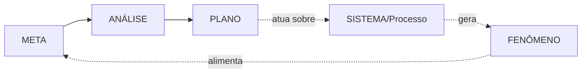
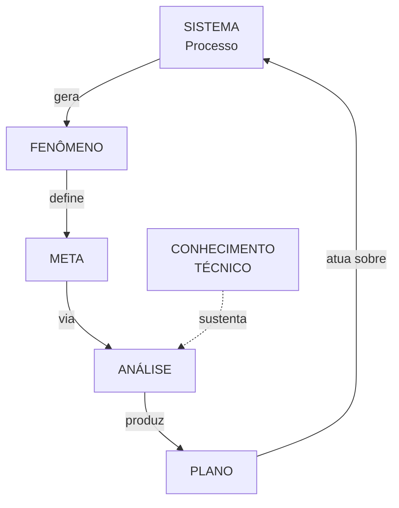

# Integração das Ferramentas da Qualidade ao Sistema de Gestão

> [!info] Sobre esta nota
> Material extraído do arquivo `CAP1.pdf`. Apresenta a estrutura conceitual que liga **Sistema → Fenômenos → Metas → Análise → Plano**, com o roteiro de ferramentas associado a cada etapa do método de melhoria.

---

## 1. Conceito Base: Sistema e Fenômenos

Um **[[Sistema]] (Processo)** gera **[[Fenômenos]]**.

### 1.1. Tipos de Fenômenos Gerados

Os fenômenos resultantes de um sistema/processo podem ser:

- Produtos
- Bens
- Serviços
- Valor
- Quebras
- Defeitos
- Perda de market share
- Custo elevado
- Acidentes
- Atrasos
- Etc.

### 1.2. Classificação dos Fenômenos

- **Fenômenos Positivos**
- **Fenômenos Negativos**

---

## 2. Beneficiários do Sistema

Os fenômenos (positivos e negativos) gerados pelo sistema impactam os **Beneficiários do Sistema**:

- [[Clientes]]
- [[Acionistas]]
- [[Empregados]]
- [[Vizinhos]]

---

## 3. Metas e Planos

> [!quote] Definição de Meta
> As **METAS** são estabelecidas sobre os fenômenos para satisfação das partes beneficiárias.

> [!quote] Definição de Plano
> Os **PLANOS** são estabelecidos para promover mudanças no sistema (processo).

> [!important] Correlação Meta ↔ Plano
> Deve existir uma correlação direta entre **META** e **PLANO**.
> Esta correlação é feita através da **ANÁLISE**.

---

## 4. O Método: [[Meta]] → [[Análise]] → [[Plano]]

### 4.1. Fases do Método

- **Fase Atual** → identifica-se a **META** (via [[Brainstorming]])
- **Fase Futura** → chega-se ao **PLANO**

Entre as duas, ocorre a **ANÁLISE**, dividida em três frentes:

1. [[Análise de Fenômeno]] (FINS)
2. [[Análise de Processo]] (MEIOS)
3. [[Análise das Alternativas Estratégicas]]

### 4.2. Detalhamento das Análises

#### 🎯 Análise de Fenômeno (FINS)

- Coleta de Dados
- Estratificação e Priorização
- Análise das Variações
- **Saída:** Meta Específica (derivada da **META GERAL**)

#### ⚙️ Análise de Processo (MEIOS)

- Determinação / Dissecação do Processo
- Quantificação e Priorização dos fatores causais

#### 🧭 Análise das Alternativas Estratégicas

- Simulação
- Otimização

---

## 5. Funções dos [[Black Belts]] no Sistema de Gestão

O Sistema de Gestão estrutura-se em três níveis:

- **Plano de Longo Prazo** → [[Missão e Visão]]
- **Plano de Médio Prazo**
- **Plano Atual** → Metas Anuais

### 5.1. As Quatro Funções do Black Belt

> [!success] As 4 atribuições
> 1. **Ajudar no Desdobramento das Diretrizes Anuais**
> 2. **Projetar novos Produtos e novos Processos** (Inovação)
> 3. **Ajudar o seu Gerente a Estabelecer o Plano de Ação** para alcançar as Metas Anuais
> 4. **Resolver os Problemas Crônicos** provenientes da operação da empresa

### 5.2. Ciclos Associados

- **[[PDCA]] (A-D-P-C)** → metas de melhoria, metas anuais, inovação, problemas crônicos
- **[[SDCA]] (A-D-S-C)** → ações corretivas e Procedimentos Operacionais Padrão

### 5.3. Tipos de Medidas e Metas

- **Medidas Desdobráveis** ↔ **Medidas Não Desdobráveis**
- **Meta de Melhorias** / **Meta Problema** / **Problema Crônico Operacional**
- **Revisão Periódica das Anomalias**
- **Problemas Crônicos Prioritários**

---

## 6. Roteiro — Etapa 1: Identificação do Problema

> [!question] Perguntas-chave
> - O problema já está focado?
> - Vale a pena investir? (taxa de retorno econômico: situação atual vs. meta)

### Ferramentas

- Identificação e Avaliação do Problema
- Histórico do Problema (frequência, como ocorre, tendências)
- [[Avaliação do Sistema de Medição]] — garante a confiabilidade dos dados gerados
- [[Mapa de Raciocínio]] — atualizado ao longo da execução das etapas
- [[Gráfico Sequencial]]

> [!warning] Decisão
> Se **não vale a pena investir** → **Abandone**.

---

## 7. Roteiro — Etapa 2: Análise do Fenômeno

> [!question] Perguntas-chave
> - Existem dados e são confiáveis?
> - Alguns dos problemas mostram variações significativas?
> - Já é possível estabelecer a meta de cada problema importante?

### Ferramentas

- [[Estratificação]]
- [[Diagrama de Pareto]]
- [[Folha de Verificação]]
- [[Amostragem]]
- [[Histograma]]
- [[Análise de Conglomerados]]
- [[Carta de Controle]]
- Coleta de Dados
- Análise de Variação
- Estratificação e Priorização do problema

### Tipos de Meta resultante

- Metas **desdobráveis** ou delegáveis
- Metas **não desdobráveis** ou não delegáveis

> [!tip] Sem dados confiáveis?
> Volte um passo → **Coletar dados** / **Coletar mais dados**.

---

## 8. Roteiro — Etapa 3: Análise do Processo

> [!question] Perguntas-chave
> - O processo é bem definido?
> - É necessário quantificar?
> - Foram obtidas todas as informações necessárias?

### 8.1. Ferramentas Qualitativas

- [[Fluxograma]]
- [[Mapa de Processo]]
- [[FMEA]] / [[FTA]]
- Brainstorming (listar fatores causais qualitativos)
- [[Diagrama de Afinidades]]
- [[Diagrama de Relações]]
- [[Diagrama de Árvore]]
- [[Diagrama de Causa e Efeito]]

### 8.2. Ferramentas Quantitativas

- [[Diagrama de Matriz]]
- [[Diagrama de Dispersão]]
- [[Planejamento de Experimentos]] (DOE)
- [[Análise de Regressão]]
- Cartas de Controle
- [[Análise de Tempo de Falhas]] e Testes de Vida Acelerados

### 8.3. Saída desta etapa

- Conhecimento Qualitativo do Processo de cada problema importante
- Quantificação e Priorização do Processo

---

## 9. Roteiro — Etapa 4: Estabelecimento do Plano de Ação

> [!question] Perguntas-chave
> - As medidas provocam efeitos correlatos (indesejáveis)?
> - As medidas são suficientes para atingir a meta?
> - Existem outras medidas a serem consideradas?

### 9.1. Brainstorming de Medidas

Classificação:

| Eixo | Opção A | Opção B |
|---|---|---|
| Desdobramento | Desdobráveis | Não desdobráveis |
| Efeitos colaterais | Geram efeitos indesejáveis | Não geram efeitos indesejáveis |

> [!tip] Critério de escolha
> Adotar as medidas **mais simples, de menor custo e mais rápidas**.

### 9.2. Ferramentas de Análise

- Diagrama de Matriz
- Análise das Alternativas Estratégicas
- [[Pesquisa Operacional]]
- [[Pesquisa de Mercado]]
- [[EVOP]] (Testes na Operação)

### 9.3. Inovação

- Novos Equipamentos
- Novos Materiais
- Novas Tecnologias

### 9.4. Montagem do Plano de Ação — Ferramentas

- [[Diagrama de Barras]]
- [[PDPC]]
- [[Diagrama de Setas]] — PERT/CPM
- [[3W]]
- [[5W1H]]
- [[5W2H]]

---

## 10. Nota Importante sobre o Roteiro

> [!warning] O roteiro não é obrigatório
> Este roteiro é apenas **sugerido**. Dependendo do problema ele poderá ser substancialmente simplificado, alterado ou até mesmo aumentado pelo uso de outros recursos não aqui listados.
>
> O **Black Belt** deve ter domínio do método e das ferramentas de tal modo a escolher a melhor sequência utilizando seus conhecimentos, sua experiência e sua criatividade.

---

## 11. Níveis de Formação (Belts)

| Nível | Curso correspondente |
|---|---|
| 🤍 **White Belt** (Faixa Branca) | GPD Operação - Faixa Branca |
| 🟫 **Brown Belt** (Faixa Marrom) | GPD Operação - Faixa Marrom |
| ⬛ **Black Belt** (Faixa Preta) | GPD Operação - Faixa Preta ("Six Sigma - Black Belts") |
| 🟥 **Master Black Belt** (Mestre Faixa Preta) | Inclui [[QFD]], Pesquisa Operacional, [[Estatística Avançada]], [[GPD]] e [[Gerenciamento de Projetos]] |

> [!note] Conhecimentos mínimos do Black Belt
> O Black Belt deve dominar todas as ferramentas listadas no roteiro acima.

---

## 12. Visão Integrada Final

### 12.1. Processo de Planejamento — pilares

- Tomada de Decisões
- Aprendizado
- Gerenciamento
- Desenvolvimento Tecnológico
- Sobrevivência

### 12.2. Base de tudo

> [!quote] Fundamento
> O **CONHECIMENTO TÉCNICO** sustenta todo o processo de planejamento.

---

## Notas relacionadas (sugestões para criar no vault)

- [[Sistema]]
- [[Fenômenos]]
- [[Meta]] · [[Análise]] · [[Plano]]
- [[PDCA]] · [[SDCA]]
- [[Black Belts]]
- [[Diagrama de Pareto]] · [[Diagrama de Causa e Efeito]] · [[FMEA]]
- [[5W2H]] · [[PDPC]]
- [[GPD]] · [[QFD]]
