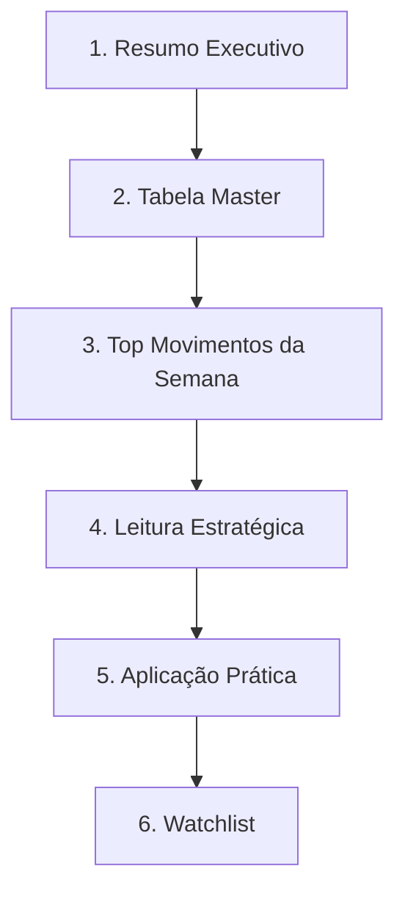

# 🧠 Premium Retail Radar (PRR)

> [!abstract] TL;DR
> Sistema contínuo de inteligência de varejo premium que monitora inaugurações, expansões, flagships e movimentos estratégicos de marcas premium e de luxo em shoppings, ruas e clusters urbanos qualificados. Funciona como camada estratégica do ecossistema [[RISC]] / [[SRIS]].

---

## 🎯 Tese Central

> [!quote]
> "Os vencedores do varejo premium não serão os ativos com mais lojas. Serão os ativos com os melhores **clusters de marca, experiência e comunidade**."

**Mudança de paradigma:**
- ❌ Modelo antigo: Shopping = espaço locável
- ✅ Novo modelo: Shopping premium = **ecossistema de marca + experiência**

---

## 🎯 Objetivo Estratégico

Transformar o shopping center em:
- Plataforma de **curadoria premium**
- Plataforma de **experiência**
- Sistema de **inteligência comercial**
- Motor de **captura antecipada de tendências**

---

## 🏬 Escopo Inicial Monitorado

### São Paulo
| Tipo | Ativos |
|---|---|
| Shoppings | [[Iguatemi São Paulo]], [[Iguatemi JK]], [[Shopping Cidade Jardim]] |
| Ruas | [[Oscar Freire]] |

### Rio de Janeiro
| Tipo | Ativos |
|---|---|
| Shoppings | [[VillageMall]], [[Shopping Leblon]], [[Rio Design Leblon]], [[Fashion Mall]] |
| Ruas | [[Garcia d'Ávila]], [[Visconde de Pirajá]], [[Dias Ferreira]], [[Paulo Gustavo (Niterói)]] |

### Belo Horizonte
| Tipo | Ativos |
|---|---|
| Shoppings | [[Pátio Savassi]], [[DiamondMall]], [[BH Shopping]] |
| Regiões | [[Savassi]], [[Lourdes]] |

---

## 🔍 O Que o Radar Monitora

> [!check] Inclui
> - Novas lojas
> - Flagships
> - Soft openings
> - Expansões
> - Upgrades relevantes
> - Relocations premium
> - Entrada de marcas internacionais
> - Upgrade de posicionamento de marcas brasileiras

> [!fail] Exclui
> - Quiosques simples
> - Operações mass market
> - Trocas irrelevantes
> - Operações sem sinal premium

---

## 💎 Critérios de Qualificação Premium

Uma marca entra no radar quando possui **pelo menos 2 sinais**:

- [ ] Ticket médio elevado
- [ ] Branding sofisticado
- [ ] Presença em clusters premium
- [ ] Expansão seletiva
- [ ] Forte presença digital
- [ ] Experiência diferenciada
- [ ] Forte engajamento/comunidade

---

## 🧠 Conceitos Estratégicos Incorporados

### #cluster-premium
> Luxo e premium funcionam por **clusterização**.

Marcas premium atraem:
- Consumidores affluent
- Outras marcas premium
- Tráfego qualificado

### #DNVB — Digital Native Vertical Brands Sofisticadas
Marcas nascidas digitalmente, com branding sofisticado, distribuição seletiva e foco em experiência.

**Exemplos:** [[Simple Organic]], [[Haight]], [[CARE Natural Beauty]], [[On Running]]

### #experiential-retail
A loja física passou a funcionar como:
- Mídia
- Branding
- Aquisição
- Relacionamento
- Experiência

---

## 🏬 Estrutura do Radar Semanal

### 1. Resumo Executivo
Inaugurações, upgrades, watchlist, principais insights.

### 2. Tabela Master
Marca · Categoria · Local · Tipo · Status · **Premium Score**

### 3. Top Movimentos da Semana
Análise qualitativa: por que importa, impacto estratégico, leitura competitiva.

### 4. Leitura Estratégica
Tendências, sinais antecipados, movimentos competitivos, formação de clusters.

### 5. Aplicação Prática
Targets comerciais, categorias prioritárias, riscos competitivos, oportunidades de mix.

### 6. Watchlist
Pipeline futuro: novas marcas, expansões, entradas LATAM, flagships.

---

## 📊 Dashboard Contínuo

**Componentes:**
- Dashboard
- Weekly_Log
- Watchlist
- Alert_Feed
- Alert_Rules

**KPIs monitorados:**
- Inaugurações premium
- Upgrades
- Intensidade competitiva
- Marcas internacionais
- Novas categorias

---

## 🚨 Sistema de Alertas

> [!warning] Triggers
> - Nova flagship
> - Expansão internacional
> - Mudança de cluster
> - Entrada de categoria estratégica

**Integrações previstas:** Slack · WhatsApp · E-mail · Power Automate · Zapier · Make

---

## 🧠 Leituras Estratégicas por Praça

### São Paulo
| Ativo | Posicionamento |
|---|---|
| [[Shopping Cidade Jardim]] | Cluster dominante de **luxo LATAM** |
| [[Iguatemi JK]] | Luxury lifestyle · Sports luxury · Inovação premium |
| [[Oscar Freire]] | Discovery retail · Laboratório flagship |

### Rio de Janeiro
| Ativo | Posicionamento |
|---|---|
| [[VillageMall]] | **Ultra premium** dominante |
| Leblon / Ipanema | Experiential luxury lifestyle |

**Tendências RJ:** resort luxury · wellness · gastronomia premium

### Belo Horizonte
| Ativo | Posicionamento |
|---|---|
| [[Pátio Savassi]] | Premium aspiracional contemporâneo |
| [[DiamondMall]] | Affluent tradicional |

**Tendências BH:** wellness premium · sports luxury · DNVBs sofisticadas

---

## 🔥 Categorias Mais Promissoras

- #sports-luxury
- #wellness-premium
- #beauty-premium
- #gastronomia-experiencial
- #lifestyle-premium
- #resort-luxury

---

## 🎯 Aplicações no Leasing

O radar permite:
- Antecipar tendências
- Capturar marcas antes da concorrência
- Melhorar curadoria
- Elevar percepção premium
- Fortalecer clusterização
- Aumentar potencial de **NOI**

---

## 🔗 Notas Relacionadas

- [[RISC]]
- [[SRIS]]
- [[Cluster Premium]]
- [[Curadoria de Mix]]
- [[Leasing Estratégico]]
- [[Watchlist Premium]]

---

## 📝 Observações de Leitura Crítica

> [!note] Pontos a aprofundar
> - O documento define **o quê** monitorar e **a estrutura** dos relatórios, mas não detalha a **metodologia de cálculo do Premium Score** nem as regras formais do `Alert_Rules`.
> - Os "sinais de qualificação premium" são qualitativos — falta um framework de scoring (ex.: pesos, faixas, thresholds).
> - A **frequência operacional** está implícita (semanal), mas não há definição de SLA para alertas em tempo real.
> - O escopo cobre SP, RJ e BH — vale registrar como expandir para outras praças (Curitiba, Brasília, Florianópolis, Recife).

---

**Confiança da resposta: 9/10**
Resumo é fiel ao documento original. O único ponto de atenção é que algumas inferências de organização (callouts, mermaid, wikilinks) são interpretações minhas de como adaptar o conteúdo ao Obsidian — o conteúdo em si reflete o original.
