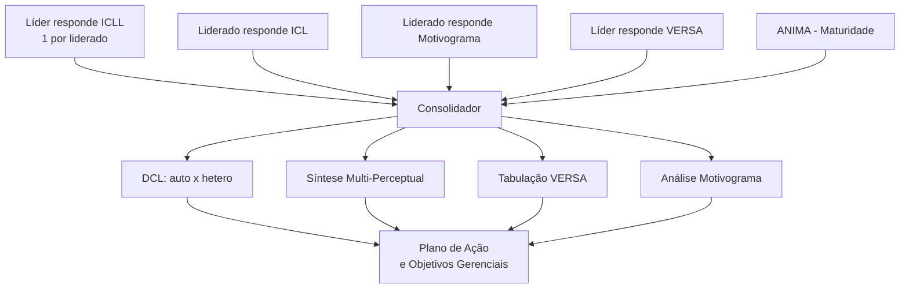

# SAG — Sistema de Acompanhamento Gerencial

> [!abstract] Em uma frase
> O **SAG** é um sistema baseado nos princípios da **[[Liderança Situacional]]** que ajuda o líder a identificar (1) o **comportamento que ele adota** com cada liderado, (2) **como o liderado o percebe**, (3) o **nível de motivação** e **maturidade** do liderado, e (4) o **estilo de liderança** predominante — gerando insumos para desenvolvimento pessoal e da equipe.

---

## 🎯 Conceito

O SAG parte do pressuposto da liderança situacional: **não existe um único estilo de liderança correto** — o estilo precisa se adequar ao nível de maturidade do liderado e à situação. O sistema serve para tornar essa relação **mensurável e visível**, evitando dissonâncias entre como o líder se vê e como é percebido.

**Para que serve:**
- Identificar comportamentos do líder com cada liderado
- Diagnosticar o estilo de liderança predominante
- Mapear oportunidades de crescimento pessoal e da equipe
- Antecipar **atrito** que costuma surgir quando há divergência entre autopercepção e heteropercepção

---

## 🧩 Estrutura do Sistema

São **5 instrumentos** que se conectam:

| Instrumento | Quem responde | Função |
|---|---|---|
| [[ICLL]] | Líder (1 por liderado) | Como o líder se comporta com cada liderado |
| [[ICL]] | Liderado | Como o liderado percebe o comportamento do líder |
| [[Motivograma]] | Liderado | Nível de motivação do liderado |
| [[Consolidador SAG\|Consolidador]] | Líder (uso restrito) | Importa e traduz dados em análises |
| [[ANIMA]] | — | Apura nível de maturidade do liderado |

---

## 📋 Instrumentos detalhados

### [[ICLL]] — Identificação do Comportamento do Líder com os Liderados

- **Quem responde:** o **líder**, **um questionário por liderado**.
- **Formato:** 12 perguntas, 4 alternativas cada.
- **Regra de ouro:** responder o **comportamento efetivo**, não o que se gostaria de fazer.
- **Saída:** insumo para o módulo de análise no Consolidador.

### [[ICL]] — Identificação do Comportamento do Líder

- **Quem responde:** o **liderado**.
- **Mesma lógica do ICLL**, mas pela ótica do liderado.
- **Formato:** 12 perguntas, 4 alternativas cada.
- **Regra de ouro:** responder o **comportamento real do líder**, não o esperado/idealizado.
- A comparação ICL × ICLL é o coração da análise de dissonância.

### [[Motivograma]]

- **Objetivo:** medir o **nível de motivação** do liderado.
- **Formato:** 30 questões, cada uma com **2 situações alternativas**.
- **Sistema de pontuação:**
	- O liderado distribui notas entre as duas alternativas.
	- A mais identificada recebe **2 ou 3**.
	- A menos identificada recebe **0 ou 1**.
	- **Soma sempre = 3 pontos** por questão.
- **Base teórica:** [[Hierarquia das Necessidades de Maslow]] *(o slide original grafa "Marlow" — provável erro de digitação; o autor correto é **Abraham Maslow**).*

### [[ANIMA]] — Análise do Nível de Maturidade dos Liderados

- **Função:** apurar **maturidade** e **comportamento do liderado em relação às metas**.
- É o instrumento que fecha o ciclo, conectando comportamento × motivação × maturidade.

---

## 🧮 [[Consolidador SAG|Consolidador]]

Ferramenta (planilha) que **importa os questionários e gera as pré-análises**. Acesso **restrito ao líder**.

### Módulo 1 — Como Operar
- **1.1 Instruções:** regras de operação da planilha.

### Módulo 2 — Inserindo os Dados
- **2.1 Cadastro de Liderados/Questionários** (exceto VERSA): nome do liderado, nome do arquivo do liderado, nome do arquivo do líder, status da importação.
- **2.2 Importar I** — Motivograma e ICL (do liderado).
- **2.3 Importar II** — ICLL (do líder).
- **2.4 [[VERSA]]** — Questionário de **Versatilidade de Ação**, respondido pelo **líder** para avaliar capacidade de adaptação de estilo.

### Módulo 3 — Ferramentas de Análise
- **3.1 Tabulação Versatilidade de Ação** → resultado do [[VERSA]].
- **3.2 Motivograma** → necessidades latentes a tratar (base [[Hierarquia das Necessidades de Maslow|Maslow]]).
- **3.3 [[DCL]] — Demonstrativo do Comportamento do Líder:**
	- Compara **autopercepção do líder** × **heteropercepção do liderado**.
	- Identifica **estilo primário** (quadrante de maior pontuação) e **estilo secundário** (segunda maior).
	- ⚠️ **Dispersão grande entre as duas visões = sinal de atrito/descontentamento futuro.**
- **3.4 [[Síntese Multi-Perceptual]]:** permite ao líder localizar seu estilo, identificar o quadrante do liderado e **traçar objetivos gerenciais**.

---

## 🔄 Fluxo de Aplicação

---

## 💡 Pontos-chave para revisitar

> [!tip] Insights centrais
> - O SAG vive da **comparação entre percepções** (líder × liderado). Sem essa dupla coleta, ele perde o sentido.
> - **Honestidade nas respostas é pré-requisito** — tanto o líder quanto o liderado precisam responder pelo *real*, não pelo *ideal*.
> - O **estilo primário + secundário** é mais informativo do que um único rótulo.
> - **Gap entre autopercepção e heteropercepção** é o principal preditor de conflito.
> - [[VERSA]] mede algo diferente dos demais: **flexibilidade de estilo**, não o estilo em si.

---

## 🔗 Conceitos relacionados (para expandir como notas)

- [[Liderança Situacional]] (base teórica — modelo Hersey-Blanchard)
- [[Hierarquia das Necessidades de Maslow]]
- [[Estilos de Liderança]]
- [[Maturidade do Liderado]]
- [[Feedback 360]] *(parente conceitual do SAG)*
- [[Autopercepção vs Heteropercepção]]

---

## ❓ Lacunas e perguntas em aberto

> [!question] O que o slide deck **não** responde
> - Quais são os **4 quadrantes** de estilo de liderança usados pelo SAG? (provavelmente E1–E4 do modelo Hersey-Blanchard, mas o deck não nomeia.)
> - Como exatamente o VERSA pontua versatilidade?
> - Qual a escala de maturidade do ANIMA (M1–M4)?
> - Existe periodicidade recomendada para reaplicar o ciclo?

---

## 📚 Fonte

- Arquivo original: `SAG.ppt` (12 slides, presumivelmente material interno de treinamento).
- ⚠️ O slide 9 escreve "Marlow" — **erro de digitação**; o autor da hierarquia das necessidades é **Abraham Maslow**.
