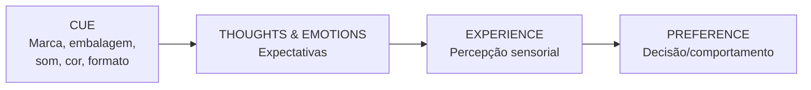

> [!info] Sobre este material
> Resumo do deck **"The Human Factor – Winning Customers' Preference"** da Professora **Szu-chi Huang** (Stanford Graduate School of Business). O material usa um experimento de degustação de café como fio condutor para demonstrar como [[expectativas]] moldam a [[percepção do consumidor]] e a [[preferência de marca]].

---

## 🎯 Tese central

> [!quote] "Be wary of intuitions, especially intuitions about how your own mind works." — Daniel Simons

A preferência do consumidor **não é determinada pela "realidade" do produto**, mas pelas [[expectativas]] criadas antes da experiência. [[Marca]], [[embalagem]], [[som do nome]], [[cor]] e [[formato]] funcionam como **cues** (gatilhos) que constroem essas expectativas — e essas expectativas guiam a experiência sensorial real.

---

## 🧪 O experimento do café (estrutura do deck)

Seis marcas foram testadas às cegas: **Blue Bottle, Blue Mountain, Peet's, Starbucks, McDonald's e 7-Eleven**.

> [!note] Resultado revelador
> As três amostras servidas no teste foram, na verdade, **Starbucks (Coffee 1), McDonald's (Coffee 2) e Blue Mountain (Coffee 3)** — esta última, uma das mais caras do mundo.

### Avaliação geral (1–10)

| Café | Marca real | Nota média |
|------|-----------|-----------|
| Coffee 1 | Starbucks | **5,0** |
| Coffee 2 | McDonald's | **5,94** |
| Coffee 3 | Blue Mountain | **5,29** |

### Disposição a pagar (USD/lb)

| Café | Marca real | $/lb |
|------|-----------|------|
| Coffee 1 | Starbucks | **$8,84** |
| Coffee 2 | McDonald's | **$11,68** |
| Coffee 3 | Blue Mountain | **$10,59** |

> [!warning] Insight chave
> **McDonald's** (um dos cafés mais baratos do painel) recebeu a maior nota e a maior disposição a pagar quando provado às cegas. **Blue Mountain** (um dos cafés mais caros do mundo) ficou no meio. Sem o cue de marca, a "qualidade percebida" desmorona.

### Identificação cega das marcas (frequências de palpite)

- **Coffee 1 (Starbucks real):** mais associado a Starbucks e McDonald's
- **Coffee 2 (McDonald's real):** mais associado a **Blue Bottle (12) e Starbucks (9)** — marcas premium
- **Coffee 3 (Blue Mountain real):** distribuído entre Starbucks, Blue Bottle e McDonald's

Conclusão: consumidores **não conseguem identificar marcas de café às cegas** — confirmando o mesmo achado clássico do [[teste de cerveja às cegas]] (Pabst, Colt 45, Miller Lite, Coors, Budweiser, Guinness).

---

## 🧠 O estudo de fMRI Coke vs. Pepsi

> [!example] Dois protocolos
> - **Entrega anônima:** sujeito não sabe qual marca está bebendo
> - **Entrega com cue de marca:** sujeito vê a lata

| Condição | Preferência por Coca |
|----------|---------------------|
| Anônima | **50%** |
| Com marca | **75%** |

**Achado neural:**
- Anônimo → áreas de **recompensa** (comida, álcool) ativadas igualmente por Coke e Pepsi
- Com marca → Coca-Cola ativa **regiões cerebrais adicionais de nível superior** (memória, emoção, identidade) — a marca literalmente muda o que o cérebro experimenta.

---

## 🔄 O modelo CUE → THOUGHTS → EXPERIENCE → PREFERENCE



> [!info] Como a preferência se forma
> 1. **Construtiva** — não é um dado pronto, é montada no momento
> 2. **Baseada em metas e expectativas** — as pessoas percebem o que **querem** e **esperam** perceber
> 3. **Não é "realidade"**, mas guia o comportamento de compra

---

## 🔠 Os cinco vetores sensoriais de expectativa

### 1. Som (sound symbolism)

> [!tip] Padrão fonético
> - **Sons agudos** (`/i/`, `/e/`) → pequeno, leve, ágil, afiado
> - **Sons graves** (`/a/`, `/o/`, `/u/`) → grande, lento, pesado
> - **Consoantes duras** (`/t/`, `/k/`) → pequeno, duro, rápido, pontiagudo
> - **Consoantes suaves** (`/m/`, `/l/`) → grande, redondo, macio, lento

**Casos:**
- [[Lamuma vs. Takiti]] — pessoas associam consistentemente "Lamuma" a coisas macias/redondas (mel, travesseiro, restaurante romântico) e "Takiti" a coisas duras/cortantes (molho picante, motosserra, desinfetante)
- **Carros Bromley vs. Brimley** — Bromley é percebido com mais espaço interno e potência; Brimley parece mais econômico
- **Sorvete Frish vs. Frosh** — Frosh é percebido como mais cremoso e rico
- **BlackBerry vs. Strawberry** — "Straw" foi rejeitado por ser sílaba lenta; **B = confiabilidade**, **e curto = velocidade**, **berry = pequeno/portátil**

> [!note] Implicação prática
> [[Naming consulting]] é um negócio grande e em crescimento — o nome carrega expectativa sensorial **antes** do produto ser experimentado.

### 2. Cor

| Cor | Significado dominante |
|-----|----------------------|
| Vermelho | Calor, paixão, emoção, intensidade |
| Azul | Frio, produtividade, masculino, confiança |
| Verde | Fertilidade, saúde, natureza, dinheiro |
| Roxo | Realeza, riqueza, sucesso |
| Rosa | Calma, amor, romance, feminino |
| Laranja | Quente, cautela |
| Marrom | Terra, praticidade |
| Branco | Pureza, inocência, espaço |

**Caso prático:** o rebranding da [[7-Eleven]] de "loja de conveniência genérica" para um espaço mais verde, com tipografia artesanal e [[ativações experienciais]] ("Twist. Pop. Go.", "My Kinda Beer") mudou a percepção da marca via cor + tom + ambiente.

### 3. Forma

- **Logos circulares** → suavidade, conforto, harmonia
- **Logos angulares** → durabilidade, força, performance
- **Embalagens com formas arredondadas** evocam doçura/cremosidade (chocolate)
- **Embalagens com pontas/ângulos** evocam intensidade/amargor

### 4. Visão (espaço físico)

Caso [[Warby Parker]]: a curadoria do espaço (madeira, escadas, exposição em estilo "biblioteca de óculos") cria a expectativa de **artesanato e curadoria intelectual**, justificando o preço.

### 5. Tato e Realidade Aumentada

[[AR]] (Lego, IKEA) permite que o cliente **sinta posse antes da compra** — o produto é renderizado no espaço real, e o cérebro começa a tratá-lo como propriedade. Reduz fricção e aumenta conversão.

---

## ✅ Implicações práticas (acionáveis)

- [ ] Auditar **nome** do produto/marca contra associações fonéticas pretendidas
- [ ] Mapear **cores** do branding contra o significado emocional desejado pelo cluster-alvo
- [ ] Testar **formato** de embalagem e logo (circular vs. angular) coerente com o atributo central do produto
- [ ] Garantir que **embalagem e ponto de venda** comuniquem o posicionamento de preço pretendido
- [ ] Em PDV: orquestrar **luz, textura, som e cheiro** para construir a expectativa antes da experiência
- [ ] Para varejo: lembrar que o **cue da loja** (fachada, iluminação, materiais) reprograma a percepção do produto vendido dentro dela
- [ ] Considerar [[AR]] ou prova física como ferramenta de **antecipação de posse**

---

## 🔗 Conexões em potencial

> [!info] Conecta com
> - [[Blueprint da Performance no Varejo]] — esse material entra na **anatomia da conversão**, especificamente nas alavancas de **experiência e branding** que afetam ticket médio e fechamento
> - [[Cluster Positioning Engine]] — os cues sensoriais devem estar **alinhados ao cluster** do shopping/varejo
> - [[Mentoria - sessão estruturada]] — pode virar um módulo sobre "como o consumidor decide"
> - [[Premium Hunter]] — entender por que [[Blue Mountain]] sozinha não vende: sem o ritual de cue de marca, o preço premium não se sustenta na experiência
> - [[Street Converter]] — operações de rua que migram para shopping precisam reconstruir os cues de expectativa

```dataview
LIST
FROM #marketing OR #branding OR #comportamento-consumidor
WHERE file.name != this.file.name
SORT file.mtime DESC
LIMIT 10
```

---

## 📝 Nota de uso

Este arquivo segue o padrão Obsidian: YAML frontmatter para queries, `[[wikilinks]]` para criar grafo de conhecimento, callouts (`>[!info]`, `>[!warning]`, etc.) para destacar insights, checkboxes para ações executáveis, e um bloco Dataview que **atualiza automaticamente** uma lista de notas relacionadas. Para o Dataview funcionar, o plugin precisa estar instalado e habilitado no vault. Templates podem reusar essa estrutura para futuros resumos de decks.

---

## 🎯 Confiança da síntese

**Confiança: 9/10**

O conteúdo do deck foi lido integralmente (38 páginas) e os números (notas, $/lb, frequências, % de preferência Coke) foram extraídos diretamente dos slides. Onde a fonte original do estudo de fMRI não está citada no deck (provavelmente McClure et al., 2004, *Neuron*), preferi não inventar a citação — recomendo verificar a referência original se for usar em material publicado. A interpretação das implicações práticas é minha extrapolação a partir do conteúdo do deck.

> [!warning] Fontes não verificadas no deck original
> O deck não cita os papers fonte (Huang não dá referências bibliográficas dos estudos de Bromley/Brimley, Frish/Frosh, Lamuma/Takiti). Os resultados são apresentados como achados consolidados em psicologia do consumidor, mas se for usar academicamente, vale rastrear: provavelmente Klink (2000) para sound symbolism em nomes de marca, e McClure et al. (2004) para o fMRI Coke vs. Pepsi.
