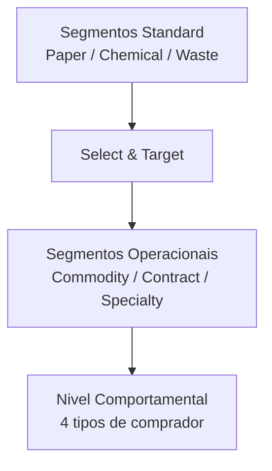
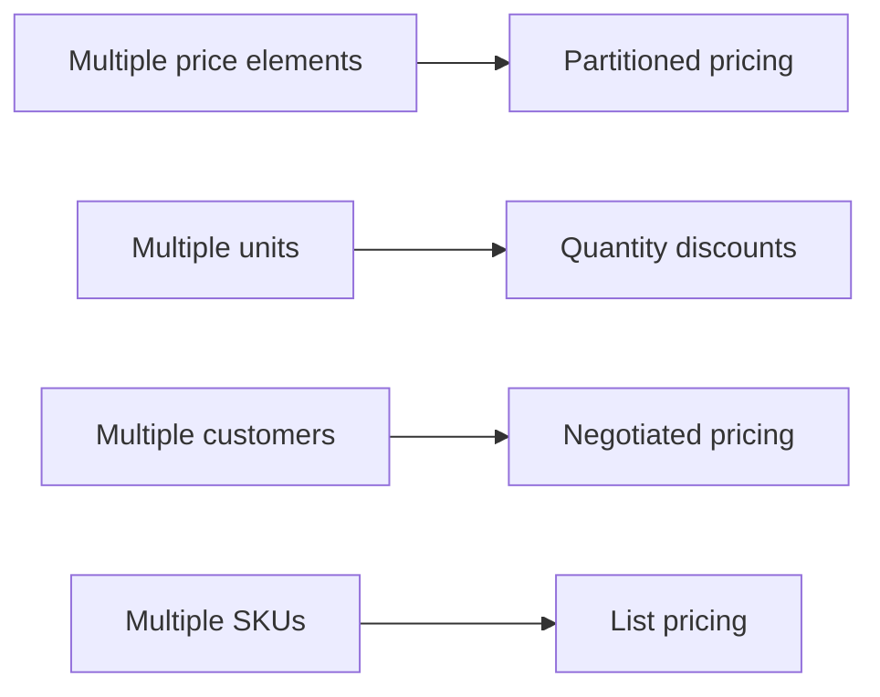
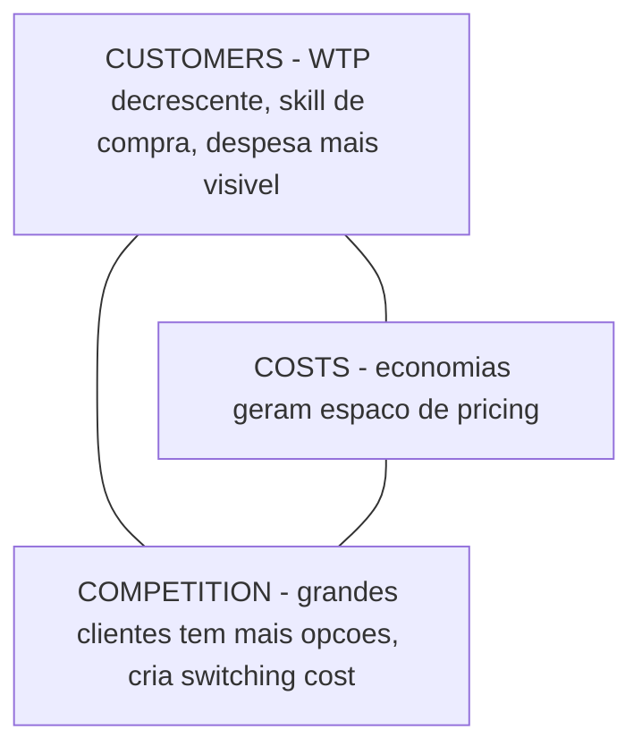
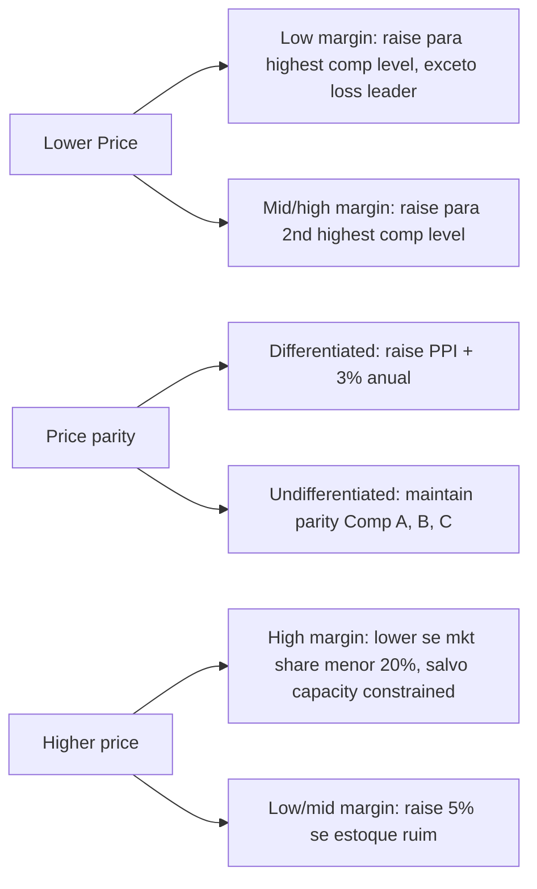
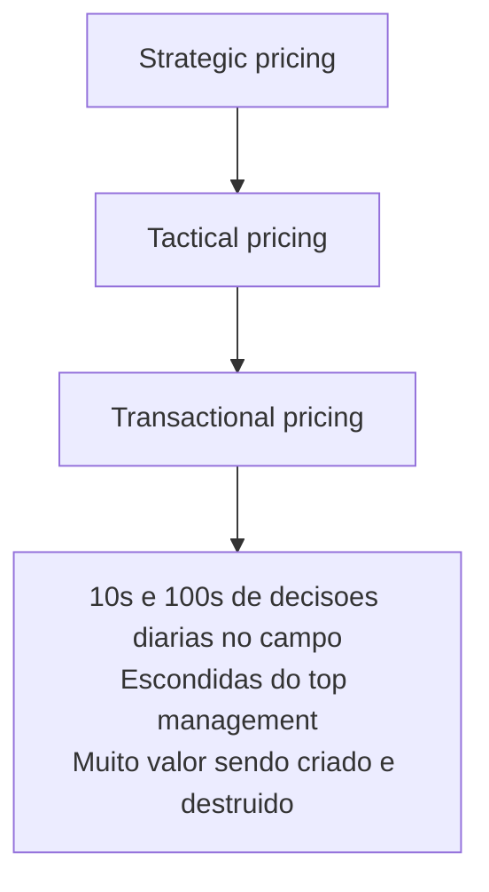
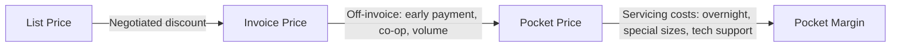
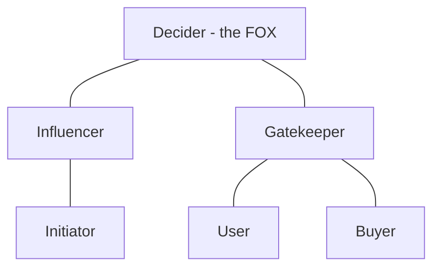
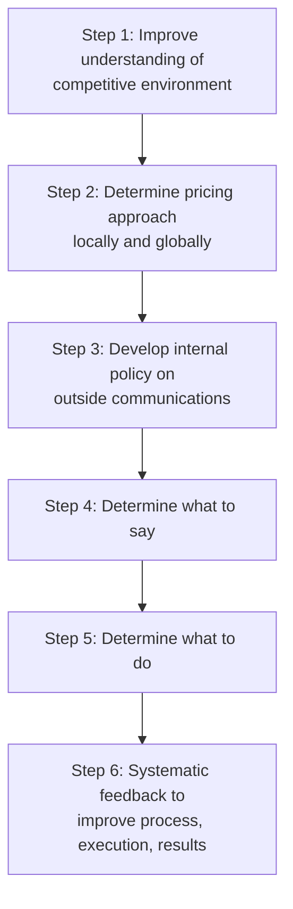

> [!info] Sobre esta nota
> Resumo detalhado do material do curso **Strategic Pricing** da Columbia Business School (sessão de sexta-feira), cobrindo 6 módulos: Segmented Pricing II, Tactics for Tailoring Price, Managing Pocket Price & Margin, Pricing Predicament, Estimating Price Sensitivity, Life Cycle Pricing e Information Management.

# Strategic Pricing — Columbia Business School

## 🗺️ Mapa da nota

- [[#1. Segmented Pricing II (Reed Holden)]]
- [[#2. Tactics for Tailoring Price (Wadhwa)]]
- [[#3. Managing Pocket Price & Pocket Margin]]
- [[#4. Pricing Predicament — Negotiated vs. Fixed]]
- [[#5. Estimating Price Sensitivity (Depth Research)]]
- [[#6. Life Cycle Pricing]]
- [[#7. Information Management]]
- [[#Síntese e conexões]]

---

## 1. Segmented Pricing II (Reed Holden)

### Como os mercados evoluem

> [!note] Princípio central
> Conforme mercados amadurecem, **segmentos** se tornam o campo de batalha. Líderes que ignoram segmentos emergentes cometem um erro clássico.

- **Mercados em desenvolvimento**: nichos abertos são preenchidos por early competitors. Segmentos novos abrem espaço para líderes, second-tier e novos entrantes.
- **Mercados maduros**: segmentos se tornam vitais para [[líderes manterem dominância]], second-tier evitar competição mainstream e novos entrantes encontrarem espaço.

### BTC vs BTB Segmentation

| Tipo | Característica | Risco |
|------|---------------|-------|
| BTC | Sofisticada (variáveis AIO, needs-based) | Imprecisa, baseada em promoção |
| BTB | Implementação via sales force | Falha quando técnicas BTC são copiadas |

### Erros comuns de segmentação

- Foco nos **maiores clientes** (regra 80/20) — mas grandes clientes tendem a ser [[price buyers]] (têm mais em jogo + skills internos).
- Às vezes é melhor focar no **mid-range** (regra "20/225").
- Segmentação precisa ser implementada via [[força de vendas]].

### Framework: do Standard ao Operacional ao Comportamental



**Avaliar por**: Size, Growth, Competitive intensity, Level of needs, Ability to meet needs, Likelihood of adoption.

**Targetar por**: Purchasing Style, Size, Profit Potential, Current relationships, Ability to meet needs, Likelihood of adoption.

**Operational Identifiers** (exemplos):
- Real Estate: owner-occupied vs. leased
- Transportation: self vs. dealer-serviced
- Software: in-house tech staff vs. outsourced

### Os 4 tipos de comprador B2B

> [!important] Os quatro arquétipos de [[Reed Holden]]
> Dentro do mesmo segmento operacional, os **comportamentos** ainda variam. A "visão" do comprador define a abordagem.

| Tipo | Approved Vendors | Estilo | Tamanho | Expertise interna | Comprador |
|------|------------------|--------|---------|-------------------|-----------|
| **Price Buyer / Poker Player** | All | Aggressive/Abusive | Large | High ou Low | PA/Consultant |
| **Value Buyer** | 2-3 | Controlling | Large/Medium | High | Dept Mgr/Engineer |
| **Relationship Buyer** | 1 | Open & Receptive | Medium/Small | Medium/Low | User/Owner |
| **Poker Player** | — | Disfarçado de Price | — | — | — |

### Táticas por tipo de comprador

> [!example] Selling to **Price Buyers**
> - Estabelecer preço mínimo
> - Cuidado com bidding wars
> - Oferecer só a solução mínima (força trade-off preço-valor)
> - **Não tente provar valor**
> - Nunca espere que se tornem leais
> - Resultado: revenue com lucro "aceitável"

> [!example] Selling to **Value Buyers**
> - Investir em entender o negócio
> - Oferecer pacotes high/low value
> - Ajudar a escolher
> - Fornecer cálculos extensivos de [[ROI]] (mínimo: cost savings; melhor: aumento de vendas/lucro)
> - Resultado: receita lucrativa + follow-on business

> [!example] Selling to **Relationship Buyers**
> - Investir no relacionamento em todos os níveis
> - Carregar linha completa de produtos e serviços
> - Começar pequeno, expandir gradualmente
> - Vender tecnologia comprovada
> - Tornar-se "o departamento" do cliente
> - Preço **justo** — não tire vantagem
> - Resultado: clientes leais

> [!warning] Selling to **Poker Players**
> Jogam poker para conseguir maior valor por menor preço.
> - Tratá-los como Price Buyers
> - Entender seus value drivers
> - Mover-se para outros membros do **buying center**
> - Desenvolver plano de negociação
> - Conseguir buy-in do senior management
> - Identificar pelos sinais: pegam controle, bloqueiam acesso, qualificam múltiplos vendors com RFP, promessa interna "watch this", poder declarado é frequentemente bluff.

### A importância da confiança

> [!quote] Reed Holden
> "Trust is a key determinant of relationships with loyal and value customers. If you undermine trust — you will turn them into poker players."

Táticas para desenvolver confiança: customer orientation, expertise produto/aplicação, reliability, comunicação aberta e honesta.

### Conclusões — Segmented Pricing

- Para precificar com eficácia: ofertas que acomodem **needs** + abordagens de venda que acomodem **behaviors**.
- Se só puder fazer uma coisa: **foque nas abordagens de venda**.
- Treinar **salespeople E senior managers** nas abordagens.

---

## 2. Tactics for Tailoring Price (Wadhwa)

### Tópicos cobertos



### 2.1 Partitioned Pricing

> [!note] Conceito
> Clientes **não pesam igualmente** todos os componentes de preço. Há um "anchor and adjust" (racionalidade limitada): focam em alguns componentes e ignoram outros.

**Exemplos**: discounts & allowances, checking accounts, planos de celular, S&H charges, extended warranties, accessories, taxas de gasolina em locadora.

**Implicação estratégica**:
- Entender sensibilidade ao preço **separadamente** para cada componente
- Precificar competitivamente os **elementos visíveis**; extrair margens altas nos demais

#### Dado relevante — Extended Warranties

Custos adicionais como % do preço total ao consumidor:
- Notebook PCs: ~28,5%
- Desktop PCs: ~18,2%
- DVDs: ~29,6%
- Flatpanel TVs: ~12,5%
- Audio: ~20,6%
- Digital Cameras: ~18,8%

Diferenças de preço entre varejistas são **muito maiores em warranties** do que no produto em si.

### 2.2 É justo com o cliente?

> [!example] Caso Washington Mutual — "The buck fifty stops here"
> - Eliminou taxa de $1,50 em ATMs próprios; advertising apela ao desconforto do consumidor com taxas.
> - Lucro dobrou entre 2000-2004 ($3,9 bi).
> - Como? Taxas (ex: bounced checks) eram o stream de receita que mais crescia (~$500 mi). Cobravam $1,50 quando clientes usavam ATMs de outros bancos.
> - Reconhecimentos: Fortune 2004 "America's Most Admired", Harris Interactive 2004 "Top 10 Financial Services Brands".

**The Good** (práticas amplamente aceitas pelo consumidor):
- Car rentals: gas-tank refill penalties
- Telecom: extras médios de 20% na conta; AT&T "regulatory assessment" ~$0,5 bi
- Cartões: número de cartões com taxa de $35 dobrou em 2002; receita extra ~$20 bi
- Hotéis: connectivity fee $4/noite, in-room safes $1+, taxas "administrativas"
- Subscriptions: auto-renewal
- Retail: gift certificates → gift cards

**The Bad** (geraram backlash):
- Bank One: $3 para usar caixa humano → eliminado após defecções
- NY Jets: $50 fee na waiting list de season tickets → "alguns nem estão vivos"
- Sprint: $3 por chamada ao customer service → revertido

**The Ugly** (settlements):
- Dish Network/EchoStar: milhões em settlement com NY por taxas não divulgadas
- MasterCard/Visa: $800 mi por taxas escondidas em compras em moeda estrangeira
- Providian: settlement em ação coletiva

### 2.3 The Warning Signs

> [!warning] Você está no terreno perigoso se...
> - Seus clientes mais lucrativos são os mais insatisfeitos
> - Você tem regras que **quer** que clientes quebrem (porque gera lucro)
> - Você dificulta entendimento das regras e ajuda clientes a quebrá-las
> - Você depende de contratos para impedir defecção

### 2.4 Retail Pricing — Awareness

Estudo em supermercado interceptando shoppers ao colocar produto no carrinho:
- **Menos de 50%** souberam dizer o preço corretamente
- Maioria **subestimou** o preço
- **20%** sequer arriscaram um chute

**Pirâmide do Retail Pricing**:

| Nível | Tipo | Tática |
|-------|------|--------|
| Topo | **Loss Leaders** | Preço agressivo, showcase em mídia externa |
| Meio | **Key Value Indicators** | Preço competitivo |
| Base | **Background Products** | Explorar preços mais altos |

### 2.5 Quantity Discounts

> [!question] Em que situações faz sentido dar (ou cobrar mais) por volume?

**Rationale para descontos**:



#### Mini-case: Negociação de quantidade

> [!example] O cenário
> - Cliente comprou 100.000 chips este ano
> - Você quer crescer para 125.000+ no ano que vem
> - Cliente: commit de 30% volume adicional **se** 10% desconto no volume total
> - Margem de contribuição: 35%
> - **Aceitar?**

**Análise rápida** (assumindo preço atual = 1, desconto sobre preço):
- Status quo: margem unitária 0,35 × 100.000 = $35.000
- Com deal: margem unitária cai para (0,35 − 0,10) = 0,25 sobre 130.000 = $32.500
- **Pior do que estava** → não aceite como está. Negocie commit maior ou desconto menor.

> [!confidence] Confiança neste cálculo: 7/10
> Assume que o 10% é sobre preço final, não sobre margem. Os slides não detalham — o case é usado para discussão em sala.

#### Caso US Postal Service

- USPS introduziu desconto para "consolidators" → bulk shipments
- UPS criou "UPS Basic": usa USPS só para rotas remotas/caras (cherry-picking), captura o desconto. Resultado: **USPS perde dinheiro no envio dos pacotes da UPS**.
- "Resulta em grandes perdas imediatas de receita; só ganhamos no rural que eles não querem."

#### Mini-case: Industrial Services Co.

Cenário: cliente precisa entre 1.000 e 2.500 unidades; flexibilidade de $40-55.

| | Option 1 | Option 2 | Option 3 |
|---|----------|----------|----------|
| Min commitment | 1.000 | 1.500 | 2.000 |
| Unit fee | $50 | $45 | $40 |
| Overage fee | $55 | $55 | $55 |

> [!important] Pricing structure to induce upfront commitment
> 1. Fixed fee até volume committed
> 2. Higher unit fee se exceder commitment
> 3. Effective discount maior se cliente commita quantidade maior

#### Cell phone fee structure

Estudo com 5 operadoras (Europa, Américas, Oriente Médio): subscriber churn rate sobe muito para subscribers com alta volatilidade na conta. Estruturas tarifárias com commit upfront reduzem churn.

#### Implementation issues — Quantity Discounts

- Designing ótimo é complicado: requer info, risco de margin erosion (5% off pode ser hit enorme)
- Pode levar a **grey markets**
- A estrutura de pricing **molda** o tipo de cliente e comportamento que você atrai

### 2.6 Negotiated Pricing

Argumento típico do cliente: *"Eu só valorizo X e Y, não Z. Por que pagar preço cheio?"*

**Outcome**: deal-by-deal discounting baseado no julgamento do sales rep.

**Solução**: [[Price Menus]] — preço base fixo + add-on fees para serviços value-added.

| Negotiated | Fixed | Price Menus (híbrido) |
|------------|-------|----------------------|
| Flexível, responsiva | Standard, scalable, simples | Base fixa + add-ons |
| Sales force foca em fechar deals | Sales force foca em comunicar valor | Sales force foca em customizar pacote |

#### Menu Pricing — exemplos

| | Base | Mod A | Mod B | Mod C | Delivery | Training | On-site | 24-hr | Preço |
|---|------|-------|-------|-------|----------|----------|---------|-------|-------|
| Newbies | ✓ | ✓ | | | ✓ | ✓ | | | $X |
| Tech-centric | ✓ | ✓ | ✓ | ✓ | ✓ | | | | $Y |
| Service | ✓ | | | ✓ | ✓ | | ✓ | ✓ | $Z |

#### Spotlight on the Sales Force — McKinsey 2002

- **Raise prices and gain share**: top performers conseguiram subir preço 1,3 pp acima da categoria E ganhar 1,2 pp de market share (vs. all others: -0,8 pp e 0 pp).
- **Selective lowest-price policy**: top performers usam matching de preço só em períodos limitados, em key items, ou contra concorrentes específicos.
- **Winners use menu pricing more**: top performers aplicam menu pricing a mais de 80% das contas; o benefício vem de aplicar a contas pequenas que são inerentemente mais caras de servir.

### 2.7 Setting List Prices

Desafios típicos: 100s de SKUs, sem abordagem consistente, condições de mercado mudando, pouco dado sobre sensibilidade.

#### Directional Information — perguntas-chave

| Pergunta | Informação direcional |
|----------|----------------------|
| Este SKU está sub ou sobre-precificado? | Comparação com competidores |
| Qual a probabilidade dos clientes aceitarem aumento? | # de alternativas, nível de diferenciação |
| Quanta profitabilidade está em risco? | Sales volume, gross margins |

#### Pricing rules — exemplos



#### Caso JetBlue — preços vs. competição

| Rota | USD/Mile | Nº competidores |
|------|----------|-----------------|
| JFK – Burlington | $0,32 | 1 |
| JFK – Rochester | $0,32 | 1 |
| Long Beach – Las Vegas | $0,17 | 4 |

> Preço cai com aumento de competição — confirmação direcional clássica.

---

## 3. Managing Pocket Price & Pocket Margin

### Três níveis de decisões de pricing



**Atenção gerencial** tipicamente foca em strategic + tactical. Transactional fica invisível.

### Quanto valor está em jogo?

> [!important] 1% de melhoria em... gera melhoria de operating profit de:
> - **Preço: 11,1%**
> - Variable cost: 7,8%
> - Volume: 3,3%
> - Fixed cost: 2,3%

**Fato chocante**:
- 17%-29% de "leakage" em transactional pricing (além do invoice price)
- 60%-500% de diferença em pricing para o mesmo produto entre contas

### Pricing Waterfall



### Como medir performance

```
$ Revenue
   ↓
$ Gross Profits = Σ(Price − COGS) × Units
   ↓
$ Gross Profits modified = Σ(Pocket Price − COGS) × Units
   (deduz: co-op allowance, early payment, volume discount)
   ↓
$ Incremental Profits = Σ(Pocket Price − COGS) × Units − Servicing costs
   (deduz: shipping, special sizes/styles, tech support)
```

### Pocket Price Band

Distribuição do número de contas por faixa de pocket price (ex: $3,40 a $5,60). Análise pode ser feita também por pocket margin, individual price elements, cost-to-serve.

### Typical findings

- Elementos do waterfall são visíveis para personas diferentes; **ninguém tem a visão completa**.
- Sales people tipicamente veem on-invoice deductions, **não veem** off-invoice deductions.
- Discount behavior por customer size mostra: pequenas contas com discounts altíssimos + enorme variação em discounts para contas do mesmo tamanho.

### Improvement Strategies

> [!important] Underperforming vs. Outperforming accounts

| Underperforming | Average transactions | Outperforming |
|-----------------|---------------------|---------------|
| Renegociar — raise prices, menu pricing | Aumentar pocket price | Grow sales |
| Crescer volume p/ efficient scale | | Retain aggressively |
| Implementar low-cost sales/servicing | | Atrair novos clientes do mesmo tipo |
| Disengage se apropriado | | Transferir learnings |

### Difference in Pocket Margin: Sources (Top 20% vs Bottom 20%)

Decomposição da diferença total entre top 20% e bottom 20% de contas:
- **Negotiated discounts: 32%** ← maior driver
- Volume discounts: 11%
- Shipping: 4%
- COGS: 2%
- Co-op allowances: 2%
- (efeito líquido restante): 12%

> [!takeaway] Insight
> O maior driver da diferença não é COGS nem volume — é o **desconto negociado** ad hoc. Atacar esse vetor primeiro.

### Profiling top/bottom performers — onde está o sucesso?

More success with:
- **Customer**: small/mid biz, non hi-tech, new accounts
- **Competition**: less competition
- **Company**: SF (not DM-CC), new products

### Waterfall engineering

> [!note] Princípio
> Avaliar sensibilidade individual de cada conta aos diferentes elementos de pricing.
> - Para **raise price**: focar em componentes price-insensitive
> - Para **increase sales**: focar em melhorar componentes price-sensitive

### Key requirements para gerir pocket price/margin

- **Accounting systems** no nível da conta (tracking de allowances, shipping etc.)
- **Sales force training & incentives** alinhados com profitability management — comissões atreladas a lucro, não receita
- **Menu pricing** — desbundlar service elements que incorrem custos e fornecem incremental value

---

## 4. Pricing Predicament — Negotiated vs. Fixed

(Recapitulação dos conceitos centrais já cobertos.)

> [!important] Key learnings em Negotiated Pricing
>
> **B2B Marketing**: contextos B2B envolvem múltiplos influenciadores e decisores. Entender o **[[buying center]]** é crítico.
>
> **Pricing along product lifecycle (curva S)**: comportamento do cliente muda conforme produto/indústria amadurece. Componentes podem precisar ser desbundlados e oferecidos em formato menu over time.
>
> **Fixed vs negotiated**: fixed garante integridade de preço; negotiated dá flexibilidade. **Menu pricing** permite customizar mantendo integridade — uma forma é criar bundles baseados nas necessidades de diferentes segmentos.
>
> **Salesforce design**: precisa de info abrangente e oportuna (produtos, features, preços de concorrência). Sem medição/incentivo adequados, sales people racionalmente tomam visão de curto prazo. Fixed-price policies exigem "probes" e ties profundos nas customer organizations.

---

## 5. Estimating Price Sensitivity (Depth Research)

### Por que falar com clientes sobre valor?

É crítico entender:
- **Financial implications** dos benefícios entregues → conexão com diferentes níveis de oferta
- **Features** com maior diferencial vs. competição → prioridades para product development

> [!quote] Reed Holden
> "Learnings form the basis for pricing power."

**Abordagem preferida**: entrevistas **one-on-one** com clientes.

### Depth Interviews — Qualitative Research

- Probing profundo de problemas reais e valor das soluções
- Para a maioria das aplicações B2B, **suficiente** para insights conclusivos
- Não exige amostras grandes
- Pode ser informal ou formal
- Requer: entender o profit model do cliente, ability to ask short questions, listen, probe.

### "How to Value Dirt"

> Pista: **são os serviços que entregam o valor**. Mesmo uma commodity tem valor agregado via serviços.

### Determining Financial Value — The Cascading Questions

| Customer says | Supplier asks |
|--------------|---------------|
| "I really need faster truck loading" | Why? |
| "Reduce hourly operating costs" | How much? |
| "$90 per hour" | How many tons per truck? |
| "16" | We can save 30 min = $45 or $2,81/ton |

### Internal Expectations vs. Reality

| Expectation | Reality |
|------------|---------|
| Customer é price buyer | Customer é poker player que quer valor |
| Value é intangível | Não sabemos identificar valor |
| Capabilities não podem ser valoradas | Capabilities relevantes sempre têm valor |
| Customers não dão dados | Customers **adoram** dar dados |

### In-Depth Customer Interview Process


**Preparation**: Review internal data, develop hypotheses, criteria, account background, prepare customer.
**Execution**: Plan approach, questioning technique, get interview started, prepare for challenges.
**Integration**: Document learnings, refine hypotheses, improve offerings, competitive knowledge, value positioning, pricing.

### Best Practices: Conducting the Interview

- Deixe o cliente fornecer insights e value data
- **Evite problem-solving** durante a discussão
- Dig deep onde o entrevistado tem maior conhecimento
- Entreviste **vários membros** da organização para ter quadro completo
- **A interpretação do cliente é a realidade**

### The Buying Center — Who's Who in the Zoo



**Questões-chave para cada papel**:
- Level of Power & Authority
- Key Value Need
- Measures of Success

> Fonte clássica: [[Thomas Bonoma]], *Major Sales: Who Really Does the Buying?* HBR, Maio-Junho 1982.

### Buying Center — Basic Requirements

- Identificar cada membro
- Confirmar posição, poder, controle
- **Gatekeepers e consultants tipicamente exageram seu poder**
- Encontrar o **"fox"** (decider real)
- Estrutura do buying center muda constantemente (novos membros, mudanças de poder)

### Who is Your Audience? — três níveis

| Nível | Key Focus | Características | Considerations |
|-------|-----------|----------------|----------------|
| **Users/Consumers** | Functionality | Falam por horas | Pedir gory details de uso |
| **Mid-Level** | Features | Want data, proof, rationale | Explorar reasons why, how many, department needs |
| **Executives** | Value/Results | Measurable improvements, organizational impact, value drivers | Avoid details, wasting time, being pushy |

### Buying Center Analysis (template)

| Name | Position | Function | Power Level | Value Needs |
|------|----------|----------|-------------|-------------|
| | | | | |

Customer Purchasing Agenda: ____

---

## 6. Life Cycle Pricing

### Rule Three: Apply a Simple Pricing Strategy

### Primary Pricing Strategies

| Estratégia | Quando usar | Exemplo |
|-----------|-------------|---------|
| **Skim** | Price high vs. competição; high value products & services | Xerox |
| **Penetration** | Price low vs. competição; ganhar share em high-value; ganhar position em low-value | Dell |
| **Neutral** | Price close to competição; não usar preço como arma | Panametrics |

Desenvolver estratégia baseado em:
- Natureza dos produtos/serviços (high vs low value; stand-alone vs product support)
- Skills e recursos internos
- Posição vs. competidores
- **Reação provável** dos competidores
- Resposta subsequente dos clientes (depende do estágio do mercado e urgência)

### Market Cycles Drive Customer Response

```
Sales Revenue
     ↑
     |         The Danger Zone
     |       _______
     |     /        \___
     |    /              \
     |   /  AMD            \
     |  /  (mature/decline) \___
     | /
     |/_________________________________ Time
     Emerging   High Growth   Mature   Decline
     (intel emerging → high growth)
```

### Skim Pricing

- Best para high value e image products/services
- Essential para emerging markets (refletir valor)
- Target = early adopters (price insensitive)
- Isola da price competition em fases de growth/mature
- **Para dominant competitors**: deixa porta para second-tier — usar como parte de **múltiplas estratégias**.

### Penetration Pricing

- Em fases de **high growth** (mercado muito price elastic)
- Tente ser o primeiro a "break for the bottom"
- Volume aumentado permite investir para reduzir cost structure
- **Não é necessário em emerging markets**
- **Perigoso em mercados maduros** → mercados se tornam inelásticos

### Neutral Pricing

- Funciona para second-tier (follow the leader)
- Limita reação competitiva
- Requer good competitive scanning
- **Essencial para todos** entrando em mercados maduros
- Requer elemento de **anúncio público**

### Por fase do mercado

> [!info] **Emerging Markets**
> - Target early adopters (não tão price-sensitive, mas value-sensitive)
> - Pouca competição → preço **não deve** ser fator, exceto se vendendo a clientes errados.

> [!info] **Growth Markets**
> - Adoções aceleram, competidores entram, frequentemente usando preço como arma
> - Usualmente bom ter **dual strategy**: penetration na commodity + skim nos high-value
> - Falhar em ambos = habilita competidores e não protege value segment.

> [!warning] **Mature Markets**
> - Growth slows, clientes ficam smarter (price-sensitive), cost declines diminuem
> - Mercados tornam-se inelásticos
> - **Major indicator**: revenue estável + preços caindo
> - **Price competition pode ser devastating**
> - Quando ser tático destrói lucros: crescer unit sales + revenue estável; aumentar discounts conquista menos.

> [!info] **Declining Markets**
> - Clientes saem para newer technology
> - Os que ficam tendem a ser **menos price-sensitive**
> - Competidores saem lentamente
> - Cuidado com competidores que "se agarram" — frequentemente por desespero
> - **Evoluir para skim strategy**

### The Best Path to Control Markets

| Estratégia | Emerging | Growth | Mature | Decline |
|-----------|----------|--------|--------|---------|
| Skim | ✓ | red zone | ✓ | ✓ |
| Penetration | red zone | ✓ | red zone | red zone |
| Neutral | ✓ | ✓ | ✓ | red zone |

**Try to avoid the Red Zones.**

### Concluding Thoughts

> [!important] Product Life Cycle Pricing Strategy
> - O que funciona em uma fase **usualmente não funciona** na próxima
> - Na verdade, **frequentemente funciona o inverso**
> - Sempre planejar para a **próxima fase**
> - Watch for signs of maturity/change
> - Decidir o market footprint — precisará de **flanking offering** para ganhar share
> - **Linha tênue entre sucesso e fracasso** (ex: Apollo Computer)
> - "And, everyone's got to agree with it"

---

## 7. Information Management

> [!quote] Lao Tzu
> "The best General enters the mind of his enemy."

### Como Intuit venceu a Microsoft (David & Golias)

- Produtos de entrada **low-cost**
- Great customer service
- Foca em **key buying influences**
- Antecipa o próximo movimento
- Stays one step ahead

### Pricing Tactics: 6 Steps de Information Management



### Step 1: Improve understanding of competitive environment

- Falta de entendimento → uso de **"negative" pricing**
- Desenvolver **repositório** de competitive pricing info
- Escanear e armazenar RFP results, press, anúncios de competidores → **triangular com a realidade**
- Entender **habilidade** dos competidores de controlar pricing — frequentemente **não conseguem**

### Step 2: Determine pricing approach locally and globally

- Só existem três: **Skim, Penetration, Neutral**
- Deve diferir regionalmente e por tecnologia de produto
- Mas ter abordagem **global** consistente
- Baseada no conhecimento do Step 1
- Garantir capacidade de **implementar e controlar**

> [!example] Treating Price Discounts Strategically
> Combinar segmentos standard (Server, Desktop, Mobile) × operational segments (faixas de preço, geografia) → matriz com posições: Current Strong-Defend / Grow / Static / Ignore.

### Step 3: Develop internal policy on outside communications

- Identificar **spokesperson** — coach para melhores resultados
- Policy: o que outros podem ou **não podem** dizer
- Instituir clearing location para todos os contatos com imprensa
- Implementar com short training sessions
- "Comentários inocentes" podem prejudicar resultados
- Desenvolver lista de publicações prováveis para entrevistas

### Step 4: Determine what to say

- Anunciar sua abordagem de pricing (exceto se "opportunistic"/uncontrolled)
- **Lógica e capabilities** por trás
- Full firm commitment
- Concern for the good of the industry
- Resolve to protect share + capabilities to do so

### Step 5: Determine what to do

- **Put teeth into implementation**: punir publicamente offenders
- Preparar salespeople: training + forced compliance
- Usar **ações dos competidores contra eles**
- Identificar clientes "high profile" do competidor
- Oportunidades para "5 minute" prices para mandar mensagem
- Construir capabilities internas de "chess"

### Nature of Announcements

- **Pre-announce e justifique** aumentos
- Cost é boa justificativa
- "Pending a review of the industry"
- Willingness to join the battle ("but hope you don't have to" — [[Southwest]])
- Ability to defend com low costs e technology
- Concern for the industry as a whole

### Caso: Class 8 Trucks (2000)

- Mercado desacelerou significativamente
- Líder Freightliner substituiu CEO orientado a preço
- Novo CEO anunciou intenção de **subir preços**
- Mid-level manager de major competitor declarou que aumento não duraria
- CEO daquela empresa rapidamente deu várias entrevistas anunciando intenção de **aumentar preços**
- **O aumento aguentou.**

### Public Announcements podem estabilizar mercados — mas...

> [!danger] Atenção
> - Anúncios só em **forum público**
> - É **ilegal conspirar** para fixar preços e alocar clientes
> - "Conscious parallelism" **não é ilegal** mas pode dar base para investigação interna
> - Eliminar qualquer "smoking gun"
> - Para colocar dentes em aumentos: é **legal** setar preços através do canal
> - **Don't "discuss" — implement.** Publicly force compliance.

### Step 6: Systematic feedback

- Avaliar continuamente o que é dito e feito por competidores
- Estar atento a mudanças organizacionais que possam alterar strategy/execution
- Monitorar execução e resultados para consistência com a mensagem
- Focar em **começar com improvements** ao longo do caminho

### Rule Ten: Pricing With Confidence — Remember Who You Are

> Move from **Being a Price Victim** → **Value Confidence**

### Strategic Pricing: Tactics & Implementation — fechamento

- Os rewards de melhor pricing são significativos
- Manter perspectiva:
  - Só porque você tradicionalmente deu desconto **não significa** que produtos/serviços não têm valor
  - Nem todo cliente quer solução completa — precisa de **flanking offering** para proteger high value
- **Keep it simple**: complex offerings se prestam a simple value propositions... e pricing models
- A maioria dos clientes (e salespeople) **apreciam isso**
- **Experimentar e ajustar** — ter bons sistemas para monitorar resultados
- Be patient and keep moving ahead

---

## Síntese e conexões

### O fio condutor do material

Todo o curso converge em três insights centrais:

1. **A complexidade está no transactional, não no strategic** — 10s e 100s de decisões diárias destroem valor invisivelmente. O [[pricing waterfall]] revela onde.
2. **Segmentação só funciona se a sales force implementar** — o B2B fracassa quando técnicas B2C são copiadas sem adaptação. O segredo está em treinar comportamentos, não só estruturas de preço.
3. **Pricing é gestão de informação** — interna (depth research, buying center), externa (sinalização, anúncios, "conscious parallelism" legal).

### Frameworks que se conectam

- [[Reed Holden]] (4 tipos de comprador) ↔ [[Hitendra Wadhwa]] (menu pricing): comportamento define abordagem; menu pricing operacionaliza customização sem destruir integridade.
- [[Pocket Price Waterfall]] ↔ [[Bonoma Buying Center]]: ambos revelam o "invisível" — o waterfall mostra onde o dinheiro vaza, o buying center mostra quem realmente decide.
- [[Life Cycle Pricing]] ↔ [[Information Management]]: a fase do mercado dita a estratégia (skim/penetration/neutral); a comunicação pública sinaliza essa estratégia para estabilizar (ou destabilizar) o mercado.

### Para revisitar

- [ ] Resolver o mini-case Industrial Services Co. com os três options
- [ ] Reler caso US Postal Service vs UPS — aprendizado sobre **design não-intencional**
- [ ] Estudar [[Bonoma 1982 HBR]] sobre buying center
- [ ] Mapear meus próprios clientes no framework dos 4 tipos
- [ ] Aplicar pocket price band aos meus dados de venda

```dataview
LIST FROM [[]]
WHERE contains(file.outlinks, this.file.link)
```

---

## Nota de uso (Obsidian)

- **Wikilinks** (`[[conceito]]`) conectam esta nota a outras notas conceituais que você pode criar (ex: criar `[[Pocket Price Waterfall]]` como nota separada com mais profundidade).
- **Callouts** (`> [!info]`, `> [!warning]`, `> [!example]`, `> [!quote]` etc.) renderizam blocos coloridos no Obsidian.
- **Mermaid** diagramas funcionam nativamente.
- **Dataview** no final lista automaticamente notas que linkam de volta para esta — útil quando o cofre crescer.
- **Frontmatter YAML** no topo permite filtrar/agrupar via plugins (Dataview, Bases, Properties).
- Considere criar **templates** para os frameworks: um template de Buying Center Analysis, um de Pocket Price Waterfall, um para os 4 tipos de comprador.

---

> [!confidence] Rating de confiança: **8/10**
>
> **Por quê 8 e não 10:**
> - Resumo fiel ao material recebido (slides do PDF). Confiança alta em estrutura, frameworks e exemplos diretamente citados.
> - Cálculo do mini-case dos chips (seção 2.5) é uma interpretação — pode haver convenção diferente sobre o que o 10% de desconto significa exatamente. O case original parece deixar isso aberto para discussão em sala.
> - Atribuições (Reed Holden, Hitendra Wadhwa, Bonoma HBR 1982, McKinsey 2002) vêm direto dos slides — não verifiquei fontes externas. Os percentuais do estudo McKinsey vêm transcritos dos gráficos dos slides — a qualidade do PDF dificulta leitura precisa de números pequenos, então pode haver imprecisão de ±0,2 pp.
> - O caso Washington Mutual ($3,9 bi de lucro, taxas crescendo $500 mi) está no material; não validei contra reportes financeiros públicos. WaMu colapsou em 2008 — esses números são pré-crise.
> - Não busquei verificar Apollo Computer, JetBlue, Class 8 Trucks etc. — são exemplos didáticos do curso.
> - **Não usei web search** porque você pediu resumo do material, não validação externa. Se quiser que eu verifique algum dado específico (ex: estudo McKinsey 2002 ou números do WaMu), posso fazer em uma próxima pergunta.
