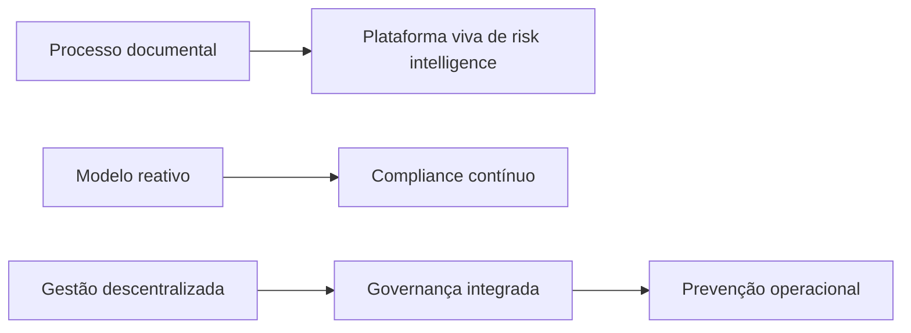

# 🏬 Seguro Lojas — Resumo Estratégico

> [!abstract] Tese Central
> O shopping center do futuro não gerencia apenas lojas — ele gerencia **risco, continuidade operacional, compliance, dados, prevenção e resiliência financeira**. O seguro deixa de ser proteção financeira e se torna uma **camada estratégica de inteligência operacional**.

---

## 🎯 Contexto e Racional

Projeto estratégico para estruturar um modelo **inteligente, escalável e financeiramente eficiente** de seguros para lojas em shopping centers, equilibrando os interesses de múltiplos stakeholders.

### Stakeholders Envolvidos
- [[Empreendedores de Shopping]]
- [[Lojistas]]
- [[Seguradoras]]
- [[Administradoras]]
- [[Jurídico e Compliance]]
- [[Operação e Brigada]]
- [[Governança de Risco]]

### Lógica Central
> Minimizar a exposição financeira e operacional do shopping através da combinação ideal entre:
> - Seguro centralizado do shopping
> - Seguro obrigatório/incentivado dos lojistas
> - Processos de controle
> - Compliance operacional
> - Gestão contínua de risco

---

## 🚀 Objetivos Macro

- [ ] Reduzir o custo total da apólice master
- [ ] Minimizar lacunas de cobertura (gaps)
- [ ] Diminuir risco jurídico do empreendedor
- [ ] Garantir maior proteção patrimonial
- [ ] Estruturar governança contínua
- [ ] Criar mecanismos escaláveis de compliance
- [ ] Viabilizar modelos híbridos ou centralizados inovadores

---

## 🧩 1. Modelos Estruturais de Seguro

### 🔹 A. Coleta Individual por Loja
Cada lojista contrata sua própria apólice.

| ✅ Vantagens | ⚠️ Riscos |
|---|---|
| Menor custo direto ao empreendedor | Coberturas inadequadas |
| Transferência parcial de responsabilidade | Seguros vencidos |
| Flexibilidade ao lojista | Falta de padronização |
| Potencial redução do prêmio master | Baixa rastreabilidade / [[Gap de Cobertura]] |

### 🔹 B. Modelo Sugerido Loja a Loja
Shopping define **regras mínimas obrigatórias**.

**Características:**
- Coberturas mínimas padronizadas
- [[LMI]] mínimo obrigatório
- Controle documental
- Renovação monitorada
- Auditoria periódica

**Benefícios:**
- Redução significativa de risco
- Melhor governança
- Maior comparabilidade
- Escalabilidade operacional

### 🔹 C. Modelo Centralizado / Blanket
Shopping contrata **apólice única** abrangendo lojistas.

| ✅ Benefícios | ⚠️ Desvantagens |
|---|---|
| Escala de negociação | Maior responsabilidade do shopping |
| Padronização total | Complexidade atuarial |
| Melhor controle operacional | Necessidade de gestão sofisticada |
| Menor risco de gaps | — |

---

## 🔀 2. Modelo Híbrido — Direção Estratégica Principal

> [!success] Direção Recomendada
> Combinação de cobertura macro pelo shopping + cobertura específica pelo lojista.

### 🏛️ Shopping cobre
- Estrutura predial
- Áreas comuns
- Grandes eventos catastróficos
- Infraestrutura compartilhada

### 🛍️ Lojista cobre
- Estoque
- Operação interna
- Equipamentos
- Responsabilidade civil operacional
- Lucros cessantes específicos

---

## 📋 3. Compliance de Seguros

> [!goal] Objetivo
> Criar um **motor contínuo** de compliance securitário.

### Controle de Apólices
- Vigência
- Cobertura
- Seguradora
- Franquias
- Limites
- Exclusões

### Alertas Automatizados
- 🔔 Vencimento
- 🔔 Gap de cobertura
- 🔔 Falta de documentação

### Integração Operacional
Conexão com → Contratos · Auditoria · [[Brigada]] · Jurídico · [[Facilities]]

---

## 🛡️ 4. Gestão de Risco Operacional

### 🔥 Brigada e Incêndio
- Treinamento intensivo
- Simulados
- Fiscalização
- Combate inicial robusto

### 🔍 Inspeções
- Recorrência obrigatória
- Escalonamento de risco
- Alertas automáticos

### 📄 Certificados Operacionais
- [[AVCB]] válido
- Aprovações formais
- Controle documental contínuo

---

## 💰 5. Estratégia Econômica

### Redução do Prêmio Master
Via → pulverização de risco · compliance contínuo · melhoria operacional

### Redução de Eventos Severos
Via → prevenção · brigada · inspeções · monitoramento

### Redução do Risco Jurídico
Via → eliminação de negligência operacional · gaps documentais · falhas de fiscalização

---

## 🤝 6. Discussões com Seguradoras

### Temas Estratégicos
- Estrutura atuarial
- [[Seguro Embedded]]
- [[Pool de Risco]]
- Apólice híbrida
- Seguro coletivo

### Coberturas Críticas a Negociar
Lucros cessantes · Danos elétricos · RC · Incêndio · Explosão · Fumaça · Interrupção operacional

---

## 💻 7. Governança e Tecnologia

### Módulos da Plataforma
- [ ] Cadastro de apólices
- [ ] Controle documental
- [ ] Dashboard executivo
- [ ] Scoring de risco
- [ ] Alertas automáticos

### Integrações Futuras
ERP · Facilities · Brigada · Contratos · [[IoT]]

---

## 🧯 8. Coberturas Críticas (Lista de Referência)

- Incêndio
- Queda de raio
- Explosão
- Danos elétricos
- Ruptura de tubulação
- Lucros cessantes
- Responsabilidade Civil (RC)
- Tumultos
- Vendaval
- Estoque
- Equipamentos

---

## 📐 9. Conceitos Técnicos

### LMI — Limite Máximo de Indenização
> [!info] Definição
> Define o **teto máximo de indenização** por cobertura.

**Pontos de atenção:**
- Risco de [[Subseguro]]
- [[Gap de Cobertura]]
- Necessidade de padronização mínima

---

## 🏆 10. Tese Estratégica Consolidada

> [!summary] Modelo Ideal Identificado
> - Apólice master robusta
> - Cobertura mínima obrigatória dos lojistas
> - Compliance automatizado
> - Auditoria contínua
> - Gestão ativa de risco

---

## 🔭 Visão de Futuro

### De → Para
| **De** | **Para** |
|---|---|
| Processo documental | Plataforma viva de risk intelligence |
| Modelo reativo | Compliance contínuo |
| Gestão descentralizada | Governança integrada e prevenção operacional |

---

## 📦 Possíveis Entregáveis Futuros

### Estratégia
- [ ] Política corporativa de seguros
- [ ] Guideline para lojistas
- [ ] Matriz de responsabilidades

### Operação
- [ ] Checklist operacional
- [ ] Score de risco por loja
- [ ] Fluxo de auditoria

### Tecnologia
- [ ] BI de risco
- [ ] Dashboard executivo
- [ ] Sistema de alertas

### Jurídico
- [ ] Cláusulas padrão
- [ ] Compliance contratual
- [ ] Obrigações securitárias

---

## 🔗 Notas Relacionadas
- [[Governança de Shopping Centers]]
- [[Gestão de Risco Operacional]]
- [[Compliance Securitário]]
- [[Modelos de Apólice Master]]

## 🏷️ Tags
#seguros/shopping #compliance/securitário #governança/risco #projeto/estratégico #apólice/master #apólice/híbrida
