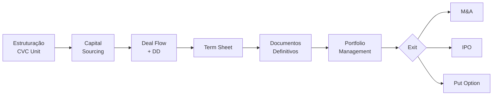

# Corporate Venture Capital — Legal Workshop

> [!info] Metadados da fonte
> **Autor:** Guilherme Potenza  
> **Escritório:** [[Veirano Advogados]]  
> **Evento:** [[Global Corporate Venturing Academy]]  
> **Data:** Outubro/2019  
> **Contato:** guilherme.potenza@veirano.com.br

> [!abstract] Visão geral
> Material legal-prático sobre estruturação e operação de unidades de [[Corporate Venture Capital]] (CVC) no Brasil, cobrindo desde a constituição do veículo até estratégias de saída. Foco em aspectos de [[Due Diligence]], [[Term Sheet]], documentos definitivos, criação de valor e desafios comuns para corporações que investem em [[startups]].

---

## 1. Os 8 Pilares ("Eight Arms") do CVC

Framework de áreas críticas para estruturar e operar uma unidade de CVC:

- [ ] Estruturação da [[CVC Unit]]
- [ ] [[Capital Sourcing]] (origem do capital)
- [ ] [[Staffing CVC|Staffing]]: contratações internas vs. externas
- [ ] Estratégia de [[Fundo de VC Independente]]
- [ ] [[Deal Flow]], [[Due Diligence]], [[Valuation]], [[Term Sheet]]
- [ ] [[Portfolio Management]] e criação de valor
- [ ] [[Performance Measurement]]: estratégico vs. financeiro, interno vs. externo
- [ ] [[Estratégias de Saída|Exits]] e estratégias de sobrevivência

> [!tip] Os pilares destacados no material original como prioritários são: **Deal Flow/DD/Valuations/Term Sheets**, **Portfolio Management** e **Exits & Survival Strategies**.

---

## 2. O Ecossistema de Venture Capital no Brasil

Estágios de investimento e tickets típicos no mercado brasileiro:

| Estágio | Aporte | Característica |
|---|---|---|
| [[Angel Investment]] | até ~R$ 2 mi | Dinheiro + [[mentoria]] |
| [[Seed Capital]] | até ~R$ 10 mi | Dinheiro + apoio para crescer |
| [[Growth Funds]] | R$ 11 mi+ | Dinheiro + expertise |

> [!note] Posicionamento do CVC
> O **Corporate Venture** atua de forma transversal — pode entrar desde o início (beginning) até o momento de [[IPO]] ou venda. Não está restrito a um estágio específico.

---

## 3. Documentos da Transação (Série A em diante)

Três cenários típicos de estruturação documental:

### Convertible Debt (Brasil)
- [[Term Sheet]]
- [[Investment Agreement]] + disclosure schedules
- [[Issuance Indenture|Escritura de Emissão]]
- Template de [[Shareholders' Agreement|Acordo de Acionistas]]
- Ata de [[Assembleia Geral]]
- [[Estatuto Social|Bylaws]] da companhia

### Equity (Brasil)
- [[Term Sheet]]
- [[Investment Agreement]] + disclosure schedules
- [[Bônus de Subscrição]] (se necessário)
- [[Shareholders' Agreement]]
- Ata de [[Assembleia Geral]]
- [[Estatuto Social]]

### Offshore
- [[Preferred Stock Purchase Agreement]]
- [[Amended and Restated Certificate of Incorporation]]
- [[Investors' Right Agreement]]
- [[ROFR]] and [[Co-Sale Agreement]]

---

## 4. Term Sheet — Anatomia

> [!important] O [[Term Sheet]] é o documento "pai" que dá origem aos demais: Investment Agreement, Issuance Indenture, Shareholders' Agreement e outros documentos.

**Características essenciais:**
- Resumo dos principais pontos da transação
- Certos detalhes podem ficar abertos para os documentos definitivos
- Cláusula de [[No Shop]] (exclusividade de negociação)
- **Upside:** direito de participar dos bons cenários da startup
- **Downside:** [[Liquidation Preference|preferência na liquidação]]
- "What is going on?": [[Information Rights|direitos de informação]]
- [[Political Rights|Direitos políticos]] e [[governança]]
- Binding vs. non-binding (vinculante ou não)

---

## 5. Estruturação do Veículo: FIP vs. FLIP

### Estrutura FIP (Brasil)

```
INVESTIDOR
   ↓
   FIP
   ↓ (shares ou convertible debt)
STARTUPS
```

**Pontos de atenção tributários e regulatórios:**

> [!warning] Aquisição ou conferência de ações/quotas
> Tensão entre a [[ADI 07/07]] (Ação Direta de Inconstitucionalidade) e precedentes existentes.

> [!info] Tributação do FIP
> O FIP funciona como [[pass-through entity]] (transparência fiscal).

> [!example] Desinvestimento
> - [[Redemption|Resgate]], [[Amortização]] ou venda
> - Tratamento diferente para [[pessoas jurídicas]] vs. [[pessoas físicas]]
> - [[Ganhos líquidos]]
> - [[PIS/COFINS]]

> [!warning] Dividendos
> Sem isenção se distribuídos diretamente aos quotistas.

### Estrutura FLIP (Offshore)

```
Founders & Angels ── Corporate Governance ── VC Funds
                            ↓
                     Cayman HoldCo
                            ↓
                     Delaware LLC
        ────────────────────────────────── (Abroad / Brazil)
   Founders                         Sociedade Limitada
```

> [!note] A estrutura [[FLIP]] internacionaliza a holding para receber investimento estrangeiro com mais facilidade e oferecer estrutura de governança familiar a investidores globais.

---

## 6. Due Diligence Legal

> [!info] Objetivo
> Avaliação de riscos: exame detalhado da situação **legal, financeira e contábil** da startup.

**Calibragem por estágio:**
- **Seed (EUA):** DD legal limitada
- **Seed (Brasil):** revisão de certidões, documentos societários e [[Propriedade Intelectual|IP]]
- **Séries A, B, C+:** DD legal e contábil mais extensa

### Red Flags Comuns em Startups

> [!danger] Pontos críticos para vigiar na DD
> - Discrepância entre **registro de ações/quotas** e **[[cap table]]**
> - Falta de documentação sobre titularidade das ações / cap table complicado
> - Múltiplas rodadas anteriores com [[valuation caps]] diferentes ou muito baixos
> - Estrutura societária e [[governança corporativa]] em formato incomum
> - Ausência de [[Vesting|cláusulas de vesting]] para founders e key holders (ou termos atípicos)
> - Ausência de [[IP Assignment Agreement|acordo de cessão de PI]]
> - Risco de [[pejotização]] (misclassification) e riscos trabalhistas relacionados
> - Acordos de [[joint venture]] e licenciamento
> - Desentendimentos não detectados entre founders

---

## 7. O Que Torna CVCs Diferentes?

> [!quote] CVCs operam com lógica distinta dos fundos tradicionais de VC

- **Horizonte mais de longo prazo** (e muitos founders gostam disso)
- Tradicionalmente **não focam em ser lead investor** da rodada
- Frequentemente há **discussões comerciais simultâneas** ao investimento (pode atrasar o deal)
- Possíveis **restrições/limitações** sobre atividades da investida (alinhadas aos objetivos estratégicos)
- Podem solicitar [[Right of First Refusal|direito de preferência]] em qualquer venda da empresa ou em venda para competidor
- Possível **competição** entre a corporação patrocinadora e a investida pode afetar termos
- Risco de **pessoa inelegível** para o board (conflito de interesses)

---

## 8. Como CVCs Criam Valor?

- Programas **bem divulgados** no ecossistema
- Busca por posições em **advisory boards** e atividades similares
- Uso de **unidades externas** e parceria com gestores de fundo (vs. tudo interno)
- Buscar investimento de terceiros no fundo CVC em paralelo a transações comerciais
- Engajamento **precoce e contínuo** com investidas em oportunidades de sinergia e intangíveis que **só a corporação pode oferecer**

---

## 9. Desafios Comuns para CVCs

> [!warning] Pontos de fricção típicos
> - **Velocidade** de execução vs. fundos independentes
> - Superar **desconfiança dos founders** quanto à corporação (informações confidenciais)
> - **Alinhamento e coordenação** entre as atividades estratégicas da corporação e as investidas (alianças, relacionamentos comerciais, projetos conjuntos)
> - Prover **incentivos** à unidade de CVC que alinhem interesses
> - Obrigações de **reporte de companhia aberta**
> - Adotar a **mentalidade e cultura de VC**: aceitar que a maioria das startups falha, que você não controlará a investida, que muitas startups são informais comparadas a empresas maduras
> - **[[Put Option]]** — opção de venda que pode ser exercida pelos demais investidores

---

## 10. Estratégias de Saída

### Curva de Valuation e M&A Zone

> [!info] Lógica gráfica do material
> O material apresenta uma curva onde valuation cresce ao longo do tempo (Angel → Seed → Série A → expansão), até atingir uma **"M&A Zone"** — patamar em que a empresa fica suficientemente madura para ser adquirida.

### Venture-Backed M&A — Preço

- **Cash/Stock** (dinheiro e/ou ações)
- **[[Earn-out]]** (geralmente quando founders continuam na empresa)
- **[[Escrow]]/Holdback** (para indenizações)

### Venture-Backed M&A — Cap Table

- **[[Liquidation Preference]]** (preferred stock vs. ordinary stock)
- **[[Payment Waterfall]]** — ordem de preferências
- **Option Holders** (titulares de opções)
- **Convertible Loans** (empréstimos conversíveis)

### Venture-Backed M&A — R&W e Indenização

- DD mais detalhada que no investimento inicial
- Limitações de indenização: **Basket? Cap? De minimis?**

### Venture-Backed M&A — Estrutura Offshore

- Aquisição da entidade brasileira vs. holding offshore
- Implicações tributárias

### Possíveis Adquirentes

> [!example] Tipologia de compradores

**Competidor:**
- Posso internalizar a tecnologia antes?
- [[Non-Compete|Não-competição]] baseada em território?

**Fusão com a startup (próprio CVC):**
- Manter pessoal-chave (já familiar)
- Integrar a solução

**Terceiro não-competidor:**
- Interesses alinhados com outros investidores
- Acordo de prestação de serviços

### IPO como Saída

- Exercer **[[Registration Rights]]**
- Outros direitos relacionados ([[piggyback]], [[S-3]]...)
- **Momento certo de saída?**
- **Controle** — divulgação de informações confidenciais
- Oferta **primária vs. secundária**

---

## 11. Síntese Visual do Fluxo CVC



---

## 12. Glossário de Termos-Chave

- [[ADI 07/07]] — Ação Direta de Inconstitucionalidade relevante para tributação de FIPs
- [[Basket]] — valor mínimo acumulado de perdas antes de gerar obrigação indenizatória
- [[Cap]] — teto de indenização
- [[Cap Table]] — tabela de capitalização (distribuição societária)
- [[De Minimis]] — valor mínimo individual de perda para ser indenizável
- [[Earn-out]] — pagamento adicional condicionado a desempenho futuro
- [[FIP]] — Fundo de Investimento em Participações
- [[FLIP]] — estrutura societária com holding offshore (tipicamente Cayman + Delaware)
- [[Liquidation Preference]] — preferência no recebimento em evento de liquidez
- [[No Shop]] — exclusividade de negociação durante período acordado
- [[Put Option]] — direito de exigir que outra parte compre a participação
- [[Registration Rights]] — direitos de registro em IPO
- [[ROFR]] — Right of First Refusal (direito de preferência)
- [[Vesting]] — aquisição gradual de participação societária ao longo do tempo

---

## 13. Conexões com Outras Áreas

```dataview
LIST
FROM [[]]
WHERE contains(tags, "cvc") OR contains(tags, "venture-capital") OR contains(tags, "m&a") OR contains(tags, "startups")
SORT file.name ASC
```

---

## 14. Próximos Passos / Action Items

- [ ] Estudar template de [[Shareholders' Agreement]] mencionado como anexo no material original
- [ ] Aprofundar [[ADI 07/07]] e seus precedentes para tributação de FIP
- [ ] Mapear diferenças práticas entre [[FIP]] e [[FLIP]] para o caso concreto
- [ ] Construir checklist próprio de [[Due Diligence]] com base nos red flags listados
- [ ] Comparar este material (2019) com práticas atuais de CVC no Brasil — o ecossistema evoluiu

---

> [!warning] Nota de uso deste documento no Obsidian
> - Wikilinks `[[...]]` foram usados em termos conceituais para permitir construção de uma base de conhecimento conectada — clique para criar notas vinculadas.
> - O bloco **Dataview** ao final só funciona com o **plugin Dataview** instalado e ativado.
> - Os callouts (`>[!info]`, `>[!warning]`, etc.) são nativos do Obsidian.
> - O bloco **Mermaid** requer o plugin/recurso de Mermaid (ativo por padrão em versões recentes).
> - Recomenda-se salvar este arquivo em uma pasta como `/Vault/Direito/CVC/` e criar nota mãe `[[Corporate Venture Capital]]` que conecte vários materiais.
> - Considere transformar este resumo em **template** para futuros resumos de materiais legais.

---

> [!quote] Confiança e ressalvas
> **Avaliação de confiança: 8/10**  
> O resumo reflete fielmente o conteúdo do PDF de 20 slides apresentado. Os pontos foram traduzidos e estruturados sem inferências além do que está no material. Não acrescentei opiniões ou dados externos não presentes no documento. Pontos de menor confiança:
> - Alguns termos do slide (ex.: "Ineligible person for the board") foram interpretados conforme sentido jurídico-societário usual, mas o slide não detalha — mantive a expressão original.
> - A "M&A Zone" do gráfico é qualitativa no original; descrevi a lógica sem números específicos pois o slide não os apresenta.
> - O material é de **outubro/2019** — algumas referências regulatórias podem ter sido atualizadas desde então (especialmente regulamentação CVM sobre FIPs e tributação). Para uso prático atual, recomenda-se validação com fonte regulatória atualizada.
