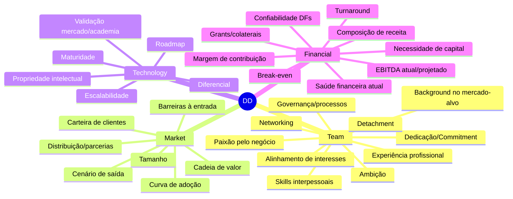

# Seleção, Monitoramento e Criação de Valor em Investimentos de VC

> [!info] Contexto da aula
> Aula 8 do curso PEVC do Insper (fev/2020), apresentada pela **SP Ventures** e pela **Brasil Venture Debt**. Aborda o ciclo completo de um investimento de [[Venture Capital]] — da análise de oportunidades à criação de valor — e introduz o [[Venture Debt]] como instrumento complementar.

---

## 1. Panorama do Mercado de Venture Capital no Brasil

> [!quote] Tese geral
> O Brasil é líder na América Latina em VC, com **55,9% dos investimentos da região** (dados LAVCA citados na apresentação).

### Números-chave (2017–2019)

| Ano | Volume Investido | # Deals | Ticket Médio |
|-----|-----------------:|--------:|-------------:|
| 2017 | US$ 905M | 295 | US$ 725M*¹ |
| 2018 | US$ 1,5Bi | 222 | US$ 925M*¹ |
| 2019 | US$ 2,7Bi | 259 | US$ 1.710M*¹ |

*¹ Valores conforme apresentação original — atenção: os números de "valor médio rodada" no slide parecem inconsistentes com volume/deals (provável erro de unidade na fonte; verificar). Fonte declarada: Distrito Dataminer, MIT Research, CVM, SP Ventures Analysis.*

### Drivers estruturais
- Grande [[mercado doméstico]] (7ª maior economia mundial)
- População entusiasta por tecnologia
- Ecossistema em formação há mais de uma década
- Celeiro de potenciais [[unicórnios]]

---

## 2. SP Ventures — Visão Geral

### Linha do tempo
- **2007** — Gestora regional do [[Fundo Criatec I]] (BNDES + Banco do Nordeste). R$ 21MM investidos, 8 empresas
- **2012** — Entrada de sócios estratégicos no GP (Jive)
- **2013** — Início do [[Fundo de Inovação Paulista]]. R$ 105MM comprometidos, 20 empresas
- **2019** — Lançamento da [[Brasil Venture Debt]]
- **2020** — Início do **AGTECH II**. R$ 138MM comprometidos

### Time core
- [[Francisco Jardim]] — Fundador / Diretor Executivo (29+ investimentos, 18 em AgFood Tech)
- [[Felipe Guth]] — Sócio-diretor / CFO e Compliance
- [[Alexandre Stephan]] — Sócio-diretor / Gestor de portfólio (ex-Aqua Capital, INSEAD)

### Posicionamento
- **Líder incontestável no Brasil** em deals de AgFood Tech (ranking Distrito)
- Bem posicionada globalmente (CB Insights, AgFunder)

---

## 3. Análise de Oportunidades

> [!tip] Framework de seleção
> Antes da DD profunda, todo deal precisa atender pelo menos **1 dos 3 critérios de pré-análise**.

### 3.1 Pré-análise (3 critérios)
- [ ] **A** — Tração comercial
- [ ] **B** — Tecnologia disruptiva
- [ ] **C** — Co-investidor estratégico

### 3.2 Critérios de DD (4 pilares)



### 3.3 Coeficientes de análise

> [!example] Três lentes simultâneas
> - **Growth Potential** — itens que sinalizam upside (tamanho de mercado, adoção, ambição, paixão, escalabilidade, recorrência, EBITDA projetado…)
> - **Development Risk** — riscos de execução (cadeia de valor, IP, validação, estrutura organizacional, governança, conflitos de interesse…)
> - **Financial Risk** — riscos de caixa (saúde financeira atual, confiabilidade das DFs, break-even, turnaround, necessidade de capital)

### 3.4 Fluxo interno de Deal Making

| Etapa | Atividades-chave |
|-------|-----------------|
| **Initial Assessment** | Call inicial → 1ª reunião com pipeline leader + 1 sócio → 2ª reunião com sócio expert (Ag ou Food) |
| **Pre-Analysis** | Validar critério A/B/C → consulta a industry expert → deal alert para IC → LOI com "no shop" |
| **Business DD + Flash DD** | Atacar red flags mapeados → background check → flash financeira (séries B+) |
| **Other DD** | Financeira, legal, E&S em paralelo → entrepreneur assessment → memo de investimento → docs legais |

> [!warning] Princípio "kill fast deals"
> Atacar primeiro os principais red flags para concentrar recursos nos "cavalos certos".

---

## 4. Monitoramento de Investimentos

> [!info] Filosofia
> Monitoramento **ativo** = controle financeiro/operacional constante + participação na estratégia da investida.

### Quatro frentes de monitoramento

1. **Monitoramento estratégico**
   - Board com periodicidade mínima bimestral
   - Acompanhamento semanal (reporting)
   - Participação ativa em projetos estratégicos
   - Acompanhamento quanti + quali + presencial

2. **Monitoramento de equipe**
   - Alocação estratégica de pessoas (performance + metas)
   - Ação rápida sobre underperformers
   - Contratações-chave: exames quantitativos in-house + análise externa

3. **Suporte da gestora**
   - Sócio dedicado ao operacional da investida
   - Profissional escolhido por expertise necessária
   - Substituição conforme a empresa amadurece

4. **Governança**
   - Modelos de reporting customizados
   - Troca do membro alocado quando preciso acelerar

---

## 5. Criação de Valor

### 5.1 Metodologia em escada

```
ORIGINAÇÃO → ANÁLISE → NEGOCIAÇÃO/DD → INVESTIMENTO
   ↓
GOVERNANÇA CORPORATIVA → CONTRATAÇÕES → PROCESSOS → ESTRATÉGIA
   ↓
SAÍDA: IPO | Compradores estratégicos | Co-investidores | Recompra por proprietários
```

### 5.2 Os Quatro Pilares

| Pilar | Essência |
|-------|----------|
| **1. Disciplina de execução** | Business DD foca em prioridades de crescimento; kick-off de governança; board bimestral; calls semanais |
| **2. As pessoas certas alocadas** | Sistema de análise simples; ação rápida em low performers; exame quantitativo + externo em hires-chave |
| **3. Alinhamento e suporte** | Sócio operacional com empatia + excelência em dados; perfil escolhido por estágio da empresa |
| **4. Governança amigável** | Fóruns colaborativos, não-ameaçadores; capacidade de ser duro quando preciso |

### 5.3 Três pilares práticos de value creation
- **I. Attracting top notch people** — Trazer CEOs, conselheiros e co-investidores (ex.: Rafael Coelho/Agronow, Gustavo Raposo, Marcos Petean)
- **II. Opening corporate relations** — Conexões SpecLab→Raízen, Agronow/Agrosmart→Thrive, Agronow→FMC, InCeres→Mosaic
- **III. Introducing potential investors** — Agrosmart→Positivo/Deane Foundation, Agrofy→Syngenta Ventures/Bunge, Agronow→BTG Pactual, InCeres→Família Prado/Anjos

### 5.4 Conselheiros e Co-investidores selecionados
Rede inclui Paulo Arruda (Unicamp/Alellyx), Rosana Jamal (Motorola), Gustavo Raposo (Arvus/Hexagon), Rafael Coelho (LDC/W7), Matheus Cônsoli (Markestrat), Rodrigo Rodrigues (Agrifirma/Aqua), Paulo Silveira (Danisco/Unidas), José Luiz (Cetip), Leopoldo Saboya (Copersucar/BRF/Patria), Marcelo Prado (MPrado), Carlos Labate (Esalq), João Cirilo (Itaú/PwC).

---

## 6. Venture Debt — Fundamentos

> [!quote] Definição
> Produto de dívida **customizada (tailor made)** para empresas inovadoras, com juros, garantias e prazos adequados à realidade financeira e operacional do negócio.

### 6.1 Para que serve
- **Alavancar rodadas de equity** (entrar junto ao round → menos diluição)
- **Alongar o runway** entre rodadas (melhorar números → valuation maior na próxima)
- **Movimentos estratégicos** (capital de giro, M&A, recompra de ações, capex)

### 6.2 Características-chave
- Não-diluente
- Preferencialmente para empresas **VC-backed** com escala mínima e tração
- Prazo definido **que não vence** com nova rodada de equity ou nova dívida
- Foco em **geração de valor de longo prazo** (não é bridge tático)

### 6.3 Foco de atuação por estágio

| Estágio | Financiador típico |
|---------|--------------------|
| Anjo / Semente / Série A inicial | [[Venture Capital]] |
| Série A → Séries D+ (com tração) | **[[Venture Debt]]** |
| Crescimento avançado (escala/liquidez) | Private Equity + Bancos |
| IPO/Mercado de capitais | Mercado de capitais |

**Tipos de garantia por estágio**: pessoais → AF/cessão/escrow de recebíveis → IP e intangíveis → máquinas/estoques → garantias reais → garantias bancárias.

### 6.4 Comparação rápida

| Exigência | Banco | VC (Equity) | Venture Debt |
|-----------|:-----:|:-----------:|:------------:|
| Garantias reais tradicionais | ✓ | ✗ | parcial |
| Longo histórico financeiro | ✓ | ✗ | ✗ |
| Lucros históricos | ✓ | ✗ | ✗ |
| Diligência profunda | ✓ | ✓ | reduzida |
| Assentos no conselho | ✗ | ✓ | ✗ |
| Roadshow/negociação valuation | ✗ | ✓ | ✗ |
| Crédito tailor made | ✗ | — | ✓ |
| Análise/liberação ágil | ✗ | ✗ | ✓ |
| Governança via covenants | ✓ | parcial | ✓ |
| Capitalização anti-diluição | ✗ | ✓ | ✓ |

---

## 7. Brasil Venture Debt (BVD)

### 7.1 Overview
- **Único fundo de Venture Debt** captado e operante no Brasil (à época da aula, fev/2020)
- **R$ 140 milhões** dedicados à classe
- Investidores: BNDES, BDMG, Bossa Nova, XP Investimentos + Family Offices
- Cheques de até **R$ 13,8 milhões**
- Sócio estratégico: [[Jive Investments]] (NPL, ativos estressados, AUM R$ +3 bi)

### 7.2 Time
Gabriela Gonçalves (CEO), Ricardo Miranda (Principal), Thomas Moraes (Associate), Julia Kireeff (Analyst).

### 7.3 Comitê de Crédito
Diego Fonseca (Jive), Guilherme Ferreira (Jive), Filipe Mattos (XP Asset), Alexandre Stephan (SP Ventures), Francisco Jardim (SP Ventures).

### 7.4 O que analisam (4 lentes)

**Equity Backing** — perfil dos investidores, volume aportado, empreendedores, executivos, governança
**Diferencial Competitivo** — proposta de valor, liquidez, barreiras, escalabilidade, estrutura do mercado
**Capacidade de Pagamento** — unit economics (LTV/CAC/churn/payback), perfil de receita, crescimento, margens, endividamento, fluxo de caixa em não-crescimento
**Composição das Garantias** — qualidade, índice de cobertura, liquidez, facilidade de execução

### 7.5 Estrutura padrão de transação

| Item | Padrão BVD |
|------|------------|
| **Prazo** | 12 a 48 meses (limitado ao prazo do fundo) |
| **Carência** | Customizada ao ciclo financeiro |
| **Amortização** | PMTs mensais |
| **Taxa de juros** | Flexível, com possibilidade de **kickers** |
| **Kickers** | Royalties (% receita/crescimento/EBITDA/contrato) ou Equity (% valor da empresa) — **sem conversibilidade** |
| **Garantias** | Recebíveis (AF/cessão em conta vinculada) + alternativas (maq./estoque/IP/marca) + pessoais (aval/cash colateral) |
| **Covenants** | Reporting trimestral + auditoria anual; cap de endividamento; ICSD; índices operacionais; cross default; troca de controle |
| **Instrumentos** | Debêntures ou CCB (S.A.); Notas Promissórias ou CCB (LTDA) |
| **Diligência** | Reduzida vs VC; foco em P&L, passivos fiscal/trabalhista/tributário e contratos |

### 7.6 Monitoramento: ativo vs passivo

> [!warning] Diferença-chave
> No **VC** o monitoramento é **ativo** (sociedade, decisão estratégica, upside compartilhado). No **Venture Debt** é **passivo** (credor-devedor, controle de garantias e covenants, sem interferência na gestão).

---

## 8. Síntese — Aplicação prática

> [!summary] O que levar dessa aula
> 1. **Seleção** combina pré-análise (3 critérios) + DD 4 pilares + 3 coeficientes (growth/development risk/financial risk)
> 2. **Monitoramento** é multi-camada: estratégico, equipe, suporte da gestora e governança
> 3. **Criação de valor** sustenta-se em pessoas + relações corporativas + acesso a investidores
> 4. **Venture Debt** complementa equity: não-dilui, alonga runway, financia M&A/capex sem prazo de vencimento atrelado a próximas rodadas
> 5. A análise de Venture Debt é diferente de VC: foca em **capacidade de pagamento + garantias**, não em valuation

---

## 9. Conexões sugeridas no vault

- [[Venture Capital]] · [[Private Equity]] · [[Venture Debt]]
- [[Due Diligence]] · [[Term Sheet]] · [[Covenants Financeiros]]
- [[Unit Economics]] · [[LTV CAC]] · [[Runway e Burn Rate]]
- [[Governança Corporativa em Startups]]
- [[AgFood Tech Brasil]]
- [[Estruturas de Saída IPO M&A]]

---

## 10. Dataview — Notas relacionadas

```dataview
LIST
FROM #venture-capital OR #venture-debt OR #private-equity
WHERE file.name != this.file.name
SORT file.mtime DESC
LIMIT 20
```

```dataview
TABLE tipo, status, criado
FROM "aulas" OR "investimentos"
WHERE contains(tags, "venture-capital") OR contains(tags, "venture-debt")
SORT criado DESC
```

---

## 📌 Nota de uso

- Os **[[wikilinks]]** acima são âncoras conceituais — crie as notas correspondentes conforme for construindo o vault
- Os blocos **Dataview** dependem do plugin Dataview ativado no Obsidian
- **Callouts** (`>[!info]`, `>[!warning]` etc.) renderizam nativamente no Obsidian (Live Preview/Reading Mode)
- O **frontmatter YAML** permite consultas por tipo/área/tags e integração com plugins como Dataview, Kanban e Templater
- Considere transformar esta nota em **template** caso vá resumir outras aulas do mesmo curso PEVC

---

## ⚠️ Pontos de atenção / limitações

1. Os números de "Valor Médio Rodada" no slide 3 parecem inconsistentes (US$ 725M/925M/1.710M ao lado de volume total de US$ 905M/1,5Bi/2,7Bi com 222–295 deals) — provável erro de unidade na fonte original; o ticket médio real seria ordem de magnitude menor (US$ ~3M–~10M). **Verificar fonte primária da LAVCA/Distrito antes de citar.**
2. Os dados são de **fev/2020** — pré-pandemia. O mercado de VC brasileiro mudou substancialmente desde então (pico 2021, retração 2022–2023).
3. A informação de que a BVD seria "único fundo de Venture Debt captado e operante no Brasil" reflete o momento da apresentação (2020) — o mercado evoluiu desde então.

---

### Confiança: 8/10

**Justificativa:** O resumo segue de perto o conteúdo dos slides e organiza fielmente as estruturas (4 pilares de DD, 4 pilares de criação de valor, estrutura padrão de Venture Debt). Reduzi 1 ponto pela inconsistência aparente nos números de "valor médio rodada" do slide 3 (que mantive como reportado, mas sinalizei) e mais 1 ponto porque algumas das afirmações categóricas da apresentação (ex.: "único fundo de VD operante") são datadas de 2020 e não foram verificadas contra fontes atuais.
