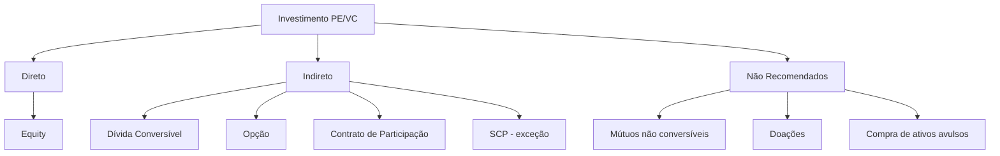

> [!info] Sobre este material
> Aula 9 do curso de **Private Equity e Venture Capital** da Insper Educação Executiva, ministrada por **Rodrigo Menezes** (Derraik & Menezes). Foco em estruturação jurídica de operações de PE/VC sob a ótica do empreendedor e do investidor.

---

## 🎯 Pontos de Atenção (Roteiro da Aula)

A aula percorre seis blocos temáticos que cobrem o ciclo completo de uma operação de [[PE/VC]]:

- [ ] [[#Veículos de Investimento]]
- [ ] [[#Veículos para o Empreendedor]]
- [ ] [[#Começo da Conversa]]
- [ ] [[#Due Diligence Legal]]
- [ ] [[#Tipos de Investimento]]
- [ ] [[#Estruturação do Investimento]]

---

## 🏦 Veículos de Investimento

### Quem são os investidores?

O ecossistema de capital privado abrange diferentes perfis, cada um com tese, ticket e estágio de atuação distintos:

- [[Investidor Anjo]]
- [[Aceleradora]]
- [[Seed Capital]]
- [[Venture Capital|VC]]
- [[Corporate Venture Capital|CVC]]
- [[Family Office]]
- [[Private Equity|PE]]
- [[Non-profits|Investidores não-lucrativos]]

### Formas jurídicas para o investidor

> [!note] Veículo ≠ Investidor
> O **veículo** é a estrutura jurídica usada para fazer o aporte; o investidor pode ser pessoa física, jurídica ou um fundo.

- **Pessoa Física** — aporte direto, sem intermediação societária
- **Sociedade Limitada** — veículo simples para grupos pequenos
- **Sociedade Anônima** — mais formal, com regras de governança definidas
- **[[SCP|Sociedade em Conta de Participação]]** — sócio oculto + sócio ostensivo
- **Sociedade Estrangeira** — investimento via offshore
- **Fundos de Investimento** — `FIPs` ou `FMIEEs` regulados pelas **Instruções CVM 578 e 579**

> [!tip] FIP x FMIEE
> Ambos são fundos regulados pela CVM, mas com perfis e exigências distintas para PE e VC. Ver [[Instrução CVM 578]] e [[Instrução CVM 579]].

---

## 👤 Veículos para o Empreendedor

Estruturas societárias mais comuns do lado da empresa investida:

- **Sociedade Limitada**
	- Atenção aos [[Regimes Tributários]]: Simples Nacional, Lucro Presumido, Lucro Real
- **Sociedade Anônima** — frequentemente exigida pelo fundo antes do aporte
- **EIRELI** — empresa individual de responsabilidade limitada *(figura em desuso após a Lei 14.195/2021, que criou a sociedade limitada unipessoal)*
- **Sociedade Offshore** — usada em estruturas internacionais

> [!warning] Transformação societária
> É comum o investidor exigir a **conversão da Ltda em S.A.** como condição precedente ao aporte, para viabilizar instrumentos como ações preferenciais e governança formal.

---

## 💬 Começo da Conversa

Etapas iniciais da negociação, antes da diligência e dos contratos definitivos:

> [!example] Term Sheet
> Documento **não vinculante** que serve para alinhar expectativas e dar conforto às partes antes do investimento pesado em diligência.

1. **Comprometimento do empreendedor** via [[Term Sheet]] com **período de exclusividade** (no-shop)
2. **Definição da estrutura do negócio**:
	- Investimento direto ou via veículo?
	- Necessidade de criar [[SPE|Sociedade de Propósito Específico]]?
	- Transformação em S.A.?
	- **[[Valuation]] preliminar**
	- **[[Estratégia de Saída]]** e diluição dos fundadores em rodadas futuras
3. **Prazos e objetivos da [[Due Diligence]]**

---

## 🔍 Due Diligence Legal

### Áreas de atenção – visão geral

| Área | Risco principal |
|------|----------------|
| Reputação | Imagem dos sócios e da empresa |
| [[#Trabalhista]] | Passivos ocultos, vínculo empregatício |
| [[#Societário e Contratual]] | Falhas de governança e contratos |
| [[#Propriedade Intelectual]] | Marcas, patentes, software |
| [[#Ambiental]] | Licenças e responsabilidade penal |
| [[#Outros]] | Imobiliário, contencioso, anticorrupção |
| [[#Tributário]] | Passivos fiscais ocultos |

### Trabalhista

> [!danger] Riscos clássicos
> Estes são os pontos onde mais aparecem passivos ocultos em diligências de PE/VC no Brasil.

- **Colaboradores fora da folha** — prestadores PJ, "quotistas de 1 quota", cooperados, autônomos, representantes comerciais
- **Falta de controle de hora extra** (controle de ponto)
- Risco de reconhecimento de **vínculo empregatício**
- **Ações trabalhistas** em curso
- **Descumprimento de convenção coletiva**

### Societário e Contratual

- **Falta de acordo entre sócios** (citado *"caso Resort"* como exemplo) — especialmente acordos formais
- **Cláusula de sucessão** em caso de falecimento (sucessão hereditária ou apuração de haveres)
- **Falta de seguro** de laboratório/fábrica (depende da atividade)
- Custos de rescisão de **contratos de distribuição e representação comercial**
- **Contratos bancários** — atenção a:
	- Cláusulas de [[Cross Default]]
	- Vencimento antecipado da dívida em caso de mudança de controle

### Propriedade Intelectual

- **Falta de registro de patentes e marcas** (Brasil e exterior)
- **Uso indevido de tecnologia de terceiros** — especialmente software (descrita como *"área nebulosa"*)
- **Contratos de transferência de tecnologia** e pagamento de royalties
- **Registro de software** no INPI

### Ambiental

- **Licenças ambientais** federais e estaduais (Ibama, Cetesb, Feema, etc.)
- **Dano ambiental é crime** (Lei 9.605/98)
- **Ações ambientais não prescrevem** — há divergência na jurisprudência sobre o tema

### Outros

- **Certidões negativas**: tributárias, trabalhistas, cartórios de distribuição (falência, cível, etc.)
- **Licitações**: certidões em dia são condição para participação
- **Anticorrupção** — pagamentos de propina (Lei Anticorrupção 12.846/2013)

### Tributário

- **Fraude fiscal**
- **Não pagamento de tributos**
- **Inadimplência no Refis**
- **Autos de infração**
- **Processos tributários** administrativos e judiciais
- **Provisionamento contábil** de perdas (risco de *"maquiagem"* do resultado)
- **Caixa 2** — falta de contabilização de receitas

---

## 💰 Tipos de Investimento



### Direto
- **[[Equity]]** — participação direta no capital social

### Indireto
- **[[Dívida Conversível|Convertible Debt]]**
- **[[Contrato de Opção]]**
- **[[Contrato de Participação]]**
- **[[SCP]]** — *não recomendado como regra geral*

### Não recomendados
- **Mútuos não conversíveis** — sem upside de equity
- **Doações** — sem proteção jurídica
- **Compra de ativos avulsos** e outros instrumentos não convencionais

---

## 📑 Estruturação do Investimento

### Documentos da operação

- [[Acordo de Investimentos]]
- [[Acordo de Acionistas]]
- Documentos de **dívida conversível** *(convertible debt)*
- [[Contrato de Opção]]
- [[Contrato de Participação]]
- [[Contrato de SCP]]
- Outros: **estatutos**, **atas**, **documentos de garantia**

### Cláusulas-chave em operações de Equity

> [!important] Proteções do investidor
> O conjunto abaixo é o "kit padrão" de proteções de um investidor de PE/VC em operação de equity.

- **Instrumentos de governança** — Diretoria Executiva e [[Conselho de Administração]]
- **Ações preferenciais com direito a voto** + ações ordinárias
- **Restrição na distribuição de dividendos**
- **[[Tag Along]]** — direito do minoritário acompanhar a venda do controlador
- **[[Drag Along]]** — obrigação de minoritário acompanhar venda (cláusula de saída)
- **Voto qualificado** em matérias relevantes
- **Restrições à venda de ações** (lock-up, right of first refusal)
- **Non-compete** + **permanência do empreendedor** na companhia
- **[[Representações e Garantias]]** *(reps & warranties)*

### Cláusulas-chave em Dívida Conversível

- Cláusulas usuais de dívida — **vencimento**, juros, amortização
- **Termos da conversão** — gatilhos, valuation cap, desconto
- **Direitos de credor**
- **Opção de ter ações da Companhia como garantia**
- **Restrições para uso do capital** (aprovação prévia para certas despesas)
- **Reps & warranties**
- **Direitos futuros de conversão** — equivalência aos demais investidores em rodadas futuras

---

## 🧠 Síntese para revisão

> [!summary] Mapa mental da aula
> 1. **Estruturas** disponíveis dos dois lados (investidor e empreendedor)
> 2. **Term sheet + exclusividade** abrem a negociação
> 3. **Due Diligence legal** mapeia passivos ocultos em 7 frentes
> 4. **Tipo de investimento** depende do estágio e do risco (equity vs. conversível)
> 5. **Documentos finais** consolidam governança, saída e proteções

---

## 🔗 Notas conectadas (Dataview)

```dataview
LIST
FROM [[]]
WHERE contains(file.outlinks, this.file.link) OR contains(file.inlinks, this.file.link)
SORT file.name ASC
```

```dataview
TABLE tipo, status, file.ctime as "Criado"
FROM #pe-vc OR #due-diligence OR #investimento
SORT file.ctime DESC
LIMIT 20
```

---

## 📌 Notas de uso (Obsidian)

> [!note] Como esta nota está estruturada
> - **Frontmatter YAML** com `tipo`, `área`, `status`, `criado`, `tags`, `aliases` para indexação
> - **`[[Wikilinks]]`** em conceitos-chave — muitos ainda são links "vermelhos" (notas a criar), o que é proposital: cada um vira uma nota-conceito separada conforme você for aprofundando
> - **Callouts** (`>[!info]`, `>[!warning]`, `>[!danger]`, `>[!summary]`) para destacar informações por tipo
> - **Checkboxes** no roteiro para marcar progresso de estudo
> - **Diagrama Mermaid** dos tipos de investimento (requer plugin Mermaid ou versão recente do Obsidian)
> - **Bloco Dataview** ao final exige o **plugin Dataview** instalado e habilitado
> - Sugestão de **fluxo de templates**: usar esta nota como base para um template "Aula/Capítulo" e criar instâncias por sessão de estudo

---

## ⚖️ Avisos e limitações

> [!warning] Material de 2020
> A apresentação é de **fevereiro de 2020**. Pontos com possível defasagem:
> - **EIRELI** foi extinta na prática pela [[Lei 14.195/2021]], substituída pela **Sociedade Limitada Unipessoal (SLU)**
> - As **Instruções CVM 578 e 579** seguem vigentes, mas com alterações posteriores — convém checar a versão atual
> - Jurisprudência sobre prescrição ambiental continua oscilando
>
> Não sou advogado — este resumo é didático, não constitui orientação jurídica.

---

**Rating de confiança: 8/10**

Resumo fiel ao conteúdo das 18 páginas do PDF. A confiança não é 10 porque:
- Algumas referências do slide (ex.: *"caso Resort"*) não têm contexto explicativo no material, então mantive a menção sem inventar a história
- Adicionei observações pontuais sobre EIRELI/SLU que **não estão no slide original** mas são relevantes para uso em 2026 — sinalizadas como aviso, não como conteúdo da aula
- Os wikilinks para conceitos (FIP, Tag Along, etc.) foram criados como sugestão de rede de notas; o conteúdo deles ainda precisa ser desenvolvido por você
