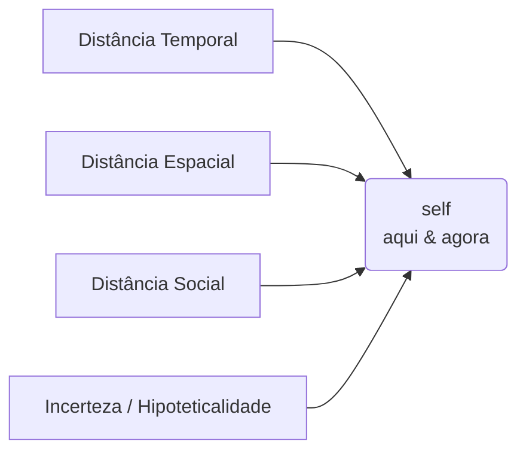
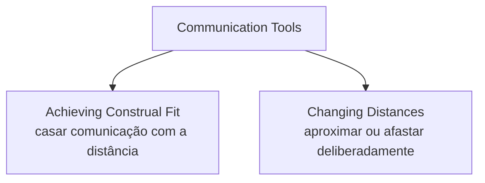
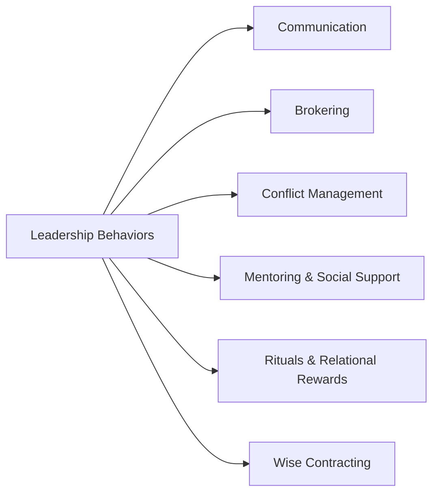

# Leading from Different Psychological Distances

>[!info] Sobre este material
> **Autor:** Nir Halevy (Stanford Graduate School of Business)
> **Programa:** Executive Program in Strategy and Organization
> **Tese central:** Gaps organizacionais são armadilhas de liderança. O papel do líder é diagnosticar e gerenciar diferentes tipos de [[Distância Psicológica]] para conectar visão e execução, topo e base, centro e periferia.

---

## 1. O problema central — Organizational Gaps as Leadership Traps

Toda organização opera com uma tensão estrutural entre dois polos:

| Polo abstrato | Polo concreto |
|---|---|
| Visão abstrata e atemporal | Metas concretas e prazos |
| Estratégia | Execução |
| Cultura ideal | Comportamento individual real |
| Alta liderança (Top Management) | Linha de frente (Rank and File) |
| [[Exploration]] | [[Exploitation]] |
| Matriz / Headquarters | Filiais / Subsidiárias |

Exemplos citados:
- **Google** — visão abstrata: *"Organize the world's information"*
- **Setor aéreo** — meta concreta: *"Cut time at the gate in half"*

A armadilha aparece quando o líder vive em um único polo e a distância vira abismo intransponível.

---

## 2. Distâncias como desafios de liderança

>[!quote] Tese de Halevy
> Líderes bem-sucedidos **conectam** distâncias sociais e organizacionais de forma eficaz.

### 2.1 [[Distância Temporal]]
- Traduzir visão de longo prazo em metas ambiciosas-mas-alcançáveis no curto prazo
- Conectar passado organizacional (origens, tradições) ao futuro (novas oportunidades)

### 2.2 [[Distância Social]]
- Gerenciar a [[Hierarquia]] (integração vertical)
- Conectar centro e periferia da rede (DEI, onboarding, integração horizontal)
- Construir parcerias com outras organizações (fornecedores, joint ventures)

### 2.3 [[Distância Espacial]]
- Conectar funcionários remotos e times geograficamente distribuídos
- Construir parcerias sustentáveis através de distâncias geográficas e culturais

### 2.4 [[Incerteza]] / Hipoteticalidade
- Gerenciar ambiguidade em períodos de transição (crise, mudança, sucessão, fusões)
- Conectar áreas com níveis distintos de incerteza (P&D, Marketing, Operações, Finanças)

>[!example] Casos citados nos slides
> - **Jeff Bezos / Amazon** — manejo de distância temporal e social via visão
> - **Starwood (HBR)** — manejo de distância espacial e cultural

---

## 3. Definição de [[Distância Psicológica]]

> Experienciar eventos, pessoas e unidades organizacionais como **próximas vs. distantes** do *self, aqui e agora*.



Todas as distâncias têm o mesmo ponto de referência: **o self no presente**.

---

## 4. [[Hierarquia]] e Distância Social

### 4.1 A pergunta errada
"Hierarquia é boa ou ruim?" — para quem? para quê? quando?

>[!warning] Halevy: essa é a pergunta errada
> Ela assume que a hierarquia é uma característica essencial do ambiente social, como o clima e a paisagem são do ambiente natural. Mas, ao contrário do clima, **a hierarquia é inteiramente construída por nós**. Portanto, *hierarquia é o que fazemos dela*.

### 4.2 As perguntas certas
1. **O que a hierarquia faz com as pessoas?**
2. **O que as pessoas fazem com a hierarquia?**

### 4.3 Pergunta #1 — O que a hierarquia faz com as pessoas

**Hierarquia pode promover ordem social**
- Em primatas: machos alfa gerenciam interações em hierarquias de dominância *(Boehm, 2012)*
- Em organizações: estruturas formais de autoridade delineiam quem se submete a quem, quem influencia quem, e dão a supervisores controle sobre recursos *(Bunderson, Van der Vegt, Cantimur, & Rink, 2016; Tost, 2015)*

**Hierarquia pode reduzir incerteza e aumentar coordenação**
- Experimento das estações de trem *(De Kwaadsteniet & Van Dijk, 2010)*: quando há hierarquia clara (estagiário + chefe), a coordenação melhora porque o subordinado defere ao superior. Sem hierarquia, dois pares iguais ficam presos em dilema de coordenação.

**Hierarquia pode promover cooperação em times**
- Evidência da NBA *(Halevy et al., SPPS 2012)*: dispersão de pagamento, lineup titular e tempo de jogo está associada a maior cooperação/coordenação e melhor desempenho do time.

**Mas hierarquia pode ajudar o time e prejudicar indivíduos**
- Estudo de expedições no Himalaia *(Anicich, Swaab & Galinsky, PNAS)*: países com valores culturais hierárquicos altos têm mais sucesso em alcançar o cume **e** mais mortalidade individual. Efeito só aparece em grupo, não em escaladores solo.

### 4.4 Quando e por que a hierarquia funciona bem

Hierarquia funciona quando cria um **ambiente psicologicamente recompensador**:
- **Reduz incerteza** e estabelece divisão clara de trabalho / cadeia de comando
- **Permite realização** via mobilidade ascendente e sistema de incentivos

E quando cria **processos psicológicos complementares** no grupo:

| Alto Poder | Baixo Poder |
|---|---|
| Risk-taking, overconfidence | Aversão a risco, vigilância |
| Reward-seeking | Prevention focus |
| Violação de normas | Seguir regras |
| Criatividade | Conformidade |
| Visão de floresta (big picture) | Atenção à árvore (detalhe) |

### 4.5 Quando a hierarquia falha — o efeito [[Power without Status]]

**Estudo (Fast, Halevy & Galinsky, 2012):** 4 condições experimentais cruzando poder × status. Participantes escolhiam tarefas (degradantes ou neutras) que o outro participante teria que executar.

>[!danger] Achado principal
> Apenas a condição **Alto Poder + Baixo Status** levou a comportamento significativamente mais degradante (*t(209)=2,38; p=0,02*). As outras três condições não diferiram entre si.

**Implicação organizacional (Anicich, Fast, Halevy & Galinsky, 2016):** quando empresas reduzem o real-estate footprint e eliminam símbolos físicos de status (sala maior, vaga marcada, proximidade da equipe), portadores de poder mas baixo status podem reagir buscando dominância por vias contraproducentes:
- [ ] Diminuir/humilhar outros
- [ ] Iniciar conflitos
- [ ] Escalar pequenos incidentes em conflitos abertos

Confirmado em estudo com adultos trabalhadores (conflito de relacionamento) e gestores de agências federais (mudança de status no último ano).

Modelo do mecanismo: status determina sentimentos (positivos/negativos), poder determina propensão a agir; quando se combinam baixo status + alto poder, o resultado é ciclo vicioso de conflito interpessoal e tratamento degradante.

---

## 5. Ferramentas de comunicação para gerenciar distâncias

Halevy organiza em duas famílias:



### 5.1 [[Construal Fit]] — casar comunicação com distância

**Princípio:** comunicação próxima pede linguagem **concreta**; comunicação distante pede linguagem **abstrata** (metáforas, vívida).

| Proximidade | Tipo de comunicação | Pergunta dominante |
|---|---|---|
| Próxima | Concreta | **Como?** |
| Intermediária | — | **O quê?** |
| Distante | Abstrata, metafórica | **Por quê?** |

Exemplos de aplicação:
- **Próximo:** coordenar operação diária com reports diretos, contratar com fornecedores
- **Distante:** articular visão ampla para stakeholders diversos, fazer parceria com novas organizações

**Estudo Berson & Halevy (2014)** — N=2.206 funcionários de telecom hierarquicamente estruturada:
- *Feedback e mentoria* de líderes próximos predizem satisfação no trabalho
- *Visão* articulada por líderes distantes prediz satisfação no trabalho
- **Regra prática:** líderes próximos usam comunicação concreta; líderes distantes usam comunicação abstrata.

>[!example] Caso citado
> Herb Kelleher (co-fundador Southwest Airlines) discutindo a competição com a United — ilustração de gestão de incerteza via comunicação.

### 5.2 Changing distances — aproximar ou afastar

**Diminuir distância psicológica:**
- [ ] Compartilhar história pessoal (especialmente histórias de fracasso, não só de sucesso)
- [ ] Usar humor apropriado e inclusivo
- [ ] [[Escuta de Alta Qualidade]] (active listening)
- [ ] Comportamento não-verbal (contato visual, aperto de mão)

**Aumentar distância psicológica:**
- [ ] Usar linguagem polida/formal
- [ ] Usar títulos formais
- [ ] Escolher meios de comunicação "magros" (lean)
- [ ] Postura corporal expansiva

**[[Escuta de Alta Qualidade]]** *(Kluger et al., 2020, Applied Psychology)* aumenta:
- Intimidade relacional
- Comportamento de ajuda
- Reciprocidade
- Comportamento de cidadania organizacional

Técnicas de active listening *(Huang et al., 2017, JPSP)*: nomear emoção, parafrasear, espelhar, perguntas abertas, **perguntas de follow-up**, pausas eficazes, voz baixa.

### 5.3 Escolha de tecnologia de comunicação *(Swaab et al., PSPR 2013)*

Duas dimensões: **síncrona × assíncrona** e **com pistas visuais/vocais × sem**.

| | Assíncrona | Síncrona |
|---|---|---|
| Face-a-face / vídeo | Video mail | Vídeo chamada |
| Voz | Voice mail | Telefone |
| Texto | E-mail | Mensagem instantânea |

Quanto mais rica a tecnologia (mais pistas, mais sincronia), menor a distância psicológica.

### 5.4 [[Wise Contracting]] — contratação relacional

Contratos de emprego nascem num momento de alta distância psicológica:
- Incerteza sobre o trabalho (hipoteticalidade)
- Recém-chegado ainda não é insider (distância social)
- Cláusulas envolvem futuro distante (distância temporal)

**Wise contracting** reduz algumas distâncias mantendo autonomia:
- **Cláusulas de coordenação concretas** → reduzem incerteza sobre o trabalho
- **Cláusulas de controle abstratas** → preservam senso de autonomia, que aumenta motivação intrínseca, persistência, criatividade e cooperação

>[!example] Caso Nordstrom
> "Use bom julgamento em todas as situações" — uma única regra abstrata no handbook, usada como dispositivo relacional. Halevy nota que, embora o mito popular diga ser a única regra, há regras detalhadas em domínios específicos (ex.: redes sociais). O contrato é mais sofisticado do que parece: regra abstrata principal + regras concretas onde precisa.

### 5.5 [[Brokering]] e gestão de conflito

Brokering = intermediação, reestruturando capital social e relacionamentos. Terceiros "selfish" (com interesse próprio) podem agir como pacificadores ao transformar conflitos e promover cooperação.

---

## 6. Negociação cross-cultural

**Modelo Iceberg da Cultura:**

| Acima da linha d'água | Abaixo |
|---|---|
| Comportamentos e instituições | Valores e crenças |
| O "**o quê**" e "**como**" da negociação | Fundamental assumptions |
| | O "**porquê**" da negociação |

A dificuldade da negociação cross-cultural é dupla: **diferenças culturais visíveis + desconhecidos abaixo da linha**. A ponte é feita com ferramentas de comunicação para reduzir incerteza e distância social *antes* do deal-making.

---

## 7. Framework de decisão — [[Appropriateness Framework]]

Baseado em James G. March, *A Primer on Decision Making*.

>[!question] Pergunta-mestre
> **What should a person like me do in a situation like this?**

Três pilares para responder:
- **Norms** — o que é esperado no contexto
- **Identity** — quem eu sou nesse papel
- **Situational Construal** — como interpreto o que está acontecendo

**Aplicação:** ao escolher como gerenciar uma distância psicológica, o líder não otimiza um resultado isolado — verifica adequação às normas, à identidade do papel e à leitura da situação.

---

## 8. Repertório de comportamentos de liderança



Esses são os seis "botões" que o líder pode girar para gerenciar distâncias psicológicas.

---

## 9. Síntese — Mind the Gap / Manage the Gap

>[!success] Mensagem final
> Distâncias psicológicas importam. O trabalho do líder é em dois movimentos:
> 1. **MIND THE GAP** — perceber e diagnosticar a distância (temporal, social, espacial, incerteza)
> 2. **MANAGE THE GAP** — agir intencionalmente: ou casando a comunicação com a distância ([[Construal Fit]]), ou movendo a distância (aproximar/afastar)

---

## Ações práticas

- [ ] Mapear os 4 tipos de distância no meu contexto atual (equipe, fornecedores, áreas)
- [ ] Identificar onde estou "vivendo em um polo" (só estratégia ou só execução)
- [ ] Auditar minha comunicação: estou usando linguagem **concreta para próximos** e **abstrata para distantes**?
- [ ] Checar alinhamento poder × status na estrutura (risco de "power without status" após mudanças físicas/remotas)
- [ ] Praticar uma técnica específica de escuta ativa por semana
- [ ] Revisar contratos/onboarding com a lente de "wise contracting" (coordenação concreta + controle abstrato)

---

## Conexões

```dataview
LIST FROM [[Liderança]] OR [[Comunicação Organizacional]] OR [[Distância Psicológica]] OR [[Hierarquia]] OR [[Negociação]] OR [[Construal Fit]]
WHERE file.name != this.file.name
SORT file.mtime DESC
```

---

## Referências citadas no material

- Boehm, C. (2012) — hierarquia em primatas
- Bunderson, J. S., Van der Vegt, G. S., Cantimur, Y., & Rink, F. (2016)
- Tost, L. P. (2015)
- De Kwaadsteniet, E. W., & Van Dijk, E. (2010) — experimento das estações
- Halevy, N. et al. (2012) *SPPS* — evidência da NBA
- Anicich, E. M., Swaab, R. I., & Galinsky, A. D. *PNAS* — *Hierarchical cultural values predict success and mortality in high-stakes teams*
- Fast, N. J., Halevy, N., & Galinsky, A. D. (2012) — Power without Status (laboratório)
- Anicich, E. M., Fast, N. J., Halevy, N., & Galinsky, A. D. (2016) — Power without Status (campo)
- Berson, Y., & Halevy, N. (2014) — construal fit em telecom
- Swaab, R. I. et al. (2013) *PSPR* — tecnologia de comunicação
- Huang, K. et al. (2017) *JPSP* — perguntas de follow-up / active listening
- Kluger, A. N. et al. (2020) *Applied Psychology* — escuta de alta qualidade
- March, J. G. — *A Primer on Decision Making* — Appropriateness Framework

>[!note] Sobre as citações
> Autores e datas vêm exatamente como aparecem nos slides do Prof. Halevy. Não confirmei títulos, periódicos e volumes em bases externas; trato como referências indicativas, úteis para localizar os papers, **não** como citação verificada de volume/página.

---

## Nota de uso (Obsidian)

- **Wikilinks** (`[[ ]]`): clicar cria ou abre a nota correspondente. Termos centrais que valem virar notas-conceito próprias: `Distância Psicológica`, `Construal Fit`, `Wise Contracting`, `Escuta de Alta Qualidade`, `Brokering`, `Hierarquia`, `Power without Status`, `Appropriateness Framework`.
- **Dataview**: o bloco no final lista automaticamente notas relacionadas — exige o plugin Dataview habilitado.
- **Callouts** (`>[!info]`, `>[!warning]`, `>[!danger]`, etc.): renderizam como caixas coloridas no Obsidian.
- **Mermaid**: diagramas renderizam nativamente.
- **Templates**: o frontmatter segue o padrão (`tipo`, `área`, `status`, `criado`, `tags`, `aliases`) e pode virar template reutilizável.

---

**Confiança nesta síntese: 8/10**

Por que não 9+:
- Conteúdo extraído fielmente dos slides, mas slides são minimalistas — expandi conexões e implicações práticas com base no que é razoável inferir da pesquisa de Halevy e dos papers citados. Tentei manter próximo ao texto original; onde inferi, está nas seções de "implicação" ou "aplicação".
- Não verifiquei volumes/páginas dos papers; as referências estão como aparecem no material.
- Algumas tabelas/diagramas dos slides aparecem em estado parcial (slide a slide, com células coloridas progressivamente) — reconstruí a estrutura completa pela sequência.
