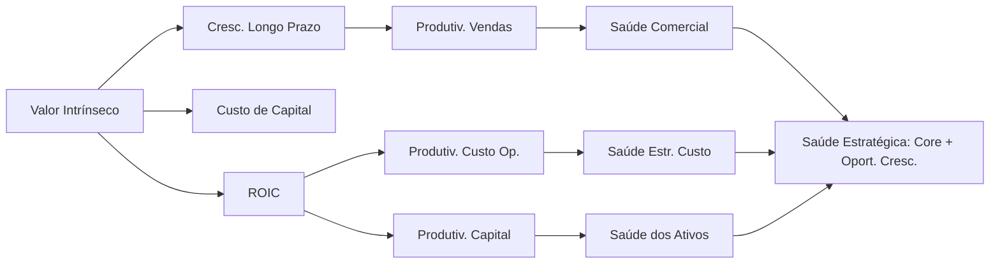
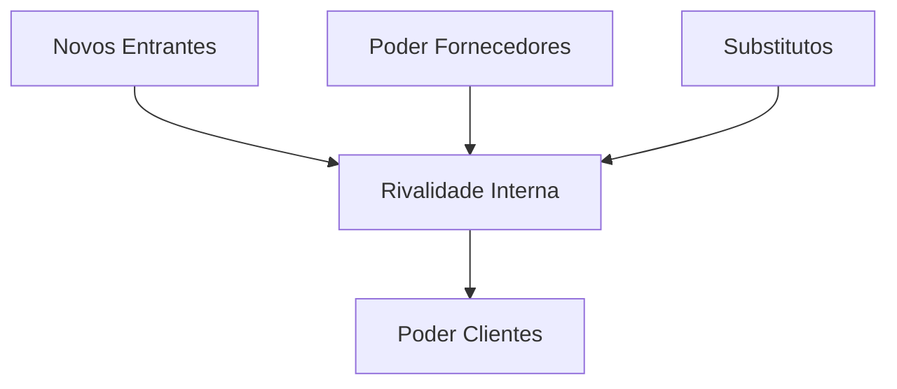

# Aula 4M – Estratégia de M&A: Visão Empresa

> [!info] Contexto
> Aula do curso de [[Fusões e Aquisições]] do [[Insper]] Educação Executiva, ministrada pelo Prof. Luiz F. M. Vieira, PhD. Cobre os blocos: **Estratégias de Crescimento**, **Processo de M&A na visão da Empresa**, **Formulação de Business Plan** e **Case Lispector**.

---

## 1. Visão de Negócio: Criação de Valor para o Acionista

> [!quote] Premissa central
> Acionistas investem com a expectativa de que, ao vender, o valor de cada investimento crescerá suficientemente acima do "custo/investimento" para compensar o "risco" tomado.

[[Valor]] é uma medida **abrangente** de performance, em contraste com medidas parciais:

- **Valor (abrangente)**: horizonte de longo prazo, interesse de todos os [[stakeholders]] (acionistas, credores, colaboradores, clientes, governo), uso eficiente dos recursos (capital, pessoas, recursos naturais, investimento).
- **Medidas parciais**: ganhos contábeis (curto prazo), satisfação das pessoas, [[Market Share]], KPIs financeiros (EBITDA, Earnings, Revenues), produtividade.

**Fonte:** Koller, Goedhart & Wessels — *Valuation: measuring and managing the value of Companies*, McKinsey & Company, 2010, 5th edition.

---

## 2. Criação de Valor depende de Vantagem Competitiva

> [!important] Princípio
> Empresas só conseguem sustentar **forte crescimento** e **alto retorno sobre capital investido** SE garantirem [[vantagem competitiva]] — conceito central da estratégia competitiva.

**Mecânica:**
- Empresas tomam recursos de investidores (dívida ou equity) e investem capital.
- Criam valor quando **TIR > Custo de Capital**.
- Velocidade de geração de vendas com retornos atrativos depende de [[Crescimento]] e [[ROIC]].
- Competição força busca contínua por fontes de vantagem competitiva.
- Necessário equilíbrio entre curto e longo prazo.

---

## 3. As Duas Alavancas: Crescimento e ROIC

> [!note] Fórmula
> **ROIC = NOPLAT / Capital Total Investido**
> Onde: NOPLAT = EBIT × (1−T); Capital Investido = PPE + Capital de Giro

### Sobre ROIC
- Quanto maior a diferença entre ROIC e [[Custo de Capital]], maior o valor criado.
- Depende da estrutura competitiva da indústria.
- Varia entre linhas de negócio conforme vantagens competitivas (ex.: sopas, pet food, bebidas).

### Sobre Crescimento
- Negócios sem crescimento aumentam chances de falha.
- Crescimento é difícil de sustentar.
- **Só gera valor com retornos acima do custo de capital.**
- Empresas com **alto ROIC** geram valor com crescimento (mesmo com pequena queda de ROIC).
- Empresas com **baixo ROIC** criam mais valor aumentando ROIC do que crescendo.

---

## 4. Componentes da Criação de Valor (McKinsey – Grow Fast or Die Slow)

Matriz do impacto sobre a capitalização de mercado:

| Vendas ↓ \ Margem EBITA → | EBITA < 10% | EBITA ≥ 10% |
|---|---|---|
| **Cresc. Vdas ≥ 20%** | +10 | +23 |
| **Cresc. Vdas < 20%** | −14 | 0 |

> [!tip] Insight
> **Crescimento tem maior efeito sobre valorização do que aumento de margem.**
> - Melhorar margem: ganho de 13–14 pp
> - Crescer mais rápido: ganho de 23–24 pp

---

## 5. Fontes de Vantagem Competitiva que geram ROIC

### Preço Premium
- Produtos inovadores (patentes, dificuldade de copiar)
- Qualidade (real ou percebida)
- [[Marcas]] (clientes dispostos a pagar mais)
- Produtos únicos sem substitutos
- Disciplina de preços (sinalização, gestão de capacidade)

### Eficiência de Custo e Capital
- Modelo inovador de negócio (difícil de copiar)
- Recursos únicos (acesso a matérias-primas)
- [[Economias de Escala]]
- Processos e produtos escaláveis (custo marginal baixo)

---

## 6. Diferenças Setoriais de ROIC e Crescimento

> [!info] Observação McKinsey (1965–2007)
> Há grande variação de ROIC entre indústrias por conta da **estrutura competitiva**. Setores como Pharma, Software, IT Services, Beverages têm ROIC mediano muito superior a Airlines, Electric Utilities, Paper Products.

Ferramenta recomendada para análise: [[5 Forças de Porter]] e modelos de análise de estrutura de indústria.

**Caso Johnson & Johnson (1965–2008):** manteve ROIC consistentemente acima do WACC, demonstrando *sustained value creation*. Depende de:
- Tamanho dos ciclos de vida de negócios/produtos.
- Capacidade de manter diferenciais de preço e/ou custo.

---

## 7. Componentes do Crescimento

Três alavancas, com pesos muito distintos:

| Componente | Descrição | Cresc. médio anual (416 empresas, 99–06) |
|---|---|---|
| **Momentum de Portfolio** | Crescimento orgânico; expansão em segmentos atuais e novos | **6,6%** |
| **M&A** | Crescimento inorgânico; compra/venda de unidades | **3,1%** |
| **Ganho de Market Share** | Crescimento orgânico via concorrência direta | **0,4%** |
| **Total** | | **10,1%** |

> [!warning] Insight contraintuitivo
> Gestores tendem a focar em **ganho de market share** — justamente a menor alavanca. Momentum de portfolio e M&A são as componentes mais relevantes.

**Crescimento é difícil de sustentar:** empresas que crescem >20% tipicamente convergem para ~5% após 5–7 anos.

---

## 8. Árvore de Criação de Valor



Alavancas organizam-se em: **Financeiras → Curto Prazo → Médio Prazo → Longo Prazo**, com Saúde Organizacional como dimensão transversal.

---

## 9. Key Value Drivers e Impacto no Valor

| Driver | Pior → Melhor | Impacto ($MM) |
|---|---|---|
| Taxa lançamento novos produtos/ano | 0,1 → 1,0 | 15,3 |
| CMV / Receita Op. Líquida | 35% → 14% | 11,3 |
| Tempo para 80% pico de vendas (anos) | 7 → 3 | 9,8 |
| Vendas baixa margem / vendas totais | 50% → 10% | 6,3 |
| SG&A / Receita Op. Líquida | 6% → 3% | 4,8 |
| Time to Market (anos) | 14 → 9 | 4,5 |
| Market Share segmentos alto valor | 25% → 70% | 2,3 |

- [ ] Identificar os value drivers do meu negócio
- [ ] Monitorar grau de esforço × tempo de resposta

---

## 10. M&A como Estratégia de Criação de Valor

> [!important] Especificidades de M&A
> - Aquisições **não adicionam capacidade** — apenas transferem propriedade entre acionistas.
> - Mercado de aquisições é **extremamente competitivo** — negociações com **prêmio**.
> - Substância econômica: desembolso antecipado por um fluxo de caixa futuro.

### Abordagem de Criação de Valor (3 avaliações)
1. Valor do vendedor como negócio independente.
2. Valor dos benefícios da aquisição ([[sinergias]]).
3. Preço de compra.

### 3 Equações Fundamentais

```
Valor Criado na Aquisição = Valor Empresa Combinada − (Valor Comprador Indep. + Valor Vendedor Indep.)

Preço Máximo de Compra = Valor Vendedor Indep. + Valor das Sinergias

Valor Criado p/ Comprador = Preço Máximo de Compra − Preço Pago ao Vendedor
```

### Aquisições geram valor para o comprador?

> [!warning] Sirower – *The Synergy Trap*
> - Na média, aquisições **diminuem o valor do comprador**.
> - Quanto **maior o prêmio pago, maior o valor desagregado**.
> - No equilíbrio: **Prêmio Pago = Valor de Sinergias** → o prêmio é pagamento antecipado sobre aposta especulativa.

### Para o vendedor?
- Prêmio = ganho imediato.
- Rejeitar prêmio substancial impede ganhos para os acionistas.

### Caixa vs. Ações?

> [!tip] Regra prática
> Aquisições com **caixa** são consistentemente melhores que com ações (Sirower).
> Emissão de ações é vista negativamente: pode sinalizar que ações estão subvalorizadas, encarecendo a aquisição.

---

## 11. Processo de M&A (10 etapas)

### Pré-Decisão de Aquisição

> [!example] Etapas 1 a 5
> 1. **[[Plano de Negócio]]** – análise externa, interna, SWOT, missão/visão, estratégia, alternativas de implementação ("ir sozinho", M&A, alianças/JVs, investimentos minoritários, troca de ativos).
> 2. **Plano de Aquisições** – objetivos, cronograma, recursos, diretrizes, busca/seleção, estratégia de negociação, oferta inicial, financiamento, plano de integração.
> 3. **Busca** – critério principal + estratégia de busca; uso de brokers (responsabilidade fiduciária) vs. finders (apresentam ambas as partes); fees: básico + prêmio fechamento + eventual retainer.
> 4. **Seleção** – refinamento com critérios adicionais (segmento, linha de produto, rentabilidade, alavancagem, market share).
> 5. **Primeiro Contato** – varia por porte (Pequenas <$25MM, Médias $25–100MM, Grandes >$100MM); discussão de valor; documentos preliminares: NDA, term sheet, carta de intenção.

### Pós-Decisão de Aquisição

> [!example] Etapas 6 a 10
> 6. **Negociação** – identifica áreas de acordo/desacordo; estabelece confiança; em paralelo: refino do valuation, estruturação do deal, [[due diligence]] (comprador, vendedor, financiador), planejamento financeiro.
> 7. **Plano de Integração** – usa due diligence para sequenciar captura de sinergias; questões do contrato de compra e venda (trabalhistas, contas a receber/pagar); cláusulas facilitadoras (não-competição, contratos de trabalho); organização da integração com responsáveis e prazos.
> 8. **Fechamento** – aprovações (acionistas, regulatórias, terceiros); contrato definitivo com preço, alocação, assunção de passivos, reps & warranties, condições.
> 9. **Integração** – planos de comunicação, retenção de pessoas, fluxo de caixa, melhores práticas, [[questões culturais]].
> 10. **Avaliação** – não mudar benchmarks; perguntas difíceis; aprender com erros.

> [!important] Princípios chave
> - Sucesso depende de **foco, entendimento e disciplina** num Plano de Negócio bem desenvolvido.
> - Aquisição é apenas **uma alternativa** de implementação estratégica.
> - Planejamento de integração deve ocorrer **antes do fechamento**, enquanto o comprador tem maior alavancagem.

---

## 12. Estrutura Básica do Plano de Negócio

1. **Introdução** — [[Modelo de Negócio CANVAS]], missão, visão, valores.
2. **Análise Externa** (oportunidades/ameaças) — [[5 Forças de Porter]].
3. **Análise Interna** (fortalezas/fraquezas) — recursos, capacitações, competências-chave.
4. **Estratégia** — [[Análise SWOT]] + [[Matriz de Ansoff]].
5. **Plano de Implementação** — ações detalhadas.
6. **Demonstrativos Financeiros** — projeções e avaliação de criação de valor.

### Modelo CANVAS (9 blocos)
Proposta de Valor · Segmentos de Clientes · Canais · Relacionamento com Clientes · Fluxos de Receita · Recursos-chave · Atividades-chave · Parcerias-chave · Estrutura de Custos.

**Exemplo aplicado:** [[Nespresso]] (parcerias com fábrica chinesa e produtores de café; atividades-chave em cápsulas patenteadas e logística; oferta "melhor café espresso sem trabalho nem sujeira"; canais varejos parceiros, lojas próprias e Nespresso.com; segmentos alto padrão social e tecnológicos; estrutura de custos em publicidade/fabricação/logística; receita com baixa margem nas máquinas e altíssima margem nas cápsulas).

---

## 13. Análise SWOT — Geração de Estratégias

|  | **Fortalezas (S)** | **Fraquezas (W)** |
|---|---|---|
| **Oportunidades (O)** | Estratégias SO (usar S para capturar O) | Estratégias WO (alavancar O para superar W) |
| **Ameaças (T)** | Estratégias ST (usar S para evitar T) | Estratégias WT (minimizar W e evitar T) |

> [!tip] Critérios para fortalezas/fraquezas relevantes
> - Reconhecidas pelos clientes.
> - Influenciam valor percebido.
> - Difíceis de imitar/substituir.

---

## 14. Matriz de Ansoff — Estratégias de Crescimento

|  | **Produtos Atuais** | **Produtos Novos** |
|---|---|---|
| **Mercados Atuais** | Penetração de Mercado | Desenvolvimento de Produto |
| **Mercados Novos** | Desenvolvimento de Mercado | **Diversificação** (horizontal / vertical / concêntrica / conglomerada) |

- **Horizontal**: novos produtos tecnologicamente não-relacionados em mercados atuais.
- **Vertical**: entrada em negócios de fornecedores ou clientes.
- **Concêntrica**: novos produtos relacionados em novos mercados.
- **Conglomerada**: produtos totalmente novos em mercados novos.

---

## 15. Razões para Aquisições × Problemas para Sucesso

### Razões (motivações para M&A)
- Custo menor e time-to-market mais rápido
- Maior diversificação
- Maior poder de mercado
- Evitar competição excessiva
- Transpor barreiras de entrada
- Aprender e desenvolver novas capacitações
- Menor risco vs. desenvolvimento orgânico

### Problemas (riscos típicos)
- Dificuldades de integração
- [[Avaliação inadequada do alvo]]
- Dívida grande/extraordinária
- Inabilidade para capturar sinergias
- Diversificação excessiva
- Gestores muito focados em aquisições
- Operação grande demais

---

## 16. Por Que Estratégias de M&A Falham

> [!warning] Causas-raiz
> 1. **Entrar/permanecer em indústrias não-lucrativas** (avaliar pelas [[5 Forças de Porter]]).
> 2. **Afastar-se do core** — perder o foco no que sabe fazer.
> 3. **Benefícios econômicos improváveis ou não incrementais** — falha em pensar "na margem"; sinergias que o comprador capturaria sem a aquisição.
> 4. **Não obter vantagens econômicas** — competição na transação reduz retornos.
> 5. **Falta de criatividade na estruturação** — pagamento, financiamento, earn-out, planejamento tributário.
> 6. **Poucos mecanismos de check & balances** — falta de "skin in the game".

---

## 17. Atratividade da Indústria — 5 Forças de Porter



| Força | Determinantes principais |
|---|---|
| **Novos Entrantes** | Economias escala, diferenças propriedade, marca, custos de mudança, capital necessário, acesso à distribuição, política de governo, retaliação esperada |
| **Fornecedores** | Diferenças de inputs, custos de mudança, substitutos, concentração, importância do volume, custo relativo, integração para frente |
| **Rivalidade Interna** | Crescimento da indústria, custos fixos, excesso capacidade, diferenciação, marca, custos de mudança, concentração, complexidade informacional, diversidade competitiva, barreiras de saída |
| **Clientes** | Concentração, volume, custos de mudança, informação, integração para trás, substitutos, diferenciação, marca, impacto em qualidade, lucro dos clientes |
| **Substitutos** | Desempenho relativo do preço, custos de mudança, aceitação pelos clientes |

> [!example] Comparação ilustrativa
> - **Aviação**: barreiras baixas (lease), poucos fornecedores, custo fixo alto, competição forte, substitutos (carro/ônibus) → Operating Income / Assets ≈ **1,3%**
> - **Farmacêutica**: barreiras altas (P&D), proteção de patentes, baixo poder de barganha de clientes/fornecedores → Operating Income / Assets ≈ **25,0%**

**Fonte:** Pankaj Ghemawat, Harvard Business School.

---

## 18. Crescimento a partir do Core (Zook)

Vetores de adjacência ao core business:

- **Novos Produtos** — novos segmentos, mais share, serviços.
- **Novos Canais** — adaptar produto/marca para canais inexplorados.
- **Integração à Frente** — controlar ativos próximos ao usuário final.
- **Integração Reversa** — controlar fontes da cadeia de suprimentos.
- **Novas Competências** — adquirir/desenvolver para chegar a outros cores.
- **Novos Segmentos** — segmentos pouco explorados/emergentes.
- **Expansão Geográfica** — novos países, redensificar, mídia regional.
- **Novos Negócios** — aproveitar competências em frentes novas.

**Passo a passo:** definir core → escolher adjacências → analisar viabilidade.

---

## 19. Case Lispector Tecnologia S.A. (síntese)

> [!note] Perfil
> - Fundada 2014 por engenheiros; 200 funcionários em 2015.
> - Capacidade 70 mil impressoras/ano; utilização 14% (10 mil) em 2015.
> - Tecnologia patenteada em 2014 (20 anos).
> - Dívida BNDES: 1 ano de carência de principal; amortização anual R$ 4,5 MM; juros 5%aa real.

### Fornecedor crítico GH (alvo de aquisição)
- Componente essencial com patente registrada 2013 (20 anos).
- Importação penalizada por tarifa + logística.
- Fundo PE **Simply the Best (STB)** detém 50%.
- Fundador faleceu em 2012; família sem expertise.
- **GH à venda: R$ 130 MM por 100%, ex-dívida.**

### Cenário M&A — efeitos esperados
- Melhora do **CMU** (internalização de margem + ganho de escala/diluição de fixos).
- Maior poder de barganha vs. concorrentes (direto) e consumidores (indireto).
- Despesas Administrativas reduzidas em **500 pp** (sede própria GH).
- Despesas com Vendas mantidas em 8% do ROL.
- Depreciação/Amortização: 5% → 8% do AFB.
- [[Beta desalavancado]] +30% (novo mercado + maior endividamento).
- Investimento mínimo de 7% do ROL/ano.
- Financiamento STB: até **40% do preço** a **20%aa por 5 anos**, SAC.

### Cenário "Day After" — problemas reais
- Roubo de diagramas técnicos por funcionários insatisfeitos → concorrência com produto melhor e mais barato.
- Processos trabalhistas → contingências de **R$ 15 MM** (com encargos e juros).
- Necessidade de reforçar RH e Jurídico.

### Questões para discussão
- [ ] Quais value drivers da Lispector antes e depois da aquisição?
- [ ] Quais ações operacionais e financeiras no cenário Day After?
- [ ] Onde está a maior destruição de valor vs. cenário M&A original?
- [ ] Quais medidas para reestruturação da dívida?

---

## Conexões e Próximos Passos

### Mapa de conceitos relacionados
- [[Valuation]] — quantificação dos value drivers.
- [[Due Diligence]] — base para o plano de integração.
- [[Post Merger Integration]] — execução da etapa 9 do processo.
- [[Aspectos Jurídicos de M&A]] — contrato definitivo, reps & warranties, earn-out.
- [[Private Equity e Venture Capital]] — visão complementar do investidor.

### Ações para mim
- [ ] Aplicar o framework CANVAS + SWOT + Ansoff em um negócio próprio
- [ ] Calcular ROIC vs. WACC do meu negócio atual
- [ ] Mapear value drivers prioritários e seu grau de esforço × tempo de resposta
- [ ] Revisitar o Case Lispector com números reais para 4-T (Valuation Cases)

---

## Dataview — Conexões Automáticas

```dataview
LIST
FROM [[]]
WHERE contains(tags, "M&A") OR contains(tags, "valuation") OR contains(tags, "estratégia")
SORT file.mtime DESC
```

---

## Nota de Uso

> [!info] Como este documento funciona no Obsidian
> - **Wikilinks** (`[[...]]`) conectam termos a notas conceituais; crie essas notas conforme aprofunda cada conceito.
> - **Callouts** (`>[!info]`, `>[!warning]`, etc.) destacam pontos críticos para revisão rápida.
> - **Checkboxes** (`- [ ]`) viram tarefas rastreáveis em plugins como Tasks ou Dataview.
> - O bloco **Dataview** ao final requer o plugin Dataview habilitado e lista notas relacionadas automaticamente.
> - Adapte o YAML frontmatter ao seu sistema de templating (ex.: Templater) se já tiver um padrão pessoal.

---

## Confiança no resumo

**Confiança: 8/10**

O resumo cobre fielmente o conteúdo dos 52 slides da aula, preservando hierarquia, fontes citadas (Koller/Goedhart/Wessels, Sirower, Porter, Ghemawat, Zook, McKinsey) e dados numéricos exatamente como apresentados no material. Pontos de ressalva:

- Os dados estatísticos (ex.: 6,6%/3,1%/0,4% no crescimento das 416 empresas; ROIC J&J; Operating Income/Assets de Aviação vs. Farma) são **citados conforme o slide**, sem verificação independente das fontes primárias. Quem usar como referência acadêmica deve checar a edição original do livro da McKinsey (5ª edição, 2010) e os papers citados.
- O Case Lispector é didático/ilustrativo da aula, não um caso público real verificável.
- A interpretação dos diagramas (árvore de criação de valor, matriz EBITA × Vendas) foi feita a partir do que está descrito no slide; pequenos detalhes visuais podem ter nuances que prosa não captura.
