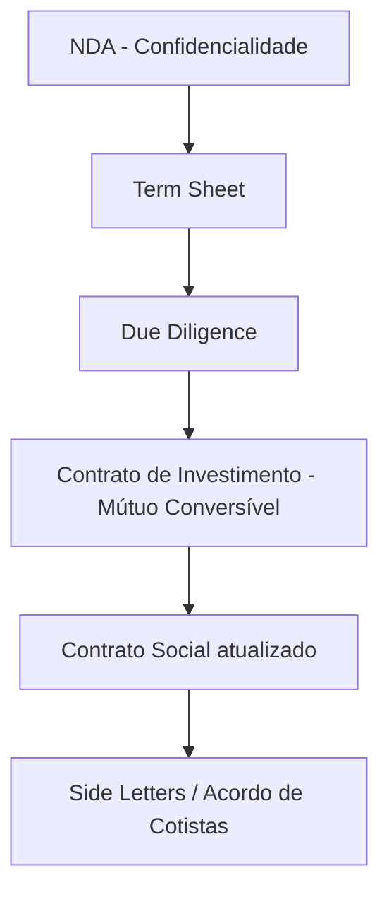

> [!info] Sobre este resumo
> Síntese do guia oficial da [[Anjos do Brasil]] sobre investimento anjo no Brasil. Material educativo — **não substitui assessoria jurídica e contábil especializada**. Útil como base para entender o vocabulário, fluxo e cuidados do investimento anjo em startups brasileiras.

---

## 1. Sobre o [[Investimento Anjo]]

> [!quote] Definição
> Investimento feito **em geral por pessoas físicas** que aportam parte do patrimônio em empresas em estágio inicial, com ou sem operação, mas com **alto potencial de crescimento e inovação**.

**Características principais:**
- Ticket típico: **R$ 50 mil a R$ 500 mil** (individual ou sindicato de investidores)
- Participação geralmente **minoritária**
- Investidor não assume posição executiva, mas agrega capital + experiência + rede
- Investir em sindicato reduz risco e aumenta valor agregado

### Escala de financiamento de startups


| Estágio | Foco |
|---|---|
| [[Fundos Semente]] | Fase inicial, estruturação da operação |
| [[Venture Capital]] | Crescimento e consolidação |
| [[Private Equity]] | Consolidação de mercado, prep. para saída |
| IPO / M&A | Saída — no Brasil, predominantemente M&A |

### Papel do investidor na empresa

- Pode ser **apenas capital + mentoria informal** ou **formalizar como diretor/conselheiro**
- Se virar administrador → pode ser **responsabilizado pessoalmente** por deliberações e passivos
- Importante: definir o papel **nos documentos** desde o início

> [!warning] Risco pessoal
> Ser Diretor, Administrador ou Conselheiro pode gerar responsabilidade pessoal. Buscar aconselhamento jurídico específico antes de aceitar essas posições.

### Expectativa de retorno

- Potencial médio: **~40% a.a.**, podendo chegar a **10x, 20x ou 50x** o capital
- **Sem garantia** — é investimento de risco
- Regra de ouro: quanto mais cedo o aporte, maior o retorno potencial (e maior o risco)
- Saída do anjo pode demorar — depende de novas rodadas e condições de mercado

---

## 2. Sobre a [[Empresa-Alvo]]

### O que o investidor avalia

> [!important] Investe-se no empreendedor, não só no empreendimento
> Em estágio inicial, **o aspecto humano** (capacidade, ética, projeções sólidas) pesa mais do que o negócio em si.

**Dois eixos de avaliação:**
1. **Humano** — confiança, capacidade de execução, ética, histórico do empreendedor
2. **Negócio** — modelo, mercado, tipo societário, governança

### Tipos societários comuns

- **Sociedade Limitada** — mais usual no anjo (menor complexidade e custo)
- **Sociedade Anônima** — preferida por [[Venture Capital]] e [[Private Equity]] em rodadas posteriores

### [[Simples Nacional]] — enquadramento

| Categoria | Receita bruta anual |
|---|---|
| **Microempresa (ME)** | ≤ R$ 360.000,00 |
| **Empresa de Pequeno Porte (EPP)** | ≤ R$ 3.600.000,00 |

> [!caution] Exclusões do Simples Nacional
> - Sociedades Anônimas
> - Empresas com sócio no exterior
> - Empresas com capital de entidade pública
> - Empresas com débitos junto a INSS, Fazenda Federal/Estadual/Municipal

### [[Valuation]] — métodos e limitações

| Método | Como funciona | Limitação no anjo |
|---|---|---|
| **Fluxo de Caixa Descontado** | Diferença entre entrada e despesas fixas (EBITDA) | Muito especulativo; falta histórico |
| **Múltiplos** | Comparação com investimentos similares | Difícil achar parâmetro adequado |
| **Renda** | Análise de dividendos distribuídos | Startups raramente distribuem dividendos |
| **Patrimônio Líquido** | Valor dos ativos da empresa | Startups iniciais quase não têm patrimônio |

**Lógica prática do valuation anjo:**
1. Definir taxa de retorno esperada
2. Projetar valor da empresa na saída
3. Calcular % de participação no momento da saída
4. Ajustar para **diluições futuras** em novas rodadas
5. Chegar ao % de entrada hoje
6. Negociar **pre-money** (antes do aporte) e **post-money** (após)

> [!example] Exemplo numérico do guia
> Investidor X aporta R$ 100 mil, quer 10% e 50% de retorno em 5 anos → R$ 760 mil de retorno → empresa vale R$ 7,6 milhões em 5 anos → considerando 2 rodadas futuras com 10% de diluição cada → **deve entrar com 35,8% hoje** para manter 10% no fim.

### Pitch — cuidados na apresentação

- **1ª apresentação**: sem dados confidenciais — só informação relevante
- **2ª apresentação**: detalhada, após assinatura de [[NDA]]
- [[NDA]] (Acordo de Confidencialidade) protege ambos os lados

---

## 3. Antes do Investimento — [[Due Diligence]]

### [[Governança Corporativa]]

- Conjunto de políticas e práticas que regulam o funcionamento da empresa
- Anjo pode contribuir: separação de contas pessoais/PJ, conselho transparente
- Boa governança = mais valor + facilita rodadas futuras

### Áreas críticas de auditoria

> [!checklist] Frentes da Due Diligence
> - [ ] **Financeira** — declarações, balanços, receita, custos
> - [ ] **Tributária** — passivo fiscal, alíquotas, Certidões Negativas
> - [ ] **Societária** — registros em Junta Comercial, histórico do empreendedor em outras sociedades
> - [ ] **Propriedade Intelectual** — patentes ([[INPI]]), marca, cessão de software (tratado como direito autoral no BR)
> - [ ] **Trabalhista** — risco de "PJs" reclassificados como CLT, FGTS, INSS

> [!warning] Risco trabalhista — "PJs"
> Contratação de autônomos via PJ pode ser reclassificada pela Justiça do Trabalho como vínculo CLT, gerando passivo com **privilégio sobre patrimônio dos sócios**.

### Documentos a solicitar

- Certidões negativas: Justiça **estadual, federal, trabalhista**
- Cartórios de protesto
- [[PROCON]] (se prestadora de serviços)
- Certidão conjunta Receita Federal/Estadual
- Certidão negativa [[INSS]] e [[FGTS]]

---

## 4. Tipos de Investimento

| Modalidade | Como funciona | Quando usar |
|---|---|---|
| **[[Mútuo Conversível]]** | Empréstimo com opção/obrigação de conversão em cotas ao atingir evento ou prazo | **Mais comum no anjo** — limita risco antes de associação formal |
| **[[Opção de Compra]]** | Direito de comprar cotas por preço pré-definido (pode ter [[vesting]]) | Incentivo a administradores/permanência |
| **Compra e Venda de Cotas** | Aquisição direta da participação | Menos usada por anjos (preferem ser credores) |

> [!tip] Foco do guia
> O guia recomenda **Mútuo Conversível em Sociedade Limitada** como formato padrão para investimento anjo no Brasil.

---

## 5. Documentos do Investimento

### Sequência típica



### Documentos principais

- **[[NDA]] / Acordo de Confidencialidade** — protege informações trocadas
- **[[Term Sheet]]** — resumo dos principais termos; base para contratos definitivos
- **[[Contrato Social]]** — rege relação entre sócios e sociedade; registrado em Junta Comercial (efeito *erga omnes*)
- **[[Side Letters]]** — regras entre algumas/todas as partes (vesting, sucessão, recompra)
- **[[Acordo de Cotistas]] / [[Acordo de Acionistas]]** — quórum, restrições, gestão, votos, veto, não-competição

### Termos contratuais essenciais

> [!info] Glossário operacional

#### 1) Deliberações Sociais
Matérias que exigem proteção do investidor: alteração do objeto social, falência, distribuição de dividendos, encerramento, dívidas acima de teto, mudança de controle, novas rodadas abaixo de valor mínimo.

#### 2) [[Tag Along]] e [[Drag Along]]
- **Tag Along** — direito de "colar" na venda de outro sócio (proteção do minoritário)
- **Drag Along** — poder de "arrastar" os demais sócios em uma venda integral (geralmente exige valor/data mínima)

#### 3) [[Put Option]]
Direito do investidor de vender suas cotas a preço pré-definido — reembolso quando não há evento de liquidez bem-sucedido.

#### 4) Venda para terceiros — [[ROFR]]
*Right of First Refusal* — direito de preferência: demais cotistas podem adquirir cotas ofertadas a terceiros nas mesmas condições.

#### 5) [[Não Concorrência]]
Período em que fundadores/administradores não podem competir com a empresa após saída.

#### 6) [[Lock Up]]
Vedação de transferência de cotas (entre sócios ou para terceiros) por período definido. Pode ter sanção (alienação compulsória).

#### 7) [[Preferência na Liquidação]]
> "O último dinheiro que entra é sempre o primeiro que sai."

Define ordem e valor de retorno em evento de liquidez (incluindo **liquidação presumida**: fusão, aquisição, venda de ativos, mudança de controle).

#### 8) Resolução de Disputas — [[Arbitragem]] vs. Justiça Comum
- Arbitragem: mais rápida, mas **custo na casa dos 6 dígitos** e **decisão irrecorrível**
- Empresas em estágio inicial geralmente preferem **juízo comum**

### [[Vesting]] — o que é
Período de permanência mínima dos fundadores/administradores para evitar que um sócio se beneficie do esforço alheio. Geralmente cláusula em side letter, opção de compra ou mútuo conversível.

---

## 6. Outros Pontos Importantes

### Tributação (legislação de abril de 2016 — **verificar atualizações**)

> [!caution] Dado defasado
> A tabela abaixo é do guia original (2016). **Sempre verificar com contador atual**. A MP 682 mencionada no guia ainda estava pendente de conversão em lei à época.

**Ganho de Capital — Pessoa Física (tabela do guia):**

| Alíquota | Faixa de Ganho |
|---|---|
| 15% | até R$ 5 milhões |
| 17,5% | de R$ 5 mi a R$ 10 mi |
| 20% | de R$ 10 mi a R$ 30 mi |
| 22,5% | acima de R$ 30 mi |

> [!warning] Observação sobre as faixas
> No PDF original há erro de digitação nas faixas — duas linhas com a mesma faixa. **Confirmar com fonte oficial atualizada da Receita Federal.**

**Outros pontos tributários:**
- **[[IOF]]** sobre empréstimos — alíquota varia com prazo; **PF para PJ é isento**
- **Pro labore** — remuneração de sócios trabalhando na empresa; incidência de **11% INSS**
- **Dividendos** — atualmente isentos (segundo legislação à época), mas **raramente distribuídos em startups iniciais** (lucro reinvestido)

### Pós-investimento — cuidados

- Acompanhar [[Business Plan]] e métricas operacionais
- Relação de **transparência** com o empreendedor
- Reuniões periódicas + **relatório curto (máx. 2 páginas)** com periodicidade definida (ex: bimestral)
- Não interferir na rotina operacional

### Próxima rodada — transformação em S.A.

- VC e PE preferem **Sociedade Anônima**
- Exige novas formalidades: assembleias, atas, livro de registro de ações
- **Passivo até a entrada de novos investidores** = responsabilidade do anjo + empreendedor

---

## 🔑 Pontos-chave para Lembrar

> [!summary] TL;DR
> 1. Investimento anjo é **PF investindo em estágio inicial**, R$ 50k–R$ 500k, com expectativa de retorno alto e risco alto.
> 2. **Empreendedor > empreendimento** — confiança e capacidade são o ativo principal.
> 3. **Mútuo conversível em Ltda** é o formato mais comum no Brasil.
> 4. **Term Sheet → Due Diligence → Contrato definitivo** é a sequência típica.
> 5. **Tag/Drag, ROFR, Put, Lock-up, Vesting, Preferência na liquidação** são o vocabulário mínimo.
> 6. **Diluição** em rodadas futuras precisa estar no cálculo desde o aporte inicial.
> 7. **Sempre consultar advogado e contador** — o guia é educativo, não operacional.

---

## Conexões e Próximos Passos

```dataview
LIST
FROM [[#]]
WHERE contains(file.outlinks, this.file.link)
```

**Notas relacionadas a criar:**
- [[Mútuo Conversível - modelo e cláusulas]]
- [[Term Sheet - checklist de termos]]
- [[Due Diligence - questionário de PME]]
- [[Cap Table e diluição - planilha]]
- [[Valuation de startup - métodos práticos]]
- [[Tag Along vs Drag Along - exemplos]]
- [[Saída do investidor anjo - cenários]]

**Fontes externas:**
- Site oficial: https://www.anjosdobrasil.net
- Por que ser investidor anjo: https://www.anjosdobrasil.net/por-que-ser-investidor-anjo.html
- Modelos de documentos: https://www.anjosdobrasil.net/guia

---

## Nota de uso

> [!note] Dependências e fluxo no Obsidian
> - Esta nota usa **[[wikilinks]]** para conectar conceitos-chave a notas próprias (criar conforme aprofundar cada tema).
> - O bloco **Dataview** ao final lista notas que referenciam esta — exige o **plugin Dataview** ativado.
> - **Callouts** (`> [!info]`, `> [!warning]` etc.) renderizam com cores no tema padrão e em temas como Minimal.
> - Esta é uma **nota-resumo de referência** — para sessões de estudo ou análise de deals específicos, criar instâncias separadas a partir de um template (ex: `Template - Análise de Deal Anjo`).
> - Os dados tributários e valores monetários do guia original são de **2016** — sempre revalidar antes de aplicar.

---

## Rating de Confiança

**Confiança: 8/10**

**O que sustenta o 8:**
- Resumo extraído **diretamente do PDF fornecido** — fidelidade ao conteúdo original é alta.
- Estrutura, vocabulário e exemplos numéricos vêm do material, não de memória.

**Por que não 9 ou 10:**
- O guia da Anjos do Brasil é de **~2016** (referência explícita à MP 682 e à legislação tributária da época). Pontos sobre **alíquotas, isenção de dividendos, regras do Simples e valores de enquadramento** podem ter mudado — destaquei isso nos callouts, mas o leitor precisa validar com contador atualizado.
- A tabela de ganho de capital no PDF original tem **erro de digitação** (duas linhas com a mesma faixa "R$ 5 mi a R$ 10 mi"). Reproduzi com aviso, mas a tabela correta da Receita atual deve ser conferida.
- Não verifiquei via web se houve atualização do guia após 2016 — se essa validação for importante para você, posso buscar.
