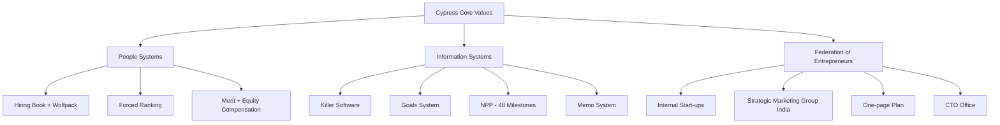

# Resumo de estudo de caso para Obsidian

> **Resumo:** **Conversation Overview**

The person requested a detailed summary of a Stanford Graduate School of Business case study (OB84, 2012) about Cypress Semiconductor, formatted specifically for use within Obsidian. The task was to produce a structured, richly formatted Obsidian note from the provided PDF material, with wikilinks, callouts, Dataview queries, Mermaid diagrams, and YAML frontmatter.

Claude produced a comprehensive Obsidian-ready document covering the case's key themes: T.J. Rodgers' leadership philosophy, the "Federation of Entrepreneurs" organizational model, people systems (hiring processes, performance management, compensation), information systems (Killer Software, Goals System, NPP milestones), the four evolutionary phases of Cypress (1982–2012), the internal start-up process and its financial structure, and concrete results. The note included wikilinks to related concepts (e.g., SunPower, Lei de Moore, Vale do Silício, venture capital), Obsidian-native callout blocks for quotes and key information, a Mermaid diagram synthesizing the overall model, a Dataview query block, and suggestions for child notes to create. A confidence level assessment (9/10) was included, noting that all data, quotes, and statistics were extracted directly from the source material without external references.

The domain is management, organizational behavior, corporate innovation, and semiconductor industry. Key terminology used includes: intraempreendedorismo, federação de empreendedores, forced ranking, fab-lite, NPP (New Product Planning), wolfpack session, killer software, one-page plan, three horizons, and P&L center. No corrections or preference instructions were provided by the person during this conversation.

**Mensagens:** 2 · **Criada:** 2026-05-21 · **Atualizada:** 2026-05-21

---

## 👤 Usuário · 2026-05-21 20:08

Faça um resumo detalhado desse material, formatado para ser usado e conectado dentro do obsidian

- 📎 8-25-202215-40Cypress Semiconductor A Federation of Entrepreneurs.pdf

## 🤖 Claude · 2026-05-21 20:10

 
```
This block is not supported on your current device yet.
```

```markdown
---
tipo: estudo-de-caso
área: [[Gestão]], [[Inovação Corporativa]], [[Cultura Organizacional]]
status: ativo
criado: 2026-05-21
tags: [estudo-caso, stanford, semicondutores, intraempreendedorismo, cultura, performance, venture-building]
aliases: ["Cypress Semiconductor", "Federation of Entrepreneurs", "T.J. Rodgers", "Cypress Case OB84"]
---

# Cypress Semiconductor: A Federation of Entrepreneurs

> [!info] Sobre o caso
> Caso de estudo da **Stanford Graduate School of Business** (OB84, 2012), preparado pelos professores **David Caldwell** e **Charles O'Reilly**. Analisa como **T.J. Rodgers**, fundador e CEO da Cypress Semiconductor, construiu uma empresa capaz de competir simultaneamente em mercados maduros (eficiência/custo) e em inovações de ruptura (flexibilidade/risco), através do modelo "federação de empreendedores".

---

## 🎯 Contexto e Desafio Central

A Cypress em 2011 faturou **US$ 995 milhões** com margem pré-imposto de **24%**. Apesar do bom desempenho, era um player pequeno comparado a gigantes como a [[Samsung]] (40x maior).

>[!quote] T.J. Rodgers
> "It's all about execution because if you haven't done what you said you were going to do it doesn't matter if you have a good plan or not."

O **desafio fundamental** que estrutura todo o caso:
- [ ] Competir em mercados maduros (eficiência + redução de custo)
- [ ] Gerar inovações disruptivas (flexibilidade + tomada de risco)
- [ ] Manter o espírito empreendedor mesmo crescendo como [[empresa de capital aberto]]

A solução proposta por Rodgers: gerir a Cypress como uma **[[federação de empreendedores]]**.

---

## 👤 T.J. Rodgers — Perfil do Fundador

- PhD por [[Stanford]], com patente em tecnologia de chips
- Iniciou carreira na **AMI (American Microprocessors Inc.)** em 1973, ambiente que considerava "warm-and-fuzzy" e que veio a falir
- Listado pela revista *Fortune* como um dos chefes mais durões dos EUA
- Auto-descrição: **tough but not mean**

>[!quote] Rodgers sobre cultura
> "Life is cordial right up to the day the company dies. Winning is what matters. And if winning means being tough, demanding, impatient, then that's what you have to be."

**Estilo de gestão**: 
- Praticava o "**rock turning**" — questionamento profundo de premissas, podendo parecer interrogatório
- Forte ideologia pessoal: criticava subsídios governamentais, altas cargas tributárias corporativas, política de imigração restritiva dos EUA
- Paradoxo: cético quanto ao [[aquecimento global]], mas a Cypress foi uma das primeiras empresas do [[Vale do Silício]] a usar energia solar

---

## 🏛️ Os Três Princípios Fundamentais da Cypress

### 1️⃣ Contratar e Reter os Melhores
### 2️⃣ Transparência e Honestidade Completas
### 3️⃣ Identificar e Institucionalizar as Melhores Práticas

>[!quote] Rodgers
> "People at Cypress know that we don't tolerate bureaucratic politics—it's one of the items on a very short list of what will get you fired."

---

## 👥 People Systems

### 🔍 Processo de Contratação (Hiring)

>[!important] Princípio central
> O **gestor contratante** é o responsável direto por encontrar e atrair talentos. RH **não avalia candidatos** — apenas mantém banco de currículos.

**Elementos do processo**:
- 📚 **Hiring book**: checklist de 35 passos documentando cada contratação
- 🗣️ **Mínimo de 4 entrevistas** (6 para cargos exempt, incluindo um VP)
- 🐺 **Wolfpack session**: 3-6 entrevistadores multidisciplinares fazendo perguntas técnicas duras com candidato em frente ao quadro, por 45 minutos
- 🧭 **Career-path questionnaire**: explora motivações, caráter e aspirações para detectar [[fit cultural]]
- 📞 **Reference checks** profundos — propositadamente intensos para sinalizar seriedade ao candidato

>[!quote] Rodgers
> "Our system, and the hiring book, is a vaccine against bureaucracy."

### 📊 Performance Management

**Regra dos 3%**: nenhum aumento anual para ~3% dos funcionários (analogia: assim como uma empresa morre se 3% dos produtos forem defeituosos, não se pode recompensar 3% que não contribuem).

**Três erros típicos que Rodgers buscava evitar**:
1. Avaliação pouco científica
2. "Tyranny of the mean" — espalhar aumentos para não desagradar (mediocridade da média)
3. Confundir [[merit]] com [[equity]]

### 💰 Sistema de Compensação — 3 Pilares

| Pilar | Descrição |
|-------|-----------|
| **Outstanding raises** | Top performers recebem aumentos substancialmente maiores |
| **Merit vs Equity separados** | Top de cada grupo deve ganhar 50% mais que o último |
| **Precisão importa** | Sem categorias vagas tipo "acima da média" — ranking forçado |

**Processo operacional**:
- Grupos focais de 5-25 pessoas com responsabilidades comparáveis
- **Forced ranking** com comparações par a par
- Software com **14 quality checks** e **6 warning flags**
- Cada funcionário recebe: aumento por mérito + ajuste de equidade + total + quartil

**Stock options**:
- Distribuídas pelo mesmo processo focal
- Pergunta-chave: **"Quem podemos menos perder nos próximos 4 anos?"**
- Para senior staff (~50-60 gestores): **restricted stock** vinculado a milestones de performance específicos

---

## 💻 Information Systems

### 🚨 Killer Software & Goals System

>[!warning] Killer Software
> Sistema que **literalmente desligava operações** (movimentação de material, envios, etc.) quando metas combinadas não eram cumpridas. Análogo ao **andon system** das linhas de montagem japonesas.

Rodgers chegou a ter o próprio salário retido pelo RH por atraso em revisões — e aceitou como demonstração de comprometimento.

**Goals System**:
- Entrada semanal de metas em base de dados
- Visibilidade total: até as metas de Rodgers eram públicas
- Posteriormente flexibilizado: 3-5 metas trimestrais críticas
- Cultura "**no secrets**" — reduzir incerteza e política

### 📝 Memos & Specifications

- Memorandos compartilhados em sistema acessível a todos
- Rodgers escreveu pessoalmente **mais de 1.000 memos**
- **"Show me"** — sua frase para exigir dados imediatamente verificáveis

### 🆕 New Product Planning (NPP)

>[!info] Processo NPP
> - **48 milestones** monitorados do "kickoff" à "volume production"
> - Plano de 30 páginas exigido antes do início de qualquer projeto
> - Aprovação obrigatória de Rodgers + VPs de produto, R&D, finanças, manufatura
> - Um chip teve **3.278 metas específicas** para cumprir os 48 milestones

⚠️ Trabalhar em projeto sem NPP aprovado = uma das poucas razões de **demissão imediata** (junto com comportamento político destrutivo).

---

## 📅 As 4 Fases Evolutivas da Cypress

### Fase 1 — 1982-1992: O Modelo Original

>[!quote] Rodgers
> "Why not build a collection of companies—each small enough to maintain its intensity, together big enough to matter?"

- Cada unidade era P&L center, **incluindo legal e RH**
- Subsidiárias com **ações próprias, presidentes e boards próprios**
- Funding via venture-style do centro corporativo
- "Distribution company" interna fazia vendas e cobrava as subsidiárias por alocações negociadas

### Fase 2 — 1992-2002: A Crise e a Reinvenção

>[!danger] 1992
> Cypress perdeu **US$ 21 milhões**. Rodgers assumiu publicamente a responsabilidade na capa do Annual Report.

**Mudanças**:
- Corte do portfólio de 3.500 para ~1.750 circuitos integrados
- Manufatura e teste movidos para offshore
- Primeira demissão da história da empresa
- Fim temporário das subsidiárias incubadoras
- Foco em **competir em qualquer mercado, com qualquer concorrente, a qualquer preço — e ainda lucrar**

### Fase 3 — 2002-2011: SRAM, SunPower e Transformação

- Cypress se tornou **#1 mundial em SRAM chips** (partindo de competidor com >20 rivais incluindo [[Intel]], [[AMD]], [[Hitachi]], [[Toshiba]])
- Chips de 2009 tinham **144.000x** a capacidade dos de 1983 ([[Lei de Moore]])
- Rodgers investiu US$ 750k próprios na [[SunPower]] após board recusar
- SunPower IPO em 2005 a US$ 18 → pico de US$ 133 em 2007
- 2008: spin-out da SunPower distribuiu **US$ 2,6 bilhões tax-free** aos acionistas
- Cypress migra para modelo "**fab-lite**" — abandonando o "real men have fabs"

### Fase 4 — 2012 e Além: Reorganização para Inovação

**Três Horizontes** (modelo de planejamento de produto):
- **Horizon 1**: produtos do core business atual
- **Horizon 2**: produtos em early growth / near launch
- **Horizon 3**: ideias e testes

**Quatro divisões**:
1. Consumer and Computation
2. Data Communications
3. Memory Products
4. **Emerging Technology** (start-ups internas: Cypress Envirosystems, AgigA Tech, Decatech)

>[!quote] Brad Buss (CFO)
> Os start-ups internos são "**call options on the future**"

---

## 🚀 O Processo de Internal Start-Ups

### Identificação de Novas Oportunidades

| Origem | Volume típico |
|--------|---------------|
| Referências externas | ~20/ano |
| Ideias internas (Cathal Phelan) | ~1 ideia semi-séria/mês |
| Ideias do próprio Rodgers | ~1 séria/ano |
| Avaliações sérias anuais | ~4 |

### Avaliação

1. **"Deep dive"** técnico feito pelo próprio Rodgers (1 dia/semana lendo tecnologia)
2. Análise de mercado feita pelo **Strategic Marketing Group** (sediado na Índia desde 2007, "the guys in India") — 6 analistas com MBA de universidades indianas top
3. Aprovação pelo **Executive Board**
4. Identificação de CEO
5. Negociação do **one-page plan** (3 meses)

### Estrutura Financeira

>[!info] One-page plan responde a 2 perguntas
> 1. Qual o potencial payoff do start-up?
> 2. Quanto a Cypress precisa investir para atingir os resultados?

**Critérios de investimento**:
- Receita anual potencial: **US$ 40M+/ano**
- Margem pré-imposto: **20%+**
- Retorno esperado: **5x a 10x**

**Estrutura de capital típica**:
- 10-15% common stock para founders/funcionários
- 5% reservado para bônus especiais
- Resto: preferred stock detido pela Cypress
- Common stock inicia a ~10% do preço da preferred (potencial upside grande)

### Gestão do Start-Up

>[!tip] Vantagens vs VC tradicional (Brad Buss)
> Num start-up VC tradicional, o CEO gasta **40-60% do tempo perseguindo dinheiro**. Na Cypress, o funding é trimestral baseado no plano — o CEO foca em produto e receita.

- Espaço físico separado para co-location
- Liberdade para usar (ou não) os processos da Cypress
- Reuniões mensais informais + trimestrais formais com board
- Cada start-up tem um executivo Cypress senior dedicado

### Encerramento (Wrap-up)

**Quatro caminhos possíveis**:
1. 🌟 **Spin-out / IPO** (caso SunPower) — sucesso enorme
2. 🔄 **Spin-in / aquisição** pela Cypress
3. 💼 **Venda para terceiros**
4. 💀 **Shutdown** — venda de ativos, funcionários retornam à Cypress

---

## 🏆 Resultados Concretos das Iniciativas

> Pelos padrões de Rodgers, o portfólio gerou:
> - 1 **mega-winner**: [[SunPower]]
> - 1 **big winner**: [[Cypress Microsystems]] (PSoC)
> - 2 sucessos razoáveis
> - 5 fracassos
> - 2 ainda indefinidos

**PSoC (Programmable System on a Chip)**:
- Custou US$ 54M e 4 anos para se tornar lucrativo
- Em 2009: **25% da receita** da Cypress
- CAGR de **45%**

---

## ⚙️ O Modelo Cypress — Síntese Visual



---

## 💡 Insights-Chave para Aplicação

>[!success] Lições transferíveis
> 1. **Cultura é desenhada** — não emerge. Rodgers escreveu pessoalmente os core values após entrevistar centenas de funcionários
> 2. **Política interna é cancerígena** — eliminar com transparência radical de informação
> 3. **Compensação precisa de precisão** — vagueza destrói meritocracia
> 4. **Processos viabilizam empreendedorismo** — não o sufocam, quando bem desenhados
> 5. **Aprender com [[venture capital]]** — separar avaliação técnica de avaliação de mercado
> 6. **Encerramentos justos** preservam reputação para futuras iniciativas

---

## ❓ A Pergunta de 2012 (Cliffhanger do Caso)

>[!question] Dilema final apresentado
> "The question now is whether we should modify any of our practices? What, if anything, should we change? And, importantly, can we do this and still adhere to our values?"

Um arquiteto técnico-chave observou: a força da Cypress é "**repeatability and constant learning**", mas a fraqueza é "**too much dependence on processes not people—especially at the fuzzy front end**".

>[!quote] Rodgers (em um memo)
> "It seems like joining a big company is like passing the 50-year age marker. Your metabolism slows down and your waistline inevitably gets bigger. The big question is how we can make a porky public company run like a fleet-footed start-up?"

---

## 🔗 Conexões — Dataview

```dataview
LIST
FROM [[Cypress Semiconductor]]
WHERE contains(tags, "estudo-caso") OR contains(tags, "cultura") OR contains(tags, "intraempreendedorismo")
SORT file.mtime DESC
```

---

## 📝 Nota de Uso

- Os `[[wikilinks]]` permitem criar conexões com outras notas (ex.: criar nota própria para [[Lei de Moore]], [[Vale do Silício]], [[venture capital]])
- O bloco **Dataview** ao final puxa automaticamente notas relacionadas — funciona se você tiver o plugin Dataview instalado
- Os **callouts** (`>[!info]`, `>[!quote]`, etc.) renderizam como caixas destacadas no Obsidian
- Sugestão de **notas filhas** para criar: 
  - `Federation of Entrepreneurs - Modelo Detalhado`
  - `Killer Software e Andon System` 
  - `One-page Plan Template`
  - `Forced Ranking - Prós e Contras`
- Use o **graph view** do Obsidian para visualizar a teia de conexões

---

## 🎯 Confiança da Síntese

**Nível de confiança: 9/10**

Justificativa: O resumo foi construído integralmente a partir do PDF fornecido (Stanford Case OB84, 2012), preservando dados, citações diretas e estrutura do caso. As únicas inferências interpretativas são:
- A organização em seções/headers (estrutural)
- A síntese visual em mermaid (derivada do conteúdo)
- A categorização "Lições transferíveis" (interpretativa mas fiel ao texto)

Todas as estatísticas, valores em dólar, datas e citações foram extraídos diretamente do material original. Não houve uso de fontes externas — toda a informação tem origem rastreável no PDF.
```
