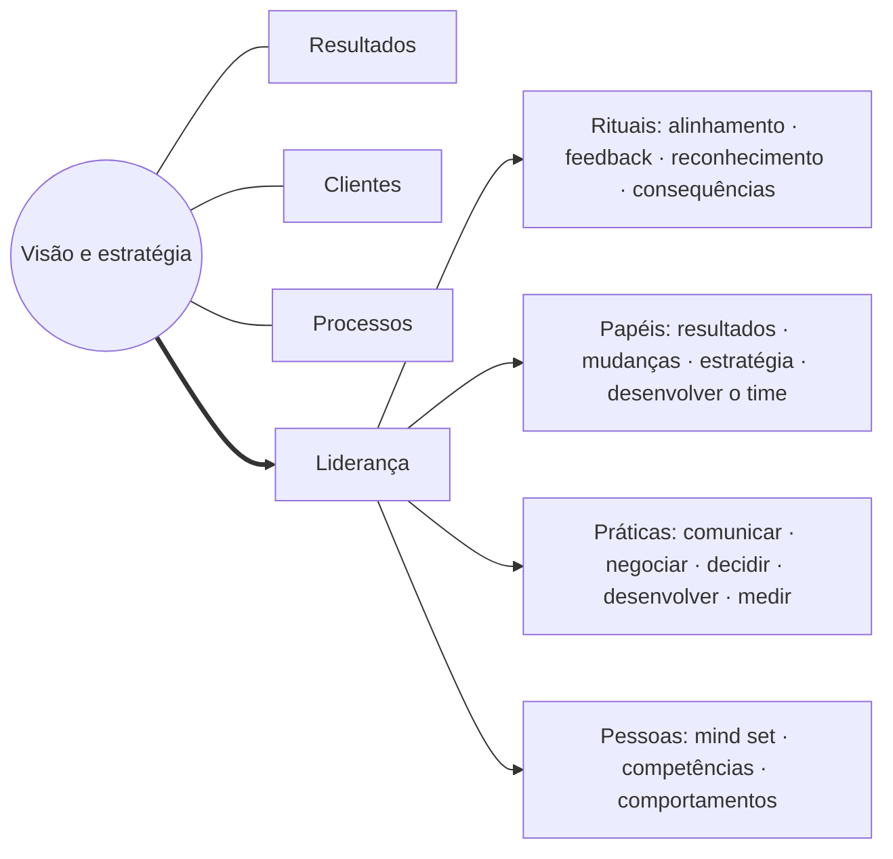
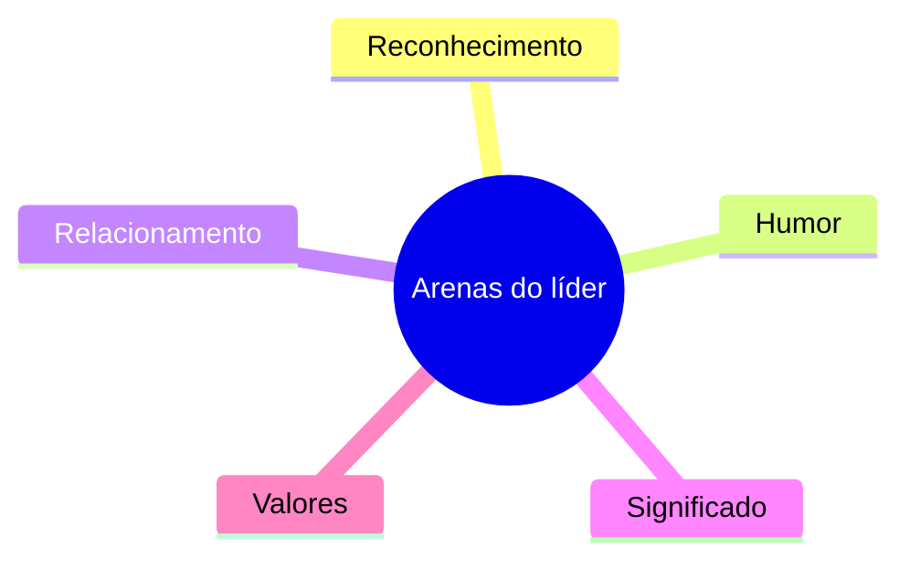
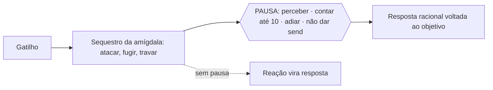
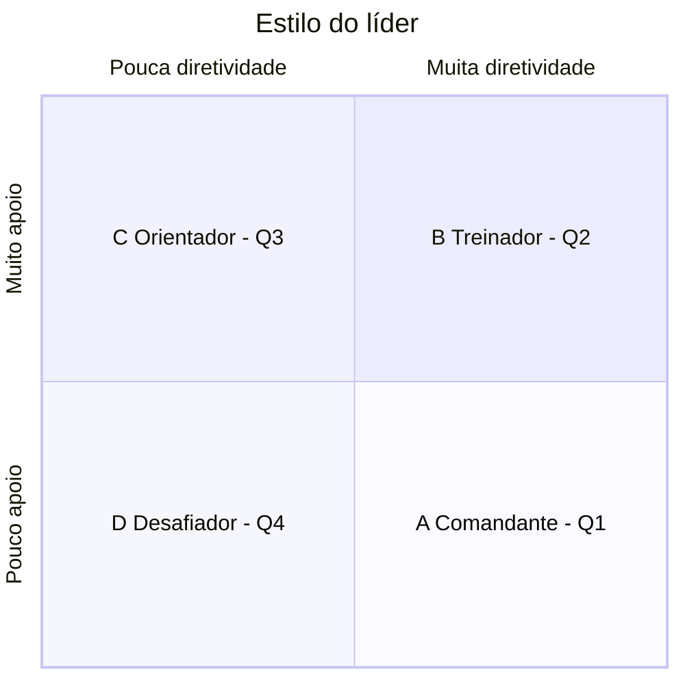
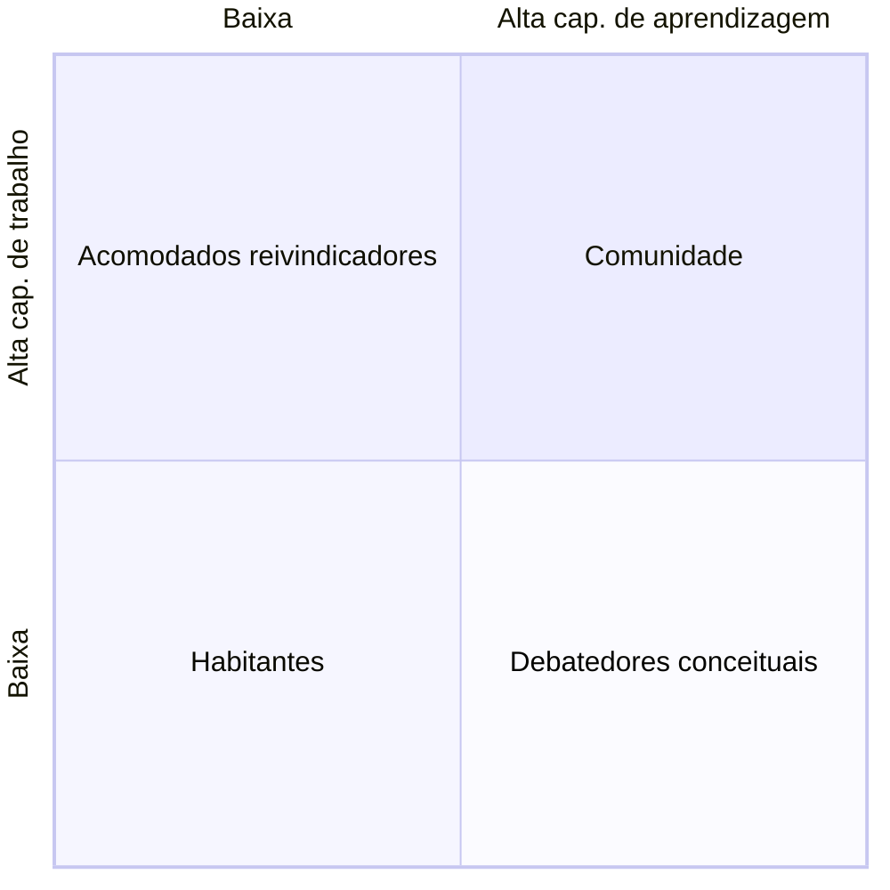
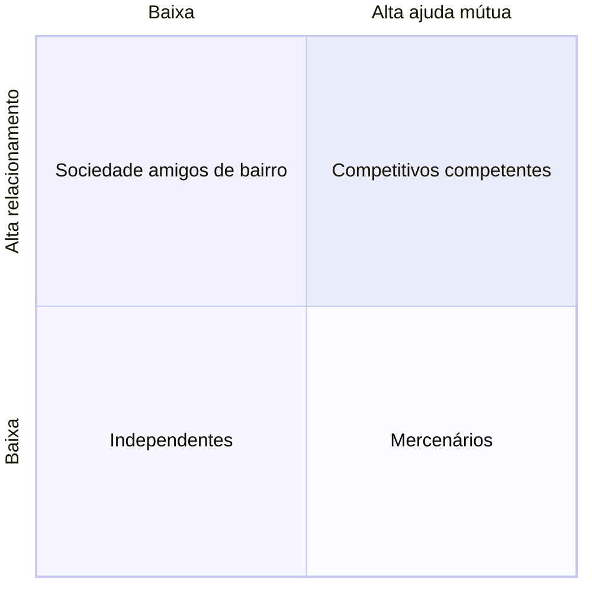
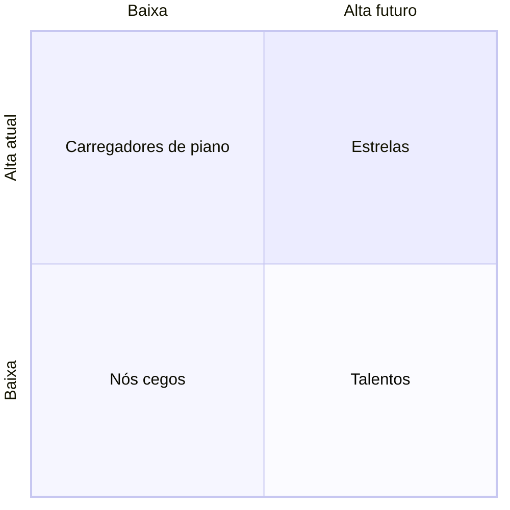

# claude/manual-operacional-caderno-de-etapas.md

---
tipo: manual-operacional
área: shopping-centers
status: v2-para-validacao
criado: 2026-09-27
tags: [manual-operacional, processos, etapas, checklist, continuidade, apuracao-automatica, allos]
aliases: [Caderno de Etapas, Manual Operacional - Etapas, Passo a passo das Etapas, Caderno v2]
---

# Manual Operacional — Caderno de Etapas

> [!abstract] Para que serve
> Detalha **cada Etapa do [[Manual Operacional]]** até o nível da rotina — por que existe, quem conduz, passo a passo, resultado, registro e **critério de validação objetivo com apuração automatizável** — organizado também **por área e posição** (Negócios/Comercial, Marketing e Mídia, Operações, Financeiro). Escrito para que uma pessoa nova na posição execute sozinha, só lendo, e para que a operação não perca continuidade quando as pessoas mudam.

> [!quote] Objetivo do shopping — o norte de toda rotina
> Trazer as melhores ofertas de lojas, serviços, entretenimento e gastronomia de acordo com o seu posicionamento, visando aumentar a frequência de visita e o ticket médio gasto nas lojas, com uma experiência qualificada, gerando encantamento para seus consumidores e maximizando venda para seus lojistas e anunciantes de maneira segura, com isso, maximizando o retorno sobre investimento aos empreendedores de shoppings a longo prazo.

> [!info] Fontes desta versão
> Manual/Book de Processos v1.1 (jul/2026); [[Handbook Operações Allos 2024]]; [[Skill - Book Renovações em Shoppings Center|Book de Renovações]]; descritivos de função das gerências e coordenações (Negócios, Marketing, Operações, Mall, Ambiência); skill [[00 - Índice|Performance de Lojas]] (gatilhos de subdeclaração); [[CREDIT & DEFAULT PREDICTION ENGINE v5|Credit & Default Engine]] (early warning). Parâmetros [calibrar]/[validar] são proposta ou vêm de material antigo (Book de Renovações 2011) ou são rotinas complementares a validar.

## Índice

- [[#Como usar este caderno]]
- [[#Atribuições por área e posição]]
- **Pilar · Segurança** — Proteger pessoas e patrimônio
    - [[#Etapa 03 · Segurança Patrimonial e Prevenção de Perdas]]
    - [[#Etapa 04 · Saúde, Segurança, Meio Ambiente (SSMA) e Emergência]]
- **Pilar · Hospitalidade** — Acolher e encantar quem visita
    - [[#Etapa 02 · Operações: Manutenção, Limpeza e Infraestrutura]]
    - [[#Etapa 05 · Estacionamento e Gestão de Fluxos]]
    - [[#Etapa 06 · Atendimento ao Cliente e SAC]]
- **Pilar · Atratividade** — Atrair público e manter o mix vivo
    - [[#Etapa 08 · Comercial e Leasing]]
    - [[#Etapa 09 · Marketing e Eventos]]
    - [[#Etapa 16 · Comitês de Performance e Acompanhamento de Vendas]]
    - [[#Etapa 18 · Renovações Contratuais e Mitigação de Renovatórias]]
- **Pilar · Eficiência** — Gerir, sustentar e rentabilizar
    - [[#Etapa 10 · Financeiro, Cobrança e Repasse]]
    - [[#Etapa 11 · Jurídico e Contratos]]
    - [[#Etapa 14 · Gestão de Fornecedores e Contratos Terceirizados]]
    - [[#Etapa 15 · Atualização e Acompanhamento de Garantias Contratuais]]
    - [[#Etapa 17 · Auditoria de Livros Fiscais de Lojas]]
    - [[#Etapa 19 · Comitê Jurídico e Gestão de Contencioso]]
- **Alicerce · Governança e Gestão** — Decidir, acompanhar e medir
    - [[#Etapa 00 · Ciclo de Acompanhamento do Manual]]
    - [[#Etapa 01 · Governança e Estrutura Organizacional]]
    - [[#Etapa 13 · Tecnologia, Sistemas e Indicadores]]
- **Alicerce · Gente e Liderança** — Formar, liderar e dar continuidade
    - [[#Etapa 20 · Gente e Performance (Gestão de Colaboradores)]]
- **Alicerce · Parceria com Lojistas** — Construir a relação que sustenta o mix
    - [[#Etapa 07 · Relacionamento com Lojistas]]
- [[#Apêndice A · Liderança]]
- [[#Apêndice B · Modelo de apuração automatizada]]

---

## Como usar este caderno

### Como o Manual está organizado: 4 pilares e 3 alicerces

Toda a operação do shopping serve a **quatro pilares de qualidade do negócio**. O que não é um atributo percebido pelo cliente, mas sustenta os quatro, está nos **alicerces**. **A execução das rotinas independe do porte do shopping**: toda rotina vale para todo ativo.

| Tipo | Pilar / Alicerce | O que é | Etapas |
|---|---|---|---|
| Pilar | **Segurança** — *Proteger pessoas e patrimônio* | Nada no shopping funciona sem segurança. Vem primeiro na hierarquia de desempate: quando tempo, verba ou decisão não dão para tudo, vence a segurança. | 03 · 04 |
| Pilar | **Hospitalidade** — *Acolher e encantar quem visita* | A experiência física e humana do visitante: ambiente limpo e funcionando, chegada e saída sem atrito, atendimento que resolve. | 02 · 05 · 06 |
| Pilar | **Atratividade** — *Atrair público e manter o mix vivo* | O que traz gente e faz a loja vender: mix comercial, marketing e eventos, performance de vendas e renovações feitas na hora certa. | 08 · 09 · 16 · 18 |
| Pilar | **Eficiência** — *Gerir, sustentar e rentabilizar* | O que protege o resultado: caixa e cobrança, contratos e garantias, fornecedores, auditoria de vendas e contencioso. | 10 · 11 · 14 · 15 · 17 · 19 |
| Alicerce | **Governança e Gestão** — *Decidir, acompanhar e medir* | O que sustenta todos os pilares: o ciclo mensal que faz o Manual acontecer, a estrutura de decisão e os sistemas e dados que medem tudo. | 00 · 01 · 13 |
| Alicerce | **Gente e Liderança** — *Formar, liderar e dar continuidade* | O shopping é feito de pessoas: recrutar, integrar, avaliar, liderar e fazer o handoff na saída — é o que faz o padrão sobreviver às trocas de pessoas. | 20 |
| Alicerce | **Parceria com Lojistas** — *Construir a relação que sustenta o mix* | O lojista é o parceiro de negócio, não o visitante: conselho, canal de atendimento, obras e vistorias, ambiência e inaugurações. | 07 |

> [!info] Hierarquia de desempate entre pilares
> Segurança > Hospitalidade > Atratividade > Eficiência. Os alicerces não competem com os pilares: eles os sustentam.

### Como cada Etapa está organizada

1. **Por que existe** e **objetivo** — o que a Etapa protege ou produz, e como contribui para o objetivo do shopping.
2. **Quem conduz · interfaces · sistemas** — a posição que roda o processo, com quem ela fala e onde trabalha.
3. **Agenda da posição** — todas as rotinas da Etapa agrupadas por frequência.
4. **Fluxo do processo** — a sequência de ponta a ponta.
5. **Rotinas passo a passo** — para cada rotina: para quê, frequência, dono, origem, passos, resultado, registro e **validação** (critério · fonte · apuração · regra).
6. **Checklist de execução** e **tabela de apuração** — a lista para marcar no mês e o que o painel confere sozinho.
7. **Indicadores**, **riscos e boas práticas**, **glossário** e **o que receber/entregar na troca de pessoa**.

### Como executar qualquer rotina

1. **Leia o "para quê"** da rotina — o que ela protege ou produz para o shopping. Se o passo a passo não couber numa situação, é o objetivo que decide.
2. **Confira as entradas** — documentos, sistemas e informações de outras áreas. Se faltar, cobre por escrito citando o código NN.KK.
3. **Execute o passo a passo** na ordem.
4. **Registre no mesmo dia** — no sistema indicado ou na pasta padrão com o nome no padrão.
5. **Confira a validação**: o critério diz o que é "conforme". Se a apuração é automática, olhe o painel; se não, confira você mesmo antes de marcar Feito.
6. **Se não conseguiu executar**, registre o motivo e avise quem responde pela Etapa. Nunca deixe a rotina sem registro.

### Conceitos

| Termo | Significado |
|---|---|
| **Etapa** | Um capítulo do Manual Operacional: um processo de ponta a ponta (ex.: Segurança Patrimonial). Cada Etapa tem objetivo, fluxo, rotinas, checklist e indicadores. |
| **Rotina** | Uma atividade recorrente dentro da Etapa, identificada por um código NN.KK (Etapa.rotina). Ex.: 03.01 = rondas programadas. Use o código em arquivos, atas e e-mails. |
| **Origem** | De onde a rotina vem: Manual v1.1 (book de processos), Handbook Operações 2024, Book de Renovações, skills do vault (Performance Lojas, Credit Engine). Parâmetros marcados [calibrar] ou [validar] são proposta ou vêm de material antigo. |
| **Dono da rotina** | O cargo que conduz a rotina no shopping. Se você ocupa esse cargo, a rotina é sua — mesmo quando outra área ajuda. A seção "Atribuições por área" lista tudo o que é de cada posição. |
| **Escopo** | Local: o shopping executa. Corporativo: uma área da holding executa e o shopping fornece insumo e cobra. Compartilhado: os dois executam partes. |
| **Frequência** | Quando a rotina acontece: diária, semanal, mensal, trimestral, semestral, anual ou por evento. A "Agenda da posição" agrupa as rotinas por frequência. |
| **Registro** | A prova datada de que a rotina aconteceu: registro em sistema, checklist, ata, planilha do período, documento vigente. Sem registro, a rotina não aconteceu — e o sucessor não consegue continuar. |
| **Validação (critério · fonte · apuração · regra)** | Cada rotina traz um critério objetivo de conformidade, a fonte de dado onde ele é verificado, o tipo de apuração e a regra em pseudo-fórmula. É o que permite conferir sem julgamento e, sempre que possível, sem intervenção humana. |
| **Apuração A · S · M** | A = automática: o dado está em sistema transacional e a regra roda sozinha. S = semiautomática: existência, data e metadados do registro são checados automaticamente (pasta padrão/lista), o conteúdo é amostrado. M = manual: exige presença ou leitura humana. |
| **Pasta padrão** | Onde ficam os registros que não vivem em sistema: SharePoint › Shopping › Ano › Etapa NN › NN.KK. Nome: AAAA-MM_NN-KK_descricao-curta. É o que torna a apuração "S" possível. |
| **⚠️ Obrigação legal** | Rotina ligada a lei, norma ou licença (AVCB, NRs, LGPD, eSocial, Lei do Inquilinato, resíduos). Não pode atrasar: é a primeira a ser feita no mês. |
| **Pilares e alicerces** | As Etapas estão organizadas pelos 4 pilares de qualidade do negócio (Segurança, Hospitalidade, Atratividade, Eficiência) e por 3 alicerces que os sustentam (Governança e Gestão, Gente e Liderança, Parceria com Lojistas). Toda rotina vale para todo shopping, independentemente do porte. |
| **Indicador (KPI) e meta** | Como saber se a Etapa está entregando o seu objetivo. A rotina é o meio; o indicador é o fim. |
| **Checklist mensal** | Até o 5º dia útil, o dono marca cada rotina do mês como Feita (com registro) ou Pendente (com motivo). Onde a apuração é automática, o status vem do sistema e o dono só trata exceções. |
| **Handoff** | A passagem de bastão quando alguém sai da posição: registros de 12 meses, controles, vencimentos e pendências. Cada Etapa diz o que entregar. |

### Registro — o que precisa ter

| Tipo | Requisito |
|---|---|
| Registro em sistema (CMMS, CRM, ERP, CLM, app) | O próprio lançamento, com data/hora e usuário. É a base da apuração automática. |
| Checklist / formulário | Data, hora, local e responsável preenchidos. |
| Print de sistema | Data visível e nome do sistema; um por rotina. |
| Ata | Data, participantes, decisões, responsáveis e prazos; material anexo. |
| Planilha / relatório | Mês de referência no nome e na primeira aba; cópia congelada do período. |
| Documento vigente | Validade visível, assinado ou protocolado. Vencido ou "em renovação" não vale. |

### Seus primeiros dias na posição

**Dia 1 · Entender**

- [ ] Ler "Como usar este caderno" e o objetivo do shopping.
- [ ] Ler a sua posição em "Atribuições por área": missão, KPIs e a lista das suas rotinas.
- [ ] Ler a(s) Etapa(s) das suas rotinas: por que existe, objetivo, fluxo, glossário.

**Dia 2 · Mapear**

- [ ] Lançar no calendário as rotinas diárias, semanais, mensais e as reuniões/comitês (código NN.KK no título).
- [ ] Identificar as rotinas ⚠️ e as datas de vencimento dos documentos legais.
- [ ] Abrir o painel de apuração e entender quais rotinas suas são A, S ou M.

**Dia 3 · Receber**

- [ ] Receber o handoff do antecessor ou do gestor (lista "O que receber" da Etapa).
- [ ] Pedir acesso aos sistemas e à pasta padrão listados.
- [ ] Ler os últimos 3 checklists mensais e as pendências abertas.

**Dias 4–5 · Conectar**

- [ ] Apresentar-se às áreas de interface e combinar como recebe os insumos delas.
- [ ] Conferir documentos vigentes; renovar o que vence em até 60 dias.
- [ ] Ler os indicadores da Etapa do último mês vs. a meta.

**Semana 2 · Executar acompanhado**

- [ ] Executar cada rotina diária e semanal seguindo o passo a passo, com o gestor ou um colega ao lado.
- [ ] Registrar cada execução no padrão e ver o status aparecer no painel.

**Semanas 3–4 · Executar sozinho**

- [ ] Executar todas as rotinas do mês.
- [ ] Fechar o checklist mensal até o 5º dia útil.
- [ ] Revisar com o gestor: o que foi feito, o que ficou pendente e por quê, o que o indicador mostra.

---

## Atribuições por área e posição

> [!info] Como ler
> Para cada posição: a missão (do descritivo de função), os KPIs que ela monitora e **todas as rotinas do Manual que são dela**, agrupadas por frequência — o calendário de quem assume o cargo. O detalhe de cada rotina está na Etapa correspondente (código NN.KK).

### Negócios / Comercial

#### Gerente de Negócios

**Missão:** Liderar a performance financeira e comercial do shopping: receita, NOI e ocupação, por meio da gestão do relacionamento com lojistas, das negociações e do planejamento comercial e financeiro. *(fonte: descritivo-funcao - Gerente de Negócios (vault))*

| KPI que monitora | Frequência | Meta |
|---|---|---|
| Receita de aluguel | Mensal | Orçado |
| NOI | Mensal | Orçado |
| Taxa de ocupação | Mensal | ≥ 90% (Manual: ≥ 96%) |
| Ticket médio de aluguel | Trimestral | Crescimento YoY |
| Renovação de contratos | Trimestral | ≥ 80% |
| Tempo médio de vacância | Mensal | < 90 dias |
| Conformidade de pagamentos | Mensal | ≥ 95% |

**Suas rotinas (23):**

- **Semanal:** [[#Etapa 20 · Gente e Performance (Gestão de Colaboradores)|20.10]] Praticar os rituais do líder: alinhamento, feedback, reconhecimento e gestão de consequências
- **Mensal:** [[#Etapa 08 · Comercial e Leasing|08.12]] Atualizar material RMR Regional · [[#Etapa 16 · Comitês de Performance e Acompanhamento de Vendas|16.02]] Realizar comitê de performance com ata registrada · [[#Etapa 16 · Comitês de Performance e Acompanhamento de Vendas|16.04]] Definir e acompanhar plano de ação por loja crítica · [[#Etapa 17 · Auditoria de Livros Fiscais de Lojas|17.01]] Realizar Comitê de Auditoria e Performance · [[#Etapa 17 · Auditoria de Livros Fiscais de Lojas|17.08]] Realizar Comitê de Performance · [[#Etapa 17 · Auditoria de Livros Fiscais de Lojas|17.13]] Elaborar e executar o plano anual de auditoria (cobertura, âncoras, risco) · [[#Etapa 20 · Gente e Performance (Gestão de Colaboradores)|20.09]] Preparar e conduzir o 1:1 mensal com o Template de Preparação para Liderança
- **Trimestral:** [[#Etapa 07 · Relacionamento com Lojistas|07.02]] Registrar ata de reunião com conselho de lojistas · [[#Etapa 08 · Comercial e Leasing|08.09]] Acompanhar Taxa de Ocupação – Mall · [[#Etapa 08 · Comercial e Leasing|08.10]] Acompanhar Taxa de Ocupação – Lojas · [[#Etapa 08 · Comercial e Leasing|08.11]] Acompanhar Taxa de Ocupação – Mídia
- **Semestral:** [[#Etapa 20 · Gente e Performance (Gestão de Colaboradores)|20.08]] Mapear o quadrante de maturidade (Q1–Q4) de cada liderado nas tarefas críticas e definir o estilo de liderança · [[#Etapa 20 · Gente e Performance (Gestão de Colaboradores)|20.11]] Avaliar a maturidade da equipe (estágio e 4 perspectivas) e definir o plano do time · [[#Etapa 20 · Gente e Performance (Gestão de Colaboradores)|20.12]] Fazer a autoavaliação do líder (gestão emocional, confiança, arenas) e atualizar o próprio PDI
- **Anual:** [[#Etapa 18 · Renovações Contratuais e Mitigação de Renovatórias|18.11]] Manter o planejamento anual de LSR (cadastro · parâmetros · planejado · realizado)
- **Por evento / demanda:** [[#Etapa 08 · Comercial e Leasing|08.04]] Realizar Comitê Comercial – Novas Locações & Renovações · [[#Etapa 10 · Financeiro, Cobrança e Repasse|10.06]] Atualizar Forecast NOI · [[#Etapa 10 · Financeiro, Cobrança e Repasse|10.07]] Atualizar Input do Farol de Metas · [[#Etapa 18 · Renovações Contratuais e Mitigação de Renovatórias|18.02]] Elaborar proposta de renovação com benchmark de mercado · [[#Etapa 18 · Renovações Contratuais e Mitigação de Renovatórias|18.03]] Registrar ata de negociação com lojista · [[#Etapa 18 · Renovações Contratuais e Mitigação de Renovatórias|18.10]] Negociar dentro das alçadas com a proposta aprovada em comitê · [[#Etapa 20 · Gente e Performance (Gestão de Colaboradores)|20.13]] Garantir a continuidade na troca de liderado ou de líder (handoff situacional)

#### Coordenador de Negócios (e analistas)

**Missão:** Executar as negociações comerciais (renovações, retenção, trocas de operação, revisões), a gestão jurídico-contratual do empreendimento e a acuracidade dos KPIs comerciais; conduzir as rotinas de cobrança, garantias, vendas e auditoria do lado do shopping. *(fonte: descritivo-funcao - Coordenador de Negócios (vault))*

| KPI que monitora | Frequência | Meta |
|---|---|---|
| Renovações fechadas | Mensal | ≥ 80% dos contratos vencendo |
| Tempo médio de negociação | Por negociação | 30–60 dias |
| Taxa de retenção | Trimestral | ≥ 85% |
| Acuracidade de dados | Mensal | 100% |
| Relatórios no prazo | Semanal | 100% |
| Satisfação de lojistas | Trimestral | ≥ 8/10 |

**Suas rotinas (50):**

- **Diário:** [[#Etapa 10 · Financeiro, Cobrança e Repasse|10.05]] Preencher recebimentos no E-law · [[#Etapa 10 · Financeiro, Cobrança e Repasse|10.08]] Executar a régua de cobrança por dias de atraso · [[#Etapa 10 · Financeiro, Cobrança e Repasse|10.12]] Bloquear renovação e novos negócios para lojistas inadimplentes ou com ação contra o shopping
- **Semanal:** [[#Etapa 17 · Auditoria de Livros Fiscais de Lojas|17.05]] Realizar Auditoria de Fechamento · [[#Etapa 17 · Auditoria de Livros Fiscais de Lojas|17.06]] Realizar Input de Vendas Semanal · [[#Etapa 17 · Auditoria de Livros Fiscais de Lojas|17.07]] Realizar Triangulação das Vendas Semanal · [[#Etapa 20 · Gente e Performance (Gestão de Colaboradores)|20.10]] Praticar os rituais do líder: alinhamento, feedback, reconhecimento e gestão de consequências
- **Mensal:** [[#Etapa 08 · Comercial e Leasing|08.03]] Conferir negociações reprovadas pelo Faturamento · [[#Etapa 08 · Comercial e Leasing|08.05]] Atualizar Controles de Notificações · [[#Etapa 08 · Comercial e Leasing|08.06]] Atualizar Controle de Manutenção – NAPP · [[#Etapa 08 · Comercial e Leasing|08.13]] Fechar novos contratos de mall (quiosques) no padrão e com condomínio por CRD · [[#Etapa 10 · Financeiro, Cobrança e Repasse|10.02]] Emitir Resultado Mensal do Controle de Atualização de Garantia de Crédito (% válidas/inválidas/pendentes/sem fiança) · [[#Etapa 10 · Financeiro, Cobrança e Repasse|10.03]] Realizar Comitê de Inadimplência · [[#Etapa 10 · Financeiro, Cobrança e Repasse|10.04]] Enviar Expectativa de Inadimplência para a Régua de Cobrança · [[#Etapa 10 · Financeiro, Cobrança e Repasse|10.09]] Monitorar os gatilhos de early warning de inadimplência e classificar o lojista por faixa · [[#Etapa 15 · Atualização e Acompanhamento de Garantias Contratuais|15.02]] Conferir vigência de carta-fiança/seguro-fiança por contrato · [[#Etapa 15 · Atualização e Acompanhamento de Garantias Contratuais|15.05]] Emitir relatório de cobertura de garantias (100% dos contratos) · [[#Etapa 16 · Comitês de Performance e Acompanhamento de Vendas|16.01]] Atualizar dashboard mensal de vendas por loja · [[#Etapa 16 · Comitês de Performance e Acompanhamento de Vendas|16.03]] Classificar lojas em risco (queda de vendas/inadimplência) · [[#Etapa 16 · Comitês de Performance e Acompanhamento de Vendas|16.06]] Calcular o score de risco de subdeclaração de vendas (uso interno) e priorizar auditoria · [[#Etapa 17 · Auditoria de Livros Fiscais de Lojas|17.15]] Cobrar 100% das diferenças apuradas e registrar a recuperação · [[#Etapa 18 · Renovações Contratuais e Mitigação de Renovatórias|18.01]] Atualizar mapa de vencimentos (12-18 meses de antecedência) · [[#Etapa 02 · Operações: Manutenção, Limpeza e Infraestrutura|02.15]] Atualizar o Mapa de Oportunidades na base de rateio (CRD) — 18 meses · [[#Etapa 20 · Gente e Performance (Gestão de Colaboradores)|20.09]] Preparar e conduzir o 1:1 mensal com o Template de Preparação para Liderança
- **Trimestral:** [[#Etapa 18 · Renovações Contratuais e Mitigação de Renovatórias|18.05]] Acompanhar taxa de renovação amigável vs. judicial
- **Semestral:** [[#Etapa 20 · Gente e Performance (Gestão de Colaboradores)|20.08]] Mapear o quadrante de maturidade (Q1–Q4) de cada liderado nas tarefas críticas e definir o estilo de liderança · [[#Etapa 20 · Gente e Performance (Gestão de Colaboradores)|20.11]] Avaliar a maturidade da equipe (estágio e 4 perspectivas) e definir o plano do time · [[#Etapa 20 · Gente e Performance (Gestão de Colaboradores)|20.12]] Fazer a autoavaliação do líder (gestão emocional, confiança, arenas) e atualizar o próprio PDI
- **Anual:** [[#Etapa 15 · Atualização e Acompanhamento de Garantias Contratuais|15.01]] Atualizar valor da garantia conforme aluguel+condomínio+FPP · [[#Etapa 07 · Relacionamento com Lojistas|07.08]] Validar a planta de equipamentos do mall (quiosques, totens, mobiliário, mídia) com Ambiência
- **Por evento / demanda:** [[#Etapa 08 · Comercial e Leasing|08.01]] Enviar plantas atualizadas · [[#Etapa 08 · Comercial e Leasing|08.02]] Enviar material de Inaugurações & Reformas · [[#Etapa 08 · Comercial e Leasing|08.07]] Atualizar Simulador de Novas Locações · [[#Etapa 08 · Comercial e Leasing|08.08]] Atualizar Simulador de Renovações · [[#Etapa 10 · Financeiro, Cobrança e Repasse|10.01]] Atualizar contato dos responsáveis por cobrança do Shopping · [[#Etapa 15 · Atualização e Acompanhamento de Garantias Contratuais|15.03]] Notificar lojista sobre garantia vencida/insuficiente · [[#Etapa 16 · Comitês de Performance e Acompanhamento de Vendas|16.05]] Alertar Financeiro/Jurídico sobre lojas de alto risco · [[#Etapa 17 · Auditoria de Livros Fiscais de Lojas|17.09]] Realizar Reunião com Jurídico · [[#Etapa 17 · Auditoria de Livros Fiscais de Lojas|17.10]] Reunir-se com cada novo lojista em até 1 mês após a inauguração (informe de vendas e auditoria) · [[#Etapa 17 · Auditoria de Livros Fiscais de Lojas|17.11]] Enviar a carta de aviso de auditoria com 3 dias corridos de antecedência (exceto fiscal) · [[#Etapa 17 · Auditoria de Livros Fiscais de Lojas|17.12]] Apresentar o relatório de auditoria ao lojista até o fim do mês subsequente e enviá-lo em 2 dias úteis · [[#Etapa 17 · Auditoria de Livros Fiscais de Lojas|17.14]] Aplicar a trava de auditoria antes de abrir qualquer renovação · [[#Etapa 18 · Renovações Contratuais e Mitigação de Renovatórias|18.06]] Classificar cada loja a renovar por mix e por quadrante (AMM/m² × Vendas/m²) · [[#Etapa 18 · Renovações Contratuais e Mitigação de Renovatórias|18.07]] Abrir a negociação na janela certa (12–6 meses ou < 6 meses) e nunca antes do último reajuste · [[#Etapa 18 · Renovações Contratuais e Mitigação de Renovatórias|18.08]] Fazer a due diligence da loja antes do primeiro contato · [[#Etapa 18 · Renovações Contratuais e Mitigação de Renovatórias|18.09]] Calcular os 4 argumentos, o LSR real e as três checagens · [[#Etapa 18 · Renovações Contratuais e Mitigação de Renovatórias|18.10]] Negociar dentro das alçadas com a proposta aprovada em comitê · [[#Etapa 18 · Renovações Contratuais e Mitigação de Renovatórias|18.12]] Renovar com cobrança de condomínio por CRD · [[#Etapa 18 · Renovações Contratuais e Mitigação de Renovatórias|18.04]] Emitir notificação extrajudicial quando necessário (Lei 8.245/91, art. 51) ⚠️ · [[#Etapa 20 · Gente e Performance (Gestão de Colaboradores)|20.13]] Garantir a continuidade na troca de liderado ou de líder (handoff situacional)

### Marketing e Mídia

#### Gerente de Marketing

**Missão:** Liderar a geração de tráfego, receita e reputação do shopping por campanhas, eventos, ativações e fidelização (CRM/Programa de Benefícios), alinhadas à estratégia comercial. *(fonte: descritivo-funcao - Gerente de Marketing (vault))*

| KPI que monitora | Frequência | Meta |
|---|---|---|
| Tráfego de consumidores | Mensal | MoM +5% a +15% |
| ROI de campanhas | Por campanha | Positivo |
| NPS | Trimestral | ≥ 50 (Manual: ≥ 60) |
| Ticket médio | Mensal | Crescimento YoY |
| Custo por visitante novo | Mensal | < R$ 5–10 |

**Suas rotinas (8):**

- **Semanal:** [[#Etapa 20 · Gente e Performance (Gestão de Colaboradores)|20.10]] Praticar os rituais do líder: alinhamento, feedback, reconhecimento e gestão de consequências
- **Mensal:** [[#Etapa 06 · Atendimento ao Cliente e SAC|06.02]] Medir NPS/CSAT do período · [[#Etapa 20 · Gente e Performance (Gestão de Colaboradores)|20.09]] Preparar e conduzir o 1:1 mensal com o Template de Preparação para Liderança
- **Semestral:** [[#Etapa 20 · Gente e Performance (Gestão de Colaboradores)|20.08]] Mapear o quadrante de maturidade (Q1–Q4) de cada liderado nas tarefas críticas e definir o estilo de liderança · [[#Etapa 20 · Gente e Performance (Gestão de Colaboradores)|20.11]] Avaliar a maturidade da equipe (estágio e 4 perspectivas) e definir o plano do time · [[#Etapa 20 · Gente e Performance (Gestão de Colaboradores)|20.12]] Fazer a autoavaliação do líder (gestão emocional, confiança, arenas) e atualizar o próprio PDI
- **Anual:** [[#Etapa 09 · Marketing e Eventos|09.05]] Atualizar manual de marca e diretrizes visuais
- **Por evento / demanda:** [[#Etapa 20 · Gente e Performance (Gestão de Colaboradores)|20.13]] Garantir a continuidade na troca de liderado ou de líder (handoff situacional)

#### Coordenador de Marketing

**Missão:** Coordenar a execução de campanhas, eventos e ativações no prazo, orçamento e qualidade; acompanhar o Programa de Benefícios, o ROI e o relacionamento com lojistas e fornecedores. *(fonte: descritivo-funcao - Coordenador de Marketing (vault))*

| KPI que monitora | Frequência | Meta |
|---|---|---|
| Eventos no prazo | Por evento | 100% |
| Eventos dentro do orçamento | Por evento | ≥ 95% |
| Participação no PB | Mensal | +5–10% MoM |
| Precisão orçamentária | Mensal | ≥ 95% |
| Documentação & compliance | Mensal | 100% |

**Suas rotinas (15):**

- **Semanal:** [[#Etapa 20 · Gente e Performance (Gestão de Colaboradores)|20.10]] Praticar os rituais do líder: alinhamento, feedback, reconhecimento e gestão de consequências
- **Mensal:** [[#Etapa 09 · Marketing e Eventos|09.01]] Atualizar calendário de campanhas e eventos do período · [[#Etapa 09 · Marketing e Eventos|09.06]] Atualizar base de membros e taxa de share of ID · [[#Etapa 09 · Marketing e Eventos|09.08]] Executar campanha segmentada do período · [[#Etapa 20 · Gente e Performance (Gestão de Colaboradores)|20.09]] Preparar e conduzir o 1:1 mensal com o Template de Preparação para Liderança
- **Trimestral:** [[#Etapa 09 · Marketing e Eventos|09.09]] Conferir adesão e prestação de contas com lojistas parceiros · [[#Etapa 09 · Marketing e Eventos|09.10]] Auditar antifraude de acúmulo/resgate de pontos
- **Semestral:** [[#Etapa 20 · Gente e Performance (Gestão de Colaboradores)|20.08]] Mapear o quadrante de maturidade (Q1–Q4) de cada liderado nas tarefas críticas e definir o estilo de liderança · [[#Etapa 20 · Gente e Performance (Gestão de Colaboradores)|20.11]] Avaliar a maturidade da equipe (estágio e 4 perspectivas) e definir o plano do time · [[#Etapa 20 · Gente e Performance (Gestão de Colaboradores)|20.12]] Fazer a autoavaliação do líder (gestão emocional, confiança, arenas) e atualizar o próprio PDI
- **Anual:** [[#Etapa 09 · Marketing e Eventos|09.07]] Validar conformidade LGPD/DPIA da base de dados
- **Por evento / demanda:** [[#Etapa 09 · Marketing e Eventos|09.02]] Registrar briefing e aprovação de patrocínio/evento · [[#Etapa 09 · Marketing e Eventos|09.03]] Medir fluxo, vendas e ROI por ação de marketing · [[#Etapa 09 · Marketing e Eventos|09.04]] Validar alvará/licença de evento junto à prefeitura ⚠️ · [[#Etapa 20 · Gente e Performance (Gestão de Colaboradores)|20.13]] Garantir a continuidade na troca de liderado ou de líder (handoff situacional)

#### Coordenador / Executivo de Mídia

**Missão:** Comercializar e entregar os espaços de mídia do shopping (mall media, patrocínios), garantindo ocupação de mídia, pós-venda comprovado e satisfação dos anunciantes. Posição inferida da estrutura "Marketing e Mídia" — validar organograma. *(fonte: Manual v1.1 (08.11) · estrutura Marketing e Mídia)*

| KPI que monitora | Frequência | Meta |
|---|---|---|
| Taxa de ocupação de mídia | Trimestral | Forecast |
| Receita de mídia | Mensal | Orçado |
| Pós-venda no prazo | Por negociação | 100% |
| NPS de anunciantes | Trimestral | ≥ 9,0 |

**Suas rotinas (2):**

- **Trimestral:** [[#Etapa 08 · Comercial e Leasing|08.14]] Registrar o pós-venda de mídia em até 30 dias e medir o NPS dos anunciantes · [[#Etapa 08 · Comercial e Leasing|08.11]] Acompanhar Taxa de Ocupação – Mídia

### Operações

#### Gerente de Operações

**Missão:** Garantir operação eficiente, segura e de excelência: infraestrutura, equipes, segurança patrimonial, condomínio e experiência do consumidor, com conformidade regulatória e rentabilidade operacional (condomínio e estacionamento). *(fonte: descritivo-funcao - Gerente de Operações (vault))*

| KPI que monitora | Frequência | Meta |
|---|---|---|
| Resultado condominial | Mensal | ≥ orçado |
| Resultado do estacionamento | Mensal | ≥ orçado |
| Consumo de energia | Mensal | −5% a −10% YoY |
| Taxa de incidentes de segurança | Mensal | −20% |
| Tempo de resposta a solicitações | Semanal | < 24h |
| Conformidade regulatória | Trimestral | 100% |
| Disponibilidade de infraestrutura | Mensal | ≥ 99% |

**Suas rotinas (9):**

- **Semanal:** [[#Etapa 20 · Gente e Performance (Gestão de Colaboradores)|20.10]] Praticar os rituais do líder: alinhamento, feedback, reconhecimento e gestão de consequências
- **Mensal:** [[#Etapa 02 · Operações: Manutenção, Limpeza e Infraestrutura|02.06]] Consolidar indicadores ESG do período (consumo, resíduos) · [[#Etapa 20 · Gente e Performance (Gestão de Colaboradores)|20.09]] Preparar e conduzir o 1:1 mensal com o Template de Preparação para Liderança
- **Semestral:** [[#Etapa 20 · Gente e Performance (Gestão de Colaboradores)|20.08]] Mapear o quadrante de maturidade (Q1–Q4) de cada liderado nas tarefas críticas e definir o estilo de liderança · [[#Etapa 20 · Gente e Performance (Gestão de Colaboradores)|20.11]] Avaliar a maturidade da equipe (estágio e 4 perspectivas) e definir o plano do time · [[#Etapa 20 · Gente e Performance (Gestão de Colaboradores)|20.12]] Fazer a autoavaliação do líder (gestão emocional, confiança, arenas) e atualizar o próprio PDI
- **Anual:** [[#Etapa 05 · Estacionamento e Gestão de Fluxos|05.05]] Revisar contrato com operadora terceirizada · [[#Etapa 05 · Estacionamento e Gestão de Fluxos|05.11]] Aprovar por alçada programas de desconto/isenção e alterações de tarifa
- **Por evento / demanda:** [[#Etapa 20 · Gente e Performance (Gestão de Colaboradores)|20.13]] Garantir a continuidade na troca de liderado ou de líder (handoff situacional)

#### Coordenador de Operações

**Missão:** Coordenar manutenção, infraestrutura, utilidades e gestão condominial; supervisionar equipes técnicas, o orçamento operacional e a resposta a lojistas. *(fonte: descritivo-funcao - Coordenador de Operações (vault) · Handbook Operações 2024)*

| KPI que monitora | Frequência | Meta |
|---|---|---|
| Orçamento condominial vs. real | Mensal | ± 5% |
| Consumo de energia/água/gás | Mensal | Redução contínua |
| Conformidade de manutenção preventiva | Mensal | 100% |
| Tempo de resposta a solicitações | Semanal | < 24h |
| Resultado do estacionamento | Mensal | ≥ orçado |

**Suas rotinas (37):**

- **Diário:** [[#Etapa 02 · Operações: Manutenção, Limpeza e Infraestrutura|02.01]] Executar rondas de inspeção predial (elétrica, hidráulica, ar-condicionado) · [[#Etapa 02 · Operações: Manutenção, Limpeza e Infraestrutura|02.02]] Atualizar OS no CMMS com evidência fotográfica · [[#Etapa 02 · Operações: Manutenção, Limpeza e Infraestrutura|02.10]] Registrar a medição diária de água nos pontos obrigatórios · [[#Etapa 02 · Operações: Manutenção, Limpeza e Infraestrutura|02.11]] Manter conforto térmico 23,9 °C ± 1 e operar a CAG por carga térmica · [[#Etapa 02 · Operações: Manutenção, Limpeza e Infraestrutura|02.13]] Manter a documentação técnica no padrão DEPARQ e os módulos PRSSO/GAIA válidos · [[#Etapa 05 · Estacionamento e Gestão de Fluxos|05.01]] Conferir apuração de receita diária do estacionamento · [[#Etapa 05 · Estacionamento e Gestão de Fluxos|05.08]] Executar sangrias e abastecimento de EPAs dentro do padrão de segurança · [[#Etapa 05 · Estacionamento e Gestão de Fluxos|05.10]] Controlar aberturas manuais de cancela e a operação do LPR
- **Semanal:** [[#Etapa 02 · Operações: Manutenção, Limpeza e Infraestrutura|02.04]] Conferir estoque mínimo de peças críticas · [[#Etapa 05 · Estacionamento e Gestão de Fluxos|05.03]] Monitorar tempo médio de permanência e ocupação · [[#Etapa 05 · Estacionamento e Gestão de Fluxos|05.04]] Inspecionar sinalização e equipamentos (cancelas, totens) · [[#Etapa 05 · Estacionamento e Gestão de Fluxos|05.06]] Realizar a reunião semanal com a operadora (Parking) · [[#Etapa 20 · Gente e Performance (Gestão de Colaboradores)|20.10]] Praticar os rituais do líder: alinhamento, feedback, reconhecimento e gestão de consequências
- **Mensal:** [[#Etapa 02 · Operações: Manutenção, Limpeza e Infraestrutura|02.03]] Revisar plano PMOC (NR-10, NR-13, NR-35) · [[#Etapa 02 · Operações: Manutenção, Limpeza e Infraestrutura|02.08]] Executar e fechar as manutenções prioritárias dos sistemas críticos ⚠️ · [[#Etapa 02 · Operações: Manutenção, Limpeza e Infraestrutura|02.09]] Trocar baterias de geradores, no-breaks e superemergência a cada 2 anos · [[#Etapa 02 · Operações: Manutenção, Limpeza e Infraestrutura|02.12]] Auditar a central de resíduos e arquivar manifestos/CDF de todas as coletas ⚠️ · [[#Etapa 02 · Operações: Manutenção, Limpeza e Infraestrutura|02.14]] Preencher o SLA mensal das facilities até o dia 10 e liberar a emissão das NFs · [[#Etapa 02 · Operações: Manutenção, Limpeza e Infraestrutura|02.15]] Atualizar o Mapa de Oportunidades na base de rateio (CRD) — 18 meses · [[#Etapa 02 · Operações: Manutenção, Limpeza e Infraestrutura|02.16]] Acompanhar o ISC do condomínio e enviar os insumos de faturamento no calendário · [[#Etapa 05 · Estacionamento e Gestão de Fluxos|05.02]] Auditar tarifas praticadas vs. tabela vigente ⚠️ · [[#Etapa 05 · Estacionamento e Gestão de Fluxos|05.07]] Auditar mensalmente vouchers, abonos e grupos de isenção/desconto · [[#Etapa 05 · Estacionamento e Gestão de Fluxos|05.09]] Conferir a prestação de contas da Parking até o 5º dia útil · [[#Etapa 05 · Estacionamento e Gestão de Fluxos|05.12]] Cumprir 100% da manutenção preventiva dos equipamentos de estacionamento · [[#Etapa 14 · Gestão de Fornecedores e Contratos Terceirizados|14.03]] Validar vigência de contratos e apólices de seguro · [[#Etapa 20 · Gente e Performance (Gestão de Colaboradores)|20.09]] Preparar e conduzir o 1:1 mensal com o Template de Preparação para Liderança
- **Trimestral:** [[#Etapa 14 · Gestão de Fornecedores e Contratos Terceirizados|14.04]] Conferir conformidade trabalhista de terceirizados ⚠️
- **Semestral:** [[#Etapa 02 · Operações: Manutenção, Limpeza e Infraestrutura|02.17]] Controlar semestralmente as TRs de ar-condicionado instaladas nas lojas (cobrança de específicos) · [[#Etapa 05 · Estacionamento e Gestão de Fluxos|05.13]] Fazer o benchmark semestral de concorrência do estacionamento · [[#Etapa 14 · Gestão de Fornecedores e Contratos Terceirizados|14.02]] Avaliar desempenho de fornecedores críticos · [[#Etapa 20 · Gente e Performance (Gestão de Colaboradores)|20.08]] Mapear o quadrante de maturidade (Q1–Q4) de cada liderado nas tarefas críticas e definir o estilo de liderança · [[#Etapa 20 · Gente e Performance (Gestão de Colaboradores)|20.11]] Avaliar a maturidade da equipe (estágio e 4 perspectivas) e definir o plano do time · [[#Etapa 20 · Gente e Performance (Gestão de Colaboradores)|20.12]] Fazer a autoavaliação do líder (gestão emocional, confiança, arenas) e atualizar o próprio PDI
- **Anual:** [[#Etapa 04 · Saúde, Segurança, Meio Ambiente (SSMA) e Emergência|04.03]] Atualizar PGR e PCMSO
- **Por evento / demanda:** [[#Etapa 02 · Operações: Manutenção, Limpeza e Infraestrutura|02.07]] Verificar exigências ambientais locais (licenciamento) ⚠️ · [[#Etapa 14 · Gestão de Fornecedores e Contratos Terceirizados|14.01]] Homologar novo fornecedor conforme política de compras · [[#Etapa 20 · Gente e Performance (Gestão de Colaboradores)|20.13]] Garantir a continuidade na troca de liderado ou de líder (handoff situacional)

#### Coordenador de Mall (Segurança e Brigada)

**Missão:** Garantir segurança patrimonial e proteção de vidas: equipe orgânica de segurança, CFTV, brigada de incêndio, plano de emergência, AVCB e relacionamento com PM, PC e Bombeiros. *(fonte: descritivo-funcao - Coordenador de Mall (vault) · Handbook Operações 2024)*

| KPI que monitora | Frequência | Meta |
|---|---|---|
| Taxa de incidentes | Mensal | −20% |
| Gravidade de incidentes | Mensal | Zero críticos |
| Tempo de resposta a incidente | Por incidente | < 5 min (Manual: ≤ 2 min área interna) |
| Conformidade de AVCB | Trimestral | 100% |
| Treinamentos realizados | Mensal | 100% do cronograma |
| Cobertura CFTV | Contínuo | 100% áreas críticas |

**Suas rotinas (21):**

- **Diário:** [[#Etapa 03 · Segurança Patrimonial e Prevenção de Perdas|03.01]] Executar rondas programadas com registro em app/relatório · [[#Etapa 03 · Segurança Patrimonial e Prevenção de Perdas|03.09]] Controlar carro-forte fora do horário de funcionamento e vedar proteção armada ⚠️
- **Semanal:** [[#Etapa 03 · Segurança Patrimonial e Prevenção de Perdas|03.02]] Revisar escala e efetivo mínimo de vigilância · [[#Etapa 20 · Gente e Performance (Gestão de Colaboradores)|20.10]] Praticar os rituais do líder: alinhamento, feedback, reconhecimento e gestão de consequências
- **Mensal:** [[#Etapa 03 · Segurança Patrimonial e Prevenção de Perdas|03.03]] Testar sistema de CFTV e gravação · [[#Etapa 03 · Segurança Patrimonial e Prevenção de Perdas|03.07]] Garantir botão de pânico nas lojas obrigatórias e teste periódico · [[#Etapa 04 · Saúde, Segurança, Meio Ambiente (SSMA) e Emergência|04.04]] Registrar reunião da CIPA (quando aplicável por porte) · [[#Etapa 04 · Saúde, Segurança, Meio Ambiente (SSMA) e Emergência|04.06]] Realizar a reunião mensal da brigada com ata (extraordinária em sinistro) · [[#Etapa 20 · Gente e Performance (Gestão de Colaboradores)|20.09]] Preparar e conduzir o 1:1 mensal com o Template de Preparação para Liderança
- **Trimestral:** [[#Etapa 03 · Segurança Patrimonial e Prevenção de Perdas|03.08]] Cumprir o cronograma de treinamentos de segurança e brigada ⚠️
- **Semestral:** [[#Etapa 03 · Segurança Patrimonial e Prevenção de Perdas|03.04]] Atualizar POP de resposta a ocorrências e treinar equipe · [[#Etapa 04 · Saúde, Segurança, Meio Ambiente (SSMA) e Emergência|04.02]] Realizar simulado de evacuação com brigada · [[#Etapa 04 · Saúde, Segurança, Meio Ambiente (SSMA) e Emergência|04.05]] Conferir ficha de EPI e treinamento das brigadas · [[#Etapa 20 · Gente e Performance (Gestão de Colaboradores)|20.08]] Mapear o quadrante de maturidade (Q1–Q4) de cada liderado nas tarefas críticas e definir o estilo de liderança · [[#Etapa 20 · Gente e Performance (Gestão de Colaboradores)|20.11]] Avaliar a maturidade da equipe (estágio e 4 perspectivas) e definir o plano do time · [[#Etapa 20 · Gente e Performance (Gestão de Colaboradores)|20.12]] Fazer a autoavaliação do líder (gestão emocional, confiança, arenas) e atualizar o próprio PDI
- **Anual:** [[#Etapa 03 · Segurança Patrimonial e Prevenção de Perdas|03.05]] Validar integração com Polícia Militar local ⚠️ · [[#Etapa 03 · Segurança Patrimonial e Prevenção de Perdas|03.06]] Atualizar anualmente a Planta Operacional de Segurança ⚠️
- **Por evento / demanda:** [[#Etapa 02 · Operações: Manutenção, Limpeza e Infraestrutura|02.05]] Validar prazo de AVCB junto ao Corpo de Bombeiros ⚠️ · [[#Etapa 04 · Saúde, Segurança, Meio Ambiente (SSMA) e Emergência|04.01]] Verificar validade do AVCB ⚠️ · [[#Etapa 20 · Gente e Performance (Gestão de Colaboradores)|20.13]] Garantir a continuidade na troca de liderado ou de líder (handoff situacional)

#### Coordenador de Ambiência

**Missão:** Garantir experiência estética, limpa, segura e agradável: obras e reformas de lojas no padrão, padrões visuais das áreas comuns, limpeza, atendimento ao cliente e treinamento das equipes de campo. *(fonte: descritivo-funcao - Coordenador de Ambiência (vault) · Handbook Operações 2024)*

| KPI que monitora | Frequência | Meta |
|---|---|---|
| Obras entregues no prazo | Por obra | ≥ 95% |
| Conformidade de padrões visuais | Semanal | 100% |
| Limpeza & higiene | Diária | Excelente |
| Satisfação do consumidor | Trimestral | ≥ 8/10 |
| Treinamentos realizados | Mensal | 100% |

**Suas rotinas (23):**

- **Diário:** [[#Etapa 02 · Operações: Manutenção, Limpeza e Infraestrutura|02.18]] Executar os checklists diários de limpeza e os rituais de acompanhamento · [[#Etapa 06 · Atendimento ao Cliente e SAC|06.01]] Registrar e classificar 100% das demandas recebidas · [[#Etapa 06 · Atendimento ao Cliente e SAC|06.06]] Controlar empréstimos (carrinho, cadeira de rodas, carregador) com termo e devolução no dia · [[#Etapa 06 · Atendimento ao Cliente e SAC|06.07]] Gerir achados e perdidos dentro dos prazos de guarda e destinação ⚠️ · [[#Etapa 07 · Relacionamento com Lojistas|07.06]] Fazer a ronda de ambiência antes da abertura (paisagismo, mobiliário, comunicação visual, totens)
- **Semanal:** [[#Etapa 20 · Gente e Performance (Gestão de Colaboradores)|20.10]] Praticar os rituais do líder: alinhamento, feedback, reconhecimento e gestão de consequências
- **Mensal:** [[#Etapa 07 · Relacionamento com Lojistas|07.05]] Acompanhar plano de adequação de lojistas notificados · [[#Etapa 07 · Relacionamento com Lojistas|07.07]] Atualizar o Book de Ambiência mensal e enviar o e-mail de inauguração no dia da abertura · [[#Etapa 07 · Relacionamento com Lojistas|07.09]] Manter comodatos de lojas no padrão de mobiliário (≥ 95%) · [[#Etapa 20 · Gente e Performance (Gestão de Colaboradores)|20.06]] Reconhecer o time de campo (Funcionário Estrela mensal · Premiallos trimestral) com gestão à vista · [[#Etapa 20 · Gente e Performance (Gestão de Colaboradores)|20.09]] Preparar e conduzir o 1:1 mensal com o Template de Preparação para Liderança
- **Trimestral:** [[#Etapa 06 · Atendimento ao Cliente e SAC|06.05]] Validar conformidade LGPD no tratamento de dados de clientes · [[#Etapa 20 · Gente e Performance (Gestão de Colaboradores)|20.07]] Treinar postura de atendimento de todo o time de campo (trimestral; novos em 30 dias)
- **Semestral:** [[#Etapa 06 · Atendimento ao Cliente e SAC|06.03]] Revisar FAQ e manual de atendimento · [[#Etapa 20 · Gente e Performance (Gestão de Colaboradores)|20.08]] Mapear o quadrante de maturidade (Q1–Q4) de cada liderado nas tarefas críticas e definir o estilo de liderança · [[#Etapa 20 · Gente e Performance (Gestão de Colaboradores)|20.11]] Avaliar a maturidade da equipe (estágio e 4 perspectivas) e definir o plano do time · [[#Etapa 20 · Gente e Performance (Gestão de Colaboradores)|20.12]] Fazer a autoavaliação do líder (gestão emocional, confiança, arenas) e atualizar o próprio PDI
- **Anual:** [[#Etapa 07 · Relacionamento com Lojistas|07.04]] Atualizar caderno técnico de lojas (referência ABRASCE) · [[#Etapa 07 · Relacionamento com Lojistas|07.08]] Validar a planta de equipamentos do mall (quiosques, totens, mobiliário, mídia) com Ambiência
- **Por evento / demanda:** [[#Etapa 06 · Atendimento ao Cliente e SAC|06.04]] Escalar e acompanhar casos críticos até resolução · [[#Etapa 07 · Relacionamento com Lojistas|07.01]] Realizar vistoria de obra/loja conforme caderno técnico · [[#Etapa 07 · Relacionamento com Lojistas|07.03]] Notificar formalmente desvios de padrão visual/operacional · [[#Etapa 20 · Gente e Performance (Gestão de Colaboradores)|20.13]] Garantir a continuidade na troca de liderado ou de líder (handoff situacional)

### Financeiro (Tesouraria / Controladoria corporativa, com interface local)

#### Tesouraria / Controladoria corporativa

**Missão:** Faturamento, conciliação, régua de cobrança, repasse e prestação de contas, controle de garantias e auditoria de vendas do lado corporativo; o shopping (Coord. Negócios / Coord. Operações) fornece insumos, executa a régua local e conduz os comitês. Estrutura financeira do shopping não consta nos descritivos do vault — validar. *(fonte: Manual v1.1 cap. 10/15/17 · Handbook (Faturamento Caixa))*

| KPI que monitora | Frequência | Meta |
|---|---|---|
| Repasse ao empreendedor | Mensal | ≤ D.U. 5 |
| Prestação de contas | Mensal | ≤ D.U. 10 |
| Inadimplência líquida | Mensal | ≤ 3% |
| Conciliação bancária | Diária | 100% |
| Recuperação de crédito (administrativa) | Mensal | ≤ 60 dias |
| Cobertura de garantias | Mensal | 100% |

**Suas rotinas (8):**

- **Diário:** [[#Etapa 10 · Financeiro, Cobrança e Repasse|10.10]] Conciliar bancariamente 100% dos recebimentos todos os dias · [[#Etapa 10 · Financeiro, Cobrança e Repasse|10.05]] Preencher recebimentos no E-law
- **Mensal:** [[#Etapa 10 · Financeiro, Cobrança e Repasse|10.11]] Cumprir os prazos de repasse (D.U. 5), prestação de contas (D.U. 10) e upload OBIEE (D.U. 15) ⚠️ · [[#Etapa 10 · Financeiro, Cobrança e Repasse|10.02]] Emitir Resultado Mensal do Controle de Atualização de Garantia de Crédito (% válidas/inválidas/pendentes/sem fiança)
- **Por evento / demanda:** [[#Etapa 17 · Auditoria de Livros Fiscais de Lojas|17.02]] Realizar Auditoria Societária · [[#Etapa 17 · Auditoria de Livros Fiscais de Lojas|17.03]] Realizar Auditoria Contratual · [[#Etapa 17 · Auditoria de Livros Fiscais de Lojas|17.04]] Realizar Auditoria Fiscal · [[#Etapa 15 · Atualização e Acompanhamento de Garantias Contratuais|15.04]] Validar idoneidade de seguradora/fiador aprovado

### Superintendência e áreas corporativas

#### Superintendente (e analista de superintendência)

**Missão:** Responder pela execução do Manual no ativo: governança, comitês, reporte, gente e o ciclo mensal de acompanhamento; define metas com o Regional e conduz a devolutiva mensal. *(fonte: Manual v1.1 cap. 00/01/20)*

| KPI que monitora | Frequência | Meta |
|---|---|---|
| Checklist mensal enviado no prazo | Mensal | 100% |
| Atas em 48h | Mensal | 100% |
| Reporte trimestral no prazo | Trimestral | 100% |
| Onboarding D0–D5 | Por admissão | 100% |

**Suas rotinas (23):**

- **Semanal:** [[#Etapa 20 · Gente e Performance (Gestão de Colaboradores)|20.10]] Praticar os rituais do líder: alinhamento, feedback, reconhecimento e gestão de consequências
- **Mensal:** [[#Etapa 00 · Ciclo de Acompanhamento do Manual|00.01]] Preencher o checklist mensal do Manual, item a item · [[#Etapa 00 · Ciclo de Acompanhamento do Manual|00.03]] Consolidar os scores de todos os shoppings do portfólio · [[#Etapa 00 · Ciclo de Acompanhamento do Manual|00.04]] Gerar e enviar a devolutiva individual a cada shopping · [[#Etapa 01 · Governança e Estrutura Organizacional|01.02]] Registrar ata de reunião de diretoria / comitê gestor · [[#Etapa 13 · Tecnologia, Sistemas e Indicadores|13.02]] Atualizar dashboard de indicadores por área · [[#Etapa 20 · Gente e Performance (Gestão de Colaboradores)|20.09]] Preparar e conduzir o 1:1 mensal com o Template de Preparação para Liderança
- **Trimestral:** [[#Etapa 00 · Ciclo de Acompanhamento do Manual|00.05]] Selecionar e auditar amostra de itens "Feito" · [[#Etapa 01 · Governança e Estrutura Organizacional|01.03]] Publicar reporte trimestral de indicadores à diretoria/investidores
- **Semestral:** [[#Etapa 01 · Governança e Estrutura Organizacional|01.05]] Validar alçadas de aprovação por valor/contrato ⚠️ · [[#Etapa 20 · Gente e Performance (Gestão de Colaboradores)|20.02]] Aplicar ciclo de avaliação de desempenho · [[#Etapa 20 · Gente e Performance (Gestão de Colaboradores)|20.08]] Mapear o quadrante de maturidade (Q1–Q4) de cada liderado nas tarefas críticas e definir o estilo de liderança · [[#Etapa 20 · Gente e Performance (Gestão de Colaboradores)|20.11]] Avaliar a maturidade da equipe (estágio e 4 perspectivas) e definir o plano do time · [[#Etapa 20 · Gente e Performance (Gestão de Colaboradores)|20.12]] Fazer a autoavaliação do líder (gestão emocional, confiança, arenas) e atualizar o próprio PDI
- **Anual:** [[#Etapa 00 · Ciclo de Acompanhamento do Manual|00.07]] Recalibrar pesos de itens que pararam de discriminar · [[#Etapa 01 · Governança e Estrutura Organizacional|01.01]] Atualizar matriz de alçadas e organograma vigente · [[#Etapa 01 · Governança e Estrutura Organizacional|01.04]] Revisar regimento interno e políticas vigentes · [[#Etapa 11 · Jurídico e Contratos|11.04]] Validar procurações e poderes vigentes · [[#Etapa 20 · Gente e Performance (Gestão de Colaboradores)|20.03]] Atualizar PDI de colaboradores-chave
- **Por evento / demanda:** [[#Etapa 00 · Ciclo de Acompanhamento do Manual|00.02]] Anexar evidência em todo item marcado como Feito · [[#Etapa 00 · Ciclo de Acompanhamento do Manual|00.06]] Registrar handoff de checklist + evidências na troca de gestor · [[#Etapa 20 · Gente e Performance (Gestão de Colaboradores)|20.01]] Executar onboarding com checklist D0-D5 · [[#Etapa 20 · Gente e Performance (Gestão de Colaboradores)|20.13]] Garantir a continuidade na troca de liderado ou de líder (handoff situacional)

#### Jurídico corporativo

**Missão:** Contratos, prazos, pareceres, garantias (idoneidade), renovatórias, contencioso e provisões — executa do lado corporativo e devolve ao shopping o que lhe cabe. *(fonte: Manual v1.1 cap. 11/15/18/19)*

| KPI que monitora | Frequência | Meta |
|---|---|---|
| Prazos perdidos | Semanal | 0 |
| Contratos com parecer prévio | Mensal | 100% |
| Provisões ajustadas | Mensal | 100% |

**Suas rotinas (11):**

- **Semanal:** [[#Etapa 11 · Jurídico e Contratos|11.02]] Atualizar gestão de prazos processuais
- **Mensal:** [[#Etapa 11 · Jurídico e Contratos|11.03]] Emitir relatório mensal de processos e contratos em andamento · [[#Etapa 19 · Comitê Jurídico e Gestão de Contencioso|19.01]] Atualizar base completa de processos e valores envolvidos · [[#Etapa 19 · Comitê Jurídico e Gestão de Contencioso|19.02]] Realizar comitê jurídico mensal com ata registrada · [[#Etapa 19 · Comitê Jurídico e Gestão de Contencioso|19.03]] Ajustar provisões contábeis conforme CPC 25
- **Trimestral:** [[#Etapa 19 · Comitê Jurídico e Gestão de Contencioso|19.05]] Reportar contencioso relevante à Diretoria/Auditoria
- **Por evento / demanda:** [[#Etapa 11 · Jurídico e Contratos|11.01]] Revisar minutas de contrato antes da assinatura · [[#Etapa 11 · Jurídico e Contratos|11.05]] Verificar normas locais aplicáveis a contratos/licenças ⚠️ · [[#Etapa 15 · Atualização e Acompanhamento de Garantias Contratuais|15.04]] Validar idoneidade de seguradora/fiador aprovado · [[#Etapa 18 · Renovações Contratuais e Mitigação de Renovatórias|18.04]] Emitir notificação extrajudicial quando necessário (Lei 8.245/91, art. 51) ⚠️ · [[#Etapa 19 · Comitê Jurídico e Gestão de Contencioso|19.04]] Autorizar acordos dentro da alçada definida

#### TI / BI corporativo

**Missão:** Sistemas de pé, backup testado, acessos corretos e dashboards D-1 para todas as Etapas. *(fonte: Manual v1.1 cap. 13)*

| KPI que monitora | Frequência | Meta |
|---|---|---|
| Uptime sistemas críticos | Mensal | ≥ 99,5% |
| Backup sem falha | Semanal | 100% |
| Dashboard até D+3 | Mensal | 100% |

**Suas rotinas (4):**

- **Semanal:** [[#Etapa 13 · Tecnologia, Sistemas e Indicadores|13.01]] Validar backup e continuidade dos sistemas críticos
- **Trimestral:** [[#Etapa 13 · Tecnologia, Sistemas e Indicadores|13.04]] Auditar acessos e permissões de sistemas
- **Semestral:** [[#Etapa 13 · Tecnologia, Sistemas e Indicadores|13.05]] Testar plano de contingência de TI
- **Anual:** [[#Etapa 13 · Tecnologia, Sistemas e Indicadores|13.03]] Revisar contratos de software (SaaS) e renovações

#### Suprimentos corporativo

**Missão:** Homologação, código de conduta e política de compras; o shopping executa a avaliação e a conformidade dos terceiros locais. *(fonte: Manual v1.1 cap. 14)*

| KPI que monitora | Frequência | Meta |
|---|---|---|
| Fornecedores ativos homologados | Mensal | 100% |
| Certidões vigentes | Trimestral | 100% |

**Suas rotinas (1):**

- **Anual:** [[#Etapa 14 · Gestão de Fornecedores e Contratos Terceirizados|14.05]] Atualizar código de conduta de fornecedores

#### Gente & Performance

**Missão:** Recrutamento, onboarding, avaliação, PDI, indicadores de pessoas e conformidade trabalhista; o shopping conduz onboarding, avaliação e reconhecimento localmente. *(fonte: Manual v1.1 cap. 20 · Handbook (Premiallos))*

| KPI que monitora | Frequência | Meta |
|---|---|---|
| Turnover voluntário | Mensal | ≤ 25% a.a. |
| Time-to-fill | Mensal | Conforme meta |
| Obrigações eSocial em atraso | Mensal | 0 |

**Suas rotinas (2):**

- **Mensal:** [[#Etapa 20 · Gente e Performance (Gestão de Colaboradores)|20.04]] Monitorar turnover, absenteísmo e time-to-fill
- **Por evento / demanda:** [[#Etapa 20 · Gente e Performance (Gestão de Colaboradores)|20.05]] Conferir conformidade trabalhista (eSocial, exames periódicos) ⚠️

### Liderança (transversal a todas as áreas)

#### Todas as lideranças (gerentes, coordenadores, supervisores e superintendente)

**Missão:** Liderar pessoas com o PDL: ajustar o estilo ao quadrante de cada liderado em cada rotina, praticar os rituais, desenvolver o time e garantir a continuidade quando alguém entra ou sai. Rotinas transversais — valem para todo gerente, coordenador, supervisor e para o superintendente. Ferramentas no Apêndice A · Liderança. *(fonte: PDL — Programa de Desenvolvimento das Lideranças (Mandelli, vault) · Manual cap. 20)*

| KPI que monitora | Frequência | Meta |
|---|---|---|
| Liderados com mapa Q1–Q4 atualizado | Semestral | 100% |
| 1:1 mensal realizado | Mensal | 100% dos liderados |
| Novos na posição com plano de acompanhamento | Por admissão | 100% em ≤ 15 dias |
| Turnover voluntário do time | Mensal | ≤ meta de G&P |

**Suas rotinas (6):**

- **Semanal:** [[#Etapa 20 · Gente e Performance (Gestão de Colaboradores)|20.10]] Praticar os rituais do líder: alinhamento, feedback, reconhecimento e gestão de consequências
- **Mensal:** [[#Etapa 20 · Gente e Performance (Gestão de Colaboradores)|20.09]] Preparar e conduzir o 1:1 mensal com o Template de Preparação para Liderança
- **Semestral:** [[#Etapa 20 · Gente e Performance (Gestão de Colaboradores)|20.08]] Mapear o quadrante de maturidade (Q1–Q4) de cada liderado nas tarefas críticas e definir o estilo de liderança · [[#Etapa 20 · Gente e Performance (Gestão de Colaboradores)|20.11]] Avaliar a maturidade da equipe (estágio e 4 perspectivas) e definir o plano do time · [[#Etapa 20 · Gente e Performance (Gestão de Colaboradores)|20.12]] Fazer a autoavaliação do líder (gestão emocional, confiança, arenas) e atualizar o próprio PDI
- **Por evento / demanda:** [[#Etapa 20 · Gente e Performance (Gestão de Colaboradores)|20.13]] Garantir a continuidade na troca de liderado ou de líder (handoff situacional)

---

## Pilar · Segurança

> [!abstract] Proteger pessoas e patrimônio
> Nada no shopping funciona sem segurança. Vem primeiro na hierarquia de desempate: quando tempo, verba ou decisão não dão para tudo, vence a segurança.

| Etapa | Por que existe | Rotinas |
|---|---|---|
| **03** [[#Etapa 03 · Segurança Patrimonial e Prevenção de Perdas|Segurança Patrimonial e Prevenção de Perdas]] | Segurança não é presença, é tempo de resposta e prevenção. Rondas, CFTV, briefing por turno e integração com a Polícia protegem pessoas, patrimônio e o estoque dos lojistas — e sustentam a confiança de quem visita. | 9 |
| **04** [[#Etapa 04 · Saúde, Segurança, Meio Ambiente (SSMA) e Emergência|Saúde, Segurança, Meio Ambiente (SSMA) e Emergência]] | É a única Etapa em que "pendente" pode significar operar fora da lei. AVCB, brigada, simulados e primeiros socorros protegem a licença de operar e a vida de quem está no shopping. | 6 |

---

## Etapa 03 · Segurança Patrimonial e Prevenção de Perdas

> [!abstract] Por que existe
> Segurança não é presença, é tempo de resposta e prevenção. Rondas, CFTV, briefing por turno e integração com a Polícia protegem pessoas, patrimônio e o estoque dos lojistas — e sustentam a confiança de quem visita.

**Objetivo:** Proteger pessoas, patrimônio e estoque das lojas por meio de vigilância presencial, monitoramento eletrônico e prevenção ativa, com resposta padronizada a ocorrências.

**Como contribui para o objetivo do shopping:** Segurança (move: Proteção do ativo). **Pilar Segurança.**

### Quem conduz, com quem fala, onde trabalha

- **Quem conduz no dia a dia:** Coordenador de mall / supervisor de segurança
- **Quem responde:** R — Gerente de Segurança · A — Superintendente · C — Polícia Militar local, CFTV, lojistas-âncora
- **Interfaces:** Gerente de Segurança, empresa de vigilância, central de CFTV, Polícia Militar, lojistas
- **Sistemas e ferramentas:** App/QR-code de rondas, sistema de CFTV, livro/sistema de ocorrências, POP
- **Entradas:** Mapa de rondas, escala, histórico de ocorrências, integração com lojistas, denúncias
- **Saídas:** Boletins de ocorrência, relatórios de turno, evidências CFTV, indicadores de segurança
- **Documentos de referência:** Plano de segurança, mapa de rondas, manual de procedimento (POP), acordo com PM, contrato de vigilância

### Agenda da posição

- **Diário:** 03.01 Executar rondas programadas com registro em app/relatório · 03.09 Controlar carro-forte fora do horário de funcionamento e vedar proteção armada ⚠️
- **Semanal:** 03.02 Revisar escala e efetivo mínimo de vigilância
- **Mensal:** 03.03 Testar sistema de CFTV e gravação · 03.07 Garantir botão de pânico nas lojas obrigatórias e teste periódico
- **Trimestral:** 03.08 Cumprir o cronograma de treinamentos de segurança e brigada ⚠️
- **Semestral:** 03.04 Atualizar POP de resposta a ocorrências e treinar equipe
- **Anual:** 03.05 Validar integração com Polícia Militar local ⚠️ · 03.06 Atualizar anualmente a Planta Operacional de Segurança ⚠️

### Fluxo do processo

1. Briefing diário de turno (3 turnos)
2. Rondas programadas + ostensivas (interno e externo)
3. Monitoramento contínuo de CFTV (central 24/7)
4. Atendimento a ocorrência (acionamento rádio/sistema)
5. Boletim de ocorrência interno + Polícia se necessário
6. Análise pós-ocorrência e ajuste de rondas

### Rotinas passo a passo

#### 03.01 · Executar rondas programadas com registro em app/relatório

*Diário · Dono: Coord. Mall (Local) · Origem: Manual v1.1*

**Para quê:** As rondas programadas de vigilância, internas e externas.

**Passo a passo**

1. Confira o mapa de rondas e a escala do dia.
2. Vigilantes registram cada ponto no app/QR-code.
3. Supervisor revisa o relatório e trata desvios no turno.

**Resultado esperado:** Presença e cobertura comprovadas.  
**Registro:** Relatório de ronda. (Relatório de ronda · diário)

> [!check] Validação — apuração automática (A)
> **Critério:** 100% das rondas do mapa registradas por turno  
> **Fonte:** App de rondas (QR-code)  
> **Regra:** `Por turno: rondas registradas / rondas programadas = 100%; desvio de horário ≤ 15 min`

#### 03.02 · Revisar escala e efetivo mínimo de vigilância

*Semanal · Dono: Coord. Mall (Local) · Origem: Manual v1.1*

**Para quê:** A escala de vigilância e o efetivo mínimo por turno.

**Passo a passo**

1. Revise a escala com o supervisor: todos os postos cobertos, férias/faltas, reforço em datas de pico.
2. Aprove e publique.

**Resultado esperado:** Efetivo mínimo garantido.  
**Registro:** Escala aprovada. (Escala aprovada · semanal)

> [!check] Validação — apuração automática (A)
> **Critério:** Escala semanal aprovada cobrindo o efetivo mínimo  
> **Fonte:** Escala (lista) × planta operacional  
> **Regra:** `Para cada posto × turno: efetivo escalado ≥ mínimo da planta`

#### 03.03 · Testar sistema de CFTV e gravação

*Mensal · Dono: Coord. Mall (Local) · Origem: Manual v1.1*

**Para quê:** O teste do CFTV: câmeras, gravação e retenção de imagens (mínimo 30 dias, LGPD).

**Passo a passo**

1. Teste uma amostra de câmeras e a recuperação de gravação (retenção ≥ 30 dias).
2. Câmera fora = OS.
3. Registre o teste.

**Resultado esperado:** CFTV confiável para ocorrências.  
**Registro:** Registro do teste. (Teste registrado · mensal)

> [!check] Validação — apuração semiautomática (S)
> **Critério:** Teste mensal de CFTV com 100% das câmeras da amostra operando e retenção ≥ 30 dias  
> **Fonte:** Sistema de CFTV / registro de teste  
> **Regra:** `Existe registro no mês AND câmeras_falha = 0 (ou OS aberta) AND retenção verificada ≥ 30 dias; LPR cancelas assertividade ≥ 99% e retenção ≥ 20 dias`

#### 03.04 · Atualizar POP de resposta a ocorrências e treinar equipe

*Semestral · Dono: Coord. Mall (Local) · Origem: Manual v1.1*

**Para quê:** O POP (procedimento operacional padrão) de resposta a ocorrências e o treinamento da equipe nele.

**Passo a passo**

1. Revise o POP a partir das ocorrências do semestre.
2. Treine todos os turnos com lista de presença.

**Resultado esperado:** Equipe responde no padrão.  
**Registro:** POP + presença. (POP + presença · semestral)

> [!check] Validação — apuração semiautomática (S)
> **Critério:** POP revisado no semestre e 100% dos turnos treinados  
> **Fonte:** Pasta POP + lista de presença  
> **Regra:** `versão POP no semestre AND presença / efetivo ≥ 100%`

#### 03.05 · Validar integração com Polícia Militar local ⚠️

*Anual · Dono: Coord. Mall (Local) · Origem: Manual v1.1*

**Para quê:** O acordo/canal formal com a Polícia Militar local (rota, contato direto, apoio).

**Passo a passo**

1. Reunião com o comando da PM da área: contatos, rota, apoio em eventos.
2. Registre o acordo.

**Resultado esperado:** Apoio policial acionável.  
**Registro:** Acordo vigente. (Acordo vigente · anual)

> [!check] Validação — apuração semiautomática (S)
> **Critério:** Acordo/registro com PM renovado no ano  
> **Fonte:** Pasta de segurança  
> **Regra:** `Existe registro datado no ano`

#### 03.06 · Atualizar anualmente a Planta Operacional de Segurança ⚠️

*Anual · Dono: Coord. Mall (Local) · Origem: Handbook Ops 2024 (Segurança)*

**Para quê:** A planta é o desenho da defesa do shopping: efetivo e postos, contatos da segurança pública, alvará da PF, CNV dos vigilantes, SIGESP, rádio na ANATEL, CFTV e câmeras das lojas sensíveis, sensores das saídas de emergência.

**Passo a passo**

1. Revise efetivo e distribuição de postos por KPI do cluster; brigada conforme legislação local.
2. Atualize documentos: alvará PF, CNV, SIGESP, registro ANATEL, contatos de PM/PC/Bombeiros.
3. Confira câmeras exclusivas em lojas sensíveis (joalheria, celulares, bancos, lotéricas, câmbio), caixas eletrônicos, tesouraria, guichês, parada de carro-forte; sensores de presença/alarme nas saídas de emergência.
4. Revise o procedimento de controle de acesso (bimestral).

**Resultado esperado:** Segurança dimensionada e legal.  
**Registro:** Planta Operacional assinada + documentos.

> [!check] Validação — apuração automática (A)
> **Critério:** Planta do ano com todos os documentos vigentes  
> **Fonte:** Pasta de segurança / PRSSO  
> **Regra:** `planta.ano = ano corrente AND alvará_PF, CNVs, SIGESP, ANATEL com validade ≥ hoje`

#### 03.07 · Garantir botão de pânico nas lojas obrigatórias e teste periódico

*Mensal (teste) · por nova loja · Dono: Coord. Mall (Local) · Origem: Handbook Ops 2024 (Segurança)*

**Para quê:** Joalheria, celulares, lotérica, câmbio, agência bancária e eletrodomésticos são os alvos de roubo. O botão liga a loja à Central em segundos.

**Passo a passo**

1. Liste as lojas obrigatórias; confira instalação e integração com a Central de Operações.
2. Teste mensal por amostra com registro; falha = OS imediata.
3. Loja nova dessas categorias: botão instalado antes da abertura.

**Resultado esperado:** 100% das lojas obrigatórias cobertas e testadas.  
**Registro:** Lista de lojas × testes.

> [!check] Validação — apuração automática (A)
> **Critério:** 100% das lojas obrigatórias com botão instalado e testado no mês  
> **Fonte:** Lista de lojas × CFTV/central  
> **Regra:** `lojas obrigatórias com botão ativo / lojas obrigatórias = 100% AND teste do mês registrado`

#### 03.08 · Cumprir o cronograma de treinamentos de segurança e brigada ⚠️

*Abandono semestral · crise anual · postura quadrimestral · integração/uso de força trimestral · POPs bimestral (+ semanal do plano de emergência) · Dono: Coord. Mall (Local) · Origem: Handbook Ops 2024 (Segurança)*

**Para quê:** Vigilante e brigadista só respondem no padrão se treinam no padrão. O calendário fixo evita que o treinamento seja a primeira coisa cortada.

**Passo a passo**

1. Monte o calendário anual com as frequências obrigatórias e o público (orgânicos + terceiros).
2. Execute com lista de presença assinada, fotos e conteúdo; novos admitidos em até 30 dias.
3. Registre no PRSSO; reagende ausências no mês.

**Resultado esperado:** 100% do efetivo treinado no prazo.  
**Registro:** Listas de presença + fotos no PRSSO.

> [!check] Validação — apuração automática (A)
> **Critério:** 100% dos treinamentos do cronograma realizados; presença ≥ 100% do efetivo  
> **Fonte:** PRSSO / lista de presença  
> **Regra:** `treinamentos realizados / programados = 100% AND presentes / efetivo ≥ 1 (com reposição)`

#### 03.09 · Controlar carro-forte fora do horário de funcionamento e vedar proteção armada ⚠️

*Contínuo · conferência mensal · Dono: Coord. Mall (Local) · Origem: Handbook Ops 2024*

**Para quê:** Carro-forte no horário de público é risco de tiroteio no mall. Proteção armada é vedada (exceções só com o diretor corporativo de Operações).

**Passo a passo**

1. Defina horários de carro-forte fora do funcionamento; Central acompanha entrada/saída por câmera.
2. Nenhum contrato de proteção armada no mall, estacionamento ou área externa.
3. Confira mensalmente por CFTV uma amostra de operações de carro-forte.

**Resultado esperado:** Zero movimentação de valores com público.  
**Registro:** Registro da Central + amostra CFTV.

> [!check] Validação — apuração automática (A)
> **Critério:** 0 ocorrências de carro-forte em horário de funcionamento; 0 contratos armados  
> **Fonte:** Log da Central / contratos  
> **Regra:** `eventos carro-forte com hora ∈ horário de funcionamento = 0 AND contratos com "armada" = 0`

### Checklist de execução

- [ ] **03.01** Executar rondas programadas com registro em app/relatório — Diário · Coord. Mall · apuração A
- [ ] **03.02** Revisar escala e efetivo mínimo de vigilância — Semanal · Coord. Mall · apuração A
- [ ] **03.03** Testar sistema de CFTV e gravação — Mensal · Coord. Mall · apuração S
- [ ] **03.04** Atualizar POP de resposta a ocorrências e treinar equipe — Semestral · Coord. Mall · apuração S
- [ ] **03.05** Validar integração com Polícia Militar local ⚠️ — Anual · Coord. Mall · apuração S
- [ ] **03.06** Atualizar anualmente a Planta Operacional de Segurança ⚠️ — Anual · Coord. Mall · apuração A
- [ ] **03.07** Garantir botão de pânico nas lojas obrigatórias e teste periódico — Mensal (teste) · por nova loja · Coord. Mall · apuração A
- [ ] **03.08** Cumprir o cronograma de treinamentos de segurança e brigada ⚠️ — Abandono semestral · crise anual · postura quadrimestral · integração/uso de força trimestral · POPs bimestral (+ semanal do plano de emergência) · Coord. Mall · apuração A
- [ ] **03.09** Controlar carro-forte fora do horário de funcionamento e vedar proteção armada ⚠️ — Contínuo · conferência mensal · Coord. Mall · apuração A

### Tabela de apuração

| # | Critério de conformidade | Fonte | Apuração | Regra |
|---|---|---|---|---|
| 03.01 | 100% das rondas do mapa registradas por turno | App de rondas (QR-code) | A | `Por turno: rondas registradas / rondas programadas = 100%; desvio de horário ≤ 15 min` |
| 03.02 | Escala semanal aprovada cobrindo o efetivo mínimo | Escala (lista) × planta operacional | A | `Para cada posto × turno: efetivo escalado ≥ mínimo da planta` |
| 03.03 | Teste mensal de CFTV com 100% das câmeras da amostra operando e retenção ≥ 30 dias | Sistema de CFTV / registro de teste | S | `Existe registro no mês AND câmeras_falha = 0 (ou OS aberta) AND retenção verificada ≥ 30 dias; LPR cancelas assertividade ≥ 99% e retenção ≥ 20 dias` |
| 03.04 | POP revisado no semestre e 100% dos turnos treinados | Pasta POP + lista de presença | S | `versão POP no semestre AND presença / efetivo ≥ 100%` |
| 03.05 | Acordo/registro com PM renovado no ano | Pasta de segurança | S | `Existe registro datado no ano` |
| 03.06 | Planta do ano com todos os documentos vigentes | Pasta de segurança / PRSSO | A | `planta.ano = ano corrente AND alvará_PF, CNVs, SIGESP, ANATEL com validade ≥ hoje` |
| 03.07 | 100% das lojas obrigatórias com botão instalado e testado no mês | Lista de lojas × CFTV/central | A | `lojas obrigatórias com botão ativo / lojas obrigatórias = 100% AND teste do mês registrado` |
| 03.08 | 100% dos treinamentos do cronograma realizados; presença ≥ 100% do efetivo | PRSSO / lista de presença | A | `treinamentos realizados / programados = 100% AND presentes / efetivo ≥ 1 (com reposição)` |
| 03.09 | 0 ocorrências de carro-forte em horário de funcionamento; 0 contratos armados | Log da Central / contratos | A | `eventos carro-forte com hora ∈ horário de funcionamento = 0 AND contratos com "armada" = 0` |

### Indicadores — como saber se está funcionando

| Indicador | Meta / SLA |
|---|---|
| Tempo de resposta a ocorrência | ≤ 2 min (área interna) |
| Cobertura CFTV monitorada | 100% acessos + 95% áreas comuns |
| Retenção de imagens | Mínimo 30 dias (conforme LGPD) |
| Treinamento de equipe | Reciclagem semestral 100% |
| Briefing por turno | 100% com registro |

*Verificação periódica:* Auditoria mensal de rondas e CFTV; revisão semestral do plano de segurança; alinhamento trimestral com PM/Polícia Civil

### Riscos e como a Etapa os evita

| Risco | O que fazer |
|---|---|
| Furto / roubo a lojas | Inteligência de prevenção, CFTV nas vitrines, parceria com lojas |
| Brigas / desordem | Posto fixo nas praças, treinamento de mediação, integração com PM |
| Atentado / evento de grande escala | Plano específico, simulado anual com PM/Bombeiros |
| Vazamento de imagens (LGPD) | Política de acesso, log de visualização, contrato com cláusulas LGPD |

> [!tip] Boas práticas
> Integração CFTV com sistema de chamado; rondas com QR-code para evidência; canal direto com Polícia Militar; análise mensal de ocorrências com plano de ação.

### Glossário da Etapa

- **Ronda** — percurso programado de vigilância com pontos de registro
- **CFTV** — circuito fechado de TV: câmeras e gravação
- **POP** — procedimento operacional padrão
- **BO interno** — boletim de ocorrência do shopping

> [!important] O que receber ao assumir / entregar ao sair
> - [ ] Mapa de rondas e escala vigente
> - [ ] POP de ocorrências e lista de presença do último treinamento
> - [ ] Contato e acordo com a PM
> - [ ] Histórico de ocorrências dos 12 meses

---

## Etapa 04 · Saúde, Segurança, Meio Ambiente (SSMA) e Emergência

> [!abstract] Por que existe
> É a única Etapa em que "pendente" pode significar operar fora da lei. AVCB, brigada, simulados e primeiros socorros protegem a licença de operar e a vida de quem está no shopping.

**Objetivo:** Assegurar a saúde e segurança de colaboradores, lojistas e clientes; cumprir a legislação ambiental; e responder com agilidade a emergências (incêndio, evacuação, primeiros socorros, eventos críticos).

**Como contribui para o objetivo do shopping:** Segurança (move: Proteção do ativo). **Pilar Segurança.**

### Quem conduz, com quem fala, onde trabalha

- **Quem conduz no dia a dia:** Coordenador de mall / SSMA
- **Quem responde:** R — Gerente de Operações + Coordenador SSMA · A — Superintendente · C — Brigada de incêndio, Corpo de Bombeiros, médico/enfermeiro do trabalho, CIPA
- **Interfaces:** Gerente de Operações, brigada, Corpo de Bombeiros, médico do trabalho, CIPA, G&P
- **Sistemas e ferramentas:** Controle de licenças, plano de emergência, fichas de EPI, atas da CIPA
- **Entradas:** Legislação aplicável (NRs, ABNT, código civil), AVCB, layout de rotas de fuga, lista da brigada
- **Saídas:** AVCB válido, relatórios de simulado, registros de ocorrência, treinamentos da brigada
- **Documentos de referência:** Plano de emergência, AVCB, PCMSO, PGR, mapa de risco, fichas de EPI, atas da CIPA

### Agenda da posição

- **Mensal:** 04.04 Registrar reunião da CIPA (quando aplicável por porte) · 04.06 Realizar a reunião mensal da brigada com ata (extraordinária em sinistro)
- **Semestral:** 04.02 Realizar simulado de evacuação com brigada · 04.05 Conferir ficha de EPI e treinamento das brigadas
- **Anual:** 04.03 Atualizar PGR e PCMSO
- **Por evento / demanda:** 04.01 Verificar validade do AVCB ⚠️

### Fluxo do processo

1. Plano de emergência elaborado e aprovado
2. Treinamento da brigada (NR-23) + reciclagem anual
3. Simulado de emergência (mínimo anual)
4. Atendimento à ocorrência (acionamento)
5. Evacuação ou contenção conforme protocolo
6. Relatório pós-ocorrência + plano corretivo

### Rotinas passo a passo

#### 04.01 · Verificar validade do AVCB ⚠️

*Conforme prazo local · Dono: Coord. Mall (Local) · Origem: Manual v1.1*

**Para quê:** O AVCB vigente (ver 02.05) — aqui do ponto de vista da emergência.

**Passo a passo**

1. Mesmo controle do 02.05; o Coord. Mall confere a validade e a afixação.

**Resultado esperado:** AVCB vigente.  
**Registro:** Certificado. (Certificado vigente · conforme prazo local)

> [!check] Validação — apuração automática (A)
> **Critério:** AVCB vigente e afixado  
> **Fonte:** Controle de licenças  
> **Regra:** `dt_validade ≥ hoje`

#### 04.02 · Realizar simulado de evacuação com brigada

*Semestral · Dono: Coord. Mall (Local) · Origem: Manual v1.1*

**Para quê:** O simulado de evacuação com a brigada de incêndio.

**Passo a passo**

1. Planeje com Bombeiros/terceiro: cenário, horário, comunicação prévia a lojistas.
2. Execute, cronometre a evacuação, fotografe.
3. Registre falhas e corrija (sinalização, rotas, brigada).

**Resultado esperado:** Evacuação no tempo previsto.  
**Registro:** Relatório do simulado. (Relatório de simulado · semestral)

> [!check] Validação — apuração semiautomática (S)
> **Critério:** Simulado semestral realizado com relatório e tempo de evacuação  
> **Fonte:** Relatório de simulado  
> **Regra:** `Existe relatório no semestre AND campo tempo_evacuacao preenchido AND plano de correção`

#### 04.03 · Atualizar PGR e PCMSO

*Anual · Dono: Coord. Operações (com G&P) (Compartilhado) · Origem: Manual v1.1*

**Para quê:** PGR (Programa de Gerenciamento de Riscos) e PCMSO (Programa de Controle Médico de Saúde Ocupacional) — documentos obrigatórios de saúde e segurança do trabalho.

**Passo a passo**

1. Solicite ao terceiro de medicina/segurança do trabalho a revisão do PGR e PCMSO.
2. Valide com G&P; arquive assinado pelo responsável técnico.

**Resultado esperado:** Conformidade NR-1/NR-7.  
**Registro:** Documentos vigentes. (Documento vigente · anual)

> [!check] Validação — apuração automática (A)
> **Critério:** PGR e PCMSO vigentes  
> **Fonte:** Módulo PRSSO  
> **Regra:** `dt_validade ≥ hoje para ambos`

#### 04.04 · Registrar reunião da CIPA (quando aplicável por porte)

*Mensal · Dono: Coord. Mall (Local) · Origem: Manual v1.1*

**Para quê:** A CIPA (Comissão Interna de Prevenção de Acidentes), quando obrigatória pelo porte.

**Passo a passo**

1. Convoque a CIPA; registre a reunião em ata.
2. Acompanhe eleição e mandato.

**Resultado esperado:** CIPA ativa.  
**Registro:** Ata da CIPA. (Ata da CIPA · mensal)

> [!check] Validação — apuração semiautomática (S)
> **Critério:** Ata da CIPA mensal (quando aplicável)  
> **Fonte:** Módulo PRSSO  
> **Regra:** `Existe ata no mês OR não aplicabilidade registrada`

#### 04.05 · Conferir ficha de EPI e treinamento das brigadas

*Semestral · Dono: Coord. Mall (Local) · Origem: Manual v1.1*

**Para quê:** As fichas de EPI (equipamento de proteção individual) e o treinamento das brigadas.

**Passo a passo**

1. Confira ficha de EPI assinada de cada colaborador.
2. Confira certificados dos brigadistas; agende reciclagem.

**Resultado esperado:** EPI e brigada em dia.  
**Registro:** Fichas + certificados. (Ficha assinada · semestral)

> [!check] Validação — apuração automática (A)
> **Critério:** 100% das fichas de EPI assinadas e brigadistas com certificado vigente  
> **Fonte:** PRSSO + lista da brigada  
> **Regra:** `fichas assinadas / efetivo = 100% AND certificados vencidos = 0`

#### 04.06 · Realizar a reunião mensal da brigada com ata (extraordinária em sinistro)

*Mensal · Dono: Coord. Mall (Local) · Origem: Handbook Ops 2024 (Bombeiros e Brigada)*

**Para quê:** A brigada precisa saber aplicar os Padrões Mínimos, promover abandono, primeiros socorros e cortar energia/gás. A reunião mensal mantém o time pronto e registra o que mudou.

**Passo a passo**

1. Convoque a brigada mensalmente; pauta: ocorrências, equipamentos, rotas, treinamentos.
2. Registre em ata e salve; após qualquer sinistro, reunião extraordinária com lições aprendidas.

**Resultado esperado:** Brigada alinhada e documentada.  
**Registro:** Ata mensal salva.

> [!check] Validação — apuração semiautomática (S)
> **Critério:** Ata mensal da brigada; ata extraordinária após sinistro  
> **Fonte:** Lista de atas  
> **Regra:** `ata no mês existe AND para cada sinistro: ata extraordinária ≤ 7 dias`

### Checklist de execução

- [ ] **04.01** Verificar validade do AVCB ⚠️ — Conforme prazo local · Coord. Mall · apuração A
- [ ] **04.02** Realizar simulado de evacuação com brigada — Semestral · Coord. Mall · apuração S
- [ ] **04.03** Atualizar PGR e PCMSO — Anual · Coord. Operações (com G&P) · apuração A
- [ ] **04.04** Registrar reunião da CIPA (quando aplicável por porte) — Mensal · Coord. Mall · apuração S
- [ ] **04.05** Conferir ficha de EPI e treinamento das brigadas — Semestral · Coord. Mall · apuração A
- [ ] **04.06** Realizar a reunião mensal da brigada com ata (extraordinária em sinistro) — Mensal · Coord. Mall · apuração S

### Tabela de apuração

| # | Critério de conformidade | Fonte | Apuração | Regra |
|---|---|---|---|---|
| 04.01 | AVCB vigente e afixado | Controle de licenças | A | `dt_validade ≥ hoje` |
| 04.02 | Simulado semestral realizado com relatório e tempo de evacuação | Relatório de simulado | S | `Existe relatório no semestre AND campo tempo_evacuacao preenchido AND plano de correção` |
| 04.03 | PGR e PCMSO vigentes | Módulo PRSSO | A | `dt_validade ≥ hoje para ambos` |
| 04.04 | Ata da CIPA mensal (quando aplicável) | Módulo PRSSO | S | `Existe ata no mês OR não aplicabilidade registrada` |
| 04.05 | 100% das fichas de EPI assinadas e brigadistas com certificado vigente | PRSSO + lista da brigada | A | `fichas assinadas / efetivo = 100% AND certificados vencidos = 0` |
| 04.06 | Ata mensal da brigada; ata extraordinária após sinistro | Lista de atas | S | `ata no mês existe AND para cada sinistro: ata extraordinária ≤ 7 dias` |

### Indicadores — como saber se está funcionando

| Indicador | Meta / SLA |
|---|---|
| AVCB válido | 100% — renovação 90 dias antes do vencimento |
| Brigada treinada | 100% efetivo + 50% reservas, reciclagem anual |
| Simulado de evacuação | Mínimo 1x/ano (recomendado 2x) |
| Equipamentos de combate a incêndio | 100% testados — inspeção mensal |
| Tempo de resposta a emergência médica | ≤ 3 min com primeiros socorros |

*Verificação periódica:* Auditoria semestral de PGR/PCMSO; vistoria anual do Corpo de Bombeiros; revisão trimestral do plano de emergência

### Riscos e como a Etapa os evita

| Risco | O que fazer |
|---|---|
| Princípio de incêndio | Sistema de detecção, brigada treinada, hidrantes inspecionados |
| Pânico em evacuação | Sinalização clara, treinamento da brigada, comunicação calma via som |
| Acidente com cliente | Sala de primeiros socorros, brigadista plantão, ambulância de prontidão em datas críticas |
| Não conformidade ambiental | Plano de gerenciamento de resíduos, licenças em dia, monitoramento |

> [!tip] Boas práticas
> Plano de emergência impresso + digital, disponível em todos os postos; sinalização universalmente compreensível; sala de primeiros socorros equipada; integração direta com SAMU/Bombeiros.

### Glossário da Etapa

- **AVCB** — Auto de Vistoria do Corpo de Bombeiros — licença de segurança contra incêndio
- **PGR** — Programa de Gerenciamento de Riscos (NR-1)
- **PCMSO** — Programa de Controle Médico de Saúde Ocupacional (NR-7)
- **CIPA** — Comissão Interna de Prevenção de Acidentes (NR-5)
- **EPI** — equipamento de proteção individual
- **Brigada** — colaboradores treinados para emergência e evacuação

> [!important] O que receber ao assumir / entregar ao sair
> - [ ] AVCB, PGR e PCMSO vigentes com datas
> - [ ] Lista da brigada e certificados
> - [ ] Relatório do último simulado
> - [ ] Calendário da CIPA

---

## Pilar · Hospitalidade

> [!abstract] Acolher e encantar quem visita
> A experiência física e humana do visitante: ambiente limpo e funcionando, chegada e saída sem atrito, atendimento que resolve.

| Etapa | Por que existe | Rotinas |
|---|---|---|
| **02** [[#Etapa 02 · Operações: Manutenção, Limpeza e Infraestrutura|Operações: Manutenção, Limpeza e Infraestrutura]] | O shopping que funciona é o que ninguém nota. Climatização, limpeza, manutenção e infraestrutura são a base física da experiência — e da segurança. Aqui, a preventiva vale mais que a corretiva, e o registro vale mais que a memória. | 18 |
| **05** [[#Etapa 05 · Estacionamento e Gestão de Fluxos|Estacionamento e Gestão de Fluxos]] | O estacionamento é a primeira e a última impressão do cliente — e uma linha de receita que fecha todo dia. Fluidez, disponibilidade de sistema e conciliação diária são o que se mede. | 13 |
| **06** [[#Etapa 06 · Atendimento ao Cliente e SAC|Atendimento ao Cliente e SAC]] | É onde o encantamento vira ou não realidade. Atender em todos os canais, resolver no primeiro contato, medir NPS e agir sobre a causa-raiz transformam reclamação em recorrência. | 7 |

---

## Etapa 02 · Operações: Manutenção, Limpeza e Infraestrutura

> [!abstract] Por que existe
> O shopping que funciona é o que ninguém nota. Climatização, limpeza, manutenção e infraestrutura são a base física da experiência — e da segurança. Aqui, a preventiva vale mais que a corretiva, e o registro vale mais que a memória.

**Objetivo:** Manter a infraestrutura do shopping em condição ideal de funcionamento — limpeza, manutenção predial, paisagismo, climatização e instalações elétricas/hidráulicas — assegurando experiência ao cliente e mínima parada operacional.

**Como contribui para o objetivo do shopping:** Frequência · experiência (move: Fluxo). **Pilar Hospitalidade.**

### Quem conduz, com quem fala, onde trabalha

- **Quem conduz no dia a dia:** Coordenador/analista de operações (manutenção)
- **Quem responde:** R — Gerente de Operações · A — Superintendente · C — Engenheiro de manutenção, fornecedores terceirizados, lojistas-âncora
- **Interfaces:** Gerente de Operações, engenheiro de manutenção, terceiros de manutenção e limpeza, lojistas-âncora, Corpo de Bombeiros
- **Sistemas e ferramentas:** CMMS (sistema de OS), checklist digital de ronda, PMOC, planilha de estoque, controle de licenças
- **Entradas:** Plano de manutenção, ordens de serviço, chamados, leituras de medidores, contratos de fornecedores
- **Saídas:** OS executadas, relatórios de inspeção, indicadores de consumo, evidências fotográficas
- **Documentos de referência:** PMOC (Plano de Manutenção, Operação e Controle), checklists, manuais de equipamentos, contratos, ARTs

### Agenda da posição

- **Diário:** 02.01 Executar rondas de inspeção predial (elétrica, hidráulica, ar-condicionado) · 02.02 Atualizar OS no CMMS com evidência fotográfica · 02.10 Registrar a medição diária de água nos pontos obrigatórios · 02.11 Manter conforto térmico 23,9 °C ± 1 e operar a CAG por carga térmica · 02.13 Manter a documentação técnica no padrão DEPARQ e os módulos PRSSO/GAIA válidos · 02.18 Executar os checklists diários de limpeza e os rituais de acompanhamento
- **Semanal:** 02.04 Conferir estoque mínimo de peças críticas
- **Mensal:** 02.03 Revisar plano PMOC (NR-10, NR-13, NR-35) · 02.06 Consolidar indicadores ESG do período (consumo, resíduos) · 02.08 Executar e fechar as manutenções prioritárias dos sistemas críticos ⚠️ · 02.09 Trocar baterias de geradores, no-breaks e superemergência a cada 2 anos · 02.12 Auditar a central de resíduos e arquivar manifestos/CDF de todas as coletas ⚠️ · 02.14 Preencher o SLA mensal das facilities até o dia 10 e liberar a emissão das NFs · 02.15 Atualizar o Mapa de Oportunidades na base de rateio (CRD) — 18 meses · 02.16 Acompanhar o ISC do condomínio e enviar os insumos de faturamento no calendário
- **Semestral:** 02.17 Controlar semestralmente as TRs de ar-condicionado instaladas nas lojas (cobrança de específicos)
- **Por evento / demanda:** 02.05 Validar prazo de AVCB junto ao Corpo de Bombeiros ⚠️ · 02.07 Verificar exigências ambientais locais (licenciamento) ⚠️

### Fluxo do processo

1. Plano anual de manutenção preventiva (PMOC, NR-10, NR-13, NR-35)
2. Programação semanal de equipes e turnos
3. Execução com checklist e OS digital
4. Inspeções rotineiras (diária / semanal / mensal)
5. Registro em sistema (CMMS) com evidência fotográfica
6. Tratativa de manutenção corretiva via chamado

### Rotinas passo a passo

#### 02.01 · Executar rondas de inspeção predial (elétrica, hidráulica, ar-condicionado)

*Diário · Dono: Coord. Operações (Local) · Origem: Manual v1.1*

**Para quê:** A ronda diária de inspeção das instalações (elétrica, hidráulica, ar-condicionado).

**Passo a passo**

1. Siga o roteiro fixo de inspeção (subestação, casa de máquinas, chillers, bombas, reservatórios, banheiros, praça).
2. Registre cada ponto no checklist digital com hora.
3. Anomalia = OS aberta no CMMS no mesmo dia.

**Resultado esperado:** Falhas detectadas antes de o cliente notar.  
**Registro:** Checklist do dia. (Checklist digital · diário)

> [!check] Validação — apuração automática (A)
> **Critério:** Ronda diária registrada em 100% dos pontos obrigatórios  
> **Fonte:** Checklist digital (app) — operacoes.allos.co  
> **Regra:** `Por dia: pontos registrados / pontos obrigatórios = 100% AND hora dentro do turno`

#### 02.02 · Atualizar OS no CMMS com evidência fotográfica

*D+1 · Dono: Coord. Operações (Local) · Origem: Manual v1.1*

**Para quê:** O registro das ordens de serviço no CMMS (sistema de manutenção) com foto do antes/depois.

**Passo a passo**

1. Abra a OS no CMMS com local, descrição e prioridade.
2. Execute ou acione o terceiro; anexe foto antes/depois.
3. Feche a OS em até D+1 com o que foi feito.

**Resultado esperado:** Histórico de manutenção completo.  
**Registro:** Print do CMMS. (Print do sistema · D+1)

> [!check] Validação — apuração automática (A)
> **Critério:** OS fechadas em D+1 com foto  
> **Fonte:** CMMS  
> **Regra:** `% OS com (dt_fechamento − dt_abertura) ≤ 1 dia útil AND anexo_foto ≥ 1 → meta ≥ 95%; corretivas ≤ 30 dias corridos = 100%`

#### 02.03 · Revisar plano PMOC (NR-10, NR-13, NR-35)

*Mensal · Dono: Coord. Operações (Local) · Origem: Manual v1.1*

**Para quê:** O PMOC (plano de manutenção, operação e controle do ar-condicionado) e as NRs de segurança do trabalho (NR-10 elétrica, NR-13 caldeiras/vasos de pressão, NR-35 altura).

**Passo a passo**

1. Reúna-se com o terceiro de manutenção: o que foi executado do PMOC e das NRs, o que atrasou.
2. Confira treinamentos e ARTs vencendo.
3. Registre em ata com ações.

**Resultado esperado:** Plano preventivo em dia.  
**Registro:** Ata de revisão. (Ata de revisão · mensal)

> [!check] Validação — apuração semiautomática (S)
> **Critério:** Reunião mensal de PMOC/NRs com ata e pendências  
> **Fonte:** Lista de atas  
> **Regra:** `Existe ata no mês AND cronograma PMOC do mês 100% executado (plataforma)`

#### 02.04 · Conferir estoque mínimo de peças críticas

*Semanal · Dono: Coord. Operações (Local) · Origem: Manual v1.1*

**Para quê:** O estoque mínimo de peças críticas (lâmpadas, correias, filtros, fusíveis, bombas) para não parar a operação.

**Passo a passo**

1. Conte o estoque de peças críticas contra a lista de mínimos.
2. Abaixo do mínimo: solicite compra com a área de Suprimentos.
3. Atualize a planilha.

**Resultado esperado:** Nenhuma parada por falta de peça.  
**Registro:** Planilha da semana. (Planilha de estoque · semanal)

> [!check] Validação — apuração automática (A)
> **Critério:** Nenhum item crítico abaixo do mínimo por > 7 dias  
> **Fonte:** Planilha/estoque (lista)  
> **Regra:** `Para cada item: saldo ≥ mínimo OR pedido de compra aberto ≤ 7 dias`

#### 02.05 · Validar prazo de AVCB junto ao Corpo de Bombeiros ⚠️

*Conforme prazo local · Dono: Coord. Mall (Local) · Origem: Manual v1.1*

**Para quê:** O AVCB (Auto de Vistoria do Corpo de Bombeiros): a licença que comprova segurança contra incêndio.

**Passo a passo**

1. Registre a validade do AVCB no controle de licenças com alerta 180 dias antes.
2. Inicie a renovação: projeto, adequações, vistoria.
3. Arquive o certificado novo.

**Resultado esperado:** Shopping licenciado contra incêndio.  
**Registro:** Certificado vigente. (Certificado vigente · verificar norma estadual)

> [!check] Validação — apuração automática (A)
> **Critério:** AVCB vigente  
> **Fonte:** Controle de licenças (Manual Licenças / PRSSO)  
> **Regra:** `dt_validade_AVCB ≥ hoje; alerta se < 180 dias`

#### 02.06 · Consolidar indicadores ESG do período (consumo, resíduos)

*Mensal (consolidado anual) · Dono: Ger. Operações (Local) · Origem: Manual v1.1*

**Para quê:** Os indicadores ESG do shopping: consumo de energia e água, resíduos, reciclagem.

**Passo a passo**

1. Colete consumo de energia e água das contas e resíduos do gestor.
2. Lance na planilha ESG do mês.
3. Consolide o relatório anual.

**Resultado esperado:** Consumos acompanhados e reduzidos.  
**Registro:** Relatório ESG. (Relatório ESG · anual)

> [!check] Validação — apuração automática (A)
> **Critério:** Indicadores ESG lançados até o dia 20 do mês subsequente  
> **Fonte:** Sistema OBZ › Gestão Ambiental e Utilidades  
> **Regra:** `Registro do mês existe AND dt_lancamento ≤ dia 20 do mês+1`

#### 02.07 · Verificar exigências ambientais locais (licenciamento) ⚠️

*Conforme órgão local · Dono: Coord. Operações (Local) · Origem: Manual v1.1*

**Para quê:** Licenças ambientais e exigências locais (alvará, licença de operação, outorga de água, etc.).

**Passo a passo**

1. Liste todas as licenças (operação, ambiental, alvará) com validade.
2. Renove com antecedência; arquive.

**Resultado esperado:** Nenhuma licença vencida.  
**Registro:** Licenças vigentes. (Licença vigente · órgão local)

> [!check] Validação — apuração automática (A)
> **Critério:** 100% das licenças ambientais/operacionais vigentes  
> **Fonte:** Módulo GAIA / Manual Licenças  
> **Regra:** `% documentos válidos e aprovados no módulo ≥ 95% (meta Handbook) e 0 licença vencida`

#### 02.08 · Executar e fechar as manutenções prioritárias dos sistemas críticos ⚠️

*Mensal (cronograma) · pendência ≤ 15 dias · Dono: Coord. Operações (Local) · Origem: Handbook Ops 2024*

**Para quê:** Elétrica (disjuntores, relés, trafos, geradores, termografia), ar-condicionado (chiller, torres) e incêndio (sprinkler, hidrante, jockey, detecção) são os sistemas que, se falham, fecham o shopping. O cronograma na plataforma é o compromisso; a pendência aberta é o risco.

**Passo a passo**

1. Abra a plataforma de manutenção (operacoes.allos.co) e liste as prioritárias do mês.
2. Execute/acione o terceiro conforme o Book de Políticas de Manutenção; anexe laudo de contraprova validado pelo gerente.
3. Corretiva identificada: resolva em até 30 dias corridos; se não conseguir, peça validação por e-mail ao Gerente Técnico Corporativo antes do prazo.
4. Riscos classificados 25 e 36 são críticos: prioridade máxima e reporte ao gerente no dia.
5. Feche o mês sem pendência; pendência do trimestre anterior zera o item.

**Resultado esperado:** Cronograma 100% cumprido; nenhuma pendência crítica aberta.  
**Registro:** Plataforma de manutenção (status + laudo).

> [!check] Validação — apuração automática (A)
> **Critério:** 100% do cronograma de prioritárias fechado; pendências resolvidas ≤ 15 dias; corretivas ≤ 30 dias  
> **Fonte:** Plataforma operacoes.allos.co  
> **Regra:** `itens_concluidos / itens_programados = 100% AND max(dias_pendente) ≤ 15 AND corretivas com dt_conclusao − dt_abertura ≤ 30`

#### 02.09 · Trocar baterias de geradores, no-breaks e superemergência a cada 2 anos

*Bienal por equipamento · conferência mensal · Dono: Coord. Operações (Local) · Origem: Handbook Ops 2024*

**Para quê:** Bateria vencida é gerador que não parte na queda de energia. A etiqueta com data de troca e validade é o que permite conferir em segundos.

**Passo a passo**

1. Mantenha a lista de equipamentos com bateria (geradores, no-breaks, superemergência) e a data da última troca.
2. Troque antes de completar 2 anos; etiquete o equipamento com data da troca + validade.
3. Na ronda mensal, confira etiquetas; vencida = OS imediata.

**Resultado esperado:** Nenhuma bateria com mais de 2 anos.  
**Registro:** Lista de ativos + foto da etiqueta.

> [!check] Validação — apuração automática (A)
> **Critério:** 0 baterias com idade > 24 meses  
> **Fonte:** Lista de ativos (plataforma)  
> **Regra:** `Para cada equipamento: hoje − dt_troca ≤ 730 dias`

#### 02.10 · Registrar a medição diária de água nos pontos obrigatórios

*Diário · Dono: Coord. Operações (Local) · Origem: Handbook Ops 2024 (Utilidades)*

**Para quê:** Vazamento e desperdício aparecem primeiro na leitura do medidor. Sem leitura diária, um vazamento vira conta de 30 dias.

**Passo a passo**

1. Leia diariamente: entrada (concessionária, poço, reúso, pipa), reservatórios, sanitários/vestiários/fraldários, purga e caixa de compensação das torres, irrigação, ETE, central de resíduos, refeitório, docas.
2. Lance na planilha/sistema; compare com a média móvel de 7 dias.
3. Desvio > 20% sem causa (evento, clima) = inspeção no dia; poço: vazão dentro da outorga.

**Resultado esperado:** Consumo sob controle; vazamentos detectados em 24h.  
**Registro:** Planilha/sistema de medição diária.

> [!check] Validação — apuração automática (A)
> **Critério:** Leitura diária de 100% dos pontos; desvios > 20% com tratativa  
> **Fonte:** Planilha/sistema de utilidades  
> **Regra:** `dias com leitura completa / dias do mês = 100% AND desvios > 20% têm OS/registro`

#### 02.11 · Manter conforto térmico 23,9 °C ± 1 e operar a CAG por carga térmica

*Diário · Dono: Coord. Operações (Local) · Origem: Handbook Ops 2024 (ASHRAE 55)*

**Para quê:** Temperatura é experiência e é a maior conta de energia do shopping. Operar chillers ligando/desligando por carga térmica e temperatura externa entrega os dois.

**Passo a passo**

1. Acompanhe a temperatura interna nos pontos de medição (mall, praça) — alvo 23,9 °C ± 1 °C ou curva de aceitabilidade 80/90%.
2. Siga o plano de operação da CAG (horários de partida/parada por carga e temperatura externa).
3. Registre desvios e ajustes; inspecione casas de máquinas de lojistas (troca térmica) na ronda.

**Resultado esperado:** Conforto térmico dentro da faixa com menor consumo.  
**Registro:** Log de automação/BMS ou planilha de leituras.

> [!check] Validação — apuração automática (A)
> **Critério:** ≥ 95% das leituras no horário de funcionamento dentro da faixa  
> **Fonte:** BMS/automação ou planilha  
> **Regra:** `leituras dentro de [22,9; 24,9] / leituras ≥ 95%`

#### 02.12 · Auditar a central de resíduos e arquivar manifestos/CDF de todas as coletas ⚠️

*Mensal (auditoria) · por coleta (manifesto) · Dono: Coord. Operações (Local) · Origem: Handbook Ops 2024 (Resíduos) · Módulo GAIA*

**Para quê:** Resíduo sem manifesto é passivo ambiental do shopping. A central fora do padrão (chorume, odor, acesso) vira autuação e reclamação.

**Passo a passo**

1. Confira mensalmente a estrutura mínima da central (piso, impermeabilização, prensa, gaiolas, balança, chorume, exaustão, acesso restrito) com o PGRS.
2. Para cada coleta, exija e arquive o manifesto na plataforma; resíduos de lojistas (infectante, óleo, RCC) com manifesto ou CDF.
3. Mantenha contratos válidos de consultoria ambiental, transportadoras e destinadoras.
4. Priorize reciclagem + compostagem; registre pesagens.

**Resultado esperado:** Central conforme; 100% das coletas rastreáveis.  
**Registro:** Checklist de auditoria + manifestos no Módulo GAIA.

> [!check] Validação — apuração automática (A)
> **Critério:** Auditoria mensal registrada; 100% das coletas com manifesto/CDF  
> **Fonte:** Módulo GAIA  
> **Regra:** `coletas com manifesto / coletas = 100% AND checklist do mês existe AND contratos ambientais vigentes`

#### 02.13 · Manter a documentação técnica no padrão DEPARQ e os módulos PRSSO/GAIA válidos

*Contínuo · conferência mensal · Dono: Coord. Operações (Local) · Origem: Handbook Ops 2024 (Documentação)*

**Para quê:** Documento que ninguém acha não existe. Estrutura de pastas fixa, nome no padrão e módulos de gestão documental atualizados são o que permite auditar e continuar o trabalho de quem saiu.

**Passo a passo**

1. Salve todo documento na estrutura DEPARQ (0.0 Referência … 17.0 Estacionamento) com o nome Sigla_Assunto_Data_Revisão (ex.: SCL_Projeto Espaço Cliente_Abr21_R04).
2. Mantenha PRSSO (CIPA, EPIs, PGR, NCs) e GAIA (resíduos, licenças ambientais, condicionantes) com > 95% dos documentos inseridos e aprovados.
3. Confira mensalmente pendências e vencimentos nos módulos.

**Resultado esperado:** Documentação encontrável e válida.  
**Registro:** Módulos PRSSO/GAIA + DEPARQ.

> [!check] Validação — apuração automática (A)
> **Critério:** > 95% dos documentos válidos e aprovados nos módulos  
> **Fonte:** PRSSO / GAIA  
> **Regra:** `docs válidos / docs exigidos > 95% (Ótimo) · 85–95% Bom · < 85% Ruim`

#### 02.14 · Preencher o SLA mensal das facilities até o dia 10 e liberar a emissão das NFs

*Mensal · até o dia 10 · Dono: Coord. Operações (Local) · Origem: Handbook Ops 2024 (Condomínio)*

**Para quê:** O SLA é o que define desconto e falta na nota do terceiro (manutenção, PMOC, brigada, vigilância, portaria, limpeza). Segurar a NF gera juros e multa para o condomínio.

**Passo a passo**

1. Até o dia 10, preencha o SLA de cada empresa de facilities na ferramenta oficial (operacoes.allos.co) e na planilha do SharePoint.
2. A consultoria valida o valor a emitir, descontos e faltas.
3. Não segure emissão de NF; registre divergências no SLA, não na nota.

**Resultado esperado:** NFs emitidas no prazo com descontos corretos.  
**Registro:** Ferramenta de SLA + planilha SharePoint.

> [!check] Validação — apuração automática (A)
> **Critério:** SLA de 100% dos contratos de facilities preenchido até o dia 10  
> **Fonte:** Ferramenta de SLA  
> **Regra:** `contratos com SLA do mês / contratos ativos = 100% AND dt_preenchimento ≤ dia 10`

#### 02.15 · Atualizar o Mapa de Oportunidades na base de rateio (CRD) — 18 meses

*Mensal · Dono: Coord. Operações (com Coord. Negócios) (Compartilhado) · Origem: Handbook Ops 2024 (Condomínio Arrecadação)*

**Para quê:** Cada renovação ou locação nova é a chance de corrigir o CRD (coeficiente de rateio) e reduzir o custo condominial dos demais. Sem o mapa, a oportunidade passa.

**Passo a passo**

1. Liste lojas com renovação ou vagas nos próximos 18 meses: CRD/ABL faturado, vencimento, CRD ideal, CRD proposto.
2. Praça de alimentação: CRD/ABL entre 10% e 30% acima das demais satélites.
3. Entregue ao Comercial antes da negociação; monitore em PN – Bases de Rateio (Oracle) / ZRRE017 (SAP).

**Resultado esperado:** Todo contrato novo/renovado com CRD proposto.  
**Registro:** Planilha do mapa + relatório do ERP.

> [!check] Validação — apuração automática (A)
> **Critério:** Mapa cobre 100% dos contratos com fim ≤ 18 meses; CRD proposto preenchido  
> **Fonte:** Planilha × ERP  
> **Regra:** `lojas no mapa / lojas com dt_fim ≤ 18m = 100% AND CRD_proposto ≠ vazio`

#### 02.16 · Acompanhar o ISC do condomínio e enviar os insumos de faturamento no calendário

*Mensal (calendário do Portal Conecta) · Dono: Coord. Operações (Local) · Origem: Handbook Ops 2024 (Faturamento Caixa)*

**Para quê:** ISC (Índice de Saúde de Caixa) é a reserva do condomínio: < 30% crítico, 30–50% atenção, > 50% saudável (meta ≈ 1 condomínio de reserva). Os insumos de faturamento definem o que o lojista paga.

**Passo a passo**

1. Calcule o ISC líquido = [saldo final − (bônus + 13º + contingências prováveis)] ÷ condomínio comum médio.
2. Envie no prazo: Projeção de Caixa atualizada, Simulador de Faturamento (loja a loja, aportes, vacância) e Validador de Insumos (despesas, ISC atual/projetado, queima de caixa).
3. ISC < 50% ou decrescente: plano de ação com Gerente de Operações e Asset.
4. Mútuos em aberto: manter adimplência / negociar quitação.

**Resultado esperado:** Caixa do condomínio saudável e faturamento correto.  
**Registro:** Resumo de Caixa da Tesouraria + insumos no Portal.

> [!check] Validação — apuração automática (A)
> **Critério:** Insumos enviados no prazo; ISC calculado e ≥ 50% ou com plano  
> **Fonte:** Portal Conecta / Tesouraria  
> **Regra:** `dt_envio_insumos ≤ prazo AND (ISC ≥ 50% OR plano_de_acao registrado)`

#### 02.17 · Controlar semestralmente as TRs de ar-condicionado instaladas nas lojas (cobrança de específicos)

*Semestral · Dono: Coord. Operações (Local) · Origem: Handbook Ops 2024 (Governança)*

**Para quê:** A cobrança de ar-condicionado específico depende das toneladas de refrigeração reais de cada loja. Sem conferência, o condomínio subsidia consumo de loja.

**Passo a passo**

1. Visite cada loja com ar-condicionado central: confira TR instalada × projeto, fotografe.
2. Atualize a planilha de fan coils (válvulas, idade — ≥ 10 anos substituir).
3. Ajuste a cobrança de específicos conforme o Manual de Rateio; superávit não é permitido.

**Resultado esperado:** Cobrança de específicos fiel ao instalado.  
**Registro:** Planilha de TR/fan coils + fotos.

> [!check] Validação — apuração semiautomática (S)
> **Critério:** 100% das lojas com AC central conferidas no semestre  
> **Fonte:** Planilha de TR  
> **Regra:** `lojas conferidas / lojas com AC = 100% AND dt_visita no semestre`

#### 02.18 · Executar os checklists diários de limpeza e os rituais de acompanhamento

*Diário (14 checklists) · rituais semanal/mensal/bimestral · Dono: Coord. Ambiência (Local) · Origem: Handbook Ops 2024 (Atendimento Serviços)*

**Para quê:** Limpeza é o item mais visível da experiência e o mais fácil de deixar cair. O checklist por área e turno com ritual de revisão é o que sustenta o padrão sem depender do supervisor do dia.

**Passo a passo**

1. Garanta o preenchimento dos 14 checklists/dia (abertura e tarde: sanitários, praça, mall, estacionamento, áreas técnicas, espaço cliente, espaço família) pela equipe orgânica/terceira.
2. Rituais: reunião semanal (A), mensais (B/C) e bimestral (D) com plano de ação por e-mail.
3. Quebra máxima aceitável: 2 dias por equipe, não concomitantes.

**Resultado esperado:** Padrão de limpeza mantido todos os dias.  
**Registro:** App de checklist + e-mails dos rituais.

> [!check] Validação — apuração automática (A)
> **Critério:** ≥ 100% dos checklists do mês (máx. 2 quebras/equipe) e rituais realizados  
> **Fonte:** App de checklist  
> **Regra:** `checklists preenchidos / (14 × dias) ≥ 0,98 AND quebras por equipe ≤ 2 AND e-mails dos rituais no período`

### Checklist de execução

- [ ] **02.01** Executar rondas de inspeção predial (elétrica, hidráulica, ar-condicionado) — Diário · Coord. Operações · apuração A
- [ ] **02.02** Atualizar OS no CMMS com evidência fotográfica — D+1 · Coord. Operações · apuração A
- [ ] **02.03** Revisar plano PMOC (NR-10, NR-13, NR-35) — Mensal · Coord. Operações · apuração S
- [ ] **02.04** Conferir estoque mínimo de peças críticas — Semanal · Coord. Operações · apuração A
- [ ] **02.05** Validar prazo de AVCB junto ao Corpo de Bombeiros ⚠️ — Conforme prazo local · Coord. Mall · apuração A
- [ ] **02.06** Consolidar indicadores ESG do período (consumo, resíduos) — Mensal (consolidado anual) · Ger. Operações · apuração A
- [ ] **02.07** Verificar exigências ambientais locais (licenciamento) ⚠️ — Conforme órgão local · Coord. Operações · apuração A
- [ ] **02.08** Executar e fechar as manutenções prioritárias dos sistemas críticos ⚠️ — Mensal (cronograma) · pendência ≤ 15 dias · Coord. Operações · apuração A
- [ ] **02.09** Trocar baterias de geradores, no-breaks e superemergência a cada 2 anos — Bienal por equipamento · conferência mensal · Coord. Operações · apuração A
- [ ] **02.10** Registrar a medição diária de água nos pontos obrigatórios — Diário · Coord. Operações · apuração A
- [ ] **02.11** Manter conforto térmico 23,9 °C ± 1 e operar a CAG por carga térmica — Diário · Coord. Operações · apuração A
- [ ] **02.12** Auditar a central de resíduos e arquivar manifestos/CDF de todas as coletas ⚠️ — Mensal (auditoria) · por coleta (manifesto) · Coord. Operações · apuração A
- [ ] **02.13** Manter a documentação técnica no padrão DEPARQ e os módulos PRSSO/GAIA válidos — Contínuo · conferência mensal · Coord. Operações · apuração A
- [ ] **02.14** Preencher o SLA mensal das facilities até o dia 10 e liberar a emissão das NFs — Mensal · até o dia 10 · Coord. Operações · apuração A
- [ ] **02.15** Atualizar o Mapa de Oportunidades na base de rateio (CRD) — 18 meses — Mensal · Coord. Operações (com Coord. Negócios) · apuração A
- [ ] **02.16** Acompanhar o ISC do condomínio e enviar os insumos de faturamento no calendário — Mensal (calendário do Portal Conecta) · Coord. Operações · apuração A
- [ ] **02.17** Controlar semestralmente as TRs de ar-condicionado instaladas nas lojas (cobrança de específicos) — Semestral · Coord. Operações · apuração S
- [ ] **02.18** Executar os checklists diários de limpeza e os rituais de acompanhamento — Diário (14 checklists) · rituais semanal/mensal/bimestral · Coord. Ambiência · apuração A

### Tabela de apuração

| # | Critério de conformidade | Fonte | Apuração | Regra |
|---|---|---|---|---|
| 02.01 | Ronda diária registrada em 100% dos pontos obrigatórios | Checklist digital (app) — operacoes.allos.co | A | `Por dia: pontos registrados / pontos obrigatórios = 100% AND hora dentro do turno` |
| 02.02 | OS fechadas em D+1 com foto | CMMS | A | `% OS com (dt_fechamento − dt_abertura) ≤ 1 dia útil AND anexo_foto ≥ 1 → meta ≥ 95%; corretivas ≤ 30 dias corridos = 100%` |
| 02.03 | Reunião mensal de PMOC/NRs com ata e pendências | Lista de atas | S | `Existe ata no mês AND cronograma PMOC do mês 100% executado (plataforma)` |
| 02.04 | Nenhum item crítico abaixo do mínimo por > 7 dias | Planilha/estoque (lista) | A | `Para cada item: saldo ≥ mínimo OR pedido de compra aberto ≤ 7 dias` |
| 02.05 | AVCB vigente | Controle de licenças (Manual Licenças / PRSSO) | A | `dt_validade_AVCB ≥ hoje; alerta se < 180 dias` |
| 02.06 | Indicadores ESG lançados até o dia 20 do mês subsequente | Sistema OBZ › Gestão Ambiental e Utilidades | A | `Registro do mês existe AND dt_lancamento ≤ dia 20 do mês+1` |
| 02.07 | 100% das licenças ambientais/operacionais vigentes | Módulo GAIA / Manual Licenças | A | `% documentos válidos e aprovados no módulo ≥ 95% (meta Handbook) e 0 licença vencida` |
| 02.08 | 100% do cronograma de prioritárias fechado; pendências resolvidas ≤ 15 dias; corretivas ≤ 30 dias | Plataforma operacoes.allos.co | A | `itens_concluidos / itens_programados = 100% AND max(dias_pendente) ≤ 15 AND corretivas com dt_conclusao − dt_abertura ≤ 30` |
| 02.09 | 0 baterias com idade > 24 meses | Lista de ativos (plataforma) | A | `Para cada equipamento: hoje − dt_troca ≤ 730 dias` |
| 02.10 | Leitura diária de 100% dos pontos; desvios > 20% com tratativa | Planilha/sistema de utilidades | A | `dias com leitura completa / dias do mês = 100% AND desvios > 20% têm OS/registro` |
| 02.11 | ≥ 95% das leituras no horário de funcionamento dentro da faixa | BMS/automação ou planilha | A | `leituras dentro de [22,9; 24,9] / leituras ≥ 95%` |
| 02.12 | Auditoria mensal registrada; 100% das coletas com manifesto/CDF | Módulo GAIA | A | `coletas com manifesto / coletas = 100% AND checklist do mês existe AND contratos ambientais vigentes` |
| 02.13 | > 95% dos documentos válidos e aprovados nos módulos | PRSSO / GAIA | A | `docs válidos / docs exigidos > 95% (Ótimo) · 85–95% Bom · < 85% Ruim` |
| 02.14 | SLA de 100% dos contratos de facilities preenchido até o dia 10 | Ferramenta de SLA | A | `contratos com SLA do mês / contratos ativos = 100% AND dt_preenchimento ≤ dia 10` |
| 02.15 | Mapa cobre 100% dos contratos com fim ≤ 18 meses; CRD proposto preenchido | Planilha × ERP | A | `lojas no mapa / lojas com dt_fim ≤ 18m = 100% AND CRD_proposto ≠ vazio` |
| 02.16 | Insumos enviados no prazo; ISC calculado e ≥ 50% ou com plano | Portal Conecta / Tesouraria | A | `dt_envio_insumos ≤ prazo AND (ISC ≥ 50% OR plano_de_acao registrado)` |
| 02.17 | 100% das lojas com AC central conferidas no semestre | Planilha de TR | S | `lojas conferidas / lojas com AC = 100% AND dt_visita no semestre` |
| 02.18 | ≥ 100% dos checklists do mês (máx. 2 quebras/equipe) e rituais realizados | App de checklist | A | `checklists preenchidos / (14 × dias) ≥ 0,98 AND quebras por equipe ≤ 2 AND e-mails dos rituais no período` |

### Indicadores — como saber se está funcionando

| Indicador | Meta / SLA |
|---|---|
| Cumprimento do plano preventivo | ≥ 95% das OS no prazo |
| Tempo de resposta a corretiva crítica | ≤ 30 min |
| Disponibilidade de climatização | ≥ 99% em horário de operação |
| Limpeza de áreas comuns | 3 turnos/dia + reforços em datas comemorativas |
| Consumo de água/energia | Variação ≤ +5% vs. baseline |

*Verificação periódica:* Auditoria anual de PMOC; vistorias trimestrais da equipe de manutenção; controle CETESB/ANVISA (qualidade da água, controle de pragas)

### Riscos e como a Etapa os evita

| Risco | O que fazer |
|---|---|
| Falha de climatização em pico de público | Manutenção preditiva, peças de reposição em estoque, contrato 24/7 |
| Multas ambientais (CETESB/IBAMA) | Plano de gerenciamento de resíduos, monitoramento de efluentes |
| Acidente por instalação elétrica | Aderência rigorosa à NR-10, laudos periódicos, PPRA atualizado |
| Surto / contaminação por má higiene | Procedimentos ANVISA, controle de pragas certificado |
| Dano reputacional ou multa ambiental/ESG | Licenciamento ambiental em dia, gestão de resíduos, indicadores ESG consolidados e reportados anualmente |

> [!tip] Boas práticas
> CMMS (sistema de gestão de manutenção) com OS digital; estoque mínimo de peças críticas; reuniões semanais de operações com indicadores; rotina de Genchi Genbutsu (ir ver no piso).

### Glossário da Etapa

- **CMMS** — sistema de gestão de manutenção onde cada OS é aberta, executada e fechada
- **OS** — ordem de serviço
- **PMOC** — Plano de Manutenção, Operação e Controle do ar-condicionado (Lei 13.589)
- **NR-10/13/35** — normas de segurança: elétrica, caldeiras e vasos de pressão, trabalho em altura
- **ART** — anotação de responsabilidade técnica do engenheiro
- **AVCB** — Auto de Vistoria do Corpo de Bombeiros

> [!important] O que receber ao assumir / entregar ao sair
> - [ ] Plano de manutenção preventiva e PMOC vigentes
> - [ ] Contratos e ARTs dos terceiros
> - [ ] Controle de licenças e AVCB com datas
> - [ ] Estoque mínimo e fornecedores de peças

---

## Etapa 05 · Estacionamento e Gestão de Fluxos

> [!abstract] Por que existe
> O estacionamento é a primeira e a última impressão do cliente — e uma linha de receita que fecha todo dia. Fluidez, disponibilidade de sistema e conciliação diária são o que se mede.

**Objetivo:** Garantir fluidez, segurança e experiência positiva no acesso de clientes, lojistas, fornecedores e cargas, otimizando ocupação e receita do estacionamento.

**Como contribui para o objetivo do shopping:** Frequência · experiência (move: Fluxo). **Pilar Hospitalidade.**

### Quem conduz, com quem fala, onde trabalha

- **Quem conduz no dia a dia:** Coordenador de estacionamento (próprio ou operadora)
- **Quem responde:** R — Coordenador de Estacionamento (próprio ou operadora terceirizada) · A — Gerente de Operações · C — Marketing, Segurança, Lojistas-âncora
- **Interfaces:** Gerente de Operações, operadora terceirizada, Marketing, Segurança
- **Sistemas e ferramentas:** Sistema de gestão do estacionamento, dashboard de ocupação, tabela de tarifas, contrato da operadora
- **Entradas:** Vagas disponíveis, tabela de tarifas, sistema de gestão de estacionamento, escala
- **Saídas:** Receita diária, ocupação, tempo médio de permanência, ocorrências
- **Documentos de referência:** Contrato com operadora, regulamento, tabela de tarifas, procedimentos de carga/descarga

### Agenda da posição

- **Diário:** 05.01 Conferir apuração de receita diária do estacionamento · 05.08 Executar sangrias e abastecimento de EPAs dentro do padrão de segurança · 05.10 Controlar aberturas manuais de cancela e a operação do LPR
- **Semanal:** 05.03 Monitorar tempo médio de permanência e ocupação · 05.04 Inspecionar sinalização e equipamentos (cancelas, totens) · 05.06 Realizar a reunião semanal com a operadora (Parking)
- **Mensal:** 05.02 Auditar tarifas praticadas vs. tabela vigente ⚠️ · 05.07 Auditar mensalmente vouchers, abonos e grupos de isenção/desconto · 05.09 Conferir a prestação de contas da Parking até o 5º dia útil · 05.12 Cumprir 100% da manutenção preventiva dos equipamentos de estacionamento
- **Semestral:** 05.13 Fazer o benchmark semestral de concorrência do estacionamento
- **Anual:** 05.05 Revisar contrato com operadora terceirizada · 05.11 Aprovar por alçada programas de desconto/isenção e alterações de tarifa

### Fluxo do processo

1. Operação diária por turnos com escala definida
2. Gestão de pico (sextas, sábados, datas comemorativas)
3. Operação de carga e descarga (horário restrito)
4. Recolhimento e conciliação financeira diária
5. Reporte mensal de ocupação e receita

### Rotinas passo a passo

#### 05.01 · Conferir apuração de receita diária do estacionamento

*Diário · Dono: Coord. Operações (Local) · Origem: Manual v1.1*

**Para quê:** A conferência diária da receita do estacionamento.

**Passo a passo**

1. Compare o fechamento do sistema com caixa/adquirente do dia.
2. Justifique diferenças no ato; escale se recorrente.

**Resultado esperado:** Receita íntegra.  
**Registro:** Fechamento conciliado. (Fechamento de caixa · diário)

> [!check] Validação — apuração automática (A)
> **Critério:** Fechamento diário conciliado (sistema × recebido)  
> **Fonte:** Sistema de estacionamento (WPS/Nepos/Perto) × adquirente/tesouraria  
> **Regra:** `Por dia: |receita_sistema − receita_recebida| ≤ tolerância AND justificativa para diferenças`

#### 05.02 · Auditar tarifas praticadas vs. tabela vigente ⚠️

*Mensal · Dono: Coord. Operações (Local) · Origem: Manual v1.1*

**Para quê:** A auditoria das tarifas cobradas vs. a tabela aprovada e afixada (obrigação legal).

**Passo a passo**

1. Sorteie uma amostra de tickets.
2. Confira valor cobrado × tabela × tempo.
3. Corrija a parametrização se houver desvio.

**Resultado esperado:** Tarifa legal e correta.  
**Registro:** Planilha de auditoria. (Planilha de auditoria · mensal)

> [!check] Validação — apuração automática (A)
> **Critério:** Amostra mensal de tickets 100% conforme tabela vigente  
> **Fonte:** Sistema de estacionamento (log de tickets)  
> **Regra:** `Para amostra: valor_cobrado = tarifa(tempo) → conformidade = 100%`

#### 05.03 · Monitorar tempo médio de permanência e ocupação

*Semanal · Dono: Coord. Operações (Local) · Origem: Manual v1.1*

**Para quê:** O monitoramento de permanência média e ocupação das vagas.

**Passo a passo**

1. Leia o dashboard da operadora: permanência média e ocupação por hora.
2. Horários de saturação viram ação (sinalização, tarifa, fluxo).

**Resultado esperado:** Fluidez nas entradas/saídas.  
**Registro:** Dashboard salvo. (Dashboard de ocupação · semanal)

> [!check] Validação — apuração semiautomática (S)
> **Critério:** Dashboard semanal de permanência/ocupação lido e ações registradas  
> **Fonte:** Dashboard da operadora  
> **Regra:** `Existe extração da semana AND registro de ação para horários de saturação`

#### 05.04 · Inspecionar sinalização e equipamentos (cancelas, totens)

*Semanal · Dono: Coord. Operações (Local) · Origem: Manual v1.1*

**Para quê:** A inspeção física de sinalização, cancelas, totens e pagamento automático.

**Passo a passo**

1. Percorra o estacionamento com o checklist: sinalização, cancelas, totens, pagamento.
2. Falha = OS com a operadora.

**Resultado esperado:** Equipamentos funcionando.  
**Registro:** Checklist da semana. (Checklist de inspeção · semanal)

> [!check] Validação — apuração automática (A)
> **Critério:** Inspeção semanal registrada; falhas com OS  
> **Fonte:** Checklist de inspeção  
> **Regra:** `checklist da semana existe AND itens não conformes têm OS aberta`

#### 05.05 · Revisar contrato com operadora terceirizada

*Anual · Dono: Ger. Operações (Local) · Origem: Manual v1.1*

**Para quê:** O contrato com a operadora terceirizada do estacionamento.

**Passo a passo**

1. Revise SLAs, repasse, tecnologia e multas do contrato.
2. Renegocie antes do vencimento.

**Resultado esperado:** Contrato adequado.  
**Registro:** Contrato revisado. (Contrato revisado · anual)

> [!check] Validação — apuração automática (A)
> **Critério:** Contrato da operadora vigente e revisado no ano  
> **Fonte:** Base de contratos  
> **Regra:** `dt_fim ≥ hoje AND revisão registrada nos últimos 12 meses`

#### 05.06 · Realizar a reunião semanal com a operadora (Parking)

*Semanal · Dono: Coord. Operações (Local) · Origem: Handbook Ops 2024 (Estacionamento)*

**Para quê:** Fluxo, pagantes, carências, isenções, pátio, estoque de bobinas: o que não é olhado toda semana vira perda de receita no mês.

**Passo a passo**

1. Reúna coordenador + supervisor de Operações com a Parking.
2. Pauta fixa: fluxo total/pagantes/carência/isenções, controle de pátio, estoque mínimo e bobinas, ocorrências.
3. Registre decisões e pendências.

**Resultado esperado:** Operação e receita acompanhadas semana a semana.  
**Registro:** Ata/registro semanal.

> [!check] Validação — apuração semiautomática (S)
> **Critério:** Registro semanal com os 3 blocos da pauta  
> **Fonte:** Lista de reuniões  
> **Regra:** `reuniões registradas / semanas = 100%`

#### 05.07 · Auditar mensalmente vouchers, abonos e grupos de isenção/desconto

*Mensal · Dono: Coord. Operações (Local) · Origem: Handbook Ops 2024 (Vouchers e abonos)*

**Para quê:** Abono é receita que não entra. Sem controle físico e conferência dos grupos no sistema, a isenção vira vazamento.

**Passo a passo**

1. Confira o controle físico de vouchers: data, numeração do voucher e do ticket, usuário, área (cliente, lojista, colaborador, outros), motivo.
2. Verifique no sistema (WPS/Nepos/Perto) a configuração dos grupos de abono (isenção, desconto por valor, por tempo).
3. Envie o e-mail de confirmação de encerramento do processo mensal ao gerente.

**Resultado esperado:** Isenções rastreáveis e dentro da política.  
**Registro:** Controle físico + e-mail mensal.

> [!check] Validação — apuração automática (A)
> **Critério:** Abonos do sistema = controle físico; grupos conforme política  
> **Fonte:** Sistema de estacionamento × controle  
> **Regra:** `|abonos_sistema − abonos_controle| = 0 AND grupos_configurados ⊆ grupos_aprovados`

#### 05.08 · Executar sangrias e abastecimento de EPAs dentro do padrão de segurança

*Diário (sangria) · auditoria mensal · Dono: Coord. Operações (com Coord. Mall) (Compartilhado) · Origem: Handbook Ops 2024 (Estacionamento)*

**Para quê:** Dinheiro no mall é risco de assalto. Troco limitado, sangria só com o shopping fechado e acompanhada, cofre em eclusa e depósito no dia protegem pessoas e receita.

**Passo a passo**

1. Nenhum EPA com mais de R$ 8 mil de troco; volume dimensionado para o dia.
2. Sangria só antes da abertura ou após o fechamento; Parking aciona a Central para acompanhamento por vigilante; cassetes lacrados até a Tesouraria.
3. Depósito bancário no mesmo dia (ou semanal com carro-forte); sem manuseio de dinheiro no mall.
4. Auditoria mensal: 3 sangrias aleatórias dos últimos 20 dias verificadas no CFTV; contrato de carro-forte assinado.

**Resultado esperado:** Zero manuseio de dinheiro com público; caixa íntegro.  
**Registro:** Log de sangrias + CFTV + comprovantes de depósito.

> [!check] Validação — apuração automática (A)
> **Critério:** Sangrias fora do horário e acompanhadas; troco ≤ R$ 8 mil; depósito D0  
> **Fonte:** Log do sistema + CFTV + extrato  
> **Regra:** `sangrias com hora ∈ funcionamento = 0 AND troco_EPA ≤ 8000 AND depósitos com dt = dt_sangria (ou semanal c/ carro-forte)`

#### 05.09 · Conferir a prestação de contas da Parking até o 5º dia útil

*Mensal · 5º dia útil · Dono: Coord. Operações (Local) · Origem: Handbook Ops 2024 (Prestação de contas Parking)*

**Para quê:** O balancete da operadora é a receita do estacionamento. Bater com os relatórios sistêmicos (menos contestações) é o que garante que o shopping recebe o que arrecadou.

**Passo a passo**

1. Receba o balancete até o 5º dia útil: rotativos, Sem Parar, Conectcar, Auto Expresso, mensalistas, Valet; Off Street (30101), deduções (Cofins 3%, PIS 0,65%, ISS).
2. Confronte receitas com WPS/Nepos/Perto menos contestações Sem Parar.
3. Diferenças: contestação formal à Parking com prazo.

**Resultado esperado:** Receita do estacionamento conferida.  
**Registro:** Balancete + conciliação.

> [!check] Validação — apuração automática (A)
> **Critério:** Balancete recebido ≤ 5º dia útil; |balancete − sistemas| ≤ tolerância  
> **Fonte:** Balancete × sistemas  
> **Regra:** `dt_recebimento ≤ 5º d.u. AND |receita_balancete − (receita_sistema − contestações)| ≤ 0,5%`

#### 05.10 · Controlar aberturas manuais de cancela e a operação do LPR

*Diário · conferência mensal · Dono: Coord. Operações (Local) · Origem: Handbook Ops 2024 (Estacionamento)*

**Para quê:** Abertura manual sem motivo padronizado é evasão. LPR com 99% de assertividade e 20 dias de imagem é o que permite cobrar e investigar.

**Passo a passo**

1. Só abra manualmente pelos motivos padronizados: ticket perdido, viaturas oficiais, falha de leitura (Sem Parar, Conectcar, Veloe, Greenpass), locadoras (Per2Voucher), problema de leitura/WPS/app. Outro motivo exige validação corporativa.
2. Mantenha LPR em 100% das câmeras de cancela, assertividade ≥ 99%, imagens ≥ 20 dias.
3. Confira mensalmente o relatório de aberturas por motivo.

**Resultado esperado:** Evasão controlada; placas rastreáveis.  
**Registro:** Relatório de aberturas + relatório do LPR.

> [!check] Validação — apuração automática (A)
> **Critério:** 100% das aberturas com motivo padronizado; LPR ≥ 99%; retenção ≥ 20 dias  
> **Fonte:** Sistema de estacionamento / LPR  
> **Regra:** `aberturas com motivo ∉ lista = 0 AND assertividade_LPR ≥ 0,99 AND retenção ≥ 20`

#### 05.11 · Aprovar por alçada programas de desconto/isenção e alterações de tarifa

*Por evento · validação anual dos contratuais · Dono: Ger. Operações (Local) · Origem: Rotina complementar do Manual — validar com a área dona*

**Para quê:** Desconto de estacionamento é decisão de receita. A alçada por impacto financeiro evita que a isenção nasça no balcão.

**Passo a passo**

1. Calcule o impacto financeiro da ação.
2. Alçada [validar com a política vigente]: até R$ 1 mil — superintendente; R$ 1–20 mil — Área Corporativa de Estacionamento; > R$ 20 mil — Diretor Regional + Diretor Adjunto de Operações.
3. Aumento de tarifa: premissa orçamentária + aprovação formal (e-mail com resposta) do Diretor Regional, Diretor de Operações e Área Corporativa.
4. Descontos contratuais (supermercado, academia, escola): validação anual.

**Resultado esperado:** Nenhuma isenção sem alçada.  
**Registro:** E-mails de validação.

> [!check] Validação — apuração semiautomática (S)
> **Critério:** 100% dos programas/alterações com validação de alçada registrada  
> **Fonte:** Lista de programas × e-mails  
> **Regra:** `programas ativos com validação / programas ativos = 100%`

#### 05.12 · Cumprir 100% da manutenção preventiva dos equipamentos de estacionamento

*Mensal · Dono: Coord. Operações (Local) · Origem: Rotina complementar do Manual — validar com a área dona*

**Para quê:** Cancela parada é fila e evasão. Preventiva em dia, com OS assinada por supervisor da Parking e técnico da mantenedora, é o que evita a corretiva de sábado.

**Passo a passo**

1. Mantenha a lista de ativos cadastrada (cancelas, totens, EPAs, LPR).
2. Execute as preventivas do mês; OS assinada e lançada no sistema dentro do mês.
3. Contratos de manutenção preventiva válidos.

**Resultado esperado:** Equipamentos disponíveis.  
**Registro:** OS no sistema.

> [!check] Validação — apuração automática (A)
> **Critério:** 100% das preventivas do mês com OS lançada no mês  
> **Fonte:** Sistema de OS  
> **Regra:** `OS preventivas concluídas / programadas = 100% AND dt_lancamento no mês`

#### 05.13 · Fazer o benchmark semestral de concorrência do estacionamento

*Semestral (março e setembro) · Dono: Coord. Operações (Local) · Origem: Rotina complementar do Manual — validar com a área dona*

**Para quê:** Tarifa e serviço se comparam com o concorrente ao lado. A visita técnica testa o que o cliente vive (ticket perdido, valet, mensalista).

**Passo a passo**

1. Pesquise tarifas dos concorrentes (1–31/03 e 1–30/09).
2. Visite o principal concorrente (1 por semestre): estações de pagamento, tabelas, acesso, valet/VIP, motos, guarda-volumes; teste 1 processo.
3. Envie apresentação à Área Corporativa de Estacionamento.

**Resultado esperado:** Tarifa e serviço posicionados com base em dados.  
**Registro:** Relatório fotográfico (PPT/PDF).

> [!check] Validação — apuração semiautomática (S)
> **Critério:** Relatório enviado em cada semestre  
> **Fonte:** Pasta de estacionamento  
> **Regra:** `relatórios no ano = 2 com datas nas janelas`

### Checklist de execução

- [ ] **05.01** Conferir apuração de receita diária do estacionamento — Diário · Coord. Operações · apuração A
- [ ] **05.02** Auditar tarifas praticadas vs. tabela vigente ⚠️ — Mensal · Coord. Operações · apuração A
- [ ] **05.03** Monitorar tempo médio de permanência e ocupação — Semanal · Coord. Operações · apuração S
- [ ] **05.04** Inspecionar sinalização e equipamentos (cancelas, totens) — Semanal · Coord. Operações · apuração A
- [ ] **05.05** Revisar contrato com operadora terceirizada — Anual · Ger. Operações · apuração A
- [ ] **05.06** Realizar a reunião semanal com a operadora (Parking) — Semanal · Coord. Operações · apuração S
- [ ] **05.07** Auditar mensalmente vouchers, abonos e grupos de isenção/desconto — Mensal · Coord. Operações · apuração A
- [ ] **05.08** Executar sangrias e abastecimento de EPAs dentro do padrão de segurança — Diário (sangria) · auditoria mensal · Coord. Operações (com Coord. Mall) · apuração A
- [ ] **05.09** Conferir a prestação de contas da Parking até o 5º dia útil — Mensal · 5º dia útil · Coord. Operações · apuração A
- [ ] **05.10** Controlar aberturas manuais de cancela e a operação do LPR — Diário · conferência mensal · Coord. Operações · apuração A
- [ ] **05.11** Aprovar por alçada programas de desconto/isenção e alterações de tarifa — Por evento · validação anual dos contratuais · Ger. Operações · apuração S
- [ ] **05.12** Cumprir 100% da manutenção preventiva dos equipamentos de estacionamento — Mensal · Coord. Operações · apuração A
- [ ] **05.13** Fazer o benchmark semestral de concorrência do estacionamento — Semestral (março e setembro) · Coord. Operações · apuração S

### Tabela de apuração

| # | Critério de conformidade | Fonte | Apuração | Regra |
|---|---|---|---|---|
| 05.01 | Fechamento diário conciliado (sistema × recebido) | Sistema de estacionamento (WPS/Nepos/Perto) × adquirente/tesouraria | A | `Por dia: |receita_sistema − receita_recebida| ≤ tolerância AND justificativa para diferenças` |
| 05.02 | Amostra mensal de tickets 100% conforme tabela vigente | Sistema de estacionamento (log de tickets) | A | `Para amostra: valor_cobrado = tarifa(tempo) → conformidade = 100%` |
| 05.03 | Dashboard semanal de permanência/ocupação lido e ações registradas | Dashboard da operadora | S | `Existe extração da semana AND registro de ação para horários de saturação` |
| 05.04 | Inspeção semanal registrada; falhas com OS | Checklist de inspeção | A | `checklist da semana existe AND itens não conformes têm OS aberta` |
| 05.05 | Contrato da operadora vigente e revisado no ano | Base de contratos | A | `dt_fim ≥ hoje AND revisão registrada nos últimos 12 meses` |
| 05.06 | Registro semanal com os 3 blocos da pauta | Lista de reuniões | S | `reuniões registradas / semanas = 100%` |
| 05.07 | Abonos do sistema = controle físico; grupos conforme política | Sistema de estacionamento × controle | A | `|abonos_sistema − abonos_controle| = 0 AND grupos_configurados ⊆ grupos_aprovados` |
| 05.08 | Sangrias fora do horário e acompanhadas; troco ≤ R$ 8 mil; depósito D0 | Log do sistema + CFTV + extrato | A | `sangrias com hora ∈ funcionamento = 0 AND troco_EPA ≤ 8000 AND depósitos com dt = dt_sangria (ou semanal c/ carro-forte)` |
| 05.09 | Balancete recebido ≤ 5º dia útil; |balancete − sistemas| ≤ tolerância | Balancete × sistemas | A | `dt_recebimento ≤ 5º d.u. AND |receita_balancete − (receita_sistema − contestações)| ≤ 0,5%` |
| 05.10 | 100% das aberturas com motivo padronizado; LPR ≥ 99%; retenção ≥ 20 dias | Sistema de estacionamento / LPR | A | `aberturas com motivo ∉ lista = 0 AND assertividade_LPR ≥ 0,99 AND retenção ≥ 20` |
| 05.11 | 100% dos programas/alterações com validação de alçada registrada | Lista de programas × e-mails | S | `programas ativos com validação / programas ativos = 100%` |
| 05.12 | 100% das preventivas do mês com OS lançada no mês | Sistema de OS | A | `OS preventivas concluídas / programadas = 100% AND dt_lancamento no mês` |
| 05.13 | Relatório enviado em cada semestre | Pasta de estacionamento | S | `relatórios no ano = 2 com datas nas janelas` |

### Indicadores — como saber se está funcionando

| Indicador | Meta / SLA |
|---|---|
| Tempo médio de entrada | ≤ 30 segundos |
| Tempo médio de saída | ≤ 45 segundos |
| Disponibilidade do sistema | ≥ 99% (cancelas e antenas) |
| Taxa de sinistro/100k carros | ≤ 0,5 |
| Cobertura CFTV | 100% das vagas em áreas cobertas |

*Verificação periódica:* Auditoria mensal de receita vs. movimento; vistoria trimestral de equipamentos e sinalização; revisão anual de contrato

### Riscos e como a Etapa os evita

| Risco | O que fazer |
|---|---|
| Sinistro com cliente | Seguro obrigatório da operadora, protocolo de atendimento, CFTV |
| Fraude / falsificação de ticket | Sistema com leitura placa, conciliação diária, auditoria por amostragem |
| Congestionamento em pico | Cancelas reversíveis, manobristas extras, comunicação prévia via marketing |
| Acidente em carga/descarga | Horário restrito, área isolada, fluxo controlado por sinaleiro |

> [!tip] Boas práticas
> Leitura automática de placa (LPR); pagamento sem ficha (app/aproximação); tarifa progressiva por evento; integração com programa de fidelidade.

### Glossário da Etapa

- **LPR** — leitura automática de placas
- **Permanência média** — tempo médio que o carro fica
- **Conciliação** — bater o sistema com o dinheiro/adquirente recebido

> [!important] O que receber ao assumir / entregar ao sair
> - [ ] Contrato e SLAs da operadora
> - [ ] Tabela de tarifas vigente e aprovada
> - [ ] Fechamentos diários dos últimos 3 meses
> - [ ] Checklists de inspeção

---

## Etapa 06 · Atendimento ao Cliente e SAC

> [!abstract] Por que existe
> É onde o encantamento vira ou não realidade. Atender em todos os canais, resolver no primeiro contato, medir NPS e agir sobre a causa-raiz transformam reclamação em recorrência.

**Objetivo:** Acolher, orientar e resolver demandas de clientes em todos os canais, com padronização, agilidade e mensuração da experiência (NPS).

**Como contribui para o objetivo do shopping:** Encantamento (move: Conversão). **Pilar Hospitalidade.**

### Quem conduz, com quem fala, onde trabalha

- **Quem conduz no dia a dia:** Coordenador/analista de atendimento (SAC)
- **Quem responde:** R — Coordenador de SAC / Atendimento · A — Gerente de Marketing · C — Operações, Segurança, Lojistas envolvidos
- **Interfaces:** Gerente de Marketing, Operações, Segurança, lojistas, Procon
- **Sistemas e ferramentas:** Sistema de tickets, pesquisa NPS, FAQ/manual de atendimento, fluxo de escalada
- **Entradas:** Demandas em todos os canais, base de FAQ, integração com lojas
- **Saídas:** Atendimentos resolvidos, NPS, indicadores de satisfação, alertas para outras áreas
- **Documentos de referência:** Manual de atendimento, FAQ, fluxo de escalada, política de privacidade (LGPD)

### Agenda da posição

- **Diário:** 06.01 Registrar e classificar 100% das demandas recebidas · 06.06 Controlar empréstimos (carrinho, cadeira de rodas, carregador) com termo e devolução no dia · 06.07 Gerir achados e perdidos dentro dos prazos de guarda e destinação ⚠️
- **Mensal:** 06.02 Medir NPS/CSAT do período
- **Trimestral:** 06.05 Validar conformidade LGPD no tratamento de dados de clientes
- **Semestral:** 06.03 Revisar FAQ e manual de atendimento
- **Por evento / demanda:** 06.04 Escalar e acompanhar casos críticos até resolução

### Fluxo do processo

1. Recepção em balcão / telefone / e-mail / redes sociais / app
2. Triagem: orientação, reclamação, elogio, achados e perdidos
3. Resolução em primeiro contato (FCR) ou escalada
4. Registro em CRM com classificação
5. Follow-up com cliente em até 24h
6. Análise semanal de causas-raiz

### Rotinas passo a passo

#### 06.01 · Registrar e classificar 100% das demandas recebidas

*Diário · Dono: Coord. Ambiência (Local) · Origem: Manual v1.1*

**Para quê:** O registro de 100% das demandas de clientes (balcão, telefone, redes, e-mail) em sistema de tickets.

**Passo a passo**

1. Todo contato (balcão, telefone, redes, e-mail) vira ticket no mesmo dia.
2. Classifique: tipo, loja, gravidade.
3. Responda dentro do SLA.

**Resultado esperado:** Nenhuma demanda perdida.  
**Registro:** Sistema de tickets. (Sistema de tickets · diário)

> [!check] Validação — apuração automática (A)
> **Critério:** 100% dos contatos registrados no mesmo dia e dentro do SLA  
> **Fonte:** CRM de atendimento (SPOT MALL)  
> **Regra:** `Para cada ticket: dt_registro = dt_contato; elogio respondido ≤ 1 d.u.; solicitação/reclamação ≤ 5 d.u.; sinistro/reembolso ≤ 5 d.u. resolução + ≤ 60 dias efetivação`

#### 06.02 · Medir NPS/CSAT do período

*Mensal · Dono: Ger. Marketing (Local) · Origem: Manual v1.1*

**Para quê:** NPS/CSAT: a medição de satisfação do cliente no período.

**Passo a passo**

1. Rode a pesquisa pós-atendimento/pós-visita.
2. Calcule NPS/CSAT; leia por causa e por loja.
3. Compartilhe com as áreas.

**Resultado esperado:** Satisfação medida e acionável.  
**Registro:** Relatório de NPS. (Relatório de NPS · mensal)

> [!check] Validação — apuração automática (A)
> **Critério:** NPS/CSAT medido no mês com amostra mínima  
> **Fonte:** Plataforma de pesquisa  
> **Regra:** `respostas ≥ amostra mínima AND NPS calculado AND relatório publicado`

#### 06.03 · Revisar FAQ e manual de atendimento

*Semestral · Dono: Coord. Ambiência (Local) · Origem: Manual v1.1*

**Para quê:** O FAQ e o manual de atendimento das equipes de linha de frente.

**Passo a passo**

1. Levante as dúvidas e reclamações mais frequentes.
2. Atualize FAQ e manual; treine a equipe.

**Resultado esperado:** Atendimento padronizado.  
**Registro:** Documento atualizado. (Documento atualizado · semestral)

> [!check] Validação — apuração semiautomática (S)
> **Critério:** FAQ/manual revisado no semestre  
> **Fonte:** Pasta de atendimento  
> **Regra:** `versão nova no semestre`

#### 06.04 · Escalar e acompanhar casos críticos até resolução

*Conforme SLA · Dono: Coord. Ambiência (Local) · Origem: Manual v1.1*

**Para quê:** O escalonamento de casos críticos (acidente, mídia, Procon, judicial) até a resolução.

**Passo a passo**

1. Caso crítico (acidente, mídia, Procon, judicial): escale imediatamente conforme a regra.
2. Acompanhe até a resolução; registre cada passo.

**Resultado esperado:** Crise contida.  
**Registro:** Registro de escalonamento. (Registro de escalonamento · conforme SLA)

> [!check] Validação — apuração automática (A)
> **Critério:** Casos críticos escalados no prazo e fechados  
> **Fonte:** CRM (fila crítica)  
> **Regra:** `Para cada ticket crítico: dt_escalonamento − dt_abertura ≤ SLA AND status = fechado`

#### 06.05 · Validar conformidade LGPD no tratamento de dados de clientes

*Trimestral · Dono: Coord. Ambiência (Local) · Origem: Manual v1.1*

**Para quê:** A conformidade LGPD no tratamento de dados dos clientes atendidos.

**Passo a passo**

1. Percorra o checklist LGPD: consentimento, retenção, acesso, resposta a titulares.
2. Corrija não conformidades.

**Resultado esperado:** Dados tratados conforme a lei.  
**Registro:** Checklist LGPD. (Checklist LGPD · trimestral)

> [!check] Validação — apuração semiautomática (S)
> **Critério:** Checklist LGPD trimestral 100% preenchido  
> **Fonte:** Lista de checklist LGPD  
> **Regra:** `Existe checklist no trimestre AND itens não conformes com plano`

#### 06.06 · Controlar empréstimos (carrinho, cadeira de rodas, carregador) com termo e devolução no dia

*Diário · Dono: Coord. Ambiência (Local) · Origem: Handbook Ops 2024 (Empréstimos)*

**Para quê:** Item emprestado sem termo é item perdido sem responsável.

**Passo a passo**

1. Registre o empréstimo no sistema com endereço do cliente (obrigatório) e termo assinado (e-mail, SMS ou papel).
2. Devolução no mesmo dia com status atualizado.
3. Não devolvido: registre tentativa de contato como evidência.

**Resultado esperado:** Zero perda sem rastreio.  
**Registro:** Sistema de atendimento.

> [!check] Validação — apuração automática (A)
> **Critério:** 100% dos empréstimos com termo e endereço; pendentes com tentativa de contato  
> **Fonte:** CRM de atendimento  
> **Regra:** `empréstimos sem termo = 0 AND não devolvidos sem contato = 0`

#### 06.07 · Gerir achados e perdidos dentro dos prazos de guarda e destinação ⚠️

*Diário · destinação 3/90/90 dias · Dono: Coord. Ambiência (Local) · Origem: Handbook Ops 2024 (Achados e Perdidos)*

**Para quê:** Item com dado pessoal exige destruição segura; perecível exige descarte rápido. O prazo padronizado protege o cliente e o shopping.

**Passo a passo**

1. Registre todo item no sistema com data e descrição.
2. Perecíveis: 3 dias; não perecíveis: 90 dias; documentos: 90 dias — depois, autorização de doação/destruição.
3. Itens com dados pessoais: destruição segura (incineração/fragmentadora); perecíveis: central de resíduos.

**Resultado esperado:** Nenhum item além do prazo; LGPD respeitada.  
**Registro:** Sistema de achados e perdidos.

> [!check] Validação — apuração automática (A)
> **Critério:** 0 itens além do prazo de guarda sem destinação registrada  
> **Fonte:** CRM de atendimento  
> **Regra:** `itens com (hoje − dt_registro) > prazo_categoria AND destino = vazio → 0`

### Checklist de execução

- [ ] **06.01** Registrar e classificar 100% das demandas recebidas — Diário · Coord. Ambiência · apuração A
- [ ] **06.02** Medir NPS/CSAT do período — Mensal · Ger. Marketing · apuração A
- [ ] **06.03** Revisar FAQ e manual de atendimento — Semestral · Coord. Ambiência · apuração S
- [ ] **06.04** Escalar e acompanhar casos críticos até resolução — Conforme SLA · Coord. Ambiência · apuração A
- [ ] **06.05** Validar conformidade LGPD no tratamento de dados de clientes — Trimestral · Coord. Ambiência · apuração S
- [ ] **06.06** Controlar empréstimos (carrinho, cadeira de rodas, carregador) com termo e devolução no dia — Diário · Coord. Ambiência · apuração A
- [ ] **06.07** Gerir achados e perdidos dentro dos prazos de guarda e destinação ⚠️ — Diário · destinação 3/90/90 dias · Coord. Ambiência · apuração A

### Tabela de apuração

| # | Critério de conformidade | Fonte | Apuração | Regra |
|---|---|---|---|---|
| 06.01 | 100% dos contatos registrados no mesmo dia e dentro do SLA | CRM de atendimento (SPOT MALL) | A | `Para cada ticket: dt_registro = dt_contato; elogio respondido ≤ 1 d.u.; solicitação/reclamação ≤ 5 d.u.; sinistro/reembolso ≤ 5 d.u. resolução + ≤ 60 dias efetivação` |
| 06.02 | NPS/CSAT medido no mês com amostra mínima | Plataforma de pesquisa | A | `respostas ≥ amostra mínima AND NPS calculado AND relatório publicado` |
| 06.03 | FAQ/manual revisado no semestre | Pasta de atendimento | S | `versão nova no semestre` |
| 06.04 | Casos críticos escalados no prazo e fechados | CRM (fila crítica) | A | `Para cada ticket crítico: dt_escalonamento − dt_abertura ≤ SLA AND status = fechado` |
| 06.05 | Checklist LGPD trimestral 100% preenchido | Lista de checklist LGPD | S | `Existe checklist no trimestre AND itens não conformes com plano` |
| 06.06 | 100% dos empréstimos com termo e endereço; pendentes com tentativa de contato | CRM de atendimento | A | `empréstimos sem termo = 0 AND não devolvidos sem contato = 0` |
| 06.07 | 0 itens além do prazo de guarda sem destinação registrada | CRM de atendimento | A | `itens com (hoje − dt_registro) > prazo_categoria AND destino = vazio → 0` |

### Indicadores — como saber se está funcionando

| Indicador | Meta / SLA |
|---|---|
| Tempo médio de atendimento presencial | ≤ 5 min |
| Resolução em primeiro contato (FCR) | ≥ 75% |
| NPS | ≥ 60 (Zona de Qualidade) |
| Tempo de resposta redes sociais | ≤ 1h em horário comercial |
| Achados e perdidos devolvidos | ≥ 60% (alvo setor) |

*Verificação periódica:* Mystery shopper trimestral; auditoria mensal de chamados; revisão semestral do manual

### Riscos e como a Etapa os evita

| Risco | O que fazer |
|---|---|
| Reclamação no Procon / Reclame Aqui | Resolução rápida, registro de tratativas, política de reembolso clara |
| Viralização em redes sociais | Plantão social media, fluxo de crise, alçada de aprovação rápida |
| Violação de LGPD em dados de cliente | Sistema com controle de acesso, treinamento, consentimento registrado |

> [!tip] Boas práticas
> Atendimento omnichannel; pesquisa NPS pós-atendimento; integração com programa de fidelidade; análise semanal de top reclamações com plano de ação.

### Glossário da Etapa

- **NPS** — Net Promoter Score — % promotores − % detratores
- **CSAT** — satisfação com o atendimento
- **FCR** — resolução no primeiro contato
- **SLA** — prazo acordado de resposta/resolução
- **LGPD** — Lei Geral de Proteção de Dados

> [!important] O que receber ao assumir / entregar ao sair
> - [ ] Base de tickets e relatórios de NPS dos 12 meses
> - [ ] FAQ e manual vigentes
> - [ ] Casos críticos abertos e histórico

---

## Pilar · Atratividade

> [!abstract] Atrair público e manter o mix vivo
> O que traz gente e faz a loja vender: mix comercial, marketing e eventos, performance de vendas e renovações feitas na hora certa.

| Etapa | Por que existe | Rotinas |
|---|---|---|
| **08** [[#Etapa 08 · Comercial e Leasing|Comercial e Leasing]] | Ocupação e mix não acontecem por acaso: acontecem porque o pipeline nunca esvazia e o plano de mix é revisado todo ano. É o coração da atratividade do shopping. | 14 |
| **09** [[#Etapa 09 · Marketing e Eventos|Marketing e Eventos]] | Fluxo se planeja. Campanhas com ROI, calendário cumprido, eventos legalizados e um programa de benefícios com base ativa — não só cadastrada — são o que move frequência e ticket. | 10 |
| **16** [[#Etapa 16 · Comitês de Performance e Acompanhamento de Vendas|Comitês de Performance e Acompanhamento de Vendas]] | Ver antes é a única forma de agir antes. Vendas declaradas, segmentação das lojas, comitê mensal com decisão e 1:1 com lojas críticas evitam o churn que "ninguém viu chegar". | 6 |
| **18** [[#Etapa 18 · Renovações Contratuais e Mitigação de Renovatórias|Renovações Contratuais e Mitigação de Renovatórias]] | A renovação começa 18 meses antes, não no vencimento. Classificar a loja, abrir na janela certa, negociar sobre venda auditada e com os quatro argumentos é o que captura o LSR sem cair na renovatória. | 12 |

---

## Etapa 08 · Comercial e Leasing

> [!abstract] Por que existe
> Ocupação e mix não acontecem por acaso: acontecem porque o pipeline nunca esvazia e o plano de mix é revisado todo ano. É o coração da atratividade do shopping.

**Objetivo:** Maximizar receita de aluguel, qualidade e diversidade do mix de lojas, ocupação e mídia interna, sustentando o ciclo de leasing.

**Como contribui para o objetivo do shopping:** Frequência · ticket (move: Fluxo · Ticket). **Pilar Atratividade.**

### Quem conduz, com quem fala, onde trabalha

- **Quem conduz no dia a dia:** Analista/coordenador comercial (leasing)
- **Quem responde:** R — Diretor / Gerente Comercial · A — Superintendente
- **Interfaces:** Gerente de Negócios, Faturamento, Jurídico, Marketing, Operações, Regional
- **Sistemas e ferramentas:** CRM comercial, simuladores de locação e renovação, SharePoint comercial, NAPP, DocuSign

### Agenda da posição

- **Mensal:** 08.03 Conferir negociações reprovadas pelo Faturamento · 08.05 Atualizar Controles de Notificações · 08.06 Atualizar Controle de Manutenção – NAPP · 08.12 Atualizar material RMR Regional · 08.13 Fechar novos contratos de mall (quiosques) no padrão e com condomínio por CRD
- **Trimestral:** 08.09 Acompanhar Taxa de Ocupação – Mall · 08.10 Acompanhar Taxa de Ocupação – Lojas · 08.11 Acompanhar Taxa de Ocupação – Mídia · 08.14 Registrar o pós-venda de mídia em até 30 dias e medir o NPS dos anunciantes
- **Por evento / demanda:** 08.01 Enviar plantas atualizadas · 08.02 Enviar material de Inaugurações & Reformas · 08.04 Realizar Comitê Comercial – Novas Locações & Renovações · 08.07 Atualizar Simulador de Novas Locações · 08.08 Atualizar Simulador de Renovações

### Fluxo do processo

1. Plano anual de mix (gap analysis)
2. Prospecção ativa de marcas-alvo
3. Negociação comercial e financeira
4. Aprovação por comitê (acima de alçada)
5. Assinatura de contrato + repasse para Operações
6. Renegociação e renovação no fim do ciclo

### Rotinas passo a passo

#### 08.01 · Enviar plantas atualizadas

*A cada alteração · Dono: Coord. Negócios (Local) · Origem: Manual v1.1*

**Para quê:** As plantas do shopping (ABL, lojas, vagas) atualizadas no SharePoint.

**Passo a passo**

1. Após qualquer mudança de layout/ABL, suba a planta nova no SharePoint.
2. Sem mudança, confirme a data da vigente.

**Resultado esperado:** Planta confiável para propostas.  
**Registro:** Planta mais recente. (Compartilhar material no SharePoint para verificação de atualização · Atualização mais recente)

> [!check] Validação — apuração semiautomática (S)
> **Critério:** Planta vigente no SharePoint com data ≥ última alteração de layout  
> **Fonte:** SharePoint comercial  
> **Regra:** `arquivo.modified ≥ dt_ultima_alteracao_ABL`

#### 08.02 · Enviar material de Inaugurações & Reformas

*A cada movimentação · Dono: Coord. Negócios (Local) · Origem: Manual v1.1*

**Para quê:** O material de inaugurações e reformas do período (pipeline de aberturas, status de obra).

**Passo a passo**

1. Atualize o material de inaugurações e reformas: loja, status de obra, data prevista.
2. Completude: todas as lojas em obra/abertura constam.

**Resultado esperado:** Pipeline visível.  
**Registro:** Material no SharePoint. (Compartilhar material no SharePoint · Atualização mais recente / completude da atividade)

> [!check] Validação — apuração automática (A)
> **Critério:** Material de inaugurações/reformas cobre 100% das lojas em obra  
> **Fonte:** SharePoint × lista de lojas em obra  
> **Regra:** `lojas listadas / lojas em obra ou abertura = 100%`

#### 08.03 · Conferir negociações reprovadas pelo Faturamento

*Mensal · Dono: Coord. Negócios (Local) · Origem: Manual v1.1*

**Para quê:** As negociações reprovadas pelo Faturamento (SLA reverso: o que voltou e por quê).

**Passo a passo**

1. Levante as negociações devolvidas pelo Faturamento (SLA reverso).
2. Registre o motivo de cada uma; corrija a causa (alçada, garantia, cadastro).

**Resultado esperado:** Menos retrabalho.  
**Registro:** Report com % justificadas. (Report (SLA reverso) · % das reprovações justificadas)

> [!check] Validação — apuração automática (A)
> **Critério:** 100% das reprovações do Faturamento com justificativa  
> **Fonte:** Report SLA reverso  
> **Regra:** `reprovações justificadas / reprovações = 100%`

#### 08.04 · Realizar Comitê Comercial – Novas Locações & Renovações

*Conforme calendário · Dono: Ger. Negócios (Local) · Origem: Manual v1.1*

**Para quê:** O Comitê Comercial de novas locações e renovações — onde as propostas são aprovadas.

**Passo a passo**

1. Envie o material prévio (propostas, simuladores).
2. Conduza o comitê; registre participantes e decisões.
3. Assine a ata via DocuSign.

**Resultado esperado:** Propostas aprovadas com governança.  
**Registro:** Ata + material. (Ata com lista de participantes + material em anexo (DocuSign) · Recorrente, conforme calendário do comitê)

> [!check] Validação — apuração automática (A)
> **Critério:** Comitê Comercial realizado conforme calendário com ata assinada  
> **Fonte:** DocuSign + calendário  
> **Regra:** `Para cada data do calendário: existe ata assinada (DocuSign status = completed) com material anexo`

#### 08.05 · Atualizar Controles de Notificações

*Mensal · Dono: Coord. Negócios (Local) · Origem: Manual v1.1*

**Para quê:** O controle das notificações comerciais a lojistas (inadimplência, descumprimento, renovação).

**Passo a passo**

1. Atualize a planilha de notificações comerciais: status e próximos passos.

**Resultado esperado:** Controle único.  
**Registro:** Planilha no SharePoint. (Compartilhar material no SharePoint · Mensal)

> [!check] Validação — apuração semiautomática (S)
> **Critério:** Controle de notificações comerciais atualizado no mês  
> **Fonte:** SharePoint  
> **Regra:** `arquivo.modified no mês`

#### 08.06 · Atualizar Controle de Manutenção – NAPP

*Mensal · Dono: Coord. Negócios (Local) · Origem: Manual v1.1*

**Para quê:** O NAPP: a coleta e o controle de manutenção das lojas ativas (dados cadastrais/comerciais das lojas).

**Passo a passo**

1. Colete o NAPP de 100% das lojas ativas.
2. Acompanhe a % coletada; cobre as faltantes.

**Resultado esperado:** Cadastro completo.  
**Registro:** Planilha NAPP. (Planilha ou relatório NAPP · % de coletas de lojas ativas mensal)

> [!check] Validação — apuração automática (A)
> **Critério:** NAPP coletado de 100% das lojas ativas  
> **Fonte:** Planilha NAPP × base de lojas  
> **Regra:** `lojas coletadas / lojas ativas = 100%`

#### 08.07 · Atualizar Simulador de Novas Locações

*A cada uso · Dono: Coord. Negócios (Local) · Origem: Manual v1.1*

**Para quê:** O simulador de novas locações: a ferramenta que calcula aluguel, CDU, carência e retorno de cada proposta.

**Passo a passo**

1. Atualize premissas do simulador (ABL, custos, taxa, inadimplência).
2. Use em toda proposta; salve a versão.

**Resultado esperado:** Propostas consistentes.  
**Registro:** Simulador atualizado. (SharePoint · Atualização mais recente)

> [!check] Validação — apuração semiautomática (S)
> **Critério:** Simulador de locações com premissas do período  
> **Fonte:** SharePoint  
> **Regra:** `arquivo.modified ≤ 90 dias`

#### 08.08 · Atualizar Simulador de Renovações

*A cada uso · Dono: Coord. Negócios (Local) · Origem: Manual v1.1*

**Para quê:** O simulador de renovações (mesma lógica para contratos que vencem).

**Passo a passo**

1. Idem 08.07, para renovações.

**Resultado esperado:** Renovações consistentes.  
**Registro:** Simulador atualizado. (SharePoint · Atualização mais recente)

> [!check] Validação — apuração semiautomática (S)
> **Critério:** Simulador de renovações com premissas do período  
> **Fonte:** SharePoint  
> **Regra:** `arquivo.modified ≤ 90 dias`

#### 08.09 · Acompanhar Taxa de Ocupação – Mall

*Trimestral · Dono: Ger. Negócios (Local) · Origem: Manual v1.1*

**Para quê:** A taxa de ocupação do mall (quiosques/mall) e seu forecast.

**Passo a passo**

1. Reúna vencimentos, saídas e pipeline do mall.
2. Projete a ocupação; registre em ata.

**Resultado esperado:** TO do mall previsível.  
**Registro:** Ata + forecast. (Ata + relatório de forecast · Trimestral)

> [!check] Validação — apuração semiautomática (S)
> **Critério:** Forecast trimestral de TO mall com ata  
> **Fonte:** SharePoint  
> **Regra:** `Existe ata + forecast no trimestre`

#### 08.10 · Acompanhar Taxa de Ocupação – Lojas

*Trimestral · Dono: Ger. Negócios (Local) · Origem: Manual v1.1*

**Para quê:** A taxa de ocupação das lojas e seu forecast.

**Passo a passo**

1. Idem 08.09, para lojas.

**Resultado esperado:** TO de lojas previsível.  
**Registro:** Ata + forecast. (Ata + relatório de forecast · Trimestral)

> [!check] Validação — apuração semiautomática (S)
> **Critério:** Forecast trimestral de TO lojas com ata  
> **Fonte:** SharePoint  
> **Regra:** `Existe ata + forecast no trimestre`

#### 08.11 · Acompanhar Taxa de Ocupação – Mídia

*Trimestral · Dono: Ger. Negócios (Local) · Origem: Manual v1.1*

**Para quê:** A taxa de ocupação de mídia (espaços publicitários) e seu forecast.

**Passo a passo**

1. Idem 08.09, para mídia.

**Resultado esperado:** TO de mídia previsível.  
**Registro:** Ata + forecast. (Ata + relatório de forecast · Trimestral)

> [!check] Validação — apuração semiautomática (S)
> **Critério:** Forecast trimestral de TO mídia com ata  
> **Fonte:** SharePoint  
> **Regra:** `Existe ata + forecast no trimestre`

#### 08.12 · Atualizar material RMR Regional

*Mensal · Dono: Ger. Negócios (Local) · Origem: Manual v1.1*

**Para quê:** O material da RMR (reunião mensal de resultados) regional na parte comercial.

**Passo a passo**

1. Monte o material comercial da RMR no padrão.
2. Compartilhe a ata via SharePoint.

**Resultado esperado:** Regional alinhada.  
**Registro:** Ata/material. (Compartilhar ata via SharePoint · Recorrente)

> [!check] Validação — apuração semiautomática (S)
> **Critério:** Material da RMR compartilhado no mês  
> **Fonte:** SharePoint  
> **Regra:** `Existe material/ata no mês`

#### 08.13 · Fechar novos contratos de mall (quiosques) no padrão e com condomínio por CRD

*Por contrato · conferência mensal · Dono: Coord. Negócios (Local) · Origem: Rotina complementar do Manual — validar com a área dona*

**Para quê:** Quiosque é receita rápida e também o contrato mais fácil de sair do padrão. Prazo, aluguéis incrementais e condomínio por CRD protegem a base de rateio.

**Passo a passo**

1. Padrão [validar política vigente]: prazo indeterminado, 14 aluguéis/ano (2 incrementais), condomínio comum ≥ média de referência, específico (água/energia) quando aplicável.
2. 100% dos novos contratos (inclusive Key Account) com cobrança de condomínio por CRD.
3. Negociação registrada no CRM; contrato assinado antes da ocupação.

**Resultado esperado:** Base de mall padronizada.  
**Registro:** CRM + contratos.

> [!check] Validação — apuração automática (A)
> **Critério:** 100% dos novos contratos de mall com CRD e cláusulas padrão  
> **Fonte:** CRM/CLM  
> **Regra:** `contratos novos com CRD / contratos novos = 100% AND prazo/aluguéis conforme padrão`

#### 08.14 · Registrar o pós-venda de mídia em até 30 dias e medir o NPS dos anunciantes

*Por negociação · NPS trimestral · Dono: Coord./Exec. de Mídia (Local) · Origem: Rotina complementar do Manual — validar com a área dona*

**Para quê:** Mídia sem pós-venda não renova. O upload da comprovação de veiculação e o NPS do anunciante são a base da recompra.

**Passo a passo**

1. Para cada negociação ≥ limite do cluster [validar valores vigentes], faça o upload do pós-venda (fotos, relatório de veiculação) no sistema até 30 dias após o fim da última propriedade veiculada.
2. Não obrigatório: cuponagem, tabloide, folheteria, patrocínio, propostas KA.
3. Aplique NPS a anunciantes externos e lojistas anunciantes; trate detratores.

**Resultado esperado:** Anunciante com comprovação e recompra.  
**Registro:** Sistema de mídia + NPS.

> [!check] Validação — apuração automática (A)
> **Critério:** 100% dos pós-vendas obrigatórios em ≤ 30 dias; NPS ≥ 9 (meta)  
> **Fonte:** Sistema de mídia  
> **Regra:** `pós-vendas no prazo / obrigatórios = 100% AND NPS ≥ 9,0`

### Checklist de execução

- [ ] **08.01** Enviar plantas atualizadas — A cada alteração · Coord. Negócios · apuração S
- [ ] **08.02** Enviar material de Inaugurações & Reformas — A cada movimentação · Coord. Negócios · apuração A
- [ ] **08.03** Conferir negociações reprovadas pelo Faturamento — Mensal · Coord. Negócios · apuração A
- [ ] **08.04** Realizar Comitê Comercial – Novas Locações & Renovações — Conforme calendário · Ger. Negócios · apuração A
- [ ] **08.05** Atualizar Controles de Notificações — Mensal · Coord. Negócios · apuração S
- [ ] **08.06** Atualizar Controle de Manutenção – NAPP — Mensal · Coord. Negócios · apuração A
- [ ] **08.07** Atualizar Simulador de Novas Locações — A cada uso · Coord. Negócios · apuração S
- [ ] **08.08** Atualizar Simulador de Renovações — A cada uso · Coord. Negócios · apuração S
- [ ] **08.09** Acompanhar Taxa de Ocupação – Mall — Trimestral · Ger. Negócios · apuração S
- [ ] **08.10** Acompanhar Taxa de Ocupação – Lojas — Trimestral · Ger. Negócios · apuração S
- [ ] **08.11** Acompanhar Taxa de Ocupação – Mídia — Trimestral · Ger. Negócios · apuração S
- [ ] **08.12** Atualizar material RMR Regional — Mensal · Ger. Negócios · apuração S
- [ ] **08.13** Fechar novos contratos de mall (quiosques) no padrão e com condomínio por CRD — Por contrato · conferência mensal · Coord. Negócios · apuração A
- [ ] **08.14** Registrar o pós-venda de mídia em até 30 dias e medir o NPS dos anunciantes — Por negociação · NPS trimestral · Coord./Exec. de Mídia · apuração A

### Tabela de apuração

| # | Critério de conformidade | Fonte | Apuração | Regra |
|---|---|---|---|---|
| 08.01 | Planta vigente no SharePoint com data ≥ última alteração de layout | SharePoint comercial | S | `arquivo.modified ≥ dt_ultima_alteracao_ABL` |
| 08.02 | Material de inaugurações/reformas cobre 100% das lojas em obra | SharePoint × lista de lojas em obra | A | `lojas listadas / lojas em obra ou abertura = 100%` |
| 08.03 | 100% das reprovações do Faturamento com justificativa | Report SLA reverso | A | `reprovações justificadas / reprovações = 100%` |
| 08.04 | Comitê Comercial realizado conforme calendário com ata assinada | DocuSign + calendário | A | `Para cada data do calendário: existe ata assinada (DocuSign status = completed) com material anexo` |
| 08.05 | Controle de notificações comerciais atualizado no mês | SharePoint | S | `arquivo.modified no mês` |
| 08.06 | NAPP coletado de 100% das lojas ativas | Planilha NAPP × base de lojas | A | `lojas coletadas / lojas ativas = 100%` |
| 08.07 | Simulador de locações com premissas do período | SharePoint | S | `arquivo.modified ≤ 90 dias` |
| 08.08 | Simulador de renovações com premissas do período | SharePoint | S | `arquivo.modified ≤ 90 dias` |
| 08.09 | Forecast trimestral de TO mall com ata | SharePoint | S | `Existe ata + forecast no trimestre` |
| 08.10 | Forecast trimestral de TO lojas com ata | SharePoint | S | `Existe ata + forecast no trimestre` |
| 08.11 | Forecast trimestral de TO mídia com ata | SharePoint | S | `Existe ata + forecast no trimestre` |
| 08.12 | Material da RMR compartilhado no mês | SharePoint | S | `Existe material/ata no mês` |
| 08.13 | 100% dos novos contratos de mall com CRD e cláusulas padrão | CRM/CLM | A | `contratos novos com CRD / contratos novos = 100% AND prazo/aluguéis conforme padrão` |
| 08.14 | 100% dos pós-vendas obrigatórios em ≤ 30 dias; NPS ≥ 9 (meta) | Sistema de mídia | A | `pós-vendas no prazo / obrigatórios = 100% AND NPS ≥ 9,0` |

### Indicadores — como saber se está funcionando

| Indicador | Meta / SLA |
|---|---|
| Taxa de ocupação | ≥ 96% (alinhado com benchmark de mercado) |
| Tempo médio de fechamento de contrato | ≤ 90 dias para loja satélite |
| Renegociação fora da curva | ≤ 5% das renovações |
| Receita de mídia interna | Conforme orçamento anual |
| Custos de ocupação dos lojistas | Em linha com benchmark de mercado |

*Verificação periódica:* Auditoria trimestral de contratos; revisão anual da política comercial; benchmark anual de tabela

### Riscos e como a Etapa os evita

| Risco | O que fazer |
|---|---|
| Concentração em poucos lojistas/grupos | Diversificação no plano de mix, limite por grupo econômico |
| Churn elevado em segmento | Monitoramento de vendas, ação comercial preventiva, renegociação proativa |
| Descumprimento contratual | Acompanhamento jurídico, cláusulas claras, notificação formal |
| Vacância prolongada de ponto âncora | Plano de substituição em vigor antes do vencimento, ações alternativas (ex.: ponto temporário) |

> [!tip] Boas práticas
> CRM comercial; pipeline de prospects sempre cheio; reuniões mensais de pipeline; plano de mix revisitado anualmente.

### Glossário da Etapa

- **ABL** — área bruta locável
- **CDU** — cessão de direito de uso (res sperata)
- **NAPP** — controle de manutenção/cadastro das lojas ativas usado pela holding
- **RMR** — reunião mensal de resultados
- **SLA reverso** — devolução do Faturamento com o motivo da reprovação
- **TO** — taxa de ocupação
- **Forecast** — previsão de ocupação/receita para os próximos meses

> [!important] O que receber ao assumir / entregar ao sair
> - [ ] Pipeline e propostas em andamento
> - [ ] Simuladores com premissas atualizadas
> - [ ] Plantas vigentes
> - [ ] Calendário do Comitê Comercial e da RMR
> - [ ] Controle de notificações

---

## Etapa 09 · Marketing e Eventos

> [!abstract] Por que existe
> Fluxo se planeja. Campanhas com ROI, calendário cumprido, eventos legalizados e um programa de benefícios com base ativa — não só cadastrada — são o que move frequência e ticket.

**Objetivo:** Gerar fluxo, fortalecer marca, sustentar vendas dos lojistas e criar experiência diferenciada, integrando campanhas, eventos, mídia e CRM.

**Como contribui para o objetivo do shopping:** Frequência · encantamento (move: Fluxo · Conversão). **Pilar Atratividade.**

### Quem conduz, com quem fala, onde trabalha

- **Quem conduz no dia a dia:** Analista/coordenador de marketing
- **Quem responde:** R — Gerente de Marketing · A — Superintendente · C — Comercial, Operações, Agência, Lojistas
- **Interfaces:** Gerente de Marketing, agência, Comercial, Operações, prefeitura, lojistas, DPO
- **Sistemas e ferramentas:** Calendário de marketing, CRM/plataforma do programa de benefícios, briefing padrão, manual de marca
- **Entradas:** Plano estratégico, orçamento aprovado, calendário do varejo, dados do CRM
- **Saídas:** Calendário aprovado, campanhas executadas, fluxo, vendas, brand metrics, ROI por ação
- **Documentos de referência:** Plano anual de marketing, briefings, manual de marca, política de patrocínio

### Agenda da posição

- **Mensal:** 09.01 Atualizar calendário de campanhas e eventos do período · 09.06 Atualizar base de membros e taxa de share of ID · 09.08 Executar campanha segmentada do período
- **Trimestral:** 09.09 Conferir adesão e prestação de contas com lojistas parceiros · 09.10 Auditar antifraude de acúmulo/resgate de pontos
- **Anual:** 09.05 Atualizar manual de marca e diretrizes visuais · 09.07 Validar conformidade LGPD/DPIA da base de dados
- **Por evento / demanda:** 09.02 Registrar briefing e aprovação de patrocínio/evento · 09.03 Medir fluxo, vendas e ROI por ação de marketing · 09.04 Validar alvará/licença de evento junto à prefeitura ⚠️

### Fluxo do processo

1. Planejamento anual de marketing (outubro/novembro)
2. Aprovação de orçamento e calendário
3. Briefing de campanhas e eventos
4. Execução (interna + agência)
5. Mensuração (fluxo, vendas, brand health)
6. Reporte mensal + lições aprendidas

### Rotinas passo a passo

#### 09.01 · Atualizar calendário de campanhas e eventos do período

*Mensal · Dono: Coord. Marketing (Local) · Origem: Manual v1.1*

**Para quê:** O calendário de campanhas e eventos do período.

**Passo a passo**

1. Atualize o calendário: datas, verba, responsável, status.
2. Aprove com a gerência.

**Resultado esperado:** Todos sabem o que vem.  
**Registro:** Calendário aprovado. (Calendário aprovado · mensal)

> [!check] Validação — apuração semiautomática (S)
> **Critério:** Calendário do mês aprovado  
> **Fonte:** Calendário de marketing (lista)  
> **Regra:** `status = aprovado AND dt_aprovacao no mês anterior`

#### 09.02 · Registrar briefing e aprovação de patrocínio/evento

*Por evento · Dono: Coord. Marketing (Local) · Origem: Manual v1.1*

**Para quê:** O briefing e a aprovação formal de cada patrocínio/evento.

**Passo a passo**

1. Preencha o briefing padrão (objetivo, público, verba, contrapartidas, KPI).
2. Colha aprovação antes da execução.

**Resultado esperado:** Ação alinhada antes de gastar.  
**Registro:** Briefing assinado. (Briefing assinado · por evento)

> [!check] Validação — apuração automática (A)
> **Critério:** 100% dos eventos com briefing aprovado antes da execução  
> **Fonte:** Lista de eventos × briefings  
> **Regra:** `Para cada evento: dt_aprovacao_briefing < dt_evento`

#### 09.03 · Medir fluxo, vendas e ROI por ação de marketing

*Por campanha · Dono: Coord. Marketing (Local) · Origem: Manual v1.1*

**Para quê:** A medição de fluxo, vendas e ROI de cada ação de marketing.

**Passo a passo**

1. Compare fluxo e vendas do período com a base.
2. Calcule ROI = retorno ÷ custo; registre aprendizados.

**Resultado esperado:** Verba direcionada ao que funciona.  
**Registro:** Relatório de ROI. (Relatório de ROI · por campanha)

> [!check] Validação — apuração automática (A)
> **Critério:** ROI calculado para 100% das campanhas encerradas  
> **Fonte:** Planilha de ROI × calendário  
> **Regra:** `campanhas com ROI / campanhas encerradas = 100%`

#### 09.04 · Validar alvará/licença de evento junto à prefeitura ⚠️

*Por evento · Dono: Coord. Marketing (Local) · Origem: Manual v1.1*

**Para quê:** O alvará/licença de evento junto à prefeitura (e Bombeiros, quando aplicável).

**Passo a passo**

1. Solicite alvará à prefeitura (e Bombeiros se aplicável) com antecedência.
2. Sem alvará, não realiza.

**Resultado esperado:** Evento legal.  
**Registro:** Alvará. (Alvará vigente · por evento)

> [!check] Validação — apuração automática (A)
> **Critério:** 100% dos eventos com público/estrutura com alvará vigente  
> **Fonte:** Lista de eventos × pasta de alvarás  
> **Regra:** `Para cada evento aplicável: existe alvará com validade cobrindo a data`

#### 09.05 · Atualizar manual de marca e diretrizes visuais

*Anual · Dono: Ger. Marketing (Local) · Origem: Manual v1.1*

**Para quê:** O manual de marca e as diretrizes visuais do shopping.

**Passo a passo**

1. Revise o manual de marca; distribua a lojistas e fornecedores.

**Resultado esperado:** Marca consistente.  
**Registro:** Manual revisado. (Manual revisado · anual)

> [!check] Validação — apuração semiautomática (S)
> **Critério:** Manual de marca revisado no ano  
> **Fonte:** Pasta de marketing  
> **Regra:** `versão nova no ano`

#### 09.06 · Atualizar base de membros e taxa de share of ID

*Mensal · Dono: Coord. Marketing (Local) · Origem: Manual v1.1 · Programa de Benefícios*

**Para quê:** A base de membros do programa de benefícios (PB) e o share of ID (parcela das vendas identificadas por CPF).

**Passo a passo**

1. Leia o dashboard de CRM: membros ativos × cadastrados, share of ID por loja.
2. Aja nas lojas com baixa identificação.

**Resultado esperado:** Base ativa crescendo.  
**Registro:** Dashboard salvo. (Dashboard de CRM · mensal)

> [!check] Validação — apuração automática (A)
> **Critério:** Dashboard de CRM do mês salvo; share of ID acompanhado  
> **Fonte:** CRM / plataforma do PB  
> **Regra:** `Extração do mês existe AND share_of_ID calculado por loja`

#### 09.07 · Validar conformidade LGPD/DPIA da base de dados

*Anual · Dono: Coord. Marketing (com DPO) (Compartilhado) · Origem: Manual v1.1 · Programa de Benefícios*

**Para quê:** A DPIA (avaliação de impacto à proteção de dados) da base de clientes/PB.

**Passo a passo**

1. Revise a DPIA com o DPO: finalidades, consentimento, retenção, compartilhamento.

**Resultado esperado:** Base em conformidade.  
**Registro:** DPIA assinada. (DPIA revisada · anual)

> [!check] Validação — apuração semiautomática (S)
> **Critério:** DPIA revisada no ano  
> **Fonte:** Pasta LGPD  
> **Regra:** `versão nova no ano assinada pelo DPO`

#### 09.08 · Executar campanha segmentada do período

*Mensal · Dono: Coord. Marketing (Local) · Origem: Manual v1.1 · Programa de Benefícios*

**Para quê:** A campanha segmentada do mês (régua de comunicação por perfil de cliente).

**Passo a passo**

1. Segmente a base; dispare a campanha; meça resposta e venda.

**Resultado esperado:** Comunicação relevante.  
**Registro:** Relatório da campanha. (Relatório de campanha · mensal)

> [!check] Validação — apuração automática (A)
> **Critério:** Campanha segmentada disparada no mês com resultado  
> **Fonte:** Plataforma do PB  
> **Regra:** `Existe campanha no mês AND métricas de resposta/venda preenchidas`

#### 09.09 · Conferir adesão e prestação de contas com lojistas parceiros

*Trimestral · Dono: Coord. Marketing (Local) · Origem: Manual v1.1 · Programa de Benefícios*

**Para quê:** A adesão e a prestação de contas dos lojistas parceiros do PB/campanhas.

**Passo a passo**

1. Consolide adesão, contrapartidas e resultados por parceiro.

**Resultado esperado:** Parcerias com resultado.  
**Registro:** Relatório de parceria. (Relatório de parceria · trimestral)

> [!check] Validação — apuração semiautomática (S)
> **Critério:** Relatório trimestral de parceiros  
> **Fonte:** Pasta de marketing  
> **Regra:** `Existe relatório no trimestre`

#### 09.10 · Auditar antifraude de acúmulo/resgate de pontos

*Trimestral · Dono: Coord. Marketing (Local) · Origem: Manual v1.1 · Programa de Benefícios*

**Para quê:** A auditoria antifraude de acúmulo/resgate de pontos no PB.

**Passo a passo**

1. Amostra: notas duplicadas, CPFs atípicos, resgates fora do padrão.
2. Bloqueie e registre.

**Resultado esperado:** Programa íntegro.  
**Registro:** Relatório de auditoria. (Relatório de auditoria · trimestral)

> [!check] Validação — apuração automática (A)
> **Critério:** Auditoria antifraude trimestral com amostra e bloqueios registrados  
> **Fonte:** Plataforma do PB (log)  
> **Regra:** `Existe relatório no trimestre AND casos bloqueados registrados no log`

### Checklist de execução

- [ ] **09.01** Atualizar calendário de campanhas e eventos do período — Mensal · Coord. Marketing · apuração S
- [ ] **09.02** Registrar briefing e aprovação de patrocínio/evento — Por evento · Coord. Marketing · apuração A
- [ ] **09.03** Medir fluxo, vendas e ROI por ação de marketing — Por campanha · Coord. Marketing · apuração A
- [ ] **09.04** Validar alvará/licença de evento junto à prefeitura ⚠️ — Por evento · Coord. Marketing · apuração A
- [ ] **09.05** Atualizar manual de marca e diretrizes visuais — Anual · Ger. Marketing · apuração S
- [ ] **09.06** Atualizar base de membros e taxa de share of ID — Mensal · Coord. Marketing · apuração A
- [ ] **09.07** Validar conformidade LGPD/DPIA da base de dados — Anual · Coord. Marketing (com DPO) · apuração S
- [ ] **09.08** Executar campanha segmentada do período — Mensal · Coord. Marketing · apuração A
- [ ] **09.09** Conferir adesão e prestação de contas com lojistas parceiros — Trimestral · Coord. Marketing · apuração S
- [ ] **09.10** Auditar antifraude de acúmulo/resgate de pontos — Trimestral · Coord. Marketing · apuração A

### Tabela de apuração

| # | Critério de conformidade | Fonte | Apuração | Regra |
|---|---|---|---|---|
| 09.01 | Calendário do mês aprovado | Calendário de marketing (lista) | S | `status = aprovado AND dt_aprovacao no mês anterior` |
| 09.02 | 100% dos eventos com briefing aprovado antes da execução | Lista de eventos × briefings | A | `Para cada evento: dt_aprovacao_briefing < dt_evento` |
| 09.03 | ROI calculado para 100% das campanhas encerradas | Planilha de ROI × calendário | A | `campanhas com ROI / campanhas encerradas = 100%` |
| 09.04 | 100% dos eventos com público/estrutura com alvará vigente | Lista de eventos × pasta de alvarás | A | `Para cada evento aplicável: existe alvará com validade cobrindo a data` |
| 09.05 | Manual de marca revisado no ano | Pasta de marketing | S | `versão nova no ano` |
| 09.06 | Dashboard de CRM do mês salvo; share of ID acompanhado | CRM / plataforma do PB | A | `Extração do mês existe AND share_of_ID calculado por loja` |
| 09.07 | DPIA revisada no ano | Pasta LGPD | S | `versão nova no ano assinada pelo DPO` |
| 09.08 | Campanha segmentada disparada no mês com resultado | Plataforma do PB | A | `Existe campanha no mês AND métricas de resposta/venda preenchidas` |
| 09.09 | Relatório trimestral de parceiros | Pasta de marketing | S | `Existe relatório no trimestre` |
| 09.10 | Auditoria antifraude trimestral com amostra e bloqueios registrados | Plataforma do PB (log) | A | `Existe relatório no trimestre AND casos bloqueados registrados no log` |

### Indicadores — como saber se está funcionando

| Indicador | Meta / SLA |
|---|---|
| Plano anual aprovado | Até 30 de novembro do ano anterior |
| Execução de calendário | 100% das datas-âncora (dia das mães, Natal, etc.) |
| Crescimento de fluxo vs. ano anterior | Em linha com meta orçamentária |
| ROI mínimo de campanha | ≥ 1,5x conforme política |
| Base de CRM ativa | Crescimento anual ≥ 10% |
| Share of ID (% de vendas identificadas) *(Programa de Benefícios)* | Monitorar tendência de crescimento — sem meta única de mercado verificável |
| Base ativa (compra ≤ 90 dias / cadastrados) *(Programa de Benefícios)* | ≥ 40% da base cadastrada (referência de mercado) |
| Ticket médio membro vs. não-membro *(Programa de Benefícios)* | Delta positivo monitorado |
| Frequência de visita membro vs. não-membro *(Programa de Benefícios)* | Maior recorrência mensal |
| Taxa de resgate de benefícios *(Programa de Benefícios)* | ≥ 30% dos pontos emitidos (referência de mercado) |
| NPS do programa *(Programa de Benefícios)* | ≥ 60 (Zona de Qualidade) |
| Adesão de lojistas ao programa *(Programa de Benefícios)* | ≥ 70% dos lojistas relevantes por ABL |
| Uptime da plataforma *(Programa de Benefícios)* | ≥ 99% [integra Cap. 13] |

*Verificação periódica:* Auditoria trimestral de contratos com agência; revisão semestral de ROI por campanha; aderência à marca

### Riscos e como a Etapa os evita

| Risco | O que fazer |
|---|---|
| Campanha sem retorno | KPIs claros pré-campanha, A/B test quando possível, gate de aprovação |
| Crise de imagem | Manual de crise, porta-voz definido, plantão social media 24/7 |
| Quebra de promessa em evento (chuva, segurança, baixo público) | Plano B, seguro, comunicação proativa |

> [!tip] Boas práticas
> Calendário integrado com varejo nacional; CRM com segmentação; mensuração de fluxo automatizada; conselho criativo com lojistas-âncora.

### Glossário da Etapa

- **ROI** — retorno sobre o investimento da ação
- **PB** — programa de benefícios/fidelidade
- **Share of ID** — parcela das vendas identificadas por CPF
- **DPIA** — avaliação de impacto à proteção de dados
- **Briefing** — documento que define objetivo, público, verba e KPI de uma ação

> [!important] O que receber ao assumir / entregar ao sair
> - [ ] Calendário e orçamento do ano
> - [ ] Briefings e relatórios de ROI
> - [ ] Base do programa de benefícios e DPIA
> - [ ] Alvarás dos eventos

---

## Etapa 16 · Comitês de Performance e Acompanhamento de Vendas

> [!abstract] Por que existe
> Ver antes é a única forma de agir antes. Vendas declaradas, segmentação das lojas, comitê mensal com decisão e 1:1 com lojas críticas evitam o churn que "ninguém viu chegar".

**Objetivo:** Acompanhar sistematicamente o desempenho de vendas das lojas, identificar precocemente riscos de inadimplência ou churn, e disparar ações comerciais, operacionais e de marketing antes que problemas se concretizem.

**Como contribui para o objetivo do shopping:** Venda do lojista (move: Conversão · Ticket). **Pilar Atratividade.**

### Quem conduz, com quem fala, onde trabalha

- **Quem conduz no dia a dia:** Analista comercial (inteligência de vendas)
- **Quem responde:** R — Gerente Comercial (Leasing/Asset Management) · A — Superintendente / Diretor Comercial · C — Marketing, Financeiro, Operações, Inteligência de Mercado
- **Interfaces:** Gerente de Negócios, Marketing, Financeiro, Operações, Inteligência de Mercado, lojistas
- **Sistemas e ferramentas:** Dashboard de vendas, matriz de risco, modelo de ata, política de renegociação
- **Entradas:** Vendas declaradas, fluxo de pessoas, NPS por loja, histórico de inadimplência, benchmark setorial (ABRASCE, IBGE), contratos
- **Saídas:** Dashboard mensal, ata do comitê, plano de ação por loja crítica, alertas para Financeiro e Jurídico
- **Documentos de referência:** Política de comitês, modelo de ata, dashboard padrão, política de renegociação, manual de classificação de risco

### Agenda da posição

- **Mensal:** 16.01 Atualizar dashboard mensal de vendas por loja · 16.02 Realizar comitê de performance com ata registrada · 16.03 Classificar lojas em risco (queda de vendas/inadimplência) · 16.04 Definir e acompanhar plano de ação por loja crítica · 16.06 Calcular o score de risco de subdeclaração de vendas (uso interno) e priorizar auditoria
- **Por evento / demanda:** 16.05 Alertar Financeiro/Jurídico sobre lojas de alto risco

### Fluxo do processo

1. Coleta mensal de vendas declaradas (até dia 5)
2. Apuração de KPIs: SSS, SAS, custo de ocupação, vendas/m²
3. Segmentação: top / midstream / atenção / crítico
4. Comitê mensal com Comercial, Marketing, Financeiro
5. Plano de ação para lojas em atenção e crítico
6. Reuniões 1:1 com lojas críticas (Comercial + lojista)
7. Follow-up no comitê do mês seguinte

### Rotinas passo a passo

#### 16.01 · Atualizar dashboard mensal de vendas por loja

*Mensal · Dono: Coord. Negócios (Local) · Origem: Manual v1.1*

**Para quê:** O dashboard mensal de vendas por loja (vendas declaradas, SSS, ranking por segmento).

**Passo a passo**

1. Após o fechamento das vendas, atualize o dashboard por loja e segmento; sinalize quedas.

**Resultado esperado:** Visão de vendas em dia.  
**Registro:** Dashboard. (Dashboard atualizado · mensal)

> [!check] Validação — apuração automática (A)
> **Critério:** Dashboard de vendas do mês publicado até D+8  
> **Fonte:** BI de vendas  
> **Regra:** `dt_publicacao ≤ 8º dia útil AND cobertura de vendas declaradas ≥ 95% até dia 5`

#### 16.02 · Realizar comitê de performance com ata registrada

*Mensal · Dono: Ger. Negócios (Local) · Origem: Manual v1.1*

**Para quê:** O comitê de performance: análise das vendas e decisões sobre lojas e segmentos.

**Passo a passo**

1. Conduza o comitê com o dashboard; decida ações por loja/segmento; registre ata.

**Resultado esperado:** Decisões sobre vendas.  
**Registro:** Ata. (Ata do comitê · mensal)

> [!check] Validação — apuração semiautomática (S)
> **Critério:** Comitê mensal com ata em 48h  
> **Fonte:** Lista de atas  
> **Regra:** `Existe ata com dt_emissao − dt_reuniao ≤ 2 d.u. AND decisões ≥ 1`

#### 16.03 · Classificar lojas em risco (queda de vendas/inadimplência)

*Mensal · Dono: Coord. Negócios (Local) · Origem: Manual v1.1*

**Para quê:** A classificação de lojas em risco (queda de vendas + inadimplência).

**Passo a passo**

1. Aplique os critérios objetivos da matriz por loja: Δ vendas 12m vs. segmento, custo de ocupação (faixa por ramo), dias de atraso e gatilhos de early warning (10.09), score de subdeclaração (16.06).
2. Classifique: top / midstream / atenção / crítico; publique no BI.

**Resultado esperado:** Risco identificado cedo, por regra, não por impressão.  
**Registro:** Matriz de risco do mês (BI). (Matriz de risco · mensal)

> [!check] Validação — apuração automática (A)
> **Critério:** Matriz de risco mensal gerada por critérios objetivos  
> **Fonte:** BI (regra)  
> **Regra:** `Para cada loja: classe = f(Δvendas 12m, CO%, dias de atraso) calculada e publicada`

#### 16.04 · Definir e acompanhar plano de ação por loja crítica

*Mensal · Dono: Ger. Negócios (Local) · Origem: Manual v1.1*

**Para quê:** O plano de ação por loja crítica (1:1 com o lojista, marketing, mix, renegociação).

**Passo a passo**

1. Para cada loja crítica: ação (1:1, marketing, mix, renegociação), dono e prazo; acompanhe.

**Resultado esperado:** Churn evitado.  
**Registro:** Plano de ação. (Plano de ação · mensal)

> [!check] Validação — apuração automática (A)
> **Critério:** 100% das lojas críticas com plano de ação ativo  
> **Fonte:** Lista de planos × matriz  
> **Regra:** `lojas críticas com plano (dono, prazo) / lojas críticas = 100%`

#### 16.05 · Alertar Financeiro/Jurídico sobre lojas de alto risco

*Conforme identificação · Dono: Coord. Negócios (Local) · Origem: Manual v1.1*

**Para quê:** O alerta formal ao Financeiro/Jurídico sobre lojas de alto risco.

**Passo a passo**

1. Loja em alto risco: alerta formal por escrito ao Financeiro e Jurídico.

**Resultado esperado:** Cobrança e garantias antecipadas.  
**Registro:** Alerta enviado. (Alerta formal · conforme identificação)

> [!check] Validação — apuração automática (A)
> **Critério:** Alerta ao Financeiro/Jurídico em ≤ 2 d.u. após entrada em alto risco  
> **Fonte:** Lista de alertas × matriz  
> **Regra:** `dt_alerta − dt_classificacao ≤ 2 d.u.`

#### 16.06 · Calcular o score de risco de subdeclaração de vendas (uso interno) e priorizar auditoria

*Mensal (automático) · Dono: Coord. Negócios (Local) · Origem: Skill Performance Lojas (vault) — gatilhos de subdeclaração*

**Para quê:** Venda subdeclarada reduz aluguel percentual e FPP. Sete padrões estatísticos indicam onde auditar primeiro — sem acusar ninguém: é indício, nunca afirmação.

**Passo a passo**

1. Calcule por loja (12–24 meses): (1) venda/m² < P25 do segmento por ≥ 12 meses — peso 20; (2) sazonalidade achatada (pico dez ÷ média < 70% do pico do segmento) — 20; (3) ≥ 4 meses com venda entre 90–100% do breakpoint do aluguel percentual — 20; (4) fluxo estável e venda da loja caindo > 10% com segmento estável — 15; (5) ≥ 3 meses com venda idêntica ou ≥ 50% valores redondos — 10; (6) CO% > 20% por ≥ 18 meses sem pedido de desconto — 10; (7) queda ≥ 25% em um mês sem causa — 5.
2. Score = pontos ÷ pesos avaliáveis × 100 (gatilho sem dado = n.v., não pontua).
3. Faixas: 0–30 acompanhar; 31–60 observar 2 ciclos e cruzar com contador de fluxo/NFC-e; 61–100 auditoria contratual, priorizando maior ABL × aluguel percentual potencial.
4. Material fica na aba interna; nunca vai ao lojista.

**Resultado esperado:** Plano de auditoria (17.13) alimentado por risco, não por palpite.  
**Registro:** BI (aba interna de risco).

> [!check] Validação — apuração automática (A)
> **Critério:** Score calculado para 100% das lojas com venda declarada; lojas 61+ no plano de auditoria  
> **Fonte:** BI de vendas  
> **Regra:** `lojas com score / lojas declarantes = 100% AND lojas score ≥ 61 ⊆ plano de auditoria do trimestre`

### Checklist de execução

- [ ] **16.01** Atualizar dashboard mensal de vendas por loja — Mensal · Coord. Negócios · apuração A
- [ ] **16.02** Realizar comitê de performance com ata registrada — Mensal · Ger. Negócios · apuração S
- [ ] **16.03** Classificar lojas em risco (queda de vendas/inadimplência) — Mensal · Coord. Negócios · apuração A
- [ ] **16.04** Definir e acompanhar plano de ação por loja crítica — Mensal · Ger. Negócios · apuração A
- [ ] **16.05** Alertar Financeiro/Jurídico sobre lojas de alto risco — Conforme identificação · Coord. Negócios · apuração A
- [ ] **16.06** Calcular o score de risco de subdeclaração de vendas (uso interno) e priorizar auditoria — Mensal (automático) · Coord. Negócios · apuração A

### Tabela de apuração

| # | Critério de conformidade | Fonte | Apuração | Regra |
|---|---|---|---|---|
| 16.01 | Dashboard de vendas do mês publicado até D+8 | BI de vendas | A | `dt_publicacao ≤ 8º dia útil AND cobertura de vendas declaradas ≥ 95% até dia 5` |
| 16.02 | Comitê mensal com ata em 48h | Lista de atas | S | `Existe ata com dt_emissao − dt_reuniao ≤ 2 d.u. AND decisões ≥ 1` |
| 16.03 | Matriz de risco mensal gerada por critérios objetivos | BI (regra) | A | `Para cada loja: classe = f(Δvendas 12m, CO%, dias de atraso) calculada e publicada` |
| 16.04 | 100% das lojas críticas com plano de ação ativo | Lista de planos × matriz | A | `lojas críticas com plano (dono, prazo) / lojas críticas = 100%` |
| 16.05 | Alerta ao Financeiro/Jurídico em ≤ 2 d.u. após entrada em alto risco | Lista de alertas × matriz | A | `dt_alerta − dt_classificacao ≤ 2 d.u.` |
| 16.06 | Score calculado para 100% das lojas com venda declarada; lojas 61+ no plano de auditoria | BI de vendas | A | `lojas com score / lojas declarantes = 100% AND lojas score ≥ 61 ⊆ plano de auditoria do trimestre` |

### Indicadores — como saber se está funcionando

| Indicador | Meta / SLA |
|---|---|
| Realização do comitê mensal | 100% — sem exceção, com ata em 48h |
| Cobertura de vendas declaradas no prazo | ≥ 95% das lojas até dia 5 |
| Lojas em 'crítico' com plano de ação ativo | 100% |
| SSS (Same Store Sales) | Apuração mensal com explicação para variações > ±5% |
| Custo de ocupação dos lojistas | Monitorado vs. benchmark (10–15% das vendas conforme ramo) |
| Vendas por m² (sales per sqm) | Apuração mensal e benchmark anual setorial |

*Verificação periódica:* Revisão trimestral pela Superintendência; backtest de previsões (alertas vs. eventos reais); auditoria externa anual da metodologia

### Riscos e como a Etapa os evita

| Risco | O que fazer |
|---|---|
| Lojista entra em crise sem aviso prévio | KPIs mensais com alerta automático; contato proativo do Comercial; conexão com Financeiro |
| Comitê vira ritual sem decisão | Ata com decisões + responsáveis + prazos; follow-up sistemático; champion da reunião |
| Renegociação reativa (já com churn iminente) | KPI de antecedência da renegociação; ações comerciais preventivas antes do crítico |
| Subnotificação de vendas pelo lojista | Cruzamento com SEFAZ/NF-e; auditoria fiscal periódica (Cap. 17); cláusula contratual |

> [!tip] Boas práticas
> Integração com SEFAZ por certificado digital; dashboard self-service; segmentação automática por percentil; reunião com pauta e ata padrão; alerta de churn por modelo estatístico.

### Glossário da Etapa

- **Vendas declaradas** — venda informada pela loja (base do aluguel percentual)
- **SSS** — same-store sales — vendas das mesmas lojas vs. ano anterior
- **Loja crítica** — loja classificada em alto risco
- **1:1** — reunião individual com o lojista

> [!important] O que receber ao assumir / entregar ao sair
> - [ ] Dashboard do último mês
> - [ ] Matriz de risco e planos de ação abertos
> - [ ] Alertas enviados a Financeiro/Jurídico

---

## Etapa 18 · Renovações Contratuais e Mitigação de Renovatórias

> [!abstract] Por que existe
> A renovação começa 18 meses antes, não no vencimento. Classificar a loja, abrir na janela certa, negociar sobre venda auditada e com os quatro argumentos é o que captura o LSR sem cair na renovatória.

**Objetivo:** Conduzir o ciclo de renovação contratual de forma proativa e estruturada, com antecipação de 12 a 18 meses, maximizando renovações amigáveis em condições de mercado e minimizando ações renovatórias judiciais (Lei 8.245/91, art. 51).

**Como contribui para o objetivo do shopping:** Ticket · frequência (move: Ticket · Fluxo). **Pilar Atratividade.**

### Quem conduz, com quem fala, onde trabalha

- **Quem conduz no dia a dia:** Analista comercial (renovações)
- **Quem responde:** R — Gerente Comercial (Leasing / Asset Management) · A — Diretor Comercial / Superintendente · C — Jurídico, Asset Management, Marketing, Financeiro
- **Interfaces:** Gerente de Negócios, Jurídico, Asset Management, Marketing, Financeiro, lojista
- **Sistemas e ferramentas:** Mapa de vencimentos (CRM), simulador de renovações, benchmark de aluguel, modelo de proposta e de notificação
- **Entradas:** Mapa de vencimentos, KPIs de performance (Cap. 16), benchmark de aluguel, plano de mix, vendas declaradas, IPCA/IGPM
- **Saídas:** Contratos renovados, ata de negociação, ações renovatórias acompanhadas, taxa de renovação, plano de substituição
- **Documentos de referência:** Política de renovação, modelo de proposta, modelo de notificação extrajudicial, calendário de vencimentos, parecer jurídico padrão (renovatória)

### Agenda da posição

- **Mensal:** 18.01 Atualizar mapa de vencimentos (12-18 meses de antecedência)
- **Trimestral:** 18.05 Acompanhar taxa de renovação amigável vs. judicial
- **Anual:** 18.11 Manter o planejamento anual de LSR (cadastro · parâmetros · planejado · realizado)
- **Por evento / demanda:** 18.02 Elaborar proposta de renovação com benchmark de mercado · 18.03 Registrar ata de negociação com lojista · 18.04 Emitir notificação extrajudicial quando necessário (Lei 8.245/91, art. 51) ⚠️ · 18.06 Classificar cada loja a renovar por mix e por quadrante (AMM/m² × Vendas/m²) · 18.07 Abrir a negociação na janela certa (12–6 meses ou < 6 meses) e nunca antes do último reajuste · 18.08 Fazer a due diligence da loja antes do primeiro contato · 18.09 Calcular os 4 argumentos, o LSR real e as três checagens · 18.10 Negociar dentro das alçadas com a proposta aprovada em comitê · 18.12 Renovar com cobrança de condomínio por CRD

### Fluxo do processo

1. Mapa rolling de vencimentos (24 meses adiante)
2. Análise prévia 18 meses antes: performance, mix, mercado
3. Estratégia: renovar / renovar com novas condições / não renovar
4. Aproximação comercial 12 meses antes do vencimento
5. Proposta formal 6 a 9 meses antes
6. Negociação e assinatura — antes do prazo legal (12 a 6m)
7. Defesa coordenada se houver ação renovatória
8. Plano B / leasing de substituição se não renovar

### Rotinas passo a passo

#### 18.01 · Atualizar mapa de vencimentos (12-18 meses de antecedência)

*Mensal · Dono: Coord. Negócios (Local) · Origem: Manual v1.1*

**Para quê:** O mapa de vencimentos de contratos com 12–18 meses de antecedência.

**Passo a passo**

1. Atualize o mapa de vencimentos 12–18 meses; cada contrato com estratégia (renovar, substituir, renegociar).

**Resultado esperado:** Nenhum vencimento surpreende.  
**Registro:** Mapa de vencimentos. (Mapa de vencimentos · mensal)

> [!check] Validação — apuração automática (A)
> **Critério:** Mapa de vencimentos cobre 100% dos contratos com fim ≤ 24 meses  
> **Fonte:** CRM/CLM  
> **Regra:** `contratos no mapa / contratos com dt_fim ≤ hoje + 24m = 100% AND cada um com estratégia`

#### 18.02 · Elaborar proposta de renovação com benchmark de mercado

*Por contrato · 6 a 9 meses antes do fim · Dono: Ger. Negócios (Local) · Origem: Manual v1.1*

**Para quê:** A proposta de renovação com benchmark de mercado (aluguel praticado × mercado × desempenho da loja).

**Passo a passo**

1. Só depois de 18.06 (classificação), 18.07 (janela), 18.08 (due diligence) e 17.14 (trava de auditoria).
2. Calcule os 4 argumentos e o LSR real no simulador (18.09 / 08.08); some a inflação; confronte com a Tabela ABC; faça o teste do perito.
3. Leve a proposta ao comitê comercial (semanal); só depois de aprovada ela vai ao lojista (18.10).
4. Formalize a proposta com a fundamentação de mercado documentada (protege em eventual renovatória).

**Resultado esperado:** Proposta aprovada em comitê, com base numérica.  
**Registro:** Proposta formalizada + registro no CRM. (Proposta formalizada · por contrato)

> [!check] Validação — apuração automática (A)
> **Critério:** Proposta formal registrada para cada contrato em negociação  
> **Fonte:** CRM  
> **Regra:** `Para cada contrato em negociação: proposta com AMM proposto, LSR e argumentos anexos`

#### 18.03 · Registrar ata de negociação com lojista

*Por negociação · Dono: Ger. Negócios (Local) · Origem: Manual v1.1*

**Para quê:** A ata da negociação com o lojista.

**Passo a passo**

1. Registre cada rodada no CRM: data, participantes, proposta, contraproposta, argumentos usados, prazos combinados.
2. Aditivo de prazo (impasse em Essencial/Relevante): no máximo 3 vezes e 90 dias no total.
3. Fechamento: valor final × valor aprovado × alçada usada; cláusulas especiais retiradas; reforma obrigatória incluída.

**Resultado esperado:** Histórico completo da negociação.  
**Registro:** Atas no CRM. (Ata assinada · por negociação)

> [!check] Validação — apuração semiautomática (S)
> **Critério:** Ata de cada rodada de negociação  
> **Fonte:** CRM  
> **Regra:** `nº atas ≥ nº rodadas registradas`

#### 18.04 · Emitir notificação extrajudicial quando necessário (Lei 8.245/91, art. 51) ⚠️

*Prazo legal · Dono: Jurídico (com Ger. Negócios) (Compartilhado) · Origem: Manual v1.1*

**Para quê:** A notificação extrajudicial nos casos em que o lojista pode ajuizar renovatória (Lei 8.245/91, art. 51).

**Passo a passo**

1. Identifique contratos em que o lojista pode ajuizar renovatória.
2. Jurídico emite e protocola a notificação dentro do prazo.

**Resultado esperado:** Aluguel definido pelo shopping, não pelo juiz.  
**Registro:** Notificação protocolada. (Notificação protocolada · prazo legal)

> [!check] Validação — apuração automática (A)
> **Critério:** Notificação art. 51 protocolada dentro do prazo legal quando aplicável  
> **Fonte:** CLM × Jurídico  
> **Regra:** `Para cada contrato aplicável: dt_protocolo dentro da janela legal`

#### 18.05 · Acompanhar taxa de renovação amigável vs. judicial

*Trimestral · Dono: Coord. Negócios (Local) · Origem: Manual v1.1*

**Para quê:** A taxa de renovações amigáveis vs. judiciais.

**Passo a passo**

1. Consolide: renovações fechadas, amigáveis × judiciais, LSR médio realizado × planejado (18.11), contratos vencidos em operação (meta 0).
2. Análise anual de causa-raiz das renovatórias judiciais com o Jurídico.

**Resultado esperado:** Menos litígio; LSR acompanhado.  
**Registro:** Indicador consolidado. (Indicador consolidado · trimestral)

> [!check] Validação — apuração automática (A)
> **Critério:** Indicador trimestral consolidado  
> **Fonte:** CRM  
> **Regra:** `taxa_amigavel = renovações amigáveis / renovações; renovatórias / renovações ≤ 5%`

#### 18.06 · Classificar cada loja a renovar por mix e por quadrante (AMM/m² × Vendas/m²)

*18 meses antes do fim · validação no comitê · Dono: Coord. Negócios (Local) · Origem: Book de Renovações (Fase 1)*

**Para quê:** A classificação define quanto e quando negociar. Essencial e Ofensora não seguem a mesma régua; quadrante 1 (vende bem, paga pouco) tem mais espaço de LSR.

**Passo a passo**

1. Mix: Essencial (valoriza a imagem — queremos renovar) · Relevante (importante — temos interesse) · Indiferente (mantenedora) · Ofensora (não adequada — sem interesse). Perguntas: aderente ao posicionamento? gera fluxo? está nos concorrentes? segmento saturado ou carente? suportaria a saída?
2. Quadrante vs. média das satélites do shopping: AMM/m² (último mês ÷ área) e Vendas/m² (média 12m expurgada ÷ área). Q1 ↑vendas ↓AMM; Q2 ↑↑; Q3 ↓vendas ↑AMM (avaliar posicionamento/permanência); Q4 ↓↓ (investigar origem: localização ou performance).
3. Leve ao comitê comercial; sem validação, a classificação é preliminar.

**Resultado esperado:** Estratégia por loja antes de qualquer contato.  
**Registro:** CRM (campos mix, quadrante, validado_em).

> [!check] Validação — apuração automática (A)
> **Critério:** 100% dos contratos com fim ≤ 18 meses com mix e quadrante validados  
> **Fonte:** CRM  
> **Regra:** `contratos (dt_fim ≤ 18m) com mix ≠ vazio AND quadrante ≠ vazio AND validado_comite = sim / total = 100%`

#### 18.07 · Abrir a negociação na janela certa (12–6 meses ou < 6 meses) e nunca antes do último reajuste

*Por contrato · Dono: Coord. Negócios (Local) · Origem: Book de Renovações (Fase 2)*

**Para quê:** Negociar antes do último reajuste faz o LSR derreter (33% viraram 21% no exemplo do Book de Renovações). Abaixo de 6 meses o direito à renovatória expira e o poder passa ao shopping — mas é preciso confirmar que não há ação ajuizada.

**Passo a passo**

1. Essencial/Relevante: contato ativo entre 12 e 6 meses do fim. Indiferente/Ofensora: < 6 meses.
2. Nunca antes do último reajuste (em geral, 12 meses do fim); exceção: reajuste próximo ao fim incorporado à proposta.
3. Antes de negociar abaixo de 6 meses: confirmar com o Jurídico que não há renovatória ajuizada.
4. Impasse em Essencial/Relevante: aditivo de prazo no máximo 3 vezes e 90 dias no total.
5. Contato do lojista pode vir a qualquer momento: receba e registre.

**Resultado esperado:** Nenhuma negociação fora da janela.  
**Registro:** CRM (dt_primeiro_contato, dt_ultimo_reajuste).

> [!check] Validação — apuração automática (A)
> **Critério:** 100% das negociações abertas dentro da janela do mix e após o último reajuste  
> **Fonte:** CRM/CLM  
> **Regra:** `dt_contato ≥ dt_ultimo_reajuste AND (mix ∈ {Ess,Rel} → dt_fim − dt_contato ∈ [6m,12m]) AND (mix ∈ {Ind,Ofe} → < 6m) AND checagem_juridica = sim quando < 6m`

#### 18.08 · Fazer a due diligence da loja antes do primeiro contato

*Por contrato · Dono: Coord. Negócios (Local) · Origem: Book de Renovações (Fase 3)*

**Para quê:** Número errado na mesa destrói a credibilidade do shopping por 5 anos. A due diligence garante que cada argumento tem base.

**Passo a passo**

1. Levante: perfil do lojista (profissional × pouca experiência), Key Account (informar a Holding), business (mercado/rede/interno).
2. Leia a minuta: data de fim (na minuta, não só no sistema), índice/mês base/último reajuste, degrau, piso, fator de A%, ponto de equilíbrio, aditivos, cláusulas especiais/subsídios.
3. Faturamento 12m: AMM, A%, condomínio comum/específico, FPP. Desempenho: vendas 12m expurgadas, CO/Vendas, crescimento, meses inadimplente, saldo.
4. Trava de auditoria (17.14) e Tabela ABC do espaço.
5. Dado faltante → [FALTA: …]; nunca estimar.

**Resultado esperado:** Dossiê completo por loja.  
**Registro:** CRM (dossiê anexo) com checklist de dados.

> [!check] Validação — apuração automática (A)
> **Critério:** Dossiê com 100% dos campos obrigatórios antes do 1º contato  
> **Fonte:** CRM  
> **Regra:** `campos_obrigatorios_preenchidos / campos = 100% AND dt_dossie < dt_primeiro_contato`

#### 18.09 · Calcular os 4 argumentos, o LSR real e as três checagens

*Por contrato · Dono: Coord. Negócios (Local) · Origem: Book de Renovações (Fases 4–5)*

**Para quê:** O LSR é a única alavanca real da renovação: inflação e degrau já estão no contrato. Os quatro argumentos transformam o aumento em comparação objetiva.

**Passo a passo**

1. Arg. 1 — A%: A% médio (expurgando dezembro) ÷ AMM.
2. Arg. 2 — CO/Vendas da mesma loja na rede: (CO rede − CO loja) × vendas → LSR = (AMM + incremento) ÷ AMM − 1; sem base na rede, usar o segmento no shopping.
3. Arg. 3 — entorno/piso/tamanho: média AMM/m² comparável ÷ AMM/m² − 1 (usar o maior).
4. Arg. 4 — pares: concorrentes / segmento Abrasce / satélites ÷ AMM/m² − 1 (usar o maior).
5. LSR: Relevante (Q1,2,4) = média dos 2 maiores + inflação; Indiferente = maior + inflação; Q3 → avaliar posicionamento/permanência; Essencial caso a caso; Ofensora LSR alto com atenção à renovatória.
6. Checagens: + inflação acumulada do último aniversário até a nova vigência; vs. Tabela ABC; teste do perito ("se virar renovatória, o laudo me dá razão?"). Degrau no 12º e 36º mês.

**Resultado esperado:** Proposta com base numérica defensável.  
**Registro:** Simulador de renovações (08.08) + CRM.

> [!check] Validação — apuração automática (A)
> **Critério:** Proposta com os 4 argumentos, LSR, inflação, Tabela ABC e teste do perito preenchidos  
> **Fonte:** Simulador/CRM  
> **Regra:** `campos [arg1..arg4, LSR, inflação, ABC, perito] ≠ vazio para 100% das propostas`

#### 18.10 · Negociar dentro das alçadas com a proposta aprovada em comitê

*Por contrato · Dono: Coord. Negócios → Ger. Negócios → Superintendente (Local) · Origem: Book de Renovações (Fase 6)*

**Para quê:** A decisão é do comitê, não do negociador. Alçadas em cascata mantêm a proposta perto do valor aprovado e dão saída para o impasse sem quebrar a relação.

**Passo a passo**

1. 1º contato: ouvir; apresentar o shopping e o que vem; ideal sair com proposta do próprio varejista; deixar claro que a decisão final é do comitê semanal.
2. 2º contato: valor-alvo já aprovado em comitê; não aceitar a proposta da 1ª reunião; contraproposta com todos os argumentos.
3. Alçadas sobre o valor aprovado [validar política vigente]: Coordenador 115%→110%; Gerente 110%→105%; Superintendente 105%→100%. Abaixo disso, volta ao comitê.
4. Nunca: insinuar sonegação, mudar a proposta porque o lojista perdeu o prazo da renovatória, citar "meta", desvalorizar o ponto, dar informação de concorrente.
5. Bloqueios: inadimplente ou com ação contra o shopping não renova (10.12). Sempre negociar retirada de cláusulas especiais/subsídios e reforma obrigatória.

**Resultado esperado:** Renovação fechada no valor aprovado, sem renovatória.  
**Registro:** CRM (proposta aprovada, rodadas, valor fechado) + ata do comitê.

> [!check] Validação — apuração automática (A)
> **Critério:** 100% dos fechamentos ≥ 100% do valor aprovado ou com nova aprovação de comitê  
> **Fonte:** CRM × atas  
> **Regra:** `valor_fechado ≥ valor_aprovado_comite OR existe reaprovação; fechamentos por alçada registrados`

#### 18.11 · Manter o planejamento anual de LSR (cadastro · parâmetros · planejado · realizado)

*Anual (com o orçamento) · atualização a cada contrato · Dono: Ger. Negócios (Local) · Origem: Book de Renovações (Fase 7)*

**Para quê:** O planejamento é a meta do ano em renovações e o que impede que uma loja opere com contrato vencido.

**Passo a passo**

1. Monte com o orçamento, antes de qualquer negociação do ano: cadastro (contratos a vencer), parâmetros (inflação, Tabela ABC, benchmarks), planejado (LSR por loja), realizado.
2. Atualize a cada contrato renovado; valide meta anual e % de atingimento com o comitê; gap → estratégia.
3. Nenhuma loja opera com contrato vencido.

**Resultado esperado:** Meta de LSR acompanhada; zero contratos vencidos.  
**Registro:** Planilha/CRM de planejamento.

> [!check] Validação — apuração automática (A)
> **Critério:** Planejado × realizado atualizado; 0 contratos vencidos em operação  
> **Fonte:** CRM/CLM  
> **Regra:** `contratos com dt_fim < hoje AND loja ativa AND sem aditivo = 0 AND planejamento.modified ≤ 30 dias`

#### 18.12 · Renovar com cobrança de condomínio por CRD

*Por renovação · Dono: Coord. Negócios (Local) · Origem: Handbook (Condomínio)*

**Para quê:** A renovação é o momento de corrigir o coeficiente de rateio: quem paga pouco condomínio é subsidiado pelos demais.

**Passo a passo**

1. Use o Mapa de Oportunidades (02.15) para o CRD proposto.
2. Inclua a cobrança por CRD em 100% das renovações (Key Account inclusas; sentenças renovatórias excluídas).

**Resultado esperado:** Base de rateio mais justa a cada renovação.  
**Registro:** CRM.

> [!check] Validação — apuração automática (A)
> **Critério:** % renovações assinadas com CRD = 100%  
> **Fonte:** CRM  
> **Regra:** `renovações com CRD / renovações assinadas = 100%`

### Checklist de execução

- [ ] **18.01** Atualizar mapa de vencimentos (12-18 meses de antecedência) — Mensal · Coord. Negócios · apuração A
- [ ] **18.02** Elaborar proposta de renovação com benchmark de mercado — Por contrato · 6 a 9 meses antes do fim · Ger. Negócios · apuração A
- [ ] **18.03** Registrar ata de negociação com lojista — Por negociação · Ger. Negócios · apuração S
- [ ] **18.04** Emitir notificação extrajudicial quando necessário (Lei 8.245/91, art. 51) ⚠️ — Prazo legal · Jurídico (com Ger. Negócios) · apuração A
- [ ] **18.05** Acompanhar taxa de renovação amigável vs. judicial — Trimestral · Coord. Negócios · apuração A
- [ ] **18.06** Classificar cada loja a renovar por mix e por quadrante (AMM/m² × Vendas/m²) — 18 meses antes do fim · validação no comitê · Coord. Negócios · apuração A
- [ ] **18.07** Abrir a negociação na janela certa (12–6 meses ou < 6 meses) e nunca antes do último reajuste — Por contrato · Coord. Negócios · apuração A
- [ ] **18.08** Fazer a due diligence da loja antes do primeiro contato — Por contrato · Coord. Negócios · apuração A
- [ ] **18.09** Calcular os 4 argumentos, o LSR real e as três checagens — Por contrato · Coord. Negócios · apuração A
- [ ] **18.10** Negociar dentro das alçadas com a proposta aprovada em comitê — Por contrato · Coord. Negócios → Ger. Negócios → Superintendente · apuração A
- [ ] **18.11** Manter o planejamento anual de LSR (cadastro · parâmetros · planejado · realizado) — Anual (com o orçamento) · atualização a cada contrato · Ger. Negócios · apuração A
- [ ] **18.12** Renovar com cobrança de condomínio por CRD — Por renovação · Coord. Negócios · apuração A

### Tabela de apuração

| # | Critério de conformidade | Fonte | Apuração | Regra |
|---|---|---|---|---|
| 18.01 | Mapa de vencimentos cobre 100% dos contratos com fim ≤ 24 meses | CRM/CLM | A | `contratos no mapa / contratos com dt_fim ≤ hoje + 24m = 100% AND cada um com estratégia` |
| 18.02 | Proposta formal registrada para cada contrato em negociação | CRM | A | `Para cada contrato em negociação: proposta com AMM proposto, LSR e argumentos anexos` |
| 18.03 | Ata de cada rodada de negociação | CRM | S | `nº atas ≥ nº rodadas registradas` |
| 18.04 | Notificação art. 51 protocolada dentro do prazo legal quando aplicável | CLM × Jurídico | A | `Para cada contrato aplicável: dt_protocolo dentro da janela legal` |
| 18.05 | Indicador trimestral consolidado | CRM | A | `taxa_amigavel = renovações amigáveis / renovações; renovatórias / renovações ≤ 5%` |
| 18.06 | 100% dos contratos com fim ≤ 18 meses com mix e quadrante validados | CRM | A | `contratos (dt_fim ≤ 18m) com mix ≠ vazio AND quadrante ≠ vazio AND validado_comite = sim / total = 100%` |
| 18.07 | 100% das negociações abertas dentro da janela do mix e após o último reajuste | CRM/CLM | A | `dt_contato ≥ dt_ultimo_reajuste AND (mix ∈ {Ess,Rel} → dt_fim − dt_contato ∈ [6m,12m]) AND (mix ∈ {Ind,Ofe} → < 6m) AND checagem_juridica = sim quando < 6m` |
| 18.08 | Dossiê com 100% dos campos obrigatórios antes do 1º contato | CRM | A | `campos_obrigatorios_preenchidos / campos = 100% AND dt_dossie < dt_primeiro_contato` |
| 18.09 | Proposta com os 4 argumentos, LSR, inflação, Tabela ABC e teste do perito preenchidos | Simulador/CRM | A | `campos [arg1..arg4, LSR, inflação, ABC, perito] ≠ vazio para 100% das propostas` |
| 18.10 | 100% dos fechamentos ≥ 100% do valor aprovado ou com nova aprovação de comitê | CRM × atas | A | `valor_fechado ≥ valor_aprovado_comite OR existe reaprovação; fechamentos por alçada registrados` |
| 18.11 | Planejado × realizado atualizado; 0 contratos vencidos em operação | CRM/CLM | A | `contratos com dt_fim < hoje AND loja ativa AND sem aditivo = 0 AND planejamento.modified ≤ 30 dias` |
| 18.12 | % renovações assinadas com CRD = 100% | CRM | A | `renovações com CRD / renovações assinadas = 100%` |

### Indicadores — como saber se está funcionando

| Indicador | Meta / SLA |
|---|---|
| Taxa de renovação amigável | ≥ 85% (das que renovam) |
| Ações renovatórias / total de renovações | ≤ 5% — meta de redução contínua |
| Renovatórias com acordo extrajudicial | ≥ 70% (mesmo após ajuizada) |
| Início do processo de renovação | 18 meses antes do vencimento, 100% dos contratos |
| Renovação fechada antes do vencimento | ≥ 90% concluídas com 90 dias de antecedência |
| Vacância pós-não-renovação | ≤ 60 dias para nova ocupação |

*Verificação periódica:* Revisão trimestral do pipeline de vencimentos; análise anual de causa-raiz das renovatórias judiciais; revisão semestral da política com Jurídico

### Riscos e como a Etapa os evita

| Risco | O que fazer |
|---|---|
| Renovatória judicial com valor de aluguel inferior ao mercado | Proposta com fundamento de mercado documentado; laudo de avaliação; estratégia preventiva 18 meses antes |
| Negociação tardia (já no vencimento legal) | Calendário rolling 24 meses; alertas automáticos; donos por carteira de contratos |
| Lojista permanece no ponto além do prazo sem acordo | Notificação extrajudicial; ação de despejo coordenada; cláusula contratual clara |
| Sucessão de renovatórias em série (perda de controle de valor) | Estratégia comercial estruturada por tipo de loja; segmentação âncora / satélite / megaloja |
| Surpresa de lojista que decide sair | Plano B permanente em pipeline; pré-comercialização de pontos críticos |

> [!tip] Boas práticas
> Pipeline em CRM com alertas 24/18/12/6 meses; laudo de avaliação para lojas relevantes; coordenação Comercial + Jurídico desde o início; modelo de proposta com fundamentação de mercado; pré-leasing de substituição em paralelo nos pontos críticos.

### Glossário da Etapa

- **Renovatória** — ação judicial em que o lojista pede renovação compulsória (Lei 8.245/91, art. 51)
- **Prazo legal** — janela de 1 ano a 6 meses antes do fim do contrato para a ação
- **Benchmark** — aluguel praticado no mercado/segmento comparável
- **Leasing spread** — diferença entre o aluguel novo e o anterior

> [!important] O que receber ao assumir / entregar ao sair
> - [ ] Mapa de vencimentos 18 meses
> - [ ] Negociações em andamento com atas
> - [ ] Notificações art. 51 emitidas e prazos
> - [ ] Taxa de renovação do ano

---

## Pilar · Eficiência

> [!abstract] Gerir, sustentar e rentabilizar
> O que protege o resultado: caixa e cobrança, contratos e garantias, fornecedores, auditoria de vendas e contencioso.

| Etapa | Por que existe | Rotinas |
|---|---|---|
| **10** [[#Etapa 10 · Financeiro, Cobrança e Repasse|Financeiro, Cobrança e Repasse]] | Caixa se protege todo dia. Conciliação diária, régua de cobrança executada por dias de atraso, early warning de inadimplência, repasse no dia útil 5 e prestação de contas no dia útil 10 são o que sustenta a saúde financeira do condomínio e do empreendedor. | 12 |
| **11** [[#Etapa 11 · Jurídico e Contratos|Jurídico e Contratos]] | Prazo perdido não tem SLA, tem consequência. Minutas revisadas no prazo, contratos catalogados e notificações respondidas protegem o empreendimento em litígios e obrigações. | 5 |
| **14** [[#Etapa 14 · Gestão de Fornecedores e Contratos Terceirizados|Gestão de Fornecedores e Contratos Terceirizados]] | Terceiro que não paga o funcionário vira passivo do shopping. Homologar antes de contratar, avaliar desempenho e validar conformidade trabalhista separam fornecedor de problema. | 5 |
| **15** [[#Etapa 15 · Atualização e Acompanhamento de Garantias Contratuais|Atualização e Acompanhamento de Garantias Contratuais]] | Garantia vencida é aluguel sem proteção. Cem por cento dos contratos com garantia válida, idônea e atualizada é a Etapa que previne a inadimplência antes do primeiro atraso. | 5 |
| **17** [[#Etapa 17 · Auditoria de Livros Fiscais de Lojas|Auditoria de Livros Fiscais de Lojas]] | O aluguel percentual e o FPP dependem de a venda declarada ser verdadeira. A auditoria transforma confiança em conferido — com plano anual, risco estatístico, aviso formal e devolutiva ao lojista. | 15 |
| **19** [[#Etapa 19 · Comitê Jurídico e Gestão de Contencioso|Comitê Jurídico e Gestão de Contencioso]] | Provisão subestimada aparece na demonstração financeira; acordo ruim aparece no caixa. O comitê mensal é onde o contencioso deixa de ser surpresa. | 5 |

---

## Etapa 10 · Financeiro, Cobrança e Repasse

> [!abstract] Por que existe
> Caixa se protege todo dia. Conciliação diária, régua de cobrança executada por dias de atraso, early warning de inadimplência, repasse no dia útil 5 e prestação de contas no dia útil 10 são o que sustenta a saúde financeira do condomínio e do empreendedor.

**Objetivo:** Garantir saúde financeira do condomínio e do empreendedor: faturamento, cobrança, conciliação, repasse de aluguel e gestão de FPP (Fundo de Promoção e Propaganda).

**Como contribui para o objetivo do shopping:** ROI de longo prazo (move: Proteção do NOI). **Pilar Eficiência.**

### Quem conduz, com quem fala, onde trabalha

- **Quem conduz no dia a dia:** Analista comercial/financeiro do shopping (com Tesouraria corporativa)
- **Quem responde:** R — Gerente Financeiro / Controladoria · A — Superintendente / CFO do empreendedor
- **Interfaces:** Gerente de Negócios, Tesouraria, Régua de Cobrança, Jurídico, Controladoria
- **Sistemas e ferramentas:** ERP, E-law, régua de cobrança, planilha de garantias, Farol de Metas, forecast

### Agenda da posição

- **Diário:** 10.05 Preencher recebimentos no E-law · 10.08 Executar a régua de cobrança por dias de atraso · 10.10 Conciliar bancariamente 100% dos recebimentos todos os dias · 10.12 Bloquear renovação e novos negócios para lojistas inadimplentes ou com ação contra o shopping
- **Mensal:** 10.02 Emitir Resultado Mensal do Controle de Atualização de Garantia de Crédito (% válidas/inválidas/pendentes/sem fiança) · 10.03 Realizar Comitê de Inadimplência · 10.04 Enviar Expectativa de Inadimplência para a Régua de Cobrança · 10.09 Monitorar os gatilhos de early warning de inadimplência e classificar o lojista por faixa · 10.11 Cumprir os prazos de repasse (D.U. 5), prestação de contas (D.U. 10) e upload OBIEE (D.U. 15) ⚠️
- **Por evento / demanda:** 10.01 Atualizar contato dos responsáveis por cobrança do Shopping · 10.06 Atualizar Forecast NOI · 10.07 Atualizar Input do Farol de Metas

### Fluxo do processo

1. Emissão de boletos (aluguel + condomínio + FPP)
2. Recebimento e conciliação bancária diária
3. Acompanhamento de inadimplência (régua de cobrança)
4. Cobrança amigável → administrativa → judicial
5. Apuração de aluguel variável (com base em vendas)
6. Repasse para o empreendedor (dia útil definido)
7. Prestação de contas do condomínio (mensal aos lojistas)

### Rotinas passo a passo

#### 10.01 · Atualizar contato dos responsáveis por cobrança do Shopping

*A cada troca · Dono: Coord. Negócios (com Tesouraria) (Compartilhado) · Origem: Manual v1.1*

**Para quê:** A lista de contatos dos responsáveis por cobrança no shopping (para a Tesouraria/Régua).

**Passo a passo**

1. Atualize os contatos de cobrança no SharePoint; confirme trimestralmente.

**Resultado esperado:** Régua fala com a pessoa certa.  
**Registro:** Lista atualizada. (Compartilhar material no SharePoint · Atualização mais recente)

> [!check] Validação — apuração semiautomática (S)
> **Critério:** Contatos de cobrança atualizados (≤ 90 dias)  
> **Fonte:** SharePoint (lista de contatos)  
> **Regra:** `item.modified ≤ 90 dias`

#### 10.02 · Emitir Resultado Mensal do Controle de Atualização de Garantia de Crédito (% válidas/inválidas/pendentes/sem fiança)

*Mensal · Dono: Coord. Negócios (com Tesouraria) (Compartilhado) · Origem: Manual v1.1*

**Para quê:** O resultado mensal do controle de garantias de crédito (% válidas, inválidas, pendentes, sem fiança).

**Passo a passo**

1. Cruze base de contratos × garantias.
2. Classifique cada contrato: válida/inválida/pendente/sem fiança.
3. Emita o relatório.

**Resultado esperado:** Cobertura conhecida.  
**Registro:** Relatório mensal. (Relatório de Resultado Mensal · Mensal)

> [!check] Validação — apuração automática (A)
> **Critério:** Relatório mensal de garantias emitido; 100% dos contratos classificados  
> **Fonte:** Base contratos × garantias  
> **Regra:** `contratos classificados / contratos ativos = 100% AND relatório do mês existe`

#### 10.03 · Realizar Comitê de Inadimplência

*Mensal (2 últimas semanas) · Dono: Coord. Negócios (com Tesouraria) (Compartilhado) · Origem: Manual v1.1*

**Para quê:** O Comitê de Inadimplência: decisão sobre lojistas em atraso (negociação, corte, jurídico).

**Passo a passo**

1. Prepare o material: lojistas em atraso com dias, valor, histórico de régua (10.08), faixa de risco (10.09), garantia (15.02), proposta de tratamento.
2. Conduza o comitê; decida por lojista: negociação (com garantia/entrada), corte de serviços conforme contrato, notificação extrajudicial, execução de garantia, jurídico.
3. Registre em ata com dono e prazo por decisão.

**Resultado esperado:** Inadimplência tratada caso a caso, com decisão registrada.  
**Registro:** Ata + material do comitê. (Ata com lista de participantes + material em anexo · Nas 2 últimas semanas do mês)

> [!check] Validação — apuração semiautomática (S)
> **Critério:** Comitê de Inadimplência nas 2 últimas semanas do mês com ata  
> **Fonte:** Lista de atas  
> **Regra:** `Existe ata com dt_reuniao ≥ dia 15 do mês AND decisões por lojista`

#### 10.04 · Enviar Expectativa de Inadimplência para a Régua de Cobrança

*Mensal · Dono: Coord. Negócios (com Tesouraria) (Compartilhado) · Origem: Manual v1.1*

**Para quê:** A expectativa de inadimplência enviada à Régua de Cobrança (previsão do que não será recebido).

**Passo a passo**

1. Após o comitê, envie a expectativa de inadimplência por lojista à Régua.
2. Compartilhe a ata.

**Resultado esperado:** Previsão de caixa realista.  
**Registro:** Ata no SharePoint. (Compartilhar ata via SharePoint · Completude da atividade)

> [!check] Validação — apuração semiautomática (S)
> **Critério:** Expectativa de inadimplência enviada à Régua após o comitê  
> **Fonte:** SharePoint / Régua  
> **Regra:** `Existe envio com dt ≥ dt_comitê e ≤ último dia útil do mês`

#### 10.05 · Preencher recebimentos no E-law

*Contínuo · Dono: Coord. Negócios (com Tesouraria) (Compartilhado) · Origem: Manual v1.1*

**Para quê:** O preenchimento dos recebimentos no E-law (sistema de acompanhamento jurídico/cobrança).

**Passo a passo**

1. Registre no E-law os recebimentos de acordos e cobranças judiciais assim que ocorrerem.

**Resultado esperado:** Base jurídica atualizada.  
**Registro:** E-law atualizado. (SharePoint · Atualização mais recente)

> [!check] Validação — apuração automática (A)
> **Critério:** Recebimentos lançados no E-law em ≤ 2 dias úteis  
> **Fonte:** E-law × extrato  
> **Regra:** `Para cada recebimento de acordo/judicial: existe lançamento com dt ≤ dt_recebimento + 2 d.u.`

#### 10.06 · Atualizar Forecast NOI

*Conforme calendário · Dono: Ger. Negócios (Compartilhado) · Origem: Manual v1.1*

**Para quê:** O forecast de NOI (resultado operacional líquido) do shopping.

**Passo a passo**

1. Atualize receitas, inadimplência e despesas no forecast de NOI.

**Resultado esperado:** NOI previsível.  
**Registro:** Forecast. (Relatório de forecast · Recorrente)

> [!check] Validação — apuração automática (A)
> **Critério:** Forecast de NOI atualizado no prazo do calendário  
> **Fonte:** Ferramenta de forecast  
> **Regra:** `dt_atualizacao ≤ prazo do ciclo`

#### 10.07 · Atualizar Input do Farol de Metas

*Conforme calendário · Dono: Ger. Negócios (Compartilhado) · Origem: Manual v1.1*

**Para quê:** O input do shopping no Farol de Metas.

**Passo a passo**

1. Preencha as dimensões do Farol no prazo; valide e compartilhe a ata.

**Resultado esperado:** Farol confiável.  
**Registro:** Input/ata. (Compartilhar ata via SharePoint · Recorrente)

> [!check] Validação — apuração automática (A)
> **Critério:** Input do Farol enviado no prazo  
> **Fonte:** Farol de Metas  
> **Regra:** `dt_input ≤ prazo`

#### 10.08 · Executar a régua de cobrança por dias de atraso

*Diário · Dono: Coord. Negócios (com Tesouraria/Régua corporativa) (Compartilhado) · Origem: Manual v1.1 (fluxo cap. 10) · parâmetros [calibrar]*

**Para quê:** Inadimplência é trajetória, não evento. Cada dia de atraso tem uma ação definida; o que muda de shopping para shopping é quem executa, não o que se faz. Os prazos abaixo são proposta para calibração com a Tesouraria.

**Passo a passo**

1. D+1: aviso automático (e-mail/WhatsApp) com boleto atualizado — sistema.
2. D+5: contato telefônico do analista, registrado no CRM/E-law (motivo do atraso, promessa de pagamento).
3. D+10: comunicação formal (carta/e-mail) com encargos e prazo.
4. D+20: reunião de negociação; proposta de acordo só com garantia/entrada; registre no CRM.
5. D+30: caso entra no Comitê de Inadimplência (10.03); notificação extrajudicial pelo Jurídico; expectativa de inadimplência atualizada (10.04).
6. D+45: acionamento jurídico e execução de garantia (15.03); bloqueio de novos negócios e renovação (10.12).
7. D+60: ação judicial/despejo conforme contrato; provisão (19.03).
8. Em qualquer etapa: pagamento parcial (só aluguel, sem encargos) e pedido de desconto fora de ciclo são gatilhos de early warning (10.09).

**Resultado esperado:** Recuperação ≤ 60 dias na administrativa; inadimplência líquida ≤ 3%.  
**Registro:** CRM/E-law (histórico por etapa da régua).

> [!check] Validação — apuração automática (A)
> **Critério:** 100% dos títulos vencidos com ação da régua no prazo de cada etapa  
> **Fonte:** ERP (títulos) × CRM/E-law (ações)  
> **Regra:** `Para cada título com atraso ≥ N dias: existe ação da etapa N com dt ≤ dt_vencimento + N + 1; recuperação média ≤ 60 dias; inadimplência líquida ≤ 3%`

#### 10.09 · Monitorar os gatilhos de early warning de inadimplência e classificar o lojista por faixa

*Mensal (automático) · revisão em 7 dias por gatilho · Dono: Coord. Negócios (Local) · Origem: Credit & Default Prediction Engine v5 (vault)*

**Para quê:** O boleto é o dado que o lojista não consegue maquiar. Ler a trajetória (atraso recorrente, pagamento parcial, custo de ocupação subindo) permite agir com 2–3 meses de antecedência.

**Passo a passo**

1. Gatilhos automáticos por loja: (1) 2+ atrasos em 6 meses; (2) pagamento parcial (aluguel pago, encargos não); (3) pedido de renegociação/desconto fora de ciclo; (4) custo de ocupação subindo 2+ trimestres; (5) venda caindo com fluxo do shopping estável; (6) garantia vencida sem renovação; (7) sinais de campo (equipe reduzida, estoque vazio, liquidação atípica) informados por Operações; (8) atraso de inauguração > 30 dias.
2. Classifique: Verde (sem gatilho) · Amarelo (1 gatilho) — diagnóstico em 30 dias · Laranja (2+ ou CO em alta) — plano em 15 dias com reforço de garantia · Vermelho (3+ ou atraso ≥ 60 dias) — decisão em 7 dias: recuperar ou repor (abrir pipeline de substituição antes do despejo).
3. Revise o score em até 7 dias após qualquer gatilho; registre a ação com dono e prazo.

**Resultado esperado:** Nenhum default sem aviso prévio; pipeline de reposição aberto antes da vacância.  
**Registro:** Matriz de risco (BI) + plano por loja.

> [!check] Validação — apuração automática (A)
> **Critério:** Gatilhos calculados para 100% das lojas; faixa e ação registradas no prazo  
> **Fonte:** BI (ERP + vendas + CLM + campo)  
> **Regra:** `lojas com score no mês / lojas ativas = 100% AND (Laranja: plano ≤ 15 dias; Vermelho: decisão ≤ 7 dias)`

#### 10.10 · Conciliar bancariamente 100% dos recebimentos todos os dias

*Diário · Dono: Tesouraria corporativa (com Coord. Negócios) (Corporativo) · Origem: Manual v1.1 (fluxo cap. 10)*

**Para quê:** Sem conciliação diária, a régua cobra quem já pagou e deixa de cobrar quem não pagou.

**Passo a passo**

1. Importe extratos; baixe títulos pagos no ERP; trate divergências (valor, data, identificador).
2. Pendências de identificação resolvidas em ≤ 2 dias úteis.

**Resultado esperado:** Posição de inadimplência correta todo dia.  
**Registro:** ERP (conciliação).

> [!check] Validação — apuração automática (A)
> **Critério:** 100% das movimentações conciliadas em D+1  
> **Fonte:** ERP × extrato  
> **Regra:** `movimentações não conciliadas com idade > 1 d.u. = 0`

#### 10.11 · Cumprir os prazos de repasse (D.U. 5), prestação de contas (D.U. 10) e upload OBIEE (D.U. 15) ⚠️

*Mensal · Dono: Tesouraria/Controladoria (com Coord. Operações) (Corporativo) · Origem: Manual v1.1 KPIs cap. 10*

**Para quê:** Repasse atrasado é confiança do empreendedor perdida; prestação de contas atrasada é ação judicial de lojista.

**Passo a passo**

1. Repasse do aluguel ao empreendedor até o 5º dia útil.
2. Prestação de contas do condomínio aos lojistas até o 10º dia útil.
3. Upload do relatório OBIEE "Prestação de Contas inclusão Receita – CG" na Intranet até o 15º dia útil (extração não antes do 12º, sem ajustes manuais).

**Resultado esperado:** Zero atraso nos três marcos.  
**Registro:** ERP + Intranet.

> [!check] Validação — apuração automática (A)
> **Critério:** 3 marcos cumpridos no mês  
> **Fonte:** ERP / Intranet  
> **Regra:** `dt_repasse ≤ DU5 AND dt_prestacao ≤ DU10 AND dt_upload ∈ [DU12, DU15]`

#### 10.12 · Bloquear renovação e novos negócios para lojistas inadimplentes ou com ação contra o shopping

*Contínuo (regra de sistema) · Dono: Coord. Negócios (Local) · Origem: Book de Renovações (bloqueios absolutos)*

**Para quê:** Renovar com inadimplente é financiar a dívida com o contrato. A regra precisa estar no sistema, não na memória do negociador.

**Passo a passo**

1. Antes de qualquer proposta (renovação, expansão, novo ponto), consulte: saldo em aberto e ações judiciais do CNPJ/grupo.
2. Inadimplente ou com ação contra o shopping: proposta bloqueada até regularização; exceção só com alçada formal registrada.

**Resultado esperado:** Nenhum contrato novo carregando dívida antiga.  
**Registro:** CRM (flag de bloqueio).

> [!check] Validação — apuração automática (A)
> **Critério:** 0 propostas aprovadas para CNPJ com saldo vencido > 30 dias ou ação ativa, sem alçada  
> **Fonte:** CRM × ERP × jurídico  
> **Regra:** `propostas aprovadas com (saldo_vencido>30d OR ação_ativa) AND sem exceção_alçada = 0`

### Checklist de execução

- [ ] **10.01** Atualizar contato dos responsáveis por cobrança do Shopping — A cada troca · Coord. Negócios (com Tesouraria) · apuração S
- [ ] **10.02** Emitir Resultado Mensal do Controle de Atualização de Garantia de Crédito (% válidas/inválidas/pendentes/sem fiança) — Mensal · Coord. Negócios (com Tesouraria) · apuração A
- [ ] **10.03** Realizar Comitê de Inadimplência — Mensal (2 últimas semanas) · Coord. Negócios (com Tesouraria) · apuração S
- [ ] **10.04** Enviar Expectativa de Inadimplência para a Régua de Cobrança — Mensal · Coord. Negócios (com Tesouraria) · apuração S
- [ ] **10.05** Preencher recebimentos no E-law — Contínuo · Coord. Negócios (com Tesouraria) · apuração A
- [ ] **10.06** Atualizar Forecast NOI — Conforme calendário · Ger. Negócios · apuração A
- [ ] **10.07** Atualizar Input do Farol de Metas — Conforme calendário · Ger. Negócios · apuração A
- [ ] **10.08** Executar a régua de cobrança por dias de atraso — Diário · Coord. Negócios (com Tesouraria/Régua corporativa) · apuração A
- [ ] **10.09** Monitorar os gatilhos de early warning de inadimplência e classificar o lojista por faixa — Mensal (automático) · revisão em 7 dias por gatilho · Coord. Negócios · apuração A
- [ ] **10.10** Conciliar bancariamente 100% dos recebimentos todos os dias — Diário · Tesouraria corporativa (com Coord. Negócios) · apuração A
- [ ] **10.11** Cumprir os prazos de repasse (D.U. 5), prestação de contas (D.U. 10) e upload OBIEE (D.U. 15) ⚠️ — Mensal · Tesouraria/Controladoria (com Coord. Operações) · apuração A
- [ ] **10.12** Bloquear renovação e novos negócios para lojistas inadimplentes ou com ação contra o shopping — Contínuo (regra de sistema) · Coord. Negócios · apuração A

### Tabela de apuração

| # | Critério de conformidade | Fonte | Apuração | Regra |
|---|---|---|---|---|
| 10.01 | Contatos de cobrança atualizados (≤ 90 dias) | SharePoint (lista de contatos) | S | `item.modified ≤ 90 dias` |
| 10.02 | Relatório mensal de garantias emitido; 100% dos contratos classificados | Base contratos × garantias | A | `contratos classificados / contratos ativos = 100% AND relatório do mês existe` |
| 10.03 | Comitê de Inadimplência nas 2 últimas semanas do mês com ata | Lista de atas | S | `Existe ata com dt_reuniao ≥ dia 15 do mês AND decisões por lojista` |
| 10.04 | Expectativa de inadimplência enviada à Régua após o comitê | SharePoint / Régua | S | `Existe envio com dt ≥ dt_comitê e ≤ último dia útil do mês` |
| 10.05 | Recebimentos lançados no E-law em ≤ 2 dias úteis | E-law × extrato | A | `Para cada recebimento de acordo/judicial: existe lançamento com dt ≤ dt_recebimento + 2 d.u.` |
| 10.06 | Forecast de NOI atualizado no prazo do calendário | Ferramenta de forecast | A | `dt_atualizacao ≤ prazo do ciclo` |
| 10.07 | Input do Farol enviado no prazo | Farol de Metas | A | `dt_input ≤ prazo` |
| 10.08 | 100% dos títulos vencidos com ação da régua no prazo de cada etapa | ERP (títulos) × CRM/E-law (ações) | A | `Para cada título com atraso ≥ N dias: existe ação da etapa N com dt ≤ dt_vencimento + N + 1; recuperação média ≤ 60 dias; inadimplência líquida ≤ 3%` |
| 10.09 | Gatilhos calculados para 100% das lojas; faixa e ação registradas no prazo | BI (ERP + vendas + CLM + campo) | A | `lojas com score no mês / lojas ativas = 100% AND (Laranja: plano ≤ 15 dias; Vermelho: decisão ≤ 7 dias)` |
| 10.10 | 100% das movimentações conciliadas em D+1 | ERP × extrato | A | `movimentações não conciliadas com idade > 1 d.u. = 0` |
| 10.11 | 3 marcos cumpridos no mês | ERP / Intranet | A | `dt_repasse ≤ DU5 AND dt_prestacao ≤ DU10 AND dt_upload ∈ [DU12, DU15]` |
| 10.12 | 0 propostas aprovadas para CNPJ com saldo vencido > 30 dias ou ação ativa, sem alçada | CRM × ERP × jurídico | A | `propostas aprovadas com (saldo_vencido>30d OR ação_ativa) AND sem exceção_alçada = 0` |

### Indicadores — como saber se está funcionando

| Indicador | Meta / SLA |
|---|---|
| Repasse para o empreendedor | Até dia útil 5 do mês subsequente |
| Prestação de contas do condomínio | Até dia útil 10 do mês subsequente |
| Inadimplência líquida | ≤ 3% (alinhado com média do setor) |
| Conciliação bancária | Diária, 100% |
| Tempo médio de recuperação de crédito | ≤ 60 dias na cobrança administrativa |

*Verificação periódica:* Auditoria externa anual do condomínio; auditoria interna trimestral de cobrança; conciliação diária

### Riscos e como a Etapa os evita

| Risco | O que fazer |
|---|---|
| Inadimplência crescente | Régua de cobrança automatizada, análise de crédito, ação jurídica |
| Subfaturamento (vendas omitidas) | Auditoria fiscal das vendas, integração ECF/SEFAZ, cláusula contratual |
| Fraude interna | Segregação de funções, conciliação diária, auditoria, controle de acessos |
| Erro em prestação de contas | Revisão por dupla, sistema integrado, validação por amostragem |

> [!tip] Boas práticas
> ERP integrado; régua de cobrança em sistema; prestação de contas digital e detalhada; auditoria externa anual obrigatória.

### Glossário da Etapa

- **NOI** — resultado operacional líquido (receitas − despesas do empreendimento)
- **Régua de cobrança** — sequência padronizada de contatos e ações por dias de atraso
- **E-law** — sistema de acompanhamento jurídico/cobrança
- **FPP** — fundo de promoção e propaganda
- **Farol de Metas** — painel oficial de resultados do shopping

> [!important] O que receber ao assumir / entregar ao sair
> - [ ] Contatos de cobrança
> - [ ] Expectativa de inadimplência do mês
> - [ ] Forecast de NOI e inputs do Farol
> - [ ] Atas do Comitê de Inadimplência

---

## Etapa 11 · Jurídico e Contratos

> [!abstract] Por que existe
> Prazo perdido não tem SLA, tem consequência. Minutas revisadas no prazo, contratos catalogados e notificações respondidas protegem o empreendimento em litígios e obrigações.

**Objetivo:** Mitigar riscos contratuais e regulatórios, sustentar a operação comercial e proteger o empreendedor em litígios.

**Como contribui para o objetivo do shopping:** ROI de longo prazo (move: Proteção do ativo). **Pilar Eficiência.**

### Quem conduz, com quem fala, onde trabalha

- **Quem conduz no dia a dia:** Analista jurídico (corporativo) + analista de superintendência (interface)
- **Quem responde:** R — Gerente Jurídico / escritório terceirizado · A — Diretoria Jurídica do empreendedor · C — Comercial, Financeiro, Operações, Compliance
- **Interfaces:** Jurídico corporativo/escritório, Comercial, Financeiro, Operações, Compliance
- **Sistemas e ferramentas:** CLM/gestão de contratos, agenda de prazos, modelos padrão, assinatura eletrônica
- **Entradas:** Modelos de contrato, jurisprudência, normas aplicáveis, demandas das áreas
- **Saídas:** Contratos assinados, pareceres, processos acompanhados, relatório mensal
- **Documentos de referência:** Modelos padrão (locação, prestação, NDA, distrato), procurações, gestão de prazos processuais

### Agenda da posição

- **Semanal:** 11.02 Atualizar gestão de prazos processuais
- **Mensal:** 11.03 Emitir relatório mensal de processos e contratos em andamento
- **Anual:** 11.04 Validar procurações e poderes vigentes
- **Por evento / demanda:** 11.01 Revisar minutas de contrato antes da assinatura · 11.05 Verificar normas locais aplicáveis a contratos/licenças ⚠️

### Fluxo do processo

1. Recepção de demanda (contrato, notificação, processo)
2. Análise e revisão de minuta
3. Negociação de cláusulas
4. Aprovação e assinatura (sistema com trilha)
5. Arquivo digital com prazos cadastrados
6. Acompanhamento processual (litígios)

### Rotinas passo a passo

#### 11.01 · Revisar minutas de contrato antes da assinatura

*Por contrato · Dono: Jurídico corporativo (Matricial) · Origem: Manual v1.1*

**Para quê:** A revisão jurídica de toda minuta antes da assinatura.

**Passo a passo**

1. Envie a minuta ao Jurídico com prazo e contexto.
2. Só assine com parecer.

**Resultado esperado:** Contrato seguro.  
**Registro:** Parecer. (Parecer jurídico · por contrato)

> [!check] Validação — apuração automática (A)
> **Critério:** 100% dos contratos assinados com parecer prévio  
> **Fonte:** CLM (DocuSign) × pareceres  
> **Regra:** `Para cada contrato assinado: existe parecer com dt < dt_assinatura`

#### 11.02 · Atualizar gestão de prazos processuais

*Semanal · Dono: Jurídico corporativo (Matricial) · Origem: Manual v1.1*

**Para quê:** A gestão de prazos processuais (agenda de prazos judiciais e administrativos).

**Passo a passo**

1. Jurídico atualiza a agenda; o shopping responde às demandas (documentos, fatos) no prazo.

**Resultado esperado:** Nenhum prazo perdido.  
**Registro:** Agenda de prazos. (Agenda de prazos · semanal)

> [!check] Validação — apuração automática (A)
> **Critério:** Agenda de prazos atualizada semanalmente; 0 prazos perdidos  
> **Fonte:** Sistema jurídico  
> **Regra:** `agenda.modified na semana AND prazos vencidos sem ação = 0`

#### 11.03 · Emitir relatório mensal de processos e contratos em andamento

*Mensal · Dono: Jurídico corporativo (Matricial) · Origem: Manual v1.1*

**Para quê:** O relatório mensal de processos e contratos em andamento.

**Passo a passo**

1. Leia o relatório do Jurídico; aja nos pontos que cabem ao shopping.

**Resultado esperado:** Shopping ciente do risco.  
**Registro:** Relatório. (Relatório mensal · mensal)

> [!check] Validação — apuração semiautomática (S)
> **Critério:** Relatório mensal recebido  
> **Fonte:** Pasta jurídica  
> **Regra:** `Existe relatório do mês`

#### 11.04 · Validar procurações e poderes vigentes

*Anual · Dono: Superintendente (com Jurídico) (Compartilhado) · Origem: Manual v1.1*

**Para quê:** As procurações e poderes de quem assina pelo shopping.

**Passo a passo**

1. Confira validade e escopo das procurações; renove antes do vencimento.

**Resultado esperado:** Assinaturas válidas.  
**Registro:** Procuração vigente. (Procuração vigente · anual)

> [!check] Validação — apuração automática (A)
> **Critério:** Procurações vigentes  
> **Fonte:** CLM  
> **Regra:** `dt_validade ≥ hoje para todas as procurações ativas`

#### 11.05 · Verificar normas locais aplicáveis a contratos/licenças ⚠️

*Por demanda · Dono: Jurídico corporativo (Matricial) · Origem: Manual v1.1*

**Para quê:** A verificação de normas locais aplicáveis a contratos e licenças (lei municipal, código de posturas).

**Passo a passo**

1. Antes de contratar/licenciar, peça parecer sobre normas locais.

**Resultado esperado:** Conformidade local.  
**Registro:** Parecer. (Parecer de conformidade · por demanda)

> [!check] Validação — apuração semiautomática (S)
> **Critério:** Parecer de conformidade para cada demanda de contratação/licença  
> **Fonte:** Lista de demandas  
> **Regra:** `Para cada demanda: parecer anexo`

### Checklist de execução

- [ ] **11.01** Revisar minutas de contrato antes da assinatura — Por contrato · Jurídico corporativo · apuração A
- [ ] **11.02** Atualizar gestão de prazos processuais — Semanal · Jurídico corporativo · apuração A
- [ ] **11.03** Emitir relatório mensal de processos e contratos em andamento — Mensal · Jurídico corporativo · apuração S
- [ ] **11.04** Validar procurações e poderes vigentes — Anual · Superintendente (com Jurídico) · apuração A
- [ ] **11.05** Verificar normas locais aplicáveis a contratos/licenças ⚠️ — Por demanda · Jurídico corporativo · apuração S

### Tabela de apuração

| # | Critério de conformidade | Fonte | Apuração | Regra |
|---|---|---|---|---|
| 11.01 | 100% dos contratos assinados com parecer prévio | CLM (DocuSign) × pareceres | A | `Para cada contrato assinado: existe parecer com dt < dt_assinatura` |
| 11.02 | Agenda de prazos atualizada semanalmente; 0 prazos perdidos | Sistema jurídico | A | `agenda.modified na semana AND prazos vencidos sem ação = 0` |
| 11.03 | Relatório mensal recebido | Pasta jurídica | S | `Existe relatório do mês` |
| 11.04 | Procurações vigentes | CLM | A | `dt_validade ≥ hoje para todas as procurações ativas` |
| 11.05 | Parecer de conformidade para cada demanda de contratação/licença | Lista de demandas | S | `Para cada demanda: parecer anexo` |

### Indicadores — como saber se está funcionando

| Indicador | Meta / SLA |
|---|---|
| Análise de minuta padrão | ≤ 5 dias úteis |
| Análise de minuta complexa | ≤ 10 dias úteis |
| Resposta a notificação | Dentro do prazo legal (sempre) |
| Atualização de gestão processual | Semanal |
| Contratos vigentes catalogados | 100% em sistema |

*Verificação periódica:* Auditoria semestral de modelos; due diligence anual; revisão anual do regulamento interno

### Riscos e como a Etapa os evita

| Risco | O que fazer |
|---|---|
| Perda de prazo processual | Sistema de gestão de prazos com alerta, dupla checagem |
| Cláusula contratual ambígua | Modelos atualizados, revisão por escritório externo em casos complexos |
| Litígio com lojista relevante | Tentativa de mediação prévia, escalonamento, registro detalhado |
| Sanção regulatória | Monitoramento legislativo, compliance integrado, treinamentos |

> [!tip] Boas práticas
> Sistema de gestão contratual (CLM) com fluxo de aprovação; modelos padronizados e versionados; assinatura eletrônica; alerta automático de vencimentos.

### Glossário da Etapa

- **CLM** — sistema de gestão do ciclo de vida do contrato
- **Minuta** — versão do contrato antes da assinatura
- **Parecer** — opinião formal do Jurídico
- **Procuração** — documento que dá poderes para assinar

> [!important] O que receber ao assumir / entregar ao sair
> - [ ] Contratos vigentes e vencimentos
> - [ ] Procurações e validades
> - [ ] Demandas em aberto com o Jurídico

---

## Etapa 14 · Gestão de Fornecedores e Contratos Terceirizados

> [!abstract] Por que existe
> Terceiro que não paga o funcionário vira passivo do shopping. Homologar antes de contratar, avaliar desempenho e validar conformidade trabalhista separam fornecedor de problema.

**Objetivo:** Garantir qualidade, conformidade legal e custo competitivo da base de fornecedores e prestadores de serviço terceirizados.

**Como contribui para o objetivo do shopping:** Segurança · ROI (move: Proteção do ativo). **Pilar Eficiência.**

### Quem conduz, com quem fala, onde trabalha

- **Quem conduz no dia a dia:** Coordenador de operações (com Suprimentos)
- **Quem responde:** R — Coordenador de Suprimentos / Operações · A — Gerente da área contratante + Superintendente · C — Jurídico, Financeiro, Compliance
- **Interfaces:** Suprimentos corporativo, Jurídico, Financeiro, Compliance, áreas usuárias, fornecedores
- **Sistemas e ferramentas:** Portal/ficha de homologação, base de fornecedores, controle de contratos e apólices, certidões
- **Entradas:** Demandas das áreas, base de fornecedores homologados, política de compras
- **Saídas:** Contratos vigentes, avaliações de desempenho, indicadores de gasto
- **Documentos de referência:** Política de compras, código de conduta de fornecedor, modelo de contrato, ficha de homologação

### Agenda da posição

- **Mensal:** 14.03 Validar vigência de contratos e apólices de seguro
- **Trimestral:** 14.04 Conferir conformidade trabalhista de terceirizados ⚠️
- **Semestral:** 14.02 Avaliar desempenho de fornecedores críticos
- **Anual:** 14.05 Atualizar código de conduta de fornecedores
- **Por evento / demanda:** 14.01 Homologar novo fornecedor conforme política de compras

### Fluxo do processo

1. Homologação de fornecedor (documentação + financeiro)
2. Cotação e seleção
3. Contratação com SLA
4. Recebimento de NF e atestamento da área
5. Avaliação periódica de desempenho
6. Renovação ou desligamento

### Rotinas passo a passo

#### 14.01 · Homologar novo fornecedor conforme política de compras

*Por fornecedor · Dono: Coord. Operações (com Suprimentos) (Compartilhado) · Origem: Manual v1.1*

**Para quê:** A homologação de fornecedor novo conforme a política de compras.

**Passo a passo**

1. Exija documentação fiscal, trabalhista, seguros e referências.
2. Homologue na ficha; sem homologação, não contrata.

**Resultado esperado:** Fornecedor idôneo.  
**Registro:** Ficha de homologação. (Ficha de homologação · por fornecedor)

> [!check] Validação — apuração automática (A)
> **Critério:** 100% dos fornecedores ativos homologados  
> **Fonte:** Portal de fornecedores × ERP (pagamentos)  
> **Regra:** `fornecedores pagos no mês ⊆ fornecedores homologados`

#### 14.02 · Avaliar desempenho de fornecedores críticos

*Semestral · Dono: Coord. Operações (com Suprimentos) (Compartilhado) · Origem: Manual v1.1*

**Para quê:** A avaliação de desempenho dos fornecedores críticos (limpeza, segurança, manutenção, estacionamento).

**Passo a passo**

1. Avalie SLA, qualidade e incidentes de cada fornecedor crítico.
2. Dê feedback formal; plano de melhoria.

**Resultado esperado:** Serviço no padrão.  
**Registro:** Avaliação registrada. (Avaliação registrada · semestral)

> [!check] Validação — apuração automática (A)
> **Critério:** Avaliação semestral dos fornecedores críticos  
> **Fonte:** Ferramenta de SLA (operacoes.allos.co)  
> **Regra:** `Para cada fornecedor crítico: avaliação no semestre; SLA mensal preenchido até o dia 10`

#### 14.03 · Validar vigência de contratos e apólices de seguro

*Mensal · Dono: Coord. Operações (com Suprimentos) (Compartilhado) · Origem: Manual v1.1*

**Para quê:** A vigência de contratos e apólices de seguro (RC, patrimonial, terceiros).

**Passo a passo**

1. Confira vencimentos de contratos e apólices; renove com antecedência.

**Resultado esperado:** Cobertura contínua.  
**Registro:** Contrato/apólice vigente. (Contrato/apólice vigente · mensal)

> [!check] Validação — apuração automática (A)
> **Critério:** 0 contratos/apólices vencidos  
> **Fonte:** Base de contratos  
> **Regra:** `dt_fim ≥ hoje para todos os ativos; alerta 60 dias`

#### 14.04 · Conferir conformidade trabalhista de terceirizados ⚠️

*Trimestral · Dono: Coord. Operações (com Suprimentos) (Compartilhado) · Origem: Manual v1.1*

**Para quê:** A conformidade trabalhista dos terceirizados (FGTS, INSS, certidões, folha) — obrigação legal para evitar responsabilidade subsidiária.

**Passo a passo**

1. Exija certidões e comprovantes (FGTS, INSS, folha) dos terceirizados.
2. Irregular: retenha pagamento e escale.

**Resultado esperado:** Sem passivo trabalhista.  
**Registro:** Certidões. (Certidões vigentes · trimestral)

> [!check] Validação — apuração automática (A)
> **Critério:** Certidões trabalhistas vigentes para 100% dos terceirizados  
> **Fonte:** Portal de fornecedores  
> **Regra:** `Para cada terceiro: FGTS, INSS, CNDT vigentes`

#### 14.05 · Atualizar código de conduta de fornecedores

*Anual · Dono: Suprimentos corporativo (Matricial) · Origem: Manual v1.1*

**Para quê:** O código de conduta de fornecedores.

**Passo a passo**

1. Suprimentos atualiza o código; o shopping colhe assinatura dos fornecedores locais.

**Resultado esperado:** Conduta pactuada.  
**Registro:** Documento assinado. (Documento assinado · anual)

> [!check] Validação — apuração automática (A)
> **Critério:** Código de conduta assinado por 100% dos fornecedores locais  
> **Fonte:** Portal de fornecedores  
> **Regra:** `assinados / fornecedores ativos = 100%`

### Checklist de execução

- [ ] **14.01** Homologar novo fornecedor conforme política de compras — Por fornecedor · Coord. Operações (com Suprimentos) · apuração A
- [ ] **14.02** Avaliar desempenho de fornecedores críticos — Semestral · Coord. Operações (com Suprimentos) · apuração A
- [ ] **14.03** Validar vigência de contratos e apólices de seguro — Mensal · Coord. Operações (com Suprimentos) · apuração A
- [ ] **14.04** Conferir conformidade trabalhista de terceirizados ⚠️ — Trimestral · Coord. Operações (com Suprimentos) · apuração A
- [ ] **14.05** Atualizar código de conduta de fornecedores — Anual · Suprimentos corporativo · apuração A

### Tabela de apuração

| # | Critério de conformidade | Fonte | Apuração | Regra |
|---|---|---|---|---|
| 14.01 | 100% dos fornecedores ativos homologados | Portal de fornecedores × ERP (pagamentos) | A | `fornecedores pagos no mês ⊆ fornecedores homologados` |
| 14.02 | Avaliação semestral dos fornecedores críticos | Ferramenta de SLA (operacoes.allos.co) | A | `Para cada fornecedor crítico: avaliação no semestre; SLA mensal preenchido até o dia 10` |
| 14.03 | 0 contratos/apólices vencidos | Base de contratos | A | `dt_fim ≥ hoje para todos os ativos; alerta 60 dias` |
| 14.04 | Certidões trabalhistas vigentes para 100% dos terceirizados | Portal de fornecedores | A | `Para cada terceiro: FGTS, INSS, CNDT vigentes` |
| 14.05 | Código de conduta assinado por 100% dos fornecedores locais | Portal de fornecedores | A | `assinados / fornecedores ativos = 100%` |

### Indicadores — como saber se está funcionando

| Indicador | Meta / SLA |
|---|---|
| Fornecedor homologado antes da contratação | 100% |
| Tempo médio de homologação | ≤ 15 dias úteis |
| Avaliação de desempenho | Trimestral para críticos / Semestral demais |
| Validação de obrigações trabalhistas | Mensal para terceirizados com cessão de mão de obra |
| Concentração em fornecedor único | ≤ 30% em categorias críticas |

*Verificação periódica:* Auditoria trimestral de fornecedores críticos; revisão anual da base homologada; auditoria de obrigações trabalhistas

### Riscos e como a Etapa os evita

| Risco | O que fazer |
|---|---|
| Inadimplência trabalhista do terceiro (risco solidário) | Coleta mensal de comprovantes (FGTS, INSS, folha), retenção contratual |
| Falha em fornecedor crítico | Backup mapeado, contrato com SLA, multa por descumprimento |
| Compliance / corrupção | Código de conduta assinado, due diligence, canal de denúncias |
| Custos crescentes sem justificativa | Cotação periódica, benchmarking, revisão contratual |

> [!tip] Boas práticas
> Portal de fornecedores; due diligence digital; controle de documentação automatizado; avaliação periódica em sistema; cláusula de auditoria.

### Glossário da Etapa

- **Homologação** — aprovação prévia do fornecedor (documentos, idoneidade)
- **Responsabilidade subsidiária** — o shopping pode responder por dívidas trabalhistas do terceiro
- **Apólice** — contrato de seguro
- **SLA** — nível de serviço contratado

> [!important] O que receber ao assumir / entregar ao sair
> - [ ] Base de fornecedores homologados
> - [ ] Controle de vencimentos de contratos/apólices
> - [ ] Últimas avaliações de desempenho
> - [ ] Certidões trabalhistas do trimestre

---

## Etapa 15 · Atualização e Acompanhamento de Garantias Contratuais

> [!abstract] Por que existe
> Garantia vencida é aluguel sem proteção. Cem por cento dos contratos com garantia válida, idônea e atualizada é a Etapa que previne a inadimplência antes do primeiro atraso.

**Objetivo:** Garantir que 100% dos contratos de locação mantenham garantia válida, idônea e em valor adequado durante toda a vigência, com atualização anual em linha com aluguel + condomínio + FPP e acompanhamento mensal de vencimentos.

**Como contribui para o objetivo do shopping:** ROI de longo prazo (move: Proteção do NOI). **Pilar Eficiência.**

### Quem conduz, com quem fala, onde trabalha

- **Quem conduz no dia a dia:** Analista comercial/financeiro (com Jurídico e Controladoria)
- **Quem responde:** R — Jurídico + Controladoria (gestão da garantia) · A — CFO / Diretor Financeiro · C — Comercial (na renovação), Seguradoras/Bancos parceiros
- **Interfaces:** Jurídico, Controladoria, Comercial (renovação), seguradoras/bancos, lojista
- **Sistemas e ferramentas:** Base de contratos × garantias, relatório de vencimentos, rol de seguradoras aprovadas
- **Entradas:** Contratos vigentes, faturamento mensal por loja, cadastro de fiadores e seguradoras aprovadas, política de garantias
- **Saídas:** Relatório mensal de garantias, atualizações anuais executadas, cobertura 100% dos contratos ativos
- **Documentos de referência:** Política de garantias, rol de seguradoras aprovadas, modelos de carta-fiança e seguro-fiança, ficha de fiador PF/PJ, cláusula contratual padrão

### Agenda da posição

- **Mensal:** 15.02 Conferir vigência de carta-fiança/seguro-fiança por contrato · 15.05 Emitir relatório de cobertura de garantias (100% dos contratos)
- **Anual:** 15.01 Atualizar valor da garantia conforme aluguel+condomínio+FPP
- **Por evento / demanda:** 15.03 Notificar lojista sobre garantia vencida/insuficiente · 15.04 Validar idoneidade de seguradora/fiador aprovado

### Fluxo do processo

1. Inventário inicial (modalidade, valor, vencimento)
2. Acompanhamento mensal em CLM com alertas 90/60/30 dias
3. Atualização anual: cálculo do novo valor (12x aluguel+cond+FPP)
4. Solicitação formal ao lojista (prazo 30 dias)
5. Análise jurídica da garantia recebida
6. Registro + arquivo digital + atualização contratual
7. Escalonamento (notificação → multa → ação)

### Rotinas passo a passo

#### 15.01 · Atualizar valor da garantia conforme aluguel+condomínio+FPP

*Anual / no reajuste · Dono: Coord. Negócios (com Jurídico/Controladoria) (Compartilhado) · Origem: Manual v1.1*

**Para quê:** A atualização do valor da garantia (aluguel + condomínio + FPP) em cada contrato.

**Passo a passo**

1. Recalcule a garantia (aluguel + condomínio + FPP) por contrato.
2. Solicite complemento quando insuficiente.

**Resultado esperado:** Garantia proporcional ao risco.  
**Registro:** Cálculo por contrato. (Cálculo de atualização · anual)

> [!check] Validação — apuração automática (A)
> **Critério:** 100% dos contratos com garantia recalculada no ciclo  
> **Fonte:** CLM  
> **Regra:** `Para cada contrato: valor_garantia ≥ 12 × (aluguel + condomínio + FPP) vigentes`

#### 15.02 · Conferir vigência de carta-fiança/seguro-fiança por contrato

*Mensal · Dono: Coord. Negócios (com Jurídico/Controladoria) (Compartilhado) · Origem: Manual v1.1*

**Para quê:** A vigência de carta-fiança/seguro-fiança de cada contrato.

**Passo a passo**

1. Emita o relatório de vencimentos com alerta 90 dias antes.

**Resultado esperado:** Nenhuma garantia vence sem aviso.  
**Registro:** Relatório. (Relatório de vencimentos · mensal)

> [!check] Validação — apuração automática (A)
> **Critério:** Relatório mensal de vencimentos; alertas 90/60/30 disparados  
> **Fonte:** CLM  
> **Regra:** `Existe relatório AND garantias vencendo ≤ 90 dias sinalizadas`

#### 15.03 · Notificar lojista sobre garantia vencida/insuficiente

*Conforme vencimento · Dono: Coord. Negócios (com Jurídico/Controladoria) (Compartilhado) · Origem: Manual v1.1*

**Para quê:** A notificação ao lojista com garantia vencida ou insuficiente.

**Passo a passo**

1. Notifique formalmente o lojista com prazo; escale ao Jurídico se não regularizar.

**Resultado esperado:** Garantia regularizada.  
**Registro:** Notificação. (Notificação enviada · conforme vencimento)

> [!check] Validação — apuração automática (A)
> **Critério:** Notificação enviada em ≤ 5 dias úteis após vencimento/insuficiência  
> **Fonte:** CLM × notificações  
> **Regra:** `dt_notificacao − dt_evento ≤ 5 d.u.; regularização ≤ 30 dias`

#### 15.04 · Validar idoneidade de seguradora/fiador aprovado

*Por novo fiador · Dono: Jurídico corporativo (Matricial) · Origem: Manual v1.1*

**Para quê:** A validação de idoneidade de seguradora/fiador (SUSEP, capacidade, restrições).

**Passo a passo**

1. Jurídico valida seguradora (SUSEP) ou fiador (capacidade, restrições) antes de aceitar.

**Resultado esperado:** Garantia executável.  
**Registro:** Cadastro aprovado. (Cadastro aprovado · por novo fiador)

> [!check] Validação — apuração automática (A)
> **Critério:** Fiador/seguradora aprovados antes do aceite  
> **Fonte:** CLM  
> **Regra:** `garantia.status_aprovacao = aprovado AND dt_aprovacao < dt_aceite`

#### 15.05 · Emitir relatório de cobertura de garantias (100% dos contratos)

*Mensal · Dono: Coord. Negócios (com Jurídico/Controladoria) (Compartilhado) · Origem: Manual v1.1*

**Para quê:** O relatório de cobertura de garantias: 100% dos contratos com garantia válida.

**Passo a passo**

1. Consolide % válidas/inválidas/pendentes (mesma base do 10.02).

**Resultado esperado:** 100% dos contratos cobertos.  
**Registro:** Relatório mensal. (Relatório mensal · mensal)

> [!check] Validação — apuração automática (A)
> **Critério:** Cobertura de garantia válida = 100% dos contratos ativos  
> **Fonte:** CLM  
> **Regra:** `contratos com garantia válida / contratos ativos = 100%`

### Checklist de execução

- [ ] **15.01** Atualizar valor da garantia conforme aluguel+condomínio+FPP — Anual / no reajuste · Coord. Negócios (com Jurídico/Controladoria) · apuração A
- [ ] **15.02** Conferir vigência de carta-fiança/seguro-fiança por contrato — Mensal · Coord. Negócios (com Jurídico/Controladoria) · apuração A
- [ ] **15.03** Notificar lojista sobre garantia vencida/insuficiente — Conforme vencimento · Coord. Negócios (com Jurídico/Controladoria) · apuração A
- [ ] **15.04** Validar idoneidade de seguradora/fiador aprovado — Por novo fiador · Jurídico corporativo · apuração A
- [ ] **15.05** Emitir relatório de cobertura de garantias (100% dos contratos) — Mensal · Coord. Negócios (com Jurídico/Controladoria) · apuração A

### Tabela de apuração

| # | Critério de conformidade | Fonte | Apuração | Regra |
|---|---|---|---|---|
| 15.01 | 100% dos contratos com garantia recalculada no ciclo | CLM | A | `Para cada contrato: valor_garantia ≥ 12 × (aluguel + condomínio + FPP) vigentes` |
| 15.02 | Relatório mensal de vencimentos; alertas 90/60/30 disparados | CLM | A | `Existe relatório AND garantias vencendo ≤ 90 dias sinalizadas` |
| 15.03 | Notificação enviada em ≤ 5 dias úteis após vencimento/insuficiência | CLM × notificações | A | `dt_notificacao − dt_evento ≤ 5 d.u.; regularização ≤ 30 dias` |
| 15.04 | Fiador/seguradora aprovados antes do aceite | CLM | A | `garantia.status_aprovacao = aprovado AND dt_aprovacao < dt_aceite` |
| 15.05 | Cobertura de garantia válida = 100% dos contratos ativos | CLM | A | `contratos com garantia válida / contratos ativos = 100%` |

### Indicadores — como saber se está funcionando

| Indicador | Meta / SLA |
|---|---|
| Cobertura de garantia em contratos ativos | 100% |
| Garantia em valor adequado pós-atualização | 100% após ciclo anual |
| Acompanhamento mensal em sistema | 100% — sem exceção |
| Tempo de regularização após notificação | ≤ 30 dias |
| Aderência ao rol de modalidades aprovadas | 100% (fiança bancária, seguro-fiança, caução ≥ 12x, fiador aprovado) |

*Verificação periódica:* Revisão semestral da base completa; auditoria externa anual com confirmação de validade das garantias; alerta automático em CLM para vencimentos

### Riscos e como a Etapa os evita

| Risco | O que fazer |
|---|---|
| Garantia vencida sem cobertura ativa | Alertas automáticos 90/60/30 dias antes do vencimento, escalada formal |
| Valor de garantia defasado pela inflação | Ciclo anual obrigatório de atualização com cálculo automático no sistema |
| Fiador insolvente ou seguradora desclassificada | Due diligence na entrada, rol de seguradoras pré-aprovadas, revisão de idoneidade |
| Aceitação informal por relacionamento | Política sem exceção; qualquer flexibilização exige alçada formal e registro |

> [!tip] Boas práticas
> CLM (Contract Lifecycle Management) com workflow de garantias; integração com seguradoras via API; cálculo automático de valor; carta-fiança eletrônica.

### Glossário da Etapa

- **Garantia** — carta-fiança, seguro-fiança, caução ou fiador que cobre o contrato
- **Idoneidade** — capacidade e regularidade da seguradora/fiador
- **Cobertura** — % de contratos com garantia válida

> [!important] O que receber ao assumir / entregar ao sair
> - [ ] Relatório de cobertura do último mês
> - [ ] Vencimentos dos próximos 90 dias
> - [ ] Notificações em aberto
> - [ ] Rol de seguradoras/fiadores aprovados

---

## Etapa 17 · Auditoria de Livros Fiscais de Lojas

> [!abstract] Por que existe
> O aluguel percentual e o FPP dependem de a venda declarada ser verdadeira. A auditoria transforma confiança em conferido — com plano anual, risco estatístico, aviso formal e devolutiva ao lojista.

**Objetivo:** Garantir veracidade das vendas declaradas pelos lojistas — base do aluguel percentual e do FPP — por meio de auditoria fiscal periódica conforme cláusula contratual, reduzindo perda por subfaturamento.

**Como contribui para o objetivo do shopping:** ROI de longo prazo (move: Proteção do NOI). **Pilar Eficiência.**

### Quem conduz, com quem fala, onde trabalha

- **Quem conduz no dia a dia:** Analista comercial/auditoria (com Controladoria)
- **Quem responde:** R — Controladoria / Auditoria Interna (ou escritório terceirizado) · A — CFO / Diretor Financeiro
- **Interfaces:** Controladoria/Auditoria, Gerente de Negócios, Jurídico, lojistas
- **Sistemas e ferramentas:** Planilhas de auditoria (societária, contratual, fiscal, triangulação), sistema de input de vendas, Junta Comercial

### Agenda da posição

- **Semanal:** 17.05 Realizar Auditoria de Fechamento · 17.06 Realizar Input de Vendas Semanal · 17.07 Realizar Triangulação das Vendas Semanal
- **Mensal:** 17.01 Realizar Comitê de Auditoria e Performance · 17.08 Realizar Comitê de Performance · 17.13 Elaborar e executar o plano anual de auditoria (cobertura, âncoras, risco) · 17.15 Cobrar 100% das diferenças apuradas e registrar a recuperação
- **Por evento / demanda:** 17.02 Realizar Auditoria Societária · 17.03 Realizar Auditoria Contratual · 17.04 Realizar Auditoria Fiscal · 17.09 Realizar Reunião com Jurídico · 17.10 Reunir-se com cada novo lojista em até 1 mês após a inauguração (informe de vendas e auditoria) · 17.11 Enviar a carta de aviso de auditoria com 3 dias corridos de antecedência (exceto fiscal) · 17.12 Apresentar o relatório de auditoria ao lojista até o fim do mês subsequente e enviá-lo em 2 dias úteis · 17.14 Aplicar a trava de auditoria antes de abrir qualquer renovação

### Fluxo do processo

1. Plano anual de auditoria (cobertura mínima)
2. Seleção de lojas: amostragem + risco-based
3. Notificação formal ao lojista (prazo de 15 dias)
4. Auditoria de ECF, SPED Fiscal e Livro Caixa
5. Cruzamento com vendas declaradas mensalmente
6. Relatório de auditoria com diferenças apuradas
7. Cobrança retroativa + multa contratual (se aplicável)

### Rotinas passo a passo

#### 17.01 · Realizar Comitê de Auditoria e Performance

*Mensal (exceto BF/Natal) · Dono: Ger. Negócios (com Auditoria) (Compartilhado) · Origem: Manual v1.1*

**Para quê:** O Comitê de Auditoria e Performance: onde se decide o que fazer com as dispersões de venda encontradas (aluguel percentual, desconto, renovação).

**Passo a passo**

1. Monte o material: lojas auditadas, dispersões, ganho potencial (aluguel %, desconto, renovação).
2. Conduza o comitê; registre decisões.

**Resultado esperado:** Dispersões tratadas.  
**Registro:** Ata + material. (Ata + material em anexo. Mapear dispersões em lojas auditadas; buscar ganho em aluguel percentual, redução de desconto e renovações. Não se aplica em Plantão BF / Plantão Natal · Mensal)

> [!check] Validação — apuração semiautomática (S)
> **Critério:** Comitê de Auditoria mensal (exceto BF/Natal) com ata  
> **Fonte:** Lista de atas  
> **Regra:** `Existe ata no mês com decisões por loja auditada`

#### 17.02 · Realizar Auditoria Societária

*Conforme contratos · Dono: Controladoria / Auditoria (Matricial) · Origem: Manual v1.1*

**Para quê:** A auditoria societária: confere se a loja/CNPJ do contrato é a que opera (alterações na Junta Comercial).

**Passo a passo**

1. Para contratos assinados até o mês, obtenha certidão/extrato da Junta Comercial.
2. Confira se o CNPJ/sócios do contrato são os que operam.

**Resultado esperado:** Contraparte correta.  
**Registro:** Certidões. (Certidão da Junta Comercial ("extrato" das movimentações) · Revisar contratos assinados até o mês X)

> [!check] Validação — apuração semiautomática (S)
> **Critério:** 100% dos contratos assinados no mês com auditoria societária  
> **Fonte:** Junta Comercial × contratos  
> **Regra:** `contratos com certidão / contratos assinados = 100%`

#### 17.03 · Realizar Auditoria Contratual

*Conforme categoria · Dono: Controladoria / Auditoria (Matricial) · Origem: Manual v1.1*

**Para quê:** A auditoria contratual: confere cláusulas × cobranças (retroativos, reajustes, descontos).

**Passo a passo**

1. Confira cláusulas × cobranças (reajustes, descontos, retroativos) por loja.
2. Registre retroativos devidos.

**Resultado esperado:** Cobrança conforme contrato.  
**Registro:** Planilha de retroativos. (Planilha de retroativos por loja · % de contratos auditados (exigência varia por categoria))

> [!check] Validação — apuração semiautomática (S)
> **Critério:** % de contratos auditados conforme categoria  
> **Fonte:** Planilha de auditoria contratual  
> **Regra:** `auditados / meta da categoria ≥ 100%`

#### 17.04 · Realizar Auditoria Fiscal

*Conforme plano · Dono: Controladoria / Auditoria (Matricial) · Origem: Manual v1.1*

**Para quê:** A auditoria fiscal: confere venda declarada × notas fiscais/livros.

**Passo a passo**

1. Compare venda declarada × notas fiscais/livros da loja auditada.
2. Preencha a planilha padrão.

**Resultado esperado:** Venda declarada verificada.  
**Registro:** Planilha. (Preenchimento de planilha · Completude da atividade)

> [!check] Validação — apuração semiautomática (S)
> **Critério:** Planilha de auditoria fiscal preenchida para as lojas do plano  
> **Fonte:** Sistema/planilha de auditoria  
> **Regra:** `lojas auditadas no mês / plano do mês = 100%`

#### 17.05 · Realizar Auditoria de Fechamento

*Semanal · Dono: Coord. Negócios (com Auditoria) (Compartilhado) · Origem: Manual v1.1*

**Para quê:** A auditoria de fechamento: valida a venda semanal informada pelas lojas.

**Passo a passo**

1. Valide a venda semanal informada pelas lojas auditáveis (coleta diária, lançamento ao menos semanal) contra o % mínimo de cargas.
2. Lojas com entrega mensal: valide no fechamento do mês.
3. Registre divergências para a triangulação (17.07).

**Resultado esperado:** Base de vendas íntegra semana a semana.  
**Registro:** Registro no sistema de auditoria. (A definir/reavaliar — algumas lojas só informam no fim do mês · Semanal, com % mínimo de cargas)

> [!check] Validação — apuração automática (A)
> **Critério:** Auditoria de fechamento semanal com % mínimo de cargas  
> **Fonte:** Sistema de auditoria  
> **Regra:** `cargas validadas / cargas esperadas ≥ % mínimo`

#### 17.06 · Realizar Input de Vendas Semanal

*Semanal · fechamento até o 6º dia útil · Dono: Coord. Negócios (com Auditoria) (Compartilhado) · Origem: Manual v1.1*

**Para quê:** O input semanal de vendas no sistema.

**Passo a passo**

1. Garanta que 100% das lojas obrigadas informem vendas (diariamente no sistema; fechamento do mês até o 6º dia útil).
2. Cobre as faltantes com o modelo padrão; reincidência → Comitê de Auditoria (17.01).
3. Mantenha a lista de operações sem obrigatoriedade de declaração com os contratos que a sustentam.

**Resultado esperado:** Cobertura de vendas declaradas ≥ 95% (100% = ótimo).  
**Registro:** Sistema de vendas + lista de exceções. (— · Atualização mais recente / completude)

> [!check] Validação — apuração automática (A)
> **Critério:** Input semanal de vendas completo  
> **Fonte:** Sistema de vendas (Oracle)  
> **Regra:** `lojas com venda informada / lojas obrigadas ≥ 95% até o 6º dia útil (100% = ótimo)`

#### 17.07 · Realizar Triangulação das Vendas Semanal

*Semanal · Dono: Coord. Negócios (com Auditoria) (Compartilhado) · Origem: Manual v1.1*

**Para quê:** A triangulação semanal das vendas: comparar as 3 coletas (declarado, meios de pagamento, NF).

**Passo a passo**

1. Compare as 3 coletas (declarado, meios de pagamento, NF); divergências → comitê 17.01.

**Resultado esperado:** Dispersão detectada.  
**Registro:** Planilha de triangulação. (Planilha · Venda das 3 coletas (adaptar para lojas com entrega mensal))

> [!check] Validação — apuração automática (A)
> **Critério:** Triangulação semanal com divergências encaminhadas  
> **Fonte:** Planilha/BI de triangulação  
> **Regra:** `Para cada loja: |declarado − max(meios de pagamento, NF)| / declarado ≤ 15% OR encaminhada ao comitê`

#### 17.08 · Realizar Comitê de Performance

*Mensal · Dono: Ger. Negócios (com Auditoria) (Compartilhado) · Origem: Manual v1.1*

**Para quê:** O Comitê de Performance (visão da auditoria) — pode ser o mesmo evento do 16.02.

**Passo a passo**

1. Comitê de performance com a visão da auditoria (pode ser o mesmo do 16.02).

**Resultado esperado:** Decisões integradas.  
**Registro:** Ata + material. (Ata + material em anexo · Mensal)

> [!check] Validação — apuração semiautomática (S)
> **Critério:** Comitê de performance mensal com ata  
> **Fonte:** Lista de atas  
> **Regra:** `Existe ata no mês`

#### 17.09 · Realizar Reunião com Jurídico

*Conforme casos · Dono: Coord. Negócios (com Auditoria) (Compartilhado) · Origem: Manual v1.1*

**Para quê:** A reunião com o Jurídico sobre lojas com dispersão relevante.

**Passo a passo**

1. Reunião com o Jurídico sobre lojas com dispersão relevante; decisões (notificação, cobrança, rescisão).

**Resultado esperado:** Ação jurídica quando necessário.  
**Registro:** Ata. (Compartilhar ata via SharePoint · Completude da atividade)

> [!check] Validação — apuração semiautomática (S)
> **Critério:** Lojas com dispersão relevante levadas ao Jurídico  
> **Fonte:** Lista de atas  
> **Regra:** `Para cada loja com dispersão > limite: ata com decisão`

#### 17.10 · Reunir-se com cada novo lojista em até 1 mês após a inauguração (informe de vendas e auditoria)

*Por abertura · ≤ 30 dias · Dono: Coord. Negócios (com Auditoria) (Local) · Origem: Rotina complementar do Manual — validar com a área dona*

**Para quê:** O lojista que entende a regra no primeiro mês declara certo desde o início. A reunião presencial explica o informe diário de vendas, a auditoria e as consequências contratuais.

**Passo a passo**

1. Agende reunião presencial em até 30 dias da inauguração.
2. Apresente: como e quando informar vendas, cláusula de auditoria, calendário, contatos.
3. Envie o material por e-mail ou colha protocolo de recebimento.

**Resultado esperado:** 100% dos novos lojistas orientados.  
**Registro:** E-mail com material / protocolo.

> [!check] Validação — apuração automática (A)
> **Critério:** 100% das aberturas com reunião ≤ 30 dias  
> **Fonte:** Lista de aberturas × registros  
> **Regra:** `aberturas com reunião (dt ≤ dt_abertura + 30) / aberturas = 100%`

#### 17.11 · Enviar a carta de aviso de auditoria com 3 dias corridos de antecedência (exceto fiscal)

*Por auditoria · Dono: Coord. Negócios (com Auditoria) (Local) · Origem: Manual v1.1 (notificação formal 15 dias)*

**Para quê:** Auditoria sem aviso formal é contestável. A carta no modelo padrão, com protocolo, é o que sustenta a cobrança de diferenças depois.

**Passo a passo**

1. Use os modelos padrão (conhecimento/presencial e fiscal).
2. Entregue por via física com protocolo de recebimento ≥ 3 dias corridos antes (auditoria fiscal: notificação formal com prazo de 15 dias).
3. Arquive o protocolo na pasta da loja.

**Resultado esperado:** Auditoria juridicamente sustentada.  
**Registro:** Cartas + protocolos.

> [!check] Validação — apuração automática (A)
> **Critério:** 100% das auditorias com carta protocolada no prazo  
> **Fonte:** Sistema de auditoria  
> **Regra:** `auditorias com dt_protocolo ≤ dt_auditoria − 3 / auditorias = 100%`

#### 17.12 · Apresentar o relatório de auditoria ao lojista até o fim do mês subsequente e enviá-lo em 2 dias úteis

*Por auditoria · Dono: Coord. Negócios (com Auditoria) (Local) · Origem: Rotina complementar do Manual — validar com a área dona*

**Para quê:** Auditoria que não é devolvida ao lojista não muda comportamento. A reunião fecha o ciclo e gera a cobrança ou o ajuste.

**Passo a passo**

1. Reunião presencial até o fim do mês seguinte à auditoria; registre pontos e decisões.
2. Envie o relatório por e-mail em até 2 dias úteis após a reunião.
3. Meta: ≥ 80% das lojas auditadas com relatório apresentado no prazo.

**Resultado esperado:** Diferenças cobradas; lojista ciente.  
**Registro:** E-mail com relatório + sistema de auditoria.

> [!check] Validação — apuração automática (A)
> **Critério:** ≥ 80% das lojas auditadas com reunião no prazo e relatório em ≤ 2 d.u.  
> **Fonte:** Sistema de auditoria  
> **Regra:** `auditorias com reunião ≤ fim do mês+1 AND envio ≤ reunião + 2 d.u. / auditorias ≥ 80% (100% ótimo)`

#### 17.13 · Elaborar e executar o plano anual de auditoria (cobertura, âncoras, risco)

*Anual (plano) · mensal (execução) · Dono: Ger. Negócios (com Auditoria) (Compartilhado) · Origem: Manual v1.1 KPIs cap. 17 · skill Performance Lojas*

**Para quê:** Cobertura mínima + âncoras + lojas sinalizadas por risco, com amostra aleatória para evitar viés: é assim que a auditoria protege a receita sem virar perseguição.

**Passo a passo**

1. Plano anual: 20–30% das lojas (ciclo ≈ 4 anos), 100% das âncoras, 100% das lojas com score de risco ≥ 61 (16.06) e alertas do comitê (16.03), + amostra aleatória com rotação.
2. Distribua por mês; cada auditoria: notificação → execução → relatório ≤ 60 dias.
3. Acompanhe cobertura realizada × plano no comitê (17.01); ROI = diferenças recuperadas ÷ custo.

**Resultado esperado:** Cobertura cumprida; risco coberto.  
**Registro:** Plano + sistema de auditoria.

> [!check] Validação — apuração automática (A)
> **Critério:** Cobertura ≥ plano; 100% âncoras e sinalizadas; ciclo ≤ 60 dias  
> **Fonte:** Sistema de auditoria  
> **Regra:** `auditadas YTD / plano YTD ≥ 100% AND âncoras auditadas = 100% AND sinalizadas auditadas = 100% AND mediana(ciclo) ≤ 60`

#### 17.14 · Aplicar a trava de auditoria antes de abrir qualquer renovação

*Por renovação · Dono: Coord. Negócios (Local) · Origem: Book de Renovações (Fase 3)*

**Para quê:** Negociar LSR com venda não auditada é negociar sobre número que o lojista escolheu. A auditoria integral recente é pré-requisito, não observação.

**Passo a passo**

1. Confira: 100% das lojas a renovar com auditoria integral em pelo menos 1 mês nos 6 meses anteriores ao início da negociação (ideal: integral 6–3 meses antes + fechamento nos 2 últimos meses).
2. Meses de sazonalidade histórica não contam; dispersão de 15% na curva → reauditar no mês seguinte.
3. Fora da janela: a negociação não começa — agende a auditoria e registre o bloqueio.

**Resultado esperado:** Toda renovação negociada sobre venda auditada.  
**Registro:** CRM (flag de trava) + sistema de auditoria.

> [!check] Validação — apuração automática (A)
> **Critério:** 0 renovações abertas sem auditoria integral nos 6 meses anteriores  
> **Fonte:** CRM × sistema de auditoria  
> **Regra:** `renovações com status ≥ "em negociação" AND max(dt_auditoria_integral) < dt_inicio − 180 dias = 0`

#### 17.15 · Cobrar 100% das diferenças apuradas e registrar a recuperação

*Por auditoria · acompanhamento mensal · Dono: Coord. Negócios (com Tesouraria/Jurídico) (Compartilhado) · Origem: Manual v1.1 KPIs cap. 17*

**Para quê:** Diferença apurada e não cobrada ensina o lojista que auditoria não tem consequência.

**Passo a passo**

1. Emita a cobrança retroativa + multa contratual (se aplicável) em ≤ 10 dias após o relatório.
2. Acompanhe até o recebimento; sem acordo em 30 dias → Jurídico (17.09).
3. Registre recuperado × apurado (ROI da auditoria).

**Resultado esperado:** Receita recuperada.  
**Registro:** ERP (títulos) + sistema de auditoria.

> [!check] Validação — apuração automática (A)
> **Critério:** 100% das diferenças com título emitido ≤ 10 dias; recuperação acompanhada  
> **Fonte:** Sistema de auditoria × ERP  
> **Regra:** `diferenças com título / diferenças = 100% AND dt_titulo − dt_relatorio ≤ 10`

### Checklist de execução

- [ ] **17.01** Realizar Comitê de Auditoria e Performance — Mensal (exceto BF/Natal) · Ger. Negócios (com Auditoria) · apuração S
- [ ] **17.02** Realizar Auditoria Societária — Conforme contratos · Controladoria / Auditoria · apuração S
- [ ] **17.03** Realizar Auditoria Contratual — Conforme categoria · Controladoria / Auditoria · apuração S
- [ ] **17.04** Realizar Auditoria Fiscal — Conforme plano · Controladoria / Auditoria · apuração S
- [ ] **17.05** Realizar Auditoria de Fechamento — Semanal · Coord. Negócios (com Auditoria) · apuração A
- [ ] **17.06** Realizar Input de Vendas Semanal — Semanal · fechamento até o 6º dia útil · Coord. Negócios (com Auditoria) · apuração A
- [ ] **17.07** Realizar Triangulação das Vendas Semanal — Semanal · Coord. Negócios (com Auditoria) · apuração A
- [ ] **17.08** Realizar Comitê de Performance — Mensal · Ger. Negócios (com Auditoria) · apuração S
- [ ] **17.09** Realizar Reunião com Jurídico — Conforme casos · Coord. Negócios (com Auditoria) · apuração S
- [ ] **17.10** Reunir-se com cada novo lojista em até 1 mês após a inauguração (informe de vendas e auditoria) — Por abertura · ≤ 30 dias · Coord. Negócios (com Auditoria) · apuração A
- [ ] **17.11** Enviar a carta de aviso de auditoria com 3 dias corridos de antecedência (exceto fiscal) — Por auditoria · Coord. Negócios (com Auditoria) · apuração A
- [ ] **17.12** Apresentar o relatório de auditoria ao lojista até o fim do mês subsequente e enviá-lo em 2 dias úteis — Por auditoria · Coord. Negócios (com Auditoria) · apuração A
- [ ] **17.13** Elaborar e executar o plano anual de auditoria (cobertura, âncoras, risco) — Anual (plano) · mensal (execução) · Ger. Negócios (com Auditoria) · apuração A
- [ ] **17.14** Aplicar a trava de auditoria antes de abrir qualquer renovação — Por renovação · Coord. Negócios · apuração A
- [ ] **17.15** Cobrar 100% das diferenças apuradas e registrar a recuperação — Por auditoria · acompanhamento mensal · Coord. Negócios (com Tesouraria/Jurídico) · apuração A

### Tabela de apuração

| # | Critério de conformidade | Fonte | Apuração | Regra |
|---|---|---|---|---|
| 17.01 | Comitê de Auditoria mensal (exceto BF/Natal) com ata | Lista de atas | S | `Existe ata no mês com decisões por loja auditada` |
| 17.02 | 100% dos contratos assinados no mês com auditoria societária | Junta Comercial × contratos | S | `contratos com certidão / contratos assinados = 100%` |
| 17.03 | % de contratos auditados conforme categoria | Planilha de auditoria contratual | S | `auditados / meta da categoria ≥ 100%` |
| 17.04 | Planilha de auditoria fiscal preenchida para as lojas do plano | Sistema/planilha de auditoria | S | `lojas auditadas no mês / plano do mês = 100%` |
| 17.05 | Auditoria de fechamento semanal com % mínimo de cargas | Sistema de auditoria | A | `cargas validadas / cargas esperadas ≥ % mínimo` |
| 17.06 | Input semanal de vendas completo | Sistema de vendas (Oracle) | A | `lojas com venda informada / lojas obrigadas ≥ 95% até o 6º dia útil (100% = ótimo)` |
| 17.07 | Triangulação semanal com divergências encaminhadas | Planilha/BI de triangulação | A | `Para cada loja: |declarado − max(meios de pagamento, NF)| / declarado ≤ 15% OR encaminhada ao comitê` |
| 17.08 | Comitê de performance mensal com ata | Lista de atas | S | `Existe ata no mês` |
| 17.09 | Lojas com dispersão relevante levadas ao Jurídico | Lista de atas | S | `Para cada loja com dispersão > limite: ata com decisão` |
| 17.10 | 100% das aberturas com reunião ≤ 30 dias | Lista de aberturas × registros | A | `aberturas com reunião (dt ≤ dt_abertura + 30) / aberturas = 100%` |
| 17.11 | 100% das auditorias com carta protocolada no prazo | Sistema de auditoria | A | `auditorias com dt_protocolo ≤ dt_auditoria − 3 / auditorias = 100%` |
| 17.12 | ≥ 80% das lojas auditadas com reunião no prazo e relatório em ≤ 2 d.u. | Sistema de auditoria | A | `auditorias com reunião ≤ fim do mês+1 AND envio ≤ reunião + 2 d.u. / auditorias ≥ 80% (100% ótimo)` |
| 17.13 | Cobertura ≥ plano; 100% âncoras e sinalizadas; ciclo ≤ 60 dias | Sistema de auditoria | A | `auditadas YTD / plano YTD ≥ 100% AND âncoras auditadas = 100% AND sinalizadas auditadas = 100% AND mediana(ciclo) ≤ 60` |
| 17.14 | 0 renovações abertas sem auditoria integral nos 6 meses anteriores | CRM × sistema de auditoria | A | `renovações com status ≥ "em negociação" AND max(dt_auditoria_integral) < dt_inicio − 180 dias = 0` |
| 17.15 | 100% das diferenças com título emitido ≤ 10 dias; recuperação acompanhada | Sistema de auditoria × ERP | A | `diferenças com título / diferenças = 100% AND dt_titulo − dt_relatorio ≤ 10` |

### Indicadores — como saber se está funcionando

| Indicador | Meta / SLA |
|---|---|
| Cobertura anual mínima | 20–30% das lojas (ciclo de ~4 anos para 100%) |
| Auditoria de lojas-âncora | 100% ao ano |
| Auditoria por risco (alerta do Cap. 16) | 100% das lojas sinalizadas |
| Tempo notificação → conclusão | ≤ 60 dias |
| Cobrança de diferenças apuradas | 100% (administrativa ou judicial) |
| Cláusula de auditoria em contratos novos | 100% |

*Verificação periódica:* Revisão anual do plano; auditoria externa do processo a cada 2 anos; controle de qualidade dos relatórios (peer review)

### Riscos e como a Etapa os evita

| Risco | O que fazer |
|---|---|
| Lojista recusa a auditoria | Cláusula contratual explícita; multa por descumprimento; escalada jurídica |
| Erros ou retrabalho na auditoria | Dupla checagem; padrão de relatório; treinamento da equipe; certificação CRC |
| Concentração só em 'suspeitos' (viés) | Amostragem aleatória + risco-based combinadas; rotação obrigatória |
| Uso indevido de informação fiscal | Política de confidencialidade; LGPD; restrição de acesso; termo de sigilo |
| Subfaturamento sistêmico não detectado | Integração com SEFAZ/NF-e; análise de outliers; auditoria de POS quando aplicável |

> [!tip] Boas práticas
> Integração com SEFAZ por certificado digital (cruzamento automático contínuo); auditoria de fluxo por POS quando ramo aceitar; cláusula contratual robusta; ROI calculado da auditoria (diferenças recuperadas / custo).

### Glossário da Etapa

- **Aluguel percentual** — parcela do aluguel calculada sobre a venda
- **Dispersão de venda** — diferença entre venda declarada e venda apurada
- **Triangulação** — cruzar três fontes: declarado, meios de pagamento, notas fiscais
- **Plantão BF/Natal** — períodos de Black Friday e Natal em que o comitê não ocorre

> [!important] O que receber ao assumir / entregar ao sair
> - [ ] Lojas auditadas e dispersões do ano
> - [ ] Planilha de triangulação e input semanal
> - [ ] Atas dos comitês
> - [ ] Pendências com o Jurídico

---

## Etapa 19 · Comitê Jurídico e Gestão de Contencioso

> [!abstract] Por que existe
> Provisão subestimada aparece na demonstração financeira; acordo ruim aparece no caixa. O comitê mensal é onde o contencioso deixa de ser surpresa.

**Objetivo:** Avaliar mensalmente o conjunto de ações judiciais (recuperação de crédito, indenizatórias, renovatórias, despejo, trabalhistas, fiscais), definindo estratégia caso a caso, alçadas de acordo e direcionamento de recursos, com provisões contábeis adequadas (CPC 25).

**Como contribui para o objetivo do shopping:** ROI de longo prazo (move: Proteção do NOI). **Pilar Eficiência.**

### Quem conduz, com quem fala, onde trabalha

- **Quem conduz no dia a dia:** Analista jurídico (corporativo) + superintendência
- **Quem responde:** R — Gerente Jurídico (interno ou escritório terceirizado) · A — Diretor Jurídico / Superintendente · C — Financeiro (provisões e cobrança), Comercial (renovatórias e despejo), Operações (indenizatórias), Compliance, RH (trabalhistas)
- **Interfaces:** Jurídico, Financeiro/Controladoria, Comercial, Operações, RH, Diretoria, Auditoria
- **Sistemas e ferramentas:** Base de processos, dashboard de contencioso, política de provisões, matriz de alçadas
- **Entradas:** Base completa de processos, valores envolvidos, provisões atuais, pareceres dos advogados, alçadas
- **Saídas:** Ata do comitê, decisões registradas, ajuste de provisões, acordos autorizados, plano de ação por caso
- **Documentos de referência:** Regimento do comitê, modelo de ata, política de acordos, matriz de alçadas, dashboard de contencioso, política de provisões (CPC 25 / IFRS)

### Agenda da posição

- **Mensal:** 19.01 Atualizar base completa de processos e valores envolvidos · 19.02 Realizar comitê jurídico mensal com ata registrada · 19.03 Ajustar provisões contábeis conforme CPC 25
- **Trimestral:** 19.05 Reportar contencioso relevante à Diretoria/Auditoria
- **Por evento / demanda:** 19.04 Autorizar acordos dentro da alçada definida

### Fluxo do processo

1. Atualização semanal do mapa de processos (Jurídico)
2. Triagem por categoria, valor envolvido e fase processual
3. Pauta do comitê — destaques + casos com alçada
4. Comitê mensal: Jurídico + áreas envolvidas + Financeiro
5. Decisões: estratégia, acordo, recurso, provisão
6. Ata com prazos e responsáveis (em até 48h)
7. Atualização do dashboard de contencioso
8. Reporte trimestral à Diretoria

### Rotinas passo a passo

#### 19.01 · Atualizar base completa de processos e valores envolvidos

*Mensal · Dono: Jurídico corporativo (Matricial) · Origem: Manual v1.1*

**Para quê:** A base completa de processos (ativos e passivos) e valores envolvidos.

**Passo a passo**

1. Jurídico atualiza a base; o shopping confirma fatos e documentos.

**Resultado esperado:** Base íntegra.  
**Registro:** Base atualizada. (Base atualizada · mensal)

> [!check] Validação — apuração automática (A)
> **Critério:** Base de processos atualizada no mês  
> **Fonte:** Sistema jurídico  
> **Regra:** `base.modified no mês AND processos sem valor de causa = 0`

#### 19.02 · Realizar comitê jurídico mensal com ata registrada

*Mensal · Dono: Jurídico corporativo (Matricial) · Origem: Manual v1.1*

**Para quê:** O comitê jurídico mensal.

**Passo a passo**

1. Comitê com ata: estratégia, acordos, provisões.

**Resultado esperado:** Contencioso governado.  
**Registro:** Ata. (Ata do comitê · mensal)

> [!check] Validação — apuração semiautomática (S)
> **Critério:** Comitê jurídico mensal com ata  
> **Fonte:** Lista de atas  
> **Regra:** `Existe ata no mês`

#### 19.03 · Ajustar provisões contábeis conforme CPC 25

*Mensal · Dono: Jurídico corporativo (Matricial) · Origem: Manual v1.1*

**Para quê:** O ajuste de provisões contábeis conforme CPC 25 (provável/possível/remoto).

**Passo a passo**

1. Com Controladoria, ajuste provisões (provável/possível/remoto).

**Resultado esperado:** Provisão fiel.  
**Registro:** Provisão ajustada. (Provisão ajustada · mensal)

> [!check] Validação — apuração automática (A)
> **Critério:** Provisões ajustadas no fechamento  
> **Fonte:** ERP × base jurídica  
> **Regra:** `Para cada processo: classificação (provável/possível/remoto) AND provisão = valor × regra`

#### 19.04 · Autorizar acordos dentro da alçada definida

*Por caso · Dono: Jurídico corporativo (Matricial) · Origem: Manual v1.1*

**Para quê:** A autorização de acordos dentro da alçada.

**Passo a passo**

1. Acordo com termo e aprovação de quem tem alçada.

**Resultado esperado:** Acordos legítimos.  
**Registro:** Termo. (Termo de acordo · por caso)

> [!check] Validação — apuração automática (A)
> **Critério:** 100% dos acordos com termo e aprovação de alçada  
> **Fonte:** Sistema jurídico  
> **Regra:** `acordos com aprovação de alçada / acordos = 100%`

#### 19.05 · Reportar contencioso relevante à Diretoria/Auditoria

*Trimestral · Dono: Jurídico corporativo (Matricial) · Origem: Manual v1.1*

**Para quê:** O reporte trimestral de contencioso relevante à Diretoria/Auditoria.

**Passo a passo**

1. Dashboard de casos relevantes, exposição e tendência à Diretoria/Auditoria.

**Resultado esperado:** Diretoria ciente.  
**Registro:** Dashboard. (Dashboard de contencioso · trimestral)

> [!check] Validação — apuração semiautomática (S)
> **Critério:** Dashboard trimestral enviado  
> **Fonte:** BI jurídico  
> **Regra:** `Existe envio no trimestre`

### Checklist de execução

- [ ] **19.01** Atualizar base completa de processos e valores envolvidos — Mensal · Jurídico corporativo · apuração A
- [ ] **19.02** Realizar comitê jurídico mensal com ata registrada — Mensal · Jurídico corporativo · apuração S
- [ ] **19.03** Ajustar provisões contábeis conforme CPC 25 — Mensal · Jurídico corporativo · apuração A
- [ ] **19.04** Autorizar acordos dentro da alçada definida — Por caso · Jurídico corporativo · apuração A
- [ ] **19.05** Reportar contencioso relevante à Diretoria/Auditoria — Trimestral · Jurídico corporativo · apuração S

### Tabela de apuração

| # | Critério de conformidade | Fonte | Apuração | Regra |
|---|---|---|---|---|
| 19.01 | Base de processos atualizada no mês | Sistema jurídico | A | `base.modified no mês AND processos sem valor de causa = 0` |
| 19.02 | Comitê jurídico mensal com ata | Lista de atas | S | `Existe ata no mês` |
| 19.03 | Provisões ajustadas no fechamento | ERP × base jurídica | A | `Para cada processo: classificação (provável/possível/remoto) AND provisão = valor × regra` |
| 19.04 | 100% dos acordos com termo e aprovação de alçada | Sistema jurídico | A | `acordos com aprovação de alçada / acordos = 100%` |
| 19.05 | Dashboard trimestral enviado | BI jurídico | S | `Existe envio no trimestre` |

### Indicadores — como saber se está funcionando

| Indicador | Meta / SLA |
|---|---|
| Realização do comitê mensal | 100% — sem exceção, com ata em 48h |
| Mapa de processos atualizado | Semanal, 100% |
| Provisão para contingências em conformidade CPC 25 | 100% — auditável trimestralmente |
| Cobertura por categoria no comitê | 100% — recuperação, indenizatórias, renovatórias, despejo, trabalhistas, fiscais |
| Tempo médio de decisão sobre acordo | ≤ 30 dias após classificação |
| Recuperação efetiva em ações de cobrança | Acompanhada por safra de ajuizamento |
| Reporte à Diretoria | Trimestral, com material padronizado |

*Verificação periódica:* Revisão trimestral das provisões pela Controladoria; auditoria externa anual (conformidade CPC 25); peer review semestral das estratégias por escritório terceirizado

### Riscos e como a Etapa os evita

| Risco | O que fazer |
|---|---|
| Provisão contábil subestimada (impacto em demonstrações financeiras) | Revisão por escritório terceirizado; parecer técnico semestral; método estatístico para massa + individual para casos relevantes |
| Acordo desfavorável aceito sem análise estratégica | Matriz de alçadas obrigatória; comitê é gate para qualquer acordo acima de limite |
| Perda em massa em categoria não monitorada | Segmentação completa por tipo de ação; dashboard com alertas; recorte mensal por categoria |
| Comunicação falha entre áreas (Jurídico ↔ Comercial ↔ Financeiro) | Presença obrigatória no comitê; ata com responsáveis; canal direto para urgências |
| Não cumprimento de prazo processual | Sistema de gestão de prazos com alertas redundantes; dupla checagem; backup de advogado |
| Renovatória mal defendida (perda de controle de valor) | Coordenação imediata com Comercial (Cap. 18); laudo de avaliação; estratégia documentada |

> [!tip] Boas práticas
> Dashboard de contencioso com filtros por tipo / fase / valor; provisão estatística para ações de massa + individual para casos relevantes; matriz de alçadas clara; integração com cobrança (Cap. 10) e com Comercial (Cap. 18); reporte padronizado à Diretoria.

### Glossário da Etapa

- **Contencioso** — conjunto de processos judiciais e administrativos
- **CPC 25** — norma contábil de provisões: provável/possível/remoto
- **Alçada** — limite de valor que cada nível pode aprovar
- **Ação de massa** — muitos processos semelhantes (ex.: consumidor)

> [!important] O que receber ao assumir / entregar ao sair
> - [ ] Base de processos atualizada
> - [ ] Provisões do último fechamento
> - [ ] Acordos em negociação
> - [ ] Casos relevantes reportados

---

## Alicerce · Governança e Gestão

> [!abstract] Decidir, acompanhar e medir
> O que sustenta todos os pilares: o ciclo mensal que faz o Manual acontecer, a estrutura de decisão e os sistemas e dados que medem tudo.

| Etapa | Por que existe | Rotinas |
|---|---|---|
| **00** [[#Etapa 00 · Ciclo de Acompanhamento do Manual|Ciclo de Acompanhamento do Manual]] | É o que garante que o Manual seja praticado e não só escrito: todo mês, cada dono de rotina registra o que fez, com evidência. Esse histórico é o que permite ao gestor enxergar lacunas e ao sucessor continuar de onde o antecessor parou. | 7 |
| **01** [[#Etapa 01 · Governança e Estrutura Organizacional|Governança e Estrutura Organizacional]] | Governança é o que faz a decisão acontecer no ritmo certo e deixar rastro. Reuniões com agenda, atas em 48h e alçadas claras são a comissão técnica do shopping: definem quem decide, quando e com que autoridade. | 5 |
| **13** [[#Etapa 13 · Tecnologia, Sistemas e Indicadores|Tecnologia, Sistemas e Indicadores]] | Todas as Etapas do Manual dependem de sistemas de pé e dados confiáveis. Uptime, backup com restore testado e dashboards D-1 são a infraestrutura invisível da gestão. | 5 |

---

## Etapa 00 · Ciclo de Acompanhamento do Manual

> [!abstract] Por que existe
> É o que garante que o Manual seja praticado e não só escrito: todo mês, cada dono de rotina registra o que fez, com evidência. Esse histórico é o que permite ao gestor enxergar lacunas e ao sucessor continuar de onde o antecessor parou.

**Objetivo:** Garantir que os processos do Manual sejam cumpridos de forma verificável, mês a mês, em todos os shoppings do portfólio — e que a adesão sobreviva à troca de gestor.

**Como contribui para o objetivo do shopping:** ROI de longo prazo (move: Proteção do NOI). **Alicerce Governança e Gestão.**

### Quem conduz, com quem fala, onde trabalha

- **Quem conduz no dia a dia:** Analista/coordenador de cada área (o dono de cada rotina), com apoio do gestor da área
- **Quem responde:** R — Gestor do shopping · A — Regional / Portfólio · C — Auditoria (Cap. 17)
- **Interfaces:** Superintendente, Regional/Portfólio, Auditoria interna
- **Sistemas e ferramentas:** Painel consolidador do Manual (SharePoint), pasta padrão de evidências

### Agenda da posição

- **Mensal:** 00.01 Preencher o checklist mensal do Manual, item a item · 00.03 Consolidar os scores de todos os shoppings do portfólio · 00.04 Gerar e enviar a devolutiva individual a cada shopping
- **Trimestral:** 00.05 Selecionar e auditar amostra de itens "Feito"
- **Anual:** 00.07 Recalibrar pesos de itens que pararam de discriminar
- **Por evento / demanda:** 00.02 Anexar evidência em todo item marcado como Feito · 00.06 Registrar handoff de checklist + evidências na troca de gestor

### Fluxo do processo

1. Preenchimento (Feito / Pendente / N/A + evidência)
2. Envio até o 5º dia útil
3. Consolidação automática (score)
4. Devolutiva individual
5. Auditoria por amostragem (trimestral)
6. Alerta de continuidade (troca de gestor)
7. Handoff formal (12 meses)
8. Selo de maturidade (Bronze → Prata → Ouro)

### Rotinas passo a passo

#### 00.01 · Preencher o checklist mensal do Manual, item a item

*Mensal · até o 5º dia útil · Dono: Superintendente (Local) · Origem: Manual v1.1*

**Para quê:** O preenchimento mensal do checklist da sua Etapa no painel consolidador.

**Passo a passo**

1. Abra o checklist da sua Etapa no painel do Manual.
2. Percorra os itens na ordem: legais ⚠️, depois diários/semanais, depois mensais.
3. Marque Feito só quando a rotina aconteceu no período e a evidência está na pasta; caso contrário, Pendente com o motivo em uma linha.
4. Revise com o seu gestor antes de enviar.

**Resultado esperado:** Retrato fiel do mês da sua Etapa.  
**Registro:** Checklist enviado no painel. (Registro no painel consolidador · Mensal, até o 5º dia útil)

> [!check] Validação — apuração automática (A)
> **Critério:** Checklist da Etapa 100% preenchido até o 5º dia útil  
> **Fonte:** Painel do Manual (lista SharePoint)  
> **Regra:** `COUNT(itens sem status) = 0 AND dt_envio ≤ 5º dia útil`

#### 00.02 · Anexar evidência em todo item marcado como Feito

*No ato do preenchimento · Dono: Superintendente (Local) · Origem: Manual v1.1*

**Para quê:** A prova de cada item marcado Feito.

**Passo a passo**

1. Salve a evidência na pasta padrão (Shopping/Ano/Etapa/item) com o nome AAAA-MM_NN-KK_descricao.
2. Cole o link no item do checklist.
3. Confira: data visível, período correto, arquivo abre.

**Resultado esperado:** Cada Feito comprovável em 30 segundos.  
**Registro:** Link/arquivo no item. (Print, ata, planilha ou link conforme o item · No ato do preenchimento)

> [!check] Validação — apuração automática (A)
> **Critério:** Todo item Feito tem link/arquivo válido na pasta padrão  
> **Fonte:** Painel + pasta padrão (Graph API)  
> **Regra:** `Para cada item Feito: link resolve (HTTP 200) AND arquivo.modified dentro do período AND nome no padrão AAAA-MM_NN-KK`

#### 00.03 · Consolidar os scores de todos os shoppings do portfólio

*Mensal (corporativo) · Dono: Superintendente (Local) · Origem: Manual v1.1*

**Para quê:** A consolidação mensal dos checklists de todos os shoppings do portfólio pela área corporativa.

**Passo a passo**

1. Após o prazo de envio, a área corporativa consolida os checklists dos shoppings.
2. O shopping confere se o seu envio foi recebido e está íntegro.

**Resultado esperado:** Painel consolidador atualizado.  
**Registro:** Painel consolidador. (Painel consolidador atualizado · Mensal, após o prazo de envio)

> [!check] Validação — apuração automática (A)
> **Critério:** Consolidação publicada após o prazo  
> **Fonte:** Painel consolidador  
> **Regra:** `dt_publicacao_consolidado ≤ 8º dia útil`

#### 00.04 · Gerar e enviar a devolutiva individual a cada shopping

*Mensal · Dono: Superintendente (Local) · Origem: Manual v1.1*

**Para quê:** O retorno mensal ao shopping: o que foi feito, o que ficou pendente e como o mês se compara ao histórico.

**Passo a passo**

1. Receba o retorno do mês (mês vs. histórico) da área corporativa.
2. Leia com o seu gestor: pendências recorrentes e itens legais.
3. Transforme cada pendência em ação com dono e prazo no plano de ação.

**Resultado esperado:** Plano de ação do mês.  
**Registro:** Devolutiva + plano de ação. (Relatório de evolução (mês atual vs. histórico) · Mensal)

> [!check] Validação — apuração automática (A)
> **Critério:** Devolutiva recebida e plano de ação com dono/prazo para toda pendência  
> **Fonte:** Painel (lista Plano de ação)  
> **Regra:** `Para cada item Pendente do mês: existe ação com dono ≠ vazio AND prazo ≠ vazio`

#### 00.05 · Selecionar e auditar amostra de itens "Feito"

*Trimestral · Dono: Superintendente (Local) · Origem: Manual v1.1*

**Para quê:** A conferência trimestral, por amostra, de que as rotinas marcadas como Feitas têm evidência válida.

**Passo a passo**

1. Mantenha a pasta padrão completa durante o trimestre.
2. Quando a amostra for sorteada, apresente a evidência de cada item Feito; itens in loco: mostre o processo/local.
3. Registre as divergências apontadas e corrija a rotina.

**Resultado esperado:** Amostra validada com dispersão mínima.  
**Registro:** Relatório de auditoria. (Relatório de auditoria (Cap. 17) · Trimestral)

> [!check] Validação — apuração manual (M)
> **Critério:** Amostra trimestral auditada; dispersão apurada  
> **Fonte:** Relatório de auditoria (lista) + verificação in loco  
> **Regra:** `Existe relatório do trimestre AND dispersão = 1 − validados/declarados calculada`

#### 00.06 · Registrar handoff de checklist + evidências na troca de gestor

*Na troca de gestor/dono · Dono: Superintendente (Local) · Origem: Manual v1.1*

**Para quê:** A passagem de bastão quando o gestor ou dono de item muda.

**Passo a passo**

1. Liste o que entregar (ver "O que entregar no handoff" de cada Etapa).
2. Entregue os 12 meses de checklist + evidências, controles e pendências.
3. Faça uma reunião de passagem com o sucessor e registre.

**Resultado esperado:** Sucessor executa no primeiro mês sem retrabalho.  
**Registro:** Termo de handoff datado. (Histórico de 12 meses repassado ao sucessor · No momento da transição)

> [!check] Validação — apuração semiautomática (S)
> **Critério:** Handoff registrado na troca de dono  
> **Fonte:** Lista de handoffs + Gente & Performance  
> **Regra:** `Para cada mudança de dono (G&P): existe termo de handoff com data ≤ data da saída + 5 dias úteis`

#### 00.07 · Recalibrar pesos de itens que pararam de discriminar

*Anual (corporativo) · Dono: Superintendente (Local) · Origem: Manual v1.1*

**Para quê:** A revisão anual do checklist: rotinas que todos já cumprem sem esforço ou que ninguém consegue cumprir precisam ser revistas.

**Passo a passo**

1. Os donos de cada Etapa revisam as rotinas que todos cumprem sempre ou que ninguém consegue cumprir.
2. O shopping envia sugestões de ajuste.

**Resultado esperado:** Checklist revisado para o ano.  
**Registro:** Ata de revisão. (Ata de recalibração · Anual)

> [!check] Validação — apuração semiautomática (S)
> **Critério:** Revisão anual do checklist registrada  
> **Fonte:** Ata de revisão (pasta corporativa)  
> **Regra:** `Existe ata do ano com lista de itens alterados`

### Checklist de execução

- [ ] **00.01** Preencher o checklist mensal do Manual, item a item — Mensal · até o 5º dia útil · Superintendente · apuração A
- [ ] **00.02** Anexar evidência em todo item marcado como Feito — No ato do preenchimento · Superintendente · apuração A
- [ ] **00.03** Consolidar os scores de todos os shoppings do portfólio — Mensal (corporativo) · Superintendente · apuração A
- [ ] **00.04** Gerar e enviar a devolutiva individual a cada shopping — Mensal · Superintendente · apuração A
- [ ] **00.05** Selecionar e auditar amostra de itens "Feito" — Trimestral · Superintendente · apuração M
- [ ] **00.06** Registrar handoff de checklist + evidências na troca de gestor — Na troca de gestor/dono · Superintendente · apuração S
- [ ] **00.07** Recalibrar pesos de itens que pararam de discriminar — Anual (corporativo) · Superintendente · apuração S

### Tabela de apuração

| # | Critério de conformidade | Fonte | Apuração | Regra |
|---|---|---|---|---|
| 00.01 | Checklist da Etapa 100% preenchido até o 5º dia útil | Painel do Manual (lista SharePoint) | A | `COUNT(itens sem status) = 0 AND dt_envio ≤ 5º dia útil` |
| 00.02 | Todo item Feito tem link/arquivo válido na pasta padrão | Painel + pasta padrão (Graph API) | A | `Para cada item Feito: link resolve (HTTP 200) AND arquivo.modified dentro do período AND nome no padrão AAAA-MM_NN-KK` |
| 00.03 | Consolidação publicada após o prazo | Painel consolidador | A | `dt_publicacao_consolidado ≤ 8º dia útil` |
| 00.04 | Devolutiva recebida e plano de ação com dono/prazo para toda pendência | Painel (lista Plano de ação) | A | `Para cada item Pendente do mês: existe ação com dono ≠ vazio AND prazo ≠ vazio` |
| 00.05 | Amostra trimestral auditada; dispersão apurada | Relatório de auditoria (lista) + verificação in loco | M | `Existe relatório do trimestre AND dispersão = 1 − validados/declarados calculada` |
| 00.06 | Handoff registrado na troca de dono | Lista de handoffs + Gente & Performance | S | `Para cada mudança de dono (G&P): existe termo de handoff com data ≤ data da saída + 5 dias úteis` |
| 00.07 | Revisão anual do checklist registrada | Ata de revisão (pasta corporativa) | S | `Existe ata do ano com lista de itens alterados` |

### Indicadores — como saber se está funcionando

| Indicador | Meta / SLA |
|---|---|
| Checklist enviado no prazo | Até o 5º dia útil do mês seguinte |
| Itens Feito com evidência | 100% |
| Auditoria amostral | Trimestral (Cap. 17) |

*Verificação periódica:* Cap. 17 audita trimestralmente uma amostra dos itens marcados Feito, validando a evidência real.

> [!tip] Boas práticas
> Comparação é sempre o shopping contra o próprio histórico. Sem ranking entre shoppings. Item marcado como Feito só conta com evidência anexada.

### Glossário da Etapa

- **Book / Manual Operacional** — este manual: processos, rotinas e checklists
- **Evidência** — prova datada de que a rotina aconteceu
- **Pasta padrão** — estrutura fixa no SharePoint: Shopping / Ano / Etapa / item

> [!important] O que receber ao assumir / entregar ao sair
> - [ ] Pasta padrão dos últimos 12 meses
> - [ ] Lista de pendências abertas com motivo
> - [ ] Calendário de fechamento e comitês

---

## Etapa 01 · Governança e Estrutura Organizacional

> [!abstract] Por que existe
> Governança é o que faz a decisão acontecer no ritmo certo e deixar rastro. Reuniões com agenda, atas em 48h e alçadas claras são a comissão técnica do shopping: definem quem decide, quando e com que autoridade.

**Objetivo:** Estabelecer o organograma, as alçadas decisórias e os ritos de gestão que sustentam a operação do shopping, garantindo clareza de papéis e velocidade na tomada de decisão.

**Como contribui para o objetivo do shopping:** ROI de longo prazo (move: Proteção do NOI). **Alicerce Governança e Gestão.**

### Quem conduz, com quem fala, onde trabalha

- **Quem conduz no dia a dia:** Analista de superintendência (apoio ao superintendente)
- **Quem responde:** R — Superintendente do shopping · A — Diretoria do empreendedor / Investidores · C — Gerências (Operações, Comercial, Marketing, Financeiro, Jurídico)
- **Interfaces:** Superintendente, gerências, diretoria do empreendedor, conselho de lojistas
- **Sistemas e ferramentas:** Modelo de ata, matriz de alçadas, plano estratégico, pasta de governança
- **Entradas:** Planejamento estratégico, orçamento aprovado, contratos vigentes, indicadores do mês
- **Saídas:** Atas, decisões formalizadas, plano de ação, reporte trimestral
- **Documentos de referência:** Manual de governança, regimento interno, matriz de alçadas, atas, plano estratégico

### Agenda da posição

- **Mensal:** 01.02 Registrar ata de reunião de diretoria / comitê gestor
- **Trimestral:** 01.03 Publicar reporte trimestral de indicadores à diretoria/investidores
- **Semestral:** 01.05 Validar alçadas de aprovação por valor/contrato ⚠️
- **Anual:** 01.01 Atualizar matriz de alçadas e organograma vigente · 01.04 Revisar regimento interno e políticas vigentes

### Fluxo do processo

1. Definição do organograma e alçadas (anual)
2. Reuniões de comitê mensais por gerência
3. Reunião de superintendência (semanal)
4. Atas formalizadas em até 48h
5. Plano de ação com responsáveis e prazos
6. Reporte trimestral para a diretoria

### Rotinas passo a passo

#### 01.01 · Atualizar matriz de alçadas e organograma vigente

*Anual · Dono: Superintendente (Local) · Origem: Manual v1.1*

**Para quê:** O organograma vigente e a matriz de quem aprova o quê (alçadas) no shopping.

**Passo a passo**

1. Abra a matriz de alçadas e o organograma vigentes.
2. Atualize cargos, substitutos, limites de aprovação por valor e por tipo de contrato.
3. Valide com o superintendente e a holding; publique a versão datada.

**Resultado esperado:** Todos sabem quem aprova o quê.  
**Registro:** Documento revisado e assinado. (Documento revisado · anual)

> [!check] Validação — apuração semiautomática (S)
> **Critério:** Matriz de alçadas e organograma com data de revisão no ano corrente  
> **Fonte:** Pasta de governança  
> **Regra:** `arquivo.modified no ano AND campo "revisado em" preenchido AND assinatura`

#### 01.02 · Registrar ata de reunião de diretoria / comitê gestor

*Mensal · Dono: Superintendente (Local) · Origem: Manual v1.1*

**Para quê:** A ata da reunião mensal de diretoria/comitê gestor do shopping.

**Passo a passo**

1. Monte a pauta com indicadores do mês, pendências e decisões necessárias; envie 48h antes.
2. Conduza a reunião; anote decisões, responsáveis e prazos.
3. Emita a ata em até 48h e colha assinaturas.

**Resultado esperado:** Decisões registradas e rastreáveis.  
**Registro:** Ata assinada. (Ata assinada · mensal)

> [!check] Validação — apuração semiautomática (S)
> **Critério:** Ata mensal emitida em ≤ 48h com decisões, responsáveis e prazos  
> **Fonte:** Lista de atas (SharePoint)  
> **Regra:** `Existe ata com dt_reuniao no mês AND dt_emissao − dt_reuniao ≤ 2 dias úteis AND nº decisões ≥ 1`

#### 01.03 · Publicar reporte trimestral de indicadores à diretoria/investidores

*Trimestral · Dono: Superintendente (Local) · Origem: Manual v1.1*

**Para quê:** O reporte trimestral de indicadores do shopping para diretoria/investidores.

**Passo a passo**

1. Consolide os KPIs das Etapas e do Farol no modelo padrão.
2. Escreva a análise: o que foi bem, o que não, ações.
3. Valide com o superintendente; envie à diretoria/investidores no prazo.

**Resultado esperado:** Diretoria informada sem surpresas.  
**Registro:** Relatório enviado. (Relatório enviado · trimestral)

> [!check] Validação — apuração semiautomática (S)
> **Critério:** Reporte trimestral enviado no prazo  
> **Fonte:** E-mail/portal de reporte  
> **Regra:** `dt_envio ≤ prazo da holding para o trimestre`

#### 01.04 · Revisar regimento interno e políticas vigentes

*Anual · Dono: Superintendente (Local) · Origem: Manual v1.1*

**Para quê:** O regimento interno do shopping e as políticas que regem lojistas e operação.

**Passo a passo**

1. Revise o regimento interno e as políticas com o Jurídico: o que mudou em lei, norma ABRASCE ou prática.
2. Publique a versão nova e comunique aos lojistas.

**Resultado esperado:** Regras atualizadas e conhecidas.  
**Registro:** Documento atualizado. (Documento atualizado · anual)

> [!check] Validação — apuração semiautomática (S)
> **Critério:** Regimento e políticas revisados no ano  
> **Fonte:** Pasta de governança  
> **Regra:** `arquivo.versao incrementada no ano AND parecer jurídico anexo`

#### 01.05 · Validar alçadas de aprovação por valor/contrato ⚠️

*Semestral · Dono: Superintendente (Local) · Origem: Manual v1.1*

**Para quê:** A validação de que cada contrato/pagamento foi aprovado por quem tinha alçada.

**Passo a passo**

1. Selecione uma amostra de aprovações (contratos, pagamentos) do semestre.
2. Confira cada uma contra a matriz de alçadas.
3. Corrija desvios e registre a conferência.

**Resultado esperado:** Nenhuma aprovação fora de alçada.  
**Registro:** Matriz assinada + registro. (Matriz assinada · semestral)

> [!check] Validação — apuração automática (A)
> **Critério:** Amostra semestral de aprovações 100% dentro da matriz de alçadas  
> **Fonte:** ERP (aprovações) × matriz  
> **Regra:** `Para amostra: aprovador.alçada ≥ valor AND tipo permitido → % conforme = 100%`

### Checklist de execução

- [ ] **01.01** Atualizar matriz de alçadas e organograma vigente — Anual · Superintendente · apuração S
- [ ] **01.02** Registrar ata de reunião de diretoria / comitê gestor — Mensal · Superintendente · apuração S
- [ ] **01.03** Publicar reporte trimestral de indicadores à diretoria/investidores — Trimestral · Superintendente · apuração S
- [ ] **01.04** Revisar regimento interno e políticas vigentes — Anual · Superintendente · apuração S
- [ ] **01.05** Validar alçadas de aprovação por valor/contrato ⚠️ — Semestral · Superintendente · apuração A

### Tabela de apuração

| # | Critério de conformidade | Fonte | Apuração | Regra |
|---|---|---|---|---|
| 01.01 | Matriz de alçadas e organograma com data de revisão no ano corrente | Pasta de governança | S | `arquivo.modified no ano AND campo "revisado em" preenchido AND assinatura` |
| 01.02 | Ata mensal emitida em ≤ 48h com decisões, responsáveis e prazos | Lista de atas (SharePoint) | S | `Existe ata com dt_reuniao no mês AND dt_emissao − dt_reuniao ≤ 2 dias úteis AND nº decisões ≥ 1` |
| 01.03 | Reporte trimestral enviado no prazo | E-mail/portal de reporte | S | `dt_envio ≤ prazo da holding para o trimestre` |
| 01.04 | Regimento e políticas revisados no ano | Pasta de governança | S | `arquivo.versao incrementada no ano AND parecer jurídico anexo` |
| 01.05 | Amostra semestral de aprovações 100% dentro da matriz de alçadas | ERP (aprovações) × matriz | A | `Para amostra: aprovador.alçada ≥ valor AND tipo permitido → % conforme = 100%` |

### Indicadores — como saber se está funcionando

| Indicador | Meta / SLA |
|---|---|
| Reuniões de comitê | 100% mensais com ata |
| Publicação de atas | Em até 48h após reunião |
| Cumprimento do plano de ação | ≥ 85% no prazo |
| Reporte para a diretoria | Trimestral, dia útil 10 |

*Verificação periódica:* Revisão semestral do regimento; auditoria interna anual da matriz de alçadas; controle de cumprimento das atas

### Riscos e como a Etapa os evita

| Risco | O que fazer |
|---|---|
| Decisões fora de alçada | Matriz publicada e revisada anualmente; sistema com aprovação eletrônica |
| Sucessão e perda de conhecimento | Manuais de cargo, plano de sucessão, registro de decisões |
| Conflito empreendedor x lojistas | Conselho de lojistas formalizado, comunicação cadenciada |

> [!tip] Boas práticas
> Reunião semanal de superintendência com agenda fixa; comitê mensal por área com pauta e ata padrão; matriz de alçadas visível e versionada.

### Glossário da Etapa

- **Matriz de alçadas** — tabela de quem aprova o quê, até que valor
- **Regimento interno** — regras de convivência e operação do shopping para lojistas
- **Comitê gestor** — reunião mensal de decisão do shopping

> [!important] O que receber ao assumir / entregar ao sair
> - [ ] Matriz de alçadas e organograma vigentes
> - [ ] Atas dos últimos 12 meses
> - [ ] Calendário de comitês e reporte trimestral

---

## Etapa 13 · Tecnologia, Sistemas e Indicadores

> [!abstract] Por que existe
> Todas as Etapas do Manual dependem de sistemas de pé e dados confiáveis. Uptime, backup com restore testado e dashboards D-1 são a infraestrutura invisível da gestão.

**Objetivo:** Sustentar a operação com sistemas estáveis e gerar inteligência de gestão a partir de dados confiáveis e indicadores acionáveis.

**Como contribui para o objetivo do shopping:** ROI de longo prazo (move: Proteção do NOI). **Alicerce Governança e Gestão.**

### Quem conduz, com quem fala, onde trabalha

- **Quem conduz no dia a dia:** Analista de TI/BI (corporativo) + superintendência (validação)
- **Quem responde:** R — Gerente de TI / Coordenador de BI · A — Superintendente · C — Todas as gerências (donos do dado), Compliance/LGPD, fornecedores
- **Interfaces:** TI/BI corporativo, gerências (donos do dado), fornecedores de software, LGPD
- **Sistemas e ferramentas:** Mapa de sistemas, política de backup, dashboards, contratos SaaS
- **Entradas:** Demandas das áreas, contratos de software, base de dados, indicadores desejados
- **Saídas:** Sistemas em operação, dashboards, indicadores, relatórios automatizados
- **Documentos de referência:** Política de TI, mapa de sistemas, contratos de software (SaaS), política de backup, manual do dashboard

### Agenda da posição

- **Semanal:** 13.01 Validar backup e continuidade dos sistemas críticos
- **Mensal:** 13.02 Atualizar dashboard de indicadores por área
- **Trimestral:** 13.04 Auditar acessos e permissões de sistemas
- **Semestral:** 13.05 Testar plano de contingência de TI
- **Anual:** 13.03 Revisar contratos de software (SaaS) e renovações

### Fluxo do processo

1. Levantamento de demanda das áreas
2. Análise técnica e proposta
3. Implantação (com plano de mudança)
4. Sustentação (suporte N1/N2)
5. Melhoria contínua e atualizações
6. Reporte de indicadores em dashboards

### Rotinas passo a passo

#### 13.01 · Validar backup e continuidade dos sistemas críticos

*Semanal · Dono: TI / BI corporativo (Matricial) · Origem: Manual v1.1*

**Para quê:** O backup e a continuidade dos sistemas críticos (ERP, CMMS, estacionamento, CFTV).

**Passo a passo**

1. TI valida o log de backup; teste de restore periódico.

**Resultado esperado:** Dados recuperáveis.  
**Registro:** Log de backup. (Log de backup · semanal)

> [!check] Validação — apuração automática (A)
> **Critério:** Log de backup semanal sem falha; restore testado no mês  
> **Fonte:** Ferramenta de backup  
> **Regra:** `jobs_falha = 0 na semana AND teste_restore no mês = OK`

#### 13.02 · Atualizar dashboard de indicadores por área

*Mensal · Dono: Superintendente (valida) / TI (Compartilhado) · Origem: Manual v1.1*

**Para quê:** O dashboard de indicadores por área (D-1).

**Passo a passo**

1. TI publica o dashboard; o superintendente valida os números.

**Resultado esperado:** Indicadores confiáveis.  
**Registro:** Dashboard publicado. (Dashboard publicado · mensal)

> [!check] Validação — apuração automática (A)
> **Critério:** Dashboard publicado até D+3 e validado  
> **Fonte:** BI  
> **Regra:** `dt_publicacao ≤ 3º dia útil AND flag validado pelo superintendente`

#### 13.03 · Revisar contratos de software (SaaS) e renovações

*Anual · Dono: TI / BI corporativo (Matricial) · Origem: Manual v1.1*

**Para quê:** Os contratos de software (SaaS) e suas renovações.

**Passo a passo**

1. Revise uso, custo e renovação automática de cada SaaS.

**Resultado esperado:** Sem software ocioso.  
**Registro:** Contrato revisado. (Contrato revisado · anual)

> [!check] Validação — apuração automática (A)
> **Critério:** Contratos SaaS revisados no ano  
> **Fonte:** Base de contratos  
> **Regra:** `Para cada SaaS: revisão ≤ 12 meses`

#### 13.04 · Auditar acessos e permissões de sistemas

*Trimestral · Dono: TI / BI corporativo (Matricial) · Origem: Manual v1.1*

**Para quê:** A auditoria de acessos e permissões (quem acessa o quê; desligados removidos).

**Passo a passo**

1. Liste usuários × cargo; remova acessos de desligados e indevidos.

**Resultado esperado:** Acesso mínimo necessário.  
**Registro:** Relatório de acesso. (Relatório de acesso · trimestral)

> [!check] Validação — apuração automática (A)
> **Critério:** Auditoria trimestral de acessos; 0 desligados com acesso  
> **Fonte:** AD/IdP × G&P  
> **Regra:** `usuários ativos ∩ desligados = ∅`

#### 13.05 · Testar plano de contingência de TI

*Semestral · Dono: TI / BI corporativo (Matricial) · Origem: Manual v1.1*

**Para quê:** O teste do plano de contingência de TI (queda de sistema/energia/link).

**Passo a passo**

1. Simule falha (sistema/energia/link); registre tempo de retomada.

**Resultado esperado:** Operação resiliente.  
**Registro:** Teste registrado. (Teste registrado · semestral)

> [!check] Validação — apuração semiautomática (S)
> **Critério:** Teste semestral de contingência com RTO medido  
> **Fonte:** Registro de teste  
> **Regra:** `Existe teste no semestre com tempo de retomada`

### Checklist de execução

- [ ] **13.01** Validar backup e continuidade dos sistemas críticos — Semanal · TI / BI corporativo · apuração A
- [ ] **13.02** Atualizar dashboard de indicadores por área — Mensal · Superintendente (valida) / TI · apuração A
- [ ] **13.03** Revisar contratos de software (SaaS) e renovações — Anual · TI / BI corporativo · apuração A
- [ ] **13.04** Auditar acessos e permissões de sistemas — Trimestral · TI / BI corporativo · apuração A
- [ ] **13.05** Testar plano de contingência de TI — Semestral · TI / BI corporativo · apuração S

### Tabela de apuração

| # | Critério de conformidade | Fonte | Apuração | Regra |
|---|---|---|---|---|
| 13.01 | Log de backup semanal sem falha; restore testado no mês | Ferramenta de backup | A | `jobs_falha = 0 na semana AND teste_restore no mês = OK` |
| 13.02 | Dashboard publicado até D+3 e validado | BI | A | `dt_publicacao ≤ 3º dia útil AND flag validado pelo superintendente` |
| 13.03 | Contratos SaaS revisados no ano | Base de contratos | A | `Para cada SaaS: revisão ≤ 12 meses` |
| 13.04 | Auditoria trimestral de acessos; 0 desligados com acesso | AD/IdP × G&P | A | `usuários ativos ∩ desligados = ∅` |
| 13.05 | Teste semestral de contingência com RTO medido | Registro de teste | S | `Existe teste no semestre com tempo de retomada` |

### Indicadores — como saber se está funcionando

| Indicador | Meta / SLA |
|---|---|
| Uptime de sistemas críticos | ≥ 99% (ERP, fluxo, estacionamento, CFTV) |
| Atendimento N1 | ≤ 2h em horário comercial |
| Resolução de chamado crítico | ≤ 4h |
| Backup | Diário com teste de restore mensal |
| Dashboards atualizados | Dados D-1 disponíveis até 9h |

*Verificação periódica:* Auditoria anual de TI; teste de penetração anual; revisão trimestral de contratos SaaS

### Riscos e como a Etapa os evita

| Risco | O que fazer |
|---|---|
| Indisponibilidade do ERP/fluxo | Contrato SaaS com SLA, plano de continuidade, contato 24/7 |
| Ataque cibernético / ransomware | Firewall, MFA, backup imutável, treinamento phishing, simulado |
| Inconsistência de dados entre sistemas | Integrações testadas, conciliação periódica, governança de dado |
| Custo crescente de SaaS sem uso | Revisão trimestral de uso/licenças, política de cancelamento |

> [!tip] Boas práticas
> Stack único de BI; sistema único ou integrado de gestão; dashboards self-service para gerências; backup imutável; teste de restore mensal.

### Glossário da Etapa

- **Backup/restore** — cópia de segurança e o teste de recuperá-la
- **Uptime** — % do tempo em que o sistema está no ar
- **SaaS** — software por assinatura
- **D-1** — dado do dia anterior

> [!important] O que receber ao assumir / entregar ao sair
> - [ ] Mapa de sistemas e contatos dos fornecedores
> - [ ] Logs de backup e último teste de restore
> - [ ] Lista de acessos por cargo

---

## Alicerce · Gente e Liderança

> [!abstract] Formar, liderar e dar continuidade
> O shopping é feito de pessoas: recrutar, integrar, avaliar, liderar e fazer o handoff na saída — é o que faz o padrão sobreviver às trocas de pessoas.

| Etapa | Por que existe | Rotinas |
|---|---|---|
| **20** [[#Etapa 20 · Gente e Performance (Gestão de Colaboradores)|Gente e Performance (Gestão de Colaboradores)]] | O shopping é feito de pessoas. Recrutar no prazo, integrar no D0, avaliar com calibração e fazer o handoff na saída é o que faz o padrão sobreviver às trocas de pessoas. O Apêndice A · Liderança (base PDL) dá a gerentes, coordenadores e supervisores as ferramentas para isso: liderar cada pessoa conforme a sua maturidade em cada rotina. | 13 |

---

## Etapa 20 · Gente e Performance (Gestão de Colaboradores)

> [!abstract] Por que existe
> O shopping é feito de pessoas. Recrutar no prazo, integrar no D0, avaliar com calibração e fazer o handoff na saída é o que faz o padrão sobreviver às trocas de pessoas. O Apêndice A · Liderança (base PDL) dá a gerentes, coordenadores e supervisores as ferramentas para isso: liderar cada pessoa conforme a sua maturidade em cada rotina.

**Objetivo:** Atrair, integrar, desenvolver e reter os colaboradores da operação do shopping ao longo de todo o ciclo de vida — da abertura de vaga ao desligamento —, sustentando uma equipe engajada, de alta performance e em conformidade trabalhista.

**Como contribui para o objetivo do shopping:** ROI de longo prazo (move: Proteção do NOI). **Alicerce Gente e Liderança.**

### Quem conduz, com quem fala, onde trabalha

- **Quem conduz no dia a dia:** Analista de Gente & Performance (RH local ou compartilhado); cada gerente e coordenador conduz as rotinas de liderança do PDL (20.08–20.13)
- **Quem responde:** R — Coordenador de Gente & Gestão (RH local ou compartilhado) · A — Superintendente · C — Gestores das 3 áreas (líderes diretos), RH corporativo do operador, Jurídico Trabalhista
- **Interfaces:** Superintendente, gestores das áreas, RH corporativo, Jurídico trabalhista, CIPA
- **Sistemas e ferramentas:** ATS (recrutamento), checklist de onboarding, formulário de avaliação, PDI, eSocial, dashboard de pessoas, templates do PDL (mapa de quadrantes, 1:1, diagnóstico de equipe)
- **Entradas:** Orçamento de quadro, requisições de vaga, descrições de cargo, avaliações, política de Gente & Gestão, dados do eSocial
- **Saídas:** Vagas preenchidas, colaboradores integrados, avaliações concluídas, PDIs, desligamentos formalizados, indicadores de pessoas
- **Documentos de referência:** Política de Gente & Gestão, descrições de cargo, manual de onboarding, formulário de avaliação, modelo de PDI, checklist de desligamento, registros eSocial

### Agenda da posição

- **Semanal:** 20.10 Praticar os rituais do líder: alinhamento, feedback, reconhecimento e gestão de consequências
- **Mensal:** 20.04 Monitorar turnover, absenteísmo e time-to-fill · 20.06 Reconhecer o time de campo (Funcionário Estrela mensal · Premiallos trimestral) com gestão à vista · 20.09 Preparar e conduzir o 1:1 mensal com o Template de Preparação para Liderança
- **Trimestral:** 20.07 Treinar postura de atendimento de todo o time de campo (trimestral; novos em 30 dias)
- **Semestral:** 20.02 Aplicar ciclo de avaliação de desempenho · 20.08 Mapear o quadrante de maturidade (Q1–Q4) de cada liderado nas tarefas críticas e definir o estilo de liderança · 20.11 Avaliar a maturidade da equipe (estágio e 4 perspectivas) e definir o plano do time · 20.12 Fazer a autoavaliação do líder (gestão emocional, confiança, arenas) e atualizar o próprio PDI
- **Anual:** 20.03 Atualizar PDI de colaboradores-chave
- **Por evento / demanda:** 20.01 Executar onboarding com checklist D0-D5 · 20.05 Conferir conformidade trabalhista (eSocial, exames periódicos) ⚠️ · 20.13 Garantir a continuidade na troca de liderado ou de líder (handoff situacional)

### Fluxo do processo

1. Planejamento de quadro (headcount) e abertura de vaga
2. Recrutamento e seleção (R&S)
3. Admissão e onboarding (integração)
4. Gestão de desempenho (metas/OKR + feedback)
5. Desenvolvimento (PDI, trilhas, capacitação)
6. Retenção e clima organizacional
7. Offboarding / desligamento + entrevista de saída

> [!tip] Ferramentas de liderança → Apêndice A · Liderança
> As rotinas 20.08 a 20.13 colocam em prática o Apêndice A (base PDL): papel do líder, confiança, arenas, gestão emocional, liderança situacional Q1–Q4, maturidade de equipe e o template de 1:1. Direcionado a gerentes e, em especial, a coordenadores e supervisores.

### Rotinas passo a passo

#### 20.01 · Executar onboarding com checklist D0-D5

*Por admissão · Dono: Superintendente (com G&P) (Compartilhado) · Origem: Manual v1.1*

**Para quê:** O onboarding de novo colaborador com checklist D0–D5 (acessos, integração, segurança, Manual).

**Passo a passo**

1. Execute o checklist D0–D5: acessos, integração, segurança, leitura deste manual.
2. Registre 100%.

**Resultado esperado:** Novo colaborador produtivo na semana 1.  
**Registro:** Checklist. (Checklist 100% · até 5º dia útil)

> [!check] Validação — apuração automática (A)
> **Critério:** Onboarding D0–D5 100% para cada admitido  
> **Fonte:** Sistema de RH / checklist  
> **Regra:** `Para cada admissão: itens concluídos / itens = 100% até D5`

#### 20.02 · Aplicar ciclo de avaliação de desempenho

*Semestral/anual · Dono: Superintendente (com G&P) (Compartilhado) · Origem: Manual v1.1*

**Para quê:** O ciclo de avaliação de desempenho.

**Passo a passo**

1. Aplique a avaliação no calendário de G&P com calibração entre gestores.

**Resultado esperado:** Desempenho avaliado.  
**Registro:** Avaliação registrada. (Avaliação registrada · semestral/anual)

> [!check] Validação — apuração automática (A)
> **Critério:** Ciclo de avaliação aplicado a 100% do elegível  
> **Fonte:** Sistema de RH  
> **Regra:** `avaliados / elegíveis = 100% no calendário`

#### 20.03 · Atualizar PDI de colaboradores-chave

*Anual · Dono: Superintendente (com G&P) (Compartilhado) · Origem: Manual v1.1*

**Para quê:** O PDI (plano de desenvolvimento individual) de colaboradores-chave.

**Passo a passo**

1. PDI de colaboradores-chave assinado por gestor e colaborador.

**Resultado esperado:** Sucessão preparada.  
**Registro:** PDI. (PDI assinado · anual)

> [!check] Validação — apuração automática (A)
> **Critério:** PDI assinado para 100% dos colaboradores-chave  
> **Fonte:** Sistema de RH  
> **Regra:** `PDIs / colaboradores-chave = 100%`

#### 20.04 · Monitorar turnover, absenteísmo e time-to-fill

*Mensal · Dono: Gente & Performance (Matricial) · Origem: Manual v1.1*

**Para quê:** Turnover, absenteísmo e time-to-fill (tempo para preencher vaga).

**Passo a passo**

1. Leia o dashboard de pessoas; aja nas causas de turnover/absenteísmo.

**Resultado esperado:** Time estável.  
**Registro:** Dashboard. (Dashboard de pessoas · mensal)

> [!check] Validação — apuração automática (A)
> **Critério:** Dashboard de pessoas publicado no mês  
> **Fonte:** People analytics  
> **Regra:** `Existe publicação do mês com turnover, absenteísmo, time-to-fill`

#### 20.05 · Conferir conformidade trabalhista (eSocial, exames periódicos) ⚠️

*Calendário legal · Dono: Gente & Performance (Matricial) · Origem: Manual v1.1*

**Para quê:** A conformidade trabalhista (eSocial, exames periódicos, ASO).

**Passo a passo**

1. Cumpra o calendário do eSocial e dos exames periódicos; arquive comprovantes.

**Resultado esperado:** Conformidade trabalhista.  
**Registro:** Comprovante. (Comprovante eSocial · calendário legal)

> [!check] Validação — apuração automática (A)
> **Critério:** 0 obrigações eSocial em atraso; exames periódicos em dia  
> **Fonte:** eSocial / sistema de RH  
> **Regra:** `eventos eSocial pendentes = 0 AND exames vencidos = 0`

#### 20.06 · Reconhecer o time de campo (Funcionário Estrela mensal · Premiallos trimestral) com gestão à vista

*Mensal · trimestral · Dono: Coord. Ambiência (com G&P) (Local) · Origem: Handbook Ops 2024 (Premiallos)*

**Para quê:** Equipe de campo (limpeza, manutenção, estacionamento, brigada, segurança, supervisores) é quem entrega a experiência. Reconhecimento visível sustenta postura e reduz turnover.

**Passo a passo**

1. Critérios: absenteísmo zero, sem advertências, participação em treinamentos, postura, apresentação, elogios formalizados, aderência aos valores.
2. Mensal: Funcionário Estrela por grupo; trimestral: Premiallos (mínimo). Entrega com foto; quadro de gestão à vista atualizado.

**Resultado esperado:** Time de campo engajado.  
**Registro:** Fotos + quadro atualizado.

> [!check] Validação — apuração semiautomática (S)
> **Critério:** Reconhecimento realizado em 100% dos ciclos com registro  
> **Fonte:** Pasta G&P  
> **Regra:** `ciclos com registro / ciclos = 100%`

#### 20.07 · Treinar postura de atendimento de todo o time de campo (trimestral; novos em 30 dias)

*Trimestral · admitidos ≤ 30 dias · Dono: Coord. Ambiência (Local) · Origem: Handbook (treinamentos)*

**Para quê:** Saudação, postura e atendimento rápido são o padrão que o cliente sente em todos os contatos com orgânicos e terceiros.

**Passo a passo**

1. Trimestralmente, treine 100% dos colaboradores de campo (orgânicos e terceiros).
2. Novos admitidos (lista dos últimos 90 dias) treinados em até 30 dias.
3. Registre lista de presença assinada e datada + fotos.

**Resultado esperado:** Padrão de atendimento uniforme.  
**Registro:** Lista de presença + fotos.

> [!check] Validação — apuração automática (A)
> **Critério:** 100% do time treinado no trimestre; admitidos ≤ 30 dias  
> **Fonte:** Lista de presença × ADP/G&P  
> **Regra:** `treinados / efetivo de campo = 100% AND admitidos com treino ≤ 30 dias = 100%`

#### 20.08 · Mapear o quadrante de maturidade (Q1–Q4) de cada liderado nas tarefas críticas e definir o estilo de liderança

*Semestral · e em toda admissão ou troca de posição · Dono: Cada gerente, coordenador, supervisor e o superintendente (com G&P) (Local) · Origem: PDL — Mandelli (vault)*

**Para quê:** A mesma pessoa pode ser Q4 numa rotina e Q1 em outra. Liderar todos do mesmo jeito gera micro-gestão em quem já é autônomo e abandono em quem está começando. O mapa diz, por tarefa, quanto de direção e quanto de apoio cada liderado precisa — e é a principal proteção contra a descontinuidade quando alguém novo assume uma posição.

**Passo a passo**

1. Liste os liderados diretos e, para cada um, as 3–5 rotinas mais críticas da posição (use a sua folha nos Checklists por Posição — Parte II do Manual Operacional Completo).
2. Para cada rotina, avalie conhecimento (técnico e de gestão) e atitude (motivação, autoconfiança, comprometimento), com evidências: checklist do mês, qualidade dos registros, indicadores.
3. Classifique: Q1 Incauto Motivado (atitude alta, preparo baixo) · Q2 Limitado Frustrado (atitude baixa, algum preparo) · Q3 Capaz Inseguro (preparo médio-alto, atitude variável) · Q4 Realizador Independente (alto e consistente).
4. Use o Apêndice A · Liderança (A.5) e defina o estilo correspondente: Q1 → Comandante ("faça assim") · Q2 → Treinador ("vamos juntos") · Q3 → Orientador ("pode ir, estou aqui") · Q4 → Desafiador ("vai sozinho").
5. Combine com o liderado como você vai gerenciá-lo em cada tarefa — o estilo é combinado, não imposto.
6. Novo na posição começa em Q1 nas rotinas da posição: estilo Comandante, com o Caderno de Etapas como roteiro e acompanhamento semanal até o primeiro fechamento mensal.

**Resultado esperado:** Cada liderado com quadrante e estilo definidos por tarefa crítica; nenhum novo na posição sem plano de acompanhamento.  
**Registro:** Mapa de quadrantes (planilha/sistema de G&P) por liderado, datado.

> [!check] Validação — apuração semiautomática (S)
> **Critério:** Mapa Q1–Q4 atualizado (≤ 6 meses) para 100% dos liderados diretos; novos admitidos mapeados em ≤ 15 dias  
> **Fonte:** Sistema/planilha de G&P  
> **Regra:** `liderados com mapa (dt ≥ hoje − 180) / liderados diretos = 100% AND admitidos com mapa ≤ dt_admissão + 15`

#### 20.09 · Preparar e conduzir o 1:1 mensal com o Template de Preparação para Liderança

*Mensal · por liderado · Dono: Cada gerente, coordenador, supervisor e o superintendente (com G&P) (Local) · Origem: PDL — Mandelli (vault)*

**Para quê:** O gerenciamento um a um é onde o estilo vira prática: diretividade e treinamento para quem precisa aprender, apoio e orientação para quem precisa de confiança. Preparado com o template, o 1:1 deixa rastro — e o sucessor do líder herda o histórico.

**Passo a passo**

1. Antes do 1:1, preencha o template (Apêndice A, A.5.8): liderado · situação/tarefa · nível de competência percebido · evidências · quadrante · estilo a adotar · atividades de diretividade, treinamento, apoio e orientação (com realizações e resultados do mês anterior).
2. Abra com os resultados do mês: checklist da posição, pendências e indicadores.
3. Aplique o estilo: Q1/Q2 — objetivos, prioridades, prazos, ensinar e acompanhar; Q2/Q3 — escutar, reconhecer, dar feedback, compartilhar decisões, resgatar confiança; Q4 — dar espaço, desafios e visibilidade.
4. Feche com até 3 combinados (o quê, até quando) e registre.
5. Evite os 3 erros: micro-gestão (diretividade demais), distanciamento (falta de diretividade ou de apoio), superproteção (apoio demais).

**Resultado esperado:** Todo liderado com 1:1 no mês, com combinados registrados.  
**Registro:** Template preenchido + combinados (pasta do líder ou sistema de G&P).

> [!check] Validação — apuração semiautomática (S)
> **Critério:** 1:1 registrado no mês para 100% dos liderados diretos  
> **Fonte:** Agenda corporativa + sistema/pasta de G&P  
> **Regra:** `liderados com 1:1 (dt no mês) AND template anexado / liderados diretos = 100%`

#### 20.10 · Praticar os rituais do líder: alinhamento, feedback, reconhecimento e gestão de consequências

*Semanal (alinhamento) · mensal (feedback/reconhecimento) · por evento (consequência) · Dono: Cada gerente, coordenador, supervisor e o superintendente (com G&P) (Local) · Origem: PDL — Mandelli (vault)*

**Para quê:** Os rituais são a forma de o time perceber a liderança. Reconhecimento específico e justo ("tratar diferente os diferentes"), feedback frequente e consequência coerente sustentam a confiança — sem ela, controle vira micro-gestão e empowerment vira abandono.

**Passo a passo**

1. Alinhamento semanal do time (15–30 min): prioridades, rotinas críticas da semana, pendências, obrigações legais vencendo.
2. Feedback: no mínimo mensal por liderado (no 1:1), específico, com fato, impacto e próximo passo.
3. Reconhecimento: específico e com critério claro de justiça; conecte ao programa de reconhecimento do time de campo (20.06) e à gestão à vista.
4. Gestão de consequências: desvio recorrente de rotina ⚠️ ou de conduta tem conversa registrada e plano, no padrão da política de G&P.
5. Explicite as expectativas — elas nunca são óbvias (base da confiança).

**Resultado esperado:** Time alinhado, reconhecido e com expectativas explícitas.  
**Registro:** Pauta/registro do alinhamento semanal; feedbacks e reconhecimentos no sistema de G&P.

> [!check] Validação — apuração semiautomática (S)
> **Critério:** Alinhamento semanal realizado; ≥ 1 feedback e registro de reconhecimento/mês por liderado  
> **Fonte:** Agenda + sistema de G&P  
> **Regra:** `semanas com alinhamento / semanas = 100% AND feedbacks no mês ≥ liderados diretos`

#### 20.11 · Avaliar a maturidade da equipe (estágio e 4 perspectivas) e definir o plano do time

*Semestral · Dono: Cada gerente, coordenador, supervisor e o superintendente (com G&P) (Local) · Origem: PDL — Mandelli (vault)*

**Para quê:** A queda para o caos (sub-agrupamento, confrontação) acontece sozinha; a subida para a responsabilidade compartilhada só acontece com esforço deliberado de liderança. Medir o estágio do time diz onde investir esse esforço.

**Passo a passo**

1. Use o Apêndice A (A.6). Identifique o estágio do time: Participação → Sub-agrupamento → Confrontação → Diferenciação → Responsabilidade Compartilhada, pelas variáveis confiança/compromisso, autonomia, comunicação, decisão, visão do todo, clima, autogerenciamento e resultado.
2. Posicione o time nas 4 perspectivas: capacidade de trabalho × aprendizagem (meta: Comunidade); relacionamento × ajuda mútua (meta: Competitivos Competentes); desempenho atual × futuro por pessoa (Estrelas, Talentos, Carregadores de piano, Nós cegos).
3. Defina até 3 ações para o semestre (ex.: rituais de autoavaliação, redistribuição de autonomia por assunto, plano para "nós cegos").
4. Alimente a calibração de desempenho (20.02) e o PDI (20.03) com a leitura atual × futuro.

**Resultado esperado:** Leitura do estágio do time e plano semestral com dono e prazo.  
**Registro:** Diagnóstico de equipe (template PDL) + plano.

> [!check] Validação — apuração semiautomática (S)
> **Critério:** Diagnóstico semestral registrado com ≥ 1 ação com dono e prazo  
> **Fonte:** Pasta/sistema de G&P  
> **Regra:** `existe diagnóstico no semestre AND ações com dono e prazo ≥ 1`

#### 20.12 · Fazer a autoavaliação do líder (gestão emocional, confiança, arenas) e atualizar o próprio PDI

*Semestral · Dono: Cada gerente, coordenador, supervisor e o superintendente (com G&P) (Local) · Origem: PDL — Mandelli (vault)*

**Para quê:** O líder também tem um quadrante. Equilíbrio emocional é capacidade que se desenvolve: perceber-se, controlar o impulso, ler o outro e articular. Sem autoavaliação, as disfunções (arrogância, perfeccionismo, indecisão, agressividade, "bonzinho") viram o clima do time.

**Passo a passo**

1. Use o Apêndice A (A.1–A.4 e a autoavaliação de A.7). Responda as reflexões do PDL: papel do líder (estratégia, pessoas, rituais/práticas/papéis), confiança (resultado, preocupação, integridade; controle × empowerment), arenas (reconhecimento, humor, relacionamento, significado, valores).
2. Avalie-se nos 4 quadrantes do equilíbrio emocional: autopercepção, autocontrole, empatia e articulação; identifique 1–2 disfunções que mais afetam o time.
3. Dê-se uma nota de 0 a 10 no gerenciamento um a um e liste casos de micro-gestão ou distanciamento do semestre.
4. Leve ao seu gestor e registre 2–3 ações no seu PDI (20.03), com feedback do time quando possível.

**Resultado esperado:** Líder com consciência do próprio estilo e PDI atualizado.  
**Registro:** Autoavaliação + PDI do líder no sistema de G&P.

> [!check] Validação — apuração automática (A)
> **Critério:** Autoavaliação semestral e PDI do líder atualizados  
> **Fonte:** Sistema de G&P  
> **Regra:** `líderes com autoavaliação no semestre AND PDI.modified no semestre / líderes = 100%`

#### 20.13 · Garantir a continuidade na troca de liderado ou de líder (handoff situacional)

*Por admissão, promoção, transferência ou saída · Dono: Cada gerente, coordenador, supervisor e o superintendente (com G&P) (Local) · Origem: PDL — Mandelli (vault) + Manual (handoff 00.06)*

**Para quê:** A descontinuidade nasce quando o novo ocupante é tratado como Q4 desde o primeiro dia — ou quando o novo líder não conhece o quadrante do time que herdou. O handoff situacional transfere as rotinas e também o "como liderar cada um".

**Passo a passo**

1. Saída/troca de liderado: além do handoff das rotinas (00.06), registre o quadrante do sucessor por rotina e o plano das primeiras 4 semanas (estilo Comandante/Treinador nas rotinas novas).
2. Troca de líder: o líder que sai entrega o mapa de quadrantes do time (20.08), os últimos 1:1 (20.09), o diagnóstico de equipe (20.11) e os combinados em aberto.
3. Primeiro mês do novo ocupante: acompanhamento semanal com o checklist da posição; meta de primeiro fechamento mensal completo.
4. Revise o quadrante ao fim do primeiro mês e ajuste o estilo.

**Resultado esperado:** Nenhuma rotina ou combinado perdido na troca; novo ocupante produtivo no primeiro mês.  
**Registro:** Termo de handoff situacional anexado ao handoff da posição.

> [!check] Validação — apuração automática (A)
> **Critério:** 100% das trocas com handoff situacional registrado em ≤ 5 dias úteis  
> **Fonte:** Sistema de G&P (movimentações) × registros  
> **Regra:** `movimentações (admissão/promoção/transferência/saída) com termo situacional dt ≤ dt_movimentação + 5 d.u. / movimentações = 100%`

### Checklist de execução

- [ ] **20.01** Executar onboarding com checklist D0-D5 — Por admissão · Superintendente (com G&P) · apuração A
- [ ] **20.02** Aplicar ciclo de avaliação de desempenho — Semestral/anual · Superintendente (com G&P) · apuração A
- [ ] **20.03** Atualizar PDI de colaboradores-chave — Anual · Superintendente (com G&P) · apuração A
- [ ] **20.04** Monitorar turnover, absenteísmo e time-to-fill — Mensal · Gente & Performance · apuração A
- [ ] **20.05** Conferir conformidade trabalhista (eSocial, exames periódicos) ⚠️ — Calendário legal · Gente & Performance · apuração A
- [ ] **20.06** Reconhecer o time de campo (Funcionário Estrela mensal · Premiallos trimestral) com gestão à vista — Mensal · trimestral · Coord. Ambiência (com G&P) · apuração S
- [ ] **20.07** Treinar postura de atendimento de todo o time de campo (trimestral; novos em 30 dias) — Trimestral · admitidos ≤ 30 dias · Coord. Ambiência · apuração A
- [ ] **20.08** Mapear o quadrante de maturidade (Q1–Q4) de cada liderado nas tarefas críticas e definir o estilo de liderança — Semestral · e em toda admissão ou troca de posição · Cada gerente, coordenador, supervisor e o superintendente (com G&P) · apuração S
- [ ] **20.09** Preparar e conduzir o 1:1 mensal com o Template de Preparação para Liderança — Mensal · por liderado · Cada gerente, coordenador, supervisor e o superintendente (com G&P) · apuração S
- [ ] **20.10** Praticar os rituais do líder: alinhamento, feedback, reconhecimento e gestão de consequências — Semanal (alinhamento) · mensal (feedback/reconhecimento) · por evento (consequência) · Cada gerente, coordenador, supervisor e o superintendente (com G&P) · apuração S
- [ ] **20.11** Avaliar a maturidade da equipe (estágio e 4 perspectivas) e definir o plano do time — Semestral · Cada gerente, coordenador, supervisor e o superintendente (com G&P) · apuração S
- [ ] **20.12** Fazer a autoavaliação do líder (gestão emocional, confiança, arenas) e atualizar o próprio PDI — Semestral · Cada gerente, coordenador, supervisor e o superintendente (com G&P) · apuração A
- [ ] **20.13** Garantir a continuidade na troca de liderado ou de líder (handoff situacional) — Por admissão, promoção, transferência ou saída · Cada gerente, coordenador, supervisor e o superintendente (com G&P) · apuração A

### Tabela de apuração

| # | Critério de conformidade | Fonte | Apuração | Regra |
|---|---|---|---|---|
| 20.01 | Onboarding D0–D5 100% para cada admitido | Sistema de RH / checklist | A | `Para cada admissão: itens concluídos / itens = 100% até D5` |
| 20.02 | Ciclo de avaliação aplicado a 100% do elegível | Sistema de RH | A | `avaliados / elegíveis = 100% no calendário` |
| 20.03 | PDI assinado para 100% dos colaboradores-chave | Sistema de RH | A | `PDIs / colaboradores-chave = 100%` |
| 20.04 | Dashboard de pessoas publicado no mês | People analytics | A | `Existe publicação do mês com turnover, absenteísmo, time-to-fill` |
| 20.05 | 0 obrigações eSocial em atraso; exames periódicos em dia | eSocial / sistema de RH | A | `eventos eSocial pendentes = 0 AND exames vencidos = 0` |
| 20.06 | Reconhecimento realizado em 100% dos ciclos com registro | Pasta G&P | S | `ciclos com registro / ciclos = 100%` |
| 20.07 | 100% do time treinado no trimestre; admitidos ≤ 30 dias | Lista de presença × ADP/G&P | A | `treinados / efetivo de campo = 100% AND admitidos com treino ≤ 30 dias = 100%` |
| 20.08 | Mapa Q1–Q4 atualizado (≤ 6 meses) para 100% dos liderados diretos; novos admitidos mapeados em ≤ 15 dias | Sistema/planilha de G&P | S | `liderados com mapa (dt ≥ hoje − 180) / liderados diretos = 100% AND admitidos com mapa ≤ dt_admissão + 15` |
| 20.09 | 1:1 registrado no mês para 100% dos liderados diretos | Agenda corporativa + sistema/pasta de G&P | S | `liderados com 1:1 (dt no mês) AND template anexado / liderados diretos = 100%` |
| 20.10 | Alinhamento semanal realizado; ≥ 1 feedback e registro de reconhecimento/mês por liderado | Agenda + sistema de G&P | S | `semanas com alinhamento / semanas = 100% AND feedbacks no mês ≥ liderados diretos` |
| 20.11 | Diagnóstico semestral registrado com ≥ 1 ação com dono e prazo | Pasta/sistema de G&P | S | `existe diagnóstico no semestre AND ações com dono e prazo ≥ 1` |
| 20.12 | Autoavaliação semestral e PDI do líder atualizados | Sistema de G&P | A | `líderes com autoavaliação no semestre AND PDI.modified no semestre / líderes = 100%` |
| 20.13 | 100% das trocas com handoff situacional registrado em ≤ 5 dias úteis | Sistema de G&P (movimentações) × registros | A | `movimentações (admissão/promoção/transferência/saída) com termo situacional dt ≤ dt_movimentação + 5 d.u. / movimentações = 100%` |

### Indicadores — como saber se está funcionando

| Indicador | Meta / SLA |
|---|---|
| Time-to-fill (preenchimento de vaga) | ≤ 30 dias operacional / ≤ 45 dias liderança |
| Turnover voluntário anual | ≤ 25% (monitorar vs. benchmark varejo/serviços) |
| Absenteísmo | ≤ 3% |
| Onboarding completo (checklist 100%) | Até o 5º dia útil |
| Avaliação de desempenho no ciclo | 100% dos colaboradores elegíveis |
| Entrevista de desligamento realizada | ≥ 90% dos desligamentos |
| Horas de treinamento por colaborador/ano | ≥ 20h |

*Verificação periódica:* Auditoria anual de RH e conformidade eSocial; revisão trimestral de indicadores de pessoas; pesquisa de clima anual; conformidade trabalhista com Jurídico (Cap. 19)

### Riscos e como a Etapa os evita

| Risco | O que fazer |
|---|---|
| Vaga crítica em aberto por tempo prolongado | Pipeline de talentos e banco de currículos; time-to-fill monitorado; plano de backup para funções-chave |
| Turnover alto em funções críticas | Análise de causa via entrevista de saída; plano de retenção; pesquisa de clima; revisão de remuneração |
| Passivo trabalhista (jornada, verbas, terceiros) | Conformidade eSocial; registro correto de ponto; integração com Jurídico; auditoria periódica |
| Onboarding falho (sem acesso/equipamento no D0) | Checklist com responsáveis e prazos; provisionamento automatizado de TI; padrinho de integração |
| Avaliação enviesada ou sem feedback efetivo | Calibração entre gestores; treinamento de liderança; ciclo formal com rituais definidos |
| Perda de conhecimento na saída de colaborador | Entrevista de desligamento estruturada; transferência de conhecimento documentada; mapeamento de sucessão |

> [!tip] Boas práticas
> ATS (Applicant Tracking System) para R&S; onboarding digital com checklist automatizado; ciclo de desempenho com calibração; PDI vinculado a trilhas de carreira; people analytics com dashboard de turnover, time-to-fill e absenteísmo.

### Glossário da Etapa

- **Onboarding D0–D5** — integração nos 5 primeiros dias úteis
- **PDI** — plano de desenvolvimento individual
- **Time-to-fill** — dias para preencher uma vaga
- **eSocial** — sistema do governo para obrigações trabalhistas
- **ASO** — atestado de saúde ocupacional
- **PDL** — Programa de Desenvolvimento das Lideranças — kit de ferramentas do líder
- **Liderança situacional** — estilo do líder ajustado ao quadrante do liderado em cada tarefa
- **Q1–Q4** — quadrantes de maturidade do liderado: Incauto Motivado, Limitado Frustrado, Capaz Inseguro, Realizador Independente
- **Diretividade / apoio** — os dois eixos que o líder dosa: definir, ensinar e acompanhar × escutar, reconhecer e encorajar
- **Gestão de consequências** — resposta coerente e registrada a desvios recorrentes

> [!important] O que receber ao assumir / entregar ao sair
> - [ ] Quadro e vagas abertas
> - [ ] Onboardings em andamento
> - [ ] Calendário de avaliação e PDIs
> - [ ] Exames periódicos e obrigações eSocial com datas
> - [ ] Mapa de quadrantes do time (20.08) e últimos 1:1 (20.09)
> - [ ] Diagnóstico de equipe e plano do semestre (20.11)

---

## Alicerce · Parceria com Lojistas

> [!abstract] Construir a relação que sustenta o mix
> O lojista é o parceiro de negócio, não o visitante: conselho, canal de atendimento, obras e vistorias, ambiência e inaugurações.

| Etapa | Por que existe | Rotinas |
|---|---|---|
| **07** [[#Etapa 07 · Relacionamento com Lojistas|Relacionamento com Lojistas]] | Lojista integrado vende mais e renova. Do onboarding à fiscalização de padrão, esta Etapa garante que o ciclo de vida do lojista aconteça no prazo e no padrão do empreendimento. | 9 |

---

## Etapa 07 · Relacionamento com Lojistas

> [!abstract] Por que existe
> Lojista integrado vende mais e renova. Do onboarding à fiscalização de padrão, esta Etapa garante que o ciclo de vida do lojista aconteça no prazo e no padrão do empreendimento.

**Objetivo:** Garantir cumprimento contratual e padrão do empreendimento ao longo do ciclo de vida do lojista — onboarding, obras, fiscalização, mudanças de mix e renovação.

**Como contribui para o objetivo do shopping:** Venda do lojista (move: Conversão). **Alicerce Parceria com Lojistas.**

### Quem conduz, com quem fala, onde trabalha

- **Quem conduz no dia a dia:** Coordenador de ambiência (padrão de lojas) + analista comercial
- **Quem responde:** R — Gerente Comercial + Gerente de Operações · A — Superintendente · C — Jurídico, Marketing, Engenharia
- **Interfaces:** Gerente de Negócios, Operações, Engenharia, Jurídico, Marketing, conselho de lojistas
- **Sistemas e ferramentas:** Caderno técnico, formulário de auto de vistoria, controle de notificações, portal do lojista
- **Entradas:** Contrato, caderno técnico, projeto da loja, padrão visual do shopping
- **Saídas:** Auto de vistoria, atas de reunião com lojista, notificações, planos de adequação
- **Documentos de referência:** Caderno técnico de lojas (referência ABRASCE), regulamento interno, contrato de locação, anexos

### Agenda da posição

- **Diário:** 07.06 Fazer a ronda de ambiência antes da abertura (paisagismo, mobiliário, comunicação visual, totens)
- **Mensal:** 07.05 Acompanhar plano de adequação de lojistas notificados · 07.07 Atualizar o Book de Ambiência mensal e enviar o e-mail de inauguração no dia da abertura · 07.09 Manter comodatos de lojas no padrão de mobiliário (≥ 95%)
- **Trimestral:** 07.02 Registrar ata de reunião com conselho de lojistas
- **Anual:** 07.04 Atualizar caderno técnico de lojas (referência ABRASCE) · 07.08 Validar a planta de equipamentos do mall (quiosques, totens, mobiliário, mídia) com Ambiência
- **Por evento / demanda:** 07.01 Realizar vistoria de obra/loja conforme caderno técnico · 07.03 Notificar formalmente desvios de padrão visual/operacional

### Fluxo do processo

1. Onboarding pós-contrato (boas-vindas + caderno técnico)
2. Aprovação de projeto de obra/reforma
3. Acompanhamento de obra (vistorias)
4. Vistoria de inauguração (habite-se interno)
5. Fiscalização contínua (padrão visual, horário, mix)
6. Renovação ou encerramento contratual

### Rotinas passo a passo

#### 07.01 · Realizar vistoria de obra/loja conforme caderno técnico

*Por evento · Dono: Coord. Ambiência (Local) · Origem: Manual v1.1*

**Para quê:** A vistoria de obra e de loja conforme o caderno técnico (padrões de projeto e instalação).

**Passo a passo**

1. Na entrega do projeto: confira contra o caderno técnico.
2. Durante a obra e na inauguração: vistorie; emita auto de vistoria com pendências.

**Resultado esperado:** Loja no padrão do shopping.  
**Registro:** Auto de vistoria. (Auto de vistoria · por evento)

> [!check] Validação — apuração automática (A)
> **Critério:** Auto de vistoria emitido para 100% das obras/aberturas  
> **Fonte:** Plataforma de vistorias (Intranet Mall) × lojas em obra  
> **Regra:** `Para cada loja com obra/abertura no período: existe auto de vistoria`

#### 07.02 · Registrar ata de reunião com conselho de lojistas

*Trimestral · Dono: Ger. Negócios (Local) · Origem: Manual v1.1*

**Para quê:** A reunião com o conselho/associação de lojistas.

**Passo a passo**

1. Convoque o conselho com pauta (resultados, campanhas, condomínio).
2. Registre em ata assinada.

**Resultado esperado:** Lojistas ouvidos e informados.  
**Registro:** Ata. (Ata assinada · trimestral)

> [!check] Validação — apuração semiautomática (S)
> **Critério:** Ata trimestral do conselho de lojistas  
> **Fonte:** Lista de atas  
> **Regra:** `Existe ata no trimestre com participantes`

#### 07.03 · Notificar formalmente desvios de padrão visual/operacional

*Por ocorrência · Dono: Coord. Ambiência (Local) · Origem: Manual v1.1*

**Para quê:** A notificação formal de desvios de padrão visual/operacional (vitrine, horário, uniforme, som, lixo).

**Passo a passo**

1. Fiscalize com registro fotográfico.
2. Emita notificação escrita com prazo de adequação.

**Resultado esperado:** Desvio formalizado.  
**Registro:** Notificação. (Notificação enviada · por ocorrência)

> [!check] Validação — apuração automática (A)
> **Critério:** Notificações lançadas e resolvidas no Intranet Mall  
> **Fonte:** Módulo de Notificações (Intranet Mall)  
> **Regra:** `% lançamento e resolução no prazo ≥ 95% (Ótimo) — 90–95 Bom — 85–90 Razoável — < 85 Ruim`

#### 07.04 · Atualizar caderno técnico de lojas (referência ABRASCE)

*Anual · Dono: Coord. Ambiência (Local) · Origem: Manual v1.1*

**Para quê:** O caderno técnico de lojas (normas de projeto, obra e operação, referência ABRASCE).

**Passo a passo**

1. Revise o caderno técnico com Operações e Jurídico.
2. Publique e comunique.

**Resultado esperado:** Padrão atualizado.  
**Registro:** Documento revisado. (Documento revisado · anual)

> [!check] Validação — apuração semiautomática (S)
> **Critério:** Caderno técnico revisado no ano  
> **Fonte:** Pasta de padrões  
> **Regra:** `versão nova no ano`

#### 07.05 · Acompanhar plano de adequação de lojistas notificados

*Mensal · Dono: Coord. Ambiência (Local) · Origem: Manual v1.1*

**Para quê:** O acompanhamento dos lojistas notificados até a adequação.

**Passo a passo**

1. Atualize a planilha de notificados: prazo, status, nova vistoria.
2. Reincidência: escale ao Jurídico.

**Resultado esperado:** Adequações concluídas.  
**Registro:** Plano de ação. (Plano de ação · mensal)

> [!check] Validação — apuração automática (A)
> **Critério:** Plano de adequação atualizado; reincidentes escalados  
> **Fonte:** Módulo de Notificações  
> **Regra:** `Para cada notificação vencida: status atualizado; reincidência ≥ 2 → escalada ao Jurídico registrada`

#### 07.06 · Fazer a ronda de ambiência antes da abertura (paisagismo, mobiliário, comunicação visual, totens)

*Diário · Dono: Coord. Ambiência (Local) · Origem: Handbook Ops 2024 (Ambiência)*

**Para quê:** O cliente julga o shopping pelo que vê nos primeiros 30 segundos: planta seca, sofá rasgado, placa quebrada.

**Passo a passo**

1. Antes da abertura, percorra o mall com o Checklist Ronda Diária: paisagismo (plantas verdes, sem pragas, irrigação), mobiliário (sem furos/rasgos, layout conforme planta), comunicação visual (placas e adesivos íntegros e posicionados), totens de marketing conforme planta.
2. Não conformidade = OS ou notificação (Intranet Mall) no dia.

**Resultado esperado:** Mall no padrão na abertura.  
**Registro:** Checklist digital da ronda.

> [!check] Validação — apuração automática (A)
> **Critério:** Ronda registrada em 100% dos dias com itens não conformes tratados  
> **Fonte:** App de checklist  
> **Regra:** `dias com ronda / dias de funcionamento = 100% AND não conformes sem OS/notificação = 0`

#### 07.07 · Atualizar o Book de Ambiência mensal e enviar o e-mail de inauguração no dia da abertura

*Mensal (Book de Ambiência) · por abertura (e-mail) · Dono: Coord. Ambiência (Local) · Origem: Handbook Ops 2024 (Ambiência)*

**Para quê:** O Book é a foto oficial do ativo (ficha técnica, praça pet, vagas elétricas, comunicação visual, paisagismo, comodatos). O e-mail de inauguração alimenta cadastros da holding.

**Passo a passo**

1. Atualize o Book de Ambiência até o fim do mês.
2. No dia da abertura de cada loja: e-mail com nome fantasia, LUC, área e data.

**Resultado esperado:** Cadastro corporativo em dia.  
**Registro:** Book no SharePoint + e-mails.

> [!check] Validação — apuração automática (A)
> **Critério:** Book do mês publicado; 100% das aberturas com e-mail no dia  
> **Fonte:** SharePoint × lista de aberturas  
> **Regra:** `book_ambiencia.modified no mês AND aberturas com e-mail dt = dt_abertura / aberturas = 100%`

#### 07.08 · Validar a planta de equipamentos do mall (quiosques, totens, mobiliário, mídia) com Ambiência

*Por alteração · revisão anual · Dono: Coord. Ambiência (com Coord. Negócios) (Compartilhado) · Origem: Handbook Ops 2024 (Uso e ocupação do mall)*

**Para quê:** Quiosque fora da planta obstrui fluxo, saída de emergência ou vista de loja. A planta validada é o contrato entre Comercial, Marketing e Operações.

**Passo a passo**

1. Toda alteração de ponto de quiosque, evento, totem, comodato, mobiliário ou mídia passa pela planta padrão (Template Planta Equipamentos).
2. Alterações em quiosques/eventos: validação do diretor regional + matricial.
3. Arquive a planta vigente no DEPARQ 2.0.

**Resultado esperado:** Mall ocupado conforme planta aprovada.  
**Registro:** Planta validada + e-mails de aprovação.

> [!check] Validação — apuração semiautomática (S)
> **Critério:** Planta vigente aprovada; 0 equipamentos fora da planta na ronda  
> **Fonte:** Planta × ronda  
> **Regra:** `planta.aprovada = sim AND não conformidades de posicionamento no mês = 0`

#### 07.09 · Manter comodatos de lojas no padrão de mobiliário (≥ 95%)

*Mensal · Dono: Coord. Ambiência (Local) · Origem: Handbook Ops 2024 (Comodato)*

**Para quê:** Piso e divisores padronizados na paleta do shopping são o que faz o corredor parecer um só ambiente.

**Passo a passo**

1. Confira lojas com comodato × Manual Padrão de Comodato; exceções só em área estratégica validada com Ambiência.
2. Notifique desvios pelo Intranet Mall.

**Resultado esperado:** Padrão visual consistente.  
**Registro:** Book de Ambiência (aba comodatos).

> [!check] Validação — apuração semiautomática (S)
> **Critério:** Aderência de comodatos ≥ 95%  
> **Fonte:** Book de Ambiência  
> **Regra:** `comodatos conformes / comodatos ≥ 95% (100% Ótimo)`

### Checklist de execução

- [ ] **07.01** Realizar vistoria de obra/loja conforme caderno técnico — Por evento · Coord. Ambiência · apuração A
- [ ] **07.02** Registrar ata de reunião com conselho de lojistas — Trimestral · Ger. Negócios · apuração S
- [ ] **07.03** Notificar formalmente desvios de padrão visual/operacional — Por ocorrência · Coord. Ambiência · apuração A
- [ ] **07.04** Atualizar caderno técnico de lojas (referência ABRASCE) — Anual · Coord. Ambiência · apuração S
- [ ] **07.05** Acompanhar plano de adequação de lojistas notificados — Mensal · Coord. Ambiência · apuração A
- [ ] **07.06** Fazer a ronda de ambiência antes da abertura (paisagismo, mobiliário, comunicação visual, totens) — Diário · Coord. Ambiência · apuração A
- [ ] **07.07** Atualizar o Book de Ambiência mensal e enviar o e-mail de inauguração no dia da abertura — Mensal (Book de Ambiência) · por abertura (e-mail) · Coord. Ambiência · apuração A
- [ ] **07.08** Validar a planta de equipamentos do mall (quiosques, totens, mobiliário, mídia) com Ambiência — Por alteração · revisão anual · Coord. Ambiência (com Coord. Negócios) · apuração S
- [ ] **07.09** Manter comodatos de lojas no padrão de mobiliário (≥ 95%) — Mensal · Coord. Ambiência · apuração S

### Tabela de apuração

| # | Critério de conformidade | Fonte | Apuração | Regra |
|---|---|---|---|---|
| 07.01 | Auto de vistoria emitido para 100% das obras/aberturas | Plataforma de vistorias (Intranet Mall) × lojas em obra | A | `Para cada loja com obra/abertura no período: existe auto de vistoria` |
| 07.02 | Ata trimestral do conselho de lojistas | Lista de atas | S | `Existe ata no trimestre com participantes` |
| 07.03 | Notificações lançadas e resolvidas no Intranet Mall | Módulo de Notificações (Intranet Mall) | A | `% lançamento e resolução no prazo ≥ 95% (Ótimo) — 90–95 Bom — 85–90 Razoável — < 85 Ruim` |
| 07.04 | Caderno técnico revisado no ano | Pasta de padrões | S | `versão nova no ano` |
| 07.05 | Plano de adequação atualizado; reincidentes escalados | Módulo de Notificações | A | `Para cada notificação vencida: status atualizado; reincidência ≥ 2 → escalada ao Jurídico registrada` |
| 07.06 | Ronda registrada em 100% dos dias com itens não conformes tratados | App de checklist | A | `dias com ronda / dias de funcionamento = 100% AND não conformes sem OS/notificação = 0` |
| 07.07 | Book do mês publicado; 100% das aberturas com e-mail no dia | SharePoint × lista de aberturas | A | `book_ambiencia.modified no mês AND aberturas com e-mail dt = dt_abertura / aberturas = 100%` |
| 07.08 | Planta vigente aprovada; 0 equipamentos fora da planta na ronda | Planta × ronda | S | `planta.aprovada = sim AND não conformidades de posicionamento no mês = 0` |
| 07.09 | Aderência de comodatos ≥ 95% | Book de Ambiência | S | `comodatos conformes / comodatos ≥ 95% (100% Ótimo)` |

### Indicadores — como saber se está funcionando

| Indicador | Meta / SLA |
|---|---|
| Tempo de onboarding pós-contrato | ≤ 15 dias úteis |
| Tempo de aprovação de projeto | ≤ 10 dias úteis |
| Vistorias durante obra | Mínimo 3 (estrutura, instalações, final) |
| Fiscalizações periódicas | Trimestrais por loja |
| Resposta a chamado de lojista | ≤ 24h |

*Verificação periódica:* Auditoria semestral do caderno técnico; revisão anual do regulamento interno; pesquisa de satisfação dos lojistas

### Riscos e como a Etapa os evita

| Risco | O que fazer |
|---|---|
| Obra fora do padrão | Caderno técnico claro, vistorias obrigatórias, multa contratual |
| Lojista descumprindo horário/padrão | Fiscalização periódica, notificação, escalonamento |
| Abandono de ponto | Acompanhamento de vendas/movimento, ação comercial preventiva, retomada ágil |
| Conflito de mix (sobreposição) | Cláusula de exclusividade, plano de mix anual, comitê comercial |

> [!tip] Boas práticas
> Portal do lojista (sistema integrado); reunião trimestral com conselho de lojistas; programa de capacitação; pesquisa anual de satisfação.

### Glossário da Etapa

- **Caderno técnico** — normas de projeto, obra e operação das lojas (ref. ABRASCE)
- **Auto de vistoria** — documento que registra a conformidade da loja/obra
- **Onboarding do lojista** — integração do novo lojista: contrato, projeto, obra, abertura

> [!important] O que receber ao assumir / entregar ao sair
> - [ ] Caderno técnico vigente
> - [ ] Controle de notificações e planos de adequação abertos
> - [ ] Atas do conselho de lojistas
> - [ ] Lojas em obra e vistorias pendentes

---

## Apêndice A · Liderança

> [!abstract] Para gerentes — e especialmente para coordenadores e supervisores
> Este apêndice é o manual de bolso de quem lidera gente no shopping. O Manual Operacional diz o que fazer em cada rotina; este apêndice ajuda a responder outra pergunta: como conduzir cada pessoa para que ela execute bem — inclusive quando acabou de chegar. É escrito para gerentes, mas especialmente para coordenadores e supervisores, que estão mais perto do piso, das equipes orgânicas e terceirizadas e das trocas de turno. Os conceitos vêm do PDL (Programa de Desenvolvimento das Lideranças) e das obras em que ele se baseia; as rotinas 20.08 a 20.13 do Capítulo 20 são a forma de colocar tudo isso em prática e verificar.

### Quem usa o quê

| Você é | Seu desafio | Leia primeiro | Suas rotinas |
|---|---|---|---|
| Gerente | Lidera coordenadores; responde pelo resultado da área e pela maturidade do time. | A.1 Papel do líder · A.6 Equipe · A.5 Situacional com coordenadores · calibração e PDI | 20.08 · 20.11 · 20.12 |
| Coordenador | Lidera analistas, supervisores e, muitas vezes, contratos de terceiros; é quem mais sente a troca de pessoas. | A.5 Situacional (o coração) · A.2 Confiança · A.3 Arenas · 1:1 e handoff | 20.08 · 20.09 · 20.10 · 20.13 |
| Supervisor | Lidera a equipe de campo, orgânica e terceirizada, por turno; faz o briefing e vive o piso. | A.4 Gestão emocional · A.5 Situacional no turno · A.3 Reconhecimento · rituais curtos | 20.09 (versão curta) · 20.10 |

### Por onde começar

| Situação | O que ler |
|---|---|
| Tenho 10 minutos | Leia A.5.3 (os quatro estilos) e A.5.6 (erros). Já muda o próximo 1:1. |
| Tenho 30 minutos | A.5 inteiro + o template de 1:1 (A.5.8). |
| Vou receber alguém novo | A.5.7 (exemplos) e A.7 (continuidade). Todo novo começa em Q1 nas rotinas da posição. |
| Meu time está em conflito | A.6 (estágios de equipe) e A.4 (gestão emocional). |

---

### A.1 O papel do líder

Duas camadas: na **estratégica**, visão e estratégia se desdobram em resultados, clientes e processos; na **execução**, pessoas só entregam se a liderança conectar tudo por **rituais, papéis e práticas**.



| Elemento | O que é | Inclui | Exemplo no shopping (ilustrativo) |
|---|---|---|---|
| Rituais | Os momentos fixos em que o time percebe a liderança | Alinhamento, feedback, reconhecimento, gestão de consequências | Briefing de turno do supervisor; alinhamento semanal do coordenador; feedback no 1:1 mensal; elogio público ao vigilante que conteve uma ocorrência |
| Papéis | O que se espera do líder além da própria tarefa | Entregar resultado, conduzir mudanças, traduzir a estratégia, desenvolver o time | Explicar ao time por que o checklist de limpeza mudou; preparar o sucessor da coordenação |
| Práticas | As habilidades usadas no dia a dia | Comunicação, negociação, decisão, desenvolvimento, medição de performance | Negociar escala com a empresa terceira; decidir a prioridade de OS no sábado; acompanhar o indicador da Etapa |

> [!question] Reflexões
> - Sei o que é esperado da minha área além das metas?
> - Entendo como o meu trabalho vira resultado para o cliente e para o lojista?
> - Domino os processos da minha área e respondo pela evolução deles?
> - Meu time tem o mind set certo e está preparado para o desafio?
> - Pratico todos os rituais — e meus liderados percebem isso?
> - Diferencio os rituais por pessoa?
> - Qual papel meu está mais apagado hoje? O que vou fazer?

---

### A.2 Confiança como fundamento

> [!quote] Definição
> **Confiança é acreditar que aqueles de quem dependemos irão cumprir com nossas expectativas.**

```
CONTROLE ◄──────────────────────────────────────────► EMPOWERMENT
micro-gestão        [ zona de confiança: controle ∝ maturidade ]        abandono
```

| Componente | O que significa | Na prática (ilustrativo) |
|---|---|---|
| Crença | "Crer para ver": quem lidera precisa dar o primeiro voto de confiança — com acompanhamento. | Delegar a primeira ronda de inspeção ao supervisor novo, combinando o retorno. |
| Dependência, vulnerabilidade e risco | Confiar é se expor: se o liderado falhar, o líder também falha. | O coordenador que delega o fechamento do checklist assume o risco junto — por isso revisa antes do envio nos primeiros meses. |
| Expectativas explícitas | Expectativas nunca são óbvias. O que não foi dito não pode ser cobrado. | Dizer: "registro no mesmo dia, foto antes/depois, OS fechada em D+1" — e não "capricha na OS". |
| Controle × empowerment | Controle demais vira micro-gestão; liberdade sem acompanhamento vira abandono. A dose depende da maturidade (A.5). | Novo analista: revisão diária. Analista Q4: revisão por amostra. |

**Checklist da expectativa explícita**

- [ ] O que exatamente deve ser entregue (rotina NN.KK, padrão de registro)
- [ ] Até quando (prazo, frequência)
- [ ] Com que qualidade (critério de validação da rotina)
- [ ] Como vou acompanhar (estilo combinado)
- [ ] O que acontece se não sair (consequência coerente)

---

### A.3 As arenas do líder



| Arena | Pergunta-chave | Sinal de alerta (ilustrativo) | O que fazer (ilustrativo) |
|---|---|---|---|
| Reconhecimento | Tenho tratado diferente os diferentes? O critério é claro e justo? | Elogio genérico para todos ("valeu, time!") ou só para os mesmos | Reconhecer o fato específico: "a OS da bomba fechada com laudo em D+1 evitou parar a praça" |
| Humor | Meu humor e o do time facilitam alta performance? | Líder que chega irritado e o turno inteiro trava | Chegar 10 min antes do briefing; separar o problema da pessoa; cuidar da própria energia |
| Relacionamento | Trato as pessoas como gente ou como coisa? | Falar com o terceirizado só para cobrar | Saber o nome de cada um da equipe de campo; perguntar antes de mandar |
| Significado | As pessoas entendem por que o trabalho delas importa? | "Faz porque está no checklist" | Ligar a rotina ao objetivo: "a ronda antes da abertura é a primeira impressão do cliente" |
| Valores | Sou coerente com os valores da empresa e com o que digo? | Cobrar pontualidade e chegar atrasado | Dar o exemplo nas rotinas ⚠️; admitir o próprio erro na frente do time |

---

### A.4 Gestão emocional

> [!quote] Definição
> **Equilíbrio emocional é a capacidade de lidar com as emoções — próprias e alheias — de maneira a favorecer o atingimento dos objetivos.**

| Palavra-chave | Por que importa |
|---|---|
| Capacidade | pode ser desenvolvida — não é "jeito de ser" |
| Emoção | nos move (moção) na direção certa ou errada |
| Próprias e alheias | influenciar a si e aos relacionamentos |
| Objetivo | a emoção não pode ficar entre a pessoa e o objetivo |

#### Os quatro quadrantes

|  | **Eu vejo** (percepção) | **Eu faço** (ação) |
|---|---|---|
| **Comigo** | Autopercepção | Autocontrole |
| **Com os outros** | Empatia | Articulação |

| Quadrante | Eixo | O que é | Pessoas fortes nele | Como evoluir |
|---|---|---|---|---|
| Autopercepção | Comigo · eu vejo | Entender as próprias emoções, a capacidade de resposta e a autoconfiança | Reflexivo, ouve feedback, presta atenção em si | Observar-se; monitorar sinais físicos; depois de cada episódio, anotar a conclusão; descobrir comportamentos que se repetem. Admitir o problema é o 1º passo. |
| Autocontrole | Comigo · eu faço | Canalizar impulsos na direção dos objetivos, com flexibilidade e foco em resultado | Aberto a mudanças, ponderado, confiável | Perceber o sequestro da amígdala; contar até 10; adiar; sair de cena; não dar "send"; ensaiar novos hábitos antes de situações difíceis. |
| Empatia | Com os outros · eu vejo | Detectar emoções nos outros — não é simpatia nem apatia | Sensível, sem pré-julgamento, bom mentor, cria sintonia | Prestar atenção a palavras, tom e postura; tratar pessoas como pessoas; registrar impressões e checar se acertou. |
| Articulação | Com os outros · eu faço | Liderar (seguidores voluntários), influenciar, comunicar, ler o contexto e criar vínculos | Credível, visto como líder, preocupado com o impacto | Ampliar a rede; não falar só de problemas; abrir mão da autoria para ganhar apoio; preocupar-se menos com "gostar ou não gostar". |

#### O sequestro da amígdala



#### Disfunções emocionais comuns

| Disfunção | Como aparece (ilustrativo) | Antídoto (ilustrativo) |
|---|---|---|
| Arrogância | não ouve, desqualifica a opinião do time | perguntar antes de afirmar |
| Perfeccionismo | refaz o trabalho dos outros, atrasa decisões | definir o "bom o suficiente" pelo critério da rotina |
| Chatice | cobra o mesmo ponto sem parar, sem priorizar | escolher as 3 prioridades do mês |
| Síndrome de Urtigão | mal-humorado, resmunga, afasta as pessoas | cuidar da própria energia; ritual de abertura positivo |
| Indeciso / medroso | empurra decisões para cima, o time fica parado | decidir dentro da alçada e assumir |
| Prolixo | briefings longos, mensagem se perde | três pontos por briefing |
| Monossilábico | o time não entende o que se espera | explicitar expectativas (A.2) |
| Mal-humorado / negativo | contamina o turno | separar o problema da pessoa |
| Querer aparecer | assume o crédito do time | reconhecer em público quem fez |
| Indiferente | não reage nem ao acerto nem ao erro | feedback mensal obrigatório (20.09) |
| Exagerado | trata tudo como crise | classificar pela gravidade real |
| Agressivo | grita, expõe, humilha | pausa (A.4.3) e conversa em particular |
| Bonzinho | evita conflito, não dá consequência | gestão de consequências com critério |

---

### A.5 Liderança situacional

> [!important] Princípio
> Estilos diferentes para situações diferentes. O quadrante é da pessoa **na tarefa**, nunca da pessoa.

#### Quadrantes do liderado

| Quadrante | Nome | Atitude | Preparo | Desempenho | Estilo | Frase | O que precisa |
|---|---|---|---|---|---|---|---|
| Q1 | Incauto Motivado | Alta — animado, confiante, otimista | Baixo — não está pronto e acha que "vai ser moleza" | Ainda não entrega sozinho | Comandante | "Faça assim" | Expectativas e metas claras; plano tarefa a tarefa; treino no posto de trabalho; acompanhamento frequente; o líder toma as decisões críticas |
| Q2 | Limitado Frustrado | Baixa — decepcionado, desmotivado, com medo | Algum — evoluiu, mas ainda é insuficiente | Não atende às expectativas | Treinador | "Vamos juntos" | Ser ouvido; encorajamento; feedback; apoio para resolver problemas; plano feito depois de ouvir; mostrar o caminho; prestígio quando acerta; espaço para tentar |
| Q3 | Capaz Inseguro | Variável — cuidadoso, às vezes inseguro | Médio-alto — conhece e aplica | Atende às expectativas | Orientador | "Pode ir, estou aqui" | Remoção de obstáculos; ser ouvido; encorajamento para assumir riscos; apoio nas decisões principais; demonstração de confiança |
| Q4 | Realizador Independente | Alta — seguro, consistente, positivo | Alto — proficiente, pronto | Supera as expectativas | Desafiador | "Vai sozinho" | Espaço para empreender; oportunidades e desafios; ser notado pela organização; ensinar outros |

| Quadrante | Sinais (ilustrativo) |
|---|---|
| Q1 | Faz muitas perguntas "de como", quer começar logo, subestima prazos, comete erros de procedimento sem perceber |
| Q2 | Justifica atrasos, evita o líder, sumiu das reuniões, diz "isso não funciona aqui", repete o mesmo erro |
| Q3 | Entrega, mas pede validação de tudo; evita decisões com risco; demora a enviar o checklist "para conferir mais uma vez" |
| Q4 | Antecipa problemas, propõe melhorias, ensina colegas, não precisa ser lembrado das rotinas |

#### Os quatro estilos (diretividade × apoio)



| Dimensão | Comandante | Treinador | Orientador | Desafiador |
|---|---|---|---|---|
| Objetivos | O líder estabelece e dirige | O líder ouve e estabelece, ensinando o porquê | Mais consensuais | Mais pelo colaborador |
| Acompanhamento | Próximo e justo | Um pouco de espaço, mas próximo | Definido em conjunto | Eventual, quando necessário |
| Treinamento | Intenso, básico, passo a passo, no posto | Ainda intenso, mas exige respostas | Não necessário | O colaborador treina outros |
| Coach | Feedback frequente | Atua no desânimo; elogio e encorajamento | Resolve questões emocionais | O colaborador é coach de outros |
| Decisão | O líder decide | Pergunta, ouve e decide ensinando | Em conjunto | Mais pelo colaborador |

**Impulsionadores de diretividade/treinamento:** Definir objetivos e metas · Tomar decisões · Acompanhar e controlar · Esticar o desempenho (desafiar) · Definir prioridades e prazos · Ensinar

**Impulsionadores de apoio/orientação:** Escutar · Elogiar e reconhecer · Dar feedback · Compartilhar responsabilidades · Buscar envolvimento e participação · Resgatar a confiança · Entender problemas de atitude · Mostrar-se disponível

#### Os três erros clássicos

| Erro | Causa | Como acontece | Consequência |
|---|---|---|---|
| Micro-gestão | Excesso de diretividade | Tratar um Q4 como Q1: conferir tudo, decidir por ele | O bom profissional se desmotiva ou sai |
| Distanciamento | Falta de diretividade ou de apoio | Tratar um Q1 como Q4: "o Caderno está aí, qualquer coisa me chama" | É a causa clássica de descontinuidade quando alguém novo assume |
| Superproteção | Excesso de apoio | Fazer pelo liderado Q3 o que ele já consegue fazer | Impede o Q3 de virar Q4 |

#### Exemplos no shopping (ilustrativos)

| Pessoa | Rotina | Quadrante | Estilo e o que fazer |
|---|---|---|---|
| Analista comercial recém-contratado | Calcular os 4 argumentos e o LSR (18.09) | Q1 | Comandante: sentar junto no simulador nas três primeiras renovações, explicar o porquê de cada argumento, revisar antes do comitê. |
| O mesmo analista | Atualizar o controle de notificações (08.05) | Q3 | Orientador: já sabe fazer (fazia no emprego anterior); combinar a entrega e só conferir por amostra. |
| Supervisor de limpeza com 2 meses de checklists falhando | Checklists diários de limpeza (02.18) | Q2 | Treinador: ouvir o que trava (equipe terceira? app?), refazer o plano junto, reconhecer cada semana sem quebra. |
| Coordenadora de ambiência experiente | Notificar loja âncora fora do padrão (07.03) | Q3 | Orientador: remover o obstáculo (alinhar com o gerente comercial antes), encorajar e apoiar a decisão. |
| Supervisor de segurança veterano | Rondas e briefing de turno (03.01) | Q4 | Desafiador: dar o projeto de revisão do POP de ocorrências (03.04) e pedir que treine os novos vigilantes. |
| Coordenador de operações promovido de supervisor | Fechamento do SLA das facilities (02.14) | Q1 | Comandante na rotina nova, mesmo sendo Q4 nas rotinas antigas: passo a passo até o primeiro dia 10. |

#### Template de preparação (copie para cada liderado)

```
Liderado: 
Situação / projeto / tarefa (código NN.KK): 
Nível de competência percebido: 
Evidências (checklist, registros, indicadores): 
Quadrante do liderado (Q1–Q4): 
Estilo a adotar: 
Diretividade — atividades: realizações · resultados
Treinamento — atividades: realizações · resultados
Apoio — atividades: realizações · resultados
Orientação — atividades: realizações · resultados
```

#### Roteiro do 1:1 (25 min)

| Tempo | Bloco | Conteúdo |
|---|---|---|
| 5 min | Resultados do mês | checklist da posição, pendências, indicador da Etapa |
| 10 min | Conversa no estilo combinado | Q1/Q2: ensinar e decidir prazos · Q2/Q3: ouvir, reconhecer, resgatar confiança · Q4: desafio novo |
| 5 min | Feedback | um fato, o impacto, o próximo passo |
| 5 min | Combinados | até 3: o quê, até quando — registrar |

---

### A.6 Liderando a equipe

**Equipe madura:** Alta confiança mútua e compromisso com os objetivos da área · Baixa dependência do líder — libera tempo para o que importa · Destaque natural: quem sabe mais tem mais autonomia naquele assunto · Usam sempre dois chapéus: o da própria função e o do todo · Sem oposição sistemática: concordam e discordam sem pessoalidade · Têm mecanismos de autocorreção: dedicam tempo à autoavaliação · Resultados superiores e reconhecidos pela organização

```
Desempenho
  Participação ─╮                                   ╭─ Responsabilidade compartilhada
                 ╰─ Sub-agrupamento        Diferenciação ─╯
                          ╰── Confrontação ──╯
      (a queda acontece sozinha)     (a subida exige esforço do líder)
```

| Variável | Participação | Sub-agrupamento | Confrontação | Diferenciação | Resp. compartilhada |
|---|---|---|---|---|---|
| Confiança e compromisso | Baixos, verbais | Desconfiança velada entre subgrupos | Controle aumenta; confiança só dentro do subgrupo | Sinais de compromisso real | Alta entre todos; compromisso genuíno |
| Autonomia e foco | Alta dependência do chefe | Subgrupos disputam espaço | Manobras por poder | Autonomia diferenciada por assunto | Ampla autonomia, sem intervenção |
| Comunicação | Intensa mas rasa | Focada no subgrupo | Mais franca e defensiva | Abertura e coragem para feedback | Excelente, rápida, feedback aberto |
| Tomada de decisão | Pelos mais extrovertidos | Impasses; chefe interfere | Jogo de poder; informação vira arma | Participação ampla | Consensual ou individual conforme o domínio |
| Visão do todo | Baixa e confusa | Em segundo plano | Usada quando convém | Discutida abertamente | Metas do todo priorizadas |
| Clima | Calmo, polido, sentimentos ocultos | Ótimo no subgrupo | Hostil, áspero | Diferenças aceitas; ajuda mútua | Alta solidariedade |
| Autogerenciamento | Inexistente | Discutido em pequenos grupos | Usado como arma | Ciclotímico | Presente; libera o líder |
| Resultado da área | Bom, mas dependente do líder | Subáreas ok, todo satisfatório | Perde atenção; culpa nos outros | Notável melhora | Excelente e reconhecido |

| Estágio | Ação do líder (ilustrativo) |
|---|---|
| Participação | Explicitar objetivos e papéis; dar visão do todo; não se encantar com o clima polido |
| Sub-agrupamento | Misturar subgrupos em rotinas compartilhadas (ex.: Operações + Comercial no mapa de CRD); metas comuns |
| Confrontação | Mediar com fatos (indicadores, checklist); regras claras de decisão; feedback individual sem plateia |
| Diferenciação | Dar autonomia por assunto a quem domina; ritual de autoavaliação do time |
| Responsabilidade compartilhada | Proteger o que funciona; novos desafios; preparar sucessores |

#### Capacidade de trabalho × capacidade de aprendizagem



| Quadrante | O que significa | O que o líder faz (ilustrativo) |
|---|---|---|
| Comunidade | entrega e aprende — o ideal | proteger e desafiar |
| Acomodados reivindicadores | entregam, mas não aprendem; resistem a mudança | mostrar o porquê da mudança; envolver na solução |
| Debatedores conceituais | aprendem e discutem, mas não entregam | metas e prazos claros; transformar ideia em rotina |
| Habitantes | nem entregam nem aprendem | urgente: diretividade e plano com prazo |

#### Relacionamento × ajuda mútua



| Quadrante | O que significa | O que o líder faz (ilustrativo) |
|---|---|---|
| Competitivos competentes | se dão bem e se ajudam no trabalho — o ideal | manter rituais de time |
| Sociedade amigos de bairro | se dão bem, mas não se cobram nem se ajudam no trabalho | metas compartilhadas e feedback entre pares |
| Mercenários | ajudam por interesse, sem vínculo | construir significado e relacionamento |
| Independentes | cada um por si | rotinas que exigem cooperação; reconhecer ajuda |

#### Desempenho atual × desempenho futuro (por pessoa)



| Quadrante | O que significa | O que o líder faz (ilustrativo) |
|---|---|---|
| Estrelas | entregam hoje e têm futuro | desafio, visibilidade, sucessão |
| Talentos | ainda não entregam, mas vão | treinar (Q1/Q2) e dar tempo |
| Carregadores de piano | entregam hoje, sem perspectiva de crescer | valorizar e reter na função |
| Nós cegos | nem hoje nem amanhã | atenção urgente: plano com prazo e consequência |

---

### A.7 Rotina do líder e continuidade

| Quando | O quê | Rotina |
|---|---|---|
| Diário (supervisor) | Briefing de turno de 5–10 min: prioridades, rotinas ⚠️ do dia, reconhecimento rápido | 20.10 |
| Semanal | Alinhamento do time (15–30 min) | 20.10 |
| Mensal | 1:1 com template por liderado; feedback e reconhecimento | 20.09 · 20.10 |
| Semestral | Mapa de quadrantes; diagnóstico de equipe; autoavaliação e PDI do líder | 20.08 · 20.11 · 20.12 |
| Por evento | Admissão, promoção, transferência ou saída: mapa em ≤ 15 dias e handoff situacional | 20.08 · 20.13 |

- Todo novo ocupante é Q1 nas rotinas da posição — mesmo que seja experiente. Use estilo Comandante/Treinador, com o Caderno de Etapas e o checklist da posição como roteiro.
- Acompanhamento semanal até o primeiro fechamento mensal completo; só então reavalie o quadrante.
- Na saída de alguém: além do handoff das rotinas (00.06), registre o quadrante do sucessor e o plano das 4 primeiras semanas.
- Na troca de líder: o líder que sai entrega o mapa de quadrantes, os últimos 1:1, o diagnóstico de equipe e os combinados em aberto (20.13).

#### Para supervisores (ilustrativo)

| Tema | Como aplicar |
|---|---|
| Quem lidera | Equipe orgânica e terceirizada (limpeza, vigilância, manutenção, estacionamento) por turno |
| Estilo | Aplique o situacional normalmente: o vigilante novo é Q1 em ronda com QR-code, mesmo que seja experiente em outro shopping |
| Feedback e reconhecimento | Valem para todos; para terceiros, use o reconhecimento do time de campo (20.06) e registre no SLA da empresa |
| Consequência | Para terceiros, a consequência formal passa pelo contrato/SLA com a empresa (02.14, 14.02) — nunca diretamente |
| Ritual | Briefing de turno curto e fixo; é o seu 1:1 coletivo |

#### Autoavaliação rápida (0–10)

- [ ] Sei, para cada liderado, em que quadrante ele está nas rotinas críticas — __/10
- [ ] Combinei com cada um como vou gerenciá-lo — __/10
- [ ] Fiz 1:1 com todos no último mês, com template — __/10
- [ ] Minhas expectativas estão escritas e claras — __/10
- [ ] Reconheço de forma específica e justa — __/10
- [ ] Dou consequência com critério, sem "bonzinho" nem agressividade — __/10
- [ ] Percebo quando sou sequestrado pela emoção e faço a pausa — __/10
- [ ] Meu time sabe por que o trabalho dele importa — __/10
- [ ] Não faço micro-gestão com quem já é Q4 — __/10
- [ ] Quem chegou nos últimos 3 meses tem plano de acompanhamento — __/10

#### Glossário

| Termo | Significado |
|---|---|
| Liderança situacional | ajustar o estilo à maturidade do liderado em cada tarefa |
| Q1–Q4 | quadrantes de maturidade: Incauto Motivado, Limitado Frustrado, Capaz Inseguro, Realizador Independente |
| Diretividade / treinamento | definir, decidir, ensinar, acompanhar |
| Apoio / orientação | escutar, reconhecer, dar feedback, envolver, encorajar |
| Empowerment | dar autonomia com responsabilidade |
| Sequestro da amígdala | reação emocional que toma o lugar da razão |
| Gestão de consequências | resposta coerente e registrada a desvios recorrentes |
| 1:1 | conversa individual mensal entre líder e liderado |
| Handoff situacional | passagem de bastão que inclui o "como liderar" cada pessoa |

#### Referências

- Kaplan, R. S. & Norton, D. P. A Estratégia em Ação: Balanced Scorecard. Campus, 1997.
- Beatty, R. W.; Huselid, M. A.; Schneier, C. E. "New HR Metrics". Organizational Dynamics, Elsevier, 2003.
- Goleman, D. Trabalhando com a Inteligência Emocional.
- Blanchard, K. Liderança de Alto Nível.
- PDL — Programa de Desenvolvimento das Lideranças, Mandelli Consultores Associados (resumo no vault).

> [!warning] Nota
> Conceitos vêm do PDL e de suas bases. Exemplos, sinais, antídotos e ações marcados "ilustrativo" são aplicação ao shopping, a validar com Gente & Performance.

---

## Apêndice B · Modelo de apuração automatizada

> [!abstract] Resumo
> 181 rotinas: **123 automáticas (A)**, **57 semiautomáticas (S)** e **1 manuais (M)**. Em outras palavras, 99% do checklist mensal pode ter o status apurado sem intervenção humana, restando ao dono da rotina tratar exceções e executar as rotinas in loco.

### Como o painel apura

1. **Catálogo de rotinas** (esta tabela, por Etapa): id, nome, dono, frequência, critério, fonte, apuração, regra.
2. **Conectores por fonte**: cada sistema expõe uma consulta (API/relatório) que devolve os campos usados nas regras. A pasta padrão do SharePoint é lida via Graph API (existência, data de modificação, nome no padrão).
3. **Motor de regras**: roda a regra de cada rotina no fechamento do período (diário/semanal/mensal) e grava o status: **Conforme**, **Não conforme** ou **Sem dado** (fonte indisponível ou campo vazio — nunca conta como Conforme).
4. **Checklist mensal**: rotinas A/S já chegam com status; o dono revisa exceções e preenche só as M. Feito sem registro não existe.
5. **Painel**: por shopping, área, posição e Etapa: % conforme, pendências, vencimentos nos próximos 60 dias, KPIs da Etapa.

### Modelo de dados mínimo

| Entidade | Campos principais | Alimenta |
|---|---|---|
| Rotina | id, etapa, nome, dono (cargo), escopo, frequência, legal, critério, fonte, apuração, regra | catálogo |
| Execução | rotina_id, shopping, período, status (Conforme/Não conforme/Sem dado/Pendente c/ motivo), dt_apuracao, link_registro | checklist e painel |
| Registro | rotina_id, shopping, período, tipo, url/arquivo, dt_modificacao, nome_padrao_ok | apuração S |
| Documento legal | shopping, tipo (AVCB, PGR, PCMSO, licenças, apólices, procurações), dt_validade, responsável | 02.05/02.07/04.x/11.04/14.03 |
| Contrato | LUC, CNPJ, dt_inicio, dt_fim, mix, quadrante, garantia (valor, validade, status), CRD, cláusulas | 08/15/18 |
| Título | contrato, competência, valor, dt_vencimento, dt_pagamento, parcial | 10.08/10.09/10.10 |
| Ação de cobrança | título, etapa da régua, dt, canal, resultado | 10.08 |
| Venda declarada | loja, mês, valor, fonte (declarado, meios de pagamento, NF) | 16/17 |
| Auditoria | loja, tipo, dt_carta, dt_execucao, dt_relatorio, dt_reunião, diferença, título | 17 |
| OS / checklist operacional | tipo, local, dt_abertura, dt_fechamento, anexo | 02/03/05/07 |
| Ticket de atendimento | canal, tipo, gravidade, dt_abertura, dt_resposta, dt_fechamento | 06 |
| Colaborador | cargo, dt_admissão, dt_saída, treinamentos, EPI, exames | 03.08/04.05/20 |

### Fontes de dado por família de sistema (nº de rotinas)

| Família | Rotinas |
|---|---|
| SharePoint / pasta padrão / listas | 71 |
| CRM comercial / CLM / DocuSign | 34 |
| ERP (SAP/Oracle) / Tesouraria | 13 |
| RH / eSocial / people analytics / IdP | 12 |
| Licenças / PRSSO / GAIA / documentos legais | 9 |
| Apps de ronda / checklist / vistoria (Intranet Mall) | 9 |
| Sistema de vendas / auditoria / BI de vendas | 9 |
| Plataforma de manutenção / CMMS / SLA (operacoes.allos.co) | 7 |
| Outros | 5 |
| Sistema de estacionamento (WPS/Nepos/Perto/LPR) | 4 |
| Jurídico (E-law / sistema jurídico / atas) | 4 |
| Plataforma do PB / CRM marketing / mídia | 3 |
| CRM de atendimento (SPOT MALL) / pesquisa | 1 |

### Parâmetros a calibrar antes de ligar a apuração

| Rotina | Parâmetro | Situação |
|---|---|---|
| 10.08 | Prazos da régua de cobrança (D+1/5/10/20/30/45/60) | Proposta — calibrar com Tesouraria e Jurídico |
| 10.09 | Limiares dos gatilhos e faixas de risco (Amarelo/Laranja/Vermelho) | Credit Engine (vault) — benchmarks com confiança 6/10 |
| 18.10 | Alçadas 115/110/105/100% e regras de janela | Book de Renovações 2011 — validar política vigente |
| 05.11 | Alçadas de desconto/isenção de estacionamento (R$ 1 mil / 20 mil) | Rotina complementar — validar com a área dona |
| 08.13/08.14 | Padrão de contratos de mall e limites por cluster para pós-venda de mídia | Rotina complementar — validar com a área dona |
| 16.06 | Pesos e faixas do score de subdeclaração | Skill Performance Lojas — faixas indicativas |
| 17.11/17.12/17.13 | Antecedência de carta (3 dias), prazo de relatório (2 d.u.), cobertura (20–30%) | Manual v1.1 — validar com Auditoria |
| 02.14/10.11 | Dia 10 (SLA facilities), D.U. 5/10/15 | Handbook 2024 / Manual v1.1 |

### Regras de status

- **Conforme**: regra verdadeira no período.
- **Não conforme**: regra falsa — vira pendência com motivo obrigatório.
- **Sem dado**: fonte indisponível/campo vazio — conta como não conforme para a Etapa e abre chamado para TI/dono do dado.
- **N/A**: só com não aplicabilidade aprovada (porte ou estrutura).
- Rotinas ⚠️ não conformes por 2 meses consecutivos: escalada automática ao superintendente e ao dono corporativo da Etapa.

---

## Conexões (Dataview)

```dataview
TASK
FROM [[]]
WHERE !completed
GROUP BY header
```

```dataview
LIST FROM #manual-operacional
SORT file.mtime DESC
```

> [!info] Como usar esta nota no Obsidian
> Cada `## Etapa` e cada posição em "Atribuições por área" são autocontidas: use *Note Composer → Extract heading* para dar a cada cargo a sua nota. As tabelas de apuração são o insumo direto da aba Rotinas da Base Única. Os `- [ ]` do Checklist de execução são o template mensal (Templater); a consulta Dataview agrega o que está aberto. Os `[[wikilinks]]` apontam para as fontes no vault (Handbook, Book de Renovações, skills).

> [!warning] Nível de confiança: **7/10**
> **Transcrito das fontes do vault** (alta confiança): rotinas, evidências, frequências, KPIs, riscos, entradas/saídas do Manual v1.1; prazos, limites e padrões do Handbook 2024 (30 dias corretiva, dia 10 SLA, 5º d.u. Parking, R$ 8 mil EPA, LPR 99%/20 dias, 23,9 °C, prazos de SPOT MALL e achados e perdidos, treinamentos); método do Book de Renovações (mix, quadrante, janela, 4 argumentos, LSR, alçadas, bloqueios); gatilhos da skill Performance Lojas e do Credit Engine; missões e KPIs dos descritivos de função. **Redação minha, a validar com os donos de Etapa**: o passo a passo, "para quê", interfaces, sistemas, glossários, handoff, a atribuição rotina→posição e **todas as regras de apuração** (a pseudo-fórmula precisa ser conferida contra os campos reais de cada sistema). **Proposta sem fonte no vault**: prazos da régua de cobrança (10.08) e a estrutura da área Financeira local. Material do Book de Renovações (2011) pode estar desatualizado onde marcado [validar].
