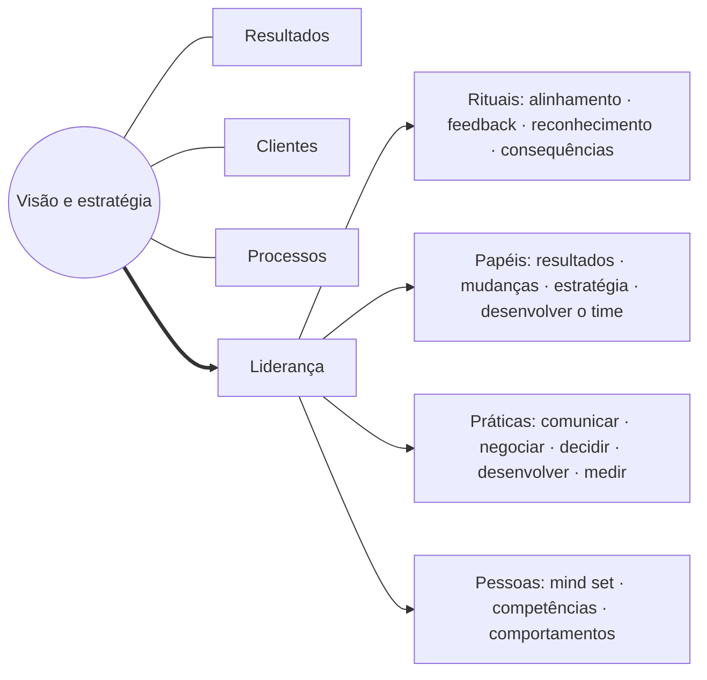
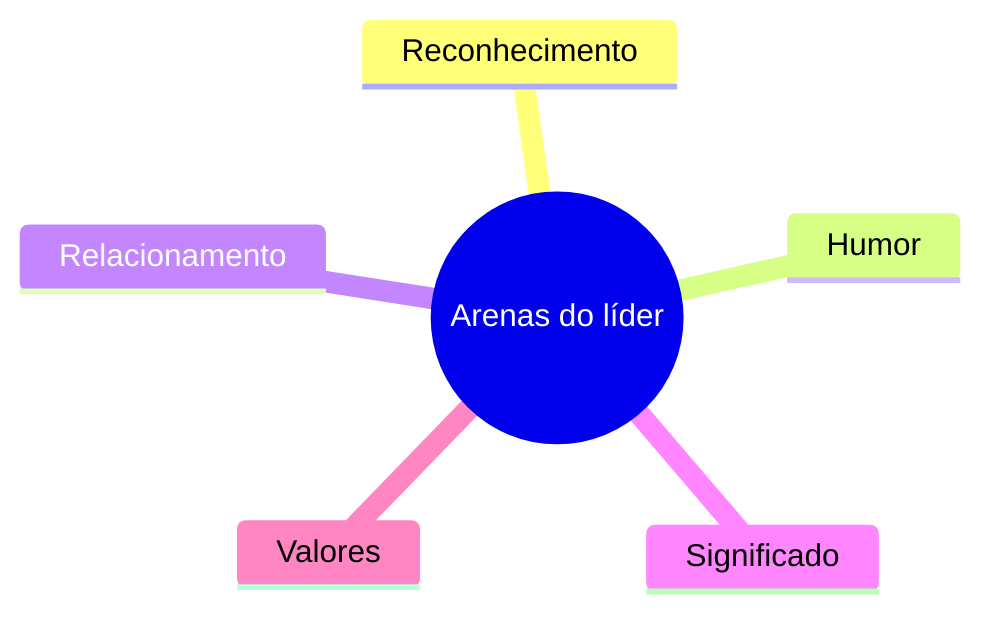
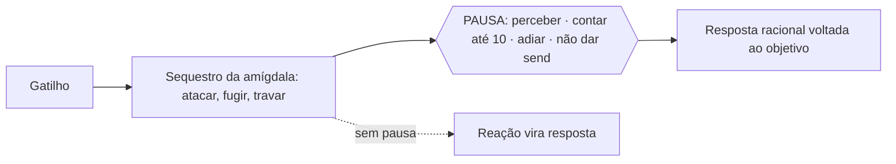
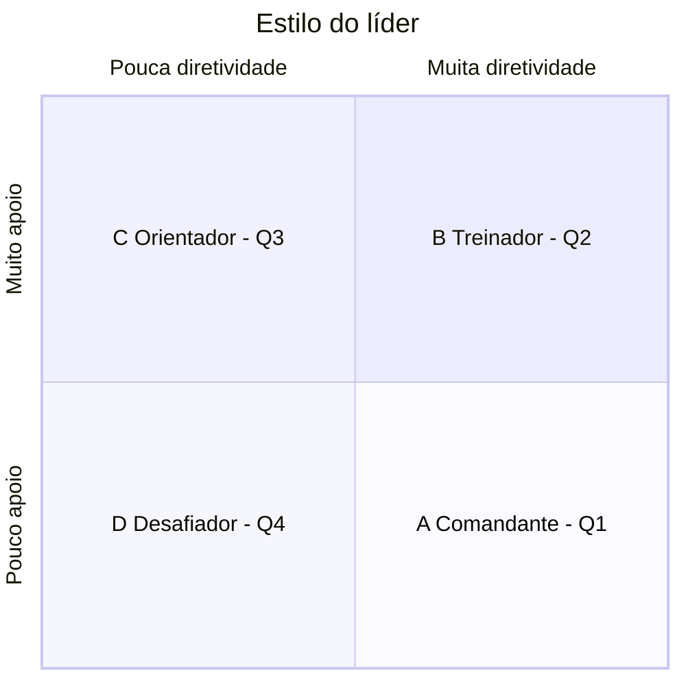
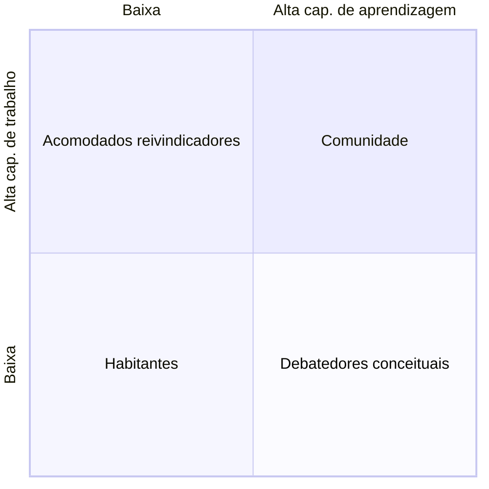
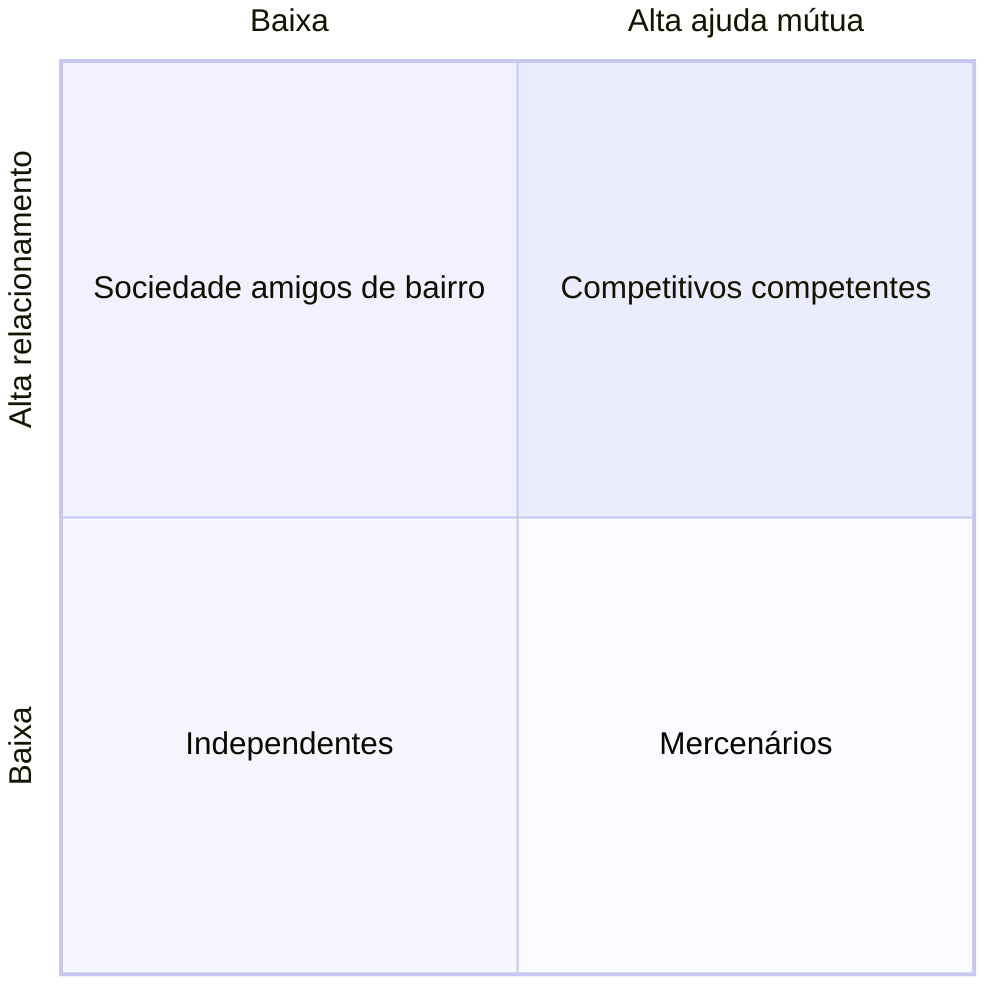
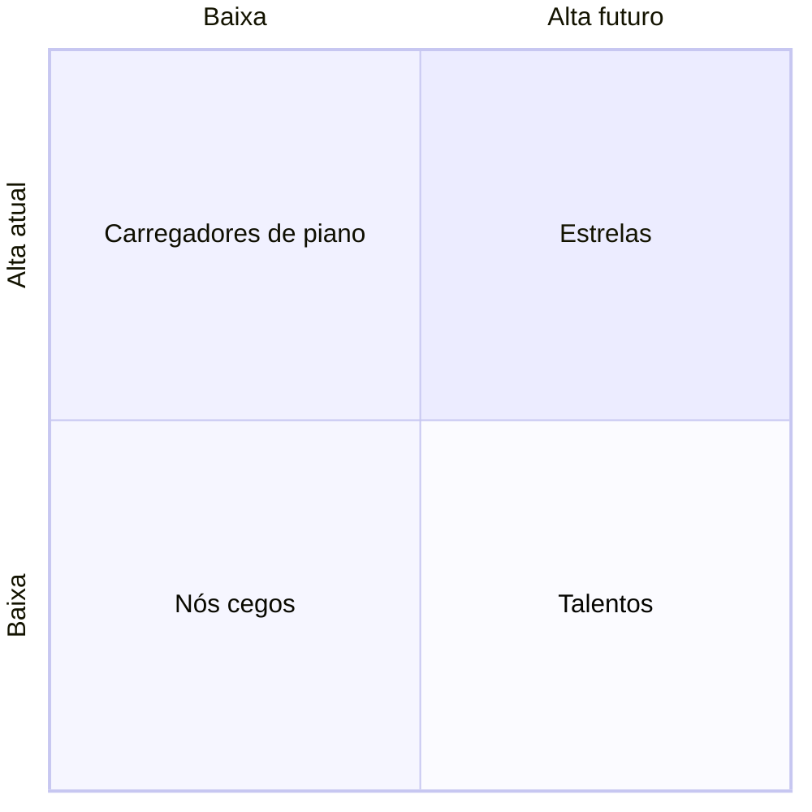

# claude/manual-operacional-completo.md

---
tipo: manual-operacional-completo
área: shopping-centers
status: v3.2-para-validacao
criado: 2026-10-20
atualizado: 2026-10-20
versão: "3.2"
tags: [manual-operacional, shopping-center, processos, etapas, pilares, alicerces, checklist, anexos, academia, lideranca, pro, allos]
aliases: [Manual Operacional Completo, Manual Completo Allos v3.2, MOC Manual Operacional]
---

# Manual Operacional Completo — Allos (v3.2)

> [!abstract] O que é este arquivo
> Versão única e indexada do **Manual Operacional v3.2** (out/2026): os 7 documentos em uma só nota, para leitura e busca. Os 7 documentos continuam existindo separadamente (MO 1 a MO 7) — são eles que se atualizam de forma independente (rotina 00.08). 178 rotinas · 20 Etapas em 4 pilares + 3 alicerces · 17 posições.

## Índice geral

- **[[#Documento 1 · Guia de Utilização|Documento 1 · Guia de Utilização]]**
    - [[#Os 7 documentos do Manual]]
    - [[#Como o Manual está organizado: 4 pilares e 3 alicerces]]
    - [[#Índice das Etapas]]
    - [[#Como usar o Manual]]
    - [[#Catálogo de documentos e arquivos]]
    - [[#Registro de alterações — v3.2]]
    - [[#Compatibilização com versões anteriores]]
- **[[#Documento 2 · Manual Operacional|Documento 2 · Manual Operacional]]**
    - [[#Atribuições por área e posição]]
    - **Pilar · [[#Pilar · Segurança|Segurança]]** — *Proteger pessoas e patrimônio*
        - [[#Etapa 03 · Segurança Patrimonial e Prevenção de Perdas|03 · Segurança Patrimonial e Prevenção de Perdas]]
        - [[#Etapa 04 · Saúde, Segurança, Meio Ambiente (SSMA) e Emergência|04 · Saúde, Segurança, Meio Ambiente (SSMA) e Emergência]]
    - **Pilar · [[#Pilar · Hospitalidade|Hospitalidade]]** — *Acolher e encantar quem visita*
        - [[#Etapa 02 · Operações: Manutenção, Limpeza e Infraestrutura|02 · Operações: Manutenção, Limpeza e Infraestrutura]]
        - [[#Etapa 05 · Estacionamento e Gestão de Fluxos|05 · Estacionamento e Gestão de Fluxos]]
        - [[#Etapa 06 · Atendimento ao Cliente e SAC|06 · Atendimento ao Cliente e SAC]]
    - **Pilar · [[#Pilar · Atratividade|Atratividade]]** — *Atrair público e manter o mix vivo*
        - [[#Etapa 08 · Comercial e Leasing|08 · Comercial e Leasing]]
        - [[#Etapa 09 · Marketing e Eventos|09 · Marketing e Eventos]]
        - [[#Etapa 16 · Performance de Lojas|16 · Performance de Lojas]]
        - [[#Etapa 18 · Renovações|18 · Renovações]]
    - **Pilar · [[#Pilar · Eficiência|Eficiência]]** — *Gerir, sustentar e rentabilizar*
        - [[#Etapa 10 · Financeiro, Cobrança e Repasse|10 · Financeiro, Cobrança e Repasse]]
        - [[#Etapa 11 · Jurídico e Contratos|11 · Jurídico e Contratos]]
        - [[#Etapa 14 · Gestão de Fornecedores e Contratos Terceirizados|14 · Gestão de Fornecedores e Contratos Terceirizados]]
        - [[#Etapa 15 · Atualização e Acompanhamento de Garantias Contratuais|15 · Atualização e Acompanhamento de Garantias Contratuais]]
        - [[#Etapa 17 · Auditoria Fiscal e Performance|17 · Auditoria Fiscal e Performance]]
        - [[#Etapa 19 · Comitê Jurídico e Gestão de Contencioso|19 · Comitê Jurídico e Gestão de Contencioso]]
    - **Alicerce · [[#Alicerce · Governança e Gestão|Governança e Gestão]]** — *Decidir, acompanhar e medir*
        - [[#Etapa 00 · Ciclo de Acompanhamento do Manual|00 · Ciclo de Acompanhamento do Manual]]
        - [[#Etapa 01 · Governança e Estrutura Organizacional|01 · Governança e Estrutura Organizacional]]
        - [[#Etapa 13 · Tecnologia, Sistemas e Indicadores|13 · Tecnologia, Sistemas e Indicadores]]
    - **Alicerce · [[#Alicerce · Gente e Liderança|Gente e Liderança]]** — *Formar, liderar e dar continuidade*
        - [[#Etapa 20 · Gente e Performance (Gestão de Colaboradores)|20 · Gente e Performance (Gestão de Colaboradores)]]
    - **Alicerce · [[#Alicerce · Parceria com Lojistas|Parceria com Lojistas]]** — *Construir a relação que sustenta o mix*
        - [[#Etapa 07 · Relacionamento com Lojistas|07 · Relacionamento com Lojistas]]
    - [[#Apêndice · Modelo de apuração automatizada]]
- **[[#Documento 3 · Checklists de Bolso|Documento 3 · Checklists de Bolso]]**
    - **[[#Parte A · Checklists por posição]]** — [[#Checklist · Gerente de Negócios|Gerente de Negócios]] · [[#Checklist · Coordenador de Negócios (e analistas)|Coordenador de Negócios]] · [[#Checklist · Gerente de Marketing|Gerente de Marketing]] · [[#Checklist · Coordenador de Marketing|Coordenador de Marketing]] · [[#Checklist · Coordenador / Executivo de Mídia|Coordenador / Executivo de Mídia]] · [[#Checklist · Gerente de Operações|Gerente de Operações]] · [[#Checklist · Coordenador de Operações|Coordenador de Operações]] · [[#Checklist · Coordenador de Mall (Segurança e Brigada)|Coordenador de Mall]] · [[#Checklist · Coordenador de Ambiência|Coordenador de Ambiência]] · [[#Checklist · Tesouraria / Controladoria corporativa|Tesouraria / Controladoria corporativa]] · [[#Checklist · CSC — Centro de Serviços Compartilhados (Crédito e Cobrança)|CSC — Centro de Serviços Compartilhados]] · [[#Checklist · Superintendente (e analista de superintendência)|Superintendente]] · [[#Checklist · Jurídico corporativo|Jurídico corporativo]] · [[#Checklist · TI / BI corporativo|TI / BI corporativo]] · [[#Checklist · Suprimentos corporativo|Suprimentos corporativo]] · [[#Checklist · Gente & Performance|Gente & Performance]] · [[#Checklist · Todas as lideranças (gerentes, coordenadores, supervisores e superintendente)|Todas as lideranças]]
    - **[[#Parte B · Cartões por Etapa]]** — [[#Cartão 03 · Segurança Patrimonial e Prevenção de Perdas|03]] · [[#Cartão 04 · Saúde, Segurança, Meio Ambiente (SSMA) e Emergência|04]] · [[#Cartão 02 · Operações: Manutenção, Limpeza e Infraestrutura|02]] · [[#Cartão 05 · Estacionamento e Gestão de Fluxos|05]] · [[#Cartão 06 · Atendimento ao Cliente e SAC|06]] · [[#Cartão 08 · Comercial e Leasing|08]] · [[#Cartão 09 · Marketing e Eventos|09]] · [[#Cartão 16 · Performance de Lojas|16]] · [[#Cartão 18 · Renovações|18]] · [[#Cartão 10 · Financeiro, Cobrança e Repasse|10]] · [[#Cartão 11 · Jurídico e Contratos|11]] · [[#Cartão 14 · Gestão de Fornecedores e Contratos Terceirizados|14]] · [[#Cartão 15 · Atualização e Acompanhamento de Garantias Contratuais|15]] · [[#Cartão 17 · Auditoria Fiscal e Performance|17]] · [[#Cartão 19 · Comitê Jurídico e Gestão de Contencioso|19]] · [[#Cartão 00 · Ciclo de Acompanhamento do Manual|00]] · [[#Cartão 01 · Governança e Estrutura Organizacional|01]] · [[#Cartão 13 · Tecnologia, Sistemas e Indicadores|13]] · [[#Cartão 20 · Gente e Performance (Gestão de Colaboradores)|20]] · [[#Cartão 07 · Relacionamento com Lojistas|07]]
- **[[#Documento 4 · Anexos Operacionais|Documento 4 · Anexos Operacionais]]**
    - [[#A1 · Matriz de riscos operacionais críticos]] (04.08)
    - [[#A2 · Dossiê de regularidade do ativo]] (02.21)
    - [[#A3 · Sistemas críticos de combate a incêndio — inspeção e teste]] (04.07)
    - [[#A4 · Utilidades e CAPEX — controles]] (02.19 · 02.20)
    - [[#A5 · Plano de contingência do estacionamento]] (05.14)
    - [[#A6 · Monitoramento do SAC público e Reclame Aqui]] (06.08)
    - [[#A7 · Kickoff técnico de obras — pauta e ata]] (07.10)
    - [[#A8 · Notificações operacionais — modelo da intranet]] (07.03)
    - [[#A9 · Seguros obrigatórios — controle de vigência e cobertura]] (11.06)
    - [[#A10 · Cadastro corporativo de fornecedores restritos]] (14.06)
    - [[#A11 · Calendário de ritos]]
    - [[#A12 · Parâmetros a calibrar antes de ligar a apuração]]
    - [[#A13 · Modelo de dados do painel de apuração]]
    - [[#Referência · Book de Processos Operacionais v1.1 (transcrição)]]
- **[[#Documento 5 · Academia Operacional|Documento 5 · Academia Operacional]]**
    - [[#Trilhas por posição]]
    - [[#Formato de Treinamento e Execução — 3·30·5]]
    - [[#Roteiros dos Microvídeos]]
- **[[#Documento 6 · Liderança e Gestão|Documento 6 · Liderança e Gestão]]**
    - [[#Apêndice A · Liderança]]
    - [[#PDL — Programa de Desenvolvimento das Lideranças]]
    - [[#Fundamentos: o Manual a serviço do objetivo do shopping]]
- **[[#Documento 7 · Programa P.R.O.|Documento 7 · Programa P.R.O.]]**

---

## Documento 1 · Guia de Utilização

> [!abstract] Para que serve
> Este guia diz **o que é** o Manual Operacional, **como está organizado** e **como usar** cada um dos 7 documentos. Uma pessoa nova na posição começa por aqui, vai ao seu checklist (Documento 3) e às Etapas das suas rotinas (Documento 2).

> [!quote] Objetivo do shopping — o norte de toda rotina
> Trazer as melhores ofertas de lojas, serviços, entretenimento e gastronomia de acordo com o seu posicionamento, visando aumentar a frequência de visita e o ticket médio gasto nas lojas, com uma experiência qualificada, gerando encantamento para seus consumidores e maximizando venda para seus lojistas e anunciantes de maneira segura, com isso, maximizando o retorno sobre investimento aos empreendedores de shoppings a longo prazo.

---

### Os 7 documentos do Manual

A partir da v3.2 o Manual é um **conjunto de 7 documentos**, cada um com uma função, um público e atualização independente. A **Base Única** (Excel) é a fonte de dados das rotinas: o que muda nela é regenerado nos documentos (rotina 00.08).

| Nº | Documento | Para quê | Quem usa | Quando |
|---|---|---|---|---|
| 1 | **[[#Documento 1 · Guia de Utilização|Guia de Utilização]]** | Entender a estrutura e o método | Todos | Na chegada à posição e a cada versão |
| 2 | **[[#Documento 2 · Manual Operacional|Manual Operacional]]** | O passo a passo de cada rotina, por Etapa e por posição | Donos de rotina e gestores | Ao executar e ao validar |
| 3 | **[[#Documento 3 · Checklists de Bolso|Checklists de Bolso]]** | A lista mensal do cargo e o cartão da Etapa | Cada posição; times de campo | Todo mês; antes de executar |
| 4 | **[[#Documento 4 · Anexos Operacionais|Anexos Operacionais]]** | Modelos e controles (riscos, regularidade, incêndio, utilidades, seguros, fornecedores…) e referências | Operações, Segurança, Jurídico | Ao montar e manter os controles |
| 5 | **[[#Documento 5 · Academia Operacional|Academia Operacional]]** | Como o Manual é ensinado: 3·30·5, trilhas por posição, roteiros | G&P, gestores, produção | Na implantação e no onboarding |
| 6 | **[[#Documento 6 · Liderança e Gestão|Liderança e Gestão]]** | Ferramentas de liderança (PDL) e fundamentos do desenho do Manual | Gerentes, coordenadores, supervisores, diretoria | 1:1, diagnóstico de equipe, revisão anual |
| 7 | **[[#Documento 7 · Programa P.R.O.|Programa P.R.O.]]** | Regulamento do reconhecimento operacional 2027 | Comitê, superintendentes | Temporada do P.R.O. |

**Benefícios da estrutura:** navegação mais direta; menor volume por documento; atualizações independentes; melhor experiência de quem executa.

---

### Como o Manual está organizado: 4 pilares e 3 alicerces

Toda a operação do shopping serve a **quatro pilares de qualidade do negócio** — o que o cliente percebe. O que sustenta os quatro sem ser atributo percebido está nos **alicerces**. **A execução das rotinas independe do porte do shopping.** Desempate entre pilares: Segurança > Hospitalidade > Atratividade > Eficiência.

| Tipo | Pilar / Alicerce | Lema | Etapas |
|---|---|---|---|
| Pilar | **Segurança** | *Proteger pessoas e patrimônio* | [[#Etapa 03 · Segurança Patrimonial e Prevenção de Perdas|03]] · [[#Etapa 04 · Saúde, Segurança, Meio Ambiente (SSMA) e Emergência|04]] |
| Pilar | **Hospitalidade** | *Acolher e encantar quem visita* | [[#Etapa 02 · Operações: Manutenção, Limpeza e Infraestrutura|02]] · [[#Etapa 05 · Estacionamento e Gestão de Fluxos|05]] · [[#Etapa 06 · Atendimento ao Cliente e SAC|06]] |
| Pilar | **Atratividade** | *Atrair público e manter o mix vivo* | [[#Etapa 08 · Comercial e Leasing|08]] · [[#Etapa 09 · Marketing e Eventos|09]] · [[#Etapa 16 · Performance de Lojas|16]] · [[#Etapa 18 · Renovações|18]] |
| Pilar | **Eficiência** | *Gerir, sustentar e rentabilizar* | [[#Etapa 10 · Financeiro, Cobrança e Repasse|10]] · [[#Etapa 11 · Jurídico e Contratos|11]] · [[#Etapa 14 · Gestão de Fornecedores e Contratos Terceirizados|14]] · [[#Etapa 15 · Atualização e Acompanhamento de Garantias Contratuais|15]] · [[#Etapa 17 · Auditoria Fiscal e Performance|17]] · [[#Etapa 19 · Comitê Jurídico e Gestão de Contencioso|19]] |
| Alicerce | **Governança e Gestão** | *Decidir, acompanhar e medir* | [[#Etapa 00 · Ciclo de Acompanhamento do Manual|00]] · [[#Etapa 01 · Governança e Estrutura Organizacional|01]] · [[#Etapa 13 · Tecnologia, Sistemas e Indicadores|13]] |
| Alicerce | **Gente e Liderança** | *Formar, liderar e dar continuidade* | [[#Etapa 20 · Gente e Performance (Gestão de Colaboradores)|20]] |
| Alicerce | **Parceria com Lojistas** | *Construir a relação que sustenta o mix* | [[#Etapa 07 · Relacionamento com Lojistas|07]] |

---

### Índice das Etapas

| Etapa | Nome | Pilar / Alicerce | Rotinas |
|---|---|---|---|
| **03** | [[#Etapa 03 · Segurança Patrimonial e Prevenção de Perdas|Segurança Patrimonial e Prevenção de Perdas]] | Pilar Segurança | 9 |
| **04** | [[#Etapa 04 · Saúde, Segurança, Meio Ambiente (SSMA) e Emergência|Saúde, Segurança, Meio Ambiente (SSMA) e Emergência]] | Pilar Segurança | 8 |
| **02** | [[#Etapa 02 · Operações: Manutenção, Limpeza e Infraestrutura|Operações: Manutenção, Limpeza e Infraestrutura]] | Pilar Hospitalidade | 21 |
| **05** | [[#Etapa 05 · Estacionamento e Gestão de Fluxos|Estacionamento e Gestão de Fluxos]] | Pilar Hospitalidade | 14 |
| **06** | [[#Etapa 06 · Atendimento ao Cliente e SAC|Atendimento ao Cliente e SAC]] | Pilar Hospitalidade | 8 |
| **08** | [[#Etapa 08 · Comercial e Leasing|Comercial e Leasing]] | Pilar Atratividade | 10 |
| **09** | [[#Etapa 09 · Marketing e Eventos|Marketing e Eventos]] | Pilar Atratividade | 10 |
| **16** | [[#Etapa 16 · Performance de Lojas|Performance de Lojas]] | Pilar Atratividade | 5 |
| **18** | [[#Etapa 18 · Renovações|Renovações]] | Pilar Atratividade | 8 |
| **10** | [[#Etapa 10 · Financeiro, Cobrança e Repasse|Financeiro, Cobrança e Repasse]] | Pilar Eficiência | 10 |
| **11** | [[#Etapa 11 · Jurídico e Contratos|Jurídico e Contratos]] | Pilar Eficiência | 6 |
| **14** | [[#Etapa 14 · Gestão de Fornecedores e Contratos Terceirizados|Gestão de Fornecedores e Contratos Terceirizados]] | Pilar Eficiência | 6 |
| **15** | [[#Etapa 15 · Atualização e Acompanhamento de Garantias Contratuais|Atualização e Acompanhamento de Garantias Contratuais]] | Pilar Eficiência | 6 |
| **17** | [[#Etapa 17 · Auditoria Fiscal e Performance|Auditoria Fiscal e Performance]] | Pilar Eficiência | 12 |
| **19** | [[#Etapa 19 · Comitê Jurídico e Gestão de Contencioso|Comitê Jurídico e Gestão de Contencioso]] | Pilar Eficiência | 5 |
| **00** | [[#Etapa 00 · Ciclo de Acompanhamento do Manual|Ciclo de Acompanhamento do Manual]] | Alicerce Governança e Gestão | 8 |
| **01** | [[#Etapa 01 · Governança e Estrutura Organizacional|Governança e Estrutura Organizacional]] | Alicerce Governança e Gestão | 5 |
| **13** | [[#Etapa 13 · Tecnologia, Sistemas e Indicadores|Tecnologia, Sistemas e Indicadores]] | Alicerce Governança e Gestão | 5 |
| **20** | [[#Etapa 20 · Gente e Performance (Gestão de Colaboradores)|Gente e Performance (Gestão de Colaboradores)]] | Alicerce Gente e Liderança | 13 |
| **07** | [[#Etapa 07 · Relacionamento com Lojistas|Relacionamento com Lojistas]] | Alicerce Parceria com Lojistas | 9 |

---

### Como usar o Manual

#### Como cada Etapa está organizada

1. **Por que existe** e **objetivo** — o que a Etapa protege ou produz, e como contribui para o objetivo do shopping.
2. **Quem conduz · interfaces · sistemas** — a posição que roda o processo, com quem ela fala e onde trabalha.
3. **Agenda da posição** — todas as rotinas da Etapa agrupadas por frequência.
4. **Fluxo do processo** — a sequência de ponta a ponta.
5. **Rotinas passo a passo** — para cada rotina: para quê, frequência, dono, origem, passos, resultado, registro e **validação** (critério · fonte · apuração · regra).
6. **Checklist de execução** e **tabela de apuração** — a lista para marcar no mês e o que o painel confere sozinho.
7. **Indicadores**, **riscos e boas práticas**, **glossário** e **o que receber/entregar na troca de pessoa**.

#### Como executar qualquer rotina

1. **Leia o "para quê"** da rotina — o que ela protege ou produz para o shopping. Se o passo a passo não couber numa situação, é o objetivo que decide.
2. **Confira as entradas** — documentos, sistemas e informações de outras áreas. Se faltar, cobre por escrito citando o código NN.KK.
3. **Execute o passo a passo** na ordem.
4. **Registre no mesmo dia** — no sistema indicado ou na pasta padrão com o nome no padrão.
5. **Confira a validação**: o critério diz o que é "conforme". Se a apuração é automática, olhe o painel; se não, confira você mesmo antes de marcar Feito.
6. **Se não conseguiu executar**, registre o motivo e avise quem responde pela Etapa. Nunca deixe a rotina sem registro.

#### Conceitos

| Termo | Significado |
|---|---|
| **Etapa** | Um capítulo do Manual Operacional: um processo de ponta a ponta (ex.: Segurança Patrimonial). Cada Etapa tem objetivo, fluxo, rotinas, checklist e indicadores. |
| **Rotina** | Uma atividade recorrente dentro da Etapa, identificada por um código NN.KK (Etapa.rotina). Ex.: 03.01 = rondas programadas. Use o código em arquivos, atas e e-mails. |
| **Origem** | De onde a rotina vem: Manual v1.1 (book de processos), Handbook Operações 2024, Book de Renovações, skills do vault (Performance Lojas, Credit Engine). Parâmetros marcados [calibrar] ou [validar] são proposta ou vêm de material antigo. |
| **Dono da rotina** | O cargo que conduz a rotina no shopping. Se você ocupa esse cargo, a rotina é sua — mesmo quando outra área ajuda. A seção "Atribuições por área e posição" (Documento 2) lista tudo o que é de cada posição. |
| **Escopo** | Local: o shopping executa. Corporativo: uma área da holding executa e o shopping fornece insumo e cobra. Compartilhado: os dois executam partes. |
| **Frequência** | Quando a rotina acontece: diária, semanal, mensal, trimestral, semestral, anual ou por evento. A "Agenda da posição" agrupa as rotinas por frequência. |
| **Registro** | A prova datada de que a rotina aconteceu: registro em sistema, checklist, ata, planilha do período, documento vigente. Sem registro, a rotina não aconteceu — e o sucessor não consegue continuar. |
| **Validação (critério · fonte · apuração · regra)** | Cada rotina traz um critério objetivo de conformidade, a fonte de dado onde ele é verificado, o tipo de apuração e a regra em pseudo-fórmula. É o que permite conferir sem julgamento e, sempre que possível, sem intervenção humana. |
| **Apuração A · S · M** | A = automática: o dado está em sistema transacional e a regra roda sozinha. S = semiautomática: existência, data e metadados do registro são checados automaticamente (pasta padrão/lista), o conteúdo é amostrado. M = manual: exige presença ou leitura humana. |
| **Pasta padrão** | Onde ficam os registros que não vivem em sistema: SharePoint › Shopping › Ano › Etapa NN › NN.KK. Nome: AAAA-MM_NN-KK_descricao-curta. É o que torna a apuração "S" possível. |
| **⚠️ Obrigação legal** | Rotina ligada a lei, norma ou licença (AVCB, NRs, LGPD, eSocial, Lei do Inquilinato, resíduos). Não pode atrasar: é a primeira a ser feita no mês. |
| **Pilares e alicerces** | As Etapas estão organizadas pelos 4 pilares de qualidade do negócio (Segurança, Hospitalidade, Atratividade, Eficiência) e por 3 alicerces que os sustentam (Governança e Gestão, Gente e Liderança, Parceria com Lojistas). Toda rotina vale para todo shopping, independentemente do porte. |
| **Indicador (KPI) e meta** | Como saber se a Etapa está entregando o seu objetivo. A rotina é o meio; o indicador é o fim. |
| **Checklist mensal** | Até o 5º dia útil, o dono marca cada rotina do mês como Feita (com registro) ou Pendente (com motivo). Onde a apuração é automática, o status vem do sistema e o dono só trata exceções. |
| **Handoff** | A passagem de bastão quando alguém sai da posição: registros de 12 meses, controles, vencimentos e pendências. Cada Etapa diz o que entregar. |

#### Registro — o que precisa ter

| Tipo | Requisito |
|---|---|
| Registro em sistema (CMMS, CRM, ERP, CLM, app) | O próprio lançamento, com data/hora e usuário. É a base da apuração automática. |
| Checklist / formulário | Data, hora, local e responsável preenchidos. |
| Print de sistema | Data visível e nome do sistema; um por rotina. |
| Ata | Data, participantes, decisões, responsáveis e prazos; material anexo. |
| Planilha / relatório | Mês de referência no nome e na primeira aba; cópia congelada do período. |
| Documento vigente | Validade visível, assinado ou protocolado. Vencido ou "em renovação" não vale. |

#### Seus primeiros dias na posição

**Dia 1 · Entender**

- [ ] Ler "este Guia" e o objetivo do shopping.
- [ ] Ler a sua posição em "Atribuições por área e posição" (Documento 2): missão, KPIs e a lista das suas rotinas.
- [ ] Ler a(s) Etapa(s) das suas rotinas: por que existe, objetivo, fluxo, glossário.

**Dia 2 · Mapear**

- [ ] Lançar no calendário as rotinas diárias, semanais, mensais e as reuniões/comitês (código NN.KK no título).
- [ ] Identificar as rotinas ⚠️ e as datas de vencimento dos documentos legais.
- [ ] Abrir o painel de apuração e entender quais rotinas suas são A, S ou M.

**Dia 3 · Receber**

- [ ] Receber o handoff do antecessor ou do gestor (lista "O que receber" da Etapa).
- [ ] Pedir acesso aos sistemas e à pasta padrão listados.
- [ ] Ler os últimos 3 checklists mensais e as pendências abertas.

**Dias 4–5 · Conectar**

- [ ] Apresentar-se às áreas de interface e combinar como recebe os insumos delas.
- [ ] Conferir documentos vigentes; renovar o que vence em até 60 dias.
- [ ] Ler os indicadores da Etapa do último mês vs. a meta.

**Semana 2 · Executar acompanhado**

- [ ] Executar cada rotina diária e semanal seguindo o passo a passo, com o gestor ou um colega ao lado.
- [ ] Registrar cada execução no padrão e ver o status aparecer no painel.

**Semanas 3–4 · Executar sozinho**

- [ ] Executar todas as rotinas do mês.
- [ ] Fechar o checklist mensal até o 5º dia útil.
- [ ] Revisar com o gestor: o que foi feito, o que ficou pendente e por quê, o que o indicador mostra.

---

---

### Catálogo de documentos e arquivos

| Arquivo | Formato | Conteúdo | Status |
|---|---|---|---|
| **1 · Guia de Utilização** | PDF + .md | Apresentação, estrutura (4 pilares + 3 alicerces, 7 documentos), como executar qualquer rotina, conceitos, primeiros dias na posição, catálogo e registro de alterações. | Vigente · para validação |
| **2 · Manual Operacional** | PDF + .md | O manual em si: por que cada Etapa existe, quem conduz, rotinas passo a passo com registro, critério de validação e regra de apuração; atribuições por área e posição; modelo de apuração. | Vigente · para validação |
| **3 · Checklists de Bolso** | PDF + .md | Material de uso diário: a lista mensal de cada cargo (para marcar e entregar ao sucessor) e o cartão de consulta rápida de cada Etapa. | Vigente · para validação |
| **4 · Anexos Operacionais** | PDF + .md | Matriz de riscos, regularidade do ativo, sistemas críticos de incêndio, utilidades e CAPEX, contingência do estacionamento, SAC público, kickoff de obras, notificações, seguros, fornecedores restritos, calendário de ritos, parâmetros e modelo de dados; transcrição do Book v1.1. | Vigente · para validação |
| **5 · Academia Operacional** | PDF + .md | Formato de capacitação (3 min de vídeo, 30 min de prática, 5 perguntas), trilhas por posição e os roteiros dos 21 microvídeos. | Vigente · para validação |
| **6 · Liderança e Gestão** | PDF + .md | Apêndice de Liderança (base PDL) para gerentes, coordenadores e supervisores; resumo do PDL; fundamentos do desenho do Manual (linha de visão, Meios × Fins, Tight/Loose). | Vigente · para validação |
| **7 · Programa P.R.O.** | PDF + .md | Regulamento e estrutura do programa 2027: conceito, pontuação por Etapa, temporada, sarrafo, auditoria, níveis e reconhecimentos. Identidade visual em arquivo separado. | Proposta · Comitê |
| **Base Única - Manual Operacional.xlsx** | Excel | Fonte única das rotinas: A · Manual (Rotinas, Resumo, Parâmetros a calibrar, Modelo de dados) · B · Ciclo mensal (Checklist de 10 shoppings, Score, Histórico, Devolutiva, Meios × Fins, Dispersão, Pareto, Plano de ação) · C · Treinamento (Trilhas, Quiz, Vídeos) | Vigente · para validação |
| **PRO - Identidade Visual.pdf** + Logos (PNG) | PDF + PNG | Manual de identidade visual do P.R.O. | Proposta · Comitê |
| **Plano de Implantacao - 90 dias.pptx** | PowerPoint | Plano de implantação nos 10 shoppings | Vigente |
| **PRO - Lancamento na Convencao 2026.pptx** | PowerPoint | Apresentação de lançamento do P.R.O. | Proposta · Comitê |
| **Calendario de Ritos - Anexo D.ics** | Calendário | Ritos recorrentes (Anexo A11) para Outlook/Google | Vigente |

---

### Registro de alterações — v3.2

> [!info] Ajustes consolidados (Negócios · Crédito, Garantias e Auditoria · Operações · Estrutura documental)
> 178 rotinas (eram 181): **12 novas**, **15 excluídas**, 33 alteradas; Etapas 16, 17 e 18 renomeadas; posição **CSC** criada; Manual reorganizado em 7 documentos. IDs não foram reaproveitados: uma rotina excluída deixa o número vago.

| ID | Ação | Antes | Depois / motivo |
|---|---|---|---|
| Etapa 16 | Renomeada | Comitês de Performance e Acompanhamento de Vendas | Performance de Lojas |
| Etapa 17 | Renomeada | Auditoria de Livros Fiscais de Lojas | Auditoria Fiscal e Performance |
| Etapa 18 | Renomeada | Renovações Contratuais e Mitigação de Renovatórias | Renovações |
| Posição | Nova | — | CSC — Centro de Serviços Compartilhados (Crédito e Cobrança) — centraliza 10.02 e 10.08 |
| 07.02 | Alterada | Registrar ata de reunião com conselho de lojistas | Conselho substituído pela Associação de Lojistas (não há conselho com papel decisório) |
| 07.08 | Excluída | Validar a planta de equipamentos do mall (quiosques, totens, mobiliário, mídia) com Ambiência | Controle já realizado por Operações (planta de equipamentos do mall) |
| 07.03 | Alterada | Notificar formalmente desvios de padrão visual/operacional | Padronização: notificações operacionais emitidas pelo modelo da intranet |
| 07.10 | Nova | — | Realizar o kickoff técnico de obras (obrigatório para novas lojas e reformas relevantes) |
| 08.03 | Alterada | Conferir negociações reprovadas pelo Faturamento · dono: Coord. Negócios | Responsável: Analista/Assistente de Contratos |
| 08.04 | Alterada | Realizar Comitê Comercial – Novas Locações & Renovações · Conforme calendário | Comitê Comercial passa a semanal |
| 08.05 | Alterada | Atualizar Controles de Notificações · Mensal | Frequência revisada para semanal |
| 08.06 | Alterada | Atualizar Controle de Manutenção – NAPP · Mensal | Substituído pelo Call Quinzenal NAPP |
| 08.07 | Excluída | Atualizar Simulador de Novas Locações | Simulador de Novas Locações excluído |
| 08.08 | Excluída | Atualizar Simulador de Renovações | Simulador de Renovações excluído (ver 18.02 — Simulador de Perícia Renovatória) |
| 08.09 | Alterada | Acompanhar Taxa de Ocupação – Mall · Trimestral | Taxa de Ocupação Mall passa a mensal |
| 08.10 | Alterada | Acompanhar Taxa de Ocupação – Lojas · Trimestral | Taxa de Ocupação Lojas passa a mensal |
| 08.11 | Excluída | Acompanhar Taxa de Ocupação – Mídia | Taxa de Ocupação Mídia excluída |
| 08.12 | Alterada | Atualizar material RMR Regional | Evidências do Material RMR revisadas |
| 08.13 | Excluída | Fechar novos contratos de mall (quiosques) no padrão e com condomínio por CRD | Contratos de Mall excluídos da Etapa 08 |
| 10.01 | Excluída | Atualizar contato dos responsáveis por cobrança do Shopping | Excluída |
| 10.02 | Alterada | Emitir Resultado Mensal do Controle de Atualização de Garantia de Crédito (% válidas/inválidas/pendentes/sem fiança) · dono: Coord. Negócios (com Tesouraria) | Garantias centralizadas no CSC |
| 10.03 | Alterada | Realizar Comitê de Inadimplência · Mensal (2 últimas semanas) | Comitê de Inadimplência passa a semanal |
| 10.04 | Alterada | Enviar Expectativa de Inadimplência para a Régua de Cobrança | Tendência de inadimplência passa a ser acompanhada no SISCOB |
| 10.06 | Alterada | Atualizar Forecast NOI · Conforme calendário | Adequado ao calendário corporativo |
| 10.07 | Excluída | Atualizar Input do Farol de Metas | Input do Farol excluído (o Farol é alimentado pela área corporativa) |
| 10.08 | Alterada | Executar a régua de cobrança por dias de atraso · dono: Coord. Negócios (com Tesouraria/Régua corporativa) | Régua de cobrança assumida pelo CSC |
| 10.09 | Alterada | Monitorar os gatilhos de early warning de inadimplência e classificar o lojista por faixa | Early warning revisado (gatilhos alinhados à Política de Crédito — parâmetros a calibrar) |
| 10.12 | Mantida | Bloquear renovação e novos negócios para lojistas inadimplentes ou com ação contra o shopping | Bloqueio para inadimplentes mantido |
| 15.01 | Alterada | Atualizar valor da garantia conforme aluguel+condomínio+FPP · Anual / no reajuste | Atualização anual das garantias conforme Política de Crédito |
| 15.02 | Alterada | Conferir vigência de carta-fiança/seguro-fiança por contrato | Fluxo via IARA+ |
| 15.03 | Alterada | Notificar lojista sobre garantia vencida/insuficiente | Fluxo via IARA+ e Política de Crédito |
| 15.04 | Alterada | Validar idoneidade de seguradora/fiador aprovado · dono: Jurídico corporativo | Controladoria excluída do processo |
| 15.05 | Alterada | Emitir relatório de cobertura de garantias (100% dos contratos) | Indicadores mensais de garantia (IARA+) |
| 15.06 | Nova | — | Formalizar as exceções de garantia conforme a Política de Crédito |
| 16.01 | Alterada | Atualizar dashboard mensal de vendas por loja | Triangulação de vendas (absorve o input semanal 17.06) |
| 16.02 | Alterada | Realizar comitê de performance com ata registrada · Mensal | Comitê de Auditoria e Performance (fórum único, quinzenal — ver 17.01) |
| 16.03 | Alterada | Classificar lojas em risco (queda de vendas/inadimplência) | Classificação de risco |
| 16.04 | Mantida | Definir e acompanhar plano de ação por loja crítica | Plano de ação por loja crítica |
| 16.05 | Excluída | Alertar Financeiro/Jurídico sobre lojas de alto risco | Excluída (o alerta ao Financeiro/Jurídico passa a sair do Comitê de Auditoria e Performance) |
| 16.06 | Alterada | Calcular o score de risco de subdeclaração de vendas (uso interno) e priorizar auditoria · Mensal (automático) · dono: Coord. Negócios | Passa a ser o Planejamento Anual de Auditorias (conteúdo migrado de 17.13) |
| 17.01 | Alterada | Realizar Comitê de Auditoria e Performance · Mensal (exceto BF/Natal) | Comitê quinzenal (mesmo fórum de 16.02 — pauta de auditoria) |
| 17.05 | Alterada | Realizar Auditoria de Fechamento · Semanal | Auditoria de fechamento passa a diária |
| 17.06 | Excluída | Realizar Input de Vendas Semanal | Incorporada à triangulação (16.01 / 17.07) |
| 17.07 | Alterada | Realizar Triangulação das Vendas Semanal | Triangulação semanal formalizada |
| 17.09 | Excluída | Realizar Reunião com Jurídico | Migrada para o Comitê Jurídico (Etapa 19 — 19.02) |
| 17.10 | Alterada | Reunir-se com cada novo lojista em até 1 mês após a inauguração (informe de vendas e auditoria) · dono: Coord. Negócios (com Auditoria) | Book de Auditoria no onboarding; participação obrigatória da Operação |
| 17.11 | Mantida | Enviar a carta de aviso de auditoria com 3 dias corridos de antecedência (exceto fiscal) | — |
| 17.12 | Mantida | Apresentar o relatório de auditoria ao lojista até o fim do mês subsequente e enviá-lo em 2 dias úteis | — |
| 17.13 | Excluída | Elaborar e executar o plano anual de auditoria (cobertura, âncoras, risco) | Migrada para 16.06 (Planejamento Anual de Auditorias) |
| 17.14 | Alterada | Aplicar a trava de auditoria antes de abrir qualquer renovação · dono: Coord. Negócios | Checklist pré-renovação (trava de auditoria + requisitos operacionais) |
| 17.15 | Alterada | Cobrar 100% das diferenças apuradas e registrar a recuperação · Por auditoria · acompanhamento mensal | Auditoria fiscal anual + cobrança das diferenças |
| 18.01 | Alterada | Atualizar mapa de vencimentos (12-18 meses de antecedência) · Mensal | Planejamento anual de renovações (absorve 18.06 e 18.07) |
| 18.02 | Alterada | Elaborar proposta de renovação com benchmark de mercado | Proposta com o Simulador de Perícia Renovatória |
| 18.03 | Excluída | Registrar ata de negociação com lojista | Excluída (registro das rodadas passa a ser campo do CRM em 18.10) |
| 18.04 | Excluída | Emitir notificação extrajudicial quando necessário (Lei 8.245/91, art. 51) | Excluída (notificação extrajudicial tratada pelo Jurídico na Etapa 19) |
| 18.05 | Alterada | Acompanhar taxa de renovação amigável vs. judicial | Avaliar extração via E-law |
| 18.06 | Excluída | Classificar cada loja a renovar por mix e por quadrante (AMM/m² × Vendas/m²) | Incorporada ao planejamento anual (18.01) |
| 18.07 | Excluída | Abrir a negociação na janela certa (12–6 meses ou < 6 meses) e nunca antes do último reajuste | Incorporada ao planejamento anual (18.01) |
| 02.19 | Nova | — | Gerir os contratos e o consumo de utilidades (energia, água e gás) |
| 02.20 | Nova | — | Manter o plano plurianual de CAPEX e renovação de ativos |
| 02.21 | Nova | — | Manter o dossiê de regularidade do ativo (AVCB, Habite-se, outorgas, As Built e licenças) com vencimentos |
| 04.07 | Nova | — | Inspecionar e testar os sistemas críticos de combate a incêndio (alarmes, hidrantes, bombas, sprinklers, RTI, rotas de fuga e iluminação de emergência) |
| 04.08 | Nova | — | Manter a matriz de riscos operacionais críticos (identificação, controles e planos de resposta) |
| 05.14 | Nova | — | Manter e testar o plano de contingência do estacionamento (falha de cancela, LPR, pagamento, energia e sistema) |
| 06.08 | Nova | — | Monitorar formalmente o Reclame Aqui e os canais públicos de reclamação (responder, classificar e tratar) |
| 11.06 | Nova | — | Controlar a vigência e a cobertura dos seguros obrigatórios do empreendimento |
| 14.06 | Nova | — | Manter o cadastro corporativo de fornecedores restritos e consultá-lo antes de qualquer contratação |
| 00.08 | Nova | — | Atualizar simultaneamente o Manual, a Base Única, os Checklists, as Trilhas e o P.R.O. a cada alteração aprovada |

> [!warning] Pontos a validar nesta versão
> **10.09** (gatilhos do early warning), **18.05** (extração via E-law), **08.03** (posição Analista/Assistente de Contratos — hoje dentro da equipe do Coordenador de Negócios), **CSC** (missão e KPIs propostos) e as 12 rotinas novas (passo a passo, critério e regra são proposta). **17.08** (Comitê de Performance) foi mantido, mas parece duplicar o Comitê de Auditoria e Performance (16.02/17.01) — decidir.

---

### Compatibilização com versões anteriores

| Antes | Agora | Observação |
|---|---|---|
| Book de Processos v1.1 | Manual Operacional (Documento 2) | O Book é a fonte histórica (transcrição no Documento 4); o Manual é o documento vigente. |
| Capítulo NN | Etapa NN | Mesmo número; 20 Etapas (00 a 20, não existe 12). |
| Item do checklist (122) | Rotina NN.KK (178) | Cada rotina tem dono, frequência, passo a passo, registro, critério e regra de apuração. |
| Pilares do Book (4) · "Governança do book" | 4 pilares de qualidade + 3 alicerces | 00, 01 e 13 → Governança e Gestão; 20 → Gente e Liderança; 07 → Parceria com Lojistas (v3.1). |
| Porte P·M·G por item | Removido | A execução das rotinas independe do porte do shopping (v3.1). |
| Feito / Pendente / N/A | Conforme / Não conforme / Sem dado / N/A | Resultado da regra de apuração (Base Única); Sem dado conta como Não conforme. |
| Evidência | Registro (pasta padrão, nome AAAA-MM_NN-KK) | Registro é o que a apuração lê. |
| Caderno de Etapas · Manual Operacional Completo (1 volume) | 7 documentos (v3.2) | Caderno → Documentos 1 e 2; Checklists e Cartões → 3; Apêndice A → 6; Apêndice B e anexos → 2 e 4; Capacitação → 5; P.R.O. → 7. |
| Painel v1/v2 · Catálogo · Kit de Treinamento | Base Única | Uma só base, com índice. |
| Conselho de Lojistas (07.02) | Associação de Lojistas | Não há conselho com papel decisório (v3.2). |
| Simuladores de Novas Locações e Renovações (08.07/08.08) | Simulador de Perícia Renovatória (18.02) | v3.2. |
| Menções à empresa anterior | "Cia" | Em todos os documentos. |

---

---

## Documento 2 · Manual Operacional

> [!abstract] Para que serve
> Detalha **cada Etapa** até o nível da rotina — por que existe, quem conduz, passo a passo, resultado, registro e **critério de validação com apuração automatizável**. Escrito para que quem assume a posição execute sozinho, só lendo. 178 rotinas: 123 automáticas, 54 semiautomáticas, 1 manual. Como usar: [[#Documento 1 · Guia de Utilização|Guia de Utilização]]. Lista por cargo: [[#Documento 3 · Checklists de Bolso|Checklists de Bolso]].

> [!quote] Objetivo do shopping — o norte de toda rotina
> Trazer as melhores ofertas de lojas, serviços, entretenimento e gastronomia de acordo com o seu posicionamento, visando aumentar a frequência de visita e o ticket médio gasto nas lojas, com uma experiência qualificada, gerando encantamento para seus consumidores e maximizando venda para seus lojistas e anunciantes de maneira segura, com isso, maximizando o retorno sobre investimento aos empreendedores de shoppings a longo prazo.

---

### Atribuições por área e posição

> [!info] Como ler
> Para cada posição: a missão (do descritivo de função), os KPIs que ela monitora e **todas as rotinas do Manual que são dela**, agrupadas por frequência — o calendário de quem assume o cargo. O detalhe está na Etapa (código NN.KK). As rotinas de liderança (20.08–20.13) aparecem em todas as posições que lideram pessoas.

#### Negócios / Comercial

##### Gerente de Negócios

**Missão:** Liderar a performance financeira e comercial do shopping: receita, NOI e ocupação, por meio da gestão do relacionamento com lojistas, das negociações e do planejamento comercial e financeiro. *(fonte: descritivo-funcao - Gerente de Negócios (vault))*

| KPI que monitora | Frequência | Meta |
|---|---|---|
| Receita de aluguel | Mensal | Orçado |
| NOI | Mensal | Orçado |
| Taxa de ocupação | Mensal | ≥ 90% (Manual: ≥ 96%) |
| Ticket médio de aluguel | Trimestral | Crescimento YoY |
| Renovação de contratos | Trimestral | ≥ 80% |
| Tempo médio de vacância | Mensal | < 90 dias |
| Conformidade de pagamentos | Mensal | ≥ 95% |

**Suas rotinas (20):**

- **Semanal:** 08.04 Realizar o Comitê Comercial (novas locações e renovações) · 20.10 Praticar os rituais do líder: alinhamento, feedback, reconhecimento e gestão de consequências
- **Quinzenal:** 16.02 Realizar o Comitê de Auditoria e Performance com ata registrada · 17.01 Levar a pauta de auditoria ao Comitê de Auditoria e Performance (quinzenal)
- **Mensal:** 08.09 Acompanhar Taxa de Ocupação – Mall · 08.10 Acompanhar Taxa de Ocupação – Lojas · 08.12 Preparar e publicar o material da RMR Regional · 16.04 Definir e acompanhar plano de ação por loja crítica · 16.06 Elaborar e acompanhar o Planejamento Anual de Auditorias (cobertura, âncoras, risco) · 17.08 Realizar Comitê de Performance · 20.09 Preparar e conduzir o 1:1 mensal com o Template de Preparação para Liderança
- **Trimestral:** 07.02 Registrar ata de reunião com a Associação de Lojistas
- **Semestral:** 20.08 Mapear o quadrante de maturidade (Q1–Q4) de cada liderado nas tarefas críticas e definir o estilo de liderança · 20.11 Avaliar a maturidade da equipe (estágio e 4 perspectivas) e definir o plano do time · 20.12 Fazer a autoavaliação do líder (gestão emocional, confiança, arenas) e atualizar o próprio PDI
- **Anual:** 18.11 Manter o planejamento anual de LSR (cadastro · parâmetros · planejado · realizado)
- **Por evento / demanda:** 10.06 Atualizar Forecast NOI · 18.02 Elaborar a proposta de renovação com o Simulador de Perícia Renovatória · 18.10 Negociar dentro das alçadas com a proposta aprovada em comitê · 20.13 Garantir a continuidade na troca de liderado ou de líder (handoff situacional)

##### Coordenador de Negócios (e analistas)

**Missão:** Executar as negociações comerciais (renovações, retenção, trocas de operação, revisões), a gestão jurídico-contratual do empreendimento e a acuracidade dos KPIs comerciais; conduzir as rotinas de cobrança, garantias, vendas e auditoria do lado do shopping. *(fonte: descritivo-funcao - Coordenador de Negócios (vault))*

| KPI que monitora | Frequência | Meta |
|---|---|---|
| Renovações fechadas | Mensal | ≥ 80% dos contratos vencendo |
| Tempo médio de negociação | Por negociação | 30–60 dias |
| Taxa de retenção | Trimestral | ≥ 85% |
| Acuracidade de dados | Mensal | 100% |
| Relatórios no prazo | Semanal | 100% |
| Satisfação de lojistas | Trimestral | ≥ 8/10 |

**Suas rotinas (36):**

- **Diário:** 10.05 Preencher recebimentos no E-law · 10.12 Bloquear renovação e novos negócios para lojistas inadimplentes ou com ação contra o shopping · 17.05 Realizar a auditoria de fechamento diária (vendas do dia × coletas)
- **Semanal:** 08.05 Atualizar Controles de Notificações · 10.03 Realizar o Comitê de Inadimplência · 17.07 Formalizar a triangulação semanal das vendas (registro assinado) · 20.10 Praticar os rituais do líder: alinhamento, feedback, reconhecimento e gestão de consequências
- **Quinzenal:** 08.06 Realizar o Call Quinzenal NAPP (manutenção e coletas de vendas)
- **Mensal:** 02.15 Atualizar o Mapa de Oportunidades na base de rateio (CRD) — 18 meses · 08.03 Conferir negociações reprovadas pelo Faturamento · 10.04 Acompanhar a tendência de inadimplência no SISCOB · 10.09 Monitorar o early warning de inadimplência e classificar o lojista por faixa (gatilhos da Política de Crédito) · 15.02 Conferir vigência de carta-fiança/seguro-fiança por contrato · 15.05 Emitir os indicadores mensais de cobertura de garantias (100% dos contratos) · 16.01 Realizar a triangulação de vendas por loja (declarado × meios de pagamento × NF) · 16.03 Classificar as lojas por risco (queda de vendas, inadimplência, subdeclaração) · 17.15 Executar a auditoria fiscal anual das lojas auditáveis e cobrar 100% das diferenças apuradas · 18.01 Elaborar e manter o planejamento anual de renovações (mapa de vencimentos 12–18 meses, classificação e janelas) · 20.09 Preparar e conduzir o 1:1 mensal com o Template de Preparação para Liderança
- **Trimestral:** 18.05 Acompanhar a taxa de renovação amigável vs. judicial (avaliar extração automática via E-law)
- **Semestral:** 20.08 Mapear o quadrante de maturidade (Q1–Q4) de cada liderado nas tarefas críticas e definir o estilo de liderança · 20.11 Avaliar a maturidade da equipe (estágio e 4 perspectivas) e definir o plano do time · 20.12 Fazer a autoavaliação do líder (gestão emocional, confiança, arenas) e atualizar o próprio PDI
- **Anual:** 15.01 Atualizar valor da garantia conforme aluguel+condomínio+FPP
- **Por evento / demanda:** 08.01 Enviar plantas atualizadas · 08.02 Enviar material de Inaugurações & Reformas · 15.03 Notificar lojista sobre garantia vencida/insuficiente · 15.06 Formalizar as exceções de garantia conforme a Política de Crédito · 17.10 Reunir-se com cada novo lojista em até 1 mês após a inauguração (Book de Auditoria + requisitos operacionais) · 17.11 Enviar a carta de aviso de auditoria com 3 dias corridos de antecedência (exceto fiscal) · 17.12 Apresentar o relatório de auditoria ao lojista até o fim do mês subsequente e enviá-lo em 2 dias úteis · 17.14 Aplicar o checklist pré-renovação (trava de auditoria + requisitos operacionais) antes de abrir qualquer renovação · 18.08 Fazer a due diligence da loja antes do primeiro contato · 18.09 Calcular os 4 argumentos, o LSR real e as três checagens · 18.12 Renovar com cobrança de condomínio por CRD · 20.13 Garantir a continuidade na troca de liderado ou de líder (handoff situacional)

#### Marketing e Mídia

##### Gerente de Marketing

**Missão:** Liderar a geração de tráfego, receita e reputação do shopping por campanhas, eventos, ativações e fidelização (CRM/Programa de Benefícios), alinhadas à estratégia comercial. *(fonte: descritivo-funcao - Gerente de Marketing (vault))*

| KPI que monitora | Frequência | Meta |
|---|---|---|
| Tráfego de consumidores | Mensal | MoM +5% a +15% |
| ROI de campanhas | Por campanha | Positivo |
| NPS | Trimestral | ≥ 50 (Manual: ≥ 60) |
| Ticket médio | Mensal | Crescimento YoY |
| Custo por visitante novo | Mensal | < R$ 5–10 |

**Suas rotinas (8):**

- **Semanal:** 20.10 Praticar os rituais do líder: alinhamento, feedback, reconhecimento e gestão de consequências
- **Mensal:** 06.02 Medir NPS/CSAT do período · 20.09 Preparar e conduzir o 1:1 mensal com o Template de Preparação para Liderança
- **Semestral:** 20.08 Mapear o quadrante de maturidade (Q1–Q4) de cada liderado nas tarefas críticas e definir o estilo de liderança · 20.11 Avaliar a maturidade da equipe (estágio e 4 perspectivas) e definir o plano do time · 20.12 Fazer a autoavaliação do líder (gestão emocional, confiança, arenas) e atualizar o próprio PDI
- **Anual:** 09.05 Atualizar manual de marca e diretrizes visuais
- **Por evento / demanda:** 20.13 Garantir a continuidade na troca de liderado ou de líder (handoff situacional)

##### Coordenador de Marketing

**Missão:** Coordenar a execução de campanhas, eventos e ativações no prazo, orçamento e qualidade; acompanhar o Programa de Benefícios, o ROI e o relacionamento com lojistas e fornecedores. *(fonte: descritivo-funcao - Coordenador de Marketing (vault))*

| KPI que monitora | Frequência | Meta |
|---|---|---|
| Eventos no prazo | Por evento | 100% |
| Eventos dentro do orçamento | Por evento | ≥ 95% |
| Participação no PB | Mensal | +5–10% MoM |
| Precisão orçamentária | Mensal | ≥ 95% |
| Documentação & compliance | Mensal | 100% |

**Suas rotinas (15):**

- **Semanal:** 20.10 Praticar os rituais do líder: alinhamento, feedback, reconhecimento e gestão de consequências
- **Mensal:** 09.01 Atualizar calendário de campanhas e eventos do período · 09.06 Atualizar base de membros e taxa de share of ID · 09.08 Executar campanha segmentada do período · 20.09 Preparar e conduzir o 1:1 mensal com o Template de Preparação para Liderança
- **Trimestral:** 09.09 Conferir adesão e prestação de contas com lojistas parceiros · 09.10 Auditar antifraude de acúmulo/resgate de pontos
- **Semestral:** 20.08 Mapear o quadrante de maturidade (Q1–Q4) de cada liderado nas tarefas críticas e definir o estilo de liderança · 20.11 Avaliar a maturidade da equipe (estágio e 4 perspectivas) e definir o plano do time · 20.12 Fazer a autoavaliação do líder (gestão emocional, confiança, arenas) e atualizar o próprio PDI
- **Anual:** 09.07 Validar conformidade LGPD/DPIA da base de dados
- **Por evento / demanda:** 09.02 Registrar briefing e aprovação de patrocínio/evento · 09.03 Medir fluxo, vendas e ROI por ação de marketing · 09.04 Validar alvará/licença de evento junto à prefeitura ⚠️ · 20.13 Garantir a continuidade na troca de liderado ou de líder (handoff situacional)

##### Coordenador / Executivo de Mídia

**Missão:** Comercializar e entregar os espaços de mídia do shopping (mall media, patrocínios), garantindo ocupação de mídia, pós-venda comprovado e satisfação dos anunciantes. Posição inferida da estrutura "Marketing e Mídia" — validar organograma. *(fonte: Manual v1.1 (08.14) · estrutura Marketing e Mídia)*

| KPI que monitora | Frequência | Meta |
|---|---|---|
| Taxa de ocupação de mídia | Trimestral | Forecast |
| Receita de mídia | Mensal | Orçado |
| Pós-venda no prazo | Por negociação | 100% |
| NPS de anunciantes | Trimestral | ≥ 9,0 |

**Suas rotinas (7):**

- **Semanal:** 20.10 Praticar os rituais do líder: alinhamento, feedback, reconhecimento e gestão de consequências
- **Mensal:** 20.09 Preparar e conduzir o 1:1 mensal com o Template de Preparação para Liderança
- **Trimestral:** 08.14 Registrar o pós-venda de mídia em até 30 dias e medir o NPS dos anunciantes
- **Semestral:** 20.08 Mapear o quadrante de maturidade (Q1–Q4) de cada liderado nas tarefas críticas e definir o estilo de liderança · 20.11 Avaliar a maturidade da equipe (estágio e 4 perspectivas) e definir o plano do time · 20.12 Fazer a autoavaliação do líder (gestão emocional, confiança, arenas) e atualizar o próprio PDI
- **Por evento / demanda:** 20.13 Garantir a continuidade na troca de liderado ou de líder (handoff situacional)

#### Operações

##### Gerente de Operações

**Missão:** Garantir operação eficiente, segura e de excelência: infraestrutura, equipes, segurança patrimonial, condomínio e experiência do consumidor, com conformidade regulatória e rentabilidade operacional (condomínio e estacionamento). *(fonte: descritivo-funcao - Gerente de Operações (vault))*

| KPI que monitora | Frequência | Meta |
|---|---|---|
| Resultado condominial | Mensal | ≥ orçado |
| Resultado do estacionamento | Mensal | ≥ orçado |
| Consumo de energia | Mensal | −5% a −10% YoY |
| Taxa de incidentes de segurança | Mensal | −20% |
| Tempo de resposta a solicitações | Semanal | < 24h |
| Conformidade regulatória | Trimestral | 100% |
| Disponibilidade de infraestrutura | Mensal | ≥ 99% |

**Suas rotinas (13):**

- **Semanal:** 20.10 Praticar os rituais do líder: alinhamento, feedback, reconhecimento e gestão de consequências
- **Mensal:** 02.06 Consolidar indicadores ESG do período (consumo, resíduos) · 02.21 Manter o dossiê de regularidade do ativo (AVCB, Habite-se, outorgas, As Built e licenças) com vencimentos ⚠️ · 11.06 Controlar a vigência e a cobertura dos seguros obrigatórios do empreendimento ⚠️ · 20.09 Preparar e conduzir o 1:1 mensal com o Template de Preparação para Liderança
- **Trimestral:** 02.20 Manter o plano plurianual de CAPEX e renovação de ativos · 04.08 Manter a matriz de riscos operacionais críticos (identificação, controles e planos de resposta)
- **Semestral:** 20.08 Mapear o quadrante de maturidade (Q1–Q4) de cada liderado nas tarefas críticas e definir o estilo de liderança · 20.11 Avaliar a maturidade da equipe (estágio e 4 perspectivas) e definir o plano do time · 20.12 Fazer a autoavaliação do líder (gestão emocional, confiança, arenas) e atualizar o próprio PDI
- **Anual:** 05.05 Revisar contrato com operadora terceirizada · 05.11 Aprovar por alçada programas de desconto/isenção e alterações de tarifa
- **Por evento / demanda:** 20.13 Garantir a continuidade na troca de liderado ou de líder (handoff situacional)

##### Coordenador de Operações

**Missão:** Coordenar manutenção, infraestrutura, utilidades e gestão condominial; supervisionar equipes técnicas, o orçamento operacional e a resposta a lojistas. *(fonte: descritivo-funcao - Coordenador de Operações (vault) · Handbook Operações 2024)*

| KPI que monitora | Frequência | Meta |
|---|---|---|
| Orçamento condominial vs. real | Mensal | ± 5% |
| Consumo de energia/água/gás | Mensal | Redução contínua |
| Conformidade de manutenção preventiva | Mensal | 100% |
| Tempo de resposta a solicitações | Semanal | < 24h |
| Resultado do estacionamento | Mensal | ≥ orçado |

**Suas rotinas (38):**

- **Diário:** 02.01 Executar rondas de inspeção predial (elétrica, hidráulica, ar-condicionado) · 02.02 Atualizar OS no CMMS com evidência fotográfica · 02.10 Registrar a medição diária de água nos pontos obrigatórios · 02.11 Manter conforto térmico 23,9 °C ± 1 e operar a CAG por carga térmica · 02.13 Manter a documentação técnica no padrão DEPARQ e os módulos PRSSO/GAIA válidos · 05.01 Conferir apuração de receita diária do estacionamento · 05.08 Executar sangrias e abastecimento de EPAs dentro do padrão de segurança · 05.10 Controlar aberturas manuais de cancela e a operação do LPR
- **Semanal:** 02.04 Conferir estoque mínimo de peças críticas · 05.03 Monitorar tempo médio de permanência e ocupação · 05.04 Inspecionar sinalização e equipamentos (cancelas, totens) · 05.06 Realizar a reunião semanal com a operadora (Parking) · 20.10 Praticar os rituais do líder: alinhamento, feedback, reconhecimento e gestão de consequências
- **Mensal:** 02.03 Revisar plano PMOC (NR-10, NR-13, NR-35) · 02.08 Executar e fechar as manutenções prioritárias dos sistemas críticos ⚠️ · 02.09 Trocar baterias de geradores, no-breaks e superemergência a cada 2 anos · 02.12 Auditar a central de resíduos e arquivar manifestos/CDF de todas as coletas ⚠️ · 02.14 Preencher o SLA mensal das facilities até o dia 10 e liberar a emissão das NFs · 02.16 Acompanhar o ISC do condomínio e enviar os insumos de faturamento no calendário · 02.19 Gerir os contratos e o consumo de utilidades (energia, água e gás) · 05.02 Auditar tarifas praticadas vs. tabela vigente ⚠️ · 05.07 Auditar mensalmente vouchers, abonos e grupos de isenção/desconto · 05.09 Conferir a prestação de contas da Parking até o 5º dia útil · 05.12 Cumprir 100% da manutenção preventiva dos equipamentos de estacionamento · 14.03 Validar vigência de contratos e apólices de seguro · 20.09 Preparar e conduzir o 1:1 mensal com o Template de Preparação para Liderança
- **Trimestral:** 14.04 Conferir conformidade trabalhista de terceirizados ⚠️
- **Semestral:** 02.17 Controlar semestralmente as TRs de ar-condicionado instaladas nas lojas (cobrança de específicos) · 05.13 Fazer o benchmark semestral de concorrência do estacionamento · 05.14 Manter e testar o plano de contingência do estacionamento (falha de cancela, LPR, pagamento, energia e sistema) · 14.02 Avaliar desempenho de fornecedores críticos · 20.08 Mapear o quadrante de maturidade (Q1–Q4) de cada liderado nas tarefas críticas e definir o estilo de liderança · 20.11 Avaliar a maturidade da equipe (estágio e 4 perspectivas) e definir o plano do time · 20.12 Fazer a autoavaliação do líder (gestão emocional, confiança, arenas) e atualizar o próprio PDI
- **Anual:** 04.03 Atualizar PGR e PCMSO
- **Por evento / demanda:** 02.07 Verificar exigências ambientais locais (licenciamento) ⚠️ · 14.01 Homologar novo fornecedor conforme política de compras · 20.13 Garantir a continuidade na troca de liderado ou de líder (handoff situacional)

##### Coordenador de Mall (Segurança e Brigada)

**Missão:** Garantir segurança patrimonial e proteção de vidas: equipe orgânica de segurança, CFTV, brigada de incêndio, plano de emergência, AVCB e relacionamento com PM, PC e Bombeiros. *(fonte: descritivo-funcao - Coordenador de Mall (vault) · Handbook Operações 2024)*

| KPI que monitora | Frequência | Meta |
|---|---|---|
| Taxa de incidentes | Mensal | −20% |
| Gravidade de incidentes | Mensal | Zero críticos |
| Tempo de resposta a incidente | Por incidente | < 5 min (Manual: ≤ 2 min área interna) |
| Conformidade de AVCB | Trimestral | 100% |
| Treinamentos realizados | Mensal | 100% do cronograma |
| Cobertura CFTV | Contínuo | 100% áreas críticas |

**Suas rotinas (22):**

- **Diário:** 03.01 Executar rondas programadas com registro em app/relatório · 03.09 Controlar carro-forte fora do horário de funcionamento e vedar proteção armada ⚠️
- **Semanal:** 03.02 Revisar escala e efetivo mínimo de vigilância · 04.07 Inspecionar e testar os sistemas críticos de combate a incêndio (alarmes, hidrantes, bombas, sprinklers, RTI, rotas de fuga e iluminação de emergência) ⚠️ · 20.10 Praticar os rituais do líder: alinhamento, feedback, reconhecimento e gestão de consequências
- **Mensal:** 03.03 Testar sistema de CFTV e gravação · 03.07 Garantir botão de pânico nas lojas obrigatórias e teste periódico · 04.04 Registrar reunião da CIPA (quando aplicável por porte) · 04.06 Realizar a reunião mensal da brigada com ata (extraordinária em sinistro) · 20.09 Preparar e conduzir o 1:1 mensal com o Template de Preparação para Liderança
- **Trimestral:** 03.08 Cumprir o cronograma de treinamentos de segurança e brigada ⚠️
- **Semestral:** 03.04 Atualizar POP de resposta a ocorrências e treinar equipe · 04.02 Realizar simulado de evacuação com brigada · 04.05 Conferir ficha de EPI e treinamento das brigadas · 20.08 Mapear o quadrante de maturidade (Q1–Q4) de cada liderado nas tarefas críticas e definir o estilo de liderança · 20.11 Avaliar a maturidade da equipe (estágio e 4 perspectivas) e definir o plano do time · 20.12 Fazer a autoavaliação do líder (gestão emocional, confiança, arenas) e atualizar o próprio PDI
- **Anual:** 03.05 Validar integração com Polícia Militar local ⚠️ · 03.06 Atualizar anualmente a Planta Operacional de Segurança ⚠️
- **Por evento / demanda:** 02.05 Validar prazo de AVCB junto ao Corpo de Bombeiros ⚠️ · 04.01 Verificar validade do AVCB ⚠️ · 20.13 Garantir a continuidade na troca de liderado ou de líder (handoff situacional)

##### Coordenador de Ambiência

**Missão:** Garantir experiência estética, limpa, segura e agradável: obras e reformas de lojas no padrão, padrões visuais das áreas comuns, limpeza, atendimento ao cliente e treinamento das equipes de campo. *(fonte: descritivo-funcao - Coordenador de Ambiência (vault) · Handbook Operações 2024)*

| KPI que monitora | Frequência | Meta |
|---|---|---|
| Obras entregues no prazo | Por obra | ≥ 95% |
| Conformidade de padrões visuais | Semanal | 100% |
| Limpeza & higiene | Diária | Excelente |
| Satisfação do consumidor | Trimestral | ≥ 8/10 |
| Treinamentos realizados | Mensal | 100% |

**Suas rotinas (24):**

- **Diário:** 02.18 Executar os checklists diários de limpeza e os rituais de acompanhamento · 06.01 Registrar e classificar 100% das demandas recebidas · 06.06 Controlar empréstimos (carrinho, cadeira de rodas, carregador) com termo e devolução no dia · 06.07 Gerir achados e perdidos dentro dos prazos de guarda e destinação ⚠️ · 06.08 Monitorar formalmente o Reclame Aqui e os canais públicos de reclamação (responder, classificar e tratar) · 07.06 Fazer a ronda de ambiência antes da abertura (paisagismo, mobiliário, comunicação visual, totens)
- **Semanal:** 20.10 Praticar os rituais do líder: alinhamento, feedback, reconhecimento e gestão de consequências
- **Mensal:** 07.05 Acompanhar plano de adequação de lojistas notificados · 07.07 Atualizar o Book de Ambiência mensal e enviar o e-mail de inauguração no dia da abertura · 07.09 Manter comodatos de lojas no padrão de mobiliário (≥ 95%) · 20.06 Reconhecer o time de campo (Funcionário Estrela mensal · Premiallos trimestral) com gestão à vista · 20.09 Preparar e conduzir o 1:1 mensal com o Template de Preparação para Liderança
- **Trimestral:** 06.05 Validar conformidade LGPD no tratamento de dados de clientes · 20.07 Treinar postura de atendimento de todo o time de campo (trimestral; novos em 30 dias)
- **Semestral:** 06.03 Revisar FAQ e manual de atendimento · 20.08 Mapear o quadrante de maturidade (Q1–Q4) de cada liderado nas tarefas críticas e definir o estilo de liderança · 20.11 Avaliar a maturidade da equipe (estágio e 4 perspectivas) e definir o plano do time · 20.12 Fazer a autoavaliação do líder (gestão emocional, confiança, arenas) e atualizar o próprio PDI
- **Anual:** 07.04 Atualizar caderno técnico de lojas (referência ABRASCE)
- **Por evento / demanda:** 06.04 Escalar e acompanhar casos críticos até resolução · 07.01 Realizar vistoria de obra/loja conforme caderno técnico · 07.03 Emitir notificações operacionais padronizadas via intranet (desvios de padrão visual/operacional) · 07.10 Realizar o kickoff técnico de obras (obrigatório para novas lojas e reformas relevantes) · 20.13 Garantir a continuidade na troca de liderado ou de líder (handoff situacional)

#### Financeiro (Tesouraria / Controladoria corporativa, com interface local)

##### Tesouraria / Controladoria corporativa

**Missão:** Faturamento, conciliação, régua de cobrança, repasse e prestação de contas, controle de garantias e auditoria de vendas do lado corporativo; o shopping (Coord. Negócios / Coord. Operações) fornece insumos, executa a régua local e conduz os comitês. Estrutura financeira do shopping não consta nos descritivos do vault — validar. *(fonte: Manual v1.1 cap. 10/15/17 · Handbook (Faturamento Caixa))*

| KPI que monitora | Frequência | Meta |
|---|---|---|
| Repasse ao empreendedor | Mensal | ≤ D.U. 5 |
| Prestação de contas | Mensal | ≤ D.U. 10 |
| Inadimplência líquida | Mensal | ≤ 3% |
| Conciliação bancária | Diária | 100% |
| Recuperação de crédito (administrativa) | Mensal | ≤ 60 dias |
| Cobertura de garantias | Mensal | 100% |

**Suas rotinas (5):**

- **Diário:** 10.10 Conciliar bancariamente 100% dos recebimentos todos os dias
- **Mensal:** 10.11 Cumprir os prazos de repasse (D.U. 5), prestação de contas (D.U. 10) e upload OBIEE (D.U. 15) ⚠️
- **Por evento / demanda:** 17.02 Realizar Auditoria Societária · 17.03 Realizar Auditoria Contratual · 17.04 Realizar Auditoria Fiscal

##### CSC — Centro de Serviços Compartilhados (Crédito e Cobrança)

**Missão:** Executar de forma centralizada, para os 10 shoppings, as rotinas transacionais de crédito e cobrança: controle das garantias de crédito, régua de cobrança por dias de atraso e tendência de inadimplência (SISCOB), com interface com o Coordenador de Negócios de cada ativo. *(Posição criada nos Ajustes v3.2 — missão proposta, validar com Financeiro.)*

| KPI que monitora | Frequência | Meta |
|---|---|---|
| Garantias válidas (% dos contratos) | Mensal | ≥ 95% |
| Régua de cobrança executada no prazo (% dos títulos) | Mensal | 100% |
| Inadimplência líquida | Mensal | Meta do Farol |

**Suas rotinas (2):**

- **Diário:** 10.08 Executar a régua de cobrança por dias de atraso
- **Mensal:** 10.02 Emitir Resultado Mensal do Controle de Atualização de Garantia de Crédito (% válidas/inválidas/pendentes/sem fiança)

#### Superintendência e áreas corporativas

##### Superintendente (e analista de superintendência)

**Missão:** Responder pela execução do Manual no ativo: governança, comitês, reporte, gente e o ciclo mensal de acompanhamento; define metas com o Regional e conduz a devolutiva mensal. *(fonte: Manual v1.1 cap. 00/01/20)*

| KPI que monitora | Frequência | Meta |
|---|---|---|
| Checklist mensal enviado no prazo | Mensal | 100% |
| Atas em 48h | Mensal | 100% |
| Reporte trimestral no prazo | Trimestral | 100% |
| Onboarding D0–D5 | Por admissão | 100% |

**Suas rotinas (24):**

- **Semanal:** 20.10 Praticar os rituais do líder: alinhamento, feedback, reconhecimento e gestão de consequências
- **Mensal:** 00.01 Preencher o checklist mensal do Manual, item a item · 00.03 Consolidar os scores de todos os shoppings do portfólio · 00.04 Gerar e enviar a devolutiva individual a cada shopping · 01.02 Registrar ata de reunião de diretoria / comitê gestor · 13.02 Atualizar dashboard de indicadores por área · 20.09 Preparar e conduzir o 1:1 mensal com o Template de Preparação para Liderança
- **Trimestral:** 00.05 Selecionar e auditar amostra de itens "Feito" · 01.03 Publicar reporte trimestral de indicadores à diretoria/investidores
- **Semestral:** 01.05 Validar alçadas de aprovação por valor/contrato ⚠️ · 20.02 Aplicar ciclo de avaliação de desempenho · 20.08 Mapear o quadrante de maturidade (Q1–Q4) de cada liderado nas tarefas críticas e definir o estilo de liderança · 20.11 Avaliar a maturidade da equipe (estágio e 4 perspectivas) e definir o plano do time · 20.12 Fazer a autoavaliação do líder (gestão emocional, confiança, arenas) e atualizar o próprio PDI
- **Anual:** 00.07 Recalibrar pesos de itens que pararam de discriminar · 01.01 Atualizar matriz de alçadas e organograma vigente · 01.04 Revisar regimento interno e políticas vigentes · 11.04 Validar procurações e poderes vigentes · 20.03 Atualizar PDI de colaboradores-chave
- **Por evento / demanda:** 00.02 Anexar evidência em todo item marcado como Feito · 00.06 Registrar handoff de checklist + evidências na troca de gestor · 00.08 Atualizar simultaneamente o Manual, a Base Única, os Checklists, as Trilhas e o P.R.O. a cada alteração aprovada · 20.01 Executar onboarding com checklist D0-D5 · 20.13 Garantir a continuidade na troca de liderado ou de líder (handoff situacional)

##### Jurídico corporativo

**Missão:** Contratos, prazos, pareceres, garantias (idoneidade), renovatórias, contencioso e provisões — executa do lado corporativo e devolve ao shopping o que lhe cabe. *(fonte: Manual v1.1 cap. 11/15/18/19)*

| KPI que monitora | Frequência | Meta |
|---|---|---|
| Prazos perdidos | Semanal | 0 |
| Contratos com parecer prévio | Mensal | 100% |
| Provisões ajustadas | Mensal | 100% |

**Suas rotinas (10):**

- **Semanal:** 11.02 Atualizar gestão de prazos processuais
- **Mensal:** 11.03 Emitir relatório mensal de processos e contratos em andamento · 19.01 Atualizar base completa de processos e valores envolvidos · 19.02 Realizar comitê jurídico mensal com ata registrada · 19.03 Ajustar provisões contábeis conforme CPC 25
- **Trimestral:** 19.05 Reportar contencioso relevante à Diretoria/Auditoria
- **Por evento / demanda:** 11.01 Revisar minutas de contrato antes da assinatura · 11.05 Verificar normas locais aplicáveis a contratos/licenças ⚠️ · 15.04 Validar idoneidade de seguradora/fiador aprovado · 19.04 Autorizar acordos dentro da alçada definida

##### TI / BI corporativo

**Missão:** Sistemas de pé, backup testado, acessos corretos e dashboards D-1 para todas as Etapas. *(fonte: Manual v1.1 cap. 13)*

| KPI que monitora | Frequência | Meta |
|---|---|---|
| Uptime sistemas críticos | Mensal | ≥ 99,5% |
| Backup sem falha | Semanal | 100% |
| Dashboard até D+3 | Mensal | 100% |

**Suas rotinas (4):**

- **Semanal:** 13.01 Validar backup e continuidade dos sistemas críticos
- **Trimestral:** 13.04 Auditar acessos e permissões de sistemas
- **Semestral:** 13.05 Testar plano de contingência de TI
- **Anual:** 13.03 Revisar contratos de software (SaaS) e renovações

##### Suprimentos corporativo

**Missão:** Homologação, código de conduta e política de compras; o shopping executa a avaliação e a conformidade dos terceiros locais. *(fonte: Manual v1.1 cap. 14)*

| KPI que monitora | Frequência | Meta |
|---|---|---|
| Fornecedores ativos homologados | Mensal | 100% |
| Certidões vigentes | Trimestral | 100% |

**Suas rotinas (2):**

- **Diário:** 14.06 Manter o cadastro corporativo de fornecedores restritos e consultá-lo antes de qualquer contratação
- **Anual:** 14.05 Atualizar código de conduta de fornecedores

##### Gente & Performance

**Missão:** Recrutamento, onboarding, avaliação, PDI, indicadores de pessoas e conformidade trabalhista; o shopping conduz onboarding, avaliação e reconhecimento localmente. *(fonte: Manual v1.1 cap. 20 · Handbook (Premiallos))*

| KPI que monitora | Frequência | Meta |
|---|---|---|
| Turnover voluntário | Mensal | ≤ 25% a.a. |
| Time-to-fill | Mensal | Conforme meta |
| Obrigações eSocial em atraso | Mensal | 0 |

**Suas rotinas (2):**

- **Mensal:** 20.04 Monitorar turnover, absenteísmo e time-to-fill
- **Por evento / demanda:** 20.05 Conferir conformidade trabalhista (eSocial, exames periódicos) ⚠️

#### Liderança (transversal a todas as áreas)

##### Todas as lideranças (gerentes, coordenadores, supervisores e superintendente)

**Missão:** Liderar pessoas com o PDL: ajustar o estilo ao quadrante de cada liderado em cada rotina, praticar os rituais, desenvolver o time e garantir a continuidade quando alguém entra ou sai. Rotinas transversais — valem para todo gerente, coordenador, supervisor e para o superintendente. Ferramentas no Apêndice A · Liderança. *(fonte: PDL — Programa de Desenvolvimento das Lideranças (Mandelli, vault) · Manual cap. 20)*

| KPI que monitora | Frequência | Meta |
|---|---|---|
| Liderados com mapa Q1–Q4 atualizado | Semestral | 100% |
| 1:1 mensal realizado | Mensal | 100% dos liderados |
| Novos na posição com plano de acompanhamento | Por admissão | 100% em ≤ 15 dias |
| Turnover voluntário do time | Mensal | ≤ meta de G&P |

**Suas rotinas (6):**

- **Semanal:** 20.10 Praticar os rituais do líder: alinhamento, feedback, reconhecimento e gestão de consequências
- **Mensal:** 20.09 Preparar e conduzir o 1:1 mensal com o Template de Preparação para Liderança
- **Semestral:** 20.08 Mapear o quadrante de maturidade (Q1–Q4) de cada liderado nas tarefas críticas e definir o estilo de liderança · 20.11 Avaliar a maturidade da equipe (estágio e 4 perspectivas) e definir o plano do time · 20.12 Fazer a autoavaliação do líder (gestão emocional, confiança, arenas) e atualizar o próprio PDI
- **Por evento / demanda:** 20.13 Garantir a continuidade na troca de liderado ou de líder (handoff situacional)

---

### Pilar · Segurança

> [!abstract] Proteger pessoas e patrimônio
> Nada no shopping funciona sem segurança. Vem primeiro na hierarquia de desempate: quando tempo, verba ou decisão não dão para tudo, vence a segurança.

| Etapa | Por que existe | Rotinas |
|---|---|---|
| **03** [[#Etapa 03 · Segurança Patrimonial e Prevenção de Perdas|Segurança Patrimonial e Prevenção de Perdas]] | Segurança não é presença, é tempo de resposta e prevenção. Rondas, CFTV, briefing por turno e integração com a Polícia protegem pessoas, patrimônio e o estoque dos lojistas — e sustentam a confiança de quem visita. | 9 |
| **04** [[#Etapa 04 · Saúde, Segurança, Meio Ambiente (SSMA) e Emergência|Saúde, Segurança, Meio Ambiente (SSMA) e Emergência]] | É a única Etapa em que "pendente" pode significar operar fora da lei. AVCB, brigada, simulados e primeiros socorros protegem a licença de operar e a vida de quem está no shopping. | 8 |

---

### Etapa 03 · Segurança Patrimonial e Prevenção de Perdas

> [!abstract] Por que existe
> Segurança não é presença, é tempo de resposta e prevenção. Rondas, CFTV, briefing por turno e integração com a Polícia protegem pessoas, patrimônio e o estoque dos lojistas — e sustentam a confiança de quem visita.

**Objetivo:** Proteger pessoas, patrimônio e estoque das lojas por meio de vigilância presencial, monitoramento eletrônico e prevenção ativa, com resposta padronizada a ocorrências.

**Como contribui para o objetivo do shopping:** Segurança (move: Proteção do ativo). **Pilar Segurança.**

#### Quem conduz, com quem fala, onde trabalha

- **Quem conduz no dia a dia:** Coordenador de mall / supervisor de segurança
- **Quem responde:** R — Gerente de Segurança · A — Superintendente · C — Polícia Militar local, CFTV, lojistas-âncora
- **Interfaces:** Gerente de Segurança, empresa de vigilância, central de CFTV, Polícia Militar, lojistas
- **Sistemas e ferramentas:** App/QR-code de rondas, sistema de CFTV, livro/sistema de ocorrências, POP
- **Entradas:** Mapa de rondas, escala, histórico de ocorrências, integração com lojistas, denúncias
- **Saídas:** Boletins de ocorrência, relatórios de turno, evidências CFTV, indicadores de segurança
- **Documentos de referência:** Plano de segurança, mapa de rondas, manual de procedimento (POP), acordo com PM, contrato de vigilância

#### Agenda da posição

- **Diário:** 03.01 Executar rondas programadas com registro em app/relatório · 03.09 Controlar carro-forte fora do horário de funcionamento e vedar proteção armada ⚠️
- **Semanal:** 03.02 Revisar escala e efetivo mínimo de vigilância
- **Mensal:** 03.03 Testar sistema de CFTV e gravação · 03.07 Garantir botão de pânico nas lojas obrigatórias e teste periódico
- **Trimestral:** 03.08 Cumprir o cronograma de treinamentos de segurança e brigada ⚠️
- **Semestral:** 03.04 Atualizar POP de resposta a ocorrências e treinar equipe
- **Anual:** 03.05 Validar integração com Polícia Militar local ⚠️ · 03.06 Atualizar anualmente a Planta Operacional de Segurança ⚠️

#### Fluxo do processo

1. Briefing diário de turno (3 turnos)
2. Rondas programadas + ostensivas (interno e externo)
3. Monitoramento contínuo de CFTV (central 24/7)
4. Atendimento a ocorrência (acionamento rádio/sistema)
5. Boletim de ocorrência interno + Polícia se necessário
6. Análise pós-ocorrência e ajuste de rondas

#### Rotinas passo a passo

##### 03.01 · Executar rondas programadas com registro em app/relatório

*Diário · Dono: Coord. Mall (Local) · Origem: Manual v1.1*

**Para quê:** As rondas programadas de vigilância, internas e externas.

**Passo a passo**

1. Confira o mapa de rondas e a escala do dia.
2. Vigilantes registram cada ponto no app/QR-code.
3. Supervisor revisa o relatório e trata desvios no turno.

**Resultado esperado:** Presença e cobertura comprovadas.  
**Registro:** Relatório de ronda. (Relatório de ronda · diário)

> [!check] Validação — apuração automática (A)
> **Critério:** 100% das rondas do mapa registradas por turno  
> **Fonte:** App de rondas (QR-code)  
> **Regra:** `Por turno: rondas registradas / rondas programadas = 100%; desvio de horário ≤ 15 min`

##### 03.02 · Revisar escala e efetivo mínimo de vigilância

*Semanal · Dono: Coord. Mall (Local) · Origem: Manual v1.1*

**Para quê:** A escala de vigilância e o efetivo mínimo por turno.

**Passo a passo**

1. Revise a escala com o supervisor: todos os postos cobertos, férias/faltas, reforço em datas de pico.
2. Aprove e publique.

**Resultado esperado:** Efetivo mínimo garantido.  
**Registro:** Escala aprovada. (Escala aprovada · semanal)

> [!check] Validação — apuração automática (A)
> **Critério:** Escala semanal aprovada cobrindo o efetivo mínimo  
> **Fonte:** Escala (lista) × planta operacional  
> **Regra:** `Para cada posto × turno: efetivo escalado ≥ mínimo da planta`

##### 03.03 · Testar sistema de CFTV e gravação

*Mensal · Dono: Coord. Mall (Local) · Origem: Manual v1.1*

**Para quê:** O teste do CFTV: câmeras, gravação e retenção de imagens (mínimo 30 dias, LGPD).

**Passo a passo**

1. Teste uma amostra de câmeras e a recuperação de gravação (retenção ≥ 30 dias).
2. Câmera fora = OS.
3. Registre o teste.

**Resultado esperado:** CFTV confiável para ocorrências.  
**Registro:** Registro do teste. (Teste registrado · mensal)

> [!check] Validação — apuração semiautomática (S)
> **Critério:** Teste mensal de CFTV com 100% das câmeras da amostra operando e retenção ≥ 30 dias  
> **Fonte:** Sistema de CFTV / registro de teste  
> **Regra:** `Existe registro no mês AND câmeras_falha = 0 (ou OS aberta) AND retenção verificada ≥ 30 dias; LPR cancelas assertividade ≥ 99% e retenção ≥ 20 dias`

##### 03.04 · Atualizar POP de resposta a ocorrências e treinar equipe

*Semestral · Dono: Coord. Mall (Local) · Origem: Manual v1.1*

**Para quê:** O POP (procedimento operacional padrão) de resposta a ocorrências e o treinamento da equipe nele.

**Passo a passo**

1. Revise o POP a partir das ocorrências do semestre.
2. Treine todos os turnos com lista de presença.

**Resultado esperado:** Equipe responde no padrão.  
**Registro:** POP + presença. (POP + presença · semestral)

> [!check] Validação — apuração semiautomática (S)
> **Critério:** POP revisado no semestre e 100% dos turnos treinados  
> **Fonte:** Pasta POP + lista de presença  
> **Regra:** `versão POP no semestre AND presença / efetivo ≥ 100%`

##### 03.05 · Validar integração com Polícia Militar local ⚠️

*Anual · Dono: Coord. Mall (Local) · Origem: Manual v1.1*

**Para quê:** O acordo/canal formal com a Polícia Militar local (rota, contato direto, apoio).

**Passo a passo**

1. Reunião com o comando da PM da área: contatos, rota, apoio em eventos.
2. Registre o acordo.

**Resultado esperado:** Apoio policial acionável.  
**Registro:** Acordo vigente. (Acordo vigente · anual)

> [!check] Validação — apuração semiautomática (S)
> **Critério:** Acordo/registro com PM renovado no ano  
> **Fonte:** Pasta de segurança  
> **Regra:** `Existe registro datado no ano`

##### 03.06 · Atualizar anualmente a Planta Operacional de Segurança ⚠️

*Anual · Dono: Coord. Mall (Local) · Origem: Handbook Ops 2024 (Segurança)*

**Para quê:** A planta é o desenho da defesa do shopping: efetivo e postos, contatos da segurança pública, alvará da PF, CNV dos vigilantes, SIGESP, rádio na ANATEL, CFTV e câmeras das lojas sensíveis, sensores das saídas de emergência.

**Passo a passo**

1. Revise efetivo e distribuição de postos por KPI do cluster; brigada conforme legislação local.
2. Atualize documentos: alvará PF, CNV, SIGESP, registro ANATEL, contatos de PM/PC/Bombeiros.
3. Confira câmeras exclusivas em lojas sensíveis (joalheria, celulares, bancos, lotéricas, câmbio), caixas eletrônicos, tesouraria, guichês, parada de carro-forte; sensores de presença/alarme nas saídas de emergência.
4. Revise o procedimento de controle de acesso (bimestral).

**Resultado esperado:** Segurança dimensionada e legal.  
**Registro:** Planta Operacional assinada + documentos.

> [!check] Validação — apuração automática (A)
> **Critério:** Planta do ano com todos os documentos vigentes  
> **Fonte:** Pasta de segurança / PRSSO  
> **Regra:** `planta.ano = ano corrente AND alvará_PF, CNVs, SIGESP, ANATEL com validade ≥ hoje`

##### 03.07 · Garantir botão de pânico nas lojas obrigatórias e teste periódico

*Mensal (teste) · por nova loja · Dono: Coord. Mall (Local) · Origem: Handbook Ops 2024 (Segurança)*

**Para quê:** Joalheria, celulares, lotérica, câmbio, agência bancária e eletrodomésticos são os alvos de roubo. O botão liga a loja à Central em segundos.

**Passo a passo**

1. Liste as lojas obrigatórias; confira instalação e integração com a Central de Operações.
2. Teste mensal por amostra com registro; falha = OS imediata.
3. Loja nova dessas categorias: botão instalado antes da abertura.

**Resultado esperado:** 100% das lojas obrigatórias cobertas e testadas.  
**Registro:** Lista de lojas × testes.

> [!check] Validação — apuração automática (A)
> **Critério:** 100% das lojas obrigatórias com botão instalado e testado no mês  
> **Fonte:** Lista de lojas × CFTV/central  
> **Regra:** `lojas obrigatórias com botão ativo / lojas obrigatórias = 100% AND teste do mês registrado`

##### 03.08 · Cumprir o cronograma de treinamentos de segurança e brigada ⚠️

*Abandono semestral · crise anual · postura quadrimestral · integração/uso de força trimestral · POPs bimestral (+ semanal do plano de emergência) · Dono: Coord. Mall (Local) · Origem: Handbook Ops 2024 (Segurança)*

**Para quê:** Vigilante e brigadista só respondem no padrão se treinam no padrão. O calendário fixo evita que o treinamento seja a primeira coisa cortada.

**Passo a passo**

1. Monte o calendário anual com as frequências obrigatórias e o público (orgânicos + terceiros).
2. Execute com lista de presença assinada, fotos e conteúdo; novos admitidos em até 30 dias.
3. Registre no PRSSO; reagende ausências no mês.

**Resultado esperado:** 100% do efetivo treinado no prazo.  
**Registro:** Listas de presença + fotos no PRSSO.

> [!check] Validação — apuração automática (A)
> **Critério:** 100% dos treinamentos do cronograma realizados; presença ≥ 100% do efetivo  
> **Fonte:** PRSSO / lista de presença  
> **Regra:** `treinamentos realizados / programados = 100% AND presentes / efetivo ≥ 1 (com reposição)`

##### 03.09 · Controlar carro-forte fora do horário de funcionamento e vedar proteção armada ⚠️

*Contínuo · conferência mensal · Dono: Coord. Mall (Local) · Origem: Handbook Ops 2024*

**Para quê:** Carro-forte no horário de público é risco de tiroteio no mall. Proteção armada é vedada (exceções só com o diretor corporativo de Operações).

**Passo a passo**

1. Defina horários de carro-forte fora do funcionamento; Central acompanha entrada/saída por câmera.
2. Nenhum contrato de proteção armada no mall, estacionamento ou área externa.
3. Confira mensalmente por CFTV uma amostra de operações de carro-forte.

**Resultado esperado:** Zero movimentação de valores com público.  
**Registro:** Registro da Central + amostra CFTV.

> [!check] Validação — apuração automática (A)
> **Critério:** 0 ocorrências de carro-forte em horário de funcionamento; 0 contratos armados  
> **Fonte:** Log da Central / contratos  
> **Regra:** `eventos carro-forte com hora ∈ horário de funcionamento = 0 AND contratos com "armada" = 0`

#### Checklist de execução

- [ ] **03.01** Executar rondas programadas com registro em app/relatório — Diário · Coord. Mall · apuração A
- [ ] **03.02** Revisar escala e efetivo mínimo de vigilância — Semanal · Coord. Mall · apuração A
- [ ] **03.03** Testar sistema de CFTV e gravação — Mensal · Coord. Mall · apuração S
- [ ] **03.04** Atualizar POP de resposta a ocorrências e treinar equipe — Semestral · Coord. Mall · apuração S
- [ ] **03.05** Validar integração com Polícia Militar local ⚠️ — Anual · Coord. Mall · apuração S
- [ ] **03.06** Atualizar anualmente a Planta Operacional de Segurança ⚠️ — Anual · Coord. Mall · apuração A
- [ ] **03.07** Garantir botão de pânico nas lojas obrigatórias e teste periódico — Mensal (teste) · por nova loja · Coord. Mall · apuração A
- [ ] **03.08** Cumprir o cronograma de treinamentos de segurança e brigada ⚠️ — Abandono semestral · crise anual · postura quadrimestral · integração/uso de força trimestral · POPs bimestral (+ semanal do plano de emergência) · Coord. Mall · apuração A
- [ ] **03.09** Controlar carro-forte fora do horário de funcionamento e vedar proteção armada ⚠️ — Contínuo · conferência mensal · Coord. Mall · apuração A

#### Tabela de apuração

| # | Critério de conformidade | Fonte | Apuração | Regra |
|---|---|---|---|---|
| 03.01 | 100% das rondas do mapa registradas por turno | App de rondas (QR-code) | A | `Por turno: rondas registradas / rondas programadas = 100%; desvio de horário ≤ 15 min` |
| 03.02 | Escala semanal aprovada cobrindo o efetivo mínimo | Escala (lista) × planta operacional | A | `Para cada posto × turno: efetivo escalado ≥ mínimo da planta` |
| 03.03 | Teste mensal de CFTV com 100% das câmeras da amostra operando e retenção ≥ 30 dias | Sistema de CFTV / registro de teste | S | `Existe registro no mês AND câmeras_falha = 0 (ou OS aberta) AND retenção verificada ≥ 30 dias; LPR cancelas assertividade ≥ 99% e retenção ≥ 20 dias` |
| 03.04 | POP revisado no semestre e 100% dos turnos treinados | Pasta POP + lista de presença | S | `versão POP no semestre AND presença / efetivo ≥ 100%` |
| 03.05 | Acordo/registro com PM renovado no ano | Pasta de segurança | S | `Existe registro datado no ano` |
| 03.06 | Planta do ano com todos os documentos vigentes | Pasta de segurança / PRSSO | A | `planta.ano = ano corrente AND alvará_PF, CNVs, SIGESP, ANATEL com validade ≥ hoje` |
| 03.07 | 100% das lojas obrigatórias com botão instalado e testado no mês | Lista de lojas × CFTV/central | A | `lojas obrigatórias com botão ativo / lojas obrigatórias = 100% AND teste do mês registrado` |
| 03.08 | 100% dos treinamentos do cronograma realizados; presença ≥ 100% do efetivo | PRSSO / lista de presença | A | `treinamentos realizados / programados = 100% AND presentes / efetivo ≥ 1 (com reposição)` |
| 03.09 | 0 ocorrências de carro-forte em horário de funcionamento; 0 contratos armados | Log da Central / contratos | A | `eventos carro-forte com hora ∈ horário de funcionamento = 0 AND contratos com "armada" = 0` |

#### Indicadores — como saber se está funcionando

| Indicador | Meta / SLA |
|---|---|
| Tempo de resposta a ocorrência | ≤ 2 min (área interna) |
| Cobertura CFTV monitorada | 100% acessos + 95% áreas comuns |
| Retenção de imagens | Mínimo 30 dias (conforme LGPD) |
| Treinamento de equipe | Reciclagem semestral 100% |
| Briefing por turno | 100% com registro |

*Verificação periódica:* Auditoria mensal de rondas e CFTV; revisão semestral do plano de segurança; alinhamento trimestral com PM/Polícia Civil

#### Riscos e como a Etapa os evita

| Risco | O que fazer |
|---|---|
| Furto / roubo a lojas | Inteligência de prevenção, CFTV nas vitrines, parceria com lojas |
| Brigas / desordem | Posto fixo nas praças, treinamento de mediação, integração com PM |
| Atentado / evento de grande escala | Plano específico, simulado anual com PM/Bombeiros |
| Vazamento de imagens (LGPD) | Política de acesso, log de visualização, contrato com cláusulas LGPD |

> [!tip] Boas práticas
> Integração CFTV com sistema de chamado; rondas com QR-code para evidência; canal direto com Polícia Militar; análise mensal de ocorrências com plano de ação.

#### Glossário da Etapa

- **Ronda** — percurso programado de vigilância com pontos de registro
- **CFTV** — circuito fechado de TV: câmeras e gravação
- **POP** — procedimento operacional padrão
- **BO interno** — boletim de ocorrência do shopping

> [!important] O que receber ao assumir / entregar ao sair
> - [ ] Mapa de rondas e escala vigente
> - [ ] POP de ocorrências e lista de presença do último treinamento
> - [ ] Contato e acordo com a PM
> - [ ] Histórico de ocorrências dos 12 meses

---

---

### Etapa 04 · Saúde, Segurança, Meio Ambiente (SSMA) e Emergência

> [!abstract] Por que existe
> É a única Etapa em que "pendente" pode significar operar fora da lei. AVCB, brigada, simulados e primeiros socorros protegem a licença de operar e a vida de quem está no shopping.

**Objetivo:** Assegurar a saúde e segurança de colaboradores, lojistas e clientes; cumprir a legislação ambiental; e responder com agilidade a emergências (incêndio, evacuação, primeiros socorros, eventos críticos).

**Como contribui para o objetivo do shopping:** Segurança (move: Proteção do ativo). **Pilar Segurança.**

#### Quem conduz, com quem fala, onde trabalha

- **Quem conduz no dia a dia:** Coordenador de mall / SSMA
- **Quem responde:** R — Gerente de Operações + Coordenador SSMA · A — Superintendente · C — Brigada de incêndio, Corpo de Bombeiros, médico/enfermeiro do trabalho, CIPA
- **Interfaces:** Gerente de Operações, brigada, Corpo de Bombeiros, médico do trabalho, CIPA, G&P
- **Sistemas e ferramentas:** Controle de licenças, plano de emergência, fichas de EPI, atas da CIPA
- **Entradas:** Legislação aplicável (NRs, ABNT, código civil), AVCB, layout de rotas de fuga, lista da brigada
- **Saídas:** AVCB válido, relatórios de simulado, registros de ocorrência, treinamentos da brigada
- **Documentos de referência:** Plano de emergência, AVCB, PCMSO, PGR, mapa de risco, fichas de EPI, atas da CIPA

#### Agenda da posição

- **Semanal:** 04.07 Inspecionar e testar os sistemas críticos de combate a incêndio (alarmes, hidrantes, bombas, sprinklers, RTI, rotas de fuga e iluminação de emergência) ⚠️
- **Mensal:** 04.04 Registrar reunião da CIPA (quando aplicável por porte) · 04.06 Realizar a reunião mensal da brigada com ata (extraordinária em sinistro)
- **Trimestral:** 04.08 Manter a matriz de riscos operacionais críticos (identificação, controles e planos de resposta)
- **Semestral:** 04.02 Realizar simulado de evacuação com brigada · 04.05 Conferir ficha de EPI e treinamento das brigadas
- **Anual:** 04.03 Atualizar PGR e PCMSO
- **Por evento / demanda:** 04.01 Verificar validade do AVCB ⚠️

#### Fluxo do processo

1. Plano de emergência elaborado e aprovado
2. Treinamento da brigada (NR-23) + reciclagem anual
3. Simulado de emergência (mínimo anual)
4. Atendimento à ocorrência (acionamento)
5. Evacuação ou contenção conforme protocolo
6. Relatório pós-ocorrência + plano corretivo

#### Rotinas passo a passo

##### 04.01 · Verificar validade do AVCB ⚠️

*Conforme prazo local · Dono: Coord. Mall (Local) · Origem: Manual v1.1*

**Para quê:** O AVCB vigente (ver 02.05) — aqui do ponto de vista da emergência.

**Passo a passo**

1. Mesmo controle do 02.05; o Coord. Mall confere a validade e a afixação.

**Resultado esperado:** AVCB vigente.  
**Registro:** Certificado. (Certificado vigente · conforme prazo local)

> [!check] Validação — apuração automática (A)
> **Critério:** AVCB vigente e afixado  
> **Fonte:** Controle de licenças  
> **Regra:** `dt_validade ≥ hoje`

##### 04.02 · Realizar simulado de evacuação com brigada

*Semestral · Dono: Coord. Mall (Local) · Origem: Manual v1.1*

**Para quê:** O simulado de evacuação com a brigada de incêndio.

**Passo a passo**

1. Planeje com Bombeiros/terceiro: cenário, horário, comunicação prévia a lojistas.
2. Execute, cronometre a evacuação, fotografe.
3. Registre falhas e corrija (sinalização, rotas, brigada).

**Resultado esperado:** Evacuação no tempo previsto.  
**Registro:** Relatório do simulado. (Relatório de simulado · semestral)

> [!check] Validação — apuração semiautomática (S)
> **Critério:** Simulado semestral realizado com relatório e tempo de evacuação  
> **Fonte:** Relatório de simulado  
> **Regra:** `Existe relatório no semestre AND campo tempo_evacuacao preenchido AND plano de correção`

##### 04.03 · Atualizar PGR e PCMSO

*Anual · Dono: Coord. Operações (com G&P) (Compartilhado) · Origem: Manual v1.1*

**Para quê:** PGR (Programa de Gerenciamento de Riscos) e PCMSO (Programa de Controle Médico de Saúde Ocupacional) — documentos obrigatórios de saúde e segurança do trabalho.

**Passo a passo**

1. Solicite ao terceiro de medicina/segurança do trabalho a revisão do PGR e PCMSO.
2. Valide com G&P; arquive assinado pelo responsável técnico.

**Resultado esperado:** Conformidade NR-1/NR-7.  
**Registro:** Documentos vigentes. (Documento vigente · anual)

> [!check] Validação — apuração automática (A)
> **Critério:** PGR e PCMSO vigentes  
> **Fonte:** Módulo PRSSO  
> **Regra:** `dt_validade ≥ hoje para ambos`

##### 04.04 · Registrar reunião da CIPA (quando aplicável por porte)

*Mensal · Dono: Coord. Mall (Local) · Origem: Manual v1.1*

**Para quê:** A CIPA (Comissão Interna de Prevenção de Acidentes), quando obrigatória pelo porte.

**Passo a passo**

1. Convoque a CIPA; registre a reunião em ata.
2. Acompanhe eleição e mandato.

**Resultado esperado:** CIPA ativa.  
**Registro:** Ata da CIPA. (Ata da CIPA · mensal)

> [!check] Validação — apuração semiautomática (S)
> **Critério:** Ata da CIPA mensal (quando aplicável)  
> **Fonte:** Módulo PRSSO  
> **Regra:** `Existe ata no mês OR não aplicabilidade registrada`

##### 04.05 · Conferir ficha de EPI e treinamento das brigadas

*Semestral · Dono: Coord. Mall (Local) · Origem: Manual v1.1*

**Para quê:** As fichas de EPI (equipamento de proteção individual) e o treinamento das brigadas.

**Passo a passo**

1. Confira ficha de EPI assinada de cada colaborador.
2. Confira certificados dos brigadistas; agende reciclagem.

**Resultado esperado:** EPI e brigada em dia.  
**Registro:** Fichas + certificados. (Ficha assinada · semestral)

> [!check] Validação — apuração automática (A)
> **Critério:** 100% das fichas de EPI assinadas e brigadistas com certificado vigente  
> **Fonte:** PRSSO + lista da brigada  
> **Regra:** `fichas assinadas / efetivo = 100% AND certificados vencidos = 0`

##### 04.06 · Realizar a reunião mensal da brigada com ata (extraordinária em sinistro)

*Mensal · Dono: Coord. Mall (Local) · Origem: Handbook Ops 2024 (Bombeiros e Brigada)*

**Para quê:** A brigada precisa saber aplicar os Padrões Mínimos, promover abandono, primeiros socorros e cortar energia/gás. A reunião mensal mantém o time pronto e registra o que mudou.

**Passo a passo**

1. Convoque a brigada mensalmente; pauta: ocorrências, equipamentos, rotas, treinamentos.
2. Registre em ata e salve; após qualquer sinistro, reunião extraordinária com lições aprendidas.

**Resultado esperado:** Brigada alinhada e documentada.  
**Registro:** Ata mensal salva.

> [!check] Validação — apuração semiautomática (S)
> **Critério:** Ata mensal da brigada; ata extraordinária após sinistro  
> **Fonte:** Lista de atas  
> **Regra:** `ata no mês existe AND para cada sinistro: ata extraordinária ≤ 7 dias`

##### 04.07 · Inspecionar e testar os sistemas críticos de combate a incêndio (alarmes, hidrantes, bombas, sprinklers, RTI, rotas de fuga e iluminação de emergência) ⚠️

*Semanal (inspeção) · mensal (teste) · Dono: Coord. Mall (Local) · Origem: Ajustes v3.2 (Operações)*

**Para quê:** O AVCB vale no papel; o que salva vidas é o sistema funcionando. Inspeção visual semanal e teste funcional mensal, com registro, mantêm alarmes, hidrantes, bombas, sprinklers, reserva técnica (RTI), rotas de fuga e iluminação de emergência prontos.

**Passo a passo**

1. Faça a inspeção visual semanal pelo checklist A3 (Anexos Operacionais): pressão, válvulas, sinalização, rotas desobstruídas, luminárias de emergência.
2. Execute o teste funcional mensal (bombas, alarme, iluminação em modo emergência, nível da RTI) e registre resultados e não conformidades.
3. Abra OS para toda falha (02.02) e acompanhe até o fechamento; escale ao gerente qualquer sistema inoperante.

**Resultado esperado:** Sistemas de combate a incêndio 100% operantes e registrados.  
**Registro:** Checklist digital A3 (semanal/mensal) + OS.

> [!check] Validação — apuração automática (A)
> **Critério:** 100% das inspeções e testes do período registrados; sistemas inoperantes = 0  
> **Fonte:** Checklist digital / CMMS  
> **Regra:** `inspeções registradas / programadas = 100% AND itens inoperantes abertos > 48h = 0`

##### 04.08 · Manter a matriz de riscos operacionais críticos (identificação, controles e planos de resposta)

*Anual (revisão) · trimestral (acompanhamento) · Dono: Ger. Operações (Local) · Origem: Ajustes v3.2 (Operações)*

**Para quê:** Gestão preventiva: saber antes quais falhas podem parar o shopping ou ferir alguém — incêndio, falta de energia, colapso de climatização, inundação, pane do estacionamento, estrutura, ataque/violência — e ter controle e resposta prontos.

**Passo a passo**

1. Monte/atualize a matriz no modelo A1 (Anexos Operacionais): risco, causa, impacto, probabilidade, controle existente, plano de resposta, dono.
2. Revise anualmente com Segurança, Manutenção e Superintendência; atualize após qualquer ocorrência relevante.
3. Acompanhe trimestralmente os controles dos riscos classificados como críticos e registre o status.

**Resultado esperado:** Riscos críticos conhecidos, com controle e resposta definidos e testados.  
**Registro:** Matriz de riscos (modelo A1) na pasta padrão + ata de revisão.

> [!check] Validação — apuração semiautomática (S)
> **Critério:** Matriz revisada no ano e riscos críticos acompanhados no trimestre  
> **Fonte:** Pasta padrão  
> **Regra:** `matriz.revisada no ano AND acompanhamento registrado no trimestre`

#### Checklist de execução

- [ ] **04.01** Verificar validade do AVCB ⚠️ — Conforme prazo local · Coord. Mall · apuração A
- [ ] **04.02** Realizar simulado de evacuação com brigada — Semestral · Coord. Mall · apuração S
- [ ] **04.03** Atualizar PGR e PCMSO — Anual · Coord. Operações (com G&P) · apuração A
- [ ] **04.04** Registrar reunião da CIPA (quando aplicável por porte) — Mensal · Coord. Mall · apuração S
- [ ] **04.05** Conferir ficha de EPI e treinamento das brigadas — Semestral · Coord. Mall · apuração A
- [ ] **04.06** Realizar a reunião mensal da brigada com ata (extraordinária em sinistro) — Mensal · Coord. Mall · apuração S
- [ ] **04.07** Inspecionar e testar os sistemas críticos de combate a incêndio (alarmes, hidrantes, bombas, sprinklers, RTI, rotas de fuga e iluminação de emergência) ⚠️ — Semanal (inspeção) · mensal (teste) · Coord. Mall · apuração A
- [ ] **04.08** Manter a matriz de riscos operacionais críticos (identificação, controles e planos de resposta) — Anual (revisão) · trimestral (acompanhamento) · Ger. Operações · apuração S

#### Tabela de apuração

| # | Critério de conformidade | Fonte | Apuração | Regra |
|---|---|---|---|---|
| 04.01 | AVCB vigente e afixado | Controle de licenças | A | `dt_validade ≥ hoje` |
| 04.02 | Simulado semestral realizado com relatório e tempo de evacuação | Relatório de simulado | S | `Existe relatório no semestre AND campo tempo_evacuacao preenchido AND plano de correção` |
| 04.03 | PGR e PCMSO vigentes | Módulo PRSSO | A | `dt_validade ≥ hoje para ambos` |
| 04.04 | Ata da CIPA mensal (quando aplicável) | Módulo PRSSO | S | `Existe ata no mês OR não aplicabilidade registrada` |
| 04.05 | 100% das fichas de EPI assinadas e brigadistas com certificado vigente | PRSSO + lista da brigada | A | `fichas assinadas / efetivo = 100% AND certificados vencidos = 0` |
| 04.06 | Ata mensal da brigada; ata extraordinária após sinistro | Lista de atas | S | `ata no mês existe AND para cada sinistro: ata extraordinária ≤ 7 dias` |
| 04.07 | 100% das inspeções e testes do período registrados; sistemas inoperantes = 0 | Checklist digital / CMMS | A | `inspeções registradas / programadas = 100% AND itens inoperantes abertos > 48h = 0` |
| 04.08 | Matriz revisada no ano e riscos críticos acompanhados no trimestre | Pasta padrão | S | `matriz.revisada no ano AND acompanhamento registrado no trimestre` |

#### Indicadores — como saber se está funcionando

| Indicador | Meta / SLA |
|---|---|
| AVCB válido | 100% — renovação 90 dias antes do vencimento |
| Brigada treinada | 100% efetivo + 50% reservas, reciclagem anual |
| Simulado de evacuação | Mínimo 1x/ano (recomendado 2x) |
| Equipamentos de combate a incêndio | 100% testados — inspeção mensal |
| Tempo de resposta a emergência médica | ≤ 3 min com primeiros socorros |

*Verificação periódica:* Auditoria semestral de PGR/PCMSO; vistoria anual do Corpo de Bombeiros; revisão trimestral do plano de emergência

#### Riscos e como a Etapa os evita

| Risco | O que fazer |
|---|---|
| Princípio de incêndio | Sistema de detecção, brigada treinada, hidrantes inspecionados |
| Pânico em evacuação | Sinalização clara, treinamento da brigada, comunicação calma via som |
| Acidente com cliente | Sala de primeiros socorros, brigadista plantão, ambulância de prontidão em datas críticas |
| Não conformidade ambiental | Plano de gerenciamento de resíduos, licenças em dia, monitoramento |

> [!tip] Boas práticas
> Plano de emergência impresso + digital, disponível em todos os postos; sinalização universalmente compreensível; sala de primeiros socorros equipada; integração direta com SAMU/Bombeiros.

#### Glossário da Etapa

- **AVCB** — Auto de Vistoria do Corpo de Bombeiros — licença de segurança contra incêndio
- **PGR** — Programa de Gerenciamento de Riscos (NR-1)
- **PCMSO** — Programa de Controle Médico de Saúde Ocupacional (NR-7)
- **CIPA** — Comissão Interna de Prevenção de Acidentes (NR-5)
- **EPI** — equipamento de proteção individual
- **Brigada** — colaboradores treinados para emergência e evacuação

> [!important] O que receber ao assumir / entregar ao sair
> - [ ] AVCB, PGR e PCMSO vigentes com datas
> - [ ] Lista da brigada e certificados
> - [ ] Relatório do último simulado
> - [ ] Calendário da CIPA

---

---

### Pilar · Hospitalidade

> [!abstract] Acolher e encantar quem visita
> A experiência física e humana do visitante: ambiente limpo e funcionando, chegada e saída sem atrito, atendimento que resolve.

| Etapa | Por que existe | Rotinas |
|---|---|---|
| **02** [[#Etapa 02 · Operações: Manutenção, Limpeza e Infraestrutura|Operações: Manutenção, Limpeza e Infraestrutura]] | O shopping que funciona é o que ninguém nota. Climatização, limpeza, manutenção e infraestrutura são a base física da experiência — e da segurança. Aqui, a preventiva vale mais que a corretiva, e o registro vale mais que a memória. | 21 |
| **05** [[#Etapa 05 · Estacionamento e Gestão de Fluxos|Estacionamento e Gestão de Fluxos]] | O estacionamento é a primeira e a última impressão do cliente — e uma linha de receita que fecha todo dia. Fluidez, disponibilidade de sistema e conciliação diária são o que se mede. | 14 |
| **06** [[#Etapa 06 · Atendimento ao Cliente e SAC|Atendimento ao Cliente e SAC]] | É onde o encantamento vira ou não realidade. Atender em todos os canais, resolver no primeiro contato, medir NPS e agir sobre a causa-raiz transformam reclamação em recorrência. | 8 |

---

### Etapa 02 · Operações: Manutenção, Limpeza e Infraestrutura

> [!abstract] Por que existe
> O shopping que funciona é o que ninguém nota. Climatização, limpeza, manutenção e infraestrutura são a base física da experiência — e da segurança. Aqui, a preventiva vale mais que a corretiva, e o registro vale mais que a memória.

**Objetivo:** Manter a infraestrutura do shopping em condição ideal de funcionamento — limpeza, manutenção predial, paisagismo, climatização e instalações elétricas/hidráulicas — assegurando experiência ao cliente e mínima parada operacional.

**Como contribui para o objetivo do shopping:** Frequência · experiência (move: Fluxo). **Pilar Hospitalidade.**

#### Quem conduz, com quem fala, onde trabalha

- **Quem conduz no dia a dia:** Coordenador/analista de operações (manutenção)
- **Quem responde:** R — Gerente de Operações · A — Superintendente · C — Engenheiro de manutenção, fornecedores terceirizados, lojistas-âncora
- **Interfaces:** Gerente de Operações, engenheiro de manutenção, terceiros de manutenção e limpeza, lojistas-âncora, Corpo de Bombeiros
- **Sistemas e ferramentas:** CMMS (sistema de OS), checklist digital de ronda, PMOC, planilha de estoque, controle de licenças
- **Entradas:** Plano de manutenção, ordens de serviço, chamados, leituras de medidores, contratos de fornecedores
- **Saídas:** OS executadas, relatórios de inspeção, indicadores de consumo, evidências fotográficas
- **Documentos de referência:** PMOC (Plano de Manutenção, Operação e Controle), checklists, manuais de equipamentos, contratos, ARTs

#### Agenda da posição

- **Diário:** 02.01 Executar rondas de inspeção predial (elétrica, hidráulica, ar-condicionado) · 02.02 Atualizar OS no CMMS com evidência fotográfica · 02.10 Registrar a medição diária de água nos pontos obrigatórios · 02.11 Manter conforto térmico 23,9 °C ± 1 e operar a CAG por carga térmica · 02.13 Manter a documentação técnica no padrão DEPARQ e os módulos PRSSO/GAIA válidos · 02.18 Executar os checklists diários de limpeza e os rituais de acompanhamento
- **Semanal:** 02.04 Conferir estoque mínimo de peças críticas
- **Mensal:** 02.03 Revisar plano PMOC (NR-10, NR-13, NR-35) · 02.06 Consolidar indicadores ESG do período (consumo, resíduos) · 02.08 Executar e fechar as manutenções prioritárias dos sistemas críticos ⚠️ · 02.09 Trocar baterias de geradores, no-breaks e superemergência a cada 2 anos · 02.12 Auditar a central de resíduos e arquivar manifestos/CDF de todas as coletas ⚠️ · 02.14 Preencher o SLA mensal das facilities até o dia 10 e liberar a emissão das NFs · 02.15 Atualizar o Mapa de Oportunidades na base de rateio (CRD) — 18 meses · 02.16 Acompanhar o ISC do condomínio e enviar os insumos de faturamento no calendário · 02.19 Gerir os contratos e o consumo de utilidades (energia, água e gás) · 02.21 Manter o dossiê de regularidade do ativo (AVCB, Habite-se, outorgas, As Built e licenças) com vencimentos ⚠️
- **Trimestral:** 02.20 Manter o plano plurianual de CAPEX e renovação de ativos
- **Semestral:** 02.17 Controlar semestralmente as TRs de ar-condicionado instaladas nas lojas (cobrança de específicos)
- **Por evento / demanda:** 02.05 Validar prazo de AVCB junto ao Corpo de Bombeiros ⚠️ · 02.07 Verificar exigências ambientais locais (licenciamento) ⚠️

#### Fluxo do processo

1. Plano anual de manutenção preventiva (PMOC, NR-10, NR-13, NR-35)
2. Programação semanal de equipes e turnos
3. Execução com checklist e OS digital
4. Inspeções rotineiras (diária / semanal / mensal)
5. Registro em sistema (CMMS) com evidência fotográfica
6. Tratativa de manutenção corretiva via chamado

#### Rotinas passo a passo

##### 02.01 · Executar rondas de inspeção predial (elétrica, hidráulica, ar-condicionado)

*Diário · Dono: Coord. Operações (Local) · Origem: Manual v1.1*

**Para quê:** A ronda diária de inspeção das instalações (elétrica, hidráulica, ar-condicionado).

**Passo a passo**

1. Siga o roteiro fixo de inspeção (subestação, casa de máquinas, chillers, bombas, reservatórios, banheiros, praça).
2. Registre cada ponto no checklist digital com hora.
3. Anomalia = OS aberta no CMMS no mesmo dia.

**Resultado esperado:** Falhas detectadas antes de o cliente notar.  
**Registro:** Checklist do dia. (Checklist digital · diário)

> [!check] Validação — apuração automática (A)
> **Critério:** Ronda diária registrada em 100% dos pontos obrigatórios  
> **Fonte:** Checklist digital (app) — operacoes.allos.co  
> **Regra:** `Por dia: pontos registrados / pontos obrigatórios = 100% AND hora dentro do turno`

##### 02.02 · Atualizar OS no CMMS com evidência fotográfica

*D+1 · Dono: Coord. Operações (Local) · Origem: Manual v1.1*

**Para quê:** O registro das ordens de serviço no CMMS (sistema de manutenção) com foto do antes/depois.

**Passo a passo**

1. Abra a OS no CMMS com local, descrição e prioridade.
2. Execute ou acione o terceiro; anexe foto antes/depois.
3. Feche a OS em até D+1 com o que foi feito.

**Resultado esperado:** Histórico de manutenção completo.  
**Registro:** Print do CMMS. (Print do sistema · D+1)

> [!check] Validação — apuração automática (A)
> **Critério:** OS fechadas em D+1 com foto  
> **Fonte:** CMMS  
> **Regra:** `% OS com (dt_fechamento − dt_abertura) ≤ 1 dia útil AND anexo_foto ≥ 1 → meta ≥ 95%; corretivas ≤ 30 dias corridos = 100%`

##### 02.03 · Revisar plano PMOC (NR-10, NR-13, NR-35)

*Mensal · Dono: Coord. Operações (Local) · Origem: Manual v1.1*

**Para quê:** O PMOC (plano de manutenção, operação e controle do ar-condicionado) e as NRs de segurança do trabalho (NR-10 elétrica, NR-13 caldeiras/vasos de pressão, NR-35 altura).

**Passo a passo**

1. Reúna-se com o terceiro de manutenção: o que foi executado do PMOC e das NRs, o que atrasou.
2. Confira treinamentos e ARTs vencendo.
3. Registre em ata com ações.

**Resultado esperado:** Plano preventivo em dia.  
**Registro:** Ata de revisão. (Ata de revisão · mensal)

> [!check] Validação — apuração semiautomática (S)
> **Critério:** Reunião mensal de PMOC/NRs com ata e pendências  
> **Fonte:** Lista de atas  
> **Regra:** `Existe ata no mês AND cronograma PMOC do mês 100% executado (plataforma)`

##### 02.04 · Conferir estoque mínimo de peças críticas

*Semanal · Dono: Coord. Operações (Local) · Origem: Manual v1.1*

**Para quê:** O estoque mínimo de peças críticas (lâmpadas, correias, filtros, fusíveis, bombas) para não parar a operação.

**Passo a passo**

1. Conte o estoque de peças críticas contra a lista de mínimos.
2. Abaixo do mínimo: solicite compra com a área de Suprimentos.
3. Atualize a planilha.

**Resultado esperado:** Nenhuma parada por falta de peça.  
**Registro:** Planilha da semana. (Planilha de estoque · semanal)

> [!check] Validação — apuração automática (A)
> **Critério:** Nenhum item crítico abaixo do mínimo por > 7 dias  
> **Fonte:** Planilha/estoque (lista)  
> **Regra:** `Para cada item: saldo ≥ mínimo OR pedido de compra aberto ≤ 7 dias`

##### 02.05 · Validar prazo de AVCB junto ao Corpo de Bombeiros ⚠️

*Conforme prazo local · Dono: Coord. Mall (Local) · Origem: Manual v1.1*

**Para quê:** O AVCB (Auto de Vistoria do Corpo de Bombeiros): a licença que comprova segurança contra incêndio.

**Passo a passo**

1. Registre a validade do AVCB no controle de licenças com alerta 180 dias antes.
2. Inicie a renovação: projeto, adequações, vistoria.
3. Arquive o certificado novo.

**Resultado esperado:** Shopping licenciado contra incêndio.  
**Registro:** Certificado vigente. (Certificado vigente · verificar norma estadual)

> [!check] Validação — apuração automática (A)
> **Critério:** AVCB vigente  
> **Fonte:** Controle de licenças (Manual Licenças / PRSSO)  
> **Regra:** `dt_validade_AVCB ≥ hoje; alerta se < 180 dias`

##### 02.06 · Consolidar indicadores ESG do período (consumo, resíduos)

*Mensal (consolidado anual) · Dono: Ger. Operações (Local) · Origem: Manual v1.1*

**Para quê:** Os indicadores ESG do shopping: consumo de energia e água, resíduos, reciclagem.

**Passo a passo**

1. Colete consumo de energia e água das contas e resíduos do gestor.
2. Lance na planilha ESG do mês.
3. Consolide o relatório anual.

**Resultado esperado:** Consumos acompanhados e reduzidos.  
**Registro:** Relatório ESG. (Relatório ESG · anual)

> [!check] Validação — apuração automática (A)
> **Critério:** Indicadores ESG lançados até o dia 20 do mês subsequente  
> **Fonte:** Sistema OBZ › Gestão Ambiental e Utilidades  
> **Regra:** `Registro do mês existe AND dt_lancamento ≤ dia 20 do mês+1`

##### 02.07 · Verificar exigências ambientais locais (licenciamento) ⚠️

*Conforme órgão local · Dono: Coord. Operações (Local) · Origem: Manual v1.1*

**Para quê:** Licenças ambientais e exigências locais (alvará, licença de operação, outorga de água, etc.).

**Passo a passo**

1. Liste todas as licenças (operação, ambiental, alvará) com validade.
2. Renove com antecedência; arquive.

**Resultado esperado:** Nenhuma licença vencida.  
**Registro:** Licenças vigentes. (Licença vigente · órgão local)

> [!check] Validação — apuração automática (A)
> **Critério:** 100% das licenças ambientais/operacionais vigentes  
> **Fonte:** Módulo GAIA / Manual Licenças  
> **Regra:** `% documentos válidos e aprovados no módulo ≥ 95% (meta Handbook) e 0 licença vencida`

##### 02.08 · Executar e fechar as manutenções prioritárias dos sistemas críticos ⚠️

*Mensal (cronograma) · pendência ≤ 15 dias · Dono: Coord. Operações (Local) · Origem: Handbook Ops 2024*

**Para quê:** Elétrica (disjuntores, relés, trafos, geradores, termografia), ar-condicionado (chiller, torres) e incêndio (sprinkler, hidrante, jockey, detecção) são os sistemas que, se falham, fecham o shopping. O cronograma na plataforma é o compromisso; a pendência aberta é o risco.

**Passo a passo**

1. Abra a plataforma de manutenção (operacoes.allos.co) e liste as prioritárias do mês.
2. Execute/acione o terceiro conforme o Book de Políticas de Manutenção; anexe laudo de contraprova validado pelo gerente.
3. Corretiva identificada: resolva em até 30 dias corridos; se não conseguir, peça validação por e-mail ao Gerente Técnico Corporativo antes do prazo.
4. Riscos classificados 25 e 36 são críticos: prioridade máxima e reporte ao gerente no dia.
5. Feche o mês sem pendência; pendência do trimestre anterior zera o item.

**Resultado esperado:** Cronograma 100% cumprido; nenhuma pendência crítica aberta.  
**Registro:** Plataforma de manutenção (status + laudo).

> [!check] Validação — apuração automática (A)
> **Critério:** 100% do cronograma de prioritárias fechado; pendências resolvidas ≤ 15 dias; corretivas ≤ 30 dias  
> **Fonte:** Plataforma operacoes.allos.co  
> **Regra:** `itens_concluidos / itens_programados = 100% AND max(dias_pendente) ≤ 15 AND corretivas com dt_conclusao − dt_abertura ≤ 30`

##### 02.09 · Trocar baterias de geradores, no-breaks e superemergência a cada 2 anos

*Bienal por equipamento · conferência mensal · Dono: Coord. Operações (Local) · Origem: Handbook Ops 2024*

**Para quê:** Bateria vencida é gerador que não parte na queda de energia. A etiqueta com data de troca e validade é o que permite conferir em segundos.

**Passo a passo**

1. Mantenha a lista de equipamentos com bateria (geradores, no-breaks, superemergência) e a data da última troca.
2. Troque antes de completar 2 anos; etiquete o equipamento com data da troca + validade.
3. Na ronda mensal, confira etiquetas; vencida = OS imediata.

**Resultado esperado:** Nenhuma bateria com mais de 2 anos.  
**Registro:** Lista de ativos + foto da etiqueta.

> [!check] Validação — apuração automática (A)
> **Critério:** 0 baterias com idade > 24 meses  
> **Fonte:** Lista de ativos (plataforma)  
> **Regra:** `Para cada equipamento: hoje − dt_troca ≤ 730 dias`

##### 02.10 · Registrar a medição diária de água nos pontos obrigatórios

*Diário · Dono: Coord. Operações (Local) · Origem: Handbook Ops 2024 (Utilidades)*

**Para quê:** Vazamento e desperdício aparecem primeiro na leitura do medidor. Sem leitura diária, um vazamento vira conta de 30 dias.

**Passo a passo**

1. Leia diariamente: entrada (concessionária, poço, reúso, pipa), reservatórios, sanitários/vestiários/fraldários, purga e caixa de compensação das torres, irrigação, ETE, central de resíduos, refeitório, docas.
2. Lance na planilha/sistema; compare com a média móvel de 7 dias.
3. Desvio > 20% sem causa (evento, clima) = inspeção no dia; poço: vazão dentro da outorga.

**Resultado esperado:** Consumo sob controle; vazamentos detectados em 24h.  
**Registro:** Planilha/sistema de medição diária.

> [!check] Validação — apuração automática (A)
> **Critério:** Leitura diária de 100% dos pontos; desvios > 20% com tratativa  
> **Fonte:** Planilha/sistema de utilidades  
> **Regra:** `dias com leitura completa / dias do mês = 100% AND desvios > 20% têm OS/registro`

##### 02.11 · Manter conforto térmico 23,9 °C ± 1 e operar a CAG por carga térmica

*Diário · Dono: Coord. Operações (Local) · Origem: Handbook Ops 2024 (ASHRAE 55)*

**Para quê:** Temperatura é experiência e é a maior conta de energia do shopping. Operar chillers ligando/desligando por carga térmica e temperatura externa entrega os dois.

**Passo a passo**

1. Acompanhe a temperatura interna nos pontos de medição (mall, praça) — alvo 23,9 °C ± 1 °C ou curva de aceitabilidade 80/90%.
2. Siga o plano de operação da CAG (horários de partida/parada por carga e temperatura externa).
3. Registre desvios e ajustes; inspecione casas de máquinas de lojistas (troca térmica) na ronda.

**Resultado esperado:** Conforto térmico dentro da faixa com menor consumo.  
**Registro:** Log de automação/BMS ou planilha de leituras.

> [!check] Validação — apuração automática (A)
> **Critério:** ≥ 95% das leituras no horário de funcionamento dentro da faixa  
> **Fonte:** BMS/automação ou planilha  
> **Regra:** `leituras dentro de [22,9; 24,9] / leituras ≥ 95%`

##### 02.12 · Auditar a central de resíduos e arquivar manifestos/CDF de todas as coletas ⚠️

*Mensal (auditoria) · por coleta (manifesto) · Dono: Coord. Operações (Local) · Origem: Handbook Ops 2024 (Resíduos) · Módulo GAIA*

**Para quê:** Resíduo sem manifesto é passivo ambiental do shopping. A central fora do padrão (chorume, odor, acesso) vira autuação e reclamação.

**Passo a passo**

1. Confira mensalmente a estrutura mínima da central (piso, impermeabilização, prensa, gaiolas, balança, chorume, exaustão, acesso restrito) com o PGRS.
2. Para cada coleta, exija e arquive o manifesto na plataforma; resíduos de lojistas (infectante, óleo, RCC) com manifesto ou CDF.
3. Mantenha contratos válidos de consultoria ambiental, transportadoras e destinadoras.
4. Priorize reciclagem + compostagem; registre pesagens.

**Resultado esperado:** Central conforme; 100% das coletas rastreáveis.  
**Registro:** Checklist de auditoria + manifestos no Módulo GAIA.

> [!check] Validação — apuração automática (A)
> **Critério:** Auditoria mensal registrada; 100% das coletas com manifesto/CDF  
> **Fonte:** Módulo GAIA  
> **Regra:** `coletas com manifesto / coletas = 100% AND checklist do mês existe AND contratos ambientais vigentes`

##### 02.13 · Manter a documentação técnica no padrão DEPARQ e os módulos PRSSO/GAIA válidos

*Contínuo · conferência mensal · Dono: Coord. Operações (Local) · Origem: Handbook Ops 2024 (Documentação)*

**Para quê:** Documento que ninguém acha não existe. Estrutura de pastas fixa, nome no padrão e módulos de gestão documental atualizados são o que permite auditar e continuar o trabalho de quem saiu.

**Passo a passo**

1. Salve todo documento na estrutura DEPARQ (0.0 Referência … 17.0 Estacionamento) com o nome Sigla_Assunto_Data_Revisão (ex.: SCL_Projeto Espaço Cliente_Abr21_R04).
2. Mantenha PRSSO (CIPA, EPIs, PGR, NCs) e GAIA (resíduos, licenças ambientais, condicionantes) com > 95% dos documentos inseridos e aprovados.
3. Confira mensalmente pendências e vencimentos nos módulos.

**Resultado esperado:** Documentação encontrável e válida.  
**Registro:** Módulos PRSSO/GAIA + DEPARQ.

> [!check] Validação — apuração automática (A)
> **Critério:** > 95% dos documentos válidos e aprovados nos módulos  
> **Fonte:** PRSSO / GAIA  
> **Regra:** `docs válidos / docs exigidos > 95% (Ótimo) · 85–95% Bom · < 85% Ruim`

##### 02.14 · Preencher o SLA mensal das facilities até o dia 10 e liberar a emissão das NFs

*Mensal · até o dia 10 · Dono: Coord. Operações (Local) · Origem: Handbook Ops 2024 (Condomínio)*

**Para quê:** O SLA é o que define desconto e falta na nota do terceiro (manutenção, PMOC, brigada, vigilância, portaria, limpeza). Segurar a NF gera juros e multa para o condomínio.

**Passo a passo**

1. Até o dia 10, preencha o SLA de cada empresa de facilities na ferramenta oficial (operacoes.allos.co) e na planilha do SharePoint.
2. A consultoria valida o valor a emitir, descontos e faltas.
3. Não segure emissão de NF; registre divergências no SLA, não na nota.

**Resultado esperado:** NFs emitidas no prazo com descontos corretos.  
**Registro:** Ferramenta de SLA + planilha SharePoint.

> [!check] Validação — apuração automática (A)
> **Critério:** SLA de 100% dos contratos de facilities preenchido até o dia 10  
> **Fonte:** Ferramenta de SLA  
> **Regra:** `contratos com SLA do mês / contratos ativos = 100% AND dt_preenchimento ≤ dia 10`

##### 02.15 · Atualizar o Mapa de Oportunidades na base de rateio (CRD) — 18 meses

*Mensal · Dono: Coord. Operações (com Coord. Negócios) (Compartilhado) · Origem: Handbook Ops 2024 (Condomínio Arrecadação)*

**Para quê:** Cada renovação ou locação nova é a chance de corrigir o CRD (coeficiente de rateio) e reduzir o custo condominial dos demais. Sem o mapa, a oportunidade passa.

**Passo a passo**

1. Liste lojas com renovação ou vagas nos próximos 18 meses: CRD/ABL faturado, vencimento, CRD ideal, CRD proposto.
2. Praça de alimentação: CRD/ABL entre 10% e 30% acima das demais satélites.
3. Entregue ao Comercial antes da negociação; monitore em PN – Bases de Rateio (Oracle) / ZRRE017 (SAP).

**Resultado esperado:** Todo contrato novo/renovado com CRD proposto.  
**Registro:** Planilha do mapa + relatório do ERP.

> [!check] Validação — apuração automática (A)
> **Critério:** Mapa cobre 100% dos contratos com fim ≤ 18 meses; CRD proposto preenchido  
> **Fonte:** Planilha × ERP  
> **Regra:** `lojas no mapa / lojas com dt_fim ≤ 18m = 100% AND CRD_proposto ≠ vazio`

##### 02.16 · Acompanhar o ISC do condomínio e enviar os insumos de faturamento no calendário

*Mensal (calendário do Portal Conecta) · Dono: Coord. Operações (Local) · Origem: Handbook Ops 2024 (Faturamento Caixa)*

**Para quê:** ISC (Índice de Saúde de Caixa) é a reserva do condomínio: < 30% crítico, 30–50% atenção, > 50% saudável (meta ≈ 1 condomínio de reserva). Os insumos de faturamento definem o que o lojista paga.

**Passo a passo**

1. Calcule o ISC líquido = [saldo final − (bônus + 13º + contingências prováveis)] ÷ condomínio comum médio.
2. Envie no prazo: Projeção de Caixa atualizada, Simulador de Faturamento (loja a loja, aportes, vacância) e Validador de Insumos (despesas, ISC atual/projetado, queima de caixa).
3. ISC < 50% ou decrescente: plano de ação com Gerente de Operações e Asset.
4. Mútuos em aberto: manter adimplência / negociar quitação.

**Resultado esperado:** Caixa do condomínio saudável e faturamento correto.  
**Registro:** Resumo de Caixa da Tesouraria + insumos no Portal.

> [!check] Validação — apuração automática (A)
> **Critério:** Insumos enviados no prazo; ISC calculado e ≥ 50% ou com plano  
> **Fonte:** Portal Conecta / Tesouraria  
> **Regra:** `dt_envio_insumos ≤ prazo AND (ISC ≥ 50% OR plano_de_acao registrado)`

##### 02.17 · Controlar semestralmente as TRs de ar-condicionado instaladas nas lojas (cobrança de específicos)

*Semestral · Dono: Coord. Operações (Local) · Origem: Handbook Ops 2024 (Governança)*

**Para quê:** A cobrança de ar-condicionado específico depende das toneladas de refrigeração reais de cada loja. Sem conferência, o condomínio subsidia consumo de loja.

**Passo a passo**

1. Visite cada loja com ar-condicionado central: confira TR instalada × projeto, fotografe.
2. Atualize a planilha de fan coils (válvulas, idade — ≥ 10 anos substituir).
3. Ajuste a cobrança de específicos conforme o Manual de Rateio; superávit não é permitido.

**Resultado esperado:** Cobrança de específicos fiel ao instalado.  
**Registro:** Planilha de TR/fan coils + fotos.

> [!check] Validação — apuração semiautomática (S)
> **Critério:** 100% das lojas com AC central conferidas no semestre  
> **Fonte:** Planilha de TR  
> **Regra:** `lojas conferidas / lojas com AC = 100% AND dt_visita no semestre`

##### 02.18 · Executar os checklists diários de limpeza e os rituais de acompanhamento

*Diário (14 checklists) · rituais semanal/mensal/bimestral · Dono: Coord. Ambiência (Local) · Origem: Handbook Ops 2024 (Atendimento Serviços)*

**Para quê:** Limpeza é o item mais visível da experiência e o mais fácil de deixar cair. O checklist por área e turno com ritual de revisão é o que sustenta o padrão sem depender do supervisor do dia.

**Passo a passo**

1. Garanta o preenchimento dos 14 checklists/dia (abertura e tarde: sanitários, praça, mall, estacionamento, áreas técnicas, espaço cliente, espaço família) pela equipe orgânica/terceira.
2. Rituais: reunião semanal (A), mensais (B/C) e bimestral (D) com plano de ação por e-mail.
3. Quebra máxima aceitável: 2 dias por equipe, não concomitantes.

**Resultado esperado:** Padrão de limpeza mantido todos os dias.  
**Registro:** App de checklist + e-mails dos rituais.

> [!check] Validação — apuração automática (A)
> **Critério:** ≥ 100% dos checklists do mês (máx. 2 quebras/equipe) e rituais realizados  
> **Fonte:** App de checklist  
> **Regra:** `checklists preenchidos / (14 × dias) ≥ 0,98 AND quebras por equipe ≤ 2 AND e-mails dos rituais no período`

##### 02.19 · Gerir os contratos e o consumo de utilidades (energia, água e gás)

*Mensal · Dono: Coord. Operações (Local) · Origem: Ajustes v3.2 (Operações)*

**Para quê:** Energia, água e gás são das maiores despesas do condomínio. Acompanhar consumo por m², contratos (mercado livre, demanda contratada, tarifas) e desvios mês a mês é o que evita multa, desperdício e surpresa no rateio.

**Passo a passo**

1. Consolide as faturas e medições do mês (energia, água, gás) e calcule consumo e custo por m² e por área comum.
2. Compare com o mês anterior, o mesmo mês do ano anterior e a meta; investigue desvios > 10%.
3. Confira os contratos (demanda contratada, vigência, tarifa) e registre ações (ajuste de demanda, manutenção, eficiência).

**Resultado esperado:** Consumo e custo de utilidades sob controle, sem multa de demanda e com desvios tratados.  
**Registro:** Planilha/BI de utilidades do mês + faturas na pasta padrão.

> [!check] Validação — apuração automática (A)
> **Critério:** Consumo de utilidades do mês registrado e desvios > 10% com ação  
> **Fonte:** Faturas / sistema de medição / BI  
> **Regra:** `registro do mês existe AND desvios > 10% com ação registrada = 100%`

##### 02.20 · Manter o plano plurianual de CAPEX e renovação de ativos

*Anual (plano) · revisão trimestral · Dono: Ger. Operações (Local) · Origem: Ajustes v3.2 (Operações)*

**Para quê:** Equipamentos têm vida útil. O plano de CAPEX antecipa a renovação de ativos críticos (climatização, elevadores/escadas, geradores, cobertura, pavimento), evita parada operacional e dá previsibilidade ao orçamento.

**Passo a passo**

1. Mantenha o inventário dos ativos críticos com idade, vida útil, estado e risco.
2. Monte/atualize o plano plurianual de CAPEX (renovação, modernização, obrigatórios) com prioridade por risco e retorno; submeta no orçamento.
3. Revise trimestralmente: execução, desvios e novas necessidades.

**Resultado esperado:** Plano de CAPEX aprovado e executado; nenhum ativo crítico além da vida útil sem plano.  
**Registro:** Plano de CAPEX (planilha/sistema) + inventário de ativos.

> [!check] Validação — apuração semiautomática (S)
> **Critério:** Plano de CAPEX do ano aprovado e revisado a cada trimestre  
> **Fonte:** Sistema de orçamento / pasta padrão  
> **Regra:** `plano.ano = ano corrente AND revisão registrada no trimestre`

##### 02.21 · Manter o dossiê de regularidade do ativo (AVCB, Habite-se, outorgas, As Built e licenças) com vencimentos ⚠️

*Mensal (conferência) · por vencimento · Dono: Ger. Operações (com Jurídico) (Compartilhado) · Origem: Ajustes v3.2 (Operações)*

**Para quê:** A regularidade do ativo é condição de operar. Um só dossiê com todos os documentos (AVCB, Habite-se, outorgas, As Built, licenças ambientais e operacionais), vigências e responsáveis evita operar irregular sem saber.

**Passo a passo**

1. Mantenha o dossiê no modelo A2 (Anexos Operacionais): documento, órgão, nº, vigência, responsável, status, pasta.
2. Confira mensalmente os vencimentos; abra a renovação com antecedência mínima de 90 dias (AVCB conforme 04.01).
3. Trate pendências com Jurídico e registre no plano de ação.

**Resultado esperado:** Nenhum documento de regularidade vencido; renovações abertas no prazo.  
**Registro:** Dossiê de regularidade (lista SharePoint) com vigências.

> [!check] Validação — apuração automática (A)
> **Critério:** Dossiê completo e nenhum documento vencido  
> **Fonte:** Lista de regularidade (SharePoint)  
> **Regra:** `documentos obrigatórios sem registro = 0 AND documentos com dt_validade < hoje = 0`

#### Checklist de execução

- [ ] **02.01** Executar rondas de inspeção predial (elétrica, hidráulica, ar-condicionado) — Diário · Coord. Operações · apuração A
- [ ] **02.02** Atualizar OS no CMMS com evidência fotográfica — D+1 · Coord. Operações · apuração A
- [ ] **02.03** Revisar plano PMOC (NR-10, NR-13, NR-35) — Mensal · Coord. Operações · apuração S
- [ ] **02.04** Conferir estoque mínimo de peças críticas — Semanal · Coord. Operações · apuração A
- [ ] **02.05** Validar prazo de AVCB junto ao Corpo de Bombeiros ⚠️ — Conforme prazo local · Coord. Mall · apuração A
- [ ] **02.06** Consolidar indicadores ESG do período (consumo, resíduos) — Mensal (consolidado anual) · Ger. Operações · apuração A
- [ ] **02.07** Verificar exigências ambientais locais (licenciamento) ⚠️ — Conforme órgão local · Coord. Operações · apuração A
- [ ] **02.08** Executar e fechar as manutenções prioritárias dos sistemas críticos ⚠️ — Mensal (cronograma) · pendência ≤ 15 dias · Coord. Operações · apuração A
- [ ] **02.09** Trocar baterias de geradores, no-breaks e superemergência a cada 2 anos — Bienal por equipamento · conferência mensal · Coord. Operações · apuração A
- [ ] **02.10** Registrar a medição diária de água nos pontos obrigatórios — Diário · Coord. Operações · apuração A
- [ ] **02.11** Manter conforto térmico 23,9 °C ± 1 e operar a CAG por carga térmica — Diário · Coord. Operações · apuração A
- [ ] **02.12** Auditar a central de resíduos e arquivar manifestos/CDF de todas as coletas ⚠️ — Mensal (auditoria) · por coleta (manifesto) · Coord. Operações · apuração A
- [ ] **02.13** Manter a documentação técnica no padrão DEPARQ e os módulos PRSSO/GAIA válidos — Contínuo · conferência mensal · Coord. Operações · apuração A
- [ ] **02.14** Preencher o SLA mensal das facilities até o dia 10 e liberar a emissão das NFs — Mensal · até o dia 10 · Coord. Operações · apuração A
- [ ] **02.15** Atualizar o Mapa de Oportunidades na base de rateio (CRD) — 18 meses — Mensal · Coord. Operações (com Coord. Negócios) · apuração A
- [ ] **02.16** Acompanhar o ISC do condomínio e enviar os insumos de faturamento no calendário — Mensal (calendário do Portal Conecta) · Coord. Operações · apuração A
- [ ] **02.17** Controlar semestralmente as TRs de ar-condicionado instaladas nas lojas (cobrança de específicos) — Semestral · Coord. Operações · apuração S
- [ ] **02.18** Executar os checklists diários de limpeza e os rituais de acompanhamento — Diário (14 checklists) · rituais semanal/mensal/bimestral · Coord. Ambiência · apuração A
- [ ] **02.19** Gerir os contratos e o consumo de utilidades (energia, água e gás) — Mensal · Coord. Operações · apuração A
- [ ] **02.20** Manter o plano plurianual de CAPEX e renovação de ativos — Anual (plano) · revisão trimestral · Ger. Operações · apuração S
- [ ] **02.21** Manter o dossiê de regularidade do ativo (AVCB, Habite-se, outorgas, As Built e licenças) com vencimentos ⚠️ — Mensal (conferência) · por vencimento · Ger. Operações (com Jurídico) · apuração A

#### Tabela de apuração

| # | Critério de conformidade | Fonte | Apuração | Regra |
|---|---|---|---|---|
| 02.01 | Ronda diária registrada em 100% dos pontos obrigatórios | Checklist digital (app) — operacoes.allos.co | A | `Por dia: pontos registrados / pontos obrigatórios = 100% AND hora dentro do turno` |
| 02.02 | OS fechadas em D+1 com foto | CMMS | A | `% OS com (dt_fechamento − dt_abertura) ≤ 1 dia útil AND anexo_foto ≥ 1 → meta ≥ 95%; corretivas ≤ 30 dias corridos = 100%` |
| 02.03 | Reunião mensal de PMOC/NRs com ata e pendências | Lista de atas | S | `Existe ata no mês AND cronograma PMOC do mês 100% executado (plataforma)` |
| 02.04 | Nenhum item crítico abaixo do mínimo por > 7 dias | Planilha/estoque (lista) | A | `Para cada item: saldo ≥ mínimo OR pedido de compra aberto ≤ 7 dias` |
| 02.05 | AVCB vigente | Controle de licenças (Manual Licenças / PRSSO) | A | `dt_validade_AVCB ≥ hoje; alerta se < 180 dias` |
| 02.06 | Indicadores ESG lançados até o dia 20 do mês subsequente | Sistema OBZ › Gestão Ambiental e Utilidades | A | `Registro do mês existe AND dt_lancamento ≤ dia 20 do mês+1` |
| 02.07 | 100% das licenças ambientais/operacionais vigentes | Módulo GAIA / Manual Licenças | A | `% documentos válidos e aprovados no módulo ≥ 95% (meta Handbook) e 0 licença vencida` |
| 02.08 | 100% do cronograma de prioritárias fechado; pendências resolvidas ≤ 15 dias; corretivas ≤ 30 dias | Plataforma operacoes.allos.co | A | `itens_concluidos / itens_programados = 100% AND max(dias_pendente) ≤ 15 AND corretivas com dt_conclusao − dt_abertura ≤ 30` |
| 02.09 | 0 baterias com idade > 24 meses | Lista de ativos (plataforma) | A | `Para cada equipamento: hoje − dt_troca ≤ 730 dias` |
| 02.10 | Leitura diária de 100% dos pontos; desvios > 20% com tratativa | Planilha/sistema de utilidades | A | `dias com leitura completa / dias do mês = 100% AND desvios > 20% têm OS/registro` |
| 02.11 | ≥ 95% das leituras no horário de funcionamento dentro da faixa | BMS/automação ou planilha | A | `leituras dentro de [22,9; 24,9] / leituras ≥ 95%` |
| 02.12 | Auditoria mensal registrada; 100% das coletas com manifesto/CDF | Módulo GAIA | A | `coletas com manifesto / coletas = 100% AND checklist do mês existe AND contratos ambientais vigentes` |
| 02.13 | > 95% dos documentos válidos e aprovados nos módulos | PRSSO / GAIA | A | `docs válidos / docs exigidos > 95% (Ótimo) · 85–95% Bom · < 85% Ruim` |
| 02.14 | SLA de 100% dos contratos de facilities preenchido até o dia 10 | Ferramenta de SLA | A | `contratos com SLA do mês / contratos ativos = 100% AND dt_preenchimento ≤ dia 10` |
| 02.15 | Mapa cobre 100% dos contratos com fim ≤ 18 meses; CRD proposto preenchido | Planilha × ERP | A | `lojas no mapa / lojas com dt_fim ≤ 18m = 100% AND CRD_proposto ≠ vazio` |
| 02.16 | Insumos enviados no prazo; ISC calculado e ≥ 50% ou com plano | Portal Conecta / Tesouraria | A | `dt_envio_insumos ≤ prazo AND (ISC ≥ 50% OR plano_de_acao registrado)` |
| 02.17 | 100% das lojas com AC central conferidas no semestre | Planilha de TR | S | `lojas conferidas / lojas com AC = 100% AND dt_visita no semestre` |
| 02.18 | ≥ 100% dos checklists do mês (máx. 2 quebras/equipe) e rituais realizados | App de checklist | A | `checklists preenchidos / (14 × dias) ≥ 0,98 AND quebras por equipe ≤ 2 AND e-mails dos rituais no período` |
| 02.19 | Consumo de utilidades do mês registrado e desvios > 10% com ação | Faturas / sistema de medição / BI | A | `registro do mês existe AND desvios > 10% com ação registrada = 100%` |
| 02.20 | Plano de CAPEX do ano aprovado e revisado a cada trimestre | Sistema de orçamento / pasta padrão | S | `plano.ano = ano corrente AND revisão registrada no trimestre` |
| 02.21 | Dossiê completo e nenhum documento vencido | Lista de regularidade (SharePoint) | A | `documentos obrigatórios sem registro = 0 AND documentos com dt_validade < hoje = 0` |

#### Indicadores — como saber se está funcionando

| Indicador | Meta / SLA |
|---|---|
| Cumprimento do plano preventivo | ≥ 95% das OS no prazo |
| Tempo de resposta a corretiva crítica | ≤ 30 min |
| Disponibilidade de climatização | ≥ 99% em horário de operação |
| Limpeza de áreas comuns | 3 turnos/dia + reforços em datas comemorativas |
| Consumo de água/energia | Variação ≤ +5% vs. baseline |

*Verificação periódica:* Auditoria anual de PMOC; vistorias trimestrais da equipe de manutenção; controle CETESB/ANVISA (qualidade da água, controle de pragas)

#### Riscos e como a Etapa os evita

| Risco | O que fazer |
|---|---|
| Falha de climatização em pico de público | Manutenção preditiva, peças de reposição em estoque, contrato 24/7 |
| Multas ambientais (CETESB/IBAMA) | Plano de gerenciamento de resíduos, monitoramento de efluentes |
| Acidente por instalação elétrica | Aderência rigorosa à NR-10, laudos periódicos, PPRA atualizado |
| Surto / contaminação por má higiene | Procedimentos ANVISA, controle de pragas certificado |
| Dano reputacional ou multa ambiental/ESG | Licenciamento ambiental em dia, gestão de resíduos, indicadores ESG consolidados e reportados anualmente |

> [!tip] Boas práticas
> CMMS (sistema de gestão de manutenção) com OS digital; estoque mínimo de peças críticas; reuniões semanais de operações com indicadores; rotina de Genchi Genbutsu (ir ver no piso).

#### Glossário da Etapa

- **CMMS** — sistema de gestão de manutenção onde cada OS é aberta, executada e fechada
- **OS** — ordem de serviço
- **PMOC** — Plano de Manutenção, Operação e Controle do ar-condicionado (Lei 13.589)
- **NR-10/13/35** — normas de segurança: elétrica, caldeiras e vasos de pressão, trabalho em altura
- **ART** — anotação de responsabilidade técnica do engenheiro
- **AVCB** — Auto de Vistoria do Corpo de Bombeiros

> [!important] O que receber ao assumir / entregar ao sair
> - [ ] Plano de manutenção preventiva e PMOC vigentes
> - [ ] Contratos e ARTs dos terceiros
> - [ ] Controle de licenças e AVCB com datas
> - [ ] Estoque mínimo e fornecedores de peças

---

---

### Etapa 05 · Estacionamento e Gestão de Fluxos

> [!abstract] Por que existe
> O estacionamento é a primeira e a última impressão do cliente — e uma linha de receita que fecha todo dia. Fluidez, disponibilidade de sistema e conciliação diária são o que se mede.

**Objetivo:** Garantir fluidez, segurança e experiência positiva no acesso de clientes, lojistas, fornecedores e cargas, otimizando ocupação e receita do estacionamento.

**Como contribui para o objetivo do shopping:** Frequência · experiência (move: Fluxo). **Pilar Hospitalidade.**

#### Quem conduz, com quem fala, onde trabalha

- **Quem conduz no dia a dia:** Coordenador de estacionamento (próprio ou operadora)
- **Quem responde:** R — Coordenador de Estacionamento (próprio ou operadora terceirizada) · A — Gerente de Operações · C — Marketing, Segurança, Lojistas-âncora
- **Interfaces:** Gerente de Operações, operadora terceirizada, Marketing, Segurança
- **Sistemas e ferramentas:** Sistema de gestão do estacionamento, dashboard de ocupação, tabela de tarifas, contrato da operadora
- **Entradas:** Vagas disponíveis, tabela de tarifas, sistema de gestão de estacionamento, escala
- **Saídas:** Receita diária, ocupação, tempo médio de permanência, ocorrências
- **Documentos de referência:** Contrato com operadora, regulamento, tabela de tarifas, procedimentos de carga/descarga

#### Agenda da posição

- **Diário:** 05.01 Conferir apuração de receita diária do estacionamento · 05.08 Executar sangrias e abastecimento de EPAs dentro do padrão de segurança · 05.10 Controlar aberturas manuais de cancela e a operação do LPR
- **Semanal:** 05.03 Monitorar tempo médio de permanência e ocupação · 05.04 Inspecionar sinalização e equipamentos (cancelas, totens) · 05.06 Realizar a reunião semanal com a operadora (Parking)
- **Mensal:** 05.02 Auditar tarifas praticadas vs. tabela vigente ⚠️ · 05.07 Auditar mensalmente vouchers, abonos e grupos de isenção/desconto · 05.09 Conferir a prestação de contas da Parking até o 5º dia útil · 05.12 Cumprir 100% da manutenção preventiva dos equipamentos de estacionamento
- **Semestral:** 05.13 Fazer o benchmark semestral de concorrência do estacionamento · 05.14 Manter e testar o plano de contingência do estacionamento (falha de cancela, LPR, pagamento, energia e sistema)
- **Anual:** 05.05 Revisar contrato com operadora terceirizada · 05.11 Aprovar por alçada programas de desconto/isenção e alterações de tarifa

#### Fluxo do processo

1. Operação diária por turnos com escala definida
2. Gestão de pico (sextas, sábados, datas comemorativas)
3. Operação de carga e descarga (horário restrito)
4. Recolhimento e conciliação financeira diária
5. Reporte mensal de ocupação e receita

#### Rotinas passo a passo

##### 05.01 · Conferir apuração de receita diária do estacionamento

*Diário · Dono: Coord. Operações (Local) · Origem: Manual v1.1*

**Para quê:** A conferência diária da receita do estacionamento.

**Passo a passo**

1. Compare o fechamento do sistema com caixa/adquirente do dia.
2. Justifique diferenças no ato; escale se recorrente.

**Resultado esperado:** Receita íntegra.  
**Registro:** Fechamento conciliado. (Fechamento de caixa · diário)

> [!check] Validação — apuração automática (A)
> **Critério:** Fechamento diário conciliado (sistema × recebido)  
> **Fonte:** Sistema de estacionamento (WPS/Nepos/Perto) × adquirente/tesouraria  
> **Regra:** `Por dia: |receita_sistema − receita_recebida| ≤ tolerância AND justificativa para diferenças`

##### 05.02 · Auditar tarifas praticadas vs. tabela vigente ⚠️

*Mensal · Dono: Coord. Operações (Local) · Origem: Manual v1.1*

**Para quê:** A auditoria das tarifas cobradas vs. a tabela aprovada e afixada (obrigação legal).

**Passo a passo**

1. Sorteie uma amostra de tickets.
2. Confira valor cobrado × tabela × tempo.
3. Corrija a parametrização se houver desvio.

**Resultado esperado:** Tarifa legal e correta.  
**Registro:** Planilha de auditoria. (Planilha de auditoria · mensal)

> [!check] Validação — apuração automática (A)
> **Critério:** Amostra mensal de tickets 100% conforme tabela vigente  
> **Fonte:** Sistema de estacionamento (log de tickets)  
> **Regra:** `Para amostra: valor_cobrado = tarifa(tempo) → conformidade = 100%`

##### 05.03 · Monitorar tempo médio de permanência e ocupação

*Semanal · Dono: Coord. Operações (Local) · Origem: Manual v1.1*

**Para quê:** O monitoramento de permanência média e ocupação das vagas.

**Passo a passo**

1. Leia o dashboard da operadora: permanência média e ocupação por hora.
2. Horários de saturação viram ação (sinalização, tarifa, fluxo).

**Resultado esperado:** Fluidez nas entradas/saídas.  
**Registro:** Dashboard salvo. (Dashboard de ocupação · semanal)

> [!check] Validação — apuração semiautomática (S)
> **Critério:** Dashboard semanal de permanência/ocupação lido e ações registradas  
> **Fonte:** Dashboard da operadora  
> **Regra:** `Existe extração da semana AND registro de ação para horários de saturação`

##### 05.04 · Inspecionar sinalização e equipamentos (cancelas, totens)

*Semanal · Dono: Coord. Operações (Local) · Origem: Manual v1.1*

**Para quê:** A inspeção física de sinalização, cancelas, totens e pagamento automático.

**Passo a passo**

1. Percorra o estacionamento com o checklist: sinalização, cancelas, totens, pagamento.
2. Falha = OS com a operadora.

**Resultado esperado:** Equipamentos funcionando.  
**Registro:** Checklist da semana. (Checklist de inspeção · semanal)

> [!check] Validação — apuração automática (A)
> **Critério:** Inspeção semanal registrada; falhas com OS  
> **Fonte:** Checklist de inspeção  
> **Regra:** `checklist da semana existe AND itens não conformes têm OS aberta`

##### 05.05 · Revisar contrato com operadora terceirizada

*Anual · Dono: Ger. Operações (Local) · Origem: Manual v1.1*

**Para quê:** O contrato com a operadora terceirizada do estacionamento.

**Passo a passo**

1. Revise SLAs, repasse, tecnologia e multas do contrato.
2. Renegocie antes do vencimento.

**Resultado esperado:** Contrato adequado.  
**Registro:** Contrato revisado. (Contrato revisado · anual)

> [!check] Validação — apuração automática (A)
> **Critério:** Contrato da operadora vigente e revisado no ano  
> **Fonte:** Base de contratos  
> **Regra:** `dt_fim ≥ hoje AND revisão registrada nos últimos 12 meses`

##### 05.06 · Realizar a reunião semanal com a operadora (Parking)

*Semanal · Dono: Coord. Operações (Local) · Origem: Handbook Ops 2024 (Estacionamento)*

**Para quê:** Fluxo, pagantes, carências, isenções, pátio, estoque de bobinas: o que não é olhado toda semana vira perda de receita no mês.

**Passo a passo**

1. Reúna coordenador + supervisor de Operações com a Parking.
2. Pauta fixa: fluxo total/pagantes/carência/isenções, controle de pátio, estoque mínimo e bobinas, ocorrências.
3. Registre decisões e pendências.

**Resultado esperado:** Operação e receita acompanhadas semana a semana.  
**Registro:** Ata/registro semanal.

> [!check] Validação — apuração semiautomática (S)
> **Critério:** Registro semanal com os 3 blocos da pauta  
> **Fonte:** Lista de reuniões  
> **Regra:** `reuniões registradas / semanas = 100%`

##### 05.07 · Auditar mensalmente vouchers, abonos e grupos de isenção/desconto

*Mensal · Dono: Coord. Operações (Local) · Origem: Handbook Ops 2024 (Vouchers e abonos)*

**Para quê:** Abono é receita que não entra. Sem controle físico e conferência dos grupos no sistema, a isenção vira vazamento.

**Passo a passo**

1. Confira o controle físico de vouchers: data, numeração do voucher e do ticket, usuário, área (cliente, lojista, colaborador, outros), motivo.
2. Verifique no sistema (WPS/Nepos/Perto) a configuração dos grupos de abono (isenção, desconto por valor, por tempo).
3. Envie o e-mail de confirmação de encerramento do processo mensal ao gerente.

**Resultado esperado:** Isenções rastreáveis e dentro da política.  
**Registro:** Controle físico + e-mail mensal.

> [!check] Validação — apuração automática (A)
> **Critério:** Abonos do sistema = controle físico; grupos conforme política  
> **Fonte:** Sistema de estacionamento × controle  
> **Regra:** `|abonos_sistema − abonos_controle| = 0 AND grupos_configurados ⊆ grupos_aprovados`

##### 05.08 · Executar sangrias e abastecimento de EPAs dentro do padrão de segurança

*Diário (sangria) · auditoria mensal · Dono: Coord. Operações (com Coord. Mall) (Compartilhado) · Origem: Handbook Ops 2024 (Estacionamento)*

**Para quê:** Dinheiro no mall é risco de assalto. Troco limitado, sangria só com o shopping fechado e acompanhada, cofre em eclusa e depósito no dia protegem pessoas e receita.

**Passo a passo**

1. Nenhum EPA com mais de R$ 8 mil de troco; volume dimensionado para o dia.
2. Sangria só antes da abertura ou após o fechamento; Parking aciona a Central para acompanhamento por vigilante; cassetes lacrados até a Tesouraria.
3. Depósito bancário no mesmo dia (ou semanal com carro-forte); sem manuseio de dinheiro no mall.
4. Auditoria mensal: 3 sangrias aleatórias dos últimos 20 dias verificadas no CFTV; contrato de carro-forte assinado.

**Resultado esperado:** Zero manuseio de dinheiro com público; caixa íntegro.  
**Registro:** Log de sangrias + CFTV + comprovantes de depósito.

> [!check] Validação — apuração automática (A)
> **Critério:** Sangrias fora do horário e acompanhadas; troco ≤ R$ 8 mil; depósito D0  
> **Fonte:** Log do sistema + CFTV + extrato  
> **Regra:** `sangrias com hora ∈ funcionamento = 0 AND troco_EPA ≤ 8000 AND depósitos com dt = dt_sangria (ou semanal c/ carro-forte)`

##### 05.09 · Conferir a prestação de contas da Parking até o 5º dia útil

*Mensal · 5º dia útil · Dono: Coord. Operações (Local) · Origem: Handbook Ops 2024 (Prestação de contas Parking)*

**Para quê:** O balancete da operadora é a receita do estacionamento. Bater com os relatórios sistêmicos (menos contestações) é o que garante que o shopping recebe o que arrecadou.

**Passo a passo**

1. Receba o balancete até o 5º dia útil: rotativos, Sem Parar, Conectcar, Auto Expresso, mensalistas, Valet; Off Street (30101), deduções (Cofins 3%, PIS 0,65%, ISS).
2. Confronte receitas com WPS/Nepos/Perto menos contestações Sem Parar.
3. Diferenças: contestação formal à Parking com prazo.

**Resultado esperado:** Receita do estacionamento conferida.  
**Registro:** Balancete + conciliação.

> [!check] Validação — apuração automática (A)
> **Critério:** Balancete recebido ≤ 5º dia útil; |balancete − sistemas| ≤ tolerância  
> **Fonte:** Balancete × sistemas  
> **Regra:** `dt_recebimento ≤ 5º d.u. AND |receita_balancete − (receita_sistema − contestações)| ≤ 0,5%`

##### 05.10 · Controlar aberturas manuais de cancela e a operação do LPR

*Diário · conferência mensal · Dono: Coord. Operações (Local) · Origem: Handbook Ops 2024 (Estacionamento)*

**Para quê:** Abertura manual sem motivo padronizado é evasão. LPR com 99% de assertividade e 20 dias de imagem é o que permite cobrar e investigar.

**Passo a passo**

1. Só abra manualmente pelos motivos padronizados: ticket perdido, viaturas oficiais, falha de leitura (Sem Parar, Conectcar, Veloe, Greenpass), locadoras (Per2Voucher), problema de leitura/WPS/app. Outro motivo exige validação corporativa.
2. Mantenha LPR em 100% das câmeras de cancela, assertividade ≥ 99%, imagens ≥ 20 dias.
3. Confira mensalmente o relatório de aberturas por motivo.

**Resultado esperado:** Evasão controlada; placas rastreáveis.  
**Registro:** Relatório de aberturas + relatório do LPR.

> [!check] Validação — apuração automática (A)
> **Critério:** 100% das aberturas com motivo padronizado; LPR ≥ 99%; retenção ≥ 20 dias  
> **Fonte:** Sistema de estacionamento / LPR  
> **Regra:** `aberturas com motivo ∉ lista = 0 AND assertividade_LPR ≥ 0,99 AND retenção ≥ 20`

##### 05.11 · Aprovar por alçada programas de desconto/isenção e alterações de tarifa

*Por evento · validação anual dos contratuais · Dono: Ger. Operações (Local) · Origem: Rotina complementar do Manual — validar com a área dona*

**Para quê:** Desconto de estacionamento é decisão de receita. A alçada por impacto financeiro evita que a isenção nasça no balcão.

**Passo a passo**

1. Calcule o impacto financeiro da ação.
2. Alçada [validar com a política vigente]: até R$ 1 mil — superintendente; R$ 1–20 mil — Área Corporativa de Estacionamento; > R$ 20 mil — Diretor Regional + Diretor Adjunto de Operações.
3. Aumento de tarifa: premissa orçamentária + aprovação formal (e-mail com resposta) do Diretor Regional, Diretor de Operações e Área Corporativa.
4. Descontos contratuais (supermercado, academia, escola): validação anual.

**Resultado esperado:** Nenhuma isenção sem alçada.  
**Registro:** E-mails de validação.

> [!check] Validação — apuração semiautomática (S)
> **Critério:** 100% dos programas/alterações com validação de alçada registrada  
> **Fonte:** Lista de programas × e-mails  
> **Regra:** `programas ativos com validação / programas ativos = 100%`

##### 05.12 · Cumprir 100% da manutenção preventiva dos equipamentos de estacionamento

*Mensal · Dono: Coord. Operações (Local) · Origem: Rotina complementar do Manual — validar com a área dona*

**Para quê:** Cancela parada é fila e evasão. Preventiva em dia, com OS assinada por supervisor da Parking e técnico da mantenedora, é o que evita a corretiva de sábado.

**Passo a passo**

1. Mantenha a lista de ativos cadastrada (cancelas, totens, EPAs, LPR).
2. Execute as preventivas do mês; OS assinada e lançada no sistema dentro do mês.
3. Contratos de manutenção preventiva válidos.

**Resultado esperado:** Equipamentos disponíveis.  
**Registro:** OS no sistema.

> [!check] Validação — apuração automática (A)
> **Critério:** 100% das preventivas do mês com OS lançada no mês  
> **Fonte:** Sistema de OS  
> **Regra:** `OS preventivas concluídas / programadas = 100% AND dt_lancamento no mês`

##### 05.13 · Fazer o benchmark semestral de concorrência do estacionamento

*Semestral (março e setembro) · Dono: Coord. Operações (Local) · Origem: Rotina complementar do Manual — validar com a área dona*

**Para quê:** Tarifa e serviço se comparam com o concorrente ao lado. A visita técnica testa o que o cliente vive (ticket perdido, valet, mensalista).

**Passo a passo**

1. Pesquise tarifas dos concorrentes (1–31/03 e 1–30/09).
2. Visite o principal concorrente (1 por semestre): estações de pagamento, tabelas, acesso, valet/VIP, motos, guarda-volumes; teste 1 processo.
3. Envie apresentação à Área Corporativa de Estacionamento.

**Resultado esperado:** Tarifa e serviço posicionados com base em dados.  
**Registro:** Relatório fotográfico (PPT/PDF).

> [!check] Validação — apuração semiautomática (S)
> **Critério:** Relatório enviado em cada semestre  
> **Fonte:** Pasta de estacionamento  
> **Regra:** `relatórios no ano = 2 com datas nas janelas`

##### 05.14 · Manter e testar o plano de contingência do estacionamento (falha de cancela, LPR, pagamento, energia e sistema)

*Semestral (teste) · por ocorrência · Dono: Coord. Operações (Local) · Origem: Ajustes v3.2 (Operações)*

**Para quê:** Quando a cancela, o LPR, o meio de pagamento ou a energia falham, o estacionamento vira fila e perda de receita. O plano de contingência diz o que cada um faz nos primeiros minutos, como registrar e como cobrar depois.

**Passo a passo**

1. Mantenha o plano no modelo A5 (Anexos Operacionais): cenário, acionamento, operação manual, registro de veículos, comunicação ao cliente, recuperação da receita.
2. Teste o plano semestralmente com a operadora (Parking) e registre o resultado; treine os novos operadores.
3. A cada ocorrência real, registre o evento, o tempo de resposta e a receita recuperada; ajuste o plano.

**Resultado esperado:** Falhas do estacionamento tratadas sem fila crítica e com receita recuperada.  
**Registro:** Plano A5 + registro de testes e ocorrências.

> [!check] Validação — apuração semiautomática (S)
> **Critério:** Plano testado no semestre e 100% das ocorrências registradas  
> **Fonte:** Pasta padrão + sistema do estacionamento  
> **Regra:** `teste registrado no semestre AND ocorrências sem registro = 0`

#### Checklist de execução

- [ ] **05.01** Conferir apuração de receita diária do estacionamento — Diário · Coord. Operações · apuração A
- [ ] **05.02** Auditar tarifas praticadas vs. tabela vigente ⚠️ — Mensal · Coord. Operações · apuração A
- [ ] **05.03** Monitorar tempo médio de permanência e ocupação — Semanal · Coord. Operações · apuração S
- [ ] **05.04** Inspecionar sinalização e equipamentos (cancelas, totens) — Semanal · Coord. Operações · apuração A
- [ ] **05.05** Revisar contrato com operadora terceirizada — Anual · Ger. Operações · apuração A
- [ ] **05.06** Realizar a reunião semanal com a operadora (Parking) — Semanal · Coord. Operações · apuração S
- [ ] **05.07** Auditar mensalmente vouchers, abonos e grupos de isenção/desconto — Mensal · Coord. Operações · apuração A
- [ ] **05.08** Executar sangrias e abastecimento de EPAs dentro do padrão de segurança — Diário (sangria) · auditoria mensal · Coord. Operações (com Coord. Mall) · apuração A
- [ ] **05.09** Conferir a prestação de contas da Parking até o 5º dia útil — Mensal · 5º dia útil · Coord. Operações · apuração A
- [ ] **05.10** Controlar aberturas manuais de cancela e a operação do LPR — Diário · conferência mensal · Coord. Operações · apuração A
- [ ] **05.11** Aprovar por alçada programas de desconto/isenção e alterações de tarifa — Por evento · validação anual dos contratuais · Ger. Operações · apuração S
- [ ] **05.12** Cumprir 100% da manutenção preventiva dos equipamentos de estacionamento — Mensal · Coord. Operações · apuração A
- [ ] **05.13** Fazer o benchmark semestral de concorrência do estacionamento — Semestral (março e setembro) · Coord. Operações · apuração S
- [ ] **05.14** Manter e testar o plano de contingência do estacionamento (falha de cancela, LPR, pagamento, energia e sistema) — Semestral (teste) · por ocorrência · Coord. Operações · apuração S

#### Tabela de apuração

| # | Critério de conformidade | Fonte | Apuração | Regra |
|---|---|---|---|---|
| 05.01 | Fechamento diário conciliado (sistema × recebido) | Sistema de estacionamento (WPS/Nepos/Perto) × adquirente/tesouraria | A | `Por dia: |receita_sistema − receita_recebida| ≤ tolerância AND justificativa para diferenças` |
| 05.02 | Amostra mensal de tickets 100% conforme tabela vigente | Sistema de estacionamento (log de tickets) | A | `Para amostra: valor_cobrado = tarifa(tempo) → conformidade = 100%` |
| 05.03 | Dashboard semanal de permanência/ocupação lido e ações registradas | Dashboard da operadora | S | `Existe extração da semana AND registro de ação para horários de saturação` |
| 05.04 | Inspeção semanal registrada; falhas com OS | Checklist de inspeção | A | `checklist da semana existe AND itens não conformes têm OS aberta` |
| 05.05 | Contrato da operadora vigente e revisado no ano | Base de contratos | A | `dt_fim ≥ hoje AND revisão registrada nos últimos 12 meses` |
| 05.06 | Registro semanal com os 3 blocos da pauta | Lista de reuniões | S | `reuniões registradas / semanas = 100%` |
| 05.07 | Abonos do sistema = controle físico; grupos conforme política | Sistema de estacionamento × controle | A | `|abonos_sistema − abonos_controle| = 0 AND grupos_configurados ⊆ grupos_aprovados` |
| 05.08 | Sangrias fora do horário e acompanhadas; troco ≤ R$ 8 mil; depósito D0 | Log do sistema + CFTV + extrato | A | `sangrias com hora ∈ funcionamento = 0 AND troco_EPA ≤ 8000 AND depósitos com dt = dt_sangria (ou semanal c/ carro-forte)` |
| 05.09 | Balancete recebido ≤ 5º dia útil; |balancete − sistemas| ≤ tolerância | Balancete × sistemas | A | `dt_recebimento ≤ 5º d.u. AND |receita_balancete − (receita_sistema − contestações)| ≤ 0,5%` |
| 05.10 | 100% das aberturas com motivo padronizado; LPR ≥ 99%; retenção ≥ 20 dias | Sistema de estacionamento / LPR | A | `aberturas com motivo ∉ lista = 0 AND assertividade_LPR ≥ 0,99 AND retenção ≥ 20` |
| 05.11 | 100% dos programas/alterações com validação de alçada registrada | Lista de programas × e-mails | S | `programas ativos com validação / programas ativos = 100%` |
| 05.12 | 100% das preventivas do mês com OS lançada no mês | Sistema de OS | A | `OS preventivas concluídas / programadas = 100% AND dt_lancamento no mês` |
| 05.13 | Relatório enviado em cada semestre | Pasta de estacionamento | S | `relatórios no ano = 2 com datas nas janelas` |
| 05.14 | Plano testado no semestre e 100% das ocorrências registradas | Pasta padrão + sistema do estacionamento | S | `teste registrado no semestre AND ocorrências sem registro = 0` |

#### Indicadores — como saber se está funcionando

| Indicador | Meta / SLA |
|---|---|
| Tempo médio de entrada | ≤ 30 segundos |
| Tempo médio de saída | ≤ 45 segundos |
| Disponibilidade do sistema | ≥ 99% (cancelas e antenas) |
| Taxa de sinistro/100k carros | ≤ 0,5 |
| Cobertura CFTV | 100% das vagas em áreas cobertas |

*Verificação periódica:* Auditoria mensal de receita vs. movimento; vistoria trimestral de equipamentos e sinalização; revisão anual de contrato

#### Riscos e como a Etapa os evita

| Risco | O que fazer |
|---|---|
| Sinistro com cliente | Seguro obrigatório da operadora, protocolo de atendimento, CFTV |
| Fraude / falsificação de ticket | Sistema com leitura placa, conciliação diária, auditoria por amostragem |
| Congestionamento em pico | Cancelas reversíveis, manobristas extras, comunicação prévia via marketing |
| Acidente em carga/descarga | Horário restrito, área isolada, fluxo controlado por sinaleiro |

> [!tip] Boas práticas
> Leitura automática de placa (LPR); pagamento sem ficha (app/aproximação); tarifa progressiva por evento; integração com programa de fidelidade.

#### Glossário da Etapa

- **LPR** — leitura automática de placas
- **Permanência média** — tempo médio que o carro fica
- **Conciliação** — bater o sistema com o dinheiro/adquirente recebido

> [!important] O que receber ao assumir / entregar ao sair
> - [ ] Contrato e SLAs da operadora
> - [ ] Tabela de tarifas vigente e aprovada
> - [ ] Fechamentos diários dos últimos 3 meses
> - [ ] Checklists de inspeção

---

---

### Etapa 06 · Atendimento ao Cliente e SAC

> [!abstract] Por que existe
> É onde o encantamento vira ou não realidade. Atender em todos os canais, resolver no primeiro contato, medir NPS e agir sobre a causa-raiz transformam reclamação em recorrência.

**Objetivo:** Acolher, orientar e resolver demandas de clientes em todos os canais, com padronização, agilidade e mensuração da experiência (NPS).

**Como contribui para o objetivo do shopping:** Encantamento (move: Conversão). **Pilar Hospitalidade.**

#### Quem conduz, com quem fala, onde trabalha

- **Quem conduz no dia a dia:** Coordenador/analista de atendimento (SAC)
- **Quem responde:** R — Coordenador de SAC / Atendimento · A — Gerente de Marketing · C — Operações, Segurança, Lojistas envolvidos
- **Interfaces:** Gerente de Marketing, Operações, Segurança, lojistas, Procon
- **Sistemas e ferramentas:** Sistema de tickets, pesquisa NPS, FAQ/manual de atendimento, fluxo de escalada
- **Entradas:** Demandas em todos os canais, base de FAQ, integração com lojas
- **Saídas:** Atendimentos resolvidos, NPS, indicadores de satisfação, alertas para outras áreas
- **Documentos de referência:** Manual de atendimento, FAQ, fluxo de escalada, política de privacidade (LGPD)

#### Agenda da posição

- **Diário:** 06.01 Registrar e classificar 100% das demandas recebidas · 06.06 Controlar empréstimos (carrinho, cadeira de rodas, carregador) com termo e devolução no dia · 06.07 Gerir achados e perdidos dentro dos prazos de guarda e destinação ⚠️ · 06.08 Monitorar formalmente o Reclame Aqui e os canais públicos de reclamação (responder, classificar e tratar)
- **Mensal:** 06.02 Medir NPS/CSAT do período
- **Trimestral:** 06.05 Validar conformidade LGPD no tratamento de dados de clientes
- **Semestral:** 06.03 Revisar FAQ e manual de atendimento
- **Por evento / demanda:** 06.04 Escalar e acompanhar casos críticos até resolução

#### Fluxo do processo

1. Recepção em balcão / telefone / e-mail / redes sociais / app
2. Triagem: orientação, reclamação, elogio, achados e perdidos
3. Resolução em primeiro contato (FCR) ou escalada
4. Registro em CRM com classificação
5. Follow-up com cliente em até 24h
6. Análise semanal de causas-raiz

#### Rotinas passo a passo

##### 06.01 · Registrar e classificar 100% das demandas recebidas

*Diário · Dono: Coord. Ambiência (Local) · Origem: Manual v1.1*

**Para quê:** O registro de 100% das demandas de clientes (balcão, telefone, redes, e-mail) em sistema de tickets.

**Passo a passo**

1. Todo contato (balcão, telefone, redes, e-mail) vira ticket no mesmo dia.
2. Classifique: tipo, loja, gravidade.
3. Responda dentro do SLA.

**Resultado esperado:** Nenhuma demanda perdida.  
**Registro:** Sistema de tickets. (Sistema de tickets · diário)

> [!check] Validação — apuração automática (A)
> **Critério:** 100% dos contatos registrados no mesmo dia e dentro do SLA  
> **Fonte:** CRM de atendimento (SPOT MALL)  
> **Regra:** `Para cada ticket: dt_registro = dt_contato; elogio respondido ≤ 1 d.u.; solicitação/reclamação ≤ 5 d.u.; sinistro/reembolso ≤ 5 d.u. resolução + ≤ 60 dias efetivação`

##### 06.02 · Medir NPS/CSAT do período

*Mensal · Dono: Ger. Marketing (Local) · Origem: Manual v1.1*

**Para quê:** NPS/CSAT: a medição de satisfação do cliente no período.

**Passo a passo**

1. Rode a pesquisa pós-atendimento/pós-visita.
2. Calcule NPS/CSAT; leia por causa e por loja.
3. Compartilhe com as áreas.

**Resultado esperado:** Satisfação medida e acionável.  
**Registro:** Relatório de NPS. (Relatório de NPS · mensal)

> [!check] Validação — apuração automática (A)
> **Critério:** NPS/CSAT medido no mês com amostra mínima  
> **Fonte:** Plataforma de pesquisa  
> **Regra:** `respostas ≥ amostra mínima AND NPS calculado AND relatório publicado`

##### 06.03 · Revisar FAQ e manual de atendimento

*Semestral · Dono: Coord. Ambiência (Local) · Origem: Manual v1.1*

**Para quê:** O FAQ e o manual de atendimento das equipes de linha de frente.

**Passo a passo**

1. Levante as dúvidas e reclamações mais frequentes.
2. Atualize FAQ e manual; treine a equipe.

**Resultado esperado:** Atendimento padronizado.  
**Registro:** Documento atualizado. (Documento atualizado · semestral)

> [!check] Validação — apuração semiautomática (S)
> **Critério:** FAQ/manual revisado no semestre  
> **Fonte:** Pasta de atendimento  
> **Regra:** `versão nova no semestre`

##### 06.04 · Escalar e acompanhar casos críticos até resolução

*Conforme SLA · Dono: Coord. Ambiência (Local) · Origem: Manual v1.1*

**Para quê:** O escalonamento de casos críticos (acidente, mídia, Procon, judicial) até a resolução.

**Passo a passo**

1. Caso crítico (acidente, mídia, Procon, judicial): escale imediatamente conforme a regra.
2. Acompanhe até a resolução; registre cada passo.

**Resultado esperado:** Crise contida.  
**Registro:** Registro de escalonamento. (Registro de escalonamento · conforme SLA)

> [!check] Validação — apuração automática (A)
> **Critério:** Casos críticos escalados no prazo e fechados  
> **Fonte:** CRM (fila crítica)  
> **Regra:** `Para cada ticket crítico: dt_escalonamento − dt_abertura ≤ SLA AND status = fechado`

##### 06.05 · Validar conformidade LGPD no tratamento de dados de clientes

*Trimestral · Dono: Coord. Ambiência (Local) · Origem: Manual v1.1*

**Para quê:** A conformidade LGPD no tratamento de dados dos clientes atendidos.

**Passo a passo**

1. Percorra o checklist LGPD: consentimento, retenção, acesso, resposta a titulares.
2. Corrija não conformidades.

**Resultado esperado:** Dados tratados conforme a lei.  
**Registro:** Checklist LGPD. (Checklist LGPD · trimestral)

> [!check] Validação — apuração semiautomática (S)
> **Critério:** Checklist LGPD trimestral 100% preenchido  
> **Fonte:** Lista de checklist LGPD  
> **Regra:** `Existe checklist no trimestre AND itens não conformes com plano`

##### 06.06 · Controlar empréstimos (carrinho, cadeira de rodas, carregador) com termo e devolução no dia

*Diário · Dono: Coord. Ambiência (Local) · Origem: Handbook Ops 2024 (Empréstimos)*

**Para quê:** Item emprestado sem termo é item perdido sem responsável.

**Passo a passo**

1. Registre o empréstimo no sistema com endereço do cliente (obrigatório) e termo assinado (e-mail, SMS ou papel).
2. Devolução no mesmo dia com status atualizado.
3. Não devolvido: registre tentativa de contato como evidência.

**Resultado esperado:** Zero perda sem rastreio.  
**Registro:** Sistema de atendimento.

> [!check] Validação — apuração automática (A)
> **Critério:** 100% dos empréstimos com termo e endereço; pendentes com tentativa de contato  
> **Fonte:** CRM de atendimento  
> **Regra:** `empréstimos sem termo = 0 AND não devolvidos sem contato = 0`

##### 06.07 · Gerir achados e perdidos dentro dos prazos de guarda e destinação ⚠️

*Diário · destinação 3/90/90 dias · Dono: Coord. Ambiência (Local) · Origem: Handbook Ops 2024 (Achados e Perdidos)*

**Para quê:** Item com dado pessoal exige destruição segura; perecível exige descarte rápido. O prazo padronizado protege o cliente e o shopping.

**Passo a passo**

1. Registre todo item no sistema com data e descrição.
2. Perecíveis: 3 dias; não perecíveis: 90 dias; documentos: 90 dias — depois, autorização de doação/destruição.
3. Itens com dados pessoais: destruição segura (incineração/fragmentadora); perecíveis: central de resíduos.

**Resultado esperado:** Nenhum item além do prazo; LGPD respeitada.  
**Registro:** Sistema de achados e perdidos.

> [!check] Validação — apuração automática (A)
> **Critério:** 0 itens além do prazo de guarda sem destinação registrada  
> **Fonte:** CRM de atendimento  
> **Regra:** `itens com (hoje − dt_registro) > prazo_categoria AND destino = vazio → 0`

##### 06.08 · Monitorar formalmente o Reclame Aqui e os canais públicos de reclamação (responder, classificar e tratar)

*Diário (monitoramento) · mensal (relatório) · Dono: Coord. Ambiência (com Marketing) (Compartilhado) · Origem: Ajustes v3.2 (Operações)*

**Para quê:** Reclamação pública não respondida vira reputação ruim e perda de cliente. Monitorar o Reclame Aqui e canais públicos todos os dias, responder no prazo e tratar a causa é parte do SAC.

**Passo a passo**

1. Verifique diariamente o Reclame Aqui e os canais públicos (redes, Google); registre cada reclamação no SAC (06.01) com classificação.
2. Responda publicamente dentro do prazo (meta: 24h) com o padrão do manual de atendimento; trate a causa com a área responsável (06.04).
3. Emita o relatório mensal: volume, tempo de resposta, índice de solução e reputação.

**Resultado esperado:** Reputação pública monitorada; 100% das reclamações respondidas no prazo.  
**Registro:** Registro no SAC + relatório mensal de reputação.

> [!check] Validação — apuração automática (A)
> **Critério:** 100% das reclamações públicas registradas e respondidas ≤ 24h  
> **Fonte:** Reclame Aqui / redes × SAC  
> **Regra:** `reclamações públicas sem registro no SAC = 0 AND tempo de resposta ≤ 24h = 100%`

#### Checklist de execução

- [ ] **06.01** Registrar e classificar 100% das demandas recebidas — Diário · Coord. Ambiência · apuração A
- [ ] **06.02** Medir NPS/CSAT do período — Mensal · Ger. Marketing · apuração A
- [ ] **06.03** Revisar FAQ e manual de atendimento — Semestral · Coord. Ambiência · apuração S
- [ ] **06.04** Escalar e acompanhar casos críticos até resolução — Conforme SLA · Coord. Ambiência · apuração A
- [ ] **06.05** Validar conformidade LGPD no tratamento de dados de clientes — Trimestral · Coord. Ambiência · apuração S
- [ ] **06.06** Controlar empréstimos (carrinho, cadeira de rodas, carregador) com termo e devolução no dia — Diário · Coord. Ambiência · apuração A
- [ ] **06.07** Gerir achados e perdidos dentro dos prazos de guarda e destinação ⚠️ — Diário · destinação 3/90/90 dias · Coord. Ambiência · apuração A
- [ ] **06.08** Monitorar formalmente o Reclame Aqui e os canais públicos de reclamação (responder, classificar e tratar) — Diário (monitoramento) · mensal (relatório) · Coord. Ambiência (com Marketing) · apuração A

#### Tabela de apuração

| # | Critério de conformidade | Fonte | Apuração | Regra |
|---|---|---|---|---|
| 06.01 | 100% dos contatos registrados no mesmo dia e dentro do SLA | CRM de atendimento (SPOT MALL) | A | `Para cada ticket: dt_registro = dt_contato; elogio respondido ≤ 1 d.u.; solicitação/reclamação ≤ 5 d.u.; sinistro/reembolso ≤ 5 d.u. resolução + ≤ 60 dias efetivação` |
| 06.02 | NPS/CSAT medido no mês com amostra mínima | Plataforma de pesquisa | A | `respostas ≥ amostra mínima AND NPS calculado AND relatório publicado` |
| 06.03 | FAQ/manual revisado no semestre | Pasta de atendimento | S | `versão nova no semestre` |
| 06.04 | Casos críticos escalados no prazo e fechados | CRM (fila crítica) | A | `Para cada ticket crítico: dt_escalonamento − dt_abertura ≤ SLA AND status = fechado` |
| 06.05 | Checklist LGPD trimestral 100% preenchido | Lista de checklist LGPD | S | `Existe checklist no trimestre AND itens não conformes com plano` |
| 06.06 | 100% dos empréstimos com termo e endereço; pendentes com tentativa de contato | CRM de atendimento | A | `empréstimos sem termo = 0 AND não devolvidos sem contato = 0` |
| 06.07 | 0 itens além do prazo de guarda sem destinação registrada | CRM de atendimento | A | `itens com (hoje − dt_registro) > prazo_categoria AND destino = vazio → 0` |
| 06.08 | 100% das reclamações públicas registradas e respondidas ≤ 24h | Reclame Aqui / redes × SAC | A | `reclamações públicas sem registro no SAC = 0 AND tempo de resposta ≤ 24h = 100%` |

#### Indicadores — como saber se está funcionando

| Indicador | Meta / SLA |
|---|---|
| Tempo médio de atendimento presencial | ≤ 5 min |
| Resolução em primeiro contato (FCR) | ≥ 75% |
| NPS | ≥ 60 (Zona de Qualidade) |
| Tempo de resposta redes sociais | ≤ 1h em horário comercial |
| Achados e perdidos devolvidos | ≥ 60% (alvo setor) |

*Verificação periódica:* Mystery shopper trimestral; auditoria mensal de chamados; revisão semestral do manual

#### Riscos e como a Etapa os evita

| Risco | O que fazer |
|---|---|
| Reclamação no Procon / Reclame Aqui | Resolução rápida, registro de tratativas, política de reembolso clara |
| Viralização em redes sociais | Plantão social media, fluxo de crise, alçada de aprovação rápida |
| Violação de LGPD em dados de cliente | Sistema com controle de acesso, treinamento, consentimento registrado |

> [!tip] Boas práticas
> Atendimento omnichannel; pesquisa NPS pós-atendimento; integração com programa de fidelidade; análise semanal de top reclamações com plano de ação.

#### Glossário da Etapa

- **NPS** — Net Promoter Score — % promotores − % detratores
- **CSAT** — satisfação com o atendimento
- **FCR** — resolução no primeiro contato
- **SLA** — prazo acordado de resposta/resolução
- **LGPD** — Lei Geral de Proteção de Dados

> [!important] O que receber ao assumir / entregar ao sair
> - [ ] Base de tickets e relatórios de NPS dos 12 meses
> - [ ] FAQ e manual vigentes
> - [ ] Casos críticos abertos e histórico

---

---

### Pilar · Atratividade

> [!abstract] Atrair público e manter o mix vivo
> O que traz gente e faz a loja vender: mix comercial, marketing e eventos, performance de lojas e renovações feitas na hora certa.

| Etapa | Por que existe | Rotinas |
|---|---|---|
| **08** [[#Etapa 08 · Comercial e Leasing|Comercial e Leasing]] | Ocupação e mix não acontecem por acaso: acontecem porque o pipeline nunca esvazia e o plano de mix é revisado todo ano. É o coração da atratividade do shopping. | 10 |
| **09** [[#Etapa 09 · Marketing e Eventos|Marketing e Eventos]] | Fluxo se planeja. Campanhas com ROI, calendário cumprido, eventos legalizados e um programa de benefícios com base ativa — não só cadastrada — são o que move frequência e ticket. | 10 |
| **16** [[#Etapa 16 · Performance de Lojas|Performance de Lojas]] | Ver antes é a única forma de agir antes. Vendas declaradas, segmentação das lojas, comitê mensal com decisão e 1:1 com lojas críticas evitam o churn que "ninguém viu chegar". | 5 |
| **18** [[#Etapa 18 · Renovações|Renovações]] | A renovação começa 18 meses antes, não no vencimento. Classificar a loja, abrir na janela certa, negociar sobre venda auditada e com os quatro argumentos é o que captura o LSR sem cair na renovatória. | 8 |

---

### Etapa 08 · Comercial e Leasing

> [!abstract] Por que existe
> Ocupação e mix não acontecem por acaso: acontecem porque o pipeline nunca esvazia e o plano de mix é revisado todo ano. É o coração da atratividade do shopping.

**Objetivo:** Maximizar receita de aluguel, qualidade e diversidade do mix de lojas, ocupação e mídia interna, sustentando o ciclo de leasing.

**Como contribui para o objetivo do shopping:** Frequência · ticket (move: Fluxo · Ticket). **Pilar Atratividade.**

#### Quem conduz, com quem fala, onde trabalha

- **Quem conduz no dia a dia:** Analista/coordenador comercial (leasing)
- **Quem responde:** R — Diretor / Gerente Comercial · A — Superintendente
- **Interfaces:** Gerente de Negócios, Faturamento, Jurídico, Marketing, Operações, Regional
- **Sistemas e ferramentas:** CRM comercial, simuladores de locação e renovação, SharePoint comercial, NAPP, DocuSign

#### Agenda da posição

- **Semanal:** 08.04 Realizar o Comitê Comercial (novas locações e renovações) · 08.05 Atualizar Controles de Notificações
- **Quinzenal:** 08.06 Realizar o Call Quinzenal NAPP (manutenção e coletas de vendas)
- **Mensal:** 08.03 Conferir negociações reprovadas pelo Faturamento · 08.09 Acompanhar Taxa de Ocupação – Mall · 08.10 Acompanhar Taxa de Ocupação – Lojas · 08.12 Preparar e publicar o material da RMR Regional
- **Trimestral:** 08.14 Registrar o pós-venda de mídia em até 30 dias e medir o NPS dos anunciantes
- **Por evento / demanda:** 08.01 Enviar plantas atualizadas · 08.02 Enviar material de Inaugurações & Reformas

#### Fluxo do processo

1. Plano anual de mix (gap analysis)
2. Prospecção ativa de marcas-alvo
3. Negociação comercial e financeira
4. Aprovação por comitê (acima de alçada)
5. Assinatura de contrato + repasse para Operações
6. Renegociação e renovação no fim do ciclo

#### Rotinas passo a passo

##### 08.01 · Enviar plantas atualizadas

*A cada alteração · Dono: Coord. Negócios (Local) · Origem: Manual v1.1*

**Para quê:** As plantas do shopping (ABL, lojas, vagas) atualizadas no SharePoint.

**Passo a passo**

1. Após qualquer mudança de layout/ABL, suba a planta nova no SharePoint.
2. Sem mudança, confirme a data da vigente.

**Resultado esperado:** Planta confiável para propostas.  
**Registro:** Planta mais recente. (Compartilhar material no SharePoint para verificação de atualização · Atualização mais recente)

> [!check] Validação — apuração semiautomática (S)
> **Critério:** Planta vigente no SharePoint com data ≥ última alteração de layout  
> **Fonte:** SharePoint comercial  
> **Regra:** `arquivo.modified ≥ dt_ultima_alteracao_ABL`

##### 08.02 · Enviar material de Inaugurações & Reformas

*A cada movimentação · Dono: Coord. Negócios (Local) · Origem: Manual v1.1*

**Para quê:** O material de inaugurações e reformas do período (pipeline de aberturas, status de obra).

**Passo a passo**

1. Atualize o material de inaugurações e reformas: loja, status de obra, data prevista.
2. Completude: todas as lojas em obra/abertura constam.

**Resultado esperado:** Pipeline visível.  
**Registro:** Material no SharePoint. (Compartilhar material no SharePoint · Atualização mais recente / completude da atividade)

> [!check] Validação — apuração automática (A)
> **Critério:** Material de inaugurações/reformas cobre 100% das lojas em obra  
> **Fonte:** SharePoint × lista de lojas em obra  
> **Regra:** `lojas listadas / lojas em obra ou abertura = 100%`

##### 08.03 · Conferir negociações reprovadas pelo Faturamento

*Mensal · Dono: Analista/Assistente de Contratos (Local) · Origem: Manual v1.1*

**Para quê:** As negociações reprovadas pelo Faturamento (SLA reverso: o que voltou e por quê).

**Passo a passo**

1. Levante as negociações devolvidas pelo Faturamento (SLA reverso).
2. Registre o motivo de cada uma; corrija a causa (alçada, garantia, cadastro).

**Resultado esperado:** Menos retrabalho.  
**Registro:** Report com % justificadas. (Report (SLA reverso) · % das reprovações justificadas)

> [!check] Validação — apuração automática (A)
> **Critério:** 100% das reprovações do Faturamento com justificativa  
> **Fonte:** Report SLA reverso  
> **Regra:** `reprovações justificadas / reprovações = 100%`

##### 08.04 · Realizar o Comitê Comercial (novas locações e renovações)

*Semanal · Dono: Ger. Negócios (Local) · Origem: Manual v1.1*

**Para quê:** O Comitê Comercial de novas locações e renovações — onde as propostas são aprovadas.

**Passo a passo**

1. Envie o material prévio (propostas, simuladores).
2. Conduza o comitê; registre participantes e decisões.
3. Assine a ata via DocuSign.

**Resultado esperado:** Propostas aprovadas com governança.  
**Registro:** Ata + material. (Ata com lista de participantes + material em anexo (DocuSign) · Recorrente, conforme calendário do comitê)

> [!check] Validação — apuração automática (A)
> **Critério:** Comitê semanal realizado com ata e lista de participantes  
> **Fonte:** Pasta padrão (atas)  
> **Regra:** `Existe ata na semana com participantes e decisões`

##### 08.05 · Atualizar Controles de Notificações

*Semanal · Dono: Coord. Negócios (Local) · Origem: Manual v1.1*

**Para quê:** O controle das notificações comerciais a lojistas (inadimplência, descumprimento, renovação).

**Passo a passo**

1. Atualize a planilha de notificações comerciais: status e próximos passos.

**Resultado esperado:** Controle único.  
**Registro:** Planilha no SharePoint. (Compartilhar material no SharePoint · Mensal)

> [!check] Validação — apuração semiautomática (S)
> **Critério:** Controle de notificações atualizado na semana  
> **Fonte:** SharePoint (planilha)  
> **Regra:** `arquivo.modified na semana`

##### 08.06 · Realizar o Call Quinzenal NAPP (manutenção e coletas de vendas)

*Quinzenal · Dono: Coord. Negócios (Local) · Origem: Manual v1.1*

**Para quê:** O call quinzenal com a NAPP acompanha a manutenção do sistema de coleta de vendas e as pendências de coleta por loja — insumo da triangulação (16.01) e da auditoria.

**Passo a passo**

1. Prepare a lista de lojas com coleta pendente/irregular e chamados abertos.
2. Realize o call quinzenal com a NAPP; registre decisões e prazos.
3. Atualize o controle de manutenção e cobre as pendências até o próximo call.

**Resultado esperado:** Pendências de coleta tratadas a cada 15 dias.  
**Registro:** Ata/registro do call + controle NAPP. (Quinzenal)

> [!check] Validação — apuração automática (A)
> **Critério:** Call quinzenal realizado com registro e pendências atualizadas  
> **Fonte:** Pasta padrão + relatório NAPP  
> **Regra:** `Existe registro do call na quinzena AND % coletas regulares ≥ meta`

##### 08.09 · Acompanhar Taxa de Ocupação – Mall

*Mensal · Dono: Ger. Negócios (Local) · Origem: Manual v1.1*

**Para quê:** A taxa de ocupação do mall (quiosques/mall) e seu forecast.

**Passo a passo**

1. Reúna vencimentos, saídas e pipeline do mall.
2. Projete a ocupação; registre em ata.

**Resultado esperado:** TO do mall previsível.  
**Registro:** Ata + forecast. (Ata + relatório de forecast · Trimestral)

> [!check] Validação — apuração semiautomática (S)
> **Critério:** TO de mall atualizada no mês com forecast  
> **Fonte:** Relatório de ocupação  
> **Regra:** `Existe relatório no mês`

##### 08.10 · Acompanhar Taxa de Ocupação – Lojas

*Mensal · Dono: Ger. Negócios (Local) · Origem: Manual v1.1*

**Para quê:** A taxa de ocupação das lojas e seu forecast.

**Passo a passo**

1. Idem 08.09, para lojas.

**Resultado esperado:** TO de lojas previsível.  
**Registro:** Ata + forecast. (Ata + relatório de forecast · Trimestral)

> [!check] Validação — apuração semiautomática (S)
> **Critério:** TO de lojas atualizada no mês com forecast  
> **Fonte:** Relatório de ocupação  
> **Regra:** `Existe relatório no mês`

##### 08.12 · Preparar e publicar o material da RMR Regional

*Mensal · Dono: Ger. Negócios (Local) · Origem: Manual v1.1*

**Para quê:** O material da RMR (reunião mensal de resultados) regional na parte comercial.

**Passo a passo**

1. Atualize o deck padrão da RMR e a base de indicadores (TO, inadimplência, vendas, NOI, pipeline) até D-2 da reunião.
2. Publique o material na pasta padrão da RMR e registre a ata com decisões e ações.

**Resultado esperado:** Regional alinhada.  
**Registro:** Deck + base publicados na pasta da RMR até D-2 e ata da reunião. (Mensal)

> [!check] Validação — apuração semiautomática (S)
> **Critério:** Material da RMR publicado até D-2 e ata registrada  
> **Fonte:** Pasta padrão da RMR  
> **Regra:** `deck.modified ≤ dt_RMR − 2 AND existe ata ≤ dt_RMR + 2 d.u.`

##### 08.14 · Registrar o pós-venda de mídia em até 30 dias e medir o NPS dos anunciantes

*Por negociação · NPS trimestral · Dono: Coord./Exec. de Mídia (Local) · Origem: Rotina complementar do Manual — validar com a área dona*

**Para quê:** Mídia sem pós-venda não renova. O upload da comprovação de veiculação e o NPS do anunciante são a base da recompra.

**Passo a passo**

1. Para cada negociação ≥ limite do cluster [validar valores vigentes], faça o upload do pós-venda (fotos, relatório de veiculação) no sistema até 30 dias após o fim da última propriedade veiculada.
2. Não obrigatório: cuponagem, tabloide, folheteria, patrocínio, propostas KA.
3. Aplique NPS a anunciantes externos e lojistas anunciantes; trate detratores.

**Resultado esperado:** Anunciante com comprovação e recompra.  
**Registro:** Sistema de mídia + NPS.

> [!check] Validação — apuração automática (A)
> **Critério:** 100% dos pós-vendas obrigatórios em ≤ 30 dias; NPS ≥ 9 (meta)  
> **Fonte:** Sistema de mídia  
> **Regra:** `pós-vendas no prazo / obrigatórios = 100% AND NPS ≥ 9,0`

#### Checklist de execução

- [ ] **08.01** Enviar plantas atualizadas — A cada alteração · Coord. Negócios · apuração S
- [ ] **08.02** Enviar material de Inaugurações & Reformas — A cada movimentação · Coord. Negócios · apuração A
- [ ] **08.03** Conferir negociações reprovadas pelo Faturamento — Mensal · Analista/Assistente de Contratos · apuração A
- [ ] **08.04** Realizar o Comitê Comercial (novas locações e renovações) — Semanal · Ger. Negócios · apuração A
- [ ] **08.05** Atualizar Controles de Notificações — Semanal · Coord. Negócios · apuração S
- [ ] **08.06** Realizar o Call Quinzenal NAPP (manutenção e coletas de vendas) — Quinzenal · Coord. Negócios · apuração A
- [ ] **08.09** Acompanhar Taxa de Ocupação – Mall — Mensal · Ger. Negócios · apuração S
- [ ] **08.10** Acompanhar Taxa de Ocupação – Lojas — Mensal · Ger. Negócios · apuração S
- [ ] **08.12** Preparar e publicar o material da RMR Regional — Mensal · Ger. Negócios · apuração S
- [ ] **08.14** Registrar o pós-venda de mídia em até 30 dias e medir o NPS dos anunciantes — Por negociação · NPS trimestral · Coord./Exec. de Mídia · apuração A

#### Tabela de apuração

| # | Critério de conformidade | Fonte | Apuração | Regra |
|---|---|---|---|---|
| 08.01 | Planta vigente no SharePoint com data ≥ última alteração de layout | SharePoint comercial | S | `arquivo.modified ≥ dt_ultima_alteracao_ABL` |
| 08.02 | Material de inaugurações/reformas cobre 100% das lojas em obra | SharePoint × lista de lojas em obra | A | `lojas listadas / lojas em obra ou abertura = 100%` |
| 08.03 | 100% das reprovações do Faturamento com justificativa | Report SLA reverso | A | `reprovações justificadas / reprovações = 100%` |
| 08.04 | Comitê semanal realizado com ata e lista de participantes | Pasta padrão (atas) | A | `Existe ata na semana com participantes e decisões` |
| 08.05 | Controle de notificações atualizado na semana | SharePoint (planilha) | S | `arquivo.modified na semana` |
| 08.06 | Call quinzenal realizado com registro e pendências atualizadas | Pasta padrão + relatório NAPP | A | `Existe registro do call na quinzena AND % coletas regulares ≥ meta` |
| 08.09 | TO de mall atualizada no mês com forecast | Relatório de ocupação | S | `Existe relatório no mês` |
| 08.10 | TO de lojas atualizada no mês com forecast | Relatório de ocupação | S | `Existe relatório no mês` |
| 08.12 | Material da RMR publicado até D-2 e ata registrada | Pasta padrão da RMR | S | `deck.modified ≤ dt_RMR − 2 AND existe ata ≤ dt_RMR + 2 d.u.` |
| 08.14 | 100% dos pós-vendas obrigatórios em ≤ 30 dias; NPS ≥ 9 (meta) | Sistema de mídia | A | `pós-vendas no prazo / obrigatórios = 100% AND NPS ≥ 9,0` |

#### Indicadores — como saber se está funcionando

| Indicador | Meta / SLA |
|---|---|
| Taxa de ocupação | ≥ 96% (alinhado com benchmark de mercado) |
| Tempo médio de fechamento de contrato | ≤ 90 dias para loja satélite |
| Renegociação fora da curva | ≤ 5% das renovações |
| Receita de mídia interna | Conforme orçamento anual |
| Custos de ocupação dos lojistas | Em linha com benchmark de mercado |

*Verificação periódica:* Auditoria trimestral de contratos; revisão anual da política comercial; benchmark anual de tabela

#### Riscos e como a Etapa os evita

| Risco | O que fazer |
|---|---|
| Concentração em poucos lojistas/grupos | Diversificação no plano de mix, limite por grupo econômico |
| Churn elevado em segmento | Monitoramento de vendas, ação comercial preventiva, renegociação proativa |
| Descumprimento contratual | Acompanhamento jurídico, cláusulas claras, notificação formal |
| Vacância prolongada de ponto âncora | Plano de substituição em vigor antes do vencimento, ações alternativas (ex.: ponto temporário) |

> [!tip] Boas práticas
> CRM comercial; pipeline de prospects sempre cheio; reuniões mensais de pipeline; plano de mix revisitado anualmente.

#### Glossário da Etapa

- **ABL** — área bruta locável
- **CDU** — cessão de direito de uso (res sperata)
- **NAPP** — controle de manutenção/cadastro das lojas ativas usado pela holding
- **RMR** — reunião mensal de resultados
- **SLA reverso** — devolução do Faturamento com o motivo da reprovação
- **TO** — taxa de ocupação
- **Forecast** — previsão de ocupação/receita para os próximos meses

> [!important] O que receber ao assumir / entregar ao sair
> - [ ] Pipeline e propostas em andamento
> - [ ] Simuladores com premissas atualizadas
> - [ ] Plantas vigentes
> - [ ] Calendário do Comitê Comercial e da RMR
> - [ ] Controle de notificações

---

---

### Etapa 09 · Marketing e Eventos

> [!abstract] Por que existe
> Fluxo se planeja. Campanhas com ROI, calendário cumprido, eventos legalizados e um programa de benefícios com base ativa — não só cadastrada — são o que move frequência e ticket.

**Objetivo:** Gerar fluxo, fortalecer marca, sustentar vendas dos lojistas e criar experiência diferenciada, integrando campanhas, eventos, mídia e CRM.

**Como contribui para o objetivo do shopping:** Frequência · encantamento (move: Fluxo · Conversão). **Pilar Atratividade.**

#### Quem conduz, com quem fala, onde trabalha

- **Quem conduz no dia a dia:** Analista/coordenador de marketing
- **Quem responde:** R — Gerente de Marketing · A — Superintendente · C — Comercial, Operações, Agência, Lojistas
- **Interfaces:** Gerente de Marketing, agência, Comercial, Operações, prefeitura, lojistas, DPO
- **Sistemas e ferramentas:** Calendário de marketing, CRM/plataforma do programa de benefícios, briefing padrão, manual de marca
- **Entradas:** Plano estratégico, orçamento aprovado, calendário do varejo, dados do CRM
- **Saídas:** Calendário aprovado, campanhas executadas, fluxo, vendas, brand metrics, ROI por ação
- **Documentos de referência:** Plano anual de marketing, briefings, manual de marca, política de patrocínio

#### Agenda da posição

- **Mensal:** 09.01 Atualizar calendário de campanhas e eventos do período · 09.06 Atualizar base de membros e taxa de share of ID · 09.08 Executar campanha segmentada do período
- **Trimestral:** 09.09 Conferir adesão e prestação de contas com lojistas parceiros · 09.10 Auditar antifraude de acúmulo/resgate de pontos
- **Anual:** 09.05 Atualizar manual de marca e diretrizes visuais · 09.07 Validar conformidade LGPD/DPIA da base de dados
- **Por evento / demanda:** 09.02 Registrar briefing e aprovação de patrocínio/evento · 09.03 Medir fluxo, vendas e ROI por ação de marketing · 09.04 Validar alvará/licença de evento junto à prefeitura ⚠️

#### Fluxo do processo

1. Planejamento anual de marketing (outubro/novembro)
2. Aprovação de orçamento e calendário
3. Briefing de campanhas e eventos
4. Execução (interna + agência)
5. Mensuração (fluxo, vendas, brand health)
6. Reporte mensal + lições aprendidas

#### Rotinas passo a passo

##### 09.01 · Atualizar calendário de campanhas e eventos do período

*Mensal · Dono: Coord. Marketing (Local) · Origem: Manual v1.1*

**Para quê:** O calendário de campanhas e eventos do período.

**Passo a passo**

1. Atualize o calendário: datas, verba, responsável, status.
2. Aprove com a gerência.

**Resultado esperado:** Todos sabem o que vem.  
**Registro:** Calendário aprovado. (Calendário aprovado · mensal)

> [!check] Validação — apuração semiautomática (S)
> **Critério:** Calendário do mês aprovado  
> **Fonte:** Calendário de marketing (lista)  
> **Regra:** `status = aprovado AND dt_aprovacao no mês anterior`

##### 09.02 · Registrar briefing e aprovação de patrocínio/evento

*Por evento · Dono: Coord. Marketing (Local) · Origem: Manual v1.1*

**Para quê:** O briefing e a aprovação formal de cada patrocínio/evento.

**Passo a passo**

1. Preencha o briefing padrão (objetivo, público, verba, contrapartidas, KPI).
2. Colha aprovação antes da execução.

**Resultado esperado:** Ação alinhada antes de gastar.  
**Registro:** Briefing assinado. (Briefing assinado · por evento)

> [!check] Validação — apuração automática (A)
> **Critério:** 100% dos eventos com briefing aprovado antes da execução  
> **Fonte:** Lista de eventos × briefings  
> **Regra:** `Para cada evento: dt_aprovacao_briefing < dt_evento`

##### 09.03 · Medir fluxo, vendas e ROI por ação de marketing

*Por campanha · Dono: Coord. Marketing (Local) · Origem: Manual v1.1*

**Para quê:** A medição de fluxo, vendas e ROI de cada ação de marketing.

**Passo a passo**

1. Compare fluxo e vendas do período com a base.
2. Calcule ROI = retorno ÷ custo; registre aprendizados.

**Resultado esperado:** Verba direcionada ao que funciona.  
**Registro:** Relatório de ROI. (Relatório de ROI · por campanha)

> [!check] Validação — apuração automática (A)
> **Critério:** ROI calculado para 100% das campanhas encerradas  
> **Fonte:** Planilha de ROI × calendário  
> **Regra:** `campanhas com ROI / campanhas encerradas = 100%`

##### 09.04 · Validar alvará/licença de evento junto à prefeitura ⚠️

*Por evento · Dono: Coord. Marketing (Local) · Origem: Manual v1.1*

**Para quê:** O alvará/licença de evento junto à prefeitura (e Bombeiros, quando aplicável).

**Passo a passo**

1. Solicite alvará à prefeitura (e Bombeiros se aplicável) com antecedência.
2. Sem alvará, não realiza.

**Resultado esperado:** Evento legal.  
**Registro:** Alvará. (Alvará vigente · por evento)

> [!check] Validação — apuração automática (A)
> **Critério:** 100% dos eventos com público/estrutura com alvará vigente  
> **Fonte:** Lista de eventos × pasta de alvarás  
> **Regra:** `Para cada evento aplicável: existe alvará com validade cobrindo a data`

##### 09.05 · Atualizar manual de marca e diretrizes visuais

*Anual · Dono: Ger. Marketing (Local) · Origem: Manual v1.1*

**Para quê:** O manual de marca e as diretrizes visuais do shopping.

**Passo a passo**

1. Revise o manual de marca; distribua a lojistas e fornecedores.

**Resultado esperado:** Marca consistente.  
**Registro:** Manual revisado. (Manual revisado · anual)

> [!check] Validação — apuração semiautomática (S)
> **Critério:** Manual de marca revisado no ano  
> **Fonte:** Pasta de marketing  
> **Regra:** `versão nova no ano`

##### 09.06 · Atualizar base de membros e taxa de share of ID

*Mensal · Dono: Coord. Marketing (Local) · Origem: Manual v1.1*

**Para quê:** A base de membros do programa de benefícios (PB) e o share of ID (parcela das vendas identificadas por CPF).

**Passo a passo**

1. Leia o dashboard de CRM: membros ativos × cadastrados, share of ID por loja.
2. Aja nas lojas com baixa identificação.

**Resultado esperado:** Base ativa crescendo.  
**Registro:** Dashboard salvo. (Dashboard de CRM · mensal)

> [!check] Validação — apuração automática (A)
> **Critério:** Dashboard de CRM do mês salvo; share of ID acompanhado  
> **Fonte:** CRM / plataforma do PB  
> **Regra:** `Extração do mês existe AND share_of_ID calculado por loja`

##### 09.07 · Validar conformidade LGPD/DPIA da base de dados

*Anual · Dono: Coord. Marketing (com DPO) (Compartilhado) · Origem: Manual v1.1*

**Para quê:** A DPIA (avaliação de impacto à proteção de dados) da base de clientes/PB.

**Passo a passo**

1. Revise a DPIA com o DPO: finalidades, consentimento, retenção, compartilhamento.

**Resultado esperado:** Base em conformidade.  
**Registro:** DPIA assinada. (DPIA revisada · anual)

> [!check] Validação — apuração semiautomática (S)
> **Critério:** DPIA revisada no ano  
> **Fonte:** Pasta LGPD  
> **Regra:** `versão nova no ano assinada pelo DPO`

##### 09.08 · Executar campanha segmentada do período

*Mensal · Dono: Coord. Marketing (Local) · Origem: Manual v1.1*

**Para quê:** A campanha segmentada do mês (régua de comunicação por perfil de cliente).

**Passo a passo**

1. Segmente a base; dispare a campanha; meça resposta e venda.

**Resultado esperado:** Comunicação relevante.  
**Registro:** Relatório da campanha. (Relatório de campanha · mensal)

> [!check] Validação — apuração automática (A)
> **Critério:** Campanha segmentada disparada no mês com resultado  
> **Fonte:** Plataforma do PB  
> **Regra:** `Existe campanha no mês AND métricas de resposta/venda preenchidas`

##### 09.09 · Conferir adesão e prestação de contas com lojistas parceiros

*Trimestral · Dono: Coord. Marketing (Local) · Origem: Manual v1.1*

**Para quê:** A adesão e a prestação de contas dos lojistas parceiros do PB/campanhas.

**Passo a passo**

1. Consolide adesão, contrapartidas e resultados por parceiro.

**Resultado esperado:** Parcerias com resultado.  
**Registro:** Relatório de parceria. (Relatório de parceria · trimestral)

> [!check] Validação — apuração semiautomática (S)
> **Critério:** Relatório trimestral de parceiros  
> **Fonte:** Pasta de marketing  
> **Regra:** `Existe relatório no trimestre`

##### 09.10 · Auditar antifraude de acúmulo/resgate de pontos

*Trimestral · Dono: Coord. Marketing (Local) · Origem: Manual v1.1*

**Para quê:** A auditoria antifraude de acúmulo/resgate de pontos no PB.

**Passo a passo**

1. Amostra: notas duplicadas, CPFs atípicos, resgates fora do padrão.
2. Bloqueie e registre.

**Resultado esperado:** Programa íntegro.  
**Registro:** Relatório de auditoria. (Relatório de auditoria · trimestral)

> [!check] Validação — apuração automática (A)
> **Critério:** Auditoria antifraude trimestral com amostra e bloqueios registrados  
> **Fonte:** Plataforma do PB (log)  
> **Regra:** `Existe relatório no trimestre AND casos bloqueados registrados no log`

#### Checklist de execução

- [ ] **09.01** Atualizar calendário de campanhas e eventos do período — Mensal · Coord. Marketing · apuração S
- [ ] **09.02** Registrar briefing e aprovação de patrocínio/evento — Por evento · Coord. Marketing · apuração A
- [ ] **09.03** Medir fluxo, vendas e ROI por ação de marketing — Por campanha · Coord. Marketing · apuração A
- [ ] **09.04** Validar alvará/licença de evento junto à prefeitura ⚠️ — Por evento · Coord. Marketing · apuração A
- [ ] **09.05** Atualizar manual de marca e diretrizes visuais — Anual · Ger. Marketing · apuração S
- [ ] **09.06** Atualizar base de membros e taxa de share of ID — Mensal · Coord. Marketing · apuração A
- [ ] **09.07** Validar conformidade LGPD/DPIA da base de dados — Anual · Coord. Marketing (com DPO) · apuração S
- [ ] **09.08** Executar campanha segmentada do período — Mensal · Coord. Marketing · apuração A
- [ ] **09.09** Conferir adesão e prestação de contas com lojistas parceiros — Trimestral · Coord. Marketing · apuração S
- [ ] **09.10** Auditar antifraude de acúmulo/resgate de pontos — Trimestral · Coord. Marketing · apuração A

#### Tabela de apuração

| # | Critério de conformidade | Fonte | Apuração | Regra |
|---|---|---|---|---|
| 09.01 | Calendário do mês aprovado | Calendário de marketing (lista) | S | `status = aprovado AND dt_aprovacao no mês anterior` |
| 09.02 | 100% dos eventos com briefing aprovado antes da execução | Lista de eventos × briefings | A | `Para cada evento: dt_aprovacao_briefing < dt_evento` |
| 09.03 | ROI calculado para 100% das campanhas encerradas | Planilha de ROI × calendário | A | `campanhas com ROI / campanhas encerradas = 100%` |
| 09.04 | 100% dos eventos com público/estrutura com alvará vigente | Lista de eventos × pasta de alvarás | A | `Para cada evento aplicável: existe alvará com validade cobrindo a data` |
| 09.05 | Manual de marca revisado no ano | Pasta de marketing | S | `versão nova no ano` |
| 09.06 | Dashboard de CRM do mês salvo; share of ID acompanhado | CRM / plataforma do PB | A | `Extração do mês existe AND share_of_ID calculado por loja` |
| 09.07 | DPIA revisada no ano | Pasta LGPD | S | `versão nova no ano assinada pelo DPO` |
| 09.08 | Campanha segmentada disparada no mês com resultado | Plataforma do PB | A | `Existe campanha no mês AND métricas de resposta/venda preenchidas` |
| 09.09 | Relatório trimestral de parceiros | Pasta de marketing | S | `Existe relatório no trimestre` |
| 09.10 | Auditoria antifraude trimestral com amostra e bloqueios registrados | Plataforma do PB (log) | A | `Existe relatório no trimestre AND casos bloqueados registrados no log` |

#### Indicadores — como saber se está funcionando

| Indicador | Meta / SLA |
|---|---|
| Plano anual aprovado | Até 30 de novembro do ano anterior |
| Execução de calendário | 100% das datas-âncora (dia das mães, Natal, etc.) |
| Crescimento de fluxo vs. ano anterior | Em linha com meta orçamentária |
| ROI mínimo de campanha | ≥ 1,5x conforme política |
| Base de CRM ativa | Crescimento anual ≥ 10% |
| Share of ID (% de vendas identificadas) *(Programa de Benefícios)* | Monitorar tendência de crescimento — sem meta única de mercado verificável |
| Base ativa (compra ≤ 90 dias / cadastrados) *(Programa de Benefícios)* | ≥ 40% da base cadastrada (referência de mercado) |
| Ticket médio membro vs. não-membro *(Programa de Benefícios)* | Delta positivo monitorado |
| Frequência de visita membro vs. não-membro *(Programa de Benefícios)* | Maior recorrência mensal |
| Taxa de resgate de benefícios *(Programa de Benefícios)* | ≥ 30% dos pontos emitidos (referência de mercado) |
| NPS do programa *(Programa de Benefícios)* | ≥ 60 (Zona de Qualidade) |
| Adesão de lojistas ao programa *(Programa de Benefícios)* | ≥ 70% dos lojistas relevantes por ABL |
| Uptime da plataforma *(Programa de Benefícios)* | ≥ 99% [integra Cap. 13] |

*Verificação periódica:* Auditoria trimestral de contratos com agência; revisão semestral de ROI por campanha; aderência à marca

#### Riscos e como a Etapa os evita

| Risco | O que fazer |
|---|---|
| Campanha sem retorno | KPIs claros pré-campanha, A/B test quando possível, gate de aprovação |
| Crise de imagem | Manual de crise, porta-voz definido, plantão social media 24/7 |
| Quebra de promessa em evento (chuva, segurança, baixo público) | Plano B, seguro, comunicação proativa |

> [!tip] Boas práticas
> Calendário integrado com varejo nacional; CRM com segmentação; mensuração de fluxo automatizada; conselho criativo com lojistas-âncora.

#### Glossário da Etapa

- **ROI** — retorno sobre o investimento da ação
- **PB** — programa de benefícios/fidelidade
- **Share of ID** — parcela das vendas identificadas por CPF
- **DPIA** — avaliação de impacto à proteção de dados
- **Briefing** — documento que define objetivo, público, verba e KPI de uma ação

> [!important] O que receber ao assumir / entregar ao sair
> - [ ] Calendário e orçamento do ano
> - [ ] Briefings e relatórios de ROI
> - [ ] Base do programa de benefícios e DPIA
> - [ ] Alvarás dos eventos

---

---

### Etapa 16 · Performance de Lojas

> [!abstract] Por que existe
> Ver antes é a única forma de agir antes. Vendas declaradas, segmentação das lojas, comitê mensal com decisão e 1:1 com lojas críticas evitam o churn que "ninguém viu chegar".

**Objetivo:** Acompanhar sistematicamente o desempenho de vendas das lojas, identificar precocemente riscos de inadimplência ou churn, e disparar ações comerciais, operacionais e de marketing antes que problemas se concretizem.

**Como contribui para o objetivo do shopping:** Venda do lojista (move: Conversão · Ticket). **Pilar Atratividade.**

#### Quem conduz, com quem fala, onde trabalha

- **Quem conduz no dia a dia:** Analista comercial (inteligência de vendas)
- **Quem responde:** R — Gerente Comercial (Leasing/Asset Management) · A — Superintendente / Diretor Comercial · C — Marketing, Financeiro, Operações, Inteligência de Mercado
- **Interfaces:** Gerente de Negócios, Marketing, Financeiro, Operações, Inteligência de Mercado, lojistas
- **Sistemas e ferramentas:** Dashboard de vendas, matriz de risco, modelo de ata, política de renegociação
- **Entradas:** Vendas declaradas, fluxo de pessoas, NPS por loja, histórico de inadimplência, benchmark setorial (ABRASCE, IBGE), contratos
- **Saídas:** Dashboard mensal, ata do comitê, plano de ação por loja crítica, alertas para Financeiro e Jurídico
- **Documentos de referência:** Política de comitês, modelo de ata, dashboard padrão, política de renegociação, manual de classificação de risco

#### Agenda da posição

- **Quinzenal:** 16.02 Realizar o Comitê de Auditoria e Performance com ata registrada
- **Mensal:** 16.01 Realizar a triangulação de vendas por loja (declarado × meios de pagamento × NF) · 16.03 Classificar as lojas por risco (queda de vendas, inadimplência, subdeclaração) · 16.04 Definir e acompanhar plano de ação por loja crítica · 16.06 Elaborar e acompanhar o Planejamento Anual de Auditorias (cobertura, âncoras, risco)

#### Fluxo do processo

1. Coleta mensal de vendas declaradas (até dia 5)
2. Apuração de KPIs: SSS, SAS, custo de ocupação, vendas/m²
3. Segmentação: top / midstream / atenção / crítico
4. Comitê mensal com Comercial, Marketing, Financeiro
5. Plano de ação para lojas em atenção e crítico
6. Reuniões 1:1 com lojas críticas (Comercial + lojista)
7. Follow-up no comitê do mês seguinte

#### Rotinas passo a passo

##### 16.01 · Realizar a triangulação de vendas por loja (declarado × meios de pagamento × NF)

*Mensal · Dono: Coord. Negócios (Local) · Origem: Manual v1.1*

**Para quê:** A triangulação compara a venda declarada com os meios de pagamento e as notas fiscais; é o que torna o acompanhamento de performance confiável e dispara a auditoria.

**Passo a passo**

1. Garanta que 100% das lojas obrigadas informaram vendas (coleta diária; fechamento até o 6º dia útil).
2. Rode a triangulação por loja (declarado × adquirência × NF) e marque as divergências acima do limiar.
3. Publique o resultado no dashboard e leve as divergências ao Comitê de Auditoria e Performance (16.02).

**Resultado esperado:** Vendas por loja validadas e divergências identificadas no mês.  
**Registro:** Triangulação publicada (BI) + lista de divergências. (Mensal; base semanal em 17.07)

> [!check] Validação — apuração automática (A)
> **Critério:** Triangulação executada para 100% das lojas auditáveis no mês  
> **Fonte:** BI de vendas × adquirência × NF  
> **Regra:** `lojas trianguladas / lojas auditáveis = 100% AND divergências > limiar listadas`

##### 16.02 · Realizar o Comitê de Auditoria e Performance com ata registrada

*Quinzenal · Dono: Ger. Negócios (Local) · Origem: Manual v1.1*

**Para quê:** O comitê de performance: análise das vendas e decisões sobre lojas e segmentos.

**Passo a passo**

1. Conduza o comitê com o dashboard; decida ações por loja/segmento; registre ata.

**Resultado esperado:** Decisões sobre vendas.  
**Registro:** Ata. (Ata do comitê · mensal)

> [!check] Validação — apuração semiautomática (S)
> **Critério:** Comitê quinzenal realizado com ata  
> **Fonte:** Pasta padrão (atas)  
> **Regra:** `Existe ata na quinzena com lojas críticas e decisões`

##### 16.03 · Classificar as lojas por risco (queda de vendas, inadimplência, subdeclaração)

*Mensal · Dono: Coord. Negócios (Local) · Origem: Manual v1.1*

**Para quê:** A classificação de lojas em risco (queda de vendas + inadimplência).

**Passo a passo**

1. Aplique os critérios objetivos da matriz por loja: Δ vendas 12m vs. segmento, custo de ocupação (faixa por ramo), dias de atraso e gatilhos de early warning (10.09), score de subdeclaração (16.06).
2. Classifique: top / midstream / atenção / crítico; publique no BI.

**Resultado esperado:** Risco identificado cedo, por regra, não por impressão.  
**Registro:** Matriz de risco do mês (BI). (Matriz de risco · mensal)

> [!check] Validação — apuração automática (A)
> **Critério:** Matriz de risco mensal gerada por critérios objetivos  
> **Fonte:** BI (regra)  
> **Regra:** `Para cada loja: classe = f(Δvendas 12m, CO%, dias de atraso) calculada e publicada`

##### 16.04 · Definir e acompanhar plano de ação por loja crítica

*Mensal · Dono: Ger. Negócios (Local) · Origem: Manual v1.1*

**Para quê:** O plano de ação por loja crítica (1:1 com o lojista, marketing, mix, renegociação).

**Passo a passo**

1. Para cada loja crítica: ação (1:1, marketing, mix, renegociação), dono e prazo; acompanhe.

**Resultado esperado:** Churn evitado.  
**Registro:** Plano de ação. (Plano de ação · mensal)

> [!check] Validação — apuração automática (A)
> **Critério:** 100% das lojas críticas com plano de ação ativo  
> **Fonte:** Lista de planos × matriz  
> **Regra:** `lojas críticas com plano (dono, prazo) / lojas críticas = 100%`

##### 16.06 · Elaborar e acompanhar o Planejamento Anual de Auditorias (cobertura, âncoras, risco)

*Anual (plano) · mensal (execução) · Dono: Ger. Negócios (com Auditoria) (Compartilhado) · Origem: Manual v1.1 KPIs cap. 17 · skill Performance Lojas · migrado de 17.13*

**Para quê:** Cobertura mínima + âncoras + lojas sinalizadas por risco, com amostra aleatória para evitar viés: é assim que a auditoria protege a receita sem virar perseguição.

**Passo a passo**

1. Plano anual: 20–30% das lojas (ciclo ≈ 4 anos), 100% das âncoras, 100% das lojas com score de risco ≥ 61 (16.06) e alertas do comitê (16.03), + amostra aleatória com rotação.
2. Distribua por mês; cada auditoria: notificação → execução → relatório ≤ 60 dias.
3. Acompanhe cobertura realizada × plano no comitê (17.01); ROI = diferenças recuperadas ÷ custo.

**Resultado esperado:** Cobertura cumprida; risco coberto.  
**Registro:** Plano + sistema de auditoria.

> [!check] Validação — apuração automática (A)
> **Critério:** Cobertura ≥ plano; 100% âncoras e sinalizadas; ciclo ≤ 60 dias  
> **Fonte:** Sistema de auditoria  
> **Regra:** `auditadas YTD / plano YTD ≥ 100% AND âncoras auditadas = 100% AND sinalizadas auditadas = 100% AND mediana(ciclo) ≤ 60`

#### Checklist de execução

- [ ] **16.01** Realizar a triangulação de vendas por loja (declarado × meios de pagamento × NF) — Mensal · Coord. Negócios · apuração A
- [ ] **16.02** Realizar o Comitê de Auditoria e Performance com ata registrada — Quinzenal · Ger. Negócios · apuração S
- [ ] **16.03** Classificar as lojas por risco (queda de vendas, inadimplência, subdeclaração) — Mensal · Coord. Negócios · apuração A
- [ ] **16.04** Definir e acompanhar plano de ação por loja crítica — Mensal · Ger. Negócios · apuração A
- [ ] **16.06** Elaborar e acompanhar o Planejamento Anual de Auditorias (cobertura, âncoras, risco) — Anual (plano) · mensal (execução) · Ger. Negócios (com Auditoria) · apuração A

#### Tabela de apuração

| # | Critério de conformidade | Fonte | Apuração | Regra |
|---|---|---|---|---|
| 16.01 | Triangulação executada para 100% das lojas auditáveis no mês | BI de vendas × adquirência × NF | A | `lojas trianguladas / lojas auditáveis = 100% AND divergências > limiar listadas` |
| 16.02 | Comitê quinzenal realizado com ata | Pasta padrão (atas) | S | `Existe ata na quinzena com lojas críticas e decisões` |
| 16.03 | Matriz de risco mensal gerada por critérios objetivos | BI (regra) | A | `Para cada loja: classe = f(Δvendas 12m, CO%, dias de atraso) calculada e publicada` |
| 16.04 | 100% das lojas críticas com plano de ação ativo | Lista de planos × matriz | A | `lojas críticas com plano (dono, prazo) / lojas críticas = 100%` |
| 16.06 | Cobertura ≥ plano; 100% âncoras e sinalizadas; ciclo ≤ 60 dias | Sistema de auditoria | A | `auditadas YTD / plano YTD ≥ 100% AND âncoras auditadas = 100% AND sinalizadas auditadas = 100% AND mediana(ciclo) ≤ 60` |

#### Indicadores — como saber se está funcionando

| Indicador | Meta / SLA |
|---|---|
| Realização do comitê mensal | 100% — sem exceção, com ata em 48h |
| Cobertura de vendas declaradas no prazo | ≥ 95% das lojas até dia 5 |
| Lojas em 'crítico' com plano de ação ativo | 100% |
| SSS (Same Store Sales) | Apuração mensal com explicação para variações > ±5% |
| Custo de ocupação dos lojistas | Monitorado vs. benchmark (10–15% das vendas conforme ramo) |
| Vendas por m² (sales per sqm) | Apuração mensal e benchmark anual setorial |

*Verificação periódica:* Revisão trimestral pela Superintendência; backtest de previsões (alertas vs. eventos reais); auditoria externa anual da metodologia

#### Riscos e como a Etapa os evita

| Risco | O que fazer |
|---|---|
| Lojista entra em crise sem aviso prévio | KPIs mensais com alerta automático; contato proativo do Comercial; conexão com Financeiro |
| Comitê vira ritual sem decisão | Ata com decisões + responsáveis + prazos; follow-up sistemático; champion da reunião |
| Renegociação reativa (já com churn iminente) | KPI de antecedência da renegociação; ações comerciais preventivas antes do crítico |
| Subnotificação de vendas pelo lojista | Cruzamento com SEFAZ/NF-e; auditoria fiscal periódica (Cap. 17); cláusula contratual |

> [!tip] Boas práticas
> Integração com SEFAZ por certificado digital; dashboard self-service; segmentação automática por percentil; reunião com pauta e ata padrão; alerta de churn por modelo estatístico.

#### Glossário da Etapa

- **Vendas declaradas** — venda informada pela loja (base do aluguel percentual)
- **SSS** — same-store sales — vendas das mesmas lojas vs. ano anterior
- **Loja crítica** — loja classificada em alto risco
- **1:1** — reunião individual com o lojista

> [!important] O que receber ao assumir / entregar ao sair
> - [ ] Dashboard do último mês
> - [ ] Matriz de risco e planos de ação abertos
> - [ ] Alertas enviados a Financeiro/Jurídico

---

---

### Etapa 18 · Renovações

> [!abstract] Por que existe
> A renovação começa 18 meses antes, não no vencimento. Classificar a loja, abrir na janela certa, negociar sobre venda auditada e com os quatro argumentos é o que captura o LSR sem cair na renovatória.

**Objetivo:** Conduzir o ciclo de renovação contratual de forma proativa e estruturada, com antecipação de 12 a 18 meses, maximizando renovações amigáveis em condições de mercado e minimizando ações renovatórias judiciais (Lei 8.245/91, art. 51).

**Como contribui para o objetivo do shopping:** Ticket · frequência (move: Ticket · Fluxo). **Pilar Atratividade.**

#### Quem conduz, com quem fala, onde trabalha

- **Quem conduz no dia a dia:** Analista comercial (renovações)
- **Quem responde:** R — Gerente Comercial (Leasing / Asset Management) · A — Diretor Comercial / Superintendente · C — Jurídico, Asset Management, Marketing, Financeiro
- **Interfaces:** Gerente de Negócios, Jurídico, Asset Management, Marketing, Financeiro, lojista
- **Sistemas e ferramentas:** Mapa de vencimentos (CRM), simulador de renovações, benchmark de aluguel, modelo de proposta e de notificação
- **Entradas:** Mapa de vencimentos, KPIs de performance (Cap. 16), benchmark de aluguel, plano de mix, vendas declaradas, IPCA/IGPM
- **Saídas:** Contratos renovados, ata de negociação, ações renovatórias acompanhadas, taxa de renovação, plano de substituição
- **Documentos de referência:** Política de renovação, modelo de proposta, modelo de notificação extrajudicial, calendário de vencimentos, parecer jurídico padrão (renovatória)

#### Agenda da posição

- **Mensal:** 18.01 Elaborar e manter o planejamento anual de renovações (mapa de vencimentos 12–18 meses, classificação e janelas)
- **Trimestral:** 18.05 Acompanhar a taxa de renovação amigável vs. judicial (avaliar extração automática via E-law)
- **Anual:** 18.11 Manter o planejamento anual de LSR (cadastro · parâmetros · planejado · realizado)
- **Por evento / demanda:** 18.02 Elaborar a proposta de renovação com o Simulador de Perícia Renovatória · 18.08 Fazer a due diligence da loja antes do primeiro contato · 18.09 Calcular os 4 argumentos, o LSR real e as três checagens · 18.10 Negociar dentro das alçadas com a proposta aprovada em comitê · 18.12 Renovar com cobrança de condomínio por CRD

#### Fluxo do processo

1. Mapa rolling de vencimentos (24 meses adiante)
2. Análise prévia 18 meses antes: performance, mix, mercado
3. Estratégia: renovar / renovar com novas condições / não renovar
4. Aproximação comercial 12 meses antes do vencimento
5. Proposta formal 6 a 9 meses antes
6. Negociação e assinatura — antes do prazo legal (12 a 6m)
7. Defesa coordenada se houver ação renovatória
8. Plano B / leasing de substituição se não renovar

#### Rotinas passo a passo

##### 18.01 · Elaborar e manter o planejamento anual de renovações (mapa de vencimentos 12–18 meses, classificação e janelas)

*Anual (com o orçamento) · atualização mensal · Dono: Coord. Negócios (Local) · Origem: Manual v1.1*

**Para quê:** O planejamento anual reúne, para cada contrato a vencer em 12–18 meses, a classificação por mix e quadrante, a janela de negociação e a meta de LSR — é o que faz a renovação começar antes do vencimento, e não nele.

**Passo a passo**

1. Atualize o mapa de vencimentos (12–18 meses) com dados do CRM.
2. Classifique cada loja a renovar por mix e por quadrante (AMM/m² × Vendas/m²) e valide no Comitê Comercial (08.04).
3. Defina a janela de abertura de cada negociação (12–6 meses ou < 6 meses; nunca antes do último reajuste) e a meta de LSR por contrato.
4. Revise mensalmente: contratos que entraram na janela, metas e desvios.

**Resultado esperado:** Todo contrato a vencer com classificação, janela e meta antes de entrar na janela.  
**Registro:** Planejamento anual no CRM/planilha (campos mix, quadrante, janela, meta). (Anual · mensal)

> [!check] Validação — apuração automática (A)
> **Critério:** 100% dos contratos a vencer em 18 meses com classificação, janela e meta registradas  
> **Fonte:** CRM  
> **Regra:** `contratos a vencer ≤ 18 meses sem (mix, quadrante, janela, meta) = 0`

##### 18.02 · Elaborar a proposta de renovação com o Simulador de Perícia Renovatória

*Por contrato · 6 a 9 meses antes do fim · Dono: Ger. Negócios (Local) · Origem: Manual v1.1*

**Para quê:** A proposta de renovação com benchmark de mercado (aluguel praticado × mercado × desempenho da loja).

**Passo a passo**

1. Só depois de 18.01 (classificação e janela), 18.08 (due diligence) e 17.14 (trava de auditoria).
2. Calcule os 4 argumentos e o LSR real no Simulador de Perícia Renovatória (18.02); some a inflação; confronte com a Tabela ABC; faça o teste do perito.
3. Leve a proposta ao comitê comercial (semanal); só depois de aprovada ela vai ao lojista (18.10).
4. Formalize a proposta com a fundamentação de mercado documentada (protege em eventual renovatória).

**Resultado esperado:** Proposta aprovada em comitê, com base numérica.  
**Registro:** Proposta formalizada + simulação de perícia renovatória anexa no CRM.

> [!check] Validação — apuração automática (A)
> **Critério:** Proposta registrada com simulação de perícia renovatória anexa  
> **Fonte:** CRM  
> **Regra:** `Para cada proposta: existe simulação anexa (dt_simulação ≤ dt_proposta)`

##### 18.05 · Acompanhar a taxa de renovação amigável vs. judicial (avaliar extração automática via E-law)

*Trimestral · Dono: Coord. Negócios (Local) · Origem: Manual v1.1 · E-law [avaliar]*

**Para quê:** A taxa de renovações amigáveis vs. judiciais.

**Passo a passo**

1. Consolide: renovações fechadas, amigáveis × judiciais, LSR médio realizado × planejado (18.11), contratos vencidos em operação (meta 0).
2. Análise anual de causa-raiz das renovatórias judiciais com o Jurídico.

**Resultado esperado:** Menos litígio; LSR acompanhado.  
**Registro:** Indicador consolidado. (Indicador consolidado · trimestral)

> [!check] Validação — apuração automática (A)
> **Critério:** Indicador trimestral consolidado  
> **Fonte:** CRM  
> **Regra:** `taxa_amigavel = renovações amigáveis / renovações; renovatórias / renovações ≤ 5%`

##### 18.08 · Fazer a due diligence da loja antes do primeiro contato

*Por contrato · Dono: Coord. Negócios (Local) · Origem: Book de Renovações (Fase 3)*

**Para quê:** Número errado na mesa destrói a credibilidade do shopping por 5 anos. A due diligence garante que cada argumento tem base.

**Passo a passo**

1. Levante: perfil do lojista (profissional × pouca experiência), Key Account (informar a Holding), business (mercado/rede/interno).
2. Leia a minuta: data de fim (na minuta, não só no sistema), índice/mês base/último reajuste, degrau, piso, fator de A%, ponto de equilíbrio, aditivos, cláusulas especiais/subsídios.
3. Faturamento 12m: AMM, A%, condomínio comum/específico, FPP. Desempenho: vendas 12m expurgadas, CO/Vendas, crescimento, meses inadimplente, saldo.
4. Trava de auditoria (17.14) e Tabela ABC do espaço.
5. Dado faltante → [FALTA: …]; nunca estimar.

**Resultado esperado:** Dossiê completo por loja.  
**Registro:** CRM (dossiê anexo) com checklist de dados.

> [!check] Validação — apuração automática (A)
> **Critério:** Dossiê com 100% dos campos obrigatórios antes do 1º contato  
> **Fonte:** CRM  
> **Regra:** `campos_obrigatorios_preenchidos / campos = 100% AND dt_dossie < dt_primeiro_contato`

##### 18.09 · Calcular os 4 argumentos, o LSR real e as três checagens

*Por contrato · Dono: Coord. Negócios (Local) · Origem: Book de Renovações (Fases 4–5)*

**Para quê:** O LSR é a única alavanca real da renovação: inflação e degrau já estão no contrato. Os quatro argumentos transformam o aumento em comparação objetiva.

**Passo a passo**

1. Arg. 1 — A%: A% médio (expurgando dezembro) ÷ AMM.
2. Arg. 2 — CO/Vendas da mesma loja na rede: (CO rede − CO loja) × vendas → LSR = (AMM + incremento) ÷ AMM − 1; sem base na rede, usar o segmento no shopping.
3. Arg. 3 — entorno/piso/tamanho: média AMM/m² comparável ÷ AMM/m² − 1 (usar o maior).
4. Arg. 4 — pares: concorrentes / segmento Abrasce / satélites ÷ AMM/m² − 1 (usar o maior).
5. LSR: Relevante (Q1,2,4) = média dos 2 maiores + inflação; Indiferente = maior + inflação; Q3 → avaliar posicionamento/permanência; Essencial caso a caso; Ofensora LSR alto com atenção à renovatória.
6. Checagens: + inflação acumulada do último aniversário até a nova vigência; vs. Tabela ABC; teste do perito ("se virar renovatória, o laudo me dá razão?"). Degrau no 12º e 36º mês.

**Resultado esperado:** Proposta com base numérica defensável.  
**Registro:** Simulador de Perícia Renovatória (18.02) + CRM.

> [!check] Validação — apuração automática (A)
> **Critério:** Proposta com os 4 argumentos, LSR, inflação, Tabela ABC e teste do perito preenchidos  
> **Fonte:** Simulador/CRM  
> **Regra:** `campos [arg1..arg4, LSR, inflação, ABC, perito] ≠ vazio para 100% das propostas`

##### 18.10 · Negociar dentro das alçadas com a proposta aprovada em comitê

*Por contrato · Dono: Coord. Negócios → Ger. Negócios → Superintendente (Local) · Origem: Book de Renovações (Fase 6)*

**Para quê:** A decisão é do comitê, não do negociador. Alçadas em cascata mantêm a proposta perto do valor aprovado e dão saída para o impasse sem quebrar a relação.

**Passo a passo**

1. 1º contato: ouvir; apresentar o shopping e o que vem; ideal sair com proposta do próprio varejista; deixar claro que a decisão final é do comitê semanal.
2. 2º contato: valor-alvo já aprovado em comitê; não aceitar a proposta da 1ª reunião; contraproposta com todos os argumentos.
3. Alçadas sobre o valor aprovado [validar política vigente]: Coordenador 115%→110%; Gerente 110%→105%; Superintendente 105%→100%. Abaixo disso, volta ao comitê.
4. Nunca: insinuar sonegação, mudar a proposta porque o lojista perdeu o prazo da renovatória, citar "meta", desvalorizar o ponto, dar informação de concorrente.
5. Bloqueios: inadimplente ou com ação contra o shopping não renova (10.12). Sempre negociar retirada de cláusulas especiais/subsídios e reforma obrigatória.

**Resultado esperado:** Renovação fechada no valor aprovado, sem renovatória.  
**Registro:** CRM (proposta aprovada, rodadas, valor fechado) + ata do comitê.

> [!check] Validação — apuração automática (A)
> **Critério:** 100% dos fechamentos ≥ 100% do valor aprovado ou com nova aprovação de comitê  
> **Fonte:** CRM × atas  
> **Regra:** `valor_fechado ≥ valor_aprovado_comite OR existe reaprovação; fechamentos por alçada registrados`

##### 18.11 · Manter o planejamento anual de LSR (cadastro · parâmetros · planejado · realizado)

*Anual (com o orçamento) · atualização a cada contrato · Dono: Ger. Negócios (Local) · Origem: Book de Renovações (Fase 7)*

**Para quê:** O planejamento é a meta do ano em renovações e o que impede que uma loja opere com contrato vencido.

**Passo a passo**

1. Monte com o orçamento, antes de qualquer negociação do ano: cadastro (contratos a vencer), parâmetros (inflação, Tabela ABC, benchmarks), planejado (LSR por loja), realizado.
2. Atualize a cada contrato renovado; valide meta anual e % de atingimento com o comitê; gap → estratégia.
3. Nenhuma loja opera com contrato vencido.

**Resultado esperado:** Meta de LSR acompanhada; zero contratos vencidos.  
**Registro:** Planilha/CRM de planejamento.

> [!check] Validação — apuração automática (A)
> **Critério:** Planejado × realizado atualizado; 0 contratos vencidos em operação  
> **Fonte:** CRM/CLM  
> **Regra:** `contratos com dt_fim < hoje AND loja ativa AND sem aditivo = 0 AND planejamento.modified ≤ 30 dias`

##### 18.12 · Renovar com cobrança de condomínio por CRD

*Por renovação · Dono: Coord. Negócios (Local) · Origem: Handbook (Condomínio)*

**Para quê:** A renovação é o momento de corrigir o coeficiente de rateio: quem paga pouco condomínio é subsidiado pelos demais.

**Passo a passo**

1. Use o Mapa de Oportunidades (02.15) para o CRD proposto.
2. Inclua a cobrança por CRD em 100% das renovações (Key Account inclusas; sentenças renovatórias excluídas).

**Resultado esperado:** Base de rateio mais justa a cada renovação.  
**Registro:** CRM.

> [!check] Validação — apuração automática (A)
> **Critério:** % renovações assinadas com CRD = 100%  
> **Fonte:** CRM  
> **Regra:** `renovações com CRD / renovações assinadas = 100%`

#### Checklist de execução

- [ ] **18.01** Elaborar e manter o planejamento anual de renovações (mapa de vencimentos 12–18 meses, classificação e janelas) — Anual (com o orçamento) · atualização mensal · Coord. Negócios · apuração A
- [ ] **18.02** Elaborar a proposta de renovação com o Simulador de Perícia Renovatória — Por contrato · 6 a 9 meses antes do fim · Ger. Negócios · apuração A
- [ ] **18.05** Acompanhar a taxa de renovação amigável vs. judicial (avaliar extração automática via E-law) — Trimestral · Coord. Negócios · apuração A
- [ ] **18.08** Fazer a due diligence da loja antes do primeiro contato — Por contrato · Coord. Negócios · apuração A
- [ ] **18.09** Calcular os 4 argumentos, o LSR real e as três checagens — Por contrato · Coord. Negócios · apuração A
- [ ] **18.10** Negociar dentro das alçadas com a proposta aprovada em comitê — Por contrato · Coord. Negócios → Ger. Negócios → Superintendente · apuração A
- [ ] **18.11** Manter o planejamento anual de LSR (cadastro · parâmetros · planejado · realizado) — Anual (com o orçamento) · atualização a cada contrato · Ger. Negócios · apuração A
- [ ] **18.12** Renovar com cobrança de condomínio por CRD — Por renovação · Coord. Negócios · apuração A

#### Tabela de apuração

| # | Critério de conformidade | Fonte | Apuração | Regra |
|---|---|---|---|---|
| 18.01 | 100% dos contratos a vencer em 18 meses com classificação, janela e meta registradas | CRM | A | `contratos a vencer ≤ 18 meses sem (mix, quadrante, janela, meta) = 0` |
| 18.02 | Proposta registrada com simulação de perícia renovatória anexa | CRM | A | `Para cada proposta: existe simulação anexa (dt_simulação ≤ dt_proposta)` |
| 18.05 | Indicador trimestral consolidado | CRM | A | `taxa_amigavel = renovações amigáveis / renovações; renovatórias / renovações ≤ 5%` |
| 18.08 | Dossiê com 100% dos campos obrigatórios antes do 1º contato | CRM | A | `campos_obrigatorios_preenchidos / campos = 100% AND dt_dossie < dt_primeiro_contato` |
| 18.09 | Proposta com os 4 argumentos, LSR, inflação, Tabela ABC e teste do perito preenchidos | Simulador/CRM | A | `campos [arg1..arg4, LSR, inflação, ABC, perito] ≠ vazio para 100% das propostas` |
| 18.10 | 100% dos fechamentos ≥ 100% do valor aprovado ou com nova aprovação de comitê | CRM × atas | A | `valor_fechado ≥ valor_aprovado_comite OR existe reaprovação; fechamentos por alçada registrados` |
| 18.11 | Planejado × realizado atualizado; 0 contratos vencidos em operação | CRM/CLM | A | `contratos com dt_fim < hoje AND loja ativa AND sem aditivo = 0 AND planejamento.modified ≤ 30 dias` |
| 18.12 | % renovações assinadas com CRD = 100% | CRM | A | `renovações com CRD / renovações assinadas = 100%` |

#### Indicadores — como saber se está funcionando

| Indicador | Meta / SLA |
|---|---|
| Taxa de renovação amigável | ≥ 85% (das que renovam) |
| Ações renovatórias / total de renovações | ≤ 5% — meta de redução contínua |
| Renovatórias com acordo extrajudicial | ≥ 70% (mesmo após ajuizada) |
| Início do processo de renovação | 18 meses antes do vencimento, 100% dos contratos |
| Renovação fechada antes do vencimento | ≥ 90% concluídas com 90 dias de antecedência |
| Vacância pós-não-renovação | ≤ 60 dias para nova ocupação |

*Verificação periódica:* Revisão trimestral do pipeline de vencimentos; análise anual de causa-raiz das renovatórias judiciais; revisão semestral da política com Jurídico

#### Riscos e como a Etapa os evita

| Risco | O que fazer |
|---|---|
| Renovatória judicial com valor de aluguel inferior ao mercado | Proposta com fundamento de mercado documentado; laudo de avaliação; estratégia preventiva 18 meses antes |
| Negociação tardia (já no vencimento legal) | Calendário rolling 24 meses; alertas automáticos; donos por carteira de contratos |
| Lojista permanece no ponto além do prazo sem acordo | Notificação extrajudicial; ação de despejo coordenada; cláusula contratual clara |
| Sucessão de renovatórias em série (perda de controle de valor) | Estratégia comercial estruturada por tipo de loja; segmentação âncora / satélite / megaloja |
| Surpresa de lojista que decide sair | Plano B permanente em pipeline; pré-comercialização de pontos críticos |

> [!tip] Boas práticas
> Pipeline em CRM com alertas 24/18/12/6 meses; laudo de avaliação para lojas relevantes; coordenação Comercial + Jurídico desde o início; modelo de proposta com fundamentação de mercado; pré-leasing de substituição em paralelo nos pontos críticos.

#### Glossário da Etapa

- **Renovatória** — ação judicial em que o lojista pede renovação compulsória (Lei 8.245/91, art. 51)
- **Prazo legal** — janela de 1 ano a 6 meses antes do fim do contrato para a ação
- **Benchmark** — aluguel praticado no mercado/segmento comparável
- **Leasing spread** — diferença entre o aluguel novo e o anterior

> [!important] O que receber ao assumir / entregar ao sair
> - [ ] Mapa de vencimentos 18 meses
> - [ ] Negociações em andamento com atas
> - [ ] Notificações art. 51 emitidas e prazos
> - [ ] Taxa de renovação do ano

---

---

### Pilar · Eficiência

> [!abstract] Gerir, sustentar e rentabilizar
> O que protege o resultado: caixa e cobrança, contratos e garantias, fornecedores, auditoria fiscal e contencioso.

| Etapa | Por que existe | Rotinas |
|---|---|---|
| **10** [[#Etapa 10 · Financeiro, Cobrança e Repasse|Financeiro, Cobrança e Repasse]] | Caixa se protege todo dia. Conciliação diária, régua de cobrança executada por dias de atraso, early warning de inadimplência, repasse no dia útil 5 e prestação de contas no dia útil 10 são o que sustenta a saúde financeira do condomínio e do empreendedor. | 10 |
| **11** [[#Etapa 11 · Jurídico e Contratos|Jurídico e Contratos]] | Prazo perdido não tem SLA, tem consequência. Minutas revisadas no prazo, contratos catalogados e notificações respondidas protegem o empreendimento em litígios e obrigações. | 6 |
| **14** [[#Etapa 14 · Gestão de Fornecedores e Contratos Terceirizados|Gestão de Fornecedores e Contratos Terceirizados]] | Terceiro que não paga o funcionário vira passivo do shopping. Homologar antes de contratar, avaliar desempenho e validar conformidade trabalhista separam fornecedor de problema. | 6 |
| **15** [[#Etapa 15 · Atualização e Acompanhamento de Garantias Contratuais|Atualização e Acompanhamento de Garantias Contratuais]] | Garantia vencida é aluguel sem proteção. Cem por cento dos contratos com garantia válida, idônea e atualizada é a Etapa que previne a inadimplência antes do primeiro atraso. | 6 |
| **17** [[#Etapa 17 · Auditoria Fiscal e Performance|Auditoria Fiscal e Performance]] | O aluguel percentual e o FPP dependem de a venda declarada ser verdadeira. A auditoria transforma confiança em conferido — com plano anual, risco estatístico, aviso formal e devolutiva ao lojista. | 12 |
| **19** [[#Etapa 19 · Comitê Jurídico e Gestão de Contencioso|Comitê Jurídico e Gestão de Contencioso]] | Provisão subestimada aparece na demonstração financeira; acordo ruim aparece no caixa. O comitê mensal é onde o contencioso deixa de ser surpresa. | 5 |

---

### Etapa 10 · Financeiro, Cobrança e Repasse

> [!abstract] Por que existe
> Caixa se protege todo dia. Conciliação diária, régua de cobrança executada por dias de atraso, early warning de inadimplência, repasse no dia útil 5 e prestação de contas no dia útil 10 são o que sustenta a saúde financeira do condomínio e do empreendedor.

**Objetivo:** Garantir saúde financeira do condomínio e do empreendedor: faturamento, cobrança, conciliação, repasse de aluguel e gestão de FPP (Fundo de Promoção e Propaganda).

**Como contribui para o objetivo do shopping:** ROI de longo prazo (move: Proteção do NOI). **Pilar Eficiência.**

#### Quem conduz, com quem fala, onde trabalha

- **Quem conduz no dia a dia:** Analista comercial/financeiro do shopping (com Tesouraria corporativa)
- **Quem responde:** R — Gerente Financeiro / Controladoria · A — Superintendente / CFO do empreendedor
- **Interfaces:** Gerente de Negócios, Tesouraria, Régua de Cobrança, Jurídico, Controladoria
- **Sistemas e ferramentas:** ERP, E-law, régua de cobrança, planilha de garantias, Farol de Metas, forecast

#### Agenda da posição

- **Diário:** 10.05 Preencher recebimentos no E-law · 10.08 Executar a régua de cobrança por dias de atraso · 10.10 Conciliar bancariamente 100% dos recebimentos todos os dias · 10.12 Bloquear renovação e novos negócios para lojistas inadimplentes ou com ação contra o shopping
- **Semanal:** 10.03 Realizar o Comitê de Inadimplência
- **Mensal:** 10.02 Emitir Resultado Mensal do Controle de Atualização de Garantia de Crédito (% válidas/inválidas/pendentes/sem fiança) · 10.04 Acompanhar a tendência de inadimplência no SISCOB · 10.09 Monitorar o early warning de inadimplência e classificar o lojista por faixa (gatilhos da Política de Crédito) · 10.11 Cumprir os prazos de repasse (D.U. 5), prestação de contas (D.U. 10) e upload OBIEE (D.U. 15) ⚠️
- **Por evento / demanda:** 10.06 Atualizar Forecast NOI

#### Fluxo do processo

1. Emissão de boletos (aluguel + condomínio + FPP)
2. Recebimento e conciliação bancária diária
3. Acompanhamento de inadimplência (régua de cobrança)
4. Cobrança amigável → administrativa → judicial
5. Apuração de aluguel variável (com base em vendas)
6. Repasse para o empreendedor (dia útil definido)
7. Prestação de contas do condomínio (mensal aos lojistas)

#### Rotinas passo a passo

##### 10.02 · Emitir Resultado Mensal do Controle de Atualização de Garantia de Crédito (% válidas/inválidas/pendentes/sem fiança)

*Mensal · Dono: CSC — Crédito e Cobrança (com Coord. Negócios) (Corporativo) · Origem: Manual v1.1*

**Para quê:** O resultado mensal do controle de garantias de crédito (% válidas, inválidas, pendentes, sem fiança).

**Passo a passo**

1. Cruze base de contratos × garantias.
2. Classifique cada contrato: válida/inválida/pendente/sem fiança.
3. Emita o relatório.

**Resultado esperado:** Cobertura conhecida.  
**Registro:** Relatório mensal. (Relatório de Resultado Mensal · Mensal)

> [!check] Validação — apuração automática (A)
> **Critério:** Relatório mensal de garantias emitido; 100% dos contratos classificados  
> **Fonte:** Base contratos × garantias  
> **Regra:** `contratos classificados / contratos ativos = 100% AND relatório do mês existe`

##### 10.03 · Realizar o Comitê de Inadimplência

*Semanal · Dono: Coord. Negócios (com Tesouraria) (Compartilhado) · Origem: Manual v1.1*

**Para quê:** O Comitê de Inadimplência: decisão sobre lojistas em atraso (negociação, corte, jurídico).

**Passo a passo**

1. Prepare o material: lojistas em atraso com dias, valor, histórico de régua (10.08), faixa de risco (10.09), garantia (15.02), proposta de tratamento.
2. Conduza o comitê; decida por lojista: negociação (com garantia/entrada), corte de serviços conforme contrato, notificação extrajudicial, execução de garantia, jurídico.
3. Registre em ata com dono e prazo por decisão.

**Resultado esperado:** Inadimplência tratada caso a caso, com decisão registrada.  
**Registro:** Ata + material do comitê. (Ata com lista de participantes + material em anexo · Nas 2 últimas semanas do mês)

> [!check] Validação — apuração semiautomática (S)
> **Critério:** Comitê semanal com ata e decisão por lojista em atraso  
> **Fonte:** Pasta padrão (atas)  
> **Regra:** `Existe ata na semana AND lojistas > 30 dias com decisão registrada = 100%`

##### 10.04 · Acompanhar a tendência de inadimplência no SISCOB

*Mensal · Dono: Coord. Negócios (com Tesouraria) (Compartilhado) · Origem: Manual v1.1*

**Para quê:** O SISCOB consolida a carteira em atraso e a tendência por faixa; é a base da expectativa de inadimplência usada na régua e no comitê (10.03).

**Passo a passo**

1. Extraia do SISCOB a posição da carteira e a tendência por faixa de atraso.
2. Compare com o mês anterior e com a meta do Farol; destaque lojistas que mudaram de faixa.
3. Leve a leitura ao Comitê de Inadimplência (10.03) e registre a expectativa do mês.

**Resultado esperado:** Expectativa de inadimplência do mês registrada com base no SISCOB.  
**Registro:** Extração SISCOB + registro no comitê. (Mensal)

> [!check] Validação — apuração automática (A)
> **Critério:** Tendência extraída do SISCOB e registrada no mês  
> **Fonte:** SISCOB  
> **Regra:** `Existe extração no mês AND expectativa registrada na ata de 10.03`

##### 10.05 · Preencher recebimentos no E-law

*Contínuo · Dono: Coord. Negócios (com Tesouraria) (Compartilhado) · Origem: Manual v1.1*

**Para quê:** O preenchimento dos recebimentos no E-law (sistema de acompanhamento jurídico/cobrança).

**Passo a passo**

1. Registre no E-law os recebimentos de acordos e cobranças judiciais assim que ocorrerem.

**Resultado esperado:** Base jurídica atualizada.  
**Registro:** E-law atualizado. (SharePoint · Atualização mais recente)

> [!check] Validação — apuração automática (A)
> **Critério:** Recebimentos lançados no E-law em ≤ 2 dias úteis  
> **Fonte:** E-law × extrato  
> **Regra:** `Para cada recebimento de acordo/judicial: existe lançamento com dt ≤ dt_recebimento + 2 d.u.`

##### 10.06 · Atualizar Forecast NOI

*Conforme calendário corporativo de forecast · Dono: Ger. Negócios (Compartilhado) · Origem: Manual v1.1*

**Para quê:** O forecast de NOI (resultado operacional líquido) do shopping.

**Passo a passo**

1. Atualize receitas, inadimplência e despesas no forecast de NOI.

**Resultado esperado:** NOI previsível.  
**Registro:** Forecast. (Relatório de forecast · Recorrente)

> [!check] Validação — apuração automática (A)
> **Critério:** Forecast de NOI atualizado no prazo do calendário  
> **Fonte:** Ferramenta de forecast  
> **Regra:** `dt_atualizacao ≤ prazo do ciclo`

##### 10.08 · Executar a régua de cobrança por dias de atraso

*Diário · Dono: CSC — Crédito e Cobrança (com Coord. Negócios) (Corporativo) · Origem: Manual v1.1 (fluxo cap. 10) · parâmetros [calibrar]*

**Para quê:** Inadimplência é trajetória, não evento. Cada dia de atraso tem uma ação definida; o que muda de shopping para shopping é quem executa, não o que se faz. Os prazos abaixo são proposta para calibração com a Tesouraria.

**Passo a passo**

1. D+1: aviso automático (e-mail/WhatsApp) com boleto atualizado — sistema.
2. D+5: contato telefônico do analista, registrado no CRM/E-law (motivo do atraso, promessa de pagamento).
3. D+10: comunicação formal (carta/e-mail) com encargos e prazo.
4. D+20: reunião de negociação; proposta de acordo só com garantia/entrada; registre no CRM.
5. D+30: caso entra no Comitê de Inadimplência (10.03); notificação extrajudicial pelo Jurídico; expectativa de inadimplência atualizada (10.04).
6. D+45: acionamento jurídico e execução de garantia (15.03); bloqueio de novos negócios e renovação (10.12).
7. D+60: ação judicial/despejo conforme contrato; provisão (19.03).
8. Em qualquer etapa: pagamento parcial (só aluguel, sem encargos) e pedido de desconto fora de ciclo são gatilhos de early warning (10.09).

**Resultado esperado:** Recuperação ≤ 60 dias na administrativa; inadimplência líquida ≤ 3%.  
**Registro:** CRM/E-law (histórico por etapa da régua).

> [!check] Validação — apuração automática (A)
> **Critério:** 100% dos títulos vencidos com ação da régua no prazo de cada etapa  
> **Fonte:** ERP (títulos) × CRM/E-law (ações)  
> **Regra:** `Para cada título com atraso ≥ N dias: existe ação da etapa N com dt ≤ dt_vencimento + N + 1; recuperação média ≤ 60 dias; inadimplência líquida ≤ 3%`

##### 10.09 · Monitorar o early warning de inadimplência e classificar o lojista por faixa (gatilhos da Política de Crédito)

*Mensal (automático) · revisão em 7 dias por gatilho · Dono: Coord. Negócios (Local) · Origem: Credit & Default Prediction Engine v5 (vault) · Política de Crédito [calibrar]*

**Para quê:** O boleto é o dado que o lojista não consegue maquiar. Ler a trajetória (atraso recorrente, pagamento parcial, custo de ocupação subindo) permite agir com 2–3 meses de antecedência.

**Passo a passo**

1. Gatilhos automáticos por loja: (1) 2+ atrasos em 6 meses; (2) pagamento parcial (aluguel pago, encargos não); (3) pedido de renegociação/desconto fora de ciclo; (4) custo de ocupação subindo 2+ trimestres; (5) venda caindo com fluxo do shopping estável; (6) garantia vencida sem renovação; (7) sinais de campo (equipe reduzida, estoque vazio, liquidação atípica) informados por Operações; (8) atraso de inauguração > 30 dias.
2. Classifique: Verde (sem gatilho) · Amarelo (1 gatilho) — diagnóstico em 30 dias · Laranja (2+ ou CO em alta) — plano em 15 dias com reforço de garantia · Vermelho (3+ ou atraso ≥ 60 dias) — decisão em 7 dias: recuperar ou repor (abrir pipeline de substituição antes do despejo).
3. Revise o score em até 7 dias após qualquer gatilho; registre a ação com dono e prazo.

**Resultado esperado:** Nenhum default sem aviso prévio; pipeline de reposição aberto antes da vacância.  
**Registro:** Matriz de risco (BI) + plano por loja.

> [!check] Validação — apuração automática (A)
> **Critério:** Gatilhos calculados para 100% das lojas; faixa e ação registradas no prazo  
> **Fonte:** BI (ERP + vendas + CLM + campo)  
> **Regra:** `lojas com score no mês / lojas ativas = 100% AND (Laranja: plano ≤ 15 dias; Vermelho: decisão ≤ 7 dias)`

##### 10.10 · Conciliar bancariamente 100% dos recebimentos todos os dias

*Diário · Dono: Tesouraria corporativa (com Coord. Negócios) (Corporativo) · Origem: Manual v1.1 (fluxo cap. 10)*

**Para quê:** Sem conciliação diária, a régua cobra quem já pagou e deixa de cobrar quem não pagou.

**Passo a passo**

1. Importe extratos; baixe títulos pagos no ERP; trate divergências (valor, data, identificador).
2. Pendências de identificação resolvidas em ≤ 2 dias úteis.

**Resultado esperado:** Posição de inadimplência correta todo dia.  
**Registro:** ERP (conciliação).

> [!check] Validação — apuração automática (A)
> **Critério:** 100% das movimentações conciliadas em D+1  
> **Fonte:** ERP × extrato  
> **Regra:** `movimentações não conciliadas com idade > 1 d.u. = 0`

##### 10.11 · Cumprir os prazos de repasse (D.U. 5), prestação de contas (D.U. 10) e upload OBIEE (D.U. 15) ⚠️

*Mensal · Dono: Tesouraria/Controladoria (com Coord. Operações) (Corporativo) · Origem: Manual v1.1 KPIs cap. 10*

**Para quê:** Repasse atrasado é confiança do empreendedor perdida; prestação de contas atrasada é ação judicial de lojista.

**Passo a passo**

1. Repasse do aluguel ao empreendedor até o 5º dia útil.
2. Prestação de contas do condomínio aos lojistas até o 10º dia útil.
3. Upload do relatório OBIEE "Prestação de Contas inclusão Receita – CG" na Intranet até o 15º dia útil (extração não antes do 12º, sem ajustes manuais).

**Resultado esperado:** Zero atraso nos três marcos.  
**Registro:** ERP + Intranet.

> [!check] Validação — apuração automática (A)
> **Critério:** 3 marcos cumpridos no mês  
> **Fonte:** ERP / Intranet  
> **Regra:** `dt_repasse ≤ DU5 AND dt_prestacao ≤ DU10 AND dt_upload ∈ [DU12, DU15]`

##### 10.12 · Bloquear renovação e novos negócios para lojistas inadimplentes ou com ação contra o shopping

*Contínuo (regra de sistema) · Dono: Coord. Negócios (Local) · Origem: Book de Renovações (bloqueios absolutos)*

**Para quê:** Renovar com inadimplente é financiar a dívida com o contrato. A regra precisa estar no sistema, não na memória do negociador.

**Passo a passo**

1. Antes de qualquer proposta (renovação, expansão, novo ponto), consulte: saldo em aberto e ações judiciais do CNPJ/grupo.
2. Inadimplente ou com ação contra o shopping: proposta bloqueada até regularização; exceção só com alçada formal registrada.

**Resultado esperado:** Nenhum contrato novo carregando dívida antiga.  
**Registro:** CRM (flag de bloqueio).

> [!check] Validação — apuração automática (A)
> **Critério:** 0 propostas aprovadas para CNPJ com saldo vencido > 30 dias ou ação ativa, sem alçada  
> **Fonte:** CRM × ERP × jurídico  
> **Regra:** `propostas aprovadas com (saldo_vencido>30d OR ação_ativa) AND sem exceção_alçada = 0`

#### Checklist de execução

- [ ] **10.02** Emitir Resultado Mensal do Controle de Atualização de Garantia de Crédito (% válidas/inválidas/pendentes/sem fiança) — Mensal · CSC — Crédito e Cobrança (com Coord. Negócios) · apuração A
- [ ] **10.03** Realizar o Comitê de Inadimplência — Semanal · Coord. Negócios (com Tesouraria) · apuração S
- [ ] **10.04** Acompanhar a tendência de inadimplência no SISCOB — Mensal · Coord. Negócios (com Tesouraria) · apuração A
- [ ] **10.05** Preencher recebimentos no E-law — Contínuo · Coord. Negócios (com Tesouraria) · apuração A
- [ ] **10.06** Atualizar Forecast NOI — Conforme calendário corporativo de forecast · Ger. Negócios · apuração A
- [ ] **10.08** Executar a régua de cobrança por dias de atraso — Diário · CSC — Crédito e Cobrança (com Coord. Negócios) · apuração A
- [ ] **10.09** Monitorar o early warning de inadimplência e classificar o lojista por faixa (gatilhos da Política de Crédito) — Mensal (automático) · revisão em 7 dias por gatilho · Coord. Negócios · apuração A
- [ ] **10.10** Conciliar bancariamente 100% dos recebimentos todos os dias — Diário · Tesouraria corporativa (com Coord. Negócios) · apuração A
- [ ] **10.11** Cumprir os prazos de repasse (D.U. 5), prestação de contas (D.U. 10) e upload OBIEE (D.U. 15) ⚠️ — Mensal · Tesouraria/Controladoria (com Coord. Operações) · apuração A
- [ ] **10.12** Bloquear renovação e novos negócios para lojistas inadimplentes ou com ação contra o shopping — Contínuo (regra de sistema) · Coord. Negócios · apuração A

#### Tabela de apuração

| # | Critério de conformidade | Fonte | Apuração | Regra |
|---|---|---|---|---|
| 10.02 | Relatório mensal de garantias emitido; 100% dos contratos classificados | Base contratos × garantias | A | `contratos classificados / contratos ativos = 100% AND relatório do mês existe` |
| 10.03 | Comitê semanal com ata e decisão por lojista em atraso | Pasta padrão (atas) | S | `Existe ata na semana AND lojistas > 30 dias com decisão registrada = 100%` |
| 10.04 | Tendência extraída do SISCOB e registrada no mês | SISCOB | A | `Existe extração no mês AND expectativa registrada na ata de 10.03` |
| 10.05 | Recebimentos lançados no E-law em ≤ 2 dias úteis | E-law × extrato | A | `Para cada recebimento de acordo/judicial: existe lançamento com dt ≤ dt_recebimento + 2 d.u.` |
| 10.06 | Forecast de NOI atualizado no prazo do calendário | Ferramenta de forecast | A | `dt_atualizacao ≤ prazo do ciclo` |
| 10.08 | 100% dos títulos vencidos com ação da régua no prazo de cada etapa | ERP (títulos) × CRM/E-law (ações) | A | `Para cada título com atraso ≥ N dias: existe ação da etapa N com dt ≤ dt_vencimento + N + 1; recuperação média ≤ 60 dias; inadimplência líquida ≤ 3%` |
| 10.09 | Gatilhos calculados para 100% das lojas; faixa e ação registradas no prazo | BI (ERP + vendas + CLM + campo) | A | `lojas com score no mês / lojas ativas = 100% AND (Laranja: plano ≤ 15 dias; Vermelho: decisão ≤ 7 dias)` |
| 10.10 | 100% das movimentações conciliadas em D+1 | ERP × extrato | A | `movimentações não conciliadas com idade > 1 d.u. = 0` |
| 10.11 | 3 marcos cumpridos no mês | ERP / Intranet | A | `dt_repasse ≤ DU5 AND dt_prestacao ≤ DU10 AND dt_upload ∈ [DU12, DU15]` |
| 10.12 | 0 propostas aprovadas para CNPJ com saldo vencido > 30 dias ou ação ativa, sem alçada | CRM × ERP × jurídico | A | `propostas aprovadas com (saldo_vencido>30d OR ação_ativa) AND sem exceção_alçada = 0` |

#### Indicadores — como saber se está funcionando

| Indicador | Meta / SLA |
|---|---|
| Repasse para o empreendedor | Até dia útil 5 do mês subsequente |
| Prestação de contas do condomínio | Até dia útil 10 do mês subsequente |
| Inadimplência líquida | ≤ 3% (alinhado com média do setor) |
| Conciliação bancária | Diária, 100% |
| Tempo médio de recuperação de crédito | ≤ 60 dias na cobrança administrativa |

*Verificação periódica:* Auditoria externa anual do condomínio; auditoria interna trimestral de cobrança; conciliação diária

#### Riscos e como a Etapa os evita

| Risco | O que fazer |
|---|---|
| Inadimplência crescente | Régua de cobrança automatizada, análise de crédito, ação jurídica |
| Subfaturamento (vendas omitidas) | Auditoria fiscal das vendas, integração ECF/SEFAZ, cláusula contratual |
| Fraude interna | Segregação de funções, conciliação diária, auditoria, controle de acessos |
| Erro em prestação de contas | Revisão por dupla, sistema integrado, validação por amostragem |

> [!tip] Boas práticas
> ERP integrado; régua de cobrança em sistema; prestação de contas digital e detalhada; auditoria externa anual obrigatória.

#### Glossário da Etapa

- **NOI** — resultado operacional líquido (receitas − despesas do empreendimento)
- **Régua de cobrança** — sequência padronizada de contatos e ações por dias de atraso
- **E-law** — sistema de acompanhamento jurídico/cobrança
- **FPP** — fundo de promoção e propaganda
- **Farol de Metas** — painel oficial de resultados do shopping

> [!important] O que receber ao assumir / entregar ao sair
> - [ ] Contatos de cobrança
> - [ ] Expectativa de inadimplência do mês
> - [ ] Forecast de NOI e inputs do Farol
> - [ ] Atas do Comitê de Inadimplência

---

---

### Etapa 11 · Jurídico e Contratos

> [!abstract] Por que existe
> Prazo perdido não tem SLA, tem consequência. Minutas revisadas no prazo, contratos catalogados e notificações respondidas protegem o empreendimento em litígios e obrigações.

**Objetivo:** Mitigar riscos contratuais e regulatórios, sustentar a operação comercial e proteger o empreendedor em litígios.

**Como contribui para o objetivo do shopping:** ROI de longo prazo (move: Proteção do ativo). **Pilar Eficiência.**

#### Quem conduz, com quem fala, onde trabalha

- **Quem conduz no dia a dia:** Analista jurídico (corporativo) + analista de superintendência (interface)
- **Quem responde:** R — Gerente Jurídico / escritório terceirizado · A — Diretoria Jurídica do empreendedor · C — Comercial, Financeiro, Operações, Compliance
- **Interfaces:** Jurídico corporativo/escritório, Comercial, Financeiro, Operações, Compliance
- **Sistemas e ferramentas:** CLM/gestão de contratos, agenda de prazos, modelos padrão, assinatura eletrônica
- **Entradas:** Modelos de contrato, jurisprudência, normas aplicáveis, demandas das áreas
- **Saídas:** Contratos assinados, pareceres, processos acompanhados, relatório mensal
- **Documentos de referência:** Modelos padrão (locação, prestação, NDA, distrato), procurações, gestão de prazos processuais

#### Agenda da posição

- **Semanal:** 11.02 Atualizar gestão de prazos processuais
- **Mensal:** 11.03 Emitir relatório mensal de processos e contratos em andamento · 11.06 Controlar a vigência e a cobertura dos seguros obrigatórios do empreendimento ⚠️
- **Anual:** 11.04 Validar procurações e poderes vigentes
- **Por evento / demanda:** 11.01 Revisar minutas de contrato antes da assinatura · 11.05 Verificar normas locais aplicáveis a contratos/licenças ⚠️

#### Fluxo do processo

1. Recepção de demanda (contrato, notificação, processo)
2. Análise e revisão de minuta
3. Negociação de cláusulas
4. Aprovação e assinatura (sistema com trilha)
5. Arquivo digital com prazos cadastrados
6. Acompanhamento processual (litígios)

#### Rotinas passo a passo

##### 11.01 · Revisar minutas de contrato antes da assinatura

*Por contrato · Dono: Jurídico corporativo (Matricial) · Origem: Manual v1.1*

**Para quê:** A revisão jurídica de toda minuta antes da assinatura.

**Passo a passo**

1. Envie a minuta ao Jurídico com prazo e contexto.
2. Só assine com parecer.

**Resultado esperado:** Contrato seguro.  
**Registro:** Parecer. (Parecer jurídico · por contrato)

> [!check] Validação — apuração automática (A)
> **Critério:** 100% dos contratos assinados com parecer prévio  
> **Fonte:** CLM (DocuSign) × pareceres  
> **Regra:** `Para cada contrato assinado: existe parecer com dt < dt_assinatura`

##### 11.02 · Atualizar gestão de prazos processuais

*Semanal · Dono: Jurídico corporativo (Matricial) · Origem: Manual v1.1*

**Para quê:** A gestão de prazos processuais (agenda de prazos judiciais e administrativos).

**Passo a passo**

1. Jurídico atualiza a agenda; o shopping responde às demandas (documentos, fatos) no prazo.

**Resultado esperado:** Nenhum prazo perdido.  
**Registro:** Agenda de prazos. (Agenda de prazos · semanal)

> [!check] Validação — apuração automática (A)
> **Critério:** Agenda de prazos atualizada semanalmente; 0 prazos perdidos  
> **Fonte:** Sistema jurídico  
> **Regra:** `agenda.modified na semana AND prazos vencidos sem ação = 0`

##### 11.03 · Emitir relatório mensal de processos e contratos em andamento

*Mensal · Dono: Jurídico corporativo (Matricial) · Origem: Manual v1.1*

**Para quê:** O relatório mensal de processos e contratos em andamento.

**Passo a passo**

1. Leia o relatório do Jurídico; aja nos pontos que cabem ao shopping.

**Resultado esperado:** Shopping ciente do risco.  
**Registro:** Relatório. (Relatório mensal · mensal)

> [!check] Validação — apuração semiautomática (S)
> **Critério:** Relatório mensal recebido  
> **Fonte:** Pasta jurídica  
> **Regra:** `Existe relatório do mês`

##### 11.04 · Validar procurações e poderes vigentes

*Anual · Dono: Superintendente (com Jurídico) (Compartilhado) · Origem: Manual v1.1*

**Para quê:** As procurações e poderes de quem assina pelo shopping.

**Passo a passo**

1. Confira validade e escopo das procurações; renove antes do vencimento.

**Resultado esperado:** Assinaturas válidas.  
**Registro:** Procuração vigente. (Procuração vigente · anual)

> [!check] Validação — apuração automática (A)
> **Critério:** Procurações vigentes  
> **Fonte:** CLM  
> **Regra:** `dt_validade ≥ hoje para todas as procurações ativas`

##### 11.05 · Verificar normas locais aplicáveis a contratos/licenças ⚠️

*Por demanda · Dono: Jurídico corporativo (Matricial) · Origem: Manual v1.1*

**Para quê:** A verificação de normas locais aplicáveis a contratos e licenças (lei municipal, código de posturas).

**Passo a passo**

1. Antes de contratar/licenciar, peça parecer sobre normas locais.

**Resultado esperado:** Conformidade local.  
**Registro:** Parecer. (Parecer de conformidade · por demanda)

> [!check] Validação — apuração semiautomática (S)
> **Critério:** Parecer de conformidade para cada demanda de contratação/licença  
> **Fonte:** Lista de demandas  
> **Regra:** `Para cada demanda: parecer anexo`

##### 11.06 · Controlar a vigência e a cobertura dos seguros obrigatórios do empreendimento ⚠️

*Mensal (conferência) · anual (renovação) · Dono: Ger. Operações (com Jurídico e Financeiro) (Compartilhado) · Origem: Ajustes v3.2 (Operações)*

**Para quê:** Incêndio, responsabilidade civil, lucros cessantes e demais apólices obrigatórias do empreendimento precisam estar vigentes e com cobertura compatível com o valor do ativo e a operação — não só as dos fornecedores (14.03).

**Passo a passo**

1. Mantenha o controle no modelo A9 (Anexos Operacionais): apólice, seguradora, cobertura, importância segurada, vigência, prêmio, responsável.
2. Confira mensalmente vigências e sinistros; abra a renovação com 60 dias de antecedência com Jurídico/Financeiro.
3. Revise anualmente a adequação das coberturas (valor do ativo, novas operações, exigências contratuais e do condomínio).

**Resultado esperado:** Nenhuma apólice obrigatória vencida ou com cobertura insuficiente.  
**Registro:** Controle de seguros (modelo A9) + apólices na pasta padrão.

> [!check] Validação — apuração automática (A)
> **Critério:** 100% das apólices obrigatórias vigentes e revisadas no ano  
> **Fonte:** Lista de seguros (SharePoint)  
> **Regra:** `apólices obrigatórias com dt_fim < hoje = 0 AND revisão anual registrada`

#### Checklist de execução

- [ ] **11.01** Revisar minutas de contrato antes da assinatura — Por contrato · Jurídico corporativo · apuração A
- [ ] **11.02** Atualizar gestão de prazos processuais — Semanal · Jurídico corporativo · apuração A
- [ ] **11.03** Emitir relatório mensal de processos e contratos em andamento — Mensal · Jurídico corporativo · apuração S
- [ ] **11.04** Validar procurações e poderes vigentes — Anual · Superintendente (com Jurídico) · apuração A
- [ ] **11.05** Verificar normas locais aplicáveis a contratos/licenças ⚠️ — Por demanda · Jurídico corporativo · apuração S
- [ ] **11.06** Controlar a vigência e a cobertura dos seguros obrigatórios do empreendimento ⚠️ — Mensal (conferência) · anual (renovação) · Ger. Operações (com Jurídico e Financeiro) · apuração A

#### Tabela de apuração

| # | Critério de conformidade | Fonte | Apuração | Regra |
|---|---|---|---|---|
| 11.01 | 100% dos contratos assinados com parecer prévio | CLM (DocuSign) × pareceres | A | `Para cada contrato assinado: existe parecer com dt < dt_assinatura` |
| 11.02 | Agenda de prazos atualizada semanalmente; 0 prazos perdidos | Sistema jurídico | A | `agenda.modified na semana AND prazos vencidos sem ação = 0` |
| 11.03 | Relatório mensal recebido | Pasta jurídica | S | `Existe relatório do mês` |
| 11.04 | Procurações vigentes | CLM | A | `dt_validade ≥ hoje para todas as procurações ativas` |
| 11.05 | Parecer de conformidade para cada demanda de contratação/licença | Lista de demandas | S | `Para cada demanda: parecer anexo` |
| 11.06 | 100% das apólices obrigatórias vigentes e revisadas no ano | Lista de seguros (SharePoint) | A | `apólices obrigatórias com dt_fim < hoje = 0 AND revisão anual registrada` |

#### Indicadores — como saber se está funcionando

| Indicador | Meta / SLA |
|---|---|
| Análise de minuta padrão | ≤ 5 dias úteis |
| Análise de minuta complexa | ≤ 10 dias úteis |
| Resposta a notificação | Dentro do prazo legal (sempre) |
| Atualização de gestão processual | Semanal |
| Contratos vigentes catalogados | 100% em sistema |

*Verificação periódica:* Auditoria semestral de modelos; due diligence anual; revisão anual do regulamento interno

#### Riscos e como a Etapa os evita

| Risco | O que fazer |
|---|---|
| Perda de prazo processual | Sistema de gestão de prazos com alerta, dupla checagem |
| Cláusula contratual ambígua | Modelos atualizados, revisão por escritório externo em casos complexos |
| Litígio com lojista relevante | Tentativa de mediação prévia, escalonamento, registro detalhado |
| Sanção regulatória | Monitoramento legislativo, compliance integrado, treinamentos |

> [!tip] Boas práticas
> Sistema de gestão contratual (CLM) com fluxo de aprovação; modelos padronizados e versionados; assinatura eletrônica; alerta automático de vencimentos.

#### Glossário da Etapa

- **CLM** — sistema de gestão do ciclo de vida do contrato
- **Minuta** — versão do contrato antes da assinatura
- **Parecer** — opinião formal do Jurídico
- **Procuração** — documento que dá poderes para assinar

> [!important] O que receber ao assumir / entregar ao sair
> - [ ] Contratos vigentes e vencimentos
> - [ ] Procurações e validades
> - [ ] Demandas em aberto com o Jurídico

---

---

### Etapa 14 · Gestão de Fornecedores e Contratos Terceirizados

> [!abstract] Por que existe
> Terceiro que não paga o funcionário vira passivo do shopping. Homologar antes de contratar, avaliar desempenho e validar conformidade trabalhista separam fornecedor de problema.

**Objetivo:** Garantir qualidade, conformidade legal e custo competitivo da base de fornecedores e prestadores de serviço terceirizados.

**Como contribui para o objetivo do shopping:** Segurança · ROI (move: Proteção do ativo). **Pilar Eficiência.**

#### Quem conduz, com quem fala, onde trabalha

- **Quem conduz no dia a dia:** Coordenador de operações (com Suprimentos)
- **Quem responde:** R — Coordenador de Suprimentos / Operações · A — Gerente da área contratante + Superintendente · C — Jurídico, Financeiro, Compliance
- **Interfaces:** Suprimentos corporativo, Jurídico, Financeiro, Compliance, áreas usuárias, fornecedores
- **Sistemas e ferramentas:** Portal/ficha de homologação, base de fornecedores, controle de contratos e apólices, certidões
- **Entradas:** Demandas das áreas, base de fornecedores homologados, política de compras
- **Saídas:** Contratos vigentes, avaliações de desempenho, indicadores de gasto
- **Documentos de referência:** Política de compras, código de conduta de fornecedor, modelo de contrato, ficha de homologação

#### Agenda da posição

- **Diário:** 14.06 Manter o cadastro corporativo de fornecedores restritos e consultá-lo antes de qualquer contratação
- **Mensal:** 14.03 Validar vigência de contratos e apólices de seguro
- **Trimestral:** 14.04 Conferir conformidade trabalhista de terceirizados ⚠️
- **Semestral:** 14.02 Avaliar desempenho de fornecedores críticos
- **Anual:** 14.05 Atualizar código de conduta de fornecedores
- **Por evento / demanda:** 14.01 Homologar novo fornecedor conforme política de compras

#### Fluxo do processo

1. Homologação de fornecedor (documentação + financeiro)
2. Cotação e seleção
3. Contratação com SLA
4. Recebimento de NF e atestamento da área
5. Avaliação periódica de desempenho
6. Renovação ou desligamento

#### Rotinas passo a passo

##### 14.01 · Homologar novo fornecedor conforme política de compras

*Por fornecedor · Dono: Coord. Operações (com Suprimentos) (Compartilhado) · Origem: Manual v1.1*

**Para quê:** A homologação de fornecedor novo conforme a política de compras.

**Passo a passo**

1. Exija documentação fiscal, trabalhista, seguros e referências.
2. Homologue na ficha; sem homologação, não contrata.

**Resultado esperado:** Fornecedor idôneo.  
**Registro:** Ficha de homologação. (Ficha de homologação · por fornecedor)

> [!check] Validação — apuração automática (A)
> **Critério:** 100% dos fornecedores ativos homologados  
> **Fonte:** Portal de fornecedores × ERP (pagamentos)  
> **Regra:** `fornecedores pagos no mês ⊆ fornecedores homologados`

##### 14.02 · Avaliar desempenho de fornecedores críticos

*Semestral · Dono: Coord. Operações (com Suprimentos) (Compartilhado) · Origem: Manual v1.1*

**Para quê:** A avaliação de desempenho dos fornecedores críticos (limpeza, segurança, manutenção, estacionamento).

**Passo a passo**

1. Avalie SLA, qualidade e incidentes de cada fornecedor crítico.
2. Dê feedback formal; plano de melhoria.

**Resultado esperado:** Serviço no padrão.  
**Registro:** Avaliação registrada. (Avaliação registrada · semestral)

> [!check] Validação — apuração automática (A)
> **Critério:** Avaliação semestral dos fornecedores críticos  
> **Fonte:** Ferramenta de SLA (operacoes.allos.co)  
> **Regra:** `Para cada fornecedor crítico: avaliação no semestre; SLA mensal preenchido até o dia 10`

##### 14.03 · Validar vigência de contratos e apólices de seguro

*Mensal · Dono: Coord. Operações (com Suprimentos) (Compartilhado) · Origem: Manual v1.1*

**Para quê:** A vigência de contratos e apólices de seguro (RC, patrimonial, terceiros).

**Passo a passo**

1. Confira vencimentos de contratos e apólices; renove com antecedência.

**Resultado esperado:** Cobertura contínua.  
**Registro:** Contrato/apólice vigente. (Contrato/apólice vigente · mensal)

> [!check] Validação — apuração automática (A)
> **Critério:** 0 contratos/apólices vencidos  
> **Fonte:** Base de contratos  
> **Regra:** `dt_fim ≥ hoje para todos os ativos; alerta 60 dias`

##### 14.04 · Conferir conformidade trabalhista de terceirizados ⚠️

*Trimestral · Dono: Coord. Operações (com Suprimentos) (Compartilhado) · Origem: Manual v1.1*

**Para quê:** A conformidade trabalhista dos terceirizados (FGTS, INSS, certidões, folha) — obrigação legal para evitar responsabilidade subsidiária.

**Passo a passo**

1. Exija certidões e comprovantes (FGTS, INSS, folha) dos terceirizados.
2. Irregular: retenha pagamento e escale.

**Resultado esperado:** Sem passivo trabalhista.  
**Registro:** Certidões. (Certidões vigentes · trimestral)

> [!check] Validação — apuração automática (A)
> **Critério:** Certidões trabalhistas vigentes para 100% dos terceirizados  
> **Fonte:** Portal de fornecedores  
> **Regra:** `Para cada terceiro: FGTS, INSS, CNDT vigentes`

##### 14.05 · Atualizar código de conduta de fornecedores

*Anual · Dono: Suprimentos corporativo (Matricial) · Origem: Manual v1.1*

**Para quê:** O código de conduta de fornecedores.

**Passo a passo**

1. Suprimentos atualiza o código; o shopping colhe assinatura dos fornecedores locais.

**Resultado esperado:** Conduta pactuada.  
**Registro:** Documento assinado. (Documento assinado · anual)

> [!check] Validação — apuração automática (A)
> **Critério:** Código de conduta assinado por 100% dos fornecedores locais  
> **Fonte:** Portal de fornecedores  
> **Regra:** `assinados / fornecedores ativos = 100%`

##### 14.06 · Manter o cadastro corporativo de fornecedores restritos e consultá-lo antes de qualquer contratação

*Contínuo · revisão trimestral · Dono: Suprimentos corporativo (com Coord. Operações) (Matricial) · Origem: Ajustes v3.2 (Operações)*

**Para quê:** Fornecedor com histórico de falha grave, irregularidade trabalhista, fiscal ou de conduta não pode voltar por outra porta em outro shopping. O cadastro corporativo de restrições protege o portfólio inteiro.

**Passo a passo**

1. Mantenha o cadastro no modelo A10 (Anexos Operacionais): fornecedor, CNPJ, motivo da restrição, origem, data, prazo/condição de revisão.
2. Toda homologação (14.01) e contratação consulta o cadastro antes de seguir; restrição vigente bloqueia.
3. Revise trimestralmente inclusões e exclusões com Suprimentos e Jurídico.

**Resultado esperado:** Nenhum fornecedor restrito contratado no portfólio.  
**Registro:** Cadastro corporativo (lista) + registro de consulta na homologação.

> [!check] Validação — apuração automática (A)
> **Critério:** Cadastro atualizado e consultado em 100% das homologações  
> **Fonte:** Lista corporativa × homologações  
> **Regra:** `homologações sem consulta registrada = 0 AND contratações com fornecedor restrito = 0`

#### Checklist de execução

- [ ] **14.01** Homologar novo fornecedor conforme política de compras — Por fornecedor · Coord. Operações (com Suprimentos) · apuração A
- [ ] **14.02** Avaliar desempenho de fornecedores críticos — Semestral · Coord. Operações (com Suprimentos) · apuração A
- [ ] **14.03** Validar vigência de contratos e apólices de seguro — Mensal · Coord. Operações (com Suprimentos) · apuração A
- [ ] **14.04** Conferir conformidade trabalhista de terceirizados ⚠️ — Trimestral · Coord. Operações (com Suprimentos) · apuração A
- [ ] **14.05** Atualizar código de conduta de fornecedores — Anual · Suprimentos corporativo · apuração A
- [ ] **14.06** Manter o cadastro corporativo de fornecedores restritos e consultá-lo antes de qualquer contratação — Contínuo · revisão trimestral · Suprimentos corporativo (com Coord. Operações) · apuração A

#### Tabela de apuração

| # | Critério de conformidade | Fonte | Apuração | Regra |
|---|---|---|---|---|
| 14.01 | 100% dos fornecedores ativos homologados | Portal de fornecedores × ERP (pagamentos) | A | `fornecedores pagos no mês ⊆ fornecedores homologados` |
| 14.02 | Avaliação semestral dos fornecedores críticos | Ferramenta de SLA (operacoes.allos.co) | A | `Para cada fornecedor crítico: avaliação no semestre; SLA mensal preenchido até o dia 10` |
| 14.03 | 0 contratos/apólices vencidos | Base de contratos | A | `dt_fim ≥ hoje para todos os ativos; alerta 60 dias` |
| 14.04 | Certidões trabalhistas vigentes para 100% dos terceirizados | Portal de fornecedores | A | `Para cada terceiro: FGTS, INSS, CNDT vigentes` |
| 14.05 | Código de conduta assinado por 100% dos fornecedores locais | Portal de fornecedores | A | `assinados / fornecedores ativos = 100%` |
| 14.06 | Cadastro atualizado e consultado em 100% das homologações | Lista corporativa × homologações | A | `homologações sem consulta registrada = 0 AND contratações com fornecedor restrito = 0` |

#### Indicadores — como saber se está funcionando

| Indicador | Meta / SLA |
|---|---|
| Fornecedor homologado antes da contratação | 100% |
| Tempo médio de homologação | ≤ 15 dias úteis |
| Avaliação de desempenho | Trimestral para críticos / Semestral demais |
| Validação de obrigações trabalhistas | Mensal para terceirizados com cessão de mão de obra |
| Concentração em fornecedor único | ≤ 30% em categorias críticas |

*Verificação periódica:* Auditoria trimestral de fornecedores críticos; revisão anual da base homologada; auditoria de obrigações trabalhistas

#### Riscos e como a Etapa os evita

| Risco | O que fazer |
|---|---|
| Inadimplência trabalhista do terceiro (risco solidário) | Coleta mensal de comprovantes (FGTS, INSS, folha), retenção contratual |
| Falha em fornecedor crítico | Backup mapeado, contrato com SLA, multa por descumprimento |
| Compliance / corrupção | Código de conduta assinado, due diligence, canal de denúncias |
| Custos crescentes sem justificativa | Cotação periódica, benchmarking, revisão contratual |

> [!tip] Boas práticas
> Portal de fornecedores; due diligence digital; controle de documentação automatizado; avaliação periódica em sistema; cláusula de auditoria.

#### Glossário da Etapa

- **Homologação** — aprovação prévia do fornecedor (documentos, idoneidade)
- **Responsabilidade subsidiária** — o shopping pode responder por dívidas trabalhistas do terceiro
- **Apólice** — contrato de seguro
- **SLA** — nível de serviço contratado

> [!important] O que receber ao assumir / entregar ao sair
> - [ ] Base de fornecedores homologados
> - [ ] Controle de vencimentos de contratos/apólices
> - [ ] Últimas avaliações de desempenho
> - [ ] Certidões trabalhistas do trimestre

---

---

### Etapa 15 · Atualização e Acompanhamento de Garantias Contratuais

> [!abstract] Por que existe
> Garantia vencida é aluguel sem proteção. Cem por cento dos contratos com garantia válida, idônea e atualizada é a Etapa que previne a inadimplência antes do primeiro atraso.

**Objetivo:** Garantir que 100% dos contratos de locação mantenham garantia válida, idônea e em valor adequado durante toda a vigência, com atualização anual em linha com aluguel + condomínio + FPP e acompanhamento mensal de vencimentos.

**Como contribui para o objetivo do shopping:** ROI de longo prazo (move: Proteção do NOI). **Pilar Eficiência.**

#### Quem conduz, com quem fala, onde trabalha

- **Quem conduz no dia a dia:** Analista comercial/financeiro (com Jurídico e Controladoria)
- **Quem responde:** R — Jurídico + Controladoria (gestão da garantia) · A — CFO / Diretor Financeiro · C — Comercial (na renovação), Seguradoras/Bancos parceiros
- **Interfaces:** Jurídico, Controladoria, Comercial (renovação), seguradoras/bancos, lojista
- **Sistemas e ferramentas:** Base de contratos × garantias, relatório de vencimentos, rol de seguradoras aprovadas
- **Entradas:** Contratos vigentes, faturamento mensal por loja, cadastro de fiadores e seguradoras aprovadas, política de garantias
- **Saídas:** Relatório mensal de garantias, atualizações anuais executadas, cobertura 100% dos contratos ativos
- **Documentos de referência:** Política de garantias, rol de seguradoras aprovadas, modelos de carta-fiança e seguro-fiança, ficha de fiador PF/PJ, cláusula contratual padrão

#### Agenda da posição

- **Mensal:** 15.02 Conferir vigência de carta-fiança/seguro-fiança por contrato · 15.05 Emitir os indicadores mensais de cobertura de garantias (100% dos contratos)
- **Anual:** 15.01 Atualizar valor da garantia conforme aluguel+condomínio+FPP
- **Por evento / demanda:** 15.03 Notificar lojista sobre garantia vencida/insuficiente · 15.04 Validar idoneidade de seguradora/fiador aprovado · 15.06 Formalizar as exceções de garantia conforme a Política de Crédito

#### Fluxo do processo

1. Inventário inicial (modalidade, valor, vencimento)
2. Acompanhamento mensal em CLM com alertas 90/60/30 dias
3. Atualização anual: cálculo do novo valor (12x aluguel+cond+FPP)
4. Solicitação formal ao lojista (prazo 30 dias)
5. Análise jurídica da garantia recebida
6. Registro + arquivo digital + atualização contratual
7. Escalonamento (notificação → multa → ação)

#### Rotinas passo a passo

##### 15.01 · Atualizar valor da garantia conforme aluguel+condomínio+FPP

*Anual · Dono: Coord. Negócios (com Jurídico) (Compartilhado) · Origem: Manual v1.1 · Política de Crédito*

**Para quê:** A atualização do valor da garantia (aluguel + condomínio + FPP) em cada contrato.

**Passo a passo**

1. Recalcule a garantia (aluguel + condomínio + FPP) por contrato.
2. Solicite complemento quando insuficiente.

**Resultado esperado:** Garantia proporcional ao risco.  
**Registro:** Cálculo por contrato. (Cálculo de atualização · anual)

> [!check] Validação — apuração automática (A)
> **Critério:** 100% das garantias atualizadas no ciclo anual conforme Política de Crédito  
> **Fonte:** IARA+  
> **Regra:** `contratos com garantia atualizada no ano / contratos ativos = 100%`

##### 15.02 · Conferir vigência de carta-fiança/seguro-fiança por contrato

*Mensal · Dono: Coord. Negócios (com Jurídico) (Compartilhado) · Origem: Manual v1.1 · Política de Crédito*

**Para quê:** A vigência de carta-fiança/seguro-fiança de cada contrato.

**Passo a passo**

1. Emita o relatório de vencimentos com alerta 90 dias antes.

**Resultado esperado:** Nenhuma garantia vence sem aviso.  
**Registro:** Relatório. (Relatório de vencimentos · mensal)

> [!check] Validação — apuração automática (A)
> **Critério:** Vigência de todas as garantias conferida no mês no IARA+  
> **Fonte:** IARA+  
> **Regra:** `garantias com dt_validade < hoje + 60 dias sinalizadas = 100%`

##### 15.03 · Notificar lojista sobre garantia vencida/insuficiente

*Conforme vencimento · Dono: Coord. Negócios (com Jurídico) (Compartilhado) · Origem: Manual v1.1 · Política de Crédito*

**Para quê:** A notificação ao lojista com garantia vencida ou insuficiente.

**Passo a passo**

1. Notifique formalmente o lojista com prazo; escale ao Jurídico se não regularizar.

**Resultado esperado:** Garantia regularizada.  
**Registro:** Notificação. (Notificação enviada · conforme vencimento)

> [!check] Validação — apuração automática (A)
> **Critério:** Notificação emitida para 100% das garantias vencidas/insuficientes  
> **Fonte:** IARA+ × notificações  
> **Regra:** `garantias vencidas sem notificação ≤ 5 dias = 0`

##### 15.04 · Validar idoneidade de seguradora/fiador aprovado

*Por novo fiador · Dono: Jurídico corporativo (Matricial) · Origem: Manual v1.1*

**Para quê:** A validação de idoneidade de seguradora/fiador (SUSEP, capacidade, restrições).

**Passo a passo**

1. Jurídico valida seguradora (SUSEP) ou fiador (capacidade, restrições) antes de aceitar.

**Resultado esperado:** Garantia executável.  
**Registro:** Cadastro aprovado. (Cadastro aprovado · por novo fiador)

> [!check] Validação — apuração automática (A)
> **Critério:** Fiador/seguradora aprovados antes do aceite  
> **Fonte:** CLM  
> **Regra:** `garantia.status_aprovacao = aprovado AND dt_aprovacao < dt_aceite`

##### 15.05 · Emitir os indicadores mensais de cobertura de garantias (100% dos contratos)

*Mensal · Dono: Coord. Negócios (com Jurídico) (Compartilhado) · Origem: Manual v1.1 · Política de Crédito*

**Para quê:** O relatório de cobertura de garantias: 100% dos contratos com garantia válida.

**Passo a passo**

1. Consolide % válidas/inválidas/pendentes (mesma base do 10.02).

**Resultado esperado:** 100% dos contratos cobertos.  
**Registro:** Relatório mensal. (Relatório mensal · mensal)

> [!check] Validação — apuração automática (A)
> **Critério:** Indicadores mensais publicados a partir do IARA+  
> **Fonte:** IARA+  
> **Regra:** `relatório do mês existe AND cobertura ≥ meta da Política`

##### 15.06 · Formalizar as exceções de garantia conforme a Política de Crédito

*Por exceção · Dono: Coord. Negócios (com Jurídico) (Compartilhado) · Origem: Ajustes v3.2 (Crédito) · Política de Crédito*

**Para quê:** Toda garantia abaixo do padrão da Política de Crédito (valor, modalidade, prazo) só existe como exceção formal, aprovada na alçada e registrada — sem isso a cobertura reportada não é verdadeira.

**Passo a passo**

1. Identifique a exceção (valor, modalidade ou prazo fora da Política) na análise do contrato ou na conferência mensal (15.02).
2. Preencha o formulário de exceção no IARA+ com justificativa e prazo de regularização; obtenha a aprovação na alçada da Política.
3. Registre a exceção e acompanhe a regularização até o prazo.

**Resultado esperado:** Nenhuma garantia fora da Política sem exceção formal aprovada.  
**Registro:** Exceção aprovada no IARA+ (formulário + alçada).

> [!check] Validação — apuração automática (A)
> **Critério:** 100% das garantias fora do padrão com exceção formal aprovada  
> **Fonte:** IARA+  
> **Regra:** `garantias fora da Política sem exceção aprovada = 0`

#### Checklist de execução

- [ ] **15.01** Atualizar valor da garantia conforme aluguel+condomínio+FPP — Anual · Coord. Negócios (com Jurídico) · apuração A
- [ ] **15.02** Conferir vigência de carta-fiança/seguro-fiança por contrato — Mensal · Coord. Negócios (com Jurídico) · apuração A
- [ ] **15.03** Notificar lojista sobre garantia vencida/insuficiente — Conforme vencimento · Coord. Negócios (com Jurídico) · apuração A
- [ ] **15.04** Validar idoneidade de seguradora/fiador aprovado — Por novo fiador · Jurídico corporativo · apuração A
- [ ] **15.05** Emitir os indicadores mensais de cobertura de garantias (100% dos contratos) — Mensal · Coord. Negócios (com Jurídico) · apuração A
- [ ] **15.06** Formalizar as exceções de garantia conforme a Política de Crédito — Por exceção · Coord. Negócios (com Jurídico) · apuração A

#### Tabela de apuração

| # | Critério de conformidade | Fonte | Apuração | Regra |
|---|---|---|---|---|
| 15.01 | 100% das garantias atualizadas no ciclo anual conforme Política de Crédito | IARA+ | A | `contratos com garantia atualizada no ano / contratos ativos = 100%` |
| 15.02 | Vigência de todas as garantias conferida no mês no IARA+ | IARA+ | A | `garantias com dt_validade < hoje + 60 dias sinalizadas = 100%` |
| 15.03 | Notificação emitida para 100% das garantias vencidas/insuficientes | IARA+ × notificações | A | `garantias vencidas sem notificação ≤ 5 dias = 0` |
| 15.04 | Fiador/seguradora aprovados antes do aceite | CLM | A | `garantia.status_aprovacao = aprovado AND dt_aprovacao < dt_aceite` |
| 15.05 | Indicadores mensais publicados a partir do IARA+ | IARA+ | A | `relatório do mês existe AND cobertura ≥ meta da Política` |
| 15.06 | 100% das garantias fora do padrão com exceção formal aprovada | IARA+ | A | `garantias fora da Política sem exceção aprovada = 0` |

#### Indicadores — como saber se está funcionando

| Indicador | Meta / SLA |
|---|---|
| Cobertura de garantia em contratos ativos | 100% |
| Garantia em valor adequado pós-atualização | 100% após ciclo anual |
| Acompanhamento mensal em sistema | 100% — sem exceção |
| Tempo de regularização após notificação | ≤ 30 dias |
| Aderência ao rol de modalidades aprovadas | 100% (fiança bancária, seguro-fiança, caução ≥ 12x, fiador aprovado) |

*Verificação periódica:* Revisão semestral da base completa; auditoria externa anual com confirmação de validade das garantias; alerta automático em CLM para vencimentos

#### Riscos e como a Etapa os evita

| Risco | O que fazer |
|---|---|
| Garantia vencida sem cobertura ativa | Alertas automáticos 90/60/30 dias antes do vencimento, escalada formal |
| Valor de garantia defasado pela inflação | Ciclo anual obrigatório de atualização com cálculo automático no sistema |
| Fiador insolvente ou seguradora desclassificada | Due diligence na entrada, rol de seguradoras pré-aprovadas, revisão de idoneidade |
| Aceitação informal por relacionamento | Política sem exceção; qualquer flexibilização exige alçada formal e registro |

> [!tip] Boas práticas
> CLM (Contract Lifecycle Management) com workflow de garantias; integração com seguradoras via API; cálculo automático de valor; carta-fiança eletrônica.

#### Glossário da Etapa

- **Garantia** — carta-fiança, seguro-fiança, caução ou fiador que cobre o contrato
- **Idoneidade** — capacidade e regularidade da seguradora/fiador
- **Cobertura** — % de contratos com garantia válida

> [!important] O que receber ao assumir / entregar ao sair
> - [ ] Relatório de cobertura do último mês
> - [ ] Vencimentos dos próximos 90 dias
> - [ ] Notificações em aberto
> - [ ] Rol de seguradoras/fiadores aprovados

---

---

### Etapa 17 · Auditoria Fiscal e Performance

> [!abstract] Por que existe
> O aluguel percentual e o FPP dependem de a venda declarada ser verdadeira. A auditoria transforma confiança em conferido — com plano anual, risco estatístico, aviso formal e devolutiva ao lojista.

**Objetivo:** Garantir veracidade das vendas declaradas pelos lojistas — base do aluguel percentual e do FPP — por meio de auditoria fiscal periódica conforme cláusula contratual, reduzindo perda por subfaturamento.

**Como contribui para o objetivo do shopping:** ROI de longo prazo (move: Proteção do NOI). **Pilar Eficiência.**

#### Quem conduz, com quem fala, onde trabalha

- **Quem conduz no dia a dia:** Analista comercial/auditoria (com Controladoria)
- **Quem responde:** R — Controladoria / Auditoria Interna (ou escritório terceirizado) · A — CFO / Diretor Financeiro
- **Interfaces:** Controladoria/Auditoria, Gerente de Negócios, Jurídico, lojistas
- **Sistemas e ferramentas:** Planilhas de auditoria (societária, contratual, fiscal, triangulação), sistema de input de vendas, Junta Comercial

#### Agenda da posição

- **Diário:** 17.05 Realizar a auditoria de fechamento diária (vendas do dia × coletas)
- **Semanal:** 17.07 Formalizar a triangulação semanal das vendas (registro assinado)
- **Quinzenal:** 17.01 Levar a pauta de auditoria ao Comitê de Auditoria e Performance (quinzenal)
- **Mensal:** 17.08 Realizar Comitê de Performance · 17.15 Executar a auditoria fiscal anual das lojas auditáveis e cobrar 100% das diferenças apuradas
- **Por evento / demanda:** 17.02 Realizar Auditoria Societária · 17.03 Realizar Auditoria Contratual · 17.04 Realizar Auditoria Fiscal · 17.10 Reunir-se com cada novo lojista em até 1 mês após a inauguração (Book de Auditoria + requisitos operacionais) · 17.11 Enviar a carta de aviso de auditoria com 3 dias corridos de antecedência (exceto fiscal) · 17.12 Apresentar o relatório de auditoria ao lojista até o fim do mês subsequente e enviá-lo em 2 dias úteis · 17.14 Aplicar o checklist pré-renovação (trava de auditoria + requisitos operacionais) antes de abrir qualquer renovação

#### Fluxo do processo

1. Plano anual de auditoria (cobertura mínima)
2. Seleção de lojas: amostragem + risco-based
3. Notificação formal ao lojista (prazo de 15 dias)
4. Auditoria de ECF, SPED Fiscal e Livro Caixa
5. Cruzamento com vendas declaradas mensalmente
6. Relatório de auditoria com diferenças apuradas
7. Cobrança retroativa + multa contratual (se aplicável)

#### Rotinas passo a passo

##### 17.01 · Levar a pauta de auditoria ao Comitê de Auditoria e Performance (quinzenal)

*Quinzenal · Dono: Ger. Negócios (com Auditoria) (Compartilhado) · Origem: Manual v1.1*

**Para quê:** O Comitê de Auditoria e Performance: onde se decide o que fazer com as dispersões de venda encontradas (aluguel percentual, desconto, renovação).

**Passo a passo**

1. Monte o material: lojas auditadas, dispersões, ganho potencial (aluguel %, desconto, renovação).
2. Conduza o comitê; registre decisões.

**Resultado esperado:** Dispersões tratadas.  
**Registro:** Ata + material. (Ata + material em anexo. Mapear dispersões em lojas auditadas; buscar ganho em aluguel percentual, redução de desconto e renovações. Não se aplica em Plantão BF / Plantão Natal · Mensal)

> [!check] Validação — apuração semiautomática (S)
> **Critério:** Pauta de auditoria tratada em todo comitê da quinzena  
> **Fonte:** Pasta padrão (atas)  
> **Regra:** `Ata da quinzena contém seção de auditoria (lojas, diferenças, cobranças)`

##### 17.02 · Realizar Auditoria Societária

*Conforme contratos · Dono: Controladoria / Auditoria (Matricial) · Origem: Manual v1.1*

**Para quê:** A auditoria societária: confere se a loja/CNPJ do contrato é a que opera (alterações na Junta Comercial).

**Passo a passo**

1. Para contratos assinados até o mês, obtenha certidão/extrato da Junta Comercial.
2. Confira se o CNPJ/sócios do contrato são os que operam.

**Resultado esperado:** Contraparte correta.  
**Registro:** Certidões. (Certidão da Junta Comercial ("extrato" das movimentações) · Revisar contratos assinados até o mês X)

> [!check] Validação — apuração semiautomática (S)
> **Critério:** 100% dos contratos assinados no mês com auditoria societária  
> **Fonte:** Junta Comercial × contratos  
> **Regra:** `contratos com certidão / contratos assinados = 100%`

##### 17.03 · Realizar Auditoria Contratual

*Conforme categoria · Dono: Controladoria / Auditoria (Matricial) · Origem: Manual v1.1*

**Para quê:** A auditoria contratual: confere cláusulas × cobranças (retroativos, reajustes, descontos).

**Passo a passo**

1. Confira cláusulas × cobranças (reajustes, descontos, retroativos) por loja.
2. Registre retroativos devidos.

**Resultado esperado:** Cobrança conforme contrato.  
**Registro:** Planilha de retroativos. (Planilha de retroativos por loja · % de contratos auditados (exigência varia por categoria))

> [!check] Validação — apuração semiautomática (S)
> **Critério:** % de contratos auditados conforme categoria  
> **Fonte:** Planilha de auditoria contratual  
> **Regra:** `auditados / meta da categoria ≥ 100%`

##### 17.04 · Realizar Auditoria Fiscal

*Conforme plano · Dono: Controladoria / Auditoria (Matricial) · Origem: Manual v1.1*

**Para quê:** A auditoria fiscal: confere venda declarada × notas fiscais/livros.

**Passo a passo**

1. Compare venda declarada × notas fiscais/livros da loja auditada.
2. Preencha a planilha padrão.

**Resultado esperado:** Venda declarada verificada.  
**Registro:** Planilha. (Preenchimento de planilha · Completude da atividade)

> [!check] Validação — apuração semiautomática (S)
> **Critério:** Planilha de auditoria fiscal preenchida para as lojas do plano  
> **Fonte:** Sistema/planilha de auditoria  
> **Regra:** `lojas auditadas no mês / plano do mês = 100%`

##### 17.05 · Realizar a auditoria de fechamento diária (vendas do dia × coletas)

*Diário · Dono: Coord. Negócios (com Auditoria) (Compartilhado) · Origem: Manual v1.1*

**Para quê:** A auditoria de fechamento: valida a venda semanal informada pelas lojas.

**Passo a passo**

1. Valide a venda semanal informada pelas lojas auditáveis (coleta diária, lançamento ao menos semanal) contra o % mínimo de cargas.
2. Lojas com entrega mensal: valide no fechamento do mês.
3. Registre divergências para a triangulação (17.07).

**Resultado esperado:** Base de vendas íntegra semana a semana.  
**Registro:** Registro no sistema de auditoria. (A definir/reavaliar — algumas lojas só informam no fim do mês · Semanal, com % mínimo de cargas)

> [!check] Validação — apuração automática (A)
> **Critério:** Fechamento diário auditado para as lojas com coleta  
> **Fonte:** Sistema de auditoria / NAPP  
> **Regra:** `dias com fechamento auditado / dias úteis = 100%`

##### 17.07 · Formalizar a triangulação semanal das vendas (registro assinado)

*Semanal · Dono: Coord. Negócios (com Auditoria) (Compartilhado) · Origem: Manual v1.1*

**Para quê:** A triangulação semanal das vendas: comparar as 3 coletas (declarado, meios de pagamento, NF).

**Passo a passo**

1. Rode a triangulação semanal (declarado × adquirência × NF) para as lojas auditáveis.
2. Formalize o resultado no sistema/planilha padrão com responsável e data; marque divergências.
3. Consolide no fechamento mensal (16.01).

**Resultado esperado:** Dispersão detectada.  
**Registro:** Planilha/sistema de triangulação formalizado (responsável + data). (Semanal)

> [!check] Validação — apuração automática (A)
> **Critério:** Triangulação semanal com divergências encaminhadas  
> **Fonte:** Planilha/BI de triangulação  
> **Regra:** `Para cada loja: |declarado − max(meios de pagamento, NF)| / declarado ≤ 15% OR encaminhada ao comitê`

##### 17.08 · Realizar Comitê de Performance

*Mensal · Dono: Ger. Negócios (com Auditoria) (Compartilhado) · Origem: Manual v1.1*

**Para quê:** O Comitê de Performance (visão da auditoria) — pode ser o mesmo evento do 16.02.

**Passo a passo**

1. Comitê de performance com a visão da auditoria (pode ser o mesmo do 16.02).

**Resultado esperado:** Decisões integradas.  
**Registro:** Ata + material. (Ata + material em anexo · Mensal)

> [!check] Validação — apuração semiautomática (S)
> **Critério:** Comitê de performance mensal com ata  
> **Fonte:** Lista de atas  
> **Regra:** `Existe ata no mês`

##### 17.10 · Reunir-se com cada novo lojista em até 1 mês após a inauguração (Book de Auditoria + requisitos operacionais)

*Por abertura · ≤ 30 dias · Dono: Coord. Negócios (com Auditoria e Operações) (Local) · Origem: Rotina complementar do Manual — validar com a área dona*

**Para quê:** O lojista que entende a regra no primeiro mês declara certo desde o início. A reunião presencial explica o informe diário de vendas, a auditoria e as consequências contratuais.

**Passo a passo**

1. Agende a reunião em até 30 dias da inauguração com o lojista, a Auditoria e o Coordenador de Operações/Ambiência (participação obrigatória da Operação).
2. Entregue e explique o Book de Auditoria (informe de vendas, coleta, prazos, auditorias) e os requisitos operacionais (horários, manutenção, resíduos, segurança).
3. Registre a reunião com protocolo de entrega e pendências.

**Resultado esperado:** 100% dos novos lojistas orientados.  
**Registro:** Protocolo de entrega do Book de Auditoria + ata com presença da Operação.

> [!check] Validação — apuração automática (A)
> **Critério:** 100% dos novos lojistas com reunião ≤ 30 dias, Book entregue e Operação presente  
> **Fonte:** Lista de aberturas × protocolos  
> **Regra:** `Para cada abertura: dt_reunião − dt_abertura ≤ 30 AND book_entregue AND presença_operações`

##### 17.11 · Enviar a carta de aviso de auditoria com 3 dias corridos de antecedência (exceto fiscal)

*Por auditoria · Dono: Coord. Negócios (com Auditoria) (Local) · Origem: Manual v1.1 (notificação formal 15 dias)*

**Para quê:** Auditoria sem aviso formal é contestável. A carta no modelo padrão, com protocolo, é o que sustenta a cobrança de diferenças depois.

**Passo a passo**

1. Use os modelos padrão (conhecimento/presencial e fiscal).
2. Entregue por via física com protocolo de recebimento ≥ 3 dias corridos antes (auditoria fiscal: notificação formal com prazo de 15 dias).
3. Arquive o protocolo na pasta da loja.

**Resultado esperado:** Auditoria juridicamente sustentada.  
**Registro:** Cartas + protocolos.

> [!check] Validação — apuração automática (A)
> **Critério:** 100% das auditorias com carta protocolada no prazo  
> **Fonte:** Sistema de auditoria  
> **Regra:** `auditorias com dt_protocolo ≤ dt_auditoria − 3 / auditorias = 100%`

##### 17.12 · Apresentar o relatório de auditoria ao lojista até o fim do mês subsequente e enviá-lo em 2 dias úteis

*Por auditoria · Dono: Coord. Negócios (com Auditoria) (Local) · Origem: Rotina complementar do Manual — validar com a área dona*

**Para quê:** Auditoria que não é devolvida ao lojista não muda comportamento. A reunião fecha o ciclo e gera a cobrança ou o ajuste.

**Passo a passo**

1. Reunião presencial até o fim do mês seguinte à auditoria; registre pontos e decisões.
2. Envie o relatório por e-mail em até 2 dias úteis após a reunião.
3. Meta: ≥ 80% das lojas auditadas com relatório apresentado no prazo.

**Resultado esperado:** Diferenças cobradas; lojista ciente.  
**Registro:** E-mail com relatório + sistema de auditoria.

> [!check] Validação — apuração automática (A)
> **Critério:** ≥ 80% das lojas auditadas com reunião no prazo e relatório em ≤ 2 d.u.  
> **Fonte:** Sistema de auditoria  
> **Regra:** `auditorias com reunião ≤ fim do mês+1 AND envio ≤ reunião + 2 d.u. / auditorias ≥ 80% (100% ótimo)`

##### 17.14 · Aplicar o checklist pré-renovação (trava de auditoria + requisitos operacionais) antes de abrir qualquer renovação

*Por renovação · Dono: Coord. Negócios (com Operações) (Local) · Origem: Book de Renovações (Fase 3)*

**Para quê:** Negociar LSR com venda não auditada é negociar sobre número que o lojista escolheu. A auditoria integral recente é pré-requisito, não observação.

**Passo a passo**

1. Antes do primeiro contato de renovação, rode o checklist pré-renovação: auditoria concluída/sem pendência, diferenças cobradas, garantias válidas.
2. Valide com Operações os requisitos operacionais da loja: notificações abertas, obras/adequações pendentes, conformidade de instalações e segurança.
3. Só libere a trava no CRM com o checklist completo e assinado pelas duas áreas.

**Resultado esperado:** Toda renovação negociada sobre venda auditada.  
**Registro:** Checklist pré-renovação assinado (Negócios + Operações) + flag de trava no CRM.

> [!check] Validação — apuração automática (A)
> **Critério:** Nenhuma renovação aberta sem checklist pré-renovação completo  
> **Fonte:** CRM (flag) × checklist  
> **Regra:** `renovações abertas com checklist incompleto = 0`

##### 17.15 · Executar a auditoria fiscal anual das lojas auditáveis e cobrar 100% das diferenças apuradas

*Anual (auditoria) · acompanhamento mensal (cobrança) · Dono: Coord. Negócios (com Tesouraria/Jurídico) (Compartilhado) · Origem: Manual v1.1 KPIs cap. 17*

**Para quê:** Diferença apurada e não cobrada ensina o lojista que auditoria não tem consequência.

**Passo a passo**

1. Emita a cobrança retroativa + multa contratual (se aplicável) em ≤ 10 dias após o relatório.
2. Acompanhe até o recebimento; sem acordo em 30 dias → Comitê Jurídico (19.02).
3. Registre recuperado × apurado (ROI da auditoria).

**Resultado esperado:** Receita recuperada.  
**Registro:** ERP (títulos) + sistema de auditoria.

> [!check] Validação — apuração automática (A)
> **Critério:** 100% das lojas do plano com auditoria fiscal no ano e diferenças cobradas  
> **Fonte:** Sistema de auditoria + ERP (títulos)  
> **Regra:** `lojas auditadas / lojas do plano = 100% AND diferenças apuradas sem título = 0`

#### Checklist de execução

- [ ] **17.01** Levar a pauta de auditoria ao Comitê de Auditoria e Performance (quinzenal) — Quinzenal · Ger. Negócios (com Auditoria) · apuração S
- [ ] **17.02** Realizar Auditoria Societária — Conforme contratos · Controladoria / Auditoria · apuração S
- [ ] **17.03** Realizar Auditoria Contratual — Conforme categoria · Controladoria / Auditoria · apuração S
- [ ] **17.04** Realizar Auditoria Fiscal — Conforme plano · Controladoria / Auditoria · apuração S
- [ ] **17.05** Realizar a auditoria de fechamento diária (vendas do dia × coletas) — Diário · Coord. Negócios (com Auditoria) · apuração A
- [ ] **17.07** Formalizar a triangulação semanal das vendas (registro assinado) — Semanal · Coord. Negócios (com Auditoria) · apuração A
- [ ] **17.08** Realizar Comitê de Performance — Mensal · Ger. Negócios (com Auditoria) · apuração S
- [ ] **17.10** Reunir-se com cada novo lojista em até 1 mês após a inauguração (Book de Auditoria + requisitos operacionais) — Por abertura · ≤ 30 dias · Coord. Negócios (com Auditoria e Operações) · apuração A
- [ ] **17.11** Enviar a carta de aviso de auditoria com 3 dias corridos de antecedência (exceto fiscal) — Por auditoria · Coord. Negócios (com Auditoria) · apuração A
- [ ] **17.12** Apresentar o relatório de auditoria ao lojista até o fim do mês subsequente e enviá-lo em 2 dias úteis — Por auditoria · Coord. Negócios (com Auditoria) · apuração A
- [ ] **17.14** Aplicar o checklist pré-renovação (trava de auditoria + requisitos operacionais) antes de abrir qualquer renovação — Por renovação · Coord. Negócios (com Operações) · apuração A
- [ ] **17.15** Executar a auditoria fiscal anual das lojas auditáveis e cobrar 100% das diferenças apuradas — Anual (auditoria) · acompanhamento mensal (cobrança) · Coord. Negócios (com Tesouraria/Jurídico) · apuração A

#### Tabela de apuração

| # | Critério de conformidade | Fonte | Apuração | Regra |
|---|---|---|---|---|
| 17.01 | Pauta de auditoria tratada em todo comitê da quinzena | Pasta padrão (atas) | S | `Ata da quinzena contém seção de auditoria (lojas, diferenças, cobranças)` |
| 17.02 | 100% dos contratos assinados no mês com auditoria societária | Junta Comercial × contratos | S | `contratos com certidão / contratos assinados = 100%` |
| 17.03 | % de contratos auditados conforme categoria | Planilha de auditoria contratual | S | `auditados / meta da categoria ≥ 100%` |
| 17.04 | Planilha de auditoria fiscal preenchida para as lojas do plano | Sistema/planilha de auditoria | S | `lojas auditadas no mês / plano do mês = 100%` |
| 17.05 | Fechamento diário auditado para as lojas com coleta | Sistema de auditoria / NAPP | A | `dias com fechamento auditado / dias úteis = 100%` |
| 17.07 | Triangulação semanal com divergências encaminhadas | Planilha/BI de triangulação | A | `Para cada loja: |declarado − max(meios de pagamento, NF)| / declarado ≤ 15% OR encaminhada ao comitê` |
| 17.08 | Comitê de performance mensal com ata | Lista de atas | S | `Existe ata no mês` |
| 17.10 | 100% dos novos lojistas com reunião ≤ 30 dias, Book entregue e Operação presente | Lista de aberturas × protocolos | A | `Para cada abertura: dt_reunião − dt_abertura ≤ 30 AND book_entregue AND presença_operações` |
| 17.11 | 100% das auditorias com carta protocolada no prazo | Sistema de auditoria | A | `auditorias com dt_protocolo ≤ dt_auditoria − 3 / auditorias = 100%` |
| 17.12 | ≥ 80% das lojas auditadas com reunião no prazo e relatório em ≤ 2 d.u. | Sistema de auditoria | A | `auditorias com reunião ≤ fim do mês+1 AND envio ≤ reunião + 2 d.u. / auditorias ≥ 80% (100% ótimo)` |
| 17.14 | Nenhuma renovação aberta sem checklist pré-renovação completo | CRM (flag) × checklist | A | `renovações abertas com checklist incompleto = 0` |
| 17.15 | 100% das lojas do plano com auditoria fiscal no ano e diferenças cobradas | Sistema de auditoria + ERP (títulos) | A | `lojas auditadas / lojas do plano = 100% AND diferenças apuradas sem título = 0` |

#### Indicadores — como saber se está funcionando

| Indicador | Meta / SLA |
|---|---|
| Cobertura anual mínima | 20–30% das lojas (ciclo de ~4 anos para 100%) |
| Auditoria de lojas-âncora | 100% ao ano |
| Auditoria por risco (alerta do Cap. 16) | 100% das lojas sinalizadas |
| Tempo notificação → conclusão | ≤ 60 dias |
| Cobrança de diferenças apuradas | 100% (administrativa ou judicial) |
| Cláusula de auditoria em contratos novos | 100% |

*Verificação periódica:* Revisão anual do plano; auditoria externa do processo a cada 2 anos; controle de qualidade dos relatórios (peer review)

#### Riscos e como a Etapa os evita

| Risco | O que fazer |
|---|---|
| Lojista recusa a auditoria | Cláusula contratual explícita; multa por descumprimento; escalada jurídica |
| Erros ou retrabalho na auditoria | Dupla checagem; padrão de relatório; treinamento da equipe; certificação CRC |
| Concentração só em 'suspeitos' (viés) | Amostragem aleatória + risco-based combinadas; rotação obrigatória |
| Uso indevido de informação fiscal | Política de confidencialidade; LGPD; restrição de acesso; termo de sigilo |
| Subfaturamento sistêmico não detectado | Integração com SEFAZ/NF-e; análise de outliers; auditoria de POS quando aplicável |

> [!tip] Boas práticas
> Integração com SEFAZ por certificado digital (cruzamento automático contínuo); auditoria de fluxo por POS quando ramo aceitar; cláusula contratual robusta; ROI calculado da auditoria (diferenças recuperadas / custo).

#### Glossário da Etapa

- **Aluguel percentual** — parcela do aluguel calculada sobre a venda
- **Dispersão de venda** — diferença entre venda declarada e venda apurada
- **Triangulação** — cruzar três fontes: declarado, meios de pagamento, notas fiscais
- **Plantão BF/Natal** — períodos de Black Friday e Natal em que o comitê não ocorre

> [!important] O que receber ao assumir / entregar ao sair
> - [ ] Lojas auditadas e dispersões do ano
> - [ ] Planilha de triangulação e input semanal
> - [ ] Atas dos comitês
> - [ ] Pendências com o Jurídico

---

---

### Etapa 19 · Comitê Jurídico e Gestão de Contencioso

> [!abstract] Por que existe
> Provisão subestimada aparece na demonstração financeira; acordo ruim aparece no caixa. O comitê mensal é onde o contencioso deixa de ser surpresa.

**Objetivo:** Avaliar mensalmente o conjunto de ações judiciais (recuperação de crédito, indenizatórias, renovatórias, despejo, trabalhistas, fiscais), definindo estratégia caso a caso, alçadas de acordo e direcionamento de recursos, com provisões contábeis adequadas (CPC 25).

**Como contribui para o objetivo do shopping:** ROI de longo prazo (move: Proteção do NOI). **Pilar Eficiência.**

#### Quem conduz, com quem fala, onde trabalha

- **Quem conduz no dia a dia:** Analista jurídico (corporativo) + superintendência
- **Quem responde:** R — Gerente Jurídico (interno ou escritório terceirizado) · A — Diretor Jurídico / Superintendente · C — Financeiro (provisões e cobrança), Comercial (renovatórias e despejo), Operações (indenizatórias), Compliance, RH (trabalhistas)
- **Interfaces:** Jurídico, Financeiro/Controladoria, Comercial, Operações, RH, Diretoria, Auditoria
- **Sistemas e ferramentas:** Base de processos, dashboard de contencioso, política de provisões, matriz de alçadas
- **Entradas:** Base completa de processos, valores envolvidos, provisões atuais, pareceres dos advogados, alçadas
- **Saídas:** Ata do comitê, decisões registradas, ajuste de provisões, acordos autorizados, plano de ação por caso
- **Documentos de referência:** Regimento do comitê, modelo de ata, política de acordos, matriz de alçadas, dashboard de contencioso, política de provisões (CPC 25 / IFRS)

#### Agenda da posição

- **Mensal:** 19.01 Atualizar base completa de processos e valores envolvidos · 19.02 Realizar comitê jurídico mensal com ata registrada · 19.03 Ajustar provisões contábeis conforme CPC 25
- **Trimestral:** 19.05 Reportar contencioso relevante à Diretoria/Auditoria
- **Por evento / demanda:** 19.04 Autorizar acordos dentro da alçada definida

#### Fluxo do processo

1. Atualização semanal do mapa de processos (Jurídico)
2. Triagem por categoria, valor envolvido e fase processual
3. Pauta do comitê — destaques + casos com alçada
4. Comitê mensal: Jurídico + áreas envolvidas + Financeiro
5. Decisões: estratégia, acordo, recurso, provisão
6. Ata com prazos e responsáveis (em até 48h)
7. Atualização do dashboard de contencioso
8. Reporte trimestral à Diretoria

#### Rotinas passo a passo

##### 19.01 · Atualizar base completa de processos e valores envolvidos

*Mensal · Dono: Jurídico corporativo (Matricial) · Origem: Manual v1.1*

**Para quê:** A base completa de processos (ativos e passivos) e valores envolvidos.

**Passo a passo**

1. Jurídico atualiza a base; o shopping confirma fatos e documentos.

**Resultado esperado:** Base íntegra.  
**Registro:** Base atualizada. (Base atualizada · mensal)

> [!check] Validação — apuração automática (A)
> **Critério:** Base de processos atualizada no mês  
> **Fonte:** Sistema jurídico  
> **Regra:** `base.modified no mês AND processos sem valor de causa = 0`

##### 19.02 · Realizar comitê jurídico mensal com ata registrada

*Mensal · Dono: Jurídico corporativo (Matricial) · Origem: Manual v1.1*

**Para quê:** O comitê jurídico mensal.

**Passo a passo**

1. Comitê com ata: estratégia, acordos, provisões.

**Resultado esperado:** Contencioso governado.  
**Registro:** Ata. (Ata do comitê · mensal)

> [!check] Validação — apuração semiautomática (S)
> **Critério:** Comitê jurídico mensal com ata  
> **Fonte:** Lista de atas  
> **Regra:** `Existe ata no mês`

##### 19.03 · Ajustar provisões contábeis conforme CPC 25

*Mensal · Dono: Jurídico corporativo (Matricial) · Origem: Manual v1.1*

**Para quê:** O ajuste de provisões contábeis conforme CPC 25 (provável/possível/remoto).

**Passo a passo**

1. Com Controladoria, ajuste provisões (provável/possível/remoto).

**Resultado esperado:** Provisão fiel.  
**Registro:** Provisão ajustada. (Provisão ajustada · mensal)

> [!check] Validação — apuração automática (A)
> **Critério:** Provisões ajustadas no fechamento  
> **Fonte:** ERP × base jurídica  
> **Regra:** `Para cada processo: classificação (provável/possível/remoto) AND provisão = valor × regra`

##### 19.04 · Autorizar acordos dentro da alçada definida

*Por caso · Dono: Jurídico corporativo (Matricial) · Origem: Manual v1.1*

**Para quê:** A autorização de acordos dentro da alçada.

**Passo a passo**

1. Acordo com termo e aprovação de quem tem alçada.

**Resultado esperado:** Acordos legítimos.  
**Registro:** Termo. (Termo de acordo · por caso)

> [!check] Validação — apuração automática (A)
> **Critério:** 100% dos acordos com termo e aprovação de alçada  
> **Fonte:** Sistema jurídico  
> **Regra:** `acordos com aprovação de alçada / acordos = 100%`

##### 19.05 · Reportar contencioso relevante à Diretoria/Auditoria

*Trimestral · Dono: Jurídico corporativo (Matricial) · Origem: Manual v1.1*

**Para quê:** O reporte trimestral de contencioso relevante à Diretoria/Auditoria.

**Passo a passo**

1. Dashboard de casos relevantes, exposição e tendência à Diretoria/Auditoria.

**Resultado esperado:** Diretoria ciente.  
**Registro:** Dashboard. (Dashboard de contencioso · trimestral)

> [!check] Validação — apuração semiautomática (S)
> **Critério:** Dashboard trimestral enviado  
> **Fonte:** BI jurídico  
> **Regra:** `Existe envio no trimestre`

#### Checklist de execução

- [ ] **19.01** Atualizar base completa de processos e valores envolvidos — Mensal · Jurídico corporativo · apuração A
- [ ] **19.02** Realizar comitê jurídico mensal com ata registrada — Mensal · Jurídico corporativo · apuração S
- [ ] **19.03** Ajustar provisões contábeis conforme CPC 25 — Mensal · Jurídico corporativo · apuração A
- [ ] **19.04** Autorizar acordos dentro da alçada definida — Por caso · Jurídico corporativo · apuração A
- [ ] **19.05** Reportar contencioso relevante à Diretoria/Auditoria — Trimestral · Jurídico corporativo · apuração S

#### Tabela de apuração

| # | Critério de conformidade | Fonte | Apuração | Regra |
|---|---|---|---|---|
| 19.01 | Base de processos atualizada no mês | Sistema jurídico | A | `base.modified no mês AND processos sem valor de causa = 0` |
| 19.02 | Comitê jurídico mensal com ata | Lista de atas | S | `Existe ata no mês` |
| 19.03 | Provisões ajustadas no fechamento | ERP × base jurídica | A | `Para cada processo: classificação (provável/possível/remoto) AND provisão = valor × regra` |
| 19.04 | 100% dos acordos com termo e aprovação de alçada | Sistema jurídico | A | `acordos com aprovação de alçada / acordos = 100%` |
| 19.05 | Dashboard trimestral enviado | BI jurídico | S | `Existe envio no trimestre` |

#### Indicadores — como saber se está funcionando

| Indicador | Meta / SLA |
|---|---|
| Realização do comitê mensal | 100% — sem exceção, com ata em 48h |
| Mapa de processos atualizado | Semanal, 100% |
| Provisão para contingências em conformidade CPC 25 | 100% — auditável trimestralmente |
| Cobertura por categoria no comitê | 100% — recuperação, indenizatórias, renovatórias, despejo, trabalhistas, fiscais |
| Tempo médio de decisão sobre acordo | ≤ 30 dias após classificação |
| Recuperação efetiva em ações de cobrança | Acompanhada por safra de ajuizamento |
| Reporte à Diretoria | Trimestral, com material padronizado |

*Verificação periódica:* Revisão trimestral das provisões pela Controladoria; auditoria externa anual (conformidade CPC 25); peer review semestral das estratégias por escritório terceirizado

#### Riscos e como a Etapa os evita

| Risco | O que fazer |
|---|---|
| Provisão contábil subestimada (impacto em demonstrações financeiras) | Revisão por escritório terceirizado; parecer técnico semestral; método estatístico para massa + individual para casos relevantes |
| Acordo desfavorável aceito sem análise estratégica | Matriz de alçadas obrigatória; comitê é gate para qualquer acordo acima de limite |
| Perda em massa em categoria não monitorada | Segmentação completa por tipo de ação; dashboard com alertas; recorte mensal por categoria |
| Comunicação falha entre áreas (Jurídico ↔ Comercial ↔ Financeiro) | Presença obrigatória no comitê; ata com responsáveis; canal direto para urgências |
| Não cumprimento de prazo processual | Sistema de gestão de prazos com alertas redundantes; dupla checagem; backup de advogado |
| Renovatória mal defendida (perda de controle de valor) | Coordenação imediata com Comercial (Cap. 18); laudo de avaliação; estratégia documentada |

> [!tip] Boas práticas
> Dashboard de contencioso com filtros por tipo / fase / valor; provisão estatística para ações de massa + individual para casos relevantes; matriz de alçadas clara; integração com cobrança (Cap. 10) e com Comercial (Cap. 18); reporte padronizado à Diretoria.

#### Glossário da Etapa

- **Contencioso** — conjunto de processos judiciais e administrativos
- **CPC 25** — norma contábil de provisões: provável/possível/remoto
- **Alçada** — limite de valor que cada nível pode aprovar
- **Ação de massa** — muitos processos semelhantes (ex.: consumidor)

> [!important] O que receber ao assumir / entregar ao sair
> - [ ] Base de processos atualizada
> - [ ] Provisões do último fechamento
> - [ ] Acordos em negociação
> - [ ] Casos relevantes reportados

---

---

### Alicerce · Governança e Gestão

> [!abstract] Decidir, acompanhar e medir
> O que sustenta todos os pilares: o ciclo mensal que faz o Manual acontecer, a estrutura de decisão e os sistemas e dados que medem tudo.

| Etapa | Por que existe | Rotinas |
|---|---|---|
| **00** [[#Etapa 00 · Ciclo de Acompanhamento do Manual|Ciclo de Acompanhamento do Manual]] | É o que garante que o Manual seja praticado e não só escrito: todo mês, cada dono de rotina registra o que fez, com evidência. Esse histórico é o que permite ao gestor enxergar lacunas e ao sucessor continuar de onde o antecessor parou. | 8 |
| **01** [[#Etapa 01 · Governança e Estrutura Organizacional|Governança e Estrutura Organizacional]] | Governança é o que faz a decisão acontecer no ritmo certo e deixar rastro. Reuniões com agenda, atas em 48h e alçadas claras são a comissão técnica do shopping: definem quem decide, quando e com que autoridade. | 5 |
| **13** [[#Etapa 13 · Tecnologia, Sistemas e Indicadores|Tecnologia, Sistemas e Indicadores]] | Todas as Etapas do Manual dependem de sistemas de pé e dados confiáveis. Uptime, backup com restore testado e dashboards D-1 são a infraestrutura invisível da gestão. | 5 |

---

### Etapa 00 · Ciclo de Acompanhamento do Manual

> [!abstract] Por que existe
> É o que garante que o Manual seja praticado e não só escrito: todo mês, cada dono de rotina registra o que fez, com evidência. Esse histórico é o que permite ao gestor enxergar lacunas e ao sucessor continuar de onde o antecessor parou.

**Objetivo:** Garantir que os processos do Manual sejam cumpridos de forma verificável, mês a mês, em todos os shoppings do portfólio — e que a adesão sobreviva à troca de gestor.

**Como contribui para o objetivo do shopping:** ROI de longo prazo (move: Proteção do NOI). **Alicerce Governança e Gestão.**

#### Quem conduz, com quem fala, onde trabalha

- **Quem conduz no dia a dia:** Analista/coordenador de cada área (o dono de cada rotina), com apoio do gestor da área
- **Quem responde:** R — Gestor do shopping · A — Regional / Portfólio · C — Auditoria (Cap. 17)
- **Interfaces:** Superintendente, Regional/Portfólio, Auditoria interna
- **Sistemas e ferramentas:** Painel consolidador do Manual (SharePoint), pasta padrão de evidências

#### Agenda da posição

- **Mensal:** 00.01 Preencher o checklist mensal do Manual, item a item · 00.03 Consolidar os scores de todos os shoppings do portfólio · 00.04 Gerar e enviar a devolutiva individual a cada shopping
- **Trimestral:** 00.05 Selecionar e auditar amostra de itens "Feito"
- **Anual:** 00.07 Recalibrar pesos de itens que pararam de discriminar
- **Por evento / demanda:** 00.02 Anexar evidência em todo item marcado como Feito · 00.06 Registrar handoff de checklist + evidências na troca de gestor · 00.08 Atualizar simultaneamente o Manual, a Base Única, os Checklists, as Trilhas e o P.R.O. a cada alteração aprovada

#### Fluxo do processo

1. Preenchimento (Feito / Pendente / N/A + evidência)
2. Envio até o 5º dia útil
3. Consolidação automática (score)
4. Devolutiva individual
5. Auditoria por amostragem (trimestral)
6. Alerta de continuidade (troca de gestor)
7. Handoff formal (12 meses)
8. Selo de maturidade (Bronze → Prata → Ouro)

#### Rotinas passo a passo

##### 00.01 · Preencher o checklist mensal do Manual, item a item

*Mensal · até o 5º dia útil · Dono: Superintendente (Local) · Origem: Manual v1.1*

**Para quê:** O preenchimento mensal do checklist da sua Etapa no painel consolidador.

**Passo a passo**

1. Abra o checklist da sua Etapa no painel do Manual.
2. Percorra os itens na ordem: legais ⚠️, depois diários/semanais, depois mensais.
3. Marque Feito só quando a rotina aconteceu no período e a evidência está na pasta; caso contrário, Pendente com o motivo em uma linha.
4. Revise com o seu gestor antes de enviar.

**Resultado esperado:** Retrato fiel do mês da sua Etapa.  
**Registro:** Checklist enviado no painel. (Registro no painel consolidador · Mensal, até o 5º dia útil)

> [!check] Validação — apuração automática (A)
> **Critério:** Checklist da Etapa 100% preenchido até o 5º dia útil  
> **Fonte:** Painel do Manual (lista SharePoint)  
> **Regra:** `COUNT(itens sem status) = 0 AND dt_envio ≤ 5º dia útil`

##### 00.02 · Anexar evidência em todo item marcado como Feito

*No ato do preenchimento · Dono: Superintendente (Local) · Origem: Manual v1.1*

**Para quê:** A prova de cada item marcado Feito.

**Passo a passo**

1. Salve a evidência na pasta padrão (Shopping/Ano/Etapa/item) com o nome AAAA-MM_NN-KK_descricao.
2. Cole o link no item do checklist.
3. Confira: data visível, período correto, arquivo abre.

**Resultado esperado:** Cada Feito comprovável em 30 segundos.  
**Registro:** Link/arquivo no item. (Print, ata, planilha ou link conforme o item · No ato do preenchimento)

> [!check] Validação — apuração automática (A)
> **Critério:** Todo item Feito tem link/arquivo válido na pasta padrão  
> **Fonte:** Painel + pasta padrão (Graph API)  
> **Regra:** `Para cada item Feito: link resolve (HTTP 200) AND arquivo.modified dentro do período AND nome no padrão AAAA-MM_NN-KK`

##### 00.03 · Consolidar os scores de todos os shoppings do portfólio

*Mensal (corporativo) · Dono: Superintendente (Local) · Origem: Manual v1.1*

**Para quê:** A consolidação mensal dos checklists de todos os shoppings do portfólio pela área corporativa.

**Passo a passo**

1. Após o prazo de envio, a área corporativa consolida os checklists dos shoppings.
2. O shopping confere se o seu envio foi recebido e está íntegro.

**Resultado esperado:** Painel consolidador atualizado.  
**Registro:** Painel consolidador. (Painel consolidador atualizado · Mensal, após o prazo de envio)

> [!check] Validação — apuração automática (A)
> **Critério:** Consolidação publicada após o prazo  
> **Fonte:** Painel consolidador  
> **Regra:** `dt_publicacao_consolidado ≤ 8º dia útil`

##### 00.04 · Gerar e enviar a devolutiva individual a cada shopping

*Mensal · Dono: Superintendente (Local) · Origem: Manual v1.1*

**Para quê:** O retorno mensal ao shopping: o que foi feito, o que ficou pendente e como o mês se compara ao histórico.

**Passo a passo**

1. Receba o retorno do mês (mês vs. histórico) da área corporativa.
2. Leia com o seu gestor: pendências recorrentes e itens legais.
3. Transforme cada pendência em ação com dono e prazo no plano de ação.

**Resultado esperado:** Plano de ação do mês.  
**Registro:** Devolutiva + plano de ação. (Relatório de evolução (mês atual vs. histórico) · Mensal)

> [!check] Validação — apuração automática (A)
> **Critério:** Devolutiva recebida e plano de ação com dono/prazo para toda pendência  
> **Fonte:** Painel (lista Plano de ação)  
> **Regra:** `Para cada item Pendente do mês: existe ação com dono ≠ vazio AND prazo ≠ vazio`

##### 00.05 · Selecionar e auditar amostra de itens "Feito"

*Trimestral · Dono: Superintendente (Local) · Origem: Manual v1.1*

**Para quê:** A conferência trimestral, por amostra, de que as rotinas marcadas como Feitas têm evidência válida.

**Passo a passo**

1. Mantenha a pasta padrão completa durante o trimestre.
2. Quando a amostra for sorteada, apresente a evidência de cada item Feito; itens in loco: mostre o processo/local.
3. Registre as divergências apontadas e corrija a rotina.

**Resultado esperado:** Amostra validada com dispersão mínima.  
**Registro:** Relatório de auditoria. (Relatório de auditoria (Cap. 17) · Trimestral)

> [!check] Validação — apuração manual (M)
> **Critério:** Amostra trimestral auditada; dispersão apurada  
> **Fonte:** Relatório de auditoria (lista) + verificação in loco  
> **Regra:** `Existe relatório do trimestre AND dispersão = 1 − validados/declarados calculada`

##### 00.06 · Registrar handoff de checklist + evidências na troca de gestor

*Na troca de gestor/dono · Dono: Superintendente (Local) · Origem: Manual v1.1*

**Para quê:** A passagem de bastão quando o gestor ou dono de item muda.

**Passo a passo**

1. Liste o que entregar (ver "O que entregar no handoff" de cada Etapa).
2. Entregue os 12 meses de checklist + evidências, controles e pendências.
3. Faça uma reunião de passagem com o sucessor e registre.

**Resultado esperado:** Sucessor executa no primeiro mês sem retrabalho.  
**Registro:** Termo de handoff datado. (Histórico de 12 meses repassado ao sucessor · No momento da transição)

> [!check] Validação — apuração semiautomática (S)
> **Critério:** Handoff registrado na troca de dono  
> **Fonte:** Lista de handoffs + Gente & Performance  
> **Regra:** `Para cada mudança de dono (G&P): existe termo de handoff com data ≤ data da saída + 5 dias úteis`

##### 00.07 · Recalibrar pesos de itens que pararam de discriminar

*Anual (corporativo) · Dono: Superintendente (Local) · Origem: Manual v1.1*

**Para quê:** A revisão anual do checklist: rotinas que todos já cumprem sem esforço ou que ninguém consegue cumprir precisam ser revistas.

**Passo a passo**

1. Os donos de cada Etapa revisam as rotinas que todos cumprem sempre ou que ninguém consegue cumprir.
2. O shopping envia sugestões de ajuste.

**Resultado esperado:** Checklist revisado para o ano.  
**Registro:** Ata de revisão. (Ata de recalibração · Anual)

> [!check] Validação — apuração semiautomática (S)
> **Critério:** Revisão anual do checklist registrada  
> **Fonte:** Ata de revisão (pasta corporativa)  
> **Regra:** `Existe ata do ano com lista de itens alterados`

##### 00.08 · Atualizar simultaneamente o Manual, a Base Única, os Checklists, as Trilhas e o P.R.O. a cada alteração aprovada

*Por alteração aprovada · Dono: Equipe do Manual (PMO corporativo) (Corporativo) · Origem: Ajustes v3.2 (Governança)*

**Para quê:** Uma rotina alterada em um documento e não nos outros cria duas verdades. Toda alteração aprovada é aplicada de uma vez no Manual, na Base Única, nos Checklists de Bolso, nas Trilhas da Academia e nos critérios do P.R.O.

**Passo a passo**

1. Registre a alteração aprovada (nova rotina, exclusão, mudança de dono/frequência/critério) no registro de alterações do Guia de Utilização.
2. Aplique na Base Única (aba Rotinas) — fonte única — e regenere Manual, Checklists, Trilhas e critérios do P.R.O. a partir dela.
3. Publique a nova versão dos 7 documentos com o mesmo número de versão e comunique as posições afetadas.

**Resultado esperado:** Um só conjunto de documentos, com a mesma versão, sem divergência entre eles.  
**Registro:** Registro de alterações + versão publicada dos 7 documentos.

> [!check] Validação — apuração semiautomática (S)
> **Critério:** Nenhuma divergência entre Base Única, Manual, Checklists, Trilhas e P.R.O. na versão vigente  
> **Fonte:** Base Única × documentos publicados  
> **Regra:** `versão(Base Única) = versão(demais documentos) AND alterações aprovadas sem aplicação = 0`

#### Checklist de execução

- [ ] **00.01** Preencher o checklist mensal do Manual, item a item — Mensal · até o 5º dia útil · Superintendente · apuração A
- [ ] **00.02** Anexar evidência em todo item marcado como Feito — No ato do preenchimento · Superintendente · apuração A
- [ ] **00.03** Consolidar os scores de todos os shoppings do portfólio — Mensal (corporativo) · Superintendente · apuração A
- [ ] **00.04** Gerar e enviar a devolutiva individual a cada shopping — Mensal · Superintendente · apuração A
- [ ] **00.05** Selecionar e auditar amostra de itens "Feito" — Trimestral · Superintendente · apuração M
- [ ] **00.06** Registrar handoff de checklist + evidências na troca de gestor — Na troca de gestor/dono · Superintendente · apuração S
- [ ] **00.07** Recalibrar pesos de itens que pararam de discriminar — Anual (corporativo) · Superintendente · apuração S
- [ ] **00.08** Atualizar simultaneamente o Manual, a Base Única, os Checklists, as Trilhas e o P.R.O. a cada alteração aprovada — Por alteração aprovada · Equipe do Manual (PMO corporativo) · apuração S

#### Tabela de apuração

| # | Critério de conformidade | Fonte | Apuração | Regra |
|---|---|---|---|---|
| 00.01 | Checklist da Etapa 100% preenchido até o 5º dia útil | Painel do Manual (lista SharePoint) | A | `COUNT(itens sem status) = 0 AND dt_envio ≤ 5º dia útil` |
| 00.02 | Todo item Feito tem link/arquivo válido na pasta padrão | Painel + pasta padrão (Graph API) | A | `Para cada item Feito: link resolve (HTTP 200) AND arquivo.modified dentro do período AND nome no padrão AAAA-MM_NN-KK` |
| 00.03 | Consolidação publicada após o prazo | Painel consolidador | A | `dt_publicacao_consolidado ≤ 8º dia útil` |
| 00.04 | Devolutiva recebida e plano de ação com dono/prazo para toda pendência | Painel (lista Plano de ação) | A | `Para cada item Pendente do mês: existe ação com dono ≠ vazio AND prazo ≠ vazio` |
| 00.05 | Amostra trimestral auditada; dispersão apurada | Relatório de auditoria (lista) + verificação in loco | M | `Existe relatório do trimestre AND dispersão = 1 − validados/declarados calculada` |
| 00.06 | Handoff registrado na troca de dono | Lista de handoffs + Gente & Performance | S | `Para cada mudança de dono (G&P): existe termo de handoff com data ≤ data da saída + 5 dias úteis` |
| 00.07 | Revisão anual do checklist registrada | Ata de revisão (pasta corporativa) | S | `Existe ata do ano com lista de itens alterados` |
| 00.08 | Nenhuma divergência entre Base Única, Manual, Checklists, Trilhas e P.R.O. na versão vigente | Base Única × documentos publicados | S | `versão(Base Única) = versão(demais documentos) AND alterações aprovadas sem aplicação = 0` |

#### Indicadores — como saber se está funcionando

| Indicador | Meta / SLA |
|---|---|
| Checklist enviado no prazo | Até o 5º dia útil do mês seguinte |
| Itens Feito com evidência | 100% |
| Auditoria amostral | Trimestral (Cap. 17) |

*Verificação periódica:* Cap. 17 audita trimestralmente uma amostra dos itens marcados Feito, validando a evidência real.

> [!tip] Boas práticas
> Comparação é sempre o shopping contra o próprio histórico. Sem ranking entre shoppings. Item marcado como Feito só conta com evidência anexada.

#### Glossário da Etapa

- **Book / Manual Operacional** — este manual: processos, rotinas e checklists
- **Evidência** — prova datada de que a rotina aconteceu
- **Pasta padrão** — estrutura fixa no SharePoint: Shopping / Ano / Etapa / item

> [!important] O que receber ao assumir / entregar ao sair
> - [ ] Pasta padrão dos últimos 12 meses
> - [ ] Lista de pendências abertas com motivo
> - [ ] Calendário de fechamento e comitês

---

---

### Etapa 01 · Governança e Estrutura Organizacional

> [!abstract] Por que existe
> Governança é o que faz a decisão acontecer no ritmo certo e deixar rastro. Reuniões com agenda, atas em 48h e alçadas claras são a comissão técnica do shopping: definem quem decide, quando e com que autoridade.

**Objetivo:** Estabelecer o organograma, as alçadas decisórias e os ritos de gestão que sustentam a operação do shopping, garantindo clareza de papéis e velocidade na tomada de decisão.

**Como contribui para o objetivo do shopping:** ROI de longo prazo (move: Proteção do NOI). **Alicerce Governança e Gestão.**

#### Quem conduz, com quem fala, onde trabalha

- **Quem conduz no dia a dia:** Analista de superintendência (apoio ao superintendente)
- **Quem responde:** R — Superintendente do shopping · A — Diretoria do empreendedor / Investidores · C — Gerências (Operações, Comercial, Marketing, Financeiro, Jurídico)
- **Interfaces:** Superintendente, gerências, diretoria do empreendedor, Associação de Lojistas
- **Sistemas e ferramentas:** Modelo de ata, matriz de alçadas, plano estratégico, pasta de governança
- **Entradas:** Planejamento estratégico, orçamento aprovado, contratos vigentes, indicadores do mês
- **Saídas:** Atas, decisões formalizadas, plano de ação, reporte trimestral
- **Documentos de referência:** Manual de governança, regimento interno, matriz de alçadas, atas, plano estratégico

#### Agenda da posição

- **Mensal:** 01.02 Registrar ata de reunião de diretoria / comitê gestor
- **Trimestral:** 01.03 Publicar reporte trimestral de indicadores à diretoria/investidores
- **Semestral:** 01.05 Validar alçadas de aprovação por valor/contrato ⚠️
- **Anual:** 01.01 Atualizar matriz de alçadas e organograma vigente · 01.04 Revisar regimento interno e políticas vigentes

#### Fluxo do processo

1. Definição do organograma e alçadas (anual)
2. Reuniões de comitê mensais por gerência
3. Reunião de superintendência (semanal)
4. Atas formalizadas em até 48h
5. Plano de ação com responsáveis e prazos
6. Reporte trimestral para a diretoria

#### Rotinas passo a passo

##### 01.01 · Atualizar matriz de alçadas e organograma vigente

*Anual · Dono: Superintendente (Local) · Origem: Manual v1.1*

**Para quê:** O organograma vigente e a matriz de quem aprova o quê (alçadas) no shopping.

**Passo a passo**

1. Abra a matriz de alçadas e o organograma vigentes.
2. Atualize cargos, substitutos, limites de aprovação por valor e por tipo de contrato.
3. Valide com o superintendente e a holding; publique a versão datada.

**Resultado esperado:** Todos sabem quem aprova o quê.  
**Registro:** Documento revisado e assinado. (Documento revisado · anual)

> [!check] Validação — apuração semiautomática (S)
> **Critério:** Matriz de alçadas e organograma com data de revisão no ano corrente  
> **Fonte:** Pasta de governança  
> **Regra:** `arquivo.modified no ano AND campo "revisado em" preenchido AND assinatura`

##### 01.02 · Registrar ata de reunião de diretoria / comitê gestor

*Mensal · Dono: Superintendente (Local) · Origem: Manual v1.1*

**Para quê:** A ata da reunião mensal de diretoria/comitê gestor do shopping.

**Passo a passo**

1. Monte a pauta com indicadores do mês, pendências e decisões necessárias; envie 48h antes.
2. Conduza a reunião; anote decisões, responsáveis e prazos.
3. Emita a ata em até 48h e colha assinaturas.

**Resultado esperado:** Decisões registradas e rastreáveis.  
**Registro:** Ata assinada. (Ata assinada · mensal)

> [!check] Validação — apuração semiautomática (S)
> **Critério:** Ata mensal emitida em ≤ 48h com decisões, responsáveis e prazos  
> **Fonte:** Lista de atas (SharePoint)  
> **Regra:** `Existe ata com dt_reuniao no mês AND dt_emissao − dt_reuniao ≤ 2 dias úteis AND nº decisões ≥ 1`

##### 01.03 · Publicar reporte trimestral de indicadores à diretoria/investidores

*Trimestral · Dono: Superintendente (Local) · Origem: Manual v1.1*

**Para quê:** O reporte trimestral de indicadores do shopping para diretoria/investidores.

**Passo a passo**

1. Consolide os KPIs das Etapas e do Farol no modelo padrão.
2. Escreva a análise: o que foi bem, o que não, ações.
3. Valide com o superintendente; envie à diretoria/investidores no prazo.

**Resultado esperado:** Diretoria informada sem surpresas.  
**Registro:** Relatório enviado. (Relatório enviado · trimestral)

> [!check] Validação — apuração semiautomática (S)
> **Critério:** Reporte trimestral enviado no prazo  
> **Fonte:** E-mail/portal de reporte  
> **Regra:** `dt_envio ≤ prazo da holding para o trimestre`

##### 01.04 · Revisar regimento interno e políticas vigentes

*Anual · Dono: Superintendente (Local) · Origem: Manual v1.1*

**Para quê:** O regimento interno do shopping e as políticas que regem lojistas e operação.

**Passo a passo**

1. Revise o regimento interno e as políticas com o Jurídico: o que mudou em lei, norma ABRASCE ou prática.
2. Publique a versão nova e comunique aos lojistas.

**Resultado esperado:** Regras atualizadas e conhecidas.  
**Registro:** Documento atualizado. (Documento atualizado · anual)

> [!check] Validação — apuração semiautomática (S)
> **Critério:** Regimento e políticas revisados no ano  
> **Fonte:** Pasta de governança  
> **Regra:** `arquivo.versao incrementada no ano AND parecer jurídico anexo`

##### 01.05 · Validar alçadas de aprovação por valor/contrato ⚠️

*Semestral · Dono: Superintendente (Local) · Origem: Manual v1.1*

**Para quê:** A validação de que cada contrato/pagamento foi aprovado por quem tinha alçada.

**Passo a passo**

1. Selecione uma amostra de aprovações (contratos, pagamentos) do semestre.
2. Confira cada uma contra a matriz de alçadas.
3. Corrija desvios e registre a conferência.

**Resultado esperado:** Nenhuma aprovação fora de alçada.  
**Registro:** Matriz assinada + registro. (Matriz assinada · semestral)

> [!check] Validação — apuração automática (A)
> **Critério:** Amostra semestral de aprovações 100% dentro da matriz de alçadas  
> **Fonte:** ERP (aprovações) × matriz  
> **Regra:** `Para amostra: aprovador.alçada ≥ valor AND tipo permitido → % conforme = 100%`

#### Checklist de execução

- [ ] **01.01** Atualizar matriz de alçadas e organograma vigente — Anual · Superintendente · apuração S
- [ ] **01.02** Registrar ata de reunião de diretoria / comitê gestor — Mensal · Superintendente · apuração S
- [ ] **01.03** Publicar reporte trimestral de indicadores à diretoria/investidores — Trimestral · Superintendente · apuração S
- [ ] **01.04** Revisar regimento interno e políticas vigentes — Anual · Superintendente · apuração S
- [ ] **01.05** Validar alçadas de aprovação por valor/contrato ⚠️ — Semestral · Superintendente · apuração A

#### Tabela de apuração

| # | Critério de conformidade | Fonte | Apuração | Regra |
|---|---|---|---|---|
| 01.01 | Matriz de alçadas e organograma com data de revisão no ano corrente | Pasta de governança | S | `arquivo.modified no ano AND campo "revisado em" preenchido AND assinatura` |
| 01.02 | Ata mensal emitida em ≤ 48h com decisões, responsáveis e prazos | Lista de atas (SharePoint) | S | `Existe ata com dt_reuniao no mês AND dt_emissao − dt_reuniao ≤ 2 dias úteis AND nº decisões ≥ 1` |
| 01.03 | Reporte trimestral enviado no prazo | E-mail/portal de reporte | S | `dt_envio ≤ prazo da holding para o trimestre` |
| 01.04 | Regimento e políticas revisados no ano | Pasta de governança | S | `arquivo.versao incrementada no ano AND parecer jurídico anexo` |
| 01.05 | Amostra semestral de aprovações 100% dentro da matriz de alçadas | ERP (aprovações) × matriz | A | `Para amostra: aprovador.alçada ≥ valor AND tipo permitido → % conforme = 100%` |

#### Indicadores — como saber se está funcionando

| Indicador | Meta / SLA |
|---|---|
| Reuniões de comitê | 100% mensais com ata |
| Publicação de atas | Em até 48h após reunião |
| Cumprimento do plano de ação | ≥ 85% no prazo |
| Reporte para a diretoria | Trimestral, dia útil 10 |

*Verificação periódica:* Revisão semestral do regimento; auditoria interna anual da matriz de alçadas; controle de cumprimento das atas

#### Riscos e como a Etapa os evita

| Risco | O que fazer |
|---|---|
| Decisões fora de alçada | Matriz publicada e revisada anualmente; sistema com aprovação eletrônica |
| Sucessão e perda de conhecimento | Manuais de cargo, plano de sucessão, registro de decisões |
| Conflito empreendedor x lojistas | Associação de Lojistas formalizado, comunicação cadenciada |

> [!tip] Boas práticas
> Reunião semanal de superintendência com agenda fixa; comitê mensal por área com pauta e ata padrão; matriz de alçadas visível e versionada.

#### Glossário da Etapa

- **Matriz de alçadas** — tabela de quem aprova o quê, até que valor
- **Regimento interno** — regras de convivência e operação do shopping para lojistas
- **Comitê gestor** — reunião mensal de decisão do shopping

> [!important] O que receber ao assumir / entregar ao sair
> - [ ] Matriz de alçadas e organograma vigentes
> - [ ] Atas dos últimos 12 meses
> - [ ] Calendário de comitês e reporte trimestral

---

---

### Etapa 13 · Tecnologia, Sistemas e Indicadores

> [!abstract] Por que existe
> Todas as Etapas do Manual dependem de sistemas de pé e dados confiáveis. Uptime, backup com restore testado e dashboards D-1 são a infraestrutura invisível da gestão.

**Objetivo:** Sustentar a operação com sistemas estáveis e gerar inteligência de gestão a partir de dados confiáveis e indicadores acionáveis.

**Como contribui para o objetivo do shopping:** ROI de longo prazo (move: Proteção do NOI). **Alicerce Governança e Gestão.**

#### Quem conduz, com quem fala, onde trabalha

- **Quem conduz no dia a dia:** Analista de TI/BI (corporativo) + superintendência (validação)
- **Quem responde:** R — Gerente de TI / Coordenador de BI · A — Superintendente · C — Todas as gerências (donos do dado), Compliance/LGPD, fornecedores
- **Interfaces:** TI/BI corporativo, gerências (donos do dado), fornecedores de software, LGPD
- **Sistemas e ferramentas:** Mapa de sistemas, política de backup, dashboards, contratos SaaS
- **Entradas:** Demandas das áreas, contratos de software, base de dados, indicadores desejados
- **Saídas:** Sistemas em operação, dashboards, indicadores, relatórios automatizados
- **Documentos de referência:** Política de TI, mapa de sistemas, contratos de software (SaaS), política de backup, manual do dashboard

#### Agenda da posição

- **Semanal:** 13.01 Validar backup e continuidade dos sistemas críticos
- **Mensal:** 13.02 Atualizar dashboard de indicadores por área
- **Trimestral:** 13.04 Auditar acessos e permissões de sistemas
- **Semestral:** 13.05 Testar plano de contingência de TI
- **Anual:** 13.03 Revisar contratos de software (SaaS) e renovações

#### Fluxo do processo

1. Levantamento de demanda das áreas
2. Análise técnica e proposta
3. Implantação (com plano de mudança)
4. Sustentação (suporte N1/N2)
5. Melhoria contínua e atualizações
6. Reporte de indicadores em dashboards

#### Rotinas passo a passo

##### 13.01 · Validar backup e continuidade dos sistemas críticos

*Semanal · Dono: TI / BI corporativo (Matricial) · Origem: Manual v1.1*

**Para quê:** O backup e a continuidade dos sistemas críticos (ERP, CMMS, estacionamento, CFTV).

**Passo a passo**

1. TI valida o log de backup; teste de restore periódico.

**Resultado esperado:** Dados recuperáveis.  
**Registro:** Log de backup. (Log de backup · semanal)

> [!check] Validação — apuração automática (A)
> **Critério:** Log de backup semanal sem falha; restore testado no mês  
> **Fonte:** Ferramenta de backup  
> **Regra:** `jobs_falha = 0 na semana AND teste_restore no mês = OK`

##### 13.02 · Atualizar dashboard de indicadores por área

*Mensal · Dono: Superintendente (valida) / TI (Compartilhado) · Origem: Manual v1.1*

**Para quê:** O dashboard de indicadores por área (D-1).

**Passo a passo**

1. TI publica o dashboard; o superintendente valida os números.

**Resultado esperado:** Indicadores confiáveis.  
**Registro:** Dashboard publicado. (Dashboard publicado · mensal)

> [!check] Validação — apuração automática (A)
> **Critério:** Dashboard publicado até D+3 e validado  
> **Fonte:** BI  
> **Regra:** `dt_publicacao ≤ 3º dia útil AND flag validado pelo superintendente`

##### 13.03 · Revisar contratos de software (SaaS) e renovações

*Anual · Dono: TI / BI corporativo (Matricial) · Origem: Manual v1.1*

**Para quê:** Os contratos de software (SaaS) e suas renovações.

**Passo a passo**

1. Revise uso, custo e renovação automática de cada SaaS.

**Resultado esperado:** Sem software ocioso.  
**Registro:** Contrato revisado. (Contrato revisado · anual)

> [!check] Validação — apuração automática (A)
> **Critério:** Contratos SaaS revisados no ano  
> **Fonte:** Base de contratos  
> **Regra:** `Para cada SaaS: revisão ≤ 12 meses`

##### 13.04 · Auditar acessos e permissões de sistemas

*Trimestral · Dono: TI / BI corporativo (Matricial) · Origem: Manual v1.1*

**Para quê:** A auditoria de acessos e permissões (quem acessa o quê; desligados removidos).

**Passo a passo**

1. Liste usuários × cargo; remova acessos de desligados e indevidos.

**Resultado esperado:** Acesso mínimo necessário.  
**Registro:** Relatório de acesso. (Relatório de acesso · trimestral)

> [!check] Validação — apuração automática (A)
> **Critério:** Auditoria trimestral de acessos; 0 desligados com acesso  
> **Fonte:** AD/IdP × G&P  
> **Regra:** `usuários ativos ∩ desligados = ∅`

##### 13.05 · Testar plano de contingência de TI

*Semestral · Dono: TI / BI corporativo (Matricial) · Origem: Manual v1.1*

**Para quê:** O teste do plano de contingência de TI (queda de sistema/energia/link).

**Passo a passo**

1. Simule falha (sistema/energia/link); registre tempo de retomada.

**Resultado esperado:** Operação resiliente.  
**Registro:** Teste registrado. (Teste registrado · semestral)

> [!check] Validação — apuração semiautomática (S)
> **Critério:** Teste semestral de contingência com RTO medido  
> **Fonte:** Registro de teste  
> **Regra:** `Existe teste no semestre com tempo de retomada`

#### Checklist de execução

- [ ] **13.01** Validar backup e continuidade dos sistemas críticos — Semanal · TI / BI corporativo · apuração A
- [ ] **13.02** Atualizar dashboard de indicadores por área — Mensal · Superintendente (valida) / TI · apuração A
- [ ] **13.03** Revisar contratos de software (SaaS) e renovações — Anual · TI / BI corporativo · apuração A
- [ ] **13.04** Auditar acessos e permissões de sistemas — Trimestral · TI / BI corporativo · apuração A
- [ ] **13.05** Testar plano de contingência de TI — Semestral · TI / BI corporativo · apuração S

#### Tabela de apuração

| # | Critério de conformidade | Fonte | Apuração | Regra |
|---|---|---|---|---|
| 13.01 | Log de backup semanal sem falha; restore testado no mês | Ferramenta de backup | A | `jobs_falha = 0 na semana AND teste_restore no mês = OK` |
| 13.02 | Dashboard publicado até D+3 e validado | BI | A | `dt_publicacao ≤ 3º dia útil AND flag validado pelo superintendente` |
| 13.03 | Contratos SaaS revisados no ano | Base de contratos | A | `Para cada SaaS: revisão ≤ 12 meses` |
| 13.04 | Auditoria trimestral de acessos; 0 desligados com acesso | AD/IdP × G&P | A | `usuários ativos ∩ desligados = ∅` |
| 13.05 | Teste semestral de contingência com RTO medido | Registro de teste | S | `Existe teste no semestre com tempo de retomada` |

#### Indicadores — como saber se está funcionando

| Indicador | Meta / SLA |
|---|---|
| Uptime de sistemas críticos | ≥ 99% (ERP, fluxo, estacionamento, CFTV) |
| Atendimento N1 | ≤ 2h em horário comercial |
| Resolução de chamado crítico | ≤ 4h |
| Backup | Diário com teste de restore mensal |
| Dashboards atualizados | Dados D-1 disponíveis até 9h |

*Verificação periódica:* Auditoria anual de TI; teste de penetração anual; revisão trimestral de contratos SaaS

#### Riscos e como a Etapa os evita

| Risco | O que fazer |
|---|---|
| Indisponibilidade do ERP/fluxo | Contrato SaaS com SLA, plano de continuidade, contato 24/7 |
| Ataque cibernético / ransomware | Firewall, MFA, backup imutável, treinamento phishing, simulado |
| Inconsistência de dados entre sistemas | Integrações testadas, conciliação periódica, governança de dado |
| Custo crescente de SaaS sem uso | Revisão trimestral de uso/licenças, política de cancelamento |

> [!tip] Boas práticas
> Stack único de BI; sistema único ou integrado de gestão; dashboards self-service para gerências; backup imutável; teste de restore mensal.

#### Glossário da Etapa

- **Backup/restore** — cópia de segurança e o teste de recuperá-la
- **Uptime** — % do tempo em que o sistema está no ar
- **SaaS** — software por assinatura
- **D-1** — dado do dia anterior

> [!important] O que receber ao assumir / entregar ao sair
> - [ ] Mapa de sistemas e contatos dos fornecedores
> - [ ] Logs de backup e último teste de restore
> - [ ] Lista de acessos por cargo

---

---

### Alicerce · Gente e Liderança

> [!abstract] Formar, liderar e dar continuidade
> O shopping é feito de pessoas: recrutar, integrar, avaliar, liderar e fazer o handoff na saída — é o que faz o padrão sobreviver às trocas de pessoas.

| Etapa | Por que existe | Rotinas |
|---|---|---|
| **20** [[#Etapa 20 · Gente e Performance (Gestão de Colaboradores)|Gente e Performance (Gestão de Colaboradores)]] | O shopping é feito de pessoas. Recrutar no prazo, integrar no D0, avaliar com calibração e fazer o handoff na saída é o que faz o padrão sobreviver às trocas de pessoas. O Apêndice A · Liderança (base PDL) dá a gerentes, coordenadores e supervisores as ferramentas para isso: liderar cada pessoa conforme a sua maturidade em cada rotina. | 13 |

---

### Etapa 20 · Gente e Performance (Gestão de Colaboradores)

> [!abstract] Por que existe
> O shopping é feito de pessoas. Recrutar no prazo, integrar no D0, avaliar com calibração e fazer o handoff na saída é o que faz o padrão sobreviver às trocas de pessoas. O Apêndice A · Liderança (base PDL) dá a gerentes, coordenadores e supervisores as ferramentas para isso: liderar cada pessoa conforme a sua maturidade em cada rotina.

**Objetivo:** Atrair, integrar, desenvolver e reter os colaboradores da operação do shopping ao longo de todo o ciclo de vida — da abertura de vaga ao desligamento —, sustentando uma equipe engajada, de alta performance e em conformidade trabalhista.

**Como contribui para o objetivo do shopping:** ROI de longo prazo (move: Proteção do NOI). **Alicerce Gente e Liderança.**

#### Quem conduz, com quem fala, onde trabalha

- **Quem conduz no dia a dia:** Analista de Gente & Performance (RH local ou compartilhado); cada gerente e coordenador conduz as rotinas de liderança do PDL (20.08–20.13)
- **Quem responde:** R — Coordenador de Gente & Gestão (RH local ou compartilhado) · A — Superintendente · C — Gestores das 3 áreas (líderes diretos), RH corporativo do operador, Jurídico Trabalhista
- **Interfaces:** Superintendente, gestores das áreas, RH corporativo, Jurídico trabalhista, CIPA
- **Sistemas e ferramentas:** ATS (recrutamento), checklist de onboarding, formulário de avaliação, PDI, eSocial, dashboard de pessoas, templates do PDL (mapa de quadrantes, 1:1, diagnóstico de equipe)
- **Entradas:** Orçamento de quadro, requisições de vaga, descrições de cargo, avaliações, política de Gente & Gestão, dados do eSocial
- **Saídas:** Vagas preenchidas, colaboradores integrados, avaliações concluídas, PDIs, desligamentos formalizados, indicadores de pessoas
- **Documentos de referência:** Política de Gente & Gestão, descrições de cargo, manual de onboarding, formulário de avaliação, modelo de PDI, checklist de desligamento, registros eSocial

#### Agenda da posição

- **Semanal:** 20.10 Praticar os rituais do líder: alinhamento, feedback, reconhecimento e gestão de consequências
- **Mensal:** 20.04 Monitorar turnover, absenteísmo e time-to-fill · 20.06 Reconhecer o time de campo (Funcionário Estrela mensal · Premiallos trimestral) com gestão à vista · 20.09 Preparar e conduzir o 1:1 mensal com o Template de Preparação para Liderança
- **Trimestral:** 20.07 Treinar postura de atendimento de todo o time de campo (trimestral; novos em 30 dias)
- **Semestral:** 20.02 Aplicar ciclo de avaliação de desempenho · 20.08 Mapear o quadrante de maturidade (Q1–Q4) de cada liderado nas tarefas críticas e definir o estilo de liderança · 20.11 Avaliar a maturidade da equipe (estágio e 4 perspectivas) e definir o plano do time · 20.12 Fazer a autoavaliação do líder (gestão emocional, confiança, arenas) e atualizar o próprio PDI
- **Anual:** 20.03 Atualizar PDI de colaboradores-chave
- **Por evento / demanda:** 20.01 Executar onboarding com checklist D0-D5 · 20.05 Conferir conformidade trabalhista (eSocial, exames periódicos) ⚠️ · 20.13 Garantir a continuidade na troca de liderado ou de líder (handoff situacional)

#### Fluxo do processo

1. Planejamento de quadro (headcount) e abertura de vaga
2. Recrutamento e seleção (R&S)
3. Admissão e onboarding (integração)
4. Gestão de desempenho (metas/OKR + feedback)
5. Desenvolvimento (PDI, trilhas, capacitação)
6. Retenção e clima organizacional
7. Offboarding / desligamento + entrevista de saída

> [!tip] Ferramentas de liderança → Apêndice A · Liderança
> As rotinas 20.08 a 20.13 colocam em prática o Apêndice A (base PDL): papel do líder, confiança, arenas, gestão emocional, liderança situacional Q1–Q4, maturidade de equipe e o template de 1:1. Direcionado a gerentes e, em especial, a coordenadores e supervisores.

> [!tip] Ferramentas de liderança → Liderança e Gestão (Documento 6)
> As rotinas 20.08 a 20.13 colocam em prática o Apêndice de Liderança (base PDL): papel do líder, confiança, arenas, gestão emocional, liderança situacional Q1–Q4, maturidade de equipe e o template de 1:1. Ver [[#Apêndice A · Liderança|Documento 6]].

#### Rotinas passo a passo

##### 20.01 · Executar onboarding com checklist D0-D5

*Por admissão · Dono: Superintendente (com G&P) (Compartilhado) · Origem: Manual v1.1*

**Para quê:** O onboarding de novo colaborador com checklist D0–D5 (acessos, integração, segurança, Manual).

**Passo a passo**

1. Execute o checklist D0–D5: acessos, integração, segurança, leitura deste manual.
2. Registre 100%.

**Resultado esperado:** Novo colaborador produtivo na semana 1.  
**Registro:** Checklist. (Checklist 100% · até 5º dia útil)

> [!check] Validação — apuração automática (A)
> **Critério:** Onboarding D0–D5 100% para cada admitido  
> **Fonte:** Sistema de RH / checklist  
> **Regra:** `Para cada admissão: itens concluídos / itens = 100% até D5`

##### 20.02 · Aplicar ciclo de avaliação de desempenho

*Semestral/anual · Dono: Superintendente (com G&P) (Compartilhado) · Origem: Manual v1.1*

**Para quê:** O ciclo de avaliação de desempenho.

**Passo a passo**

1. Aplique a avaliação no calendário de G&P com calibração entre gestores.

**Resultado esperado:** Desempenho avaliado.  
**Registro:** Avaliação registrada. (Avaliação registrada · semestral/anual)

> [!check] Validação — apuração automática (A)
> **Critério:** Ciclo de avaliação aplicado a 100% do elegível  
> **Fonte:** Sistema de RH  
> **Regra:** `avaliados / elegíveis = 100% no calendário`

##### 20.03 · Atualizar PDI de colaboradores-chave

*Anual · Dono: Superintendente (com G&P) (Compartilhado) · Origem: Manual v1.1*

**Para quê:** O PDI (plano de desenvolvimento individual) de colaboradores-chave.

**Passo a passo**

1. PDI de colaboradores-chave assinado por gestor e colaborador.

**Resultado esperado:** Sucessão preparada.  
**Registro:** PDI. (PDI assinado · anual)

> [!check] Validação — apuração automática (A)
> **Critério:** PDI assinado para 100% dos colaboradores-chave  
> **Fonte:** Sistema de RH  
> **Regra:** `PDIs / colaboradores-chave = 100%`

##### 20.04 · Monitorar turnover, absenteísmo e time-to-fill

*Mensal · Dono: Gente & Performance (Matricial) · Origem: Manual v1.1*

**Para quê:** Turnover, absenteísmo e time-to-fill (tempo para preencher vaga).

**Passo a passo**

1. Leia o dashboard de pessoas; aja nas causas de turnover/absenteísmo.

**Resultado esperado:** Time estável.  
**Registro:** Dashboard. (Dashboard de pessoas · mensal)

> [!check] Validação — apuração automática (A)
> **Critério:** Dashboard de pessoas publicado no mês  
> **Fonte:** People analytics  
> **Regra:** `Existe publicação do mês com turnover, absenteísmo, time-to-fill`

##### 20.05 · Conferir conformidade trabalhista (eSocial, exames periódicos) ⚠️

*Calendário legal · Dono: Gente & Performance (Matricial) · Origem: Manual v1.1*

**Para quê:** A conformidade trabalhista (eSocial, exames periódicos, ASO).

**Passo a passo**

1. Cumpra o calendário do eSocial e dos exames periódicos; arquive comprovantes.

**Resultado esperado:** Conformidade trabalhista.  
**Registro:** Comprovante. (Comprovante eSocial · calendário legal)

> [!check] Validação — apuração automática (A)
> **Critério:** 0 obrigações eSocial em atraso; exames periódicos em dia  
> **Fonte:** eSocial / sistema de RH  
> **Regra:** `eventos eSocial pendentes = 0 AND exames vencidos = 0`

##### 20.06 · Reconhecer o time de campo (Funcionário Estrela mensal · Premiallos trimestral) com gestão à vista

*Mensal · trimestral · Dono: Coord. Ambiência (com G&P) (Local) · Origem: Handbook Ops 2024 (Premiallos)*

**Para quê:** Equipe de campo (limpeza, manutenção, estacionamento, brigada, segurança, supervisores) é quem entrega a experiência. Reconhecimento visível sustenta postura e reduz turnover.

**Passo a passo**

1. Critérios: absenteísmo zero, sem advertências, participação em treinamentos, postura, apresentação, elogios formalizados, aderência aos valores.
2. Mensal: Funcionário Estrela por grupo; trimestral: Premiallos (mínimo). Entrega com foto; quadro de gestão à vista atualizado.

**Resultado esperado:** Time de campo engajado.  
**Registro:** Fotos + quadro atualizado.

> [!check] Validação — apuração semiautomática (S)
> **Critério:** Reconhecimento realizado em 100% dos ciclos com registro  
> **Fonte:** Pasta G&P  
> **Regra:** `ciclos com registro / ciclos = 100%`

##### 20.07 · Treinar postura de atendimento de todo o time de campo (trimestral; novos em 30 dias)

*Trimestral · admitidos ≤ 30 dias · Dono: Coord. Ambiência (Local) · Origem: Handbook (treinamentos)*

**Para quê:** Saudação, postura e atendimento rápido são o padrão que o cliente sente em todos os contatos com orgânicos e terceiros.

**Passo a passo**

1. Trimestralmente, treine 100% dos colaboradores de campo (orgânicos e terceiros).
2. Novos admitidos (lista dos últimos 90 dias) treinados em até 30 dias.
3. Registre lista de presença assinada e datada + fotos.

**Resultado esperado:** Padrão de atendimento uniforme.  
**Registro:** Lista de presença + fotos.

> [!check] Validação — apuração automática (A)
> **Critério:** 100% do time treinado no trimestre; admitidos ≤ 30 dias  
> **Fonte:** Lista de presença × ADP/G&P  
> **Regra:** `treinados / efetivo de campo = 100% AND admitidos com treino ≤ 30 dias = 100%`

##### 20.08 · Mapear o quadrante de maturidade (Q1–Q4) de cada liderado nas tarefas críticas e definir o estilo de liderança

*Semestral · e em toda admissão ou troca de posição · Dono: Cada gerente, coordenador, supervisor e o superintendente (com G&P) (Local) · Origem: PDL — Mandelli (vault)*

**Para quê:** A mesma pessoa pode ser Q4 numa rotina e Q1 em outra. Liderar todos do mesmo jeito gera micro-gestão em quem já é autônomo e abandono em quem está começando. O mapa diz, por tarefa, quanto de direção e quanto de apoio cada liderado precisa — e é a principal proteção contra a descontinuidade quando alguém novo assume uma posição.

**Passo a passo**

1. Liste os liderados diretos e, para cada um, as 3–5 rotinas mais críticas da posição (use a sua folha nos Checklists por Posição — Parte II do Manual Operacional Completo).
2. Para cada rotina, avalie conhecimento (técnico e de gestão) e atitude (motivação, autoconfiança, comprometimento), com evidências: checklist do mês, qualidade dos registros, indicadores.
3. Classifique: Q1 Incauto Motivado (atitude alta, preparo baixo) · Q2 Limitado Frustrado (atitude baixa, algum preparo) · Q3 Capaz Inseguro (preparo médio-alto, atitude variável) · Q4 Realizador Independente (alto e consistente).
4. Use o Apêndice A · Liderança (A.5) e defina o estilo correspondente: Q1 → Comandante ("faça assim") · Q2 → Treinador ("vamos juntos") · Q3 → Orientador ("pode ir, estou aqui") · Q4 → Desafiador ("vai sozinho").
5. Combine com o liderado como você vai gerenciá-lo em cada tarefa — o estilo é combinado, não imposto.
6. Novo na posição começa em Q1 nas rotinas da posição: estilo Comandante, com o Caderno de Etapas como roteiro e acompanhamento semanal até o primeiro fechamento mensal.

**Resultado esperado:** Cada liderado com quadrante e estilo definidos por tarefa crítica; nenhum novo na posição sem plano de acompanhamento.  
**Registro:** Mapa de quadrantes (planilha/sistema de G&P) por liderado, datado.

> [!check] Validação — apuração semiautomática (S)
> **Critério:** Mapa Q1–Q4 atualizado (≤ 6 meses) para 100% dos liderados diretos; novos admitidos mapeados em ≤ 15 dias  
> **Fonte:** Sistema/planilha de G&P  
> **Regra:** `liderados com mapa (dt ≥ hoje − 180) / liderados diretos = 100% AND admitidos com mapa ≤ dt_admissão + 15`

##### 20.09 · Preparar e conduzir o 1:1 mensal com o Template de Preparação para Liderança

*Mensal · por liderado · Dono: Cada gerente, coordenador, supervisor e o superintendente (com G&P) (Local) · Origem: PDL — Mandelli (vault)*

**Para quê:** O gerenciamento um a um é onde o estilo vira prática: diretividade e treinamento para quem precisa aprender, apoio e orientação para quem precisa de confiança. Preparado com o template, o 1:1 deixa rastro — e o sucessor do líder herda o histórico.

**Passo a passo**

1. Antes do 1:1, preencha o template (Apêndice A, A.5.8): liderado · situação/tarefa · nível de competência percebido · evidências · quadrante · estilo a adotar · atividades de diretividade, treinamento, apoio e orientação (com realizações e resultados do mês anterior).
2. Abra com os resultados do mês: checklist da posição, pendências e indicadores.
3. Aplique o estilo: Q1/Q2 — objetivos, prioridades, prazos, ensinar e acompanhar; Q2/Q3 — escutar, reconhecer, dar feedback, compartilhar decisões, resgatar confiança; Q4 — dar espaço, desafios e visibilidade.
4. Feche com até 3 combinados (o quê, até quando) e registre.
5. Evite os 3 erros: micro-gestão (diretividade demais), distanciamento (falta de diretividade ou de apoio), superproteção (apoio demais).

**Resultado esperado:** Todo liderado com 1:1 no mês, com combinados registrados.  
**Registro:** Template preenchido + combinados (pasta do líder ou sistema de G&P).

> [!check] Validação — apuração semiautomática (S)
> **Critério:** 1:1 registrado no mês para 100% dos liderados diretos  
> **Fonte:** Agenda corporativa + sistema/pasta de G&P  
> **Regra:** `liderados com 1:1 (dt no mês) AND template anexado / liderados diretos = 100%`

##### 20.10 · Praticar os rituais do líder: alinhamento, feedback, reconhecimento e gestão de consequências

*Semanal (alinhamento) · mensal (feedback/reconhecimento) · por evento (consequência) · Dono: Cada gerente, coordenador, supervisor e o superintendente (com G&P) (Local) · Origem: PDL — Mandelli (vault)*

**Para quê:** Os rituais são a forma de o time perceber a liderança. Reconhecimento específico e justo ("tratar diferente os diferentes"), feedback frequente e consequência coerente sustentam a confiança — sem ela, controle vira micro-gestão e empowerment vira abandono.

**Passo a passo**

1. Alinhamento semanal do time (15–30 min): prioridades, rotinas críticas da semana, pendências, obrigações legais vencendo.
2. Feedback: no mínimo mensal por liderado (no 1:1), específico, com fato, impacto e próximo passo.
3. Reconhecimento: específico e com critério claro de justiça; conecte ao programa de reconhecimento do time de campo (20.06) e à gestão à vista.
4. Gestão de consequências: desvio recorrente de rotina ⚠️ ou de conduta tem conversa registrada e plano, no padrão da política de G&P.
5. Explicite as expectativas — elas nunca são óbvias (base da confiança).

**Resultado esperado:** Time alinhado, reconhecido e com expectativas explícitas.  
**Registro:** Pauta/registro do alinhamento semanal; feedbacks e reconhecimentos no sistema de G&P.

> [!check] Validação — apuração semiautomática (S)
> **Critério:** Alinhamento semanal realizado; ≥ 1 feedback e registro de reconhecimento/mês por liderado  
> **Fonte:** Agenda + sistema de G&P  
> **Regra:** `semanas com alinhamento / semanas = 100% AND feedbacks no mês ≥ liderados diretos`

##### 20.11 · Avaliar a maturidade da equipe (estágio e 4 perspectivas) e definir o plano do time

*Semestral · Dono: Cada gerente, coordenador, supervisor e o superintendente (com G&P) (Local) · Origem: PDL — Mandelli (vault)*

**Para quê:** A queda para o caos (sub-agrupamento, confrontação) acontece sozinha; a subida para a responsabilidade compartilhada só acontece com esforço deliberado de liderança. Medir o estágio do time diz onde investir esse esforço.

**Passo a passo**

1. Use o Apêndice A (A.6). Identifique o estágio do time: Participação → Sub-agrupamento → Confrontação → Diferenciação → Responsabilidade Compartilhada, pelas variáveis confiança/compromisso, autonomia, comunicação, decisão, visão do todo, clima, autogerenciamento e resultado.
2. Posicione o time nas 4 perspectivas: capacidade de trabalho × aprendizagem (meta: Comunidade); relacionamento × ajuda mútua (meta: Competitivos Competentes); desempenho atual × futuro por pessoa (Estrelas, Talentos, Carregadores de piano, Nós cegos).
3. Defina até 3 ações para o semestre (ex.: rituais de autoavaliação, redistribuição de autonomia por assunto, plano para "nós cegos").
4. Alimente a calibração de desempenho (20.02) e o PDI (20.03) com a leitura atual × futuro.

**Resultado esperado:** Leitura do estágio do time e plano semestral com dono e prazo.  
**Registro:** Diagnóstico de equipe (template PDL) + plano.

> [!check] Validação — apuração semiautomática (S)
> **Critério:** Diagnóstico semestral registrado com ≥ 1 ação com dono e prazo  
> **Fonte:** Pasta/sistema de G&P  
> **Regra:** `existe diagnóstico no semestre AND ações com dono e prazo ≥ 1`

##### 20.12 · Fazer a autoavaliação do líder (gestão emocional, confiança, arenas) e atualizar o próprio PDI

*Semestral · Dono: Cada gerente, coordenador, supervisor e o superintendente (com G&P) (Local) · Origem: PDL — Mandelli (vault)*

**Para quê:** O líder também tem um quadrante. Equilíbrio emocional é capacidade que se desenvolve: perceber-se, controlar o impulso, ler o outro e articular. Sem autoavaliação, as disfunções (arrogância, perfeccionismo, indecisão, agressividade, "bonzinho") viram o clima do time.

**Passo a passo**

1. Use o Apêndice A (A.1–A.4 e a autoavaliação de A.7). Responda as reflexões do PDL: papel do líder (estratégia, pessoas, rituais/práticas/papéis), confiança (resultado, preocupação, integridade; controle × empowerment), arenas (reconhecimento, humor, relacionamento, significado, valores).
2. Avalie-se nos 4 quadrantes do equilíbrio emocional: autopercepção, autocontrole, empatia e articulação; identifique 1–2 disfunções que mais afetam o time.
3. Dê-se uma nota de 0 a 10 no gerenciamento um a um e liste casos de micro-gestão ou distanciamento do semestre.
4. Leve ao seu gestor e registre 2–3 ações no seu PDI (20.03), com feedback do time quando possível.

**Resultado esperado:** Líder com consciência do próprio estilo e PDI atualizado.  
**Registro:** Autoavaliação + PDI do líder no sistema de G&P.

> [!check] Validação — apuração automática (A)
> **Critério:** Autoavaliação semestral e PDI do líder atualizados  
> **Fonte:** Sistema de G&P  
> **Regra:** `líderes com autoavaliação no semestre AND PDI.modified no semestre / líderes = 100%`

##### 20.13 · Garantir a continuidade na troca de liderado ou de líder (handoff situacional)

*Por admissão, promoção, transferência ou saída · Dono: Cada gerente, coordenador, supervisor e o superintendente (com G&P) (Local) · Origem: PDL — Mandelli (vault) + Manual (handoff 00.06)*

**Para quê:** A descontinuidade nasce quando o novo ocupante é tratado como Q4 desde o primeiro dia — ou quando o novo líder não conhece o quadrante do time que herdou. O handoff situacional transfere as rotinas e também o "como liderar cada um".

**Passo a passo**

1. Saída/troca de liderado: além do handoff das rotinas (00.06), registre o quadrante do sucessor por rotina e o plano das primeiras 4 semanas (estilo Comandante/Treinador nas rotinas novas).
2. Troca de líder: o líder que sai entrega o mapa de quadrantes do time (20.08), os últimos 1:1 (20.09), o diagnóstico de equipe (20.11) e os combinados em aberto.
3. Primeiro mês do novo ocupante: acompanhamento semanal com o checklist da posição; meta de primeiro fechamento mensal completo.
4. Revise o quadrante ao fim do primeiro mês e ajuste o estilo.

**Resultado esperado:** Nenhuma rotina ou combinado perdido na troca; novo ocupante produtivo no primeiro mês.  
**Registro:** Termo de handoff situacional anexado ao handoff da posição.

> [!check] Validação — apuração automática (A)
> **Critério:** 100% das trocas com handoff situacional registrado em ≤ 5 dias úteis  
> **Fonte:** Sistema de G&P (movimentações) × registros  
> **Regra:** `movimentações (admissão/promoção/transferência/saída) com termo situacional dt ≤ dt_movimentação + 5 d.u. / movimentações = 100%`

#### Checklist de execução

- [ ] **20.01** Executar onboarding com checklist D0-D5 — Por admissão · Superintendente (com G&P) · apuração A
- [ ] **20.02** Aplicar ciclo de avaliação de desempenho — Semestral/anual · Superintendente (com G&P) · apuração A
- [ ] **20.03** Atualizar PDI de colaboradores-chave — Anual · Superintendente (com G&P) · apuração A
- [ ] **20.04** Monitorar turnover, absenteísmo e time-to-fill — Mensal · Gente & Performance · apuração A
- [ ] **20.05** Conferir conformidade trabalhista (eSocial, exames periódicos) ⚠️ — Calendário legal · Gente & Performance · apuração A
- [ ] **20.06** Reconhecer o time de campo (Funcionário Estrela mensal · Premiallos trimestral) com gestão à vista — Mensal · trimestral · Coord. Ambiência (com G&P) · apuração S
- [ ] **20.07** Treinar postura de atendimento de todo o time de campo (trimestral; novos em 30 dias) — Trimestral · admitidos ≤ 30 dias · Coord. Ambiência · apuração A
- [ ] **20.08** Mapear o quadrante de maturidade (Q1–Q4) de cada liderado nas tarefas críticas e definir o estilo de liderança — Semestral · e em toda admissão ou troca de posição · Cada gerente, coordenador, supervisor e o superintendente (com G&P) · apuração S
- [ ] **20.09** Preparar e conduzir o 1:1 mensal com o Template de Preparação para Liderança — Mensal · por liderado · Cada gerente, coordenador, supervisor e o superintendente (com G&P) · apuração S
- [ ] **20.10** Praticar os rituais do líder: alinhamento, feedback, reconhecimento e gestão de consequências — Semanal (alinhamento) · mensal (feedback/reconhecimento) · por evento (consequência) · Cada gerente, coordenador, supervisor e o superintendente (com G&P) · apuração S
- [ ] **20.11** Avaliar a maturidade da equipe (estágio e 4 perspectivas) e definir o plano do time — Semestral · Cada gerente, coordenador, supervisor e o superintendente (com G&P) · apuração S
- [ ] **20.12** Fazer a autoavaliação do líder (gestão emocional, confiança, arenas) e atualizar o próprio PDI — Semestral · Cada gerente, coordenador, supervisor e o superintendente (com G&P) · apuração A
- [ ] **20.13** Garantir a continuidade na troca de liderado ou de líder (handoff situacional) — Por admissão, promoção, transferência ou saída · Cada gerente, coordenador, supervisor e o superintendente (com G&P) · apuração A

#### Tabela de apuração

| # | Critério de conformidade | Fonte | Apuração | Regra |
|---|---|---|---|---|
| 20.01 | Onboarding D0–D5 100% para cada admitido | Sistema de RH / checklist | A | `Para cada admissão: itens concluídos / itens = 100% até D5` |
| 20.02 | Ciclo de avaliação aplicado a 100% do elegível | Sistema de RH | A | `avaliados / elegíveis = 100% no calendário` |
| 20.03 | PDI assinado para 100% dos colaboradores-chave | Sistema de RH | A | `PDIs / colaboradores-chave = 100%` |
| 20.04 | Dashboard de pessoas publicado no mês | People analytics | A | `Existe publicação do mês com turnover, absenteísmo, time-to-fill` |
| 20.05 | 0 obrigações eSocial em atraso; exames periódicos em dia | eSocial / sistema de RH | A | `eventos eSocial pendentes = 0 AND exames vencidos = 0` |
| 20.06 | Reconhecimento realizado em 100% dos ciclos com registro | Pasta G&P | S | `ciclos com registro / ciclos = 100%` |
| 20.07 | 100% do time treinado no trimestre; admitidos ≤ 30 dias | Lista de presença × ADP/G&P | A | `treinados / efetivo de campo = 100% AND admitidos com treino ≤ 30 dias = 100%` |
| 20.08 | Mapa Q1–Q4 atualizado (≤ 6 meses) para 100% dos liderados diretos; novos admitidos mapeados em ≤ 15 dias | Sistema/planilha de G&P | S | `liderados com mapa (dt ≥ hoje − 180) / liderados diretos = 100% AND admitidos com mapa ≤ dt_admissão + 15` |
| 20.09 | 1:1 registrado no mês para 100% dos liderados diretos | Agenda corporativa + sistema/pasta de G&P | S | `liderados com 1:1 (dt no mês) AND template anexado / liderados diretos = 100%` |
| 20.10 | Alinhamento semanal realizado; ≥ 1 feedback e registro de reconhecimento/mês por liderado | Agenda + sistema de G&P | S | `semanas com alinhamento / semanas = 100% AND feedbacks no mês ≥ liderados diretos` |
| 20.11 | Diagnóstico semestral registrado com ≥ 1 ação com dono e prazo | Pasta/sistema de G&P | S | `existe diagnóstico no semestre AND ações com dono e prazo ≥ 1` |
| 20.12 | Autoavaliação semestral e PDI do líder atualizados | Sistema de G&P | A | `líderes com autoavaliação no semestre AND PDI.modified no semestre / líderes = 100%` |
| 20.13 | 100% das trocas com handoff situacional registrado em ≤ 5 dias úteis | Sistema de G&P (movimentações) × registros | A | `movimentações (admissão/promoção/transferência/saída) com termo situacional dt ≤ dt_movimentação + 5 d.u. / movimentações = 100%` |

#### Indicadores — como saber se está funcionando

| Indicador | Meta / SLA |
|---|---|
| Time-to-fill (preenchimento de vaga) | ≤ 30 dias operacional / ≤ 45 dias liderança |
| Turnover voluntário anual | ≤ 25% (monitorar vs. benchmark varejo/serviços) |
| Absenteísmo | ≤ 3% |
| Onboarding completo (checklist 100%) | Até o 5º dia útil |
| Avaliação de desempenho no ciclo | 100% dos colaboradores elegíveis |
| Entrevista de desligamento realizada | ≥ 90% dos desligamentos |
| Horas de treinamento por colaborador/ano | ≥ 20h |

*Verificação periódica:* Auditoria anual de RH e conformidade eSocial; revisão trimestral de indicadores de pessoas; pesquisa de clima anual; conformidade trabalhista com Jurídico (Cap. 19)

#### Riscos e como a Etapa os evita

| Risco | O que fazer |
|---|---|
| Vaga crítica em aberto por tempo prolongado | Pipeline de talentos e banco de currículos; time-to-fill monitorado; plano de backup para funções-chave |
| Turnover alto em funções críticas | Análise de causa via entrevista de saída; plano de retenção; pesquisa de clima; revisão de remuneração |
| Passivo trabalhista (jornada, verbas, terceiros) | Conformidade eSocial; registro correto de ponto; integração com Jurídico; auditoria periódica |
| Onboarding falho (sem acesso/equipamento no D0) | Checklist com responsáveis e prazos; provisionamento automatizado de TI; padrinho de integração |
| Avaliação enviesada ou sem feedback efetivo | Calibração entre gestores; treinamento de liderança; ciclo formal com rituais definidos |
| Perda de conhecimento na saída de colaborador | Entrevista de desligamento estruturada; transferência de conhecimento documentada; mapeamento de sucessão |

> [!tip] Boas práticas
> ATS (Applicant Tracking System) para R&S; onboarding digital com checklist automatizado; ciclo de desempenho com calibração; PDI vinculado a trilhas de carreira; people analytics com dashboard de turnover, time-to-fill e absenteísmo.

#### Glossário da Etapa

- **Onboarding D0–D5** — integração nos 5 primeiros dias úteis
- **PDI** — plano de desenvolvimento individual
- **Time-to-fill** — dias para preencher uma vaga
- **eSocial** — sistema do governo para obrigações trabalhistas
- **ASO** — atestado de saúde ocupacional
- **PDL** — Programa de Desenvolvimento das Lideranças — kit de ferramentas do líder
- **Liderança situacional** — estilo do líder ajustado ao quadrante do liderado em cada tarefa
- **Q1–Q4** — quadrantes de maturidade do liderado: Incauto Motivado, Limitado Frustrado, Capaz Inseguro, Realizador Independente
- **Diretividade / apoio** — os dois eixos que o líder dosa: definir, ensinar e acompanhar × escutar, reconhecer e encorajar
- **Gestão de consequências** — resposta coerente e registrada a desvios recorrentes

> [!important] O que receber ao assumir / entregar ao sair
> - [ ] Quadro e vagas abertas
> - [ ] Onboardings em andamento
> - [ ] Calendário de avaliação e PDIs
> - [ ] Exames periódicos e obrigações eSocial com datas
> - [ ] Mapa de quadrantes do time (20.08) e últimos 1:1 (20.09)
> - [ ] Diagnóstico de equipe e plano do semestre (20.11)

---

---

### Alicerce · Parceria com Lojistas

> [!abstract] Construir a relação que sustenta o mix
> O lojista é o parceiro de negócio, não o visitante: associação, canal de atendimento, obras e vistorias, ambiência e inaugurações.

| Etapa | Por que existe | Rotinas |
|---|---|---|
| **07** [[#Etapa 07 · Relacionamento com Lojistas|Relacionamento com Lojistas]] | Lojista integrado vende mais e renova. Do onboarding à fiscalização de padrão, esta Etapa garante que o ciclo de vida do lojista aconteça no prazo e no padrão do empreendimento. | 9 |

---

### Etapa 07 · Relacionamento com Lojistas

> [!abstract] Por que existe
> Lojista integrado vende mais e renova. Do onboarding à fiscalização de padrão, esta Etapa garante que o ciclo de vida do lojista aconteça no prazo e no padrão do empreendimento.

**Objetivo:** Garantir cumprimento contratual e padrão do empreendimento ao longo do ciclo de vida do lojista — onboarding, obras, fiscalização, mudanças de mix e renovação.

**Como contribui para o objetivo do shopping:** Venda do lojista (move: Conversão). **Alicerce Parceria com Lojistas.**

#### Quem conduz, com quem fala, onde trabalha

- **Quem conduz no dia a dia:** Coordenador de ambiência (padrão de lojas) + analista comercial
- **Quem responde:** R — Gerente Comercial + Gerente de Operações · A — Superintendente · C — Jurídico, Marketing, Engenharia
- **Interfaces:** Gerente de Negócios, Operações, Engenharia, Jurídico, Marketing, Associação de Lojistas
- **Sistemas e ferramentas:** Caderno técnico, formulário de auto de vistoria, controle de notificações, portal do lojista
- **Entradas:** Contrato, caderno técnico, projeto da loja, padrão visual do shopping
- **Saídas:** Auto de vistoria, atas de reunião com lojista, notificações, planos de adequação
- **Documentos de referência:** Caderno técnico de lojas (referência ABRASCE), regulamento interno, contrato de locação, anexos

#### Agenda da posição

- **Diário:** 07.06 Fazer a ronda de ambiência antes da abertura (paisagismo, mobiliário, comunicação visual, totens)
- **Mensal:** 07.05 Acompanhar plano de adequação de lojistas notificados · 07.07 Atualizar o Book de Ambiência mensal e enviar o e-mail de inauguração no dia da abertura · 07.09 Manter comodatos de lojas no padrão de mobiliário (≥ 95%)
- **Trimestral:** 07.02 Registrar ata de reunião com a Associação de Lojistas
- **Anual:** 07.04 Atualizar caderno técnico de lojas (referência ABRASCE)
- **Por evento / demanda:** 07.01 Realizar vistoria de obra/loja conforme caderno técnico · 07.03 Emitir notificações operacionais padronizadas via intranet (desvios de padrão visual/operacional) · 07.10 Realizar o kickoff técnico de obras (obrigatório para novas lojas e reformas relevantes)

#### Fluxo do processo

1. Onboarding pós-contrato (boas-vindas + caderno técnico)
2. Aprovação de projeto de obra/reforma
3. Acompanhamento de obra (vistorias)
4. Vistoria de inauguração (habite-se interno)
5. Fiscalização contínua (padrão visual, horário, mix)
6. Renovação ou encerramento contratual

#### Rotinas passo a passo

##### 07.01 · Realizar vistoria de obra/loja conforme caderno técnico

*Por evento · Dono: Coord. Ambiência (Local) · Origem: Manual v1.1*

**Para quê:** A vistoria de obra e de loja conforme o caderno técnico (padrões de projeto e instalação).

**Passo a passo**

1. Na entrega do projeto: confira contra o caderno técnico.
2. Durante a obra e na inauguração: vistorie; emita auto de vistoria com pendências.

**Resultado esperado:** Loja no padrão do shopping.  
**Registro:** Auto de vistoria. (Auto de vistoria · por evento)

> [!check] Validação — apuração automática (A)
> **Critério:** Auto de vistoria emitido para 100% das obras/aberturas  
> **Fonte:** Plataforma de vistorias (Intranet Mall) × lojas em obra  
> **Regra:** `Para cada loja com obra/abertura no período: existe auto de vistoria`

##### 07.02 · Registrar ata de reunião com a Associação de Lojistas

*Trimestral · Dono: Ger. Negócios (Local) · Origem: Manual v1.1*

**Para quê:** A reunião periódica com a Associação de Lojistas: canal formal de escuta e alinhamento (resultados, campanhas, condomínio). Não é instância decisória.

**Passo a passo**

1. Convoque a Associação com pauta (resultados, campanhas, condomínio, obras).
2. Registre em ata assinada e publique na pasta padrão; encaminhe pendências ao plano de ação.

**Resultado esperado:** Lojistas ouvidos e informados; pendências com dono e prazo.  
**Registro:** Ata assinada (pasta padrão). (Ata assinada · trimestral)

> [!check] Validação — apuração semiautomática (S)
> **Critério:** Ata trimestral da Associação de Lojistas  
> **Fonte:** Pasta padrão (lista de atas)  
> **Regra:** `Existe ata no trimestre com participantes e pendências`

##### 07.03 · Emitir notificações operacionais padronizadas via intranet (desvios de padrão visual/operacional)

*Por ocorrência · Dono: Coord. Ambiência (Local) · Origem: Manual v1.1*

**Para quê:** A notificação formal de desvios de padrão visual/operacional (vitrine, horário, uniforme, som, lixo).

**Passo a passo**

1. Identifique o desvio na ronda (07.06) ou por ocorrência; classifique a gravidade pelo caderno técnico.
2. Emita a notificação pelo modelo padrão da intranet (tipo, prazo de adequação, base contratual) — nunca por e-mail avulso.
3. Registre o protocolo e acompanhe o prazo em 07.05.

**Resultado esperado:** Desvio formalizado.  
**Registro:** Notificação emitida pela intranet (protocolo). (Notificação · por ocorrência)

> [!check] Validação — apuração automática (A)
> **Critério:** 100% das notificações do período emitidas pelo modelo da intranet  
> **Fonte:** Intranet (módulo de notificações)  
> **Regra:** `notificações emitidas fora do modelo = 0 AND cada desvio registrado tem notificação ≤ 2 dias úteis`

##### 07.04 · Atualizar caderno técnico de lojas (referência ABRASCE)

*Anual · Dono: Coord. Ambiência (Local) · Origem: Manual v1.1*

**Para quê:** O caderno técnico de lojas (normas de projeto, obra e operação, referência ABRASCE).

**Passo a passo**

1. Revise o caderno técnico com Operações e Jurídico.
2. Publique e comunique.

**Resultado esperado:** Padrão atualizado.  
**Registro:** Documento revisado. (Documento revisado · anual)

> [!check] Validação — apuração semiautomática (S)
> **Critério:** Caderno técnico revisado no ano  
> **Fonte:** Pasta de padrões  
> **Regra:** `versão nova no ano`

##### 07.05 · Acompanhar plano de adequação de lojistas notificados

*Mensal · Dono: Coord. Ambiência (Local) · Origem: Manual v1.1*

**Para quê:** O acompanhamento dos lojistas notificados até a adequação.

**Passo a passo**

1. Atualize a planilha de notificados: prazo, status, nova vistoria.
2. Reincidência: escale ao Jurídico.

**Resultado esperado:** Adequações concluídas.  
**Registro:** Plano de ação. (Plano de ação · mensal)

> [!check] Validação — apuração automática (A)
> **Critério:** Plano de adequação atualizado; reincidentes escalados  
> **Fonte:** Módulo de Notificações  
> **Regra:** `Para cada notificação vencida: status atualizado; reincidência ≥ 2 → escalada ao Jurídico registrada`

##### 07.06 · Fazer a ronda de ambiência antes da abertura (paisagismo, mobiliário, comunicação visual, totens)

*Diário · Dono: Coord. Ambiência (Local) · Origem: Handbook Ops 2024 (Ambiência)*

**Para quê:** O cliente julga o shopping pelo que vê nos primeiros 30 segundos: planta seca, sofá rasgado, placa quebrada.

**Passo a passo**

1. Antes da abertura, percorra o mall com o Checklist Ronda Diária: paisagismo (plantas verdes, sem pragas, irrigação), mobiliário (sem furos/rasgos, layout conforme planta), comunicação visual (placas e adesivos íntegros e posicionados), totens de marketing conforme planta.
2. Não conformidade = OS ou notificação (Intranet Mall) no dia.

**Resultado esperado:** Mall no padrão na abertura.  
**Registro:** Checklist digital da ronda.

> [!check] Validação — apuração automática (A)
> **Critério:** Ronda registrada em 100% dos dias com itens não conformes tratados  
> **Fonte:** App de checklist  
> **Regra:** `dias com ronda / dias de funcionamento = 100% AND não conformes sem OS/notificação = 0`

##### 07.07 · Atualizar o Book de Ambiência mensal e enviar o e-mail de inauguração no dia da abertura

*Mensal (Book de Ambiência) · por abertura (e-mail) · Dono: Coord. Ambiência (Local) · Origem: Handbook Ops 2024 (Ambiência)*

**Para quê:** O Book é a foto oficial do ativo (ficha técnica, praça pet, vagas elétricas, comunicação visual, paisagismo, comodatos). O e-mail de inauguração alimenta cadastros da holding.

**Passo a passo**

1. Atualize o Book de Ambiência até o fim do mês.
2. No dia da abertura de cada loja: e-mail com nome fantasia, LUC, área e data.

**Resultado esperado:** Cadastro corporativo em dia.  
**Registro:** Book no SharePoint + e-mails.

> [!check] Validação — apuração automática (A)
> **Critério:** Book do mês publicado; 100% das aberturas com e-mail no dia  
> **Fonte:** SharePoint × lista de aberturas  
> **Regra:** `book_ambiencia.modified no mês AND aberturas com e-mail dt = dt_abertura / aberturas = 100%`

##### 07.09 · Manter comodatos de lojas no padrão de mobiliário (≥ 95%)

*Mensal · Dono: Coord. Ambiência (Local) · Origem: Handbook Ops 2024 (Comodato)*

**Para quê:** Piso e divisores padronizados na paleta do shopping são o que faz o corredor parecer um só ambiente.

**Passo a passo**

1. Confira lojas com comodato × Manual Padrão de Comodato; exceções só em área estratégica validada com Ambiência.
2. Notifique desvios pelo Intranet Mall.

**Resultado esperado:** Padrão visual consistente.  
**Registro:** Book de Ambiência (aba comodatos).

> [!check] Validação — apuração semiautomática (S)
> **Critério:** Aderência de comodatos ≥ 95%  
> **Fonte:** Book de Ambiência  
> **Regra:** `comodatos conformes / comodatos ≥ 95% (100% Ótimo)`

##### 07.10 · Realizar o kickoff técnico de obras (obrigatório para novas lojas e reformas relevantes)

*Por obra · antes do início · Dono: Coord. Ambiência (com Operações) (Compartilhado) · Origem: Ajustes v3.2 (Operações)*

**Para quê:** O kickoff técnico alinha, antes da obra começar, as exigências do caderno técnico, as interfaces com instalações do shopping (elétrica, hidráulica, ar, incêndio), horários, acessos e segurança do trabalho. Evita retrabalho, risco e atraso de inauguração.

**Passo a passo**

1. Convoque lojista, projetista/construtora, Operações (manutenção e segurança) e Ambiência; obrigatório para toda nova loja e para reformas relevantes (critério: intervenção em instalações, fachada ou > 30 dias).
2. Percorra a pauta padrão (Anexos Operacionais · A7): projeto aprovado, caderno técnico, pontos de interface, cronograma, horários e acessos, NRs e seguros da obra.
3. Registre a ata com pendências, responsáveis e prazos; só libere o início da obra com a ata assinada.

**Resultado esperado:** Obra iniciada só com kickoff registrado; zero intervenção não autorizada em instalações do shopping.  
**Registro:** Ata do kickoff (modelo A7) na pasta da loja.

> [!check] Validação — apuração semiautomática (S)
> **Critério:** Kickoff registrado para 100% das obras elegíveis antes do início  
> **Fonte:** Plataforma de vistorias / pasta da loja × lista de obras  
> **Regra:** `Para cada obra elegível: existe ata de kickoff com dt_ata ≤ dt_inicio_obra`

#### Checklist de execução

- [ ] **07.01** Realizar vistoria de obra/loja conforme caderno técnico — Por evento · Coord. Ambiência · apuração A
- [ ] **07.02** Registrar ata de reunião com a Associação de Lojistas — Trimestral · Ger. Negócios · apuração S
- [ ] **07.03** Emitir notificações operacionais padronizadas via intranet (desvios de padrão visual/operacional) — Por ocorrência · Coord. Ambiência · apuração A
- [ ] **07.04** Atualizar caderno técnico de lojas (referência ABRASCE) — Anual · Coord. Ambiência · apuração S
- [ ] **07.05** Acompanhar plano de adequação de lojistas notificados — Mensal · Coord. Ambiência · apuração A
- [ ] **07.06** Fazer a ronda de ambiência antes da abertura (paisagismo, mobiliário, comunicação visual, totens) — Diário · Coord. Ambiência · apuração A
- [ ] **07.07** Atualizar o Book de Ambiência mensal e enviar o e-mail de inauguração no dia da abertura — Mensal (Book de Ambiência) · por abertura (e-mail) · Coord. Ambiência · apuração A
- [ ] **07.09** Manter comodatos de lojas no padrão de mobiliário (≥ 95%) — Mensal · Coord. Ambiência · apuração S
- [ ] **07.10** Realizar o kickoff técnico de obras (obrigatório para novas lojas e reformas relevantes) — Por obra · antes do início · Coord. Ambiência (com Operações) · apuração S

#### Tabela de apuração

| # | Critério de conformidade | Fonte | Apuração | Regra |
|---|---|---|---|---|
| 07.01 | Auto de vistoria emitido para 100% das obras/aberturas | Plataforma de vistorias (Intranet Mall) × lojas em obra | A | `Para cada loja com obra/abertura no período: existe auto de vistoria` |
| 07.02 | Ata trimestral da Associação de Lojistas | Pasta padrão (lista de atas) | S | `Existe ata no trimestre com participantes e pendências` |
| 07.03 | 100% das notificações do período emitidas pelo modelo da intranet | Intranet (módulo de notificações) | A | `notificações emitidas fora do modelo = 0 AND cada desvio registrado tem notificação ≤ 2 dias úteis` |
| 07.04 | Caderno técnico revisado no ano | Pasta de padrões | S | `versão nova no ano` |
| 07.05 | Plano de adequação atualizado; reincidentes escalados | Módulo de Notificações | A | `Para cada notificação vencida: status atualizado; reincidência ≥ 2 → escalada ao Jurídico registrada` |
| 07.06 | Ronda registrada em 100% dos dias com itens não conformes tratados | App de checklist | A | `dias com ronda / dias de funcionamento = 100% AND não conformes sem OS/notificação = 0` |
| 07.07 | Book do mês publicado; 100% das aberturas com e-mail no dia | SharePoint × lista de aberturas | A | `book_ambiencia.modified no mês AND aberturas com e-mail dt = dt_abertura / aberturas = 100%` |
| 07.09 | Aderência de comodatos ≥ 95% | Book de Ambiência | S | `comodatos conformes / comodatos ≥ 95% (100% Ótimo)` |
| 07.10 | Kickoff registrado para 100% das obras elegíveis antes do início | Plataforma de vistorias / pasta da loja × lista de obras | S | `Para cada obra elegível: existe ata de kickoff com dt_ata ≤ dt_inicio_obra` |

#### Indicadores — como saber se está funcionando

| Indicador | Meta / SLA |
|---|---|
| Tempo de onboarding pós-contrato | ≤ 15 dias úteis |
| Tempo de aprovação de projeto | ≤ 10 dias úteis |
| Vistorias durante obra | Mínimo 3 (estrutura, instalações, final) |
| Fiscalizações periódicas | Trimestrais por loja |
| Resposta a chamado de lojista | ≤ 24h |

*Verificação periódica:* Auditoria semestral do caderno técnico; revisão anual do regulamento interno; pesquisa de satisfação dos lojistas

#### Riscos e como a Etapa os evita

| Risco | O que fazer |
|---|---|
| Obra fora do padrão | Caderno técnico claro, vistorias obrigatórias, multa contratual |
| Lojista descumprindo horário/padrão | Fiscalização periódica, notificação, escalonamento |
| Abandono de ponto | Acompanhamento de vendas/movimento, ação comercial preventiva, retomada ágil |
| Conflito de mix (sobreposição) | Cláusula de exclusividade, plano de mix anual, comitê comercial |

> [!tip] Boas práticas
> Portal do lojista (sistema integrado); reunião trimestral com Associação de Lojistas; programa de capacitação; pesquisa anual de satisfação.

#### Glossário da Etapa

- **Caderno técnico** — normas de projeto, obra e operação das lojas (ref. ABRASCE)
- **Auto de vistoria** — documento que registra a conformidade da loja/obra
- **Onboarding do lojista** — integração do novo lojista: contrato, projeto, obra, abertura

> [!important] O que receber ao assumir / entregar ao sair
> - [ ] Caderno técnico vigente
> - [ ] Controle de notificações e planos de adequação abertos
> - [ ] Atas do Associação de Lojistas
> - [ ] Lojas em obra e vistorias pendentes

---

---

### Apêndice · Modelo de apuração automatizada

> [!abstract] Resumo
> 178 rotinas: **123 automáticas (A)**, **54 semiautomáticas (S)** e **1 manual (M)**. Em outras palavras, 99% do checklist mensal pode ter o status apurado sem intervenção humana, restando ao dono da rotina tratar exceções e executar as rotinas in loco.

#### Como o painel apura

1. **Catálogo de rotinas** (esta tabela, por Etapa): id, nome, dono, frequência, critério, fonte, apuração, regra.
2. **Conectores por fonte**: cada sistema expõe uma consulta (API/relatório) que devolve os campos usados nas regras. A pasta padrão do SharePoint é lida via Graph API (existência, data de modificação, nome no padrão).
3. **Motor de regras**: roda a regra de cada rotina no fechamento do período (diário/semanal/mensal) e grava o status: **Conforme**, **Não conforme** ou **Sem dado** (fonte indisponível ou campo vazio — nunca conta como Conforme).
4. **Checklist mensal**: rotinas A/S já chegam com status; o dono revisa exceções e preenche só as M. Feito sem registro não existe.
5. **Painel**: por shopping, área, posição e Etapa: % conforme, pendências, vencimentos nos próximos 60 dias, KPIs da Etapa.

#### Modelo de dados mínimo

| Entidade | Campos principais | Alimenta |
|---|---|---|
| Rotina | id, etapa, nome, dono (cargo), escopo, frequência, legal, critério, fonte, apuração, regra | catálogo |
| Execução | rotina_id, shopping, período, status (Conforme/Não conforme/Sem dado/Pendente c/ motivo), dt_apuracao, link_registro | checklist e painel |
| Registro | rotina_id, shopping, período, tipo, url/arquivo, dt_modificacao, nome_padrao_ok | apuração S |
| Documento legal | shopping, tipo (AVCB, PGR, PCMSO, licenças, apólices, procurações), dt_validade, responsável | 02.05/02.07/04.x/11.04/14.03 |
| Contrato | LUC, CNPJ, dt_inicio, dt_fim, mix, quadrante, garantia (valor, validade, status), CRD, cláusulas | 08/15/18 |
| Título | contrato, competência, valor, dt_vencimento, dt_pagamento, parcial | 10.08/10.09/10.10 |
| Ação de cobrança | título, etapa da régua, dt, canal, resultado | 10.08 |
| Venda declarada | loja, mês, valor, fonte (declarado, meios de pagamento, NF) | 16/17 |
| Auditoria | loja, tipo, dt_carta, dt_execucao, dt_relatorio, dt_reunião, diferença, título | 17 |
| OS / checklist operacional | tipo, local, dt_abertura, dt_fechamento, anexo | 02/03/05/07 |
| Ticket de atendimento | canal, tipo, gravidade, dt_abertura, dt_resposta, dt_fechamento | 06 |
| Colaborador | cargo, dt_admissão, dt_saída, treinamentos, EPI, exames | 03.08/04.05/20 |

#### Fontes de dado por família de sistema (nº de rotinas)

| Família | Rotinas |
|---|---|
| SharePoint / pasta padrão / listas | 71 |
| CRM comercial / CLM / DocuSign | 34 |
| ERP (SAP/Oracle) / Tesouraria | 13 |
| RH / eSocial / people analytics / IdP | 12 |
| Licenças / PRSSO / GAIA / documentos legais | 9 |
| Apps de ronda / checklist / vistoria (Intranet Mall) | 9 |
| Sistema de vendas / auditoria / BI de vendas | 9 |
| Plataforma de manutenção / CMMS / SLA (operacoes.allos.co) | 7 |
| Outros | 5 |
| Sistema de estacionamento (WPS/Nepos/Perto/LPR) | 4 |
| Jurídico (E-law / sistema jurídico / atas) | 4 |
| Plataforma do PB / CRM marketing / mídia | 3 |
| CRM de atendimento (SPOT MALL) / pesquisa | 1 |

#### Parâmetros a calibrar

Lista completa em [[#A12 · Parâmetros a calibrar antes de ligar a apuração|Anexos Operacionais · A12]].

#### Regras de status

- **Conforme**: regra verdadeira no período.
- **Não conforme**: regra falsa — vira pendência com motivo obrigatório.
- **Sem dado**: fonte indisponível/campo vazio — conta como não conforme para a Etapa e abre chamado para TI/dono do dado.
- **N/A**: só com não aplicabilidade aprovada (porte ou estrutura).
- Rotinas ⚠️ não conformes por 2 meses consecutivos: escalada automática ao superintendente e ao dono corporativo da Etapa.

---

---

---

## Documento 3 · Checklists de Bolso

> [!abstract] Para que serve
> Material de uso diário. **Parte A — por posição:** a lista de todas as rotinas do cargo, por frequência, para marcar no mês e entregar ao sucessor. **Parte B — por Etapa:** um cartão de consulta rápida. O passo a passo e o critério de cada rotina estão no [[#Documento 2 · Manual Operacional|Manual Operacional (Documento 2)]], pelo código NN.KK.

---

### Parte A · Checklists por posição

> [!info] Como usar
> Encontre a sua posição; copie a lista do mês (ou imprima); marque cada rotina executada com o registro salvo no padrão. Rotinas **A** e **S** são apuradas pelo painel — confira as exceções; **M** dependem de você. ⚠️ = obrigação legal, primeira a ser feita no mês. Rotinas de liderança (20.08–20.13) aparecem em toda posição que lidera pessoas.

| Posição | Área | Rotinas |
|---|---|---|
| [[#Checklist · Gerente de Negócios|Gerente de Negócios]] | Negócios / Comercial | 20 |
| [[#Checklist · Coordenador de Negócios (e analistas)|Coordenador de Negócios (e analistas)]] | Negócios / Comercial | 36 |
| [[#Checklist · Gerente de Marketing|Gerente de Marketing]] | Marketing e Mídia | 8 |
| [[#Checklist · Coordenador de Marketing|Coordenador de Marketing]] | Marketing e Mídia | 15 |
| [[#Checklist · Coordenador / Executivo de Mídia|Coordenador / Executivo de Mídia]] | Marketing e Mídia | 7 |
| [[#Checklist · Gerente de Operações|Gerente de Operações]] | Operações | 13 |
| [[#Checklist · Coordenador de Operações|Coordenador de Operações]] | Operações | 38 |
| [[#Checklist · Coordenador de Mall (Segurança e Brigada)|Coordenador de Mall (Segurança e Brigada)]] | Operações | 22 |
| [[#Checklist · Coordenador de Ambiência|Coordenador de Ambiência]] | Operações | 24 |
| [[#Checklist · Tesouraria / Controladoria corporativa|Tesouraria / Controladoria corporativa]] | Financeiro (Tesouraria / Controladoria corporativa, com interface local) | 5 |
| [[#Checklist · CSC — Centro de Serviços Compartilhados (Crédito e Cobrança)|CSC — Centro de Serviços Compartilhados (Crédito e Cobrança)]] | Financeiro (Tesouraria / Controladoria corporativa, com interface local) | 2 |
| [[#Checklist · Superintendente (e analista de superintendência)|Superintendente (e analista de superintendência)]] | Superintendência e áreas corporativas | 24 |
| [[#Checklist · Jurídico corporativo|Jurídico corporativo]] | Superintendência e áreas corporativas | 10 |
| [[#Checklist · TI / BI corporativo|TI / BI corporativo]] | Superintendência e áreas corporativas | 4 |
| [[#Checklist · Suprimentos corporativo|Suprimentos corporativo]] | Superintendência e áreas corporativas | 2 |
| [[#Checklist · Gente & Performance|Gente & Performance]] | Superintendência e áreas corporativas | 2 |
| [[#Checklist · Todas as lideranças (gerentes, coordenadores, supervisores e superintendente)|Todas as lideranças (gerentes, coordenadores, supervisores e superintendente)]] | Liderança (transversal a todas as áreas) | 6 |

#### Negócios / Comercial

##### Checklist · Gerente de Negócios

**Missão:** Liderar a performance financeira e comercial do shopping: receita, NOI e ocupação, por meio da gestão do relacionamento com lojistas, das negociações e do planejamento comercial e financeiro. *(fonte: descritivo-funcao - Gerente de Negócios (vault))*

**KPIs que monitora:** Receita de aluguel (Mensal, Orçado) · NOI (Mensal, Orçado) · Taxa de ocupação (Mensal, ≥ 90% (Manual: ≥ 96%)) · Ticket médio de aluguel (Trimestral, Crescimento YoY) · Renovação de contratos (Trimestral, ≥ 80%) · Tempo médio de vacância (Mensal, < 90 dias) · Conformidade de pagamentos (Mensal, ≥ 95%)

**Shopping:** ____________ · **Mês:** ______ · **Responsável:** ____________

**Semanal**

- [ ] [[#Etapa 08 · Comercial e Leasing|08.04]] Realizar o Comitê Comercial (novas locações e renovações) — Semanal · apuração A
- [ ] [[#Etapa 20 · Gente e Performance (Gestão de Colaboradores)|20.10]] Praticar os rituais do líder: alinhamento, feedback, reconhecimento e gestão de consequências — Semanal (alinhamento) · mensal (feedback/reconhecimento) · por evento (consequência) · apuração S

**Quinzenal**

- [ ] [[#Etapa 16 · Performance de Lojas|16.02]] Realizar o Comitê de Auditoria e Performance com ata registrada — Quinzenal · apuração S
- [ ] [[#Etapa 17 · Auditoria Fiscal e Performance|17.01]] Levar a pauta de auditoria ao Comitê de Auditoria e Performance (quinzenal) — Quinzenal · apuração S

**Mensal**

- [ ] [[#Etapa 08 · Comercial e Leasing|08.09]] Acompanhar Taxa de Ocupação – Mall — Mensal · apuração S
- [ ] [[#Etapa 08 · Comercial e Leasing|08.10]] Acompanhar Taxa de Ocupação – Lojas — Mensal · apuração S
- [ ] [[#Etapa 08 · Comercial e Leasing|08.12]] Preparar e publicar o material da RMR Regional — Mensal · apuração S
- [ ] [[#Etapa 16 · Performance de Lojas|16.04]] Definir e acompanhar plano de ação por loja crítica — Mensal · apuração A
- [ ] [[#Etapa 16 · Performance de Lojas|16.06]] Elaborar e acompanhar o Planejamento Anual de Auditorias (cobertura, âncoras, risco) — Anual (plano) · mensal (execução) · apuração A
- [ ] [[#Etapa 17 · Auditoria Fiscal e Performance|17.08]] Realizar Comitê de Performance — Mensal · apuração S
- [ ] [[#Etapa 20 · Gente e Performance (Gestão de Colaboradores)|20.09]] Preparar e conduzir o 1:1 mensal com o Template de Preparação para Liderança — Mensal · por liderado · apuração S

**Trimestral**

- [ ] [[#Etapa 07 · Relacionamento com Lojistas|07.02]] Registrar ata de reunião com a Associação de Lojistas — Trimestral · apuração S

**Semestral**

- [ ] [[#Etapa 20 · Gente e Performance (Gestão de Colaboradores)|20.08]] Mapear o quadrante de maturidade (Q1–Q4) de cada liderado nas tarefas críticas e definir o estilo de liderança — Semestral · e em toda admissão ou troca de posição · apuração S
- [ ] [[#Etapa 20 · Gente e Performance (Gestão de Colaboradores)|20.11]] Avaliar a maturidade da equipe (estágio e 4 perspectivas) e definir o plano do time — Semestral · apuração S
- [ ] [[#Etapa 20 · Gente e Performance (Gestão de Colaboradores)|20.12]] Fazer a autoavaliação do líder (gestão emocional, confiança, arenas) e atualizar o próprio PDI — Semestral · apuração A

**Anual**

- [ ] [[#Etapa 18 · Renovações|18.11]] Manter o planejamento anual de LSR (cadastro · parâmetros · planejado · realizado) — Anual (com o orçamento) · atualização a cada contrato · apuração A

**Por evento / demanda**

- [ ] [[#Etapa 10 · Financeiro, Cobrança e Repasse|10.06]] Atualizar Forecast NOI — Conforme calendário corporativo de forecast · apuração A
- [ ] [[#Etapa 18 · Renovações|18.02]] Elaborar a proposta de renovação com o Simulador de Perícia Renovatória — Por contrato · 6 a 9 meses antes do fim · apuração A
- [ ] [[#Etapa 18 · Renovações|18.10]] Negociar dentro das alçadas com a proposta aprovada em comitê — Por contrato · apuração A
- [ ] [[#Etapa 20 · Gente e Performance (Gestão de Colaboradores)|20.13]] Garantir a continuidade na troca de liderado ou de líder (handoff situacional) — Por admissão, promoção, transferência ou saída · apuração A

*Executado por: __________ · Revisado pelo gestor: __________ · Data: ______*

##### Checklist · Coordenador de Negócios (e analistas)

**Missão:** Executar as negociações comerciais (renovações, retenção, trocas de operação, revisões), a gestão jurídico-contratual do empreendimento e a acuracidade dos KPIs comerciais; conduzir as rotinas de cobrança, garantias, vendas e auditoria do lado do shopping. *(fonte: descritivo-funcao - Coordenador de Negócios (vault))*

**KPIs que monitora:** Renovações fechadas (Mensal, ≥ 80% dos contratos vencendo) · Tempo médio de negociação (Por negociação, 30–60 dias) · Taxa de retenção (Trimestral, ≥ 85%) · Acuracidade de dados (Mensal, 100%) · Relatórios no prazo (Semanal, 100%) · Satisfação de lojistas (Trimestral, ≥ 8/10)

**Shopping:** ____________ · **Mês:** ______ · **Responsável:** ____________

**Diário**

- [ ] [[#Etapa 10 · Financeiro, Cobrança e Repasse|10.05]] Preencher recebimentos no E-law — Contínuo · apuração A
- [ ] [[#Etapa 10 · Financeiro, Cobrança e Repasse|10.12]] Bloquear renovação e novos negócios para lojistas inadimplentes ou com ação contra o shopping — Contínuo (regra de sistema) · apuração A
- [ ] [[#Etapa 17 · Auditoria Fiscal e Performance|17.05]] Realizar a auditoria de fechamento diária (vendas do dia × coletas) — Diário · apuração A

**Semanal**

- [ ] [[#Etapa 08 · Comercial e Leasing|08.05]] Atualizar Controles de Notificações — Semanal · apuração S
- [ ] [[#Etapa 10 · Financeiro, Cobrança e Repasse|10.03]] Realizar o Comitê de Inadimplência — Semanal · apuração S
- [ ] [[#Etapa 17 · Auditoria Fiscal e Performance|17.07]] Formalizar a triangulação semanal das vendas (registro assinado) — Semanal · apuração A
- [ ] [[#Etapa 20 · Gente e Performance (Gestão de Colaboradores)|20.10]] Praticar os rituais do líder: alinhamento, feedback, reconhecimento e gestão de consequências — Semanal (alinhamento) · mensal (feedback/reconhecimento) · por evento (consequência) · apuração S

**Quinzenal**

- [ ] [[#Etapa 08 · Comercial e Leasing|08.06]] Realizar o Call Quinzenal NAPP (manutenção e coletas de vendas) — Quinzenal · apuração A

**Mensal**

- [ ] [[#Etapa 02 · Operações: Manutenção, Limpeza e Infraestrutura|02.15]] Atualizar o Mapa de Oportunidades na base de rateio (CRD) — 18 meses — Mensal · apuração A
- [ ] [[#Etapa 08 · Comercial e Leasing|08.03]] Conferir negociações reprovadas pelo Faturamento — Mensal · apuração A
- [ ] [[#Etapa 10 · Financeiro, Cobrança e Repasse|10.04]] Acompanhar a tendência de inadimplência no SISCOB — Mensal · apuração A
- [ ] [[#Etapa 10 · Financeiro, Cobrança e Repasse|10.09]] Monitorar o early warning de inadimplência e classificar o lojista por faixa (gatilhos da Política de Crédito) — Mensal (automático) · revisão em 7 dias por gatilho · apuração A
- [ ] [[#Etapa 15 · Atualização e Acompanhamento de Garantias Contratuais|15.02]] Conferir vigência de carta-fiança/seguro-fiança por contrato — Mensal · apuração A
- [ ] [[#Etapa 15 · Atualização e Acompanhamento de Garantias Contratuais|15.05]] Emitir os indicadores mensais de cobertura de garantias (100% dos contratos) — Mensal · apuração A
- [ ] [[#Etapa 16 · Performance de Lojas|16.01]] Realizar a triangulação de vendas por loja (declarado × meios de pagamento × NF) — Mensal · apuração A
- [ ] [[#Etapa 16 · Performance de Lojas|16.03]] Classificar as lojas por risco (queda de vendas, inadimplência, subdeclaração) — Mensal · apuração A
- [ ] [[#Etapa 17 · Auditoria Fiscal e Performance|17.15]] Executar a auditoria fiscal anual das lojas auditáveis e cobrar 100% das diferenças apuradas — Anual (auditoria) · acompanhamento mensal (cobrança) · apuração A
- [ ] [[#Etapa 18 · Renovações|18.01]] Elaborar e manter o planejamento anual de renovações (mapa de vencimentos 12–18 meses, classificação e janelas) — Anual (com o orçamento) · atualização mensal · apuração A
- [ ] [[#Etapa 20 · Gente e Performance (Gestão de Colaboradores)|20.09]] Preparar e conduzir o 1:1 mensal com o Template de Preparação para Liderança — Mensal · por liderado · apuração S

**Trimestral**

- [ ] [[#Etapa 18 · Renovações|18.05]] Acompanhar a taxa de renovação amigável vs. judicial (avaliar extração automática via E-law) — Trimestral · apuração A

**Semestral**

- [ ] [[#Etapa 20 · Gente e Performance (Gestão de Colaboradores)|20.08]] Mapear o quadrante de maturidade (Q1–Q4) de cada liderado nas tarefas críticas e definir o estilo de liderança — Semestral · e em toda admissão ou troca de posição · apuração S
- [ ] [[#Etapa 20 · Gente e Performance (Gestão de Colaboradores)|20.11]] Avaliar a maturidade da equipe (estágio e 4 perspectivas) e definir o plano do time — Semestral · apuração S
- [ ] [[#Etapa 20 · Gente e Performance (Gestão de Colaboradores)|20.12]] Fazer a autoavaliação do líder (gestão emocional, confiança, arenas) e atualizar o próprio PDI — Semestral · apuração A

**Anual**

- [ ] [[#Etapa 15 · Atualização e Acompanhamento de Garantias Contratuais|15.01]] Atualizar valor da garantia conforme aluguel+condomínio+FPP — Anual · apuração A

**Por evento / demanda**

- [ ] [[#Etapa 08 · Comercial e Leasing|08.01]] Enviar plantas atualizadas — A cada alteração · apuração S
- [ ] [[#Etapa 08 · Comercial e Leasing|08.02]] Enviar material de Inaugurações & Reformas — A cada movimentação · apuração A
- [ ] [[#Etapa 15 · Atualização e Acompanhamento de Garantias Contratuais|15.03]] Notificar lojista sobre garantia vencida/insuficiente — Conforme vencimento · apuração A
- [ ] [[#Etapa 15 · Atualização e Acompanhamento de Garantias Contratuais|15.06]] Formalizar as exceções de garantia conforme a Política de Crédito — Por exceção · apuração A
- [ ] [[#Etapa 17 · Auditoria Fiscal e Performance|17.10]] Reunir-se com cada novo lojista em até 1 mês após a inauguração (Book de Auditoria + requisitos operacionais) — Por abertura · ≤ 30 dias · apuração A
- [ ] [[#Etapa 17 · Auditoria Fiscal e Performance|17.11]] Enviar a carta de aviso de auditoria com 3 dias corridos de antecedência (exceto fiscal) — Por auditoria · apuração A
- [ ] [[#Etapa 17 · Auditoria Fiscal e Performance|17.12]] Apresentar o relatório de auditoria ao lojista até o fim do mês subsequente e enviá-lo em 2 dias úteis — Por auditoria · apuração A
- [ ] [[#Etapa 17 · Auditoria Fiscal e Performance|17.14]] Aplicar o checklist pré-renovação (trava de auditoria + requisitos operacionais) antes de abrir qualquer renovação — Por renovação · apuração A
- [ ] [[#Etapa 18 · Renovações|18.08]] Fazer a due diligence da loja antes do primeiro contato — Por contrato · apuração A
- [ ] [[#Etapa 18 · Renovações|18.09]] Calcular os 4 argumentos, o LSR real e as três checagens — Por contrato · apuração A
- [ ] [[#Etapa 18 · Renovações|18.12]] Renovar com cobrança de condomínio por CRD — Por renovação · apuração A
- [ ] [[#Etapa 20 · Gente e Performance (Gestão de Colaboradores)|20.13]] Garantir a continuidade na troca de liderado ou de líder (handoff situacional) — Por admissão, promoção, transferência ou saída · apuração A

*Executado por: __________ · Revisado pelo gestor: __________ · Data: ______*

#### Marketing e Mídia

##### Checklist · Gerente de Marketing

**Missão:** Liderar a geração de tráfego, receita e reputação do shopping por campanhas, eventos, ativações e fidelização (CRM/Programa de Benefícios), alinhadas à estratégia comercial. *(fonte: descritivo-funcao - Gerente de Marketing (vault))*

**KPIs que monitora:** Tráfego de consumidores (Mensal, MoM +5% a +15%) · ROI de campanhas (Por campanha, Positivo) · NPS (Trimestral, ≥ 50 (Manual: ≥ 60)) · Ticket médio (Mensal, Crescimento YoY) · Custo por visitante novo (Mensal, < R$ 5–10)

**Shopping:** ____________ · **Mês:** ______ · **Responsável:** ____________

**Semanal**

- [ ] [[#Etapa 20 · Gente e Performance (Gestão de Colaboradores)|20.10]] Praticar os rituais do líder: alinhamento, feedback, reconhecimento e gestão de consequências — Semanal (alinhamento) · mensal (feedback/reconhecimento) · por evento (consequência) · apuração S

**Mensal**

- [ ] [[#Etapa 06 · Atendimento ao Cliente e SAC|06.02]] Medir NPS/CSAT do período — Mensal · apuração A
- [ ] [[#Etapa 20 · Gente e Performance (Gestão de Colaboradores)|20.09]] Preparar e conduzir o 1:1 mensal com o Template de Preparação para Liderança — Mensal · por liderado · apuração S

**Semestral**

- [ ] [[#Etapa 20 · Gente e Performance (Gestão de Colaboradores)|20.08]] Mapear o quadrante de maturidade (Q1–Q4) de cada liderado nas tarefas críticas e definir o estilo de liderança — Semestral · e em toda admissão ou troca de posição · apuração S
- [ ] [[#Etapa 20 · Gente e Performance (Gestão de Colaboradores)|20.11]] Avaliar a maturidade da equipe (estágio e 4 perspectivas) e definir o plano do time — Semestral · apuração S
- [ ] [[#Etapa 20 · Gente e Performance (Gestão de Colaboradores)|20.12]] Fazer a autoavaliação do líder (gestão emocional, confiança, arenas) e atualizar o próprio PDI — Semestral · apuração A

**Anual**

- [ ] [[#Etapa 09 · Marketing e Eventos|09.05]] Atualizar manual de marca e diretrizes visuais — Anual · apuração S

**Por evento / demanda**

- [ ] [[#Etapa 20 · Gente e Performance (Gestão de Colaboradores)|20.13]] Garantir a continuidade na troca de liderado ou de líder (handoff situacional) — Por admissão, promoção, transferência ou saída · apuração A

*Executado por: __________ · Revisado pelo gestor: __________ · Data: ______*

##### Checklist · Coordenador de Marketing

**Missão:** Coordenar a execução de campanhas, eventos e ativações no prazo, orçamento e qualidade; acompanhar o Programa de Benefícios, o ROI e o relacionamento com lojistas e fornecedores. *(fonte: descritivo-funcao - Coordenador de Marketing (vault))*

**KPIs que monitora:** Eventos no prazo (Por evento, 100%) · Eventos dentro do orçamento (Por evento, ≥ 95%) · Participação no PB (Mensal, +5–10% MoM) · Precisão orçamentária (Mensal, ≥ 95%) · Documentação & compliance (Mensal, 100%)

**Shopping:** ____________ · **Mês:** ______ · **Responsável:** ____________

**Semanal**

- [ ] [[#Etapa 20 · Gente e Performance (Gestão de Colaboradores)|20.10]] Praticar os rituais do líder: alinhamento, feedback, reconhecimento e gestão de consequências — Semanal (alinhamento) · mensal (feedback/reconhecimento) · por evento (consequência) · apuração S

**Mensal**

- [ ] [[#Etapa 09 · Marketing e Eventos|09.01]] Atualizar calendário de campanhas e eventos do período — Mensal · apuração S
- [ ] [[#Etapa 09 · Marketing e Eventos|09.06]] Atualizar base de membros e taxa de share of ID — Mensal · apuração A
- [ ] [[#Etapa 09 · Marketing e Eventos|09.08]] Executar campanha segmentada do período — Mensal · apuração A
- [ ] [[#Etapa 20 · Gente e Performance (Gestão de Colaboradores)|20.09]] Preparar e conduzir o 1:1 mensal com o Template de Preparação para Liderança — Mensal · por liderado · apuração S

**Trimestral**

- [ ] [[#Etapa 09 · Marketing e Eventos|09.09]] Conferir adesão e prestação de contas com lojistas parceiros — Trimestral · apuração S
- [ ] [[#Etapa 09 · Marketing e Eventos|09.10]] Auditar antifraude de acúmulo/resgate de pontos — Trimestral · apuração A

**Semestral**

- [ ] [[#Etapa 20 · Gente e Performance (Gestão de Colaboradores)|20.08]] Mapear o quadrante de maturidade (Q1–Q4) de cada liderado nas tarefas críticas e definir o estilo de liderança — Semestral · e em toda admissão ou troca de posição · apuração S
- [ ] [[#Etapa 20 · Gente e Performance (Gestão de Colaboradores)|20.11]] Avaliar a maturidade da equipe (estágio e 4 perspectivas) e definir o plano do time — Semestral · apuração S
- [ ] [[#Etapa 20 · Gente e Performance (Gestão de Colaboradores)|20.12]] Fazer a autoavaliação do líder (gestão emocional, confiança, arenas) e atualizar o próprio PDI — Semestral · apuração A

**Anual**

- [ ] [[#Etapa 09 · Marketing e Eventos|09.07]] Validar conformidade LGPD/DPIA da base de dados — Anual · apuração S

**Por evento / demanda**

- [ ] [[#Etapa 09 · Marketing e Eventos|09.02]] Registrar briefing e aprovação de patrocínio/evento — Por evento · apuração A
- [ ] [[#Etapa 09 · Marketing e Eventos|09.03]] Medir fluxo, vendas e ROI por ação de marketing — Por campanha · apuração A
- [ ] [[#Etapa 09 · Marketing e Eventos|09.04]] Validar alvará/licença de evento junto à prefeitura ⚠️ — Por evento · apuração A
- [ ] [[#Etapa 20 · Gente e Performance (Gestão de Colaboradores)|20.13]] Garantir a continuidade na troca de liderado ou de líder (handoff situacional) — Por admissão, promoção, transferência ou saída · apuração A

*Executado por: __________ · Revisado pelo gestor: __________ · Data: ______*

##### Checklist · Coordenador / Executivo de Mídia

**Missão:** Comercializar e entregar os espaços de mídia do shopping (mall media, patrocínios), garantindo ocupação de mídia, pós-venda comprovado e satisfação dos anunciantes. Posição inferida da estrutura "Marketing e Mídia" — validar organograma. *(fonte: Manual v1.1 (08.14) · estrutura Marketing e Mídia)*

**KPIs que monitora:** Taxa de ocupação de mídia (Trimestral, Forecast) · Receita de mídia (Mensal, Orçado) · Pós-venda no prazo (Por negociação, 100%) · NPS de anunciantes (Trimestral, ≥ 9,0)

**Shopping:** ____________ · **Mês:** ______ · **Responsável:** ____________

**Semanal**

- [ ] [[#Etapa 20 · Gente e Performance (Gestão de Colaboradores)|20.10]] Praticar os rituais do líder: alinhamento, feedback, reconhecimento e gestão de consequências — Semanal (alinhamento) · mensal (feedback/reconhecimento) · por evento (consequência) · apuração S

**Mensal**

- [ ] [[#Etapa 20 · Gente e Performance (Gestão de Colaboradores)|20.09]] Preparar e conduzir o 1:1 mensal com o Template de Preparação para Liderança — Mensal · por liderado · apuração S

**Trimestral**

- [ ] [[#Etapa 08 · Comercial e Leasing|08.14]] Registrar o pós-venda de mídia em até 30 dias e medir o NPS dos anunciantes — Por negociação · NPS trimestral · apuração A

**Semestral**

- [ ] [[#Etapa 20 · Gente e Performance (Gestão de Colaboradores)|20.08]] Mapear o quadrante de maturidade (Q1–Q4) de cada liderado nas tarefas críticas e definir o estilo de liderança — Semestral · e em toda admissão ou troca de posição · apuração S
- [ ] [[#Etapa 20 · Gente e Performance (Gestão de Colaboradores)|20.11]] Avaliar a maturidade da equipe (estágio e 4 perspectivas) e definir o plano do time — Semestral · apuração S
- [ ] [[#Etapa 20 · Gente e Performance (Gestão de Colaboradores)|20.12]] Fazer a autoavaliação do líder (gestão emocional, confiança, arenas) e atualizar o próprio PDI — Semestral · apuração A

**Por evento / demanda**

- [ ] [[#Etapa 20 · Gente e Performance (Gestão de Colaboradores)|20.13]] Garantir a continuidade na troca de liderado ou de líder (handoff situacional) — Por admissão, promoção, transferência ou saída · apuração A

*Executado por: __________ · Revisado pelo gestor: __________ · Data: ______*

#### Operações

##### Checklist · Gerente de Operações

**Missão:** Garantir operação eficiente, segura e de excelência: infraestrutura, equipes, segurança patrimonial, condomínio e experiência do consumidor, com conformidade regulatória e rentabilidade operacional (condomínio e estacionamento). *(fonte: descritivo-funcao - Gerente de Operações (vault))*

**KPIs que monitora:** Resultado condominial (Mensal, ≥ orçado) · Resultado do estacionamento (Mensal, ≥ orçado) · Consumo de energia (Mensal, −5% a −10% YoY) · Taxa de incidentes de segurança (Mensal, −20%) · Tempo de resposta a solicitações (Semanal, < 24h) · Conformidade regulatória (Trimestral, 100%) · Disponibilidade de infraestrutura (Mensal, ≥ 99%)

**Shopping:** ____________ · **Mês:** ______ · **Responsável:** ____________

**Semanal**

- [ ] [[#Etapa 20 · Gente e Performance (Gestão de Colaboradores)|20.10]] Praticar os rituais do líder: alinhamento, feedback, reconhecimento e gestão de consequências — Semanal (alinhamento) · mensal (feedback/reconhecimento) · por evento (consequência) · apuração S

**Mensal**

- [ ] [[#Etapa 02 · Operações: Manutenção, Limpeza e Infraestrutura|02.06]] Consolidar indicadores ESG do período (consumo, resíduos) — Mensal (consolidado anual) · apuração A
- [ ] [[#Etapa 02 · Operações: Manutenção, Limpeza e Infraestrutura|02.21]] Manter o dossiê de regularidade do ativo (AVCB, Habite-se, outorgas, As Built e licenças) com vencimentos ⚠️ — Mensal (conferência) · por vencimento · apuração A
- [ ] [[#Etapa 11 · Jurídico e Contratos|11.06]] Controlar a vigência e a cobertura dos seguros obrigatórios do empreendimento ⚠️ — Mensal (conferência) · anual (renovação) · apuração A
- [ ] [[#Etapa 20 · Gente e Performance (Gestão de Colaboradores)|20.09]] Preparar e conduzir o 1:1 mensal com o Template de Preparação para Liderança — Mensal · por liderado · apuração S

**Trimestral**

- [ ] [[#Etapa 02 · Operações: Manutenção, Limpeza e Infraestrutura|02.20]] Manter o plano plurianual de CAPEX e renovação de ativos — Anual (plano) · revisão trimestral · apuração S
- [ ] [[#Etapa 04 · Saúde, Segurança, Meio Ambiente (SSMA) e Emergência|04.08]] Manter a matriz de riscos operacionais críticos (identificação, controles e planos de resposta) — Anual (revisão) · trimestral (acompanhamento) · apuração S

**Semestral**

- [ ] [[#Etapa 20 · Gente e Performance (Gestão de Colaboradores)|20.08]] Mapear o quadrante de maturidade (Q1–Q4) de cada liderado nas tarefas críticas e definir o estilo de liderança — Semestral · e em toda admissão ou troca de posição · apuração S
- [ ] [[#Etapa 20 · Gente e Performance (Gestão de Colaboradores)|20.11]] Avaliar a maturidade da equipe (estágio e 4 perspectivas) e definir o plano do time — Semestral · apuração S
- [ ] [[#Etapa 20 · Gente e Performance (Gestão de Colaboradores)|20.12]] Fazer a autoavaliação do líder (gestão emocional, confiança, arenas) e atualizar o próprio PDI — Semestral · apuração A

**Anual**

- [ ] [[#Etapa 05 · Estacionamento e Gestão de Fluxos|05.05]] Revisar contrato com operadora terceirizada — Anual · apuração A
- [ ] [[#Etapa 05 · Estacionamento e Gestão de Fluxos|05.11]] Aprovar por alçada programas de desconto/isenção e alterações de tarifa — Por evento · validação anual dos contratuais · apuração S

**Por evento / demanda**

- [ ] [[#Etapa 20 · Gente e Performance (Gestão de Colaboradores)|20.13]] Garantir a continuidade na troca de liderado ou de líder (handoff situacional) — Por admissão, promoção, transferência ou saída · apuração A

*Executado por: __________ · Revisado pelo gestor: __________ · Data: ______*

##### Checklist · Coordenador de Operações

**Missão:** Coordenar manutenção, infraestrutura, utilidades e gestão condominial; supervisionar equipes técnicas, o orçamento operacional e a resposta a lojistas. *(fonte: descritivo-funcao - Coordenador de Operações (vault) · Handbook Operações 2024)*

**KPIs que monitora:** Orçamento condominial vs. real (Mensal, ± 5%) · Consumo de energia/água/gás (Mensal, Redução contínua) · Conformidade de manutenção preventiva (Mensal, 100%) · Tempo de resposta a solicitações (Semanal, < 24h) · Resultado do estacionamento (Mensal, ≥ orçado)

**Shopping:** ____________ · **Mês:** ______ · **Responsável:** ____________

**Diário**

- [ ] [[#Etapa 02 · Operações: Manutenção, Limpeza e Infraestrutura|02.01]] Executar rondas de inspeção predial (elétrica, hidráulica, ar-condicionado) — Diário · apuração A
- [ ] [[#Etapa 02 · Operações: Manutenção, Limpeza e Infraestrutura|02.02]] Atualizar OS no CMMS com evidência fotográfica — D+1 · apuração A
- [ ] [[#Etapa 02 · Operações: Manutenção, Limpeza e Infraestrutura|02.10]] Registrar a medição diária de água nos pontos obrigatórios — Diário · apuração A
- [ ] [[#Etapa 02 · Operações: Manutenção, Limpeza e Infraestrutura|02.11]] Manter conforto térmico 23,9 °C ± 1 e operar a CAG por carga térmica — Diário · apuração A
- [ ] [[#Etapa 02 · Operações: Manutenção, Limpeza e Infraestrutura|02.13]] Manter a documentação técnica no padrão DEPARQ e os módulos PRSSO/GAIA válidos — Contínuo · conferência mensal · apuração A
- [ ] [[#Etapa 05 · Estacionamento e Gestão de Fluxos|05.01]] Conferir apuração de receita diária do estacionamento — Diário · apuração A
- [ ] [[#Etapa 05 · Estacionamento e Gestão de Fluxos|05.08]] Executar sangrias e abastecimento de EPAs dentro do padrão de segurança — Diário (sangria) · auditoria mensal · apuração A
- [ ] [[#Etapa 05 · Estacionamento e Gestão de Fluxos|05.10]] Controlar aberturas manuais de cancela e a operação do LPR — Diário · conferência mensal · apuração A

**Semanal**

- [ ] [[#Etapa 02 · Operações: Manutenção, Limpeza e Infraestrutura|02.04]] Conferir estoque mínimo de peças críticas — Semanal · apuração A
- [ ] [[#Etapa 05 · Estacionamento e Gestão de Fluxos|05.03]] Monitorar tempo médio de permanência e ocupação — Semanal · apuração S
- [ ] [[#Etapa 05 · Estacionamento e Gestão de Fluxos|05.04]] Inspecionar sinalização e equipamentos (cancelas, totens) — Semanal · apuração A
- [ ] [[#Etapa 05 · Estacionamento e Gestão de Fluxos|05.06]] Realizar a reunião semanal com a operadora (Parking) — Semanal · apuração S
- [ ] [[#Etapa 20 · Gente e Performance (Gestão de Colaboradores)|20.10]] Praticar os rituais do líder: alinhamento, feedback, reconhecimento e gestão de consequências — Semanal (alinhamento) · mensal (feedback/reconhecimento) · por evento (consequência) · apuração S

**Mensal**

- [ ] [[#Etapa 02 · Operações: Manutenção, Limpeza e Infraestrutura|02.03]] Revisar plano PMOC (NR-10, NR-13, NR-35) — Mensal · apuração S
- [ ] [[#Etapa 02 · Operações: Manutenção, Limpeza e Infraestrutura|02.08]] Executar e fechar as manutenções prioritárias dos sistemas críticos ⚠️ — Mensal (cronograma) · pendência ≤ 15 dias · apuração A
- [ ] [[#Etapa 02 · Operações: Manutenção, Limpeza e Infraestrutura|02.09]] Trocar baterias de geradores, no-breaks e superemergência a cada 2 anos — Bienal por equipamento · conferência mensal · apuração A
- [ ] [[#Etapa 02 · Operações: Manutenção, Limpeza e Infraestrutura|02.12]] Auditar a central de resíduos e arquivar manifestos/CDF de todas as coletas ⚠️ — Mensal (auditoria) · por coleta (manifesto) · apuração A
- [ ] [[#Etapa 02 · Operações: Manutenção, Limpeza e Infraestrutura|02.14]] Preencher o SLA mensal das facilities até o dia 10 e liberar a emissão das NFs — Mensal · até o dia 10 · apuração A
- [ ] [[#Etapa 02 · Operações: Manutenção, Limpeza e Infraestrutura|02.16]] Acompanhar o ISC do condomínio e enviar os insumos de faturamento no calendário — Mensal (calendário do Portal Conecta) · apuração A
- [ ] [[#Etapa 02 · Operações: Manutenção, Limpeza e Infraestrutura|02.19]] Gerir os contratos e o consumo de utilidades (energia, água e gás) — Mensal · apuração A
- [ ] [[#Etapa 05 · Estacionamento e Gestão de Fluxos|05.02]] Auditar tarifas praticadas vs. tabela vigente ⚠️ — Mensal · apuração A
- [ ] [[#Etapa 05 · Estacionamento e Gestão de Fluxos|05.07]] Auditar mensalmente vouchers, abonos e grupos de isenção/desconto — Mensal · apuração A
- [ ] [[#Etapa 05 · Estacionamento e Gestão de Fluxos|05.09]] Conferir a prestação de contas da Parking até o 5º dia útil — Mensal · 5º dia útil · apuração A
- [ ] [[#Etapa 05 · Estacionamento e Gestão de Fluxos|05.12]] Cumprir 100% da manutenção preventiva dos equipamentos de estacionamento — Mensal · apuração A
- [ ] [[#Etapa 14 · Gestão de Fornecedores e Contratos Terceirizados|14.03]] Validar vigência de contratos e apólices de seguro — Mensal · apuração A
- [ ] [[#Etapa 20 · Gente e Performance (Gestão de Colaboradores)|20.09]] Preparar e conduzir o 1:1 mensal com o Template de Preparação para Liderança — Mensal · por liderado · apuração S

**Trimestral**

- [ ] [[#Etapa 14 · Gestão de Fornecedores e Contratos Terceirizados|14.04]] Conferir conformidade trabalhista de terceirizados ⚠️ — Trimestral · apuração A

**Semestral**

- [ ] [[#Etapa 02 · Operações: Manutenção, Limpeza e Infraestrutura|02.17]] Controlar semestralmente as TRs de ar-condicionado instaladas nas lojas (cobrança de específicos) — Semestral · apuração S
- [ ] [[#Etapa 05 · Estacionamento e Gestão de Fluxos|05.13]] Fazer o benchmark semestral de concorrência do estacionamento — Semestral (março e setembro) · apuração S
- [ ] [[#Etapa 05 · Estacionamento e Gestão de Fluxos|05.14]] Manter e testar o plano de contingência do estacionamento (falha de cancela, LPR, pagamento, energia e sistema) — Semestral (teste) · por ocorrência · apuração S
- [ ] [[#Etapa 14 · Gestão de Fornecedores e Contratos Terceirizados|14.02]] Avaliar desempenho de fornecedores críticos — Semestral · apuração A
- [ ] [[#Etapa 20 · Gente e Performance (Gestão de Colaboradores)|20.08]] Mapear o quadrante de maturidade (Q1–Q4) de cada liderado nas tarefas críticas e definir o estilo de liderança — Semestral · e em toda admissão ou troca de posição · apuração S
- [ ] [[#Etapa 20 · Gente e Performance (Gestão de Colaboradores)|20.11]] Avaliar a maturidade da equipe (estágio e 4 perspectivas) e definir o plano do time — Semestral · apuração S
- [ ] [[#Etapa 20 · Gente e Performance (Gestão de Colaboradores)|20.12]] Fazer a autoavaliação do líder (gestão emocional, confiança, arenas) e atualizar o próprio PDI — Semestral · apuração A

**Anual**

- [ ] [[#Etapa 04 · Saúde, Segurança, Meio Ambiente (SSMA) e Emergência|04.03]] Atualizar PGR e PCMSO — Anual · apuração A

**Por evento / demanda**

- [ ] [[#Etapa 02 · Operações: Manutenção, Limpeza e Infraestrutura|02.07]] Verificar exigências ambientais locais (licenciamento) ⚠️ — Conforme órgão local · apuração A
- [ ] [[#Etapa 14 · Gestão de Fornecedores e Contratos Terceirizados|14.01]] Homologar novo fornecedor conforme política de compras — Por fornecedor · apuração A
- [ ] [[#Etapa 20 · Gente e Performance (Gestão de Colaboradores)|20.13]] Garantir a continuidade na troca de liderado ou de líder (handoff situacional) — Por admissão, promoção, transferência ou saída · apuração A

*Executado por: __________ · Revisado pelo gestor: __________ · Data: ______*

##### Checklist · Coordenador de Mall (Segurança e Brigada)

**Missão:** Garantir segurança patrimonial e proteção de vidas: equipe orgânica de segurança, CFTV, brigada de incêndio, plano de emergência, AVCB e relacionamento com PM, PC e Bombeiros. *(fonte: descritivo-funcao - Coordenador de Mall (vault) · Handbook Operações 2024)*

**KPIs que monitora:** Taxa de incidentes (Mensal, −20%) · Gravidade de incidentes (Mensal, Zero críticos) · Tempo de resposta a incidente (Por incidente, < 5 min (Manual: ≤ 2 min área interna)) · Conformidade de AVCB (Trimestral, 100%) · Treinamentos realizados (Mensal, 100% do cronograma) · Cobertura CFTV (Contínuo, 100% áreas críticas)

**Shopping:** ____________ · **Mês:** ______ · **Responsável:** ____________

**Diário**

- [ ] [[#Etapa 03 · Segurança Patrimonial e Prevenção de Perdas|03.01]] Executar rondas programadas com registro em app/relatório — Diário · apuração A
- [ ] [[#Etapa 03 · Segurança Patrimonial e Prevenção de Perdas|03.09]] Controlar carro-forte fora do horário de funcionamento e vedar proteção armada ⚠️ — Contínuo · conferência mensal · apuração A

**Semanal**

- [ ] [[#Etapa 03 · Segurança Patrimonial e Prevenção de Perdas|03.02]] Revisar escala e efetivo mínimo de vigilância — Semanal · apuração A
- [ ] [[#Etapa 04 · Saúde, Segurança, Meio Ambiente (SSMA) e Emergência|04.07]] Inspecionar e testar os sistemas críticos de combate a incêndio (alarmes, hidrantes, bombas, sprinklers, RTI, rotas de fuga e iluminação de emergência) ⚠️ — Semanal (inspeção) · mensal (teste) · apuração A
- [ ] [[#Etapa 20 · Gente e Performance (Gestão de Colaboradores)|20.10]] Praticar os rituais do líder: alinhamento, feedback, reconhecimento e gestão de consequências — Semanal (alinhamento) · mensal (feedback/reconhecimento) · por evento (consequência) · apuração S

**Mensal**

- [ ] [[#Etapa 03 · Segurança Patrimonial e Prevenção de Perdas|03.03]] Testar sistema de CFTV e gravação — Mensal · apuração S
- [ ] [[#Etapa 03 · Segurança Patrimonial e Prevenção de Perdas|03.07]] Garantir botão de pânico nas lojas obrigatórias e teste periódico — Mensal (teste) · por nova loja · apuração A
- [ ] [[#Etapa 04 · Saúde, Segurança, Meio Ambiente (SSMA) e Emergência|04.04]] Registrar reunião da CIPA (quando aplicável por porte) — Mensal · apuração S
- [ ] [[#Etapa 04 · Saúde, Segurança, Meio Ambiente (SSMA) e Emergência|04.06]] Realizar a reunião mensal da brigada com ata (extraordinária em sinistro) — Mensal · apuração S
- [ ] [[#Etapa 20 · Gente e Performance (Gestão de Colaboradores)|20.09]] Preparar e conduzir o 1:1 mensal com o Template de Preparação para Liderança — Mensal · por liderado · apuração S

**Trimestral**

- [ ] [[#Etapa 03 · Segurança Patrimonial e Prevenção de Perdas|03.08]] Cumprir o cronograma de treinamentos de segurança e brigada ⚠️ — Abandono semestral · crise anual · postura quadrimestral · integração/uso de força trimestral · POPs bimestral (+ semanal do plano de emergência) · apuração A

**Semestral**

- [ ] [[#Etapa 03 · Segurança Patrimonial e Prevenção de Perdas|03.04]] Atualizar POP de resposta a ocorrências e treinar equipe — Semestral · apuração S
- [ ] [[#Etapa 04 · Saúde, Segurança, Meio Ambiente (SSMA) e Emergência|04.02]] Realizar simulado de evacuação com brigada — Semestral · apuração S
- [ ] [[#Etapa 04 · Saúde, Segurança, Meio Ambiente (SSMA) e Emergência|04.05]] Conferir ficha de EPI e treinamento das brigadas — Semestral · apuração A
- [ ] [[#Etapa 20 · Gente e Performance (Gestão de Colaboradores)|20.08]] Mapear o quadrante de maturidade (Q1–Q4) de cada liderado nas tarefas críticas e definir o estilo de liderança — Semestral · e em toda admissão ou troca de posição · apuração S
- [ ] [[#Etapa 20 · Gente e Performance (Gestão de Colaboradores)|20.11]] Avaliar a maturidade da equipe (estágio e 4 perspectivas) e definir o plano do time — Semestral · apuração S
- [ ] [[#Etapa 20 · Gente e Performance (Gestão de Colaboradores)|20.12]] Fazer a autoavaliação do líder (gestão emocional, confiança, arenas) e atualizar o próprio PDI — Semestral · apuração A

**Anual**

- [ ] [[#Etapa 03 · Segurança Patrimonial e Prevenção de Perdas|03.05]] Validar integração com Polícia Militar local ⚠️ — Anual · apuração S
- [ ] [[#Etapa 03 · Segurança Patrimonial e Prevenção de Perdas|03.06]] Atualizar anualmente a Planta Operacional de Segurança ⚠️ — Anual · apuração A

**Por evento / demanda**

- [ ] [[#Etapa 02 · Operações: Manutenção, Limpeza e Infraestrutura|02.05]] Validar prazo de AVCB junto ao Corpo de Bombeiros ⚠️ — Conforme prazo local · apuração A
- [ ] [[#Etapa 04 · Saúde, Segurança, Meio Ambiente (SSMA) e Emergência|04.01]] Verificar validade do AVCB ⚠️ — Conforme prazo local · apuração A
- [ ] [[#Etapa 20 · Gente e Performance (Gestão de Colaboradores)|20.13]] Garantir a continuidade na troca de liderado ou de líder (handoff situacional) — Por admissão, promoção, transferência ou saída · apuração A

*Executado por: __________ · Revisado pelo gestor: __________ · Data: ______*

##### Checklist · Coordenador de Ambiência

**Missão:** Garantir experiência estética, limpa, segura e agradável: obras e reformas de lojas no padrão, padrões visuais das áreas comuns, limpeza, atendimento ao cliente e treinamento das equipes de campo. *(fonte: descritivo-funcao - Coordenador de Ambiência (vault) · Handbook Operações 2024)*

**KPIs que monitora:** Obras entregues no prazo (Por obra, ≥ 95%) · Conformidade de padrões visuais (Semanal, 100%) · Limpeza & higiene (Diária, Excelente) · Satisfação do consumidor (Trimestral, ≥ 8/10) · Treinamentos realizados (Mensal, 100%)

**Shopping:** ____________ · **Mês:** ______ · **Responsável:** ____________

**Diário**

- [ ] [[#Etapa 02 · Operações: Manutenção, Limpeza e Infraestrutura|02.18]] Executar os checklists diários de limpeza e os rituais de acompanhamento — Diário (14 checklists) · rituais semanal/mensal/bimestral · apuração A
- [ ] [[#Etapa 06 · Atendimento ao Cliente e SAC|06.01]] Registrar e classificar 100% das demandas recebidas — Diário · apuração A
- [ ] [[#Etapa 06 · Atendimento ao Cliente e SAC|06.06]] Controlar empréstimos (carrinho, cadeira de rodas, carregador) com termo e devolução no dia — Diário · apuração A
- [ ] [[#Etapa 06 · Atendimento ao Cliente e SAC|06.07]] Gerir achados e perdidos dentro dos prazos de guarda e destinação ⚠️ — Diário · destinação 3/90/90 dias · apuração A
- [ ] [[#Etapa 06 · Atendimento ao Cliente e SAC|06.08]] Monitorar formalmente o Reclame Aqui e os canais públicos de reclamação (responder, classificar e tratar) — Diário (monitoramento) · mensal (relatório) · apuração A
- [ ] [[#Etapa 07 · Relacionamento com Lojistas|07.06]] Fazer a ronda de ambiência antes da abertura (paisagismo, mobiliário, comunicação visual, totens) — Diário · apuração A

**Semanal**

- [ ] [[#Etapa 20 · Gente e Performance (Gestão de Colaboradores)|20.10]] Praticar os rituais do líder: alinhamento, feedback, reconhecimento e gestão de consequências — Semanal (alinhamento) · mensal (feedback/reconhecimento) · por evento (consequência) · apuração S

**Mensal**

- [ ] [[#Etapa 07 · Relacionamento com Lojistas|07.05]] Acompanhar plano de adequação de lojistas notificados — Mensal · apuração A
- [ ] [[#Etapa 07 · Relacionamento com Lojistas|07.07]] Atualizar o Book de Ambiência mensal e enviar o e-mail de inauguração no dia da abertura — Mensal (Book de Ambiência) · por abertura (e-mail) · apuração A
- [ ] [[#Etapa 07 · Relacionamento com Lojistas|07.09]] Manter comodatos de lojas no padrão de mobiliário (≥ 95%) — Mensal · apuração S
- [ ] [[#Etapa 20 · Gente e Performance (Gestão de Colaboradores)|20.06]] Reconhecer o time de campo (Funcionário Estrela mensal · Premiallos trimestral) com gestão à vista — Mensal · trimestral · apuração S
- [ ] [[#Etapa 20 · Gente e Performance (Gestão de Colaboradores)|20.09]] Preparar e conduzir o 1:1 mensal com o Template de Preparação para Liderança — Mensal · por liderado · apuração S

**Trimestral**

- [ ] [[#Etapa 06 · Atendimento ao Cliente e SAC|06.05]] Validar conformidade LGPD no tratamento de dados de clientes — Trimestral · apuração S
- [ ] [[#Etapa 20 · Gente e Performance (Gestão de Colaboradores)|20.07]] Treinar postura de atendimento de todo o time de campo (trimestral; novos em 30 dias) — Trimestral · admitidos ≤ 30 dias · apuração A

**Semestral**

- [ ] [[#Etapa 06 · Atendimento ao Cliente e SAC|06.03]] Revisar FAQ e manual de atendimento — Semestral · apuração S
- [ ] [[#Etapa 20 · Gente e Performance (Gestão de Colaboradores)|20.08]] Mapear o quadrante de maturidade (Q1–Q4) de cada liderado nas tarefas críticas e definir o estilo de liderança — Semestral · e em toda admissão ou troca de posição · apuração S
- [ ] [[#Etapa 20 · Gente e Performance (Gestão de Colaboradores)|20.11]] Avaliar a maturidade da equipe (estágio e 4 perspectivas) e definir o plano do time — Semestral · apuração S
- [ ] [[#Etapa 20 · Gente e Performance (Gestão de Colaboradores)|20.12]] Fazer a autoavaliação do líder (gestão emocional, confiança, arenas) e atualizar o próprio PDI — Semestral · apuração A

**Anual**

- [ ] [[#Etapa 07 · Relacionamento com Lojistas|07.04]] Atualizar caderno técnico de lojas (referência ABRASCE) — Anual · apuração S

**Por evento / demanda**

- [ ] [[#Etapa 06 · Atendimento ao Cliente e SAC|06.04]] Escalar e acompanhar casos críticos até resolução — Conforme SLA · apuração A
- [ ] [[#Etapa 07 · Relacionamento com Lojistas|07.01]] Realizar vistoria de obra/loja conforme caderno técnico — Por evento · apuração A
- [ ] [[#Etapa 07 · Relacionamento com Lojistas|07.03]] Emitir notificações operacionais padronizadas via intranet (desvios de padrão visual/operacional) — Por ocorrência · apuração A
- [ ] [[#Etapa 07 · Relacionamento com Lojistas|07.10]] Realizar o kickoff técnico de obras (obrigatório para novas lojas e reformas relevantes) — Por obra · antes do início · apuração S
- [ ] [[#Etapa 20 · Gente e Performance (Gestão de Colaboradores)|20.13]] Garantir a continuidade na troca de liderado ou de líder (handoff situacional) — Por admissão, promoção, transferência ou saída · apuração A

*Executado por: __________ · Revisado pelo gestor: __________ · Data: ______*

#### Financeiro (Tesouraria / Controladoria corporativa, com interface local)

##### Checklist · Tesouraria / Controladoria corporativa

**Missão:** Faturamento, conciliação, régua de cobrança, repasse e prestação de contas, controle de garantias e auditoria de vendas do lado corporativo; o shopping (Coord. Negócios / Coord. Operações) fornece insumos, executa a régua local e conduz os comitês. Estrutura financeira do shopping não consta nos descritivos do vault — validar. *(fonte: Manual v1.1 cap. 10/15/17 · Handbook (Faturamento Caixa))*

**KPIs que monitora:** Repasse ao empreendedor (Mensal, ≤ D.U. 5) · Prestação de contas (Mensal, ≤ D.U. 10) · Inadimplência líquida (Mensal, ≤ 3%) · Conciliação bancária (Diária, 100%) · Recuperação de crédito (administrativa) (Mensal, ≤ 60 dias) · Cobertura de garantias (Mensal, 100%)

**Shopping:** ____________ · **Mês:** ______ · **Responsável:** ____________

**Diário**

- [ ] [[#Etapa 10 · Financeiro, Cobrança e Repasse|10.10]] Conciliar bancariamente 100% dos recebimentos todos os dias — Diário · apuração A

**Mensal**

- [ ] [[#Etapa 10 · Financeiro, Cobrança e Repasse|10.11]] Cumprir os prazos de repasse (D.U. 5), prestação de contas (D.U. 10) e upload OBIEE (D.U. 15) ⚠️ — Mensal · apuração A

**Por evento / demanda**

- [ ] [[#Etapa 17 · Auditoria Fiscal e Performance|17.02]] Realizar Auditoria Societária — Conforme contratos · apuração S
- [ ] [[#Etapa 17 · Auditoria Fiscal e Performance|17.03]] Realizar Auditoria Contratual — Conforme categoria · apuração S
- [ ] [[#Etapa 17 · Auditoria Fiscal e Performance|17.04]] Realizar Auditoria Fiscal — Conforme plano · apuração S

*Executado por: __________ · Revisado pelo gestor: __________ · Data: ______*

##### Checklist · CSC — Centro de Serviços Compartilhados (Crédito e Cobrança)

**Missão:** Executar de forma centralizada, para os 10 shoppings, as rotinas transacionais de crédito e cobrança: controle das garantias de crédito, régua de cobrança por dias de atraso e tendência de inadimplência (SISCOB), com interface com o Coordenador de Negócios de cada ativo. (Posição criada nos Ajustes v3.2 — missão proposta, validar com Financeiro.)

**KPIs que monitora:** Garantias válidas (% dos contratos) (Mensal, ≥ 95%) · Régua de cobrança executada no prazo (% dos títulos) (Mensal, 100%) · Inadimplência líquida (Mensal, Meta do Farol)

**Shopping:** ____________ · **Mês:** ______ · **Responsável:** ____________

**Diário**

- [ ] [[#Etapa 10 · Financeiro, Cobrança e Repasse|10.08]] Executar a régua de cobrança por dias de atraso — Diário · apuração A

**Mensal**

- [ ] [[#Etapa 10 · Financeiro, Cobrança e Repasse|10.02]] Emitir Resultado Mensal do Controle de Atualização de Garantia de Crédito (% válidas/inválidas/pendentes/sem fiança) — Mensal · apuração A

*Executado por: __________ · Revisado pelo gestor: __________ · Data: ______*

#### Superintendência e áreas corporativas

##### Checklist · Superintendente (e analista de superintendência)

**Missão:** Responder pela execução do Manual no ativo: governança, comitês, reporte, gente e o ciclo mensal de acompanhamento; define metas com o Regional e conduz a devolutiva mensal. *(fonte: Manual v1.1 cap. 00/01/20)*

**KPIs que monitora:** Checklist mensal enviado no prazo (Mensal, 100%) · Atas em 48h (Mensal, 100%) · Reporte trimestral no prazo (Trimestral, 100%) · Onboarding D0–D5 (Por admissão, 100%)

**Shopping:** ____________ · **Mês:** ______ · **Responsável:** ____________

**Semanal**

- [ ] [[#Etapa 20 · Gente e Performance (Gestão de Colaboradores)|20.10]] Praticar os rituais do líder: alinhamento, feedback, reconhecimento e gestão de consequências — Semanal (alinhamento) · mensal (feedback/reconhecimento) · por evento (consequência) · apuração S

**Mensal**

- [ ] [[#Etapa 00 · Ciclo de Acompanhamento do Manual|00.01]] Preencher o checklist mensal do Manual, item a item — Mensal · até o 5º dia útil · apuração A
- [ ] [[#Etapa 00 · Ciclo de Acompanhamento do Manual|00.03]] Consolidar os scores de todos os shoppings do portfólio — Mensal (corporativo) · apuração A
- [ ] [[#Etapa 00 · Ciclo de Acompanhamento do Manual|00.04]] Gerar e enviar a devolutiva individual a cada shopping — Mensal · apuração A
- [ ] [[#Etapa 01 · Governança e Estrutura Organizacional|01.02]] Registrar ata de reunião de diretoria / comitê gestor — Mensal · apuração S
- [ ] [[#Etapa 13 · Tecnologia, Sistemas e Indicadores|13.02]] Atualizar dashboard de indicadores por área — Mensal · apuração A
- [ ] [[#Etapa 20 · Gente e Performance (Gestão de Colaboradores)|20.09]] Preparar e conduzir o 1:1 mensal com o Template de Preparação para Liderança — Mensal · por liderado · apuração S

**Trimestral**

- [ ] [[#Etapa 00 · Ciclo de Acompanhamento do Manual|00.05]] Selecionar e auditar amostra de itens "Feito" — Trimestral · apuração M
- [ ] [[#Etapa 01 · Governança e Estrutura Organizacional|01.03]] Publicar reporte trimestral de indicadores à diretoria/investidores — Trimestral · apuração S

**Semestral**

- [ ] [[#Etapa 01 · Governança e Estrutura Organizacional|01.05]] Validar alçadas de aprovação por valor/contrato ⚠️ — Semestral · apuração A
- [ ] [[#Etapa 20 · Gente e Performance (Gestão de Colaboradores)|20.02]] Aplicar ciclo de avaliação de desempenho — Semestral/anual · apuração A
- [ ] [[#Etapa 20 · Gente e Performance (Gestão de Colaboradores)|20.08]] Mapear o quadrante de maturidade (Q1–Q4) de cada liderado nas tarefas críticas e definir o estilo de liderança — Semestral · e em toda admissão ou troca de posição · apuração S
- [ ] [[#Etapa 20 · Gente e Performance (Gestão de Colaboradores)|20.11]] Avaliar a maturidade da equipe (estágio e 4 perspectivas) e definir o plano do time — Semestral · apuração S
- [ ] [[#Etapa 20 · Gente e Performance (Gestão de Colaboradores)|20.12]] Fazer a autoavaliação do líder (gestão emocional, confiança, arenas) e atualizar o próprio PDI — Semestral · apuração A

**Anual**

- [ ] [[#Etapa 00 · Ciclo de Acompanhamento do Manual|00.07]] Recalibrar pesos de itens que pararam de discriminar — Anual (corporativo) · apuração S
- [ ] [[#Etapa 01 · Governança e Estrutura Organizacional|01.01]] Atualizar matriz de alçadas e organograma vigente — Anual · apuração S
- [ ] [[#Etapa 01 · Governança e Estrutura Organizacional|01.04]] Revisar regimento interno e políticas vigentes — Anual · apuração S
- [ ] [[#Etapa 11 · Jurídico e Contratos|11.04]] Validar procurações e poderes vigentes — Anual · apuração A
- [ ] [[#Etapa 20 · Gente e Performance (Gestão de Colaboradores)|20.03]] Atualizar PDI de colaboradores-chave — Anual · apuração A

**Por evento / demanda**

- [ ] [[#Etapa 00 · Ciclo de Acompanhamento do Manual|00.02]] Anexar evidência em todo item marcado como Feito — No ato do preenchimento · apuração A
- [ ] [[#Etapa 00 · Ciclo de Acompanhamento do Manual|00.06]] Registrar handoff de checklist + evidências na troca de gestor — Na troca de gestor/dono · apuração S
- [ ] [[#Etapa 00 · Ciclo de Acompanhamento do Manual|00.08]] Atualizar simultaneamente o Manual, a Base Única, os Checklists, as Trilhas e o P.R.O. a cada alteração aprovada — Por alteração aprovada · apuração S
- [ ] [[#Etapa 20 · Gente e Performance (Gestão de Colaboradores)|20.01]] Executar onboarding com checklist D0-D5 — Por admissão · apuração A
- [ ] [[#Etapa 20 · Gente e Performance (Gestão de Colaboradores)|20.13]] Garantir a continuidade na troca de liderado ou de líder (handoff situacional) — Por admissão, promoção, transferência ou saída · apuração A

*Executado por: __________ · Revisado pelo gestor: __________ · Data: ______*

##### Checklist · Jurídico corporativo

**Missão:** Contratos, prazos, pareceres, garantias (idoneidade), renovatórias, contencioso e provisões — executa do lado corporativo e devolve ao shopping o que lhe cabe. *(fonte: Manual v1.1 cap. 11/15/18/19)*

**KPIs que monitora:** Prazos perdidos (Semanal, 0) · Contratos com parecer prévio (Mensal, 100%) · Provisões ajustadas (Mensal, 100%)

**Shopping:** ____________ · **Mês:** ______ · **Responsável:** ____________

**Semanal**

- [ ] [[#Etapa 11 · Jurídico e Contratos|11.02]] Atualizar gestão de prazos processuais — Semanal · apuração A

**Mensal**

- [ ] [[#Etapa 11 · Jurídico e Contratos|11.03]] Emitir relatório mensal de processos e contratos em andamento — Mensal · apuração S
- [ ] [[#Etapa 19 · Comitê Jurídico e Gestão de Contencioso|19.01]] Atualizar base completa de processos e valores envolvidos — Mensal · apuração A
- [ ] [[#Etapa 19 · Comitê Jurídico e Gestão de Contencioso|19.02]] Realizar comitê jurídico mensal com ata registrada — Mensal · apuração S
- [ ] [[#Etapa 19 · Comitê Jurídico e Gestão de Contencioso|19.03]] Ajustar provisões contábeis conforme CPC 25 — Mensal · apuração A

**Trimestral**

- [ ] [[#Etapa 19 · Comitê Jurídico e Gestão de Contencioso|19.05]] Reportar contencioso relevante à Diretoria/Auditoria — Trimestral · apuração S

**Por evento / demanda**

- [ ] [[#Etapa 11 · Jurídico e Contratos|11.01]] Revisar minutas de contrato antes da assinatura — Por contrato · apuração A
- [ ] [[#Etapa 11 · Jurídico e Contratos|11.05]] Verificar normas locais aplicáveis a contratos/licenças ⚠️ — Por demanda · apuração S
- [ ] [[#Etapa 15 · Atualização e Acompanhamento de Garantias Contratuais|15.04]] Validar idoneidade de seguradora/fiador aprovado — Por novo fiador · apuração A
- [ ] [[#Etapa 19 · Comitê Jurídico e Gestão de Contencioso|19.04]] Autorizar acordos dentro da alçada definida — Por caso · apuração A

*Executado por: __________ · Revisado pelo gestor: __________ · Data: ______*

##### Checklist · TI / BI corporativo

**Missão:** Sistemas de pé, backup testado, acessos corretos e dashboards D-1 para todas as Etapas. *(fonte: Manual v1.1 cap. 13)*

**KPIs que monitora:** Uptime sistemas críticos (Mensal, ≥ 99,5%) · Backup sem falha (Semanal, 100%) · Dashboard até D+3 (Mensal, 100%)

**Shopping:** ____________ · **Mês:** ______ · **Responsável:** ____________

**Semanal**

- [ ] [[#Etapa 13 · Tecnologia, Sistemas e Indicadores|13.01]] Validar backup e continuidade dos sistemas críticos — Semanal · apuração A

**Trimestral**

- [ ] [[#Etapa 13 · Tecnologia, Sistemas e Indicadores|13.04]] Auditar acessos e permissões de sistemas — Trimestral · apuração A

**Semestral**

- [ ] [[#Etapa 13 · Tecnologia, Sistemas e Indicadores|13.05]] Testar plano de contingência de TI — Semestral · apuração S

**Anual**

- [ ] [[#Etapa 13 · Tecnologia, Sistemas e Indicadores|13.03]] Revisar contratos de software (SaaS) e renovações — Anual · apuração A

*Executado por: __________ · Revisado pelo gestor: __________ · Data: ______*

##### Checklist · Suprimentos corporativo

**Missão:** Homologação, código de conduta e política de compras; o shopping executa a avaliação e a conformidade dos terceiros locais. *(fonte: Manual v1.1 cap. 14)*

**KPIs que monitora:** Fornecedores ativos homologados (Mensal, 100%) · Certidões vigentes (Trimestral, 100%)

**Shopping:** ____________ · **Mês:** ______ · **Responsável:** ____________

**Diário**

- [ ] [[#Etapa 14 · Gestão de Fornecedores e Contratos Terceirizados|14.06]] Manter o cadastro corporativo de fornecedores restritos e consultá-lo antes de qualquer contratação — Contínuo · revisão trimestral · apuração A

**Anual**

- [ ] [[#Etapa 14 · Gestão de Fornecedores e Contratos Terceirizados|14.05]] Atualizar código de conduta de fornecedores — Anual · apuração A

*Executado por: __________ · Revisado pelo gestor: __________ · Data: ______*

##### Checklist · Gente & Performance

**Missão:** Recrutamento, onboarding, avaliação, PDI, indicadores de pessoas e conformidade trabalhista; o shopping conduz onboarding, avaliação e reconhecimento localmente. *(fonte: Manual v1.1 cap. 20 · Handbook (Premiallos))*

**KPIs que monitora:** Turnover voluntário (Mensal, ≤ 25% a.a.) · Time-to-fill (Mensal, Conforme meta) · Obrigações eSocial em atraso (Mensal, 0)

**Shopping:** ____________ · **Mês:** ______ · **Responsável:** ____________

**Mensal**

- [ ] [[#Etapa 20 · Gente e Performance (Gestão de Colaboradores)|20.04]] Monitorar turnover, absenteísmo e time-to-fill — Mensal · apuração A

**Por evento / demanda**

- [ ] [[#Etapa 20 · Gente e Performance (Gestão de Colaboradores)|20.05]] Conferir conformidade trabalhista (eSocial, exames periódicos) ⚠️ — Calendário legal · apuração A

*Executado por: __________ · Revisado pelo gestor: __________ · Data: ______*

#### Liderança (transversal a todas as áreas)

##### Checklist · Todas as lideranças (gerentes, coordenadores, supervisores e superintendente)

**Missão:** Liderar pessoas com o PDL: ajustar o estilo ao quadrante de cada liderado em cada rotina, praticar os rituais, desenvolver o time e garantir a continuidade quando alguém entra ou sai. Rotinas transversais — valem para todo gerente, coordenador, supervisor e para o superintendente. Ferramentas no Apêndice A · Liderança. *(fonte: PDL — Programa de Desenvolvimento das Lideranças (Mandelli, vault) · Manual cap. 20)*

**KPIs que monitora:** Liderados com mapa Q1–Q4 atualizado (Semestral, 100%) · 1:1 mensal realizado (Mensal, 100% dos liderados) · Novos na posição com plano de acompanhamento (Por admissão, 100% em ≤ 15 dias) · Turnover voluntário do time (Mensal, ≤ meta de G&P)

**Shopping:** ____________ · **Mês:** ______ · **Responsável:** ____________

**Semanal**

- [ ] [[#Etapa 20 · Gente e Performance (Gestão de Colaboradores)|20.10]] Praticar os rituais do líder: alinhamento, feedback, reconhecimento e gestão de consequências — Semanal (alinhamento) · mensal (feedback/reconhecimento) · por evento (consequência) · apuração S

**Mensal**

- [ ] [[#Etapa 20 · Gente e Performance (Gestão de Colaboradores)|20.09]] Preparar e conduzir o 1:1 mensal com o Template de Preparação para Liderança — Mensal · por liderado · apuração S

**Semestral**

- [ ] [[#Etapa 20 · Gente e Performance (Gestão de Colaboradores)|20.08]] Mapear o quadrante de maturidade (Q1–Q4) de cada liderado nas tarefas críticas e definir o estilo de liderança — Semestral · e em toda admissão ou troca de posição · apuração S
- [ ] [[#Etapa 20 · Gente e Performance (Gestão de Colaboradores)|20.11]] Avaliar a maturidade da equipe (estágio e 4 perspectivas) e definir o plano do time — Semestral · apuração S
- [ ] [[#Etapa 20 · Gente e Performance (Gestão de Colaboradores)|20.12]] Fazer a autoavaliação do líder (gestão emocional, confiança, arenas) e atualizar o próprio PDI — Semestral · apuração A

**Por evento / demanda**

- [ ] [[#Etapa 20 · Gente e Performance (Gestão de Colaboradores)|20.13]] Garantir a continuidade na troca de liderado ou de líder (handoff situacional) — Por admissão, promoção, transferência ou saída · apuração A

*Executado por: __________ · Revisado pelo gestor: __________ · Data: ______*

---

### Parte B · Cartões por Etapa

> [!info] Como usar
> Um cartão por Etapa, na ordem dos pilares e alicerces: por que existe, objetivo, quem conduz, indicadores, fluxo, riscos e as rotinas da Etapa com posição, frequência e apuração.

#### Cartão 03 · Segurança Patrimonial e Prevenção de Perdas

**Pilar Segurança** · move: Proteção do ativo · Farol: Risco · regime Tight · 9 rotinas

> [!abstract] Por que existe
> Segurança não é presença, é tempo de resposta e prevenção. Rondas, CFTV, briefing por turno e integração com a Polícia protegem pessoas, patrimônio e o estoque dos lojistas — e sustentam a confiança de quem visita.

**Objetivo:** Proteger pessoas, patrimônio e estoque das lojas por meio de vigilância presencial, monitoramento eletrônico e prevenção ativa, com resposta padronizada a ocorrências.

**Quem conduz:** Coordenador de mall / supervisor de segurança

**Interfaces:** Gerente de Segurança, empresa de vigilância, central de CFTV, Polícia Militar, lojistas

| Indicador | Meta |
|---|---|
| Tempo de resposta a ocorrência | **≤ 2 min (área interna)** |
| Cobertura CFTV monitorada | **100% acessos + 95% áreas comuns** |
| Retenção de imagens | **Mínimo 30 dias (conforme LGPD)** |
| Treinamento de equipe | **Reciclagem semestral 100%** |
| Briefing por turno | **100% com registro** |

**Fluxo:** Briefing diário de turno (3 turnos) → Rondas programadas + ostensivas (interno e externo) → Monitoramento contínuo de CFTV (central 24/7) → Atendimento a ocorrência (acionamento rádio/sistema) → Boletim de ocorrência interno + Polícia se necessário → Análise pós-ocorrência e ajuste de rondas

**Riscos:** Furto / roubo a lojas → Inteligência de prevenção, CFTV nas vitrines, parceria com lojas · Brigas / desordem → Posto fixo nas praças, treinamento de mediação, integração com PM · Atentado / evento de grande escala → Plano específico, simulado anual com PM/Bombeiros

| | ID | Rotina | Posição | Frequência | Ap. |
|---|---|---|---|---|---|
| ☐ | **03.01** | Executar rondas programadas com registro em app/relatório | Coordenador de Mall (Segurança e Brigada) | Diário | A |
| ☐ | **03.02** | Revisar escala e efetivo mínimo de vigilância | Coordenador de Mall (Segurança e Brigada) | Semanal | A |
| ☐ | **03.03** | Testar sistema de CFTV e gravação | Coordenador de Mall (Segurança e Brigada) | Mensal | S |
| ☐ | **03.04** | Atualizar POP de resposta a ocorrências e treinar equipe | Coordenador de Mall (Segurança e Brigada) | Semestral | S |
| ☐ | **03.05** | Validar integração com Polícia Militar local ⚠️ | Coordenador de Mall (Segurança e Brigada) | Anual | S |
| ☐ | **03.06** | Atualizar anualmente a Planta Operacional de Segurança ⚠️ | Coordenador de Mall (Segurança e Brigada) | Anual | A |
| ☐ | **03.07** | Garantir botão de pânico nas lojas obrigatórias e teste periódico | Coordenador de Mall (Segurança e Brigada) | Mensal | A |
| ☐ | **03.08** | Cumprir o cronograma de treinamentos de segurança e brigada ⚠️ | Coordenador de Mall (Segurança e Brigada) | Trimestral | A |
| ☐ | **03.09** | Controlar carro-forte fora do horário de funcionamento e vedar proteção armada ⚠️ | Coordenador de Mall (Segurança e Brigada) | Diário | A |

→ Detalhe: [[#Etapa 03 · Segurança Patrimonial e Prevenção de Perdas|Manual Operacional · Etapa 03]]

---

#### Cartão 04 · Saúde, Segurança, Meio Ambiente (SSMA) e Emergência

**Pilar Segurança** · move: Proteção do ativo · Farol: Risco · regime Tight · 8 rotinas

> [!abstract] Por que existe
> É a única Etapa em que "pendente" pode significar operar fora da lei. AVCB, brigada, simulados e primeiros socorros protegem a licença de operar e a vida de quem está no shopping.

**Objetivo:** Assegurar a saúde e segurança de colaboradores, lojistas e clientes; cumprir a legislação ambiental; e responder com agilidade a emergências (incêndio, evacuação, primeiros socorros, eventos críticos).

**Quem conduz:** Coordenador de mall / SSMA

**Interfaces:** Gerente de Operações, brigada, Corpo de Bombeiros, médico do trabalho, CIPA, G&P

| Indicador | Meta |
|---|---|
| AVCB válido | **100% — renovação 90 dias antes do vencimento** |
| Brigada treinada | **100% efetivo + 50% reservas, reciclagem anual** |
| Simulado de evacuação | **Mínimo 1x/ano (recomendado 2x)** |
| Equipamentos de combate a incêndio | **100% testados — inspeção mensal** |
| Tempo de resposta a emergência médica | **≤ 3 min com primeiros socorros** |

**Fluxo:** Plano de emergência elaborado e aprovado → Treinamento da brigada (NR-23) + reciclagem anual → Simulado de emergência (mínimo anual) → Atendimento à ocorrência (acionamento) → Evacuação ou contenção conforme protocolo → Relatório pós-ocorrência + plano corretivo

**Riscos:** Princípio de incêndio → Sistema de detecção, brigada treinada, hidrantes inspecionados · Pânico em evacuação → Sinalização clara, treinamento da brigada, comunicação calma via som · Acidente com cliente → Sala de primeiros socorros, brigadista plantão, ambulância de prontidão em datas críticas

| | ID | Rotina | Posição | Frequência | Ap. |
|---|---|---|---|---|---|
| ☐ | **04.01** | Verificar validade do AVCB ⚠️ | Coordenador de Mall (Segurança e Brigada) | Por evento / demanda | A |
| ☐ | **04.02** | Realizar simulado de evacuação com brigada | Coordenador de Mall (Segurança e Brigada) | Semestral | S |
| ☐ | **04.03** | Atualizar PGR e PCMSO | Coordenador de Operações | Anual | A |
| ☐ | **04.04** | Registrar reunião da CIPA (quando aplicável por porte) | Coordenador de Mall (Segurança e Brigada) | Mensal | S |
| ☐ | **04.05** | Conferir ficha de EPI e treinamento das brigadas | Coordenador de Mall (Segurança e Brigada) | Semestral | A |
| ☐ | **04.06** | Realizar a reunião mensal da brigada com ata (extraordinária em sinistro) | Coordenador de Mall (Segurança e Brigada) | Mensal | S |
| ☐ | **04.07** | Inspecionar e testar os sistemas críticos de combate a incêndio (alarmes, hidrantes, bombas, sprinklers, RTI, rotas de fuga e iluminação de emergência) ⚠️ | Coordenador de Mall (Segurança e Brigada) | Semanal | A |
| ☐ | **04.08** | Manter a matriz de riscos operacionais críticos (identificação, controles e planos de resposta) | Gerente de Operações | Trimestral | S |

→ Detalhe: [[#Etapa 04 · Saúde, Segurança, Meio Ambiente (SSMA) e Emergência|Manual Operacional · Etapa 04]]

---

#### Cartão 02 · Operações: Manutenção, Limpeza e Infraestrutura

**Pilar Hospitalidade** · move: Fluxo · Farol: Spending · regime Tight · 21 rotinas

> [!abstract] Por que existe
> O shopping que funciona é o que ninguém nota. Climatização, limpeza, manutenção e infraestrutura são a base física da experiência — e da segurança. Aqui, a preventiva vale mais que a corretiva, e o registro vale mais que a memória.

**Objetivo:** Manter a infraestrutura do shopping em condição ideal de funcionamento — limpeza, manutenção predial, paisagismo, climatização e instalações elétricas/hidráulicas — assegurando experiência ao cliente e mínima parada operacional.

**Quem conduz:** Coordenador/analista de operações (manutenção)

**Interfaces:** Gerente de Operações, engenheiro de manutenção, terceiros de manutenção e limpeza, lojistas-âncora, Corpo de Bombeiros

| Indicador | Meta |
|---|---|
| Cumprimento do plano preventivo | **≥ 95% das OS no prazo** |
| Tempo de resposta a corretiva crítica | **≤ 30 min** |
| Disponibilidade de climatização | **≥ 99% em horário de operação** |
| Limpeza de áreas comuns | **3 turnos/dia + reforços em datas comemorativas** |
| Consumo de água/energia | **Variação ≤ +5% vs. baseline** |

**Fluxo:** Plano anual de manutenção preventiva (PMOC, NR-10, NR-13, NR-35) → Programação semanal de equipes e turnos → Execução com checklist e OS digital → Inspeções rotineiras (diária / semanal / mensal) → Registro em sistema (CMMS) com evidência fotográfica → Tratativa de manutenção corretiva via chamado

**Riscos:** Falha de climatização em pico de público → Manutenção preditiva, peças de reposição em estoque, contrato 24/7 · Multas ambientais (CETESB/IBAMA) → Plano de gerenciamento de resíduos, monitoramento de efluentes · Acidente por instalação elétrica → Aderência rigorosa à NR-10, laudos periódicos, PPRA atualizado

| | ID | Rotina | Posição | Frequência | Ap. |
|---|---|---|---|---|---|
| ☐ | **02.01** | Executar rondas de inspeção predial (elétrica, hidráulica, ar-condicionado) | Coordenador de Operações | Diário | A |
| ☐ | **02.02** | Atualizar OS no CMMS com evidência fotográfica | Coordenador de Operações | Diário | A |
| ☐ | **02.03** | Revisar plano PMOC (NR-10, NR-13, NR-35) | Coordenador de Operações | Mensal | S |
| ☐ | **02.04** | Conferir estoque mínimo de peças críticas | Coordenador de Operações | Semanal | A |
| ☐ | **02.05** | Validar prazo de AVCB junto ao Corpo de Bombeiros ⚠️ | Coordenador de Mall (Segurança e Brigada) | Por evento / demanda | A |
| ☐ | **02.06** | Consolidar indicadores ESG do período (consumo, resíduos) | Gerente de Operações | Mensal | A |
| ☐ | **02.07** | Verificar exigências ambientais locais (licenciamento) ⚠️ | Coordenador de Operações | Por evento / demanda | A |
| ☐ | **02.08** | Executar e fechar as manutenções prioritárias dos sistemas críticos ⚠️ | Coordenador de Operações | Mensal | A |
| ☐ | **02.09** | Trocar baterias de geradores, no-breaks e superemergência a cada 2 anos | Coordenador de Operações | Mensal | A |
| ☐ | **02.10** | Registrar a medição diária de água nos pontos obrigatórios | Coordenador de Operações | Diário | A |
| ☐ | **02.11** | Manter conforto térmico 23,9 °C ± 1 e operar a CAG por carga térmica | Coordenador de Operações | Diário | A |
| ☐ | **02.12** | Auditar a central de resíduos e arquivar manifestos/CDF de todas as coletas ⚠️ | Coordenador de Operações | Mensal | A |
| ☐ | **02.13** | Manter a documentação técnica no padrão DEPARQ e os módulos PRSSO/GAIA válidos | Coordenador de Operações | Diário | A |
| ☐ | **02.14** | Preencher o SLA mensal das facilities até o dia 10 e liberar a emissão das NFs | Coordenador de Operações | Mensal | A |
| ☐ | **02.15** | Atualizar o Mapa de Oportunidades na base de rateio (CRD) — 18 meses | Coordenador de Negócios (e analistas) | Mensal | A |
| ☐ | **02.16** | Acompanhar o ISC do condomínio e enviar os insumos de faturamento no calendário | Coordenador de Operações | Mensal | A |
| ☐ | **02.17** | Controlar semestralmente as TRs de ar-condicionado instaladas nas lojas (cobrança de específicos) | Coordenador de Operações | Semestral | S |
| ☐ | **02.18** | Executar os checklists diários de limpeza e os rituais de acompanhamento | Coordenador de Ambiência | Diário | A |
| ☐ | **02.19** | Gerir os contratos e o consumo de utilidades (energia, água e gás) | Coordenador de Operações | Mensal | A |
| ☐ | **02.20** | Manter o plano plurianual de CAPEX e renovação de ativos | Gerente de Operações | Trimestral | S |
| ☐ | **02.21** | Manter o dossiê de regularidade do ativo (AVCB, Habite-se, outorgas, As Built e licenças) com vencimentos ⚠️ | Gerente de Operações | Mensal | A |

→ Detalhe: [[#Etapa 02 · Operações: Manutenção, Limpeza e Infraestrutura|Manual Operacional · Etapa 02]]

---

#### Cartão 05 · Estacionamento e Gestão de Fluxos

**Pilar Hospitalidade** · move: Fluxo · Farol: NOI · regime Tight · 14 rotinas

> [!abstract] Por que existe
> O estacionamento é a primeira e a última impressão do cliente — e uma linha de receita que fecha todo dia. Fluidez, disponibilidade de sistema e conciliação diária são o que se mede.

**Objetivo:** Garantir fluidez, segurança e experiência positiva no acesso de clientes, lojistas, fornecedores e cargas, otimizando ocupação e receita do estacionamento.

**Quem conduz:** Coordenador de estacionamento (próprio ou operadora)

**Interfaces:** Gerente de Operações, operadora terceirizada, Marketing, Segurança

| Indicador | Meta |
|---|---|
| Tempo médio de entrada | **≤ 30 segundos** |
| Tempo médio de saída | **≤ 45 segundos** |
| Disponibilidade do sistema | **≥ 99% (cancelas e antenas)** |
| Taxa de sinistro/100k carros | **≤ 0,5** |
| Cobertura CFTV | **100% das vagas em áreas cobertas** |

**Fluxo:** Operação diária por turnos com escala definida → Gestão de pico (sextas, sábados, datas comemorativas) → Operação de carga e descarga (horário restrito) → Recolhimento e conciliação financeira diária → Reporte mensal de ocupação e receita

**Riscos:** Sinistro com cliente → Seguro obrigatório da operadora, protocolo de atendimento, CFTV · Fraude / falsificação de ticket → Sistema com leitura placa, conciliação diária, auditoria por amostragem · Congestionamento em pico → Cancelas reversíveis, manobristas extras, comunicação prévia via marketing

| | ID | Rotina | Posição | Frequência | Ap. |
|---|---|---|---|---|---|
| ☐ | **05.01** | Conferir apuração de receita diária do estacionamento | Coordenador de Operações | Diário | A |
| ☐ | **05.02** | Auditar tarifas praticadas vs. tabela vigente ⚠️ | Coordenador de Operações | Mensal | A |
| ☐ | **05.03** | Monitorar tempo médio de permanência e ocupação | Coordenador de Operações | Semanal | S |
| ☐ | **05.04** | Inspecionar sinalização e equipamentos (cancelas, totens) | Coordenador de Operações | Semanal | A |
| ☐ | **05.05** | Revisar contrato com operadora terceirizada | Gerente de Operações | Anual | A |
| ☐ | **05.06** | Realizar a reunião semanal com a operadora (Parking) | Coordenador de Operações | Semanal | S |
| ☐ | **05.07** | Auditar mensalmente vouchers, abonos e grupos de isenção/desconto | Coordenador de Operações | Mensal | A |
| ☐ | **05.08** | Executar sangrias e abastecimento de EPAs dentro do padrão de segurança | Coordenador de Operações | Diário | A |
| ☐ | **05.09** | Conferir a prestação de contas da Parking até o 5º dia útil | Coordenador de Operações | Mensal | A |
| ☐ | **05.10** | Controlar aberturas manuais de cancela e a operação do LPR | Coordenador de Operações | Diário | A |
| ☐ | **05.11** | Aprovar por alçada programas de desconto/isenção e alterações de tarifa | Gerente de Operações | Anual | S |
| ☐ | **05.12** | Cumprir 100% da manutenção preventiva dos equipamentos de estacionamento | Coordenador de Operações | Mensal | A |
| ☐ | **05.13** | Fazer o benchmark semestral de concorrência do estacionamento | Coordenador de Operações | Semestral | S |
| ☐ | **05.14** | Manter e testar o plano de contingência do estacionamento (falha de cancela, LPR, pagamento, energia e sistema) | Coordenador de Operações | Semestral | S |

→ Detalhe: [[#Etapa 05 · Estacionamento e Gestão de Fluxos|Manual Operacional · Etapa 05]]

---

#### Cartão 06 · Atendimento ao Cliente e SAC

**Pilar Hospitalidade** · move: Conversão · Farol: GMV · regime Loose · 8 rotinas

> [!abstract] Por que existe
> É onde o encantamento vira ou não realidade. Atender em todos os canais, resolver no primeiro contato, medir NPS e agir sobre a causa-raiz transformam reclamação em recorrência.

**Objetivo:** Acolher, orientar e resolver demandas de clientes em todos os canais, com padronização, agilidade e mensuração da experiência (NPS).

**Quem conduz:** Coordenador/analista de atendimento (SAC)

**Interfaces:** Gerente de Marketing, Operações, Segurança, lojistas, Procon

| Indicador | Meta |
|---|---|
| Tempo médio de atendimento presencial | **≤ 5 min** |
| Resolução em primeiro contato (FCR) | **≥ 75%** |
| NPS | **≥ 60 (Zona de Qualidade)** |
| Tempo de resposta redes sociais | **≤ 1h em horário comercial** |
| Achados e perdidos devolvidos | **≥ 60% (alvo setor)** |

**Fluxo:** Recepção em balcão / telefone / e-mail / redes sociais / app → Triagem: orientação, reclamação, elogio, achados e perdidos → Resolução em primeiro contato (FCR) ou escalada → Registro em CRM com classificação → Follow-up com cliente em até 24h → Análise semanal de causas-raiz

**Riscos:** Reclamação no Procon / Reclame Aqui → Resolução rápida, registro de tratativas, política de reembolso clara · Viralização em redes sociais → Plantão social media, fluxo de crise, alçada de aprovação rápida · Violação de LGPD em dados de cliente → Sistema com controle de acesso, treinamento, consentimento registrado

| | ID | Rotina | Posição | Frequência | Ap. |
|---|---|---|---|---|---|
| ☐ | **06.01** | Registrar e classificar 100% das demandas recebidas | Coordenador de Ambiência | Diário | A |
| ☐ | **06.02** | Medir NPS/CSAT do período | Gerente de Marketing | Mensal | A |
| ☐ | **06.03** | Revisar FAQ e manual de atendimento | Coordenador de Ambiência | Semestral | S |
| ☐ | **06.04** | Escalar e acompanhar casos críticos até resolução | Coordenador de Ambiência | Por evento / demanda | A |
| ☐ | **06.05** | Validar conformidade LGPD no tratamento de dados de clientes | Coordenador de Ambiência | Trimestral | S |
| ☐ | **06.06** | Controlar empréstimos (carrinho, cadeira de rodas, carregador) com termo e devolução no dia | Coordenador de Ambiência | Diário | A |
| ☐ | **06.07** | Gerir achados e perdidos dentro dos prazos de guarda e destinação ⚠️ | Coordenador de Ambiência | Diário | A |
| ☐ | **06.08** | Monitorar formalmente o Reclame Aqui e os canais públicos de reclamação (responder, classificar e tratar) | Coordenador de Ambiência | Diário | A |

→ Detalhe: [[#Etapa 06 · Atendimento ao Cliente e SAC|Manual Operacional · Etapa 06]]

---

#### Cartão 08 · Comercial e Leasing

**Pilar Atratividade** · move: Fluxo · Ticket · Farol: TO · Mix · regime Loose · 10 rotinas

> [!abstract] Por que existe
> Ocupação e mix não acontecem por acaso: acontecem porque o pipeline nunca esvazia e o plano de mix é revisado todo ano. É o coração da atratividade do shopping.

**Objetivo:** Maximizar receita de aluguel, qualidade e diversidade do mix de lojas, ocupação e mídia interna, sustentando o ciclo de leasing.

**Quem conduz:** Analista/coordenador comercial (leasing)

**Interfaces:** Gerente de Negócios, Faturamento, Jurídico, Marketing, Operações, Regional

| Indicador | Meta |
|---|---|
| Taxa de ocupação | **≥ 96% (alinhado com benchmark de mercado)** |
| Tempo médio de fechamento de contrato | **≤ 90 dias para loja satélite** |
| Renegociação fora da curva | **≤ 5% das renovações** |
| Receita de mídia interna | **Conforme orçamento anual** |
| Custos de ocupação dos lojistas | **Em linha com benchmark de mercado** |

**Fluxo:** Plano anual de mix (gap analysis) → Prospecção ativa de marcas-alvo → Negociação comercial e financeira → Aprovação por comitê (acima de alçada) → Assinatura de contrato + repasse para Operações → Renegociação e renovação no fim do ciclo

**Riscos:** Concentração em poucos lojistas/grupos → Diversificação no plano de mix, limite por grupo econômico · Churn elevado em segmento → Monitoramento de vendas, ação comercial preventiva, renegociação proativa · Descumprimento contratual → Acompanhamento jurídico, cláusulas claras, notificação formal

| | ID | Rotina | Posição | Frequência | Ap. |
|---|---|---|---|---|---|
| ☐ | **08.01** | Enviar plantas atualizadas | Coordenador de Negócios (e analistas) | Por evento / demanda | S |
| ☐ | **08.02** | Enviar material de Inaugurações & Reformas | Coordenador de Negócios (e analistas) | Por evento / demanda | A |
| ☐ | **08.03** | Conferir negociações reprovadas pelo Faturamento | Coordenador de Negócios (e analistas) | Mensal | A |
| ☐ | **08.04** | Realizar o Comitê Comercial (novas locações e renovações) | Gerente de Negócios | Semanal | A |
| ☐ | **08.05** | Atualizar Controles de Notificações | Coordenador de Negócios (e analistas) | Semanal | S |
| ☐ | **08.06** | Realizar o Call Quinzenal NAPP (manutenção e coletas de vendas) | Coordenador de Negócios (e analistas) | Quinzenal | A |
| ☐ | **08.09** | Acompanhar Taxa de Ocupação – Mall | Gerente de Negócios | Mensal | S |
| ☐ | **08.10** | Acompanhar Taxa de Ocupação – Lojas | Gerente de Negócios | Mensal | S |
| ☐ | **08.12** | Preparar e publicar o material da RMR Regional | Gerente de Negócios | Mensal | S |
| ☐ | **08.14** | Registrar o pós-venda de mídia em até 30 dias e medir o NPS dos anunciantes | Coordenador / Executivo de Mídia | Trimestral | A |

→ Detalhe: [[#Etapa 08 · Comercial e Leasing|Manual Operacional · Etapa 08]]

---

#### Cartão 09 · Marketing e Eventos

**Pilar Atratividade** · move: Fluxo · Conversão · Farol: GMV · Spending · regime Loose · 10 rotinas

> [!abstract] Por que existe
> Fluxo se planeja. Campanhas com ROI, calendário cumprido, eventos legalizados e um programa de benefícios com base ativa — não só cadastrada — são o que move frequência e ticket.

**Objetivo:** Gerar fluxo, fortalecer marca, sustentar vendas dos lojistas e criar experiência diferenciada, integrando campanhas, eventos, mídia e CRM.

**Quem conduz:** Analista/coordenador de marketing

**Interfaces:** Gerente de Marketing, agência, Comercial, Operações, prefeitura, lojistas, DPO

| Indicador | Meta |
|---|---|
| Plano anual aprovado | **Até 30 de novembro do ano anterior** |
| Execução de calendário | **100% das datas-âncora (dia das mães, Natal, etc.)** |
| Crescimento de fluxo vs. ano anterior | **Em linha com meta orçamentária** |
| ROI mínimo de campanha | **≥ 1,5x conforme política** |
| Base de CRM ativa | **Crescimento anual ≥ 10%** |
| Share of ID (% de vendas identificadas) *(Programa de Benefícios)* | **Monitorar tendência de crescimento — sem meta única de mercado verificável** |

**Fluxo:** Planejamento anual de marketing (outubro/novembro) → Aprovação de orçamento e calendário → Briefing de campanhas e eventos → Execução (interna + agência) → Mensuração (fluxo, vendas, brand health) → Reporte mensal + lições aprendidas

**Riscos:** Campanha sem retorno → KPIs claros pré-campanha, A/B test quando possível, gate de aprovação · Crise de imagem → Manual de crise, porta-voz definido, plantão social media 24/7 · Quebra de promessa em evento (chuva, segurança, baixo público) → Plano B, seguro, comunicação proativa

| | ID | Rotina | Posição | Frequência | Ap. |
|---|---|---|---|---|---|
| ☐ | **09.01** | Atualizar calendário de campanhas e eventos do período | Coordenador de Marketing | Mensal | S |
| ☐ | **09.02** | Registrar briefing e aprovação de patrocínio/evento | Coordenador de Marketing | Por evento / demanda | A |
| ☐ | **09.03** | Medir fluxo, vendas e ROI por ação de marketing | Coordenador de Marketing | Por evento / demanda | A |
| ☐ | **09.04** | Validar alvará/licença de evento junto à prefeitura ⚠️ | Coordenador de Marketing | Por evento / demanda | A |
| ☐ | **09.05** | Atualizar manual de marca e diretrizes visuais | Gerente de Marketing | Anual | S |
| ☐ | **09.06** | Atualizar base de membros e taxa de share of ID | Coordenador de Marketing | Mensal | A |
| ☐ | **09.07** | Validar conformidade LGPD/DPIA da base de dados | Coordenador de Marketing | Anual | S |
| ☐ | **09.08** | Executar campanha segmentada do período | Coordenador de Marketing | Mensal | A |
| ☐ | **09.09** | Conferir adesão e prestação de contas com lojistas parceiros | Coordenador de Marketing | Trimestral | S |
| ☐ | **09.10** | Auditar antifraude de acúmulo/resgate de pontos | Coordenador de Marketing | Trimestral | A |

→ Detalhe: [[#Etapa 09 · Marketing e Eventos|Manual Operacional · Etapa 09]]

---

#### Cartão 16 · Performance de Lojas

**Pilar Atratividade** · move: Conversão · Ticket · Farol: GMV · Mix · regime Loose · 5 rotinas

> [!abstract] Por que existe
> Ver antes é a única forma de agir antes. Vendas declaradas, segmentação das lojas, comitê mensal com decisão e 1:1 com lojas críticas evitam o churn que "ninguém viu chegar".

**Objetivo:** Acompanhar sistematicamente o desempenho de vendas das lojas, identificar precocemente riscos de inadimplência ou churn, e disparar ações comerciais, operacionais e de marketing antes que problemas se concretizem.

**Quem conduz:** Analista comercial (inteligência de vendas)

**Interfaces:** Gerente de Negócios, Marketing, Financeiro, Operações, Inteligência de Mercado, lojistas

| Indicador | Meta |
|---|---|
| Realização do comitê mensal | **100% — sem exceção, com ata em 48h** |
| Cobertura de vendas declaradas no prazo | **≥ 95% das lojas até dia 5** |
| Lojas em 'crítico' com plano de ação ativo | **100%** |
| SSS (Same Store Sales) | **Apuração mensal com explicação para variações > ±5%** |
| Custo de ocupação dos lojistas | **Monitorado vs. benchmark (10–15% das vendas conforme ramo)** |
| Vendas por m² (sales per sqm) | **Apuração mensal e benchmark anual setorial** |

**Fluxo:** Coleta mensal de vendas declaradas (até dia 5) → Apuração de KPIs: SSS, SAS, custo de ocupação, vendas/m² → Segmentação: top / midstream / atenção / crítico → Comitê mensal com Comercial, Marketing, Financeiro → Plano de ação para lojas em atenção e crítico → Reuniões 1:1 com lojas críticas (Comercial + lojista)

**Riscos:** Lojista entra em crise sem aviso prévio → KPIs mensais com alerta automático; contato proativo do Comercial; conexão com Financeiro · Comitê vira ritual sem decisão → Ata com decisões + responsáveis + prazos; follow-up sistemático; champion da reunião · Renegociação reativa (já com churn iminente) → KPI de antecedência da renegociação; ações comerciais preventivas antes do crítico

| | ID | Rotina | Posição | Frequência | Ap. |
|---|---|---|---|---|---|
| ☐ | **16.01** | Realizar a triangulação de vendas por loja (declarado × meios de pagamento × NF) | Coordenador de Negócios (e analistas) | Mensal | A |
| ☐ | **16.02** | Realizar o Comitê de Auditoria e Performance com ata registrada | Gerente de Negócios | Quinzenal | S |
| ☐ | **16.03** | Classificar as lojas por risco (queda de vendas, inadimplência, subdeclaração) | Coordenador de Negócios (e analistas) | Mensal | A |
| ☐ | **16.04** | Definir e acompanhar plano de ação por loja crítica | Gerente de Negócios | Mensal | A |
| ☐ | **16.06** | Elaborar e acompanhar o Planejamento Anual de Auditorias (cobertura, âncoras, risco) | Gerente de Negócios | Mensal | A |

→ Detalhe: [[#Etapa 16 · Performance de Lojas|Manual Operacional · Etapa 16]]

---

#### Cartão 18 · Renovações

**Pilar Atratividade** · move: Ticket · Fluxo · Farol: TO · Mix · VGLi · regime Loose · 8 rotinas

> [!abstract] Por que existe
> A renovação começa 18 meses antes, não no vencimento. Classificar a loja, abrir na janela certa, negociar sobre venda auditada e com os quatro argumentos é o que captura o LSR sem cair na renovatória.

**Objetivo:** Conduzir o ciclo de renovação contratual de forma proativa e estruturada, com antecipação de 12 a 18 meses, maximizando renovações amigáveis em condições de mercado e minimizando ações renovatórias judiciais (Lei 8.245/91, art. 51).

**Quem conduz:** Analista comercial (renovações)

**Interfaces:** Gerente de Negócios, Jurídico, Asset Management, Marketing, Financeiro, lojista

| Indicador | Meta |
|---|---|
| Taxa de renovação amigável | **≥ 85% (das que renovam)** |
| Ações renovatórias / total de renovações | **≤ 5% — meta de redução contínua** |
| Renovatórias com acordo extrajudicial | **≥ 70% (mesmo após ajuizada)** |
| Início do processo de renovação | **18 meses antes do vencimento, 100% dos contratos** |
| Renovação fechada antes do vencimento | **≥ 90% concluídas com 90 dias de antecedência** |
| Vacância pós-não-renovação | **≤ 60 dias para nova ocupação** |

**Fluxo:** Mapa rolling de vencimentos (24 meses adiante) → Análise prévia 18 meses antes: performance, mix, mercado → Estratégia: renovar / renovar com novas condições / não renovar → Aproximação comercial 12 meses antes do vencimento → Proposta formal 6 a 9 meses antes → Negociação e assinatura — antes do prazo legal (12 a 6m)

**Riscos:** Renovatória judicial com valor de aluguel inferior ao mercado → Proposta com fundamento de mercado documentado; laudo de avaliação; estratégia preventiva 18 meses antes · Negociação tardia (já no vencimento legal) → Calendário rolling 24 meses; alertas automáticos; donos por carteira de contratos · Lojista permanece no ponto além do prazo sem acordo → Notificação extrajudicial; ação de despejo coordenada; cláusula contratual clara

| | ID | Rotina | Posição | Frequência | Ap. |
|---|---|---|---|---|---|
| ☐ | **18.01** | Elaborar e manter o planejamento anual de renovações (mapa de vencimentos 12–18 meses, classificação e janelas) | Coordenador de Negócios (e analistas) | Mensal | A |
| ☐ | **18.02** | Elaborar a proposta de renovação com o Simulador de Perícia Renovatória | Gerente de Negócios | Por evento / demanda | A |
| ☐ | **18.05** | Acompanhar a taxa de renovação amigável vs. judicial (avaliar extração automática via E-law) | Coordenador de Negócios (e analistas) | Trimestral | A |
| ☐ | **18.08** | Fazer a due diligence da loja antes do primeiro contato | Coordenador de Negócios (e analistas) | Por evento / demanda | A |
| ☐ | **18.09** | Calcular os 4 argumentos, o LSR real e as três checagens | Coordenador de Negócios (e analistas) | Por evento / demanda | A |
| ☐ | **18.10** | Negociar dentro das alçadas com a proposta aprovada em comitê | Gerente de Negócios | Por evento / demanda | A |
| ☐ | **18.11** | Manter o planejamento anual de LSR (cadastro · parâmetros · planejado · realizado) | Gerente de Negócios | Anual | A |
| ☐ | **18.12** | Renovar com cobrança de condomínio por CRD | Coordenador de Negócios (e analistas) | Por evento / demanda | A |

→ Detalhe: [[#Etapa 18 · Renovações|Manual Operacional · Etapa 18]]

---

#### Cartão 10 · Financeiro, Cobrança e Repasse

**Pilar Eficiência** · move: Proteção do NOI · Farol: NOI · Risco · regime Tight · 10 rotinas

> [!abstract] Por que existe
> Caixa se protege todo dia. Conciliação diária, régua de cobrança executada por dias de atraso, early warning de inadimplência, repasse no dia útil 5 e prestação de contas no dia útil 10 são o que sustenta a saúde financeira do condomínio e do empreendedor.

**Objetivo:** Garantir saúde financeira do condomínio e do empreendedor: faturamento, cobrança, conciliação, repasse de aluguel e gestão de FPP (Fundo de Promoção e Propaganda).

**Quem conduz:** Analista comercial/financeiro do shopping (com Tesouraria corporativa)

**Interfaces:** Gerente de Negócios, Tesouraria, Régua de Cobrança, Jurídico, Controladoria

| Indicador | Meta |
|---|---|
| Repasse para o empreendedor | **Até dia útil 5 do mês subsequente** |
| Prestação de contas do condomínio | **Até dia útil 10 do mês subsequente** |
| Inadimplência líquida | **≤ 3% (alinhado com média do setor)** |
| Conciliação bancária | **Diária, 100%** |
| Tempo médio de recuperação de crédito | **≤ 60 dias na cobrança administrativa** |

**Fluxo:** Emissão de boletos (aluguel + condomínio + FPP) → Recebimento e conciliação bancária diária → Acompanhamento de inadimplência (régua de cobrança) → Cobrança amigável → administrativa → judicial → Apuração de aluguel variável (com base em vendas) → Repasse para o empreendedor (dia útil definido)

**Riscos:** Inadimplência crescente → Régua de cobrança automatizada, análise de crédito, ação jurídica · Subfaturamento (vendas omitidas) → Auditoria fiscal das vendas, integração ECF/SEFAZ, cláusula contratual · Fraude interna → Segregação de funções, conciliação diária, auditoria, controle de acessos

| | ID | Rotina | Posição | Frequência | Ap. |
|---|---|---|---|---|---|
| ☐ | **10.02** | Emitir Resultado Mensal do Controle de Atualização de Garantia de Crédito (% válidas/inválidas/pendentes/sem fiança) | CSC — Centro de Serviços Compartilhados (Crédito e Cobrança) | Mensal | A |
| ☐ | **10.03** | Realizar o Comitê de Inadimplência | Coordenador de Negócios (e analistas) | Semanal | S |
| ☐ | **10.04** | Acompanhar a tendência de inadimplência no SISCOB | Coordenador de Negócios (e analistas) | Mensal | A |
| ☐ | **10.05** | Preencher recebimentos no E-law | Coordenador de Negócios (e analistas) | Diário | A |
| ☐ | **10.06** | Atualizar Forecast NOI | Gerente de Negócios | Por evento / demanda | A |
| ☐ | **10.08** | Executar a régua de cobrança por dias de atraso | CSC — Centro de Serviços Compartilhados (Crédito e Cobrança) | Diário | A |
| ☐ | **10.09** | Monitorar o early warning de inadimplência e classificar o lojista por faixa (gatilhos da Política de Crédito) | Coordenador de Negócios (e analistas) | Mensal | A |
| ☐ | **10.10** | Conciliar bancariamente 100% dos recebimentos todos os dias | Tesouraria / Controladoria corporativa | Diário | A |
| ☐ | **10.11** | Cumprir os prazos de repasse (D.U. 5), prestação de contas (D.U. 10) e upload OBIEE (D.U. 15) ⚠️ | Tesouraria / Controladoria corporativa | Mensal | A |
| ☐ | **10.12** | Bloquear renovação e novos negócios para lojistas inadimplentes ou com ação contra o shopping | Coordenador de Negócios (e analistas) | Diário | A |

→ Detalhe: [[#Etapa 10 · Financeiro, Cobrança e Repasse|Manual Operacional · Etapa 10]]

---

#### Cartão 11 · Jurídico e Contratos

**Pilar Eficiência** · move: Proteção do ativo · Farol: Risco · regime Tight · 6 rotinas

> [!abstract] Por que existe
> Prazo perdido não tem SLA, tem consequência. Minutas revisadas no prazo, contratos catalogados e notificações respondidas protegem o empreendimento em litígios e obrigações.

**Objetivo:** Mitigar riscos contratuais e regulatórios, sustentar a operação comercial e proteger o empreendedor em litígios.

**Quem conduz:** Analista jurídico (corporativo) + analista de superintendência (interface)

**Interfaces:** Jurídico corporativo/escritório, Comercial, Financeiro, Operações, Compliance

| Indicador | Meta |
|---|---|
| Análise de minuta padrão | **≤ 5 dias úteis** |
| Análise de minuta complexa | **≤ 10 dias úteis** |
| Resposta a notificação | **Dentro do prazo legal (sempre)** |
| Atualização de gestão processual | **Semanal** |
| Contratos vigentes catalogados | **100% em sistema** |

**Fluxo:** Recepção de demanda (contrato, notificação, processo) → Análise e revisão de minuta → Negociação de cláusulas → Aprovação e assinatura (sistema com trilha) → Arquivo digital com prazos cadastrados → Acompanhamento processual (litígios)

**Riscos:** Perda de prazo processual → Sistema de gestão de prazos com alerta, dupla checagem · Cláusula contratual ambígua → Modelos atualizados, revisão por escritório externo em casos complexos · Litígio com lojista relevante → Tentativa de mediação prévia, escalonamento, registro detalhado

| | ID | Rotina | Posição | Frequência | Ap. |
|---|---|---|---|---|---|
| ☐ | **11.01** | Revisar minutas de contrato antes da assinatura | Jurídico corporativo | Por evento / demanda | A |
| ☐ | **11.02** | Atualizar gestão de prazos processuais | Jurídico corporativo | Semanal | A |
| ☐ | **11.03** | Emitir relatório mensal de processos e contratos em andamento | Jurídico corporativo | Mensal | S |
| ☐ | **11.04** | Validar procurações e poderes vigentes | Superintendente (e analista de superintendência) | Anual | A |
| ☐ | **11.05** | Verificar normas locais aplicáveis a contratos/licenças ⚠️ | Jurídico corporativo | Por evento / demanda | S |
| ☐ | **11.06** | Controlar a vigência e a cobertura dos seguros obrigatórios do empreendimento ⚠️ | Gerente de Operações | Mensal | A |

→ Detalhe: [[#Etapa 11 · Jurídico e Contratos|Manual Operacional · Etapa 11]]

---

#### Cartão 14 · Gestão de Fornecedores e Contratos Terceirizados

**Pilar Eficiência** · move: Proteção do ativo · Farol: Spending · Risco · regime Tight · 6 rotinas

> [!abstract] Por que existe
> Terceiro que não paga o funcionário vira passivo do shopping. Homologar antes de contratar, avaliar desempenho e validar conformidade trabalhista separam fornecedor de problema.

**Objetivo:** Garantir qualidade, conformidade legal e custo competitivo da base de fornecedores e prestadores de serviço terceirizados.

**Quem conduz:** Coordenador de operações (com Suprimentos)

**Interfaces:** Suprimentos corporativo, Jurídico, Financeiro, Compliance, áreas usuárias, fornecedores

| Indicador | Meta |
|---|---|
| Fornecedor homologado antes da contratação | **100%** |
| Tempo médio de homologação | **≤ 15 dias úteis** |
| Avaliação de desempenho | **Trimestral para críticos / Semestral demais** |
| Validação de obrigações trabalhistas | **Mensal para terceirizados com cessão de mão de obra** |
| Concentração em fornecedor único | **≤ 30% em categorias críticas** |

**Fluxo:** Homologação de fornecedor (documentação + financeiro) → Cotação e seleção → Contratação com SLA → Recebimento de NF e atestamento da área → Avaliação periódica de desempenho → Renovação ou desligamento

**Riscos:** Inadimplência trabalhista do terceiro (risco solidário) → Coleta mensal de comprovantes (FGTS, INSS, folha), retenção contratual · Falha em fornecedor crítico → Backup mapeado, contrato com SLA, multa por descumprimento · Compliance / corrupção → Código de conduta assinado, due diligence, canal de denúncias

| | ID | Rotina | Posição | Frequência | Ap. |
|---|---|---|---|---|---|
| ☐ | **14.01** | Homologar novo fornecedor conforme política de compras | Coordenador de Operações | Por evento / demanda | A |
| ☐ | **14.02** | Avaliar desempenho de fornecedores críticos | Coordenador de Operações | Semestral | A |
| ☐ | **14.03** | Validar vigência de contratos e apólices de seguro | Coordenador de Operações | Mensal | A |
| ☐ | **14.04** | Conferir conformidade trabalhista de terceirizados ⚠️ | Coordenador de Operações | Trimestral | A |
| ☐ | **14.05** | Atualizar código de conduta de fornecedores | Suprimentos corporativo | Anual | A |
| ☐ | **14.06** | Manter o cadastro corporativo de fornecedores restritos e consultá-lo antes de qualquer contratação | Suprimentos corporativo | Diário | A |

→ Detalhe: [[#Etapa 14 · Gestão de Fornecedores e Contratos Terceirizados|Manual Operacional · Etapa 14]]

---

#### Cartão 15 · Atualização e Acompanhamento de Garantias Contratuais

**Pilar Eficiência** · move: Proteção do NOI · Farol: Risco · regime Tight · 6 rotinas

> [!abstract] Por que existe
> Garantia vencida é aluguel sem proteção. Cem por cento dos contratos com garantia válida, idônea e atualizada é a Etapa que previne a inadimplência antes do primeiro atraso.

**Objetivo:** Garantir que 100% dos contratos de locação mantenham garantia válida, idônea e em valor adequado durante toda a vigência, com atualização anual em linha com aluguel + condomínio + FPP e acompanhamento mensal de vencimentos.

**Quem conduz:** Analista comercial/financeiro (com Jurídico e Controladoria)

**Interfaces:** Jurídico, Controladoria, Comercial (renovação), seguradoras/bancos, lojista

| Indicador | Meta |
|---|---|
| Cobertura de garantia em contratos ativos | **100%** |
| Garantia em valor adequado pós-atualização | **100% após ciclo anual** |
| Acompanhamento mensal em sistema | **100% — sem exceção** |
| Tempo de regularização após notificação | **≤ 30 dias** |
| Aderência ao rol de modalidades aprovadas | **100% (fiança bancária, seguro-fiança, caução ≥ 12x, fiador aprovado)** |

**Fluxo:** Inventário inicial (modalidade, valor, vencimento) → Acompanhamento mensal em CLM com alertas 90/60/30 dias → Atualização anual: cálculo do novo valor (12x aluguel+cond+FPP) → Solicitação formal ao lojista (prazo 30 dias) → Análise jurídica da garantia recebida → Registro + arquivo digital + atualização contratual

**Riscos:** Garantia vencida sem cobertura ativa → Alertas automáticos 90/60/30 dias antes do vencimento, escalada formal · Valor de garantia defasado pela inflação → Ciclo anual obrigatório de atualização com cálculo automático no sistema · Fiador insolvente ou seguradora desclassificada → Due diligence na entrada, rol de seguradoras pré-aprovadas, revisão de idoneidade

| | ID | Rotina | Posição | Frequência | Ap. |
|---|---|---|---|---|---|
| ☐ | **15.01** | Atualizar valor da garantia conforme aluguel+condomínio+FPP | Coordenador de Negócios (e analistas) | Anual | A |
| ☐ | **15.02** | Conferir vigência de carta-fiança/seguro-fiança por contrato | Coordenador de Negócios (e analistas) | Mensal | A |
| ☐ | **15.03** | Notificar lojista sobre garantia vencida/insuficiente | Coordenador de Negócios (e analistas) | Por evento / demanda | A |
| ☐ | **15.04** | Validar idoneidade de seguradora/fiador aprovado | Jurídico corporativo | Por evento / demanda | A |
| ☐ | **15.05** | Emitir os indicadores mensais de cobertura de garantias (100% dos contratos) | Coordenador de Negócios (e analistas) | Mensal | A |
| ☐ | **15.06** | Formalizar as exceções de garantia conforme a Política de Crédito | Coordenador de Negócios (e analistas) | Por evento / demanda | A |

→ Detalhe: [[#Etapa 15 · Atualização e Acompanhamento de Garantias Contratuais|Manual Operacional · Etapa 15]]

---

#### Cartão 17 · Auditoria Fiscal e Performance

**Pilar Eficiência** · move: Proteção do NOI · Farol: NOI · Risco · regime Tight · 12 rotinas

> [!abstract] Por que existe
> O aluguel percentual e o FPP dependem de a venda declarada ser verdadeira. A auditoria transforma confiança em conferido — com plano anual, risco estatístico, aviso formal e devolutiva ao lojista.

**Objetivo:** Garantir veracidade das vendas declaradas pelos lojistas — base do aluguel percentual e do FPP — por meio de auditoria fiscal periódica conforme cláusula contratual, reduzindo perda por subfaturamento.

**Quem conduz:** Analista comercial/auditoria (com Controladoria)

**Interfaces:** Controladoria/Auditoria, Gerente de Negócios, Jurídico, lojistas

| Indicador | Meta |
|---|---|
| Cobertura anual mínima | **20–30% das lojas (ciclo de ~4 anos para 100%)** |
| Auditoria de lojas-âncora | **100% ao ano** |
| Auditoria por risco (alerta do Cap. 16) | **100% das lojas sinalizadas** |
| Tempo notificação → conclusão | **≤ 60 dias** |
| Cobrança de diferenças apuradas | **100% (administrativa ou judicial)** |
| Cláusula de auditoria em contratos novos | **100%** |

**Fluxo:** Plano anual de auditoria (cobertura mínima) → Seleção de lojas: amostragem + risco-based → Notificação formal ao lojista (prazo de 15 dias) → Auditoria de ECF, SPED Fiscal e Livro Caixa → Cruzamento com vendas declaradas mensalmente → Relatório de auditoria com diferenças apuradas

**Riscos:** Lojista recusa a auditoria → Cláusula contratual explícita; multa por descumprimento; escalada jurídica · Erros ou retrabalho na auditoria → Dupla checagem; padrão de relatório; treinamento da equipe; certificação CRC · Concentração só em 'suspeitos' (viés) → Amostragem aleatória + risco-based combinadas; rotação obrigatória

| | ID | Rotina | Posição | Frequência | Ap. |
|---|---|---|---|---|---|
| ☐ | **17.01** | Levar a pauta de auditoria ao Comitê de Auditoria e Performance (quinzenal) | Gerente de Negócios | Quinzenal | S |
| ☐ | **17.02** | Realizar Auditoria Societária | Tesouraria / Controladoria corporativa | Por evento / demanda | S |
| ☐ | **17.03** | Realizar Auditoria Contratual | Tesouraria / Controladoria corporativa | Por evento / demanda | S |
| ☐ | **17.04** | Realizar Auditoria Fiscal | Tesouraria / Controladoria corporativa | Por evento / demanda | S |
| ☐ | **17.05** | Realizar a auditoria de fechamento diária (vendas do dia × coletas) | Coordenador de Negócios (e analistas) | Diário | A |
| ☐ | **17.07** | Formalizar a triangulação semanal das vendas (registro assinado) | Coordenador de Negócios (e analistas) | Semanal | A |
| ☐ | **17.08** | Realizar Comitê de Performance | Gerente de Negócios | Mensal | S |
| ☐ | **17.10** | Reunir-se com cada novo lojista em até 1 mês após a inauguração (Book de Auditoria + requisitos operacionais) | Coordenador de Negócios (e analistas) | Por evento / demanda | A |
| ☐ | **17.11** | Enviar a carta de aviso de auditoria com 3 dias corridos de antecedência (exceto fiscal) | Coordenador de Negócios (e analistas) | Por evento / demanda | A |
| ☐ | **17.12** | Apresentar o relatório de auditoria ao lojista até o fim do mês subsequente e enviá-lo em 2 dias úteis | Coordenador de Negócios (e analistas) | Por evento / demanda | A |
| ☐ | **17.14** | Aplicar o checklist pré-renovação (trava de auditoria + requisitos operacionais) antes de abrir qualquer renovação | Coordenador de Negócios (e analistas) | Por evento / demanda | A |
| ☐ | **17.15** | Executar a auditoria fiscal anual das lojas auditáveis e cobrar 100% das diferenças apuradas | Coordenador de Negócios (e analistas) | Mensal | A |

→ Detalhe: [[#Etapa 17 · Auditoria Fiscal e Performance|Manual Operacional · Etapa 17]]

---

#### Cartão 19 · Comitê Jurídico e Gestão de Contencioso

**Pilar Eficiência** · move: Proteção do NOI · Farol: Risco · regime Tight · 5 rotinas

> [!abstract] Por que existe
> Provisão subestimada aparece na demonstração financeira; acordo ruim aparece no caixa. O comitê mensal é onde o contencioso deixa de ser surpresa.

**Objetivo:** Avaliar mensalmente o conjunto de ações judiciais (recuperação de crédito, indenizatórias, renovatórias, despejo, trabalhistas, fiscais), definindo estratégia caso a caso, alçadas de acordo e direcionamento de recursos, com provisões contábeis adequadas (CPC 25).

**Quem conduz:** Analista jurídico (corporativo) + superintendência

**Interfaces:** Jurídico, Financeiro/Controladoria, Comercial, Operações, RH, Diretoria, Auditoria

| Indicador | Meta |
|---|---|
| Realização do comitê mensal | **100% — sem exceção, com ata em 48h** |
| Mapa de processos atualizado | **Semanal, 100%** |
| Provisão para contingências em conformidade CPC 25 | **100% — auditável trimestralmente** |
| Cobertura por categoria no comitê | **100% — recuperação, indenizatórias, renovatórias, despejo, trabalhistas, fiscais** |
| Tempo médio de decisão sobre acordo | **≤ 30 dias após classificação** |
| Recuperação efetiva em ações de cobrança | **Acompanhada por safra de ajuizamento** |

**Fluxo:** Atualização semanal do mapa de processos (Jurídico) → Triagem por categoria, valor envolvido e fase processual → Pauta do comitê — destaques + casos com alçada → Comitê mensal: Jurídico + áreas envolvidas + Financeiro → Decisões: estratégia, acordo, recurso, provisão → Ata com prazos e responsáveis (em até 48h)

**Riscos:** Provisão contábil subestimada (impacto em demonstrações financeiras) → Revisão por escritório terceirizado; parecer técnico semestral; método estatístico para massa + individual para casos relevantes · Acordo desfavorável aceito sem análise estratégica → Matriz de alçadas obrigatória; comitê é gate para qualquer acordo acima de limite · Perda em massa em categoria não monitorada → Segmentação completa por tipo de ação; dashboard com alertas; recorte mensal por categoria

| | ID | Rotina | Posição | Frequência | Ap. |
|---|---|---|---|---|---|
| ☐ | **19.01** | Atualizar base completa de processos e valores envolvidos | Jurídico corporativo | Mensal | A |
| ☐ | **19.02** | Realizar comitê jurídico mensal com ata registrada | Jurídico corporativo | Mensal | S |
| ☐ | **19.03** | Ajustar provisões contábeis conforme CPC 25 | Jurídico corporativo | Mensal | A |
| ☐ | **19.04** | Autorizar acordos dentro da alçada definida | Jurídico corporativo | Por evento / demanda | A |
| ☐ | **19.05** | Reportar contencioso relevante à Diretoria/Auditoria | Jurídico corporativo | Trimestral | S |

→ Detalhe: [[#Etapa 19 · Comitê Jurídico e Gestão de Contencioso|Manual Operacional · Etapa 19]]

---

#### Cartão 00 · Ciclo de Acompanhamento do Manual

**Alicerce Governança e Gestão** · move: Proteção do NOI · Farol: — · regime Tight · 8 rotinas

> [!abstract] Por que existe
> É o que garante que o Manual seja praticado e não só escrito: todo mês, cada dono de rotina registra o que fez, com evidência. Esse histórico é o que permite ao gestor enxergar lacunas e ao sucessor continuar de onde o antecessor parou.

**Objetivo:** Garantir que os processos do Manual sejam cumpridos de forma verificável, mês a mês, em todos os shoppings do portfólio — e que a adesão sobreviva à troca de gestor.

**Quem conduz:** Analista/coordenador de cada área (o dono de cada rotina), com apoio do gestor da área

**Interfaces:** Superintendente, Regional/Portfólio, Auditoria interna

| Indicador | Meta |
|---|---|
| Checklist enviado no prazo | **Até o 5º dia útil do mês seguinte** |
| Itens Feito com evidência | **100%** |
| Auditoria amostral | **Trimestral (Cap. 17)** |

**Fluxo:** Preenchimento (Feito / Pendente / N/A + evidência) → Envio até o 5º dia útil → Consolidação automática (score) → Devolutiva individual → Auditoria por amostragem (trimestral) → Alerta de continuidade (troca de gestor)

| | ID | Rotina | Posição | Frequência | Ap. |
|---|---|---|---|---|---|
| ☐ | **00.01** | Preencher o checklist mensal do Manual, item a item | Superintendente (e analista de superintendência) | Mensal | A |
| ☐ | **00.02** | Anexar evidência em todo item marcado como Feito | Superintendente (e analista de superintendência) | Por evento / demanda | A |
| ☐ | **00.03** | Consolidar os scores de todos os shoppings do portfólio | Superintendente (e analista de superintendência) | Mensal | A |
| ☐ | **00.04** | Gerar e enviar a devolutiva individual a cada shopping | Superintendente (e analista de superintendência) | Mensal | A |
| ☐ | **00.05** | Selecionar e auditar amostra de itens "Feito" | Superintendente (e analista de superintendência) | Trimestral | M |
| ☐ | **00.06** | Registrar handoff de checklist + evidências na troca de gestor | Superintendente (e analista de superintendência) | Por evento / demanda | S |
| ☐ | **00.07** | Recalibrar pesos de itens que pararam de discriminar | Superintendente (e analista de superintendência) | Anual | S |
| ☐ | **00.08** | Atualizar simultaneamente o Manual, a Base Única, os Checklists, as Trilhas e o P.R.O. a cada alteração aprovada | Superintendente (e analista de superintendência) | Por evento / demanda | S |

→ Detalhe: [[#Etapa 00 · Ciclo de Acompanhamento do Manual|Manual Operacional · Etapa 00]]

---

#### Cartão 01 · Governança e Estrutura Organizacional

**Alicerce Governança e Gestão** · move: Proteção do NOI · Farol: NOI · regime Tight · 5 rotinas

> [!abstract] Por que existe
> Governança é o que faz a decisão acontecer no ritmo certo e deixar rastro. Reuniões com agenda, atas em 48h e alçadas claras são a comissão técnica do shopping: definem quem decide, quando e com que autoridade.

**Objetivo:** Estabelecer o organograma, as alçadas decisórias e os ritos de gestão que sustentam a operação do shopping, garantindo clareza de papéis e velocidade na tomada de decisão.

**Quem conduz:** Analista de superintendência (apoio ao superintendente)

**Interfaces:** Superintendente, gerências, diretoria do empreendedor, Associação de Lojistas

| Indicador | Meta |
|---|---|
| Reuniões de comitê | **100% mensais com ata** |
| Publicação de atas | **Em até 48h após reunião** |
| Cumprimento do plano de ação | **≥ 85% no prazo** |
| Reporte para a diretoria | **Trimestral, dia útil 10** |

**Fluxo:** Definição do organograma e alçadas (anual) → Reuniões de comitê mensais por gerência → Reunião de superintendência (semanal) → Atas formalizadas em até 48h → Plano de ação com responsáveis e prazos → Reporte trimestral para a diretoria

**Riscos:** Decisões fora de alçada → Matriz publicada e revisada anualmente; sistema com aprovação eletrônica · Sucessão e perda de conhecimento → Manuais de cargo, plano de sucessão, registro de decisões · Conflito empreendedor x lojistas → Associação de Lojistas formalizado, comunicação cadenciada

| | ID | Rotina | Posição | Frequência | Ap. |
|---|---|---|---|---|---|
| ☐ | **01.01** | Atualizar matriz de alçadas e organograma vigente | Superintendente (e analista de superintendência) | Anual | S |
| ☐ | **01.02** | Registrar ata de reunião de diretoria / comitê gestor | Superintendente (e analista de superintendência) | Mensal | S |
| ☐ | **01.03** | Publicar reporte trimestral de indicadores à diretoria/investidores | Superintendente (e analista de superintendência) | Trimestral | S |
| ☐ | **01.04** | Revisar regimento interno e políticas vigentes | Superintendente (e analista de superintendência) | Anual | S |
| ☐ | **01.05** | Validar alçadas de aprovação por valor/contrato ⚠️ | Superintendente (e analista de superintendência) | Semestral | A |

→ Detalhe: [[#Etapa 01 · Governança e Estrutura Organizacional|Manual Operacional · Etapa 01]]

---

#### Cartão 13 · Tecnologia, Sistemas e Indicadores

**Alicerce Governança e Gestão** · move: Proteção do NOI · Farol: Spending · regime Tight · 5 rotinas

> [!abstract] Por que existe
> Todas as Etapas do Manual dependem de sistemas de pé e dados confiáveis. Uptime, backup com restore testado e dashboards D-1 são a infraestrutura invisível da gestão.

**Objetivo:** Sustentar a operação com sistemas estáveis e gerar inteligência de gestão a partir de dados confiáveis e indicadores acionáveis.

**Quem conduz:** Analista de TI/BI (corporativo) + superintendência (validação)

**Interfaces:** TI/BI corporativo, gerências (donos do dado), fornecedores de software, LGPD

| Indicador | Meta |
|---|---|
| Uptime de sistemas críticos | **≥ 99% (ERP, fluxo, estacionamento, CFTV)** |
| Atendimento N1 | **≤ 2h em horário comercial** |
| Resolução de chamado crítico | **≤ 4h** |
| Backup | **Diário com teste de restore mensal** |
| Dashboards atualizados | **Dados D-1 disponíveis até 9h** |

**Fluxo:** Levantamento de demanda das áreas → Análise técnica e proposta → Implantação (com plano de mudança) → Sustentação (suporte N1/N2) → Melhoria contínua e atualizações → Reporte de indicadores em dashboards

**Riscos:** Indisponibilidade do ERP/fluxo → Contrato SaaS com SLA, plano de continuidade, contato 24/7 · Ataque cibernético / ransomware → Firewall, MFA, backup imutável, treinamento phishing, simulado · Inconsistência de dados entre sistemas → Integrações testadas, conciliação periódica, governança de dado

| | ID | Rotina | Posição | Frequência | Ap. |
|---|---|---|---|---|---|
| ☐ | **13.01** | Validar backup e continuidade dos sistemas críticos | TI / BI corporativo | Semanal | A |
| ☐ | **13.02** | Atualizar dashboard de indicadores por área | Superintendente (e analista de superintendência) | Mensal | A |
| ☐ | **13.03** | Revisar contratos de software (SaaS) e renovações | TI / BI corporativo | Anual | A |
| ☐ | **13.04** | Auditar acessos e permissões de sistemas | TI / BI corporativo | Trimestral | A |
| ☐ | **13.05** | Testar plano de contingência de TI | TI / BI corporativo | Semestral | S |

→ Detalhe: [[#Etapa 13 · Tecnologia, Sistemas e Indicadores|Manual Operacional · Etapa 13]]

---

#### Cartão 20 · Gente e Performance (Gestão de Colaboradores)

**Alicerce Gente e Liderança** · move: Proteção do NOI · Farol: — · regime Tight · 13 rotinas

> [!abstract] Por que existe
> O shopping é feito de pessoas. Recrutar no prazo, integrar no D0, avaliar com calibração e fazer o handoff na saída é o que faz o padrão sobreviver às trocas de pessoas. O Apêndice A · Liderança (base PDL) dá a gerentes, coordenadores e supervisores as ferramentas para isso: liderar cada pessoa conforme a sua maturidade em cada rotina.

**Objetivo:** Atrair, integrar, desenvolver e reter os colaboradores da operação do shopping ao longo de todo o ciclo de vida — da abertura de vaga ao desligamento —, sustentando uma equipe engajada, de alta performance e em conformidade trabalhista.

**Quem conduz:** Analista de Gente & Performance (RH local ou compartilhado); cada gerente e coordenador conduz as rotinas de liderança do PDL (20.08–20.13)

**Interfaces:** Superintendente, gestores das áreas, RH corporativo, Jurídico trabalhista, CIPA

| Indicador | Meta |
|---|---|
| Time-to-fill (preenchimento de vaga) | **≤ 30 dias operacional / ≤ 45 dias liderança** |
| Turnover voluntário anual | **≤ 25% (monitorar vs. benchmark varejo/serviços)** |
| Absenteísmo | **≤ 3%** |
| Onboarding completo (checklist 100%) | **Até o 5º dia útil** |
| Avaliação de desempenho no ciclo | **100% dos colaboradores elegíveis** |
| Entrevista de desligamento realizada | **≥ 90% dos desligamentos** |

**Fluxo:** Planejamento de quadro (headcount) e abertura de vaga → Recrutamento e seleção (R&S) → Admissão e onboarding (integração) → Gestão de desempenho (metas/OKR + feedback) → Desenvolvimento (PDI, trilhas, capacitação) → Retenção e clima organizacional

**Riscos:** Vaga crítica em aberto por tempo prolongado → Pipeline de talentos e banco de currículos; time-to-fill monitorado; plano de backup para funções-chave · Turnover alto em funções críticas → Análise de causa via entrevista de saída; plano de retenção; pesquisa de clima; revisão de remuneração · Passivo trabalhista (jornada, verbas, terceiros) → Conformidade eSocial; registro correto de ponto; integração com Jurídico; auditoria periódica

| | ID | Rotina | Posição | Frequência | Ap. |
|---|---|---|---|---|---|
| ☐ | **20.01** | Executar onboarding com checklist D0-D5 | Superintendente (e analista de superintendência) | Por evento / demanda | A |
| ☐ | **20.02** | Aplicar ciclo de avaliação de desempenho | Superintendente (e analista de superintendência) | Semestral | A |
| ☐ | **20.03** | Atualizar PDI de colaboradores-chave | Superintendente (e analista de superintendência) | Anual | A |
| ☐ | **20.04** | Monitorar turnover, absenteísmo e time-to-fill | Gente & Performance | Mensal | A |
| ☐ | **20.05** | Conferir conformidade trabalhista (eSocial, exames periódicos) ⚠️ | Gente & Performance | Por evento / demanda | A |
| ☐ | **20.06** | Reconhecer o time de campo (Funcionário Estrela mensal · Premiallos trimestral) com gestão à vista | Coordenador de Ambiência | Mensal | S |
| ☐ | **20.07** | Treinar postura de atendimento de todo o time de campo (trimestral; novos em 30 dias) | Coordenador de Ambiência | Trimestral | A |
| ☐ | **20.08** | Mapear o quadrante de maturidade (Q1–Q4) de cada liderado nas tarefas críticas e definir o estilo de liderança | Todas as lideranças (gerentes, coordenadores, supervisores e superintendente) | Semestral | S |
| ☐ | **20.09** | Preparar e conduzir o 1:1 mensal com o Template de Preparação para Liderança | Todas as lideranças (gerentes, coordenadores, supervisores e superintendente) | Mensal | S |
| ☐ | **20.10** | Praticar os rituais do líder: alinhamento, feedback, reconhecimento e gestão de consequências | Todas as lideranças (gerentes, coordenadores, supervisores e superintendente) | Semanal | S |
| ☐ | **20.11** | Avaliar a maturidade da equipe (estágio e 4 perspectivas) e definir o plano do time | Todas as lideranças (gerentes, coordenadores, supervisores e superintendente) | Semestral | S |
| ☐ | **20.12** | Fazer a autoavaliação do líder (gestão emocional, confiança, arenas) e atualizar o próprio PDI | Todas as lideranças (gerentes, coordenadores, supervisores e superintendente) | Semestral | A |
| ☐ | **20.13** | Garantir a continuidade na troca de liderado ou de líder (handoff situacional) | Todas as lideranças (gerentes, coordenadores, supervisores e superintendente) | Por evento / demanda | A |

→ Detalhe: [[#Etapa 20 · Gente e Performance (Gestão de Colaboradores)|Manual Operacional · Etapa 20]]

---

#### Cartão 07 · Relacionamento com Lojistas

**Alicerce Parceria com Lojistas** · move: Conversão · Farol: Mix · regime Loose · 9 rotinas

> [!abstract] Por que existe
> Lojista integrado vende mais e renova. Do onboarding à fiscalização de padrão, esta Etapa garante que o ciclo de vida do lojista aconteça no prazo e no padrão do empreendimento.

**Objetivo:** Garantir cumprimento contratual e padrão do empreendimento ao longo do ciclo de vida do lojista — onboarding, obras, fiscalização, mudanças de mix e renovação.

**Quem conduz:** Coordenador de ambiência (padrão de lojas) + analista comercial

**Interfaces:** Gerente de Negócios, Operações, Engenharia, Jurídico, Marketing, Associação de Lojistas

| Indicador | Meta |
|---|---|
| Tempo de onboarding pós-contrato | **≤ 15 dias úteis** |
| Tempo de aprovação de projeto | **≤ 10 dias úteis** |
| Vistorias durante obra | **Mínimo 3 (estrutura, instalações, final)** |
| Fiscalizações periódicas | **Trimestrais por loja** |
| Resposta a chamado de lojista | **≤ 24h** |

**Fluxo:** Onboarding pós-contrato (boas-vindas + caderno técnico) → Aprovação de projeto de obra/reforma → Acompanhamento de obra (vistorias) → Vistoria de inauguração (habite-se interno) → Fiscalização contínua (padrão visual, horário, mix) → Renovação ou encerramento contratual

**Riscos:** Obra fora do padrão → Caderno técnico claro, vistorias obrigatórias, multa contratual · Lojista descumprindo horário/padrão → Fiscalização periódica, notificação, escalonamento · Abandono de ponto → Acompanhamento de vendas/movimento, ação comercial preventiva, retomada ágil

| | ID | Rotina | Posição | Frequência | Ap. |
|---|---|---|---|---|---|
| ☐ | **07.01** | Realizar vistoria de obra/loja conforme caderno técnico | Coordenador de Ambiência | Por evento / demanda | A |
| ☐ | **07.02** | Registrar ata de reunião com a Associação de Lojistas | Gerente de Negócios | Trimestral | S |
| ☐ | **07.03** | Emitir notificações operacionais padronizadas via intranet (desvios de padrão visual/operacional) | Coordenador de Ambiência | Por evento / demanda | A |
| ☐ | **07.04** | Atualizar caderno técnico de lojas (referência ABRASCE) | Coordenador de Ambiência | Anual | S |
| ☐ | **07.05** | Acompanhar plano de adequação de lojistas notificados | Coordenador de Ambiência | Mensal | A |
| ☐ | **07.06** | Fazer a ronda de ambiência antes da abertura (paisagismo, mobiliário, comunicação visual, totens) | Coordenador de Ambiência | Diário | A |
| ☐ | **07.07** | Atualizar o Book de Ambiência mensal e enviar o e-mail de inauguração no dia da abertura | Coordenador de Ambiência | Mensal | A |
| ☐ | **07.09** | Manter comodatos de lojas no padrão de mobiliário (≥ 95%) | Coordenador de Ambiência | Mensal | S |
| ☐ | **07.10** | Realizar o kickoff técnico de obras (obrigatório para novas lojas e reformas relevantes) | Coordenador de Ambiência | Por evento / demanda | S |

→ Detalhe: [[#Etapa 07 · Relacionamento com Lojistas|Manual Operacional · Etapa 07]]

---

---

## Documento 4 · Anexos Operacionais

> [!abstract] Para que serve
> Modelos e controles que as rotinas do [[#Documento 2 · Manual Operacional|Manual Operacional]] mandam manter — matriz de riscos, regularidade do ativo, sistemas críticos de incêndio, utilidades e CAPEX, contingência do estacionamento, reputação pública, kickoff de obras, notificações, seguros, fornecedores restritos — mais o calendário de ritos, os parâmetros a calibrar, o modelo de dados e a transcrição do Book v1.1 como referência. Cada modelo diz **qual rotina o usa**, **quem mantém** e **onde fica**.

---

### A1 · Matriz de riscos operacionais críticos

**Rotina:** [[#Etapa 04 · Saúde, Segurança, Meio Ambiente (SSMA) e Emergência|04.08]] · **Mantém:** Gerente de Operações · **Revisão:** anual e após ocorrência relevante · **Acompanhamento:** trimestral dos riscos críticos · **Onde fica:** SharePoint › Shopping › Ano › Etapa 04 › 04.08

**Escala:** Probabilidade 1–5 (raro → quase certo) · Impacto 1–5 (leve → catastrófico: pessoas, operação, receita, imagem, legal) · **Criticidade = P × I** (≥ 12 = crítico: controle e plano de resposta obrigatórios, acompanhados no trimestre).

| # | Risco | Causa principal | Impacto | P | I | P×I | Controle existente (rotina) | Plano de resposta | Dono | Status |
|---|---|---|---|---|---|---|---|---|---|---|
| 1 | Incêndio | Instalação elétrica / loja | Pessoas, operação, ativo | 2 | 5 | 10 | 04.07 sistemas de incêndio · 04.02 simulado · 03.08 brigada | Plano de emergência; acionamento da brigada e do Corpo de Bombeiros | Coord. Mall | Controlado |
|  |  |  |  |  |  |  |  |  |  |  |
|  |  |  |  |  |  |  |  |  |  |  |
|  |  |  |  |  |  |  |  |  |  |  |
|  |  |  |  |  |  |  |  |  |  |  |
|  |  |  |  |  |  |  |  |  |  |  |
|  |  |  |  |  |  |  |  |  |  |  |

**Riscos mínimos a avaliar:** incêndio · falta de energia prolongada · falha de climatização · inundação/infiltração · pane do estacionamento · falha estrutural ou de cobertura · elevadores e escadas · violência/ataque/furto em massa · contaminação de água · surto/acidente com público · indisponibilidade de sistemas (13) · greve ou falha de terceirizado crítico.

---

### A2 · Dossiê de regularidade do ativo

**Rotina:** [[#Etapa 02 · Operações: Manutenção, Limpeza e Infraestrutura|02.21]] · **Mantém:** Gerente de Operações (com Jurídico) · **Conferência:** mensal · **Renovação:** abrir com 90 dias de antecedência (AVCB: 04.01) · **Onde fica:** lista SharePoint (uma linha por documento) + PDFs na pasta padrão

| Documento | Órgão emissor | Nº / protocolo | Emissão | Validade | Responsável | Status | Pasta / link |
|---|---|---|---|---|---|---|---|
| AVCB | Corpo de Bombeiros |  |  |  | Coord. Mall | Vigente |  |
|  |  |  |  |  |  |  |  |
|  |  |  |  |  |  |  |  |

**Documentos obrigatórios do dossiê:** AVCB · Habite-se · alvará de funcionamento · licença ambiental / outorga de água · As Built (arquitetura, elétrica, hidráulica, incêndio) · laudos (SPDA, elevadores/escadas, caldeiras NR-13, estrutura) · licença sanitária (praça de alimentação) · PMOC · CETESB/órgão ambiental (resíduos) · certificados de inspeção de equipamentos · ANATEL/Polícia Federal (segurança, 03.06) · IPTU/ITR e certidões do imóvel.

---

### A3 · Sistemas críticos de combate a incêndio — inspeção e teste

**Rotina:** [[#Etapa 04 · Saúde, Segurança, Meio Ambiente (SSMA) e Emergência|04.07]] · **Mantém:** Coordenador de Mall (Segurança e Brigada) · **Inspeção visual:** semanal · **Teste funcional:** mensal · **Registro:** checklist digital + OS (02.02) para toda falha

| Sistema | Inspeção semanal (visual) | Teste mensal (funcional) | Critério de aprovação |
|---|---|---|---|
| Central e detectores de alarme | Painel sem falha/supervisão; laços íntegros | Acionamento de detector e acionador manual por setor; sirenes | 100% dos setores alarmam; sem laço em falha |
| Hidrantes e mangueiras | Abrigos completos, lacrados, sinalizados; pressão no manômetro | Abertura de hidrante mais desfavorável; vazão/pressão | Pressão ≥ projeto; mangueiras no prazo de teste |
| Bombas de incêndio (principal, jockey, reserva) | Painel em automático; sem vazamento; energia/gerador | Partida automática por queda de pressão; partida manual | Partida ≤ tempo de projeto; alternância das bombas |
| Sprinklers | Válvulas abertas e lacradas; bicos desobstruídos; sem estoque a < 45 cm | Teste de fluxo (válvula de teste) e alarme hidráulico | Alarme aciona; válvulas 100% abertas |
| Reserva técnica de incêndio (RTI) | Nível visual; boia; acesso | Medição de nível; limpeza conforme plano | Nível ≥ 100% da RTI de projeto |
| Rotas de fuga e portas corta-fogo | Desobstruídas; portas fechando e sem calço; barras antipânico | Teste de fechamento/abertura das portas | 0 rotas obstruídas; 0 portas travadas |
| Iluminação e sinalização de emergência | Luminárias íntegras; placas visíveis | Simulação de falta de energia por circuito | 100% das luminárias acendem ≥ 1 h |
| Extintores | Lacre, pressão, validade, acesso, sinalização | — (recarga/teste hidrostático conforme validade) | 0 extintores vencidos ou despressurizados |
| Gerador e superemergência | Nível de combustível; baterias (02.09) | Partida em carga | Partida ≤ 15 s; autonomia ≥ projeto |

**Registro:** uma linha por sistema × semana (inspeção) e × mês (teste): data, responsável, resultado (OK / NC), OS aberta, data de fechamento. Sistema inoperante > 48 h: escalada ao Gerente de Operações e ao Superintendente.

---

### A4 · Utilidades e CAPEX — controles

**Rotinas:** [[#Etapa 02 · Operações: Manutenção, Limpeza e Infraestrutura|02.19]] (utilidades, mensal) e [[#Etapa 02 · Operações: Manutenção, Limpeza e Infraestrutura|02.20]] (CAPEX, anual · trimestral) · **Mantém:** Coordenador de Operações (utilidades) e Gerente de Operações (CAPEX)

#### A4.1 Utilidades — energia, água e gás

| Mês | Utilidade | Consumo (kWh / m³) | Custo (R$) | Consumo/m² ABL | vs. mês anterior | vs. mesmo mês ano anterior | Meta | Desvio > 10%? | Ação / responsável |
|---|---|---|---|---|---|---|---|---|---|
|  |  |  |  |  |  |  |  |  |  |
|  |  |  |  |  |  |  |  |  |  |
|  |  |  |  |  |  |  |  |  |  |

**Contratos:** fornecedor · modalidade (cativo / mercado livre) · demanda contratada (kW) · vigência · reajuste · multa por ultrapassagem · responsável pela renovação.

#### A4.2 CAPEX e renovação de ativos

| Ativo crítico | Localização | Ano de instalação | Vida útil (anos) | Idade | Estado (1–5) | Risco de parada | Ação (renovar / modernizar / manter) | Ano previsto | Valor estimado (R$) | Prioridade | Status |
|---|---|---|---|---|---|---|---|---|---|---|---|
| Chiller 1 (CAG) | Casa de máquinas | 2012 | 15 | 14 | 3 | Alto | Renovar | 2027 |  | 1 | Orçado |
|  |  |  |  |  |  |  |  |  |  |  |  |
|  |  |  |  |  |  |  |  |  |  |  |  |
|  |  |  |  |  |  |  |  |  |  |  |  |

**Ativos mínimos no inventário:** climatização (chillers, torres, fancoils), elevadores e escadas rolantes, geradores e no-breaks, subestação/transformadores, bombas (incêndio, água, esgoto), cobertura e impermeabilização, pavimento do estacionamento, fachada e comunicação visual, CFTV e controle de acesso, sistema de estacionamento (cancelas, LPR), iluminação (LED), rede de dados.

---

### A5 · Plano de contingência do estacionamento

**Rotina:** [[#Etapa 05 · Estacionamento e Gestão de Fluxos|05.14]] · **Mantém:** Coordenador de Operações (com a operadora) · **Teste:** semestral · **Registro:** por ocorrência (evento, tempo de resposta, receita recuperada)

| Cenário | Acionamento (quem · como) | Operação nos primeiros 15 min | Registro de veículos | Comunicação ao cliente | Recuperação da receita | Encerramento |
|---|---|---|---|---|---|---|
| Falha de cancela (entrada/saída) | Operador → supervisor Parking → Coord. Operações | Abrir cancela em modo manual; posicionar orientador; registrar aberturas (05.10) | Planilha de contingência (placa, hora) | Placa/aviso "pagamento no caixa"; orientador | Cobrança no caixa manual; conciliação no dia seguinte | OS fechada; relatório de ocorrência |
| Falha do LPR | Operador → TI da operadora | Tíquete em papel/QR; cadastro manual de mensalistas | Sistema (modo tíquete) | Aviso nos totens | Normal (tíquete) | Conferência de placas no dia seguinte |
| Falha de pagamento (totens, adquirência) | Operador → Coord. Operações | Caixa manual; Pix/dinheiro; registro manual | Comprovante manual numerado | Aviso nos totens e redes | Lançamento no sistema no mesmo dia | Conciliação (05.01) |
| Falta de energia | Central → gerador (02.09); Coord. Mall | Gerador assume cancelas e iluminação; se não, liberação controlada | Planilha de contingência | Orientadores nas saídas | Decisão por alçada (05.11) sobre isenção | Relatório + revisão do gerador |
| Queda do sistema (software) | Operadora → TI | Modo offline do equipamento; tíquete manual | Backup local | Aviso nos totens | Sincronização ao retornar | Validação de receita do período |

**Teste semestral:** simular dois cenários com a operadora; medir tempo até a operação manual, fila máxima e perda de receita; registrar e corrigir o plano.

---

### A6 · Monitoramento do SAC público e Reclame Aqui

**Rotina:** [[#Etapa 06 · Atendimento ao Cliente e SAC|06.08]] · **Mantém:** Coordenador de Ambiência (com Marketing) · **Monitoramento:** diário · **Relatório:** mensal · **Meta:** resposta pública ≤ 24 h; 100% registrado no SAC (06.01)

| Canal | Quem monitora | Prazo de resposta | Padrão de resposta | Classificação | Tratamento |
|---|---|---|---|---|---|
| Reclame Aqui | Ambiência | ≤ 24 h (pública) · solução ≤ 5 dias | Manual de atendimento (06.03); nunca discutir em público; levar para o canal privado | Tipo (estacionamento, loja, segurança, limpeza, evento, outro) · gravidade | Registrar no SAC; abrir caso crítico (06.04) se gravidade alta |
| Google (avaliações) | Marketing | ≤ 48 h | Agradecer / responder com ação | Nota + tema | Idem |
| Redes sociais (comentários e DMs) | Marketing (com Ambiência) | ≤ 24 h | Padrão de marca | Tema | Idem |
| Procon / consumidor.gov | Ambiência (com Jurídico) | Prazo legal | Resposta formal validada pelo Jurídico | Tipo | Registrar no SAC e no contencioso (19) se evoluir |

**Relatório mensal:** volume por canal e tema · tempo médio de resposta · % respondidas no prazo · índice de solução · reputação (nota Reclame Aqui / Google) · 3 causas mais frequentes e ação.

---

### A7 · Kickoff técnico de obras — pauta e ata

**Rotina:** [[#Etapa 07 · Relacionamento com Lojistas|07.10]] · **Obrigatório para:** toda nova loja e reforma relevante (intervenção em instalações, fachada ou obra > 30 dias) · **Conduz:** Coordenador de Ambiência com Operações (manutenção e segurança) · **Quando:** antes do início da obra; a obra só começa com a ata assinada

**Pauta padrão**

1. Projeto aprovado (arquitetura, elétrica, hidráulica, ar-condicionado, incêndio) e caderno técnico (07.04) — pendências.
2. Pontos de interface com o shopping: quadro elétrico e carga, ponto de água/esgoto, TR de ar-condicionado (02.17), exaustão, sprinklers e detecção (04.07), dados.
3. Cronograma, horários de obra, rota de material e entulho, tapume e proteção do mall, limpeza.
4. Segurança do trabalho: NRs, ART/RRT, EPI, trabalho em altura/quente, integração da equipe da obra, seguro da obra.
5. Vistorias (07.01): marcos de vistoria intermediária e de inauguração; auto de vistoria.
6. Contatos e escalada; penalidades do regulamento de obras.

**Ata (modelo):** loja · tipo de obra · data · participantes (lojista, construtora, Ambiência, Operações, Segurança) · pendências com responsável e prazo · liberação para início (sim/não) · assinaturas.

---

### A8 · Notificações operacionais — modelo da intranet

**Rotina:** [[#Etapa 07 · Relacionamento com Lojistas|07.03]] · **Emite:** Coordenador de Ambiência (padrão visual/operacional); Coordenador de Operações (instalações, resíduos, segurança do trabalho) · **Canal único:** módulo de notificações da intranet — nunca e-mail avulso · **Acompanhamento:** 07.05

| Campo | Conteúdo |
|---|---|
| Tipo | Padrão visual · horário de funcionamento · instalações/obra · resíduos · segurança · inadimplência de condomínio (cópia ao Financeiro) |
| Gravidade | Leve (orientação) · Média (prazo de adequação) · Grave (prazo curto + penalidade contratual) |
| Base | Cláusula do contrato / item do regulamento interno / caderno técnico |
| Descrição | Fato observado, data, local, evidência (foto) |
| Prazo de adequação | Leve 15 dias · Média 7 dias · Grave 48 h (padrão; ajustar pelo regulamento) |
| Consequência | Reincidência → penalidade conforme regulamento; registro no histórico do lojista |
| Protocolo | Gerado pela intranet; acompanha o plano de adequação (07.05) |

---

### A9 · Seguros obrigatórios — controle de vigência e cobertura

**Rotina:** [[#Etapa 11 · Jurídico e Contratos|11.06]] · **Mantém:** Gerente de Operações (com Jurídico e Financeiro) · **Conferência:** mensal · **Renovação:** abrir com 60 dias · **Revisão de cobertura:** anual

| Apólice | Seguradora | Nº | Cobertura principal | Importância segurada (R$) | Franquia | Vigência (início–fim) | Prêmio (R$) | Corretor / responsável | Sinistros no período | Status |
|---|---|---|---|---|---|---|---|---|---|---|
| Riscos nomeados / incêndio |  |  | Incêndio, raio, explosão, vendaval, danos elétricos |  |  |  |  |  |  | Vigente |
|  |  |  |  |  |  |  |  |  |  |  |
|  |  |  |  |  |  |  |  |  |  |  |

**Apólices mínimas a controlar:** riscos nomeados/incêndio do empreendimento · responsabilidade civil (operações, estacionamento, eventos) · lucros cessantes · D&O (se aplicável à SPE) · riscos de engenharia (obras) · garantia de fornecedores críticos (14.03) · vida/acidentes de brigada e terceirizados conforme contrato.

---

### A10 · Cadastro corporativo de fornecedores restritos

**Rotina:** [[#Etapa 14 · Gestão de Fornecedores e Contratos Terceirizados|14.06]] · **Mantém:** Suprimentos corporativo (com Jurídico) · **Consulta obrigatória:** em toda homologação (14.01) e contratação · **Revisão:** trimestral

| Fornecedor | CNPJ | Categoria | Motivo da restrição | Origem (shopping / área) | Data | Tipo (bloqueio total · condicionado) | Condição / prazo de revisão | Aprovado por | Status |
|---|---|---|---|---|---|---|---|---|---|
|  |  |  |  |  |  |  |  |  |  |
|  |  |  |  |  |  |  |  |  |  |
|  |  |  |  |  |  |  |  |  |  |

**Motivos típicos de restrição:** falha grave de serviço · irregularidade trabalhista ou fiscal (14.04) · acidente por descumprimento de NR · fraude ou conduta (14.05) · inadimplência com terceirizados · rescisão por justa causa. **Regra:** restrição vigente bloqueia a homologação em qualquer shopping do portfólio; a retirada exige aprovação de Suprimentos e Jurídico.

---

### A11 · Calendário de ritos

Ritos recorrentes do Manual (arquivo [[Calendario de Ritos - Anexo D.ics|Calendario de Ritos - Anexo D.ics]] para importar no Outlook/Google Agenda). O número entre colchetes é a Etapa.

| Frequência | Rito | Etapa |
|---|---|---|
| Diário | Round operacional matinal (Super + Ops) | 01/02 |
| Diário | Acompanhamento de chamados — SAC e manutenção | 02/06 |
| Diário | Briefing de turno de Segurança (3 turnos) | 03 |
| Diário | Acompanhamento de obras de lojistas | 07 |
| Diário | Monitoramento do programa de benefícios | 09 |
| Diário | Conciliação bancária diária | 10 |
| Diário | Triagem do dashboard de TI e sistemas críticos | 13 |
| Diário | Monitoramento de fluxo, vendas e ocorrências | 16 |
| Semanal | Reunião de Superintendência (3 gerentes) — agenda fixa, ata em 48h | 01 |
| Semanal | Reunião interna de cada gerência com a equipe | 01 |
| Semanal | Inspeções de manutenção rotineira | 02 |
| Semanal | Status de obras de lojistas (vistorias) | 07 |
| Semanal | Análise de campanhas de CRM e engajamento | 09 |
| Semanal | Análise parcial de fluxo, vendas e SAC | 16/06 |
| Semanal | Atualização do pipeline de renovações (12–6m) | 18 |
| Semanal | Atualização do mapa de processos jurídicos | 19 |
| Mensal | Apuração de KPIs operacionais e SLAs (todos os capítulos) [todos] |  |
| Mensal | Checklist do Manual — enviar até o 5º dia útil (com evidências) | 00 |
| Mensal | Devolutiva individual do Manual (1:1 Portfólio × Superintendente) | 00 |
| Mensal | Reuniões de comitê por gerência + ata em 48h | 01 |
| Mensal | Revisão de base e ROI do programa de benefícios | 09 |
| Mensal | Repasse para o empreendedor — até dia útil 5 | 10 |
| Mensal | Prestação de contas do condomínio — até D+10 | 10 |
| Mensal | Comitê de Inadimplência (2 últimas semanas do mês) | 10 |
| Mensal | Validação de obrigações trabalhistas dos terceiros | 14 |
| Mensal | Garantias com vencimento em 90 dias — ação | 15 |
| Mensal | Comitê de Performance de Lojas — ata em 48h | 16 |
| Mensal | 1:1 com lojas em atenção e crítico | 16 |
| Mensal | Comitê Jurídico (contencioso) — ata em 48h | 19 |
| Anual | Revisão do Book de Processos | 00 |
| Anual | Planejamento estratégico (set–out) | 01 |
| Anual | Orçamento anual (out–nov) | 01/10 |
| Anual | Simulado de emergência (mín. 1x/ano) | 04 |
| Anual | Renovação de AVCB e demais licenças — iniciar 90 dias antes | 04 |
| Anual | Pesquisa de satisfação de lojistas | 07 |
| Anual | Plano anual de marketing — até 30/nov | 09 |
| Anual | Revisão do regulamento do programa de benefícios | 09 |
| Anual | Auditoria LGPD do programa de benefícios | 09 |
| Anual | Auditoria externa do condomínio | 10 |
| Anual | Atualização anual de garantias contratuais | 15 |
| Anual | Plano e execução de auditoria fiscal | 17 |
| Anual | Análise causa-raiz de renovatórias do ano | 18 |

---

### A12 · Parâmetros a calibrar antes de ligar a apuração

Valores de proposta, de material antigo ou de rotinas complementares que precisam de validação da área dona antes de a apuração automática ser ligada. Registrar o valor validado na Base Única (aba *Parâmetros a calibrar*).

| Rotina(s) | Parâmetro | Situação / fonte |
|---|---|---|
| 10.08 | Prazos da régua de cobrança (D+1/5/10/20/30/45/60) | Proposta — calibrar com CSC/Tesouraria e Jurídico |
| 10.09 | Gatilhos do early warning e faixas de risco | Política de Crédito — [calibrar] (v3.2) |
| 15.01–15.06 | Valor, modalidade e prazo padrão das garantias; alçadas de exceção | Política de Crédito — [validar] (v3.2) |
| 18.10 | Alçadas 115/110/105/100% e regras de janela | Book de Renovações 2011 — validar política vigente |
| 18.05 | Extração da taxa de renovação via E-law | [avaliar] (v3.2) |
| 05.11 | Alçadas de desconto/isenção de estacionamento | Rotina complementar — validar com a área dona |
| 08.14 | Limites por cluster para pós-venda de mídia | Rotina complementar — validar com a área dona |
| 16.06 | Cobertura, âncoras e critério de risco do plano anual de auditoria | Skill Performance Lojas — faixas indicativas |
| 17.11/17.12 | Antecedência de carta (3 dias), prazo de relatório (2 d.u.) | Manual v1.1 — validar com Auditoria |
| 02.14/10.11 | Dia 10 (SLA facilities), D.U. 5/10/15 | Handbook 2024 / Manual v1.1 |
| 07.10 | Critério de "reforma relevante" | Proposta (v3.2) |
| 06.08 | Prazo de resposta pública (24 h) | Proposta (v3.2) |
| 02.19 | Limiar de desvio de consumo (10%) | Proposta (v3.2) |
| 04.08 / A1 | Escala e limiar de criticidade (P×I ≥ 12) | Proposta (v3.2) |

---

### A13 · Modelo de dados do painel de apuração

| Entidade | Campos principais | Alimenta |
|---|---|---|
| Rotina | id, etapa, nome, dono (cargo), escopo, frequência, legal, critério, fonte, apuração, regra | catálogo |
| Execução | rotina_id, shopping, período, status (Conforme/Não conforme/Sem dado/Pendente c/ motivo), dt_apuracao, link_registro | checklist e painel |
| Registro | rotina_id, shopping, período, tipo, url/arquivo, dt_modificacao, nome_padrao_ok | apuração S |
| Documento legal | shopping, tipo (AVCB, PGR, PCMSO, licenças, apólices, procurações), dt_validade, responsável | 02.05/02.07/04.x/11.04/14.03 |
| Contrato | LUC, CNPJ, dt_inicio, dt_fim, mix, quadrante, garantia (valor, validade, status), CRD, cláusulas | 08/15/18 |
| Título | contrato, competência, valor, dt_vencimento, dt_pagamento, parcial | 10.08/10.09/10.10 |
| Ação de cobrança | título, etapa da régua, dt, canal, resultado | 10.08 |
| Venda declarada | loja, mês, valor, fonte (declarado, meios de pagamento, NF) | 16/17 |
| Auditoria | loja, tipo, dt_carta, dt_execucao, dt_relatorio, dt_reunião, diferença, título | 17 |
| OS / checklist operacional | tipo, local, dt_abertura, dt_fechamento, anexo | 02/03/05/07 |
| Ticket de atendimento | canal, tipo, gravidade, dt_abertura, dt_resposta, dt_fechamento | 06 |
| Colaborador | cargo, dt_admissão, dt_saída, treinamentos, EPI, exames | 03.08/04.05/20 |

#### Regras de status

- **Conforme**: regra verdadeira no período.
- **Não conforme**: regra falsa — vira pendência com motivo obrigatório.
- **Sem dado**: fonte indisponível/campo vazio — conta como não conforme para a Etapa e abre chamado para TI/dono do dado.
- **N/A**: só com não aplicabilidade aprovada (porte ou estrutura).
- Rotinas ⚠️ não conformes por 2 meses consecutivos: escalada automática ao superintendente e ao dono corporativo da Etapa.

---

---

### Referência · Book de Processos Operacionais v1.1 (transcrição)

> [!info] Fonte histórica
> Transcrição fiel do deck **Book de Processos Operacionais v1.1** (jul/2026), origem do Manual. Termos do original ("book", "item", "Feito/Pendente", capítulos) foram preservados; a correspondência com o Manual está no Guia de Utilização.

> [!info] Sobre este arquivo
> Transcrição integral e estruturada do deck **Book de Processos Operacionais** (v1.1 · julho/2026, 132 slides) para uso como nota-índice no Obsidian.
> Referência única e padronizada para a gestão de shopping centers: **19 macroprocessos** organizados em **4 pilares**.
> Todo o conteúdo abaixo vem da fonte — nada foi acrescentado. Lacunas identificadas na fonte estão marcadas com `> [!bug]`.

---

#### Sumário — Anexos Operacionais

##### Por pilar

**[[#Pilar Segurança|Segurança]]** — Proteger pessoas e patrimônio  
  - [[#03 · SEG — Segurança Patrimonial e Prevenção de Perdas|03 · Segurança Patrimonial e Prevenção de Perdas]]  
  - [[#04 · SSMA — Saúde, Segurança, Meio Ambiente (SSMA) e Emergência|04 · Saúde, Segurança, Meio Ambiente (SSMA) e Emergência]]

**[[#Pilar Hospitalidade|Hospitalidade]]** — Acolher e encantar quem visita  
  - [[#02 · OPE — Operações: Manutenção, Limpeza e Infraestrutura|02 · Operações: Manutenção, Limpeza e Infraestrutura]]  
  - [[#05 · EST — Estacionamento e Gestão de Fluxos|05 · Estacionamento e Gestão de Fluxos]]  
  - [[#06 · SAC — Atendimento ao Cliente e SAC|06 · Atendimento ao Cliente e SAC]]  
  - [[#07 · LOJ — Relacionamento com Lojistas|07 · Relacionamento com Lojistas]]

**[[#Pilar Atratividade|Atratividade]]** — Atrair público e manter o mix vivo  
  - [[#08 · COM — Comercial e Leasing|08 · Comercial e Leasing]]  
  - [[#09 · MKT — Marketing e Eventos|09 · Marketing e Eventos]]  
  - [[#16 · PRF — Performance de Lojas|16 · Performance de Lojas]]  
  - [[#18 · RNV — Renovações|18 · Renovações]]

**[[#Pilar Eficiência|Eficiência]]** — Gerir, sustentar e rentabilizar  
  - [[#01 · GOV — Governança e Estrutura Organizacional|01 · Governança e Estrutura Organizacional]]  
  - [[#10 · FIN — Financeiro, Cobrança e Repasse|10 · Financeiro, Cobrança e Repasse]]  
  - [[#11 · JUR — Jurídico e Contratos|11 · Jurídico e Contratos]]  
  - [[#13 · TEC — Tecnologia, Sistemas e Indicadores|13 · Tecnologia, Sistemas e Indicadores]]  
  - [[#14 · FOR — Gestão de Fornecedores e Contratos Terceirizados|14 · Gestão de Fornecedores e Contratos Terceirizados]]  
  - [[#15 · GAR — Atualização e Acompanhamento de Garantias Contratuais|15 · Atualização e Acompanhamento de Garantias Contratuais]]  
  - [[#17 · AUD — Auditoria Fiscal e Performance|17 · Auditoria Fiscal e Performance]]  
  - [[#19 · LIT — Comitê Jurídico e Gestão de Contencioso|19 · Comitê Jurídico e Gestão de Contencioso]]  
  - [[#20 · GEP — Gente e Performance (Gestão de Colaboradores)|20 · Gente e Performance (Gestão de Colaboradores)]]

##### Seções gerais

- [[#Como usar este book — Anexos Operacionais]]
- [[#Os 4 pilares da operação]]
- [[#Glossário — Anexos Operacionais]]
- [[#Capítulo 0 · CAB — Ciclo de Acompanhamento do Book]]
- [[#Anexo A · Matriz consolidada de SLAs]]
- [[#Anexo B · Matriz RACI consolidada]]
- [[#Anexo D · Calendário operacional]]
- [[#Referências e fontes consultadas]]
- [[#Lacunas identificadas na fonte]]
- [[#Conexões (Dataview)]]

---

#### Como usar este book — Anexos Operacionais

> [!quote]
> Este book é um manual operacional. Não substitui o julgamento de gestores experientes — orienta para que diferentes ativos sigam o mesmo padrão de excelência.

- **Quem deve ler** — Superintendência e gerências como referência completa. Coordenadores e equipes operacionais como manual de consulta no dia a dia. Uso interno — não é material de distribuição para lojistas ou fornecedores.
- **Como navegar** — 19 macroprocessos no mesmo padrão: objetivo, RACI, fluxo, SLAs/KPIs, riscos e boas práticas. Use o sumário e a página de abertura de cada capítulo para localização rápida.
- **Atualização** — Revisão obrigatória anual. Alterações fora do ciclo passam por aprovação da Superintendência. O dono de cada capítulo é a gerência responsável.
- **Quando divergir** — Diferenças regionais, contratuais ou de porte do ativo podem exigir ajustes. Documente a exceção formalmente — não improvise sem registro.

---

#### Os 4 pilares da operação

Toda a operação do shopping serve a quatro objetivos. Cada macroprocesso deste book pertence a um deles — uma forma simples de priorizar e comunicar à equipe.

##### Pilar Segurança

Proteger pessoas e patrimônio — **2 capítulos**: 03 · 04

##### Pilar Hospitalidade

Acolher e encantar quem visita — **4 capítulos**: 02 · 05 · 06 · 07

##### Pilar Atratividade

Atrair público e manter o mix vivo — **4 capítulos**: 08 · 09 · 16 · 18

##### Pilar Eficiência

Gerir, sustentar e rentabilizar — **9 capítulos**: 01 · 10 · 11 · 13 · 14 · 15 · 17 · 19 · 20

> [!bug] Divergência na fonte
> A contagem acima reflete os capítulos **efetivamente presentes** no arquivo. O slide original "Os 4 pilares da operação" traz uma atribuição diferente:
> - Segurança — 2 capítulos: 03 · 04
> - Hospitalidade — 4 capítulos: 02 · 05 · 06 · 07
> - Atratividade — 5 capítulos: 08 · 09 · 16 · 18 · **21**
> - Eficiência — 10 capítulos: 01 · 10 · 11 · **12** · 13 · 14 · 15 · 17 · 19 · 20
>
> Os capítulos **12** e **21** não existem no corpo do deck nem nos Anexos A e B.

---

#### Glossário — Anexos Operacionais

Termos e siglas técnicas adotadas neste book.

- **[[ABL]]** — Área Bruta Locável — soma das áreas das lojas (em m²), métrica setorial central.
- **[[ABRASCE]]** — Associação Brasileira de Shopping Centers — define padrões e indicadores do setor.
- **[[ATS]]** — Applicant Tracking System — sistema de gestão de candidatos em recrutamento.
- **[[AVCB]]** — Auto de Vistoria do Corpo de Bombeiros, exigido para operação.
- **[[BPMN]]** — Business Process Model and Notation — notação padrão de fluxograma de processos.
- **[[CLM]]** — Contract Lifecycle Management — sistema de gestão do ciclo de vida do contrato.
- **[[CMMS]]** — Computerized Maintenance Management System — sistema de gestão de manutenção.
- **[[CPC 25]]** — Pronunciamento Técnico — Provisões, Passivos e Ativos Contingentes (equivalente IAS 37).
- **[[CRM]]** — Customer Relationship Management — gestão do relacionamento com o cliente.
- **[[DPO / DPIA]]** — Encarregado de Dados (LGPD) / Relatório de Impacto à Proteção de Dados.
- **[[ECF / SPED]]** — Escrituração Contábil Fiscal / Sistema Público de Escrituração Digital — obrigações fiscais.
- **[[eSocial]]** — Sistema do governo para escrituração de obrigações fiscais, previdenciárias e trabalhistas.
- **[[FCR]]** — First Call Resolution — resolução no primeiro contato.
- **[[FPP]]** — Fundo de Promoção e Propaganda — verba do condomínio destinada a marketing.
- **[[Lei 8.245/91]]** — Lei do Inquilinato — regula locações urbanas; art. 51-57 trata da ação renovatória.
- **[[LPR]]** — License Plate Recognition — leitura automática de placa.
- **[[Mix Plan]]** — Classificação de ramos do varejo publicada pela ABRASCE desde 1986.
- **[[NF-e]]** — Nota Fiscal eletrônica — base para cruzamento de vendas com SEFAZ.
- **[[NOI]]** — Net Operating Income — receita líquida operacional, principal métrica financeira.
- **[[NPS]]** — Net Promoter Score — indicador de satisfação.
- **[[OKR]]** — Objectives and Key Results — método de definição de metas e resultados-chave.
- **[[PDI]]** — Plano de Desenvolvimento Individual — trilha de evolução do colaborador.
- **[[PMOC]]** — Plano de Manutenção, Operação e Controle (climatização) — exigido pela ANVISA.
- **[[POP / SOP]]** — Procedimento Operacional Padrão / Standard Operating Procedure.
- **[[RACI]]** — Matriz de responsabilidades: Responsible, Accountable, Consulted, Informed.
- **[[Renovatória]]** — Ação judicial de renovação compulsória de locação não-residencial (Lei 8.245/91).
- **[[RFV]]** — Recência, Frequência, Valor — método de segmentação de clientes em CRM.
- **[[Share of ID]]** — % do faturamento de lojistas identificado a um cliente/programa de fidelidade.
- **[[SLA / SLO]]** — Service Level Agreement / Objective — acordo ou meta de nível de serviço.
- **[[SSS / SAS]]** — Same Store Sales / Same Area Sales — vendas em base comparável (loja a loja / m² a m²).
- **[[Time-to-fill]]** — Tempo entre a abertura da vaga e o preenchimento efetivo (indicador de R&S).
- **[[Turnover]]** — Taxa de rotatividade de colaboradores em um período.

---

#### Capítulo 0 · CAB — Ciclo de Acompanhamento do Book

> [!abstract] Governança do book
> Como o book é preenchido, evidenciado e consolidado todo mês — e como o padrão se sustenta mesmo quando o gestor do shopping muda.

##### Visão geral

- **Objetivo** — Garantir que os processos do book sejam cumpridos de forma verificável, mês a mês, em todos os shoppings do portfólio — e que a adesão sobreviva à troca de gestor.
- **Papéis envolvidos**
  - *Gestor do shopping* — preenche o checklist mensal e anexa evidência.
  - *Regional / Portfólio* — acompanha a devolutiva individual de cada ativo.
  - *Auditoria (Cap. 17)* — valida por amostragem trimestral.
- **Painel consolidador** — Sistema (ou planilha, na v1) que recebe os preenchimentos de todos os shoppings, calcula o score de cada um e devolve a evolução individual — sem comparar ativos entre si.

> [!important] O que não muda
> - Comparação é sempre o shopping contra o próprio histórico.
> - Sem ranking entre shoppings do portfólio.
> - Item marcado como **Feito** só conta com evidência anexada.

##### Passo a passo do ciclo mensal

1. **Preenchimento** — Gestor do shopping marca cada item: Feito / Pendente / N/A, com evidência anexada em todo item Feito.
2. **Envio dentro do prazo** — Checklist enviado até o 5º dia útil do mês seguinte — é item do próprio book (Cap. 1).
3. **Consolidação automática** — Painel consolidador calcula o score = pontos obtidos ÷ pontos aplicáveis ao porte/maturidade do shopping.
4. **Devolutiva individual** — Cada shopping recebe sua evolução: mês atual vs. anterior vs. média 6 meses vs. melhor histórico — nunca vs. outro shopping.
5. **Auditoria por amostragem** — Cap. 17 audita trimestralmente uma amostra dos itens marcados Feito, validando a evidência real.
6. **Alerta de continuidade** — Painel sinaliza queda de score correlacionada com troca de gestor — vira gatilho de reforço de onboarding (Cap. 20).
7. **Handoff formal** — Histórico de 12 meses de checklist + evidências é repassado ao sucessor na troca de gestor.
8. **Selo de maturidade** — Shopping avança Bronze → Prata → Ouro ao manter o score acima da meta por meses consecutivos.

##### O que o painel consolidador precisa fazer

- [ ] Receber o checklist mensal de cada um dos 10 shoppings, com evidência anexada por item.
- [ ] Aplicar o peso de cada item e calcular o score só sobre os itens aplicáveis ao porte (P/M/G) e à maturidade (Implantação/Consolidada) daquele shopping.
- [ ] Mostrar a cada shopping sua própria evolução (mês atual, mês anterior, média 6 meses, melhor histórico) — nunca a posição dele frente aos outros.
- [ ] Sinalizar quedas de score que coincidam com troca de gestor, para acionar reforço de onboarding.
- [ ] Selecionar automaticamente a amostra trimestral de itens "Feito" para a Auditoria (Cap. 17) validar.
- [ ] Manter o histórico de 12 meses acessível para o handoff formal entre gestores.

> [!note] Status atual
> Lógica de pontuação validada em protótipo interativo (formulário + painel de evolução individual). Arquitetura definitiva ainda em aberto: baixo código (SharePoint/Power Automate ou Airtable), sistema dedicado, ou módulo do sistema de gestão já usado pela operação — decisão a validar com TI.

##### Checklist operacional do CAB

*Rotina real da operação (sem matriz RACI).*

| Execução (como fazer) | Periodicidade / Critério | Evidência |
| --- | --- | --- |
| Preencher o checklist mensal do book, item a item | Mensal, até o 5º dia útil | Registro no painel consolidador |
| Anexar evidência em todo item marcado como Feito | No ato do preenchimento | Print, ata, planilha ou link conforme o item |
| Consolidar os scores de todos os shoppings do portfólio | Mensal, após o prazo de envio | Painel consolidador atualizado |
| Gerar e enviar a devolutiva individual a cada shopping | Mensal | Relatório de evolução (mês atual vs. histórico) |
| Selecionar e auditar amostra de itens "Feito" | Trimestral | Relatório de auditoria (Cap. 17) |
| Registrar handoff de checklist + evidências na troca de gestor | No momento da transição | Histórico de 12 meses repassado ao sucessor |
| Recalibrar pesos de itens que pararam de discriminar | Anual | Ata de recalibração |

---

#### 01 · GOV — Governança e Estrutura Organizacional

> [!abstract] Pilar [[#Pilar Eficiência|Eficiência]] · código `GOV · 01`
> Estabelecer o organograma, as alçadas decisórias e os ritos de gestão que sustentam a operação do shopping, garantindo clareza de papéis e velocidade na tomada de decisão.

##### 01 · Visão geral e responsabilidades

- **Objetivo do processo** — Estabelecer o organograma, as alçadas decisórias e os ritos de gestão que sustentam a operação do shopping, garantindo clareza de papéis e velocidade na tomada de decisão.
- **Inputs** — Planejamento estratégico, orçamento aprovado, contratos vigentes, indicadores do mês
- **Outputs** — Atas, decisões formalizadas, plano de ação, reporte trimestral
- **Documentos e sistemas** — Manual de governança, regimento interno, matriz de alçadas, atas, plano estratégico

**Matriz [[RACI]]**

| Papel | Quem |
| --- | --- |
| **R** — Responsável (executa) | Superintendente do shopping |
| **A** — Aprovador (responde) | Diretoria do empreendedor / Investidores |
| **C** — Consultado | Gerências (Operações, Comercial, Marketing, Financeiro, Jurídico) |
| **I** — Informado | Lojistas, sócios minoritários, Associação de Lojistas |

##### 01 · Fluxo do processo

1. Definição do organograma e alçadas (anual)
2. Reuniões de comitê mensais por gerência
3. Reunião de superintendência (semanal)
4. Atas formalizadas em até 48h
5. Plano de ação com responsáveis e prazos
6. Reporte trimestral para a diretoria

> [!tip] Boas práticas de mercado
> Reunião semanal de superintendência com agenda fixa; comitê mensal por área com pauta e ata padrão; matriz de alçadas visível e versionada.

##### 01 · SLAs, KPIs e pontos de auditoria

| Indicador | Meta / SLA |
| --- | --- |
| Reuniões de comitê | 100% mensais com ata |
| Publicação de atas | Em até 48h após reunião |
| Cumprimento do plano de ação | ≥ 85% no prazo |
| Reporte para a diretoria | Trimestral, dia útil 10 |

**Pontos de auditoria** — Revisão semestral do regimento; auditoria interna anual da matriz de alçadas; controle de cumprimento das atas

> [!warning] Atenção
> Indicadores devem ser revisados pela gerência mensalmente. Metas são padrões mínimos — ativos premium devem operar com SLAs mais rígidos.

##### 01 · Riscos e planos de contingência

| Risco identificado | Mitigação / contingência |
| --- | --- |
| Decisões fora de alçada | Matriz publicada e revisada anualmente; sistema com aprovação eletrônica |
| Sucessão e perda de conhecimento | Manuais de cargo, plano de sucessão, registro de decisões |
| Conflito empreendedor x lojistas | Associação de Lojistas formalizado, comunicação cadenciada |

##### 01 · Checklist operacional

- [ ] Atualizar matriz de alçadas e organograma vigente — **Superintendente** · porte: P ● · M ● · G ● · _Documento revisado · anual_
- [ ] Registrar ata de reunião de diretoria / comitê gestor — **Superintendente** · porte: P – · M ○ · G ● · _Ata assinada · mensal_
- [ ] Publicar reporte trimestral de indicadores à diretoria/investidores — **Superintendente** · porte: P ● · M ● · G ● · _Relatório enviado · trimestral_
- [ ] Revisar regimento interno e políticas vigentes — **Superintendente** · porte: P – · M ○ · G ● · _Documento atualizado · anual_
- [ ] Validar alçadas de aprovação por valor/contrato ⚠️ — **Superintendente** · porte: P ● · M ● · G ● · _Matriz assinada · semestral_

---

#### 02 · OPE — Operações: Manutenção, Limpeza e Infraestrutura

> [!abstract] Pilar [[#Pilar Hospitalidade|Hospitalidade]] · código `OPE · 02`
> Manter a infraestrutura do shopping em condição ideal de funcionamento — limpeza, manutenção predial, paisagismo, climatização e instalações elétricas/hidráulicas — assegurando experiência ao cliente e mínima parada operacional.

##### 02 · Visão geral e responsabilidades

- **Objetivo do processo** — Manter a infraestrutura do shopping em condição ideal de funcionamento — limpeza, manutenção predial, paisagismo, climatização e instalações elétricas/hidráulicas — assegurando experiência ao cliente e mínima parada operacional.
- **Inputs** — Plano de manutenção, ordens de serviço, chamados, leituras de medidores, contratos de fornecedores
- **Outputs** — OS executadas, relatórios de inspeção, indicadores de consumo, evidências fotográficas
- **Documentos e sistemas** — PMOC (Plano de Manutenção, Operação e Controle), checklists, manuais de equipamentos, contratos, ARTs

**Matriz [[RACI]]**

| Papel | Quem |
| --- | --- |
| **R** — Responsável (executa) | Gerente de Operações |
| **A** — Aprovador (responde) | Superintendente |
| **C** — Consultado | Engenheiro de manutenção, fornecedores terceirizados, lojistas-âncora |
| **I** — Informado | Lojistas em geral, brigada, segurança |

##### 02 · Fluxo do processo

1. Plano anual de manutenção preventiva (PMOC, NR-10, NR-13, NR-35)
2. Programação semanal de equipes e turnos
3. Execução com checklist e OS digital
4. Inspeções rotineiras (diária / semanal / mensal)
5. Registro em sistema (CMMS) com evidência fotográfica
6. Tratativa de manutenção corretiva via chamado

> [!tip] Boas práticas de mercado
> CMMS (sistema de gestão de manutenção) com OS digital; estoque mínimo de peças críticas; reuniões semanais de operações com indicadores; rotina de Genchi Genbutsu (ir ver no piso).

##### 02 · SLAs, KPIs e pontos de auditoria

| Indicador | Meta / SLA |
| --- | --- |
| Cumprimento do plano preventivo | ≥ 95% das OS no prazo |
| Tempo de resposta a corretiva crítica | ≤ 30 min |
| Disponibilidade de climatização | ≥ 99% em horário de operação |
| Limpeza de áreas comuns | 3 turnos/dia + reforços em datas comemorativas |
| Consumo de água/energia | Variação ≤ +5% vs. baseline |

**Pontos de auditoria** — Auditoria anual de PMOC; vistorias trimestrais da equipe de manutenção; controle CETESB/ANVISA (qualidade da água, controle de pragas)

> [!warning] Atenção
> Indicadores devem ser revisados pela gerência mensalmente. Metas são padrões mínimos — ativos premium devem operar com SLAs mais rígidos.

##### 02 · Riscos e planos de contingência

| Risco identificado | Mitigação / contingência |
| --- | --- |
| Falha de climatização em pico de público | Manutenção preditiva, peças de reposição em estoque, contrato 24/7 |
| Multas ambientais (CETESB/IBAMA) | Plano de gerenciamento de resíduos, monitoramento de efluentes |
| Acidente por instalação elétrica | Aderência rigorosa à NR-10, laudos periódicos, PPRA atualizado |
| Surto / contaminação por má higiene | Procedimentos ANVISA, controle de pragas certificado |
| Dano reputacional ou multa ambiental/ESG | Licenciamento ambiental em dia, gestão de resíduos, indicadores ESG consolidados e reportados anualmente |

##### 02 · Checklist operacional

- [ ] Executar rondas de inspeção predial (elétrica, hidráulica, ar-condicionado) — **Téc. de manutenção** · porte: P ● · M ● · G ● · _Checklist digital · diário_
- [ ] Atualizar OS no CMMS com evidência fotográfica — **Téc. de manutenção** · porte: P ○ · M ● · G ● · _Print do sistema · D+1_
- [ ] Revisar plano PMOC (NR-10, NR-13, NR-35) — **Engenheiro de manutenção** · porte: P – · M ○ · G ● · _Ata de revisão · mensal_
- [ ] Conferir estoque mínimo de peças críticas — **Gerente de Operações** · porte: P ● · M ● · G ● · _Planilha de estoque · semanal_
- [ ] Validar prazo de AVCB junto ao Corpo de Bombeiros ⚠️ — **Gerente de Operações** · porte: P ● · M ● · G ● · _Certificado vigente · verificar norma estadual_
- [ ] Consolidar indicadores ESG do período (consumo, resíduos) — **Gerente de Operações** · porte: P – · M – · G ● · _Relatório ESG · anual_
- [ ] Verificar exigências ambientais locais (licenciamento) ⚠️ — **Gerente de Operações** · porte: P ○ · M ● · G ● · _Licença vigente · órgão local_

---

#### 03 · SEG — Segurança Patrimonial e Prevenção de Perdas

> [!abstract] Pilar [[#Pilar Segurança|Segurança]] · código `SEG · 03`
> Proteger pessoas, patrimônio e estoque das lojas por meio de vigilância presencial, monitoramento eletrônico e prevenção ativa, com resposta padronizada a ocorrências.

##### 03 · Visão geral e responsabilidades

- **Objetivo do processo** — Proteger pessoas, patrimônio e estoque das lojas por meio de vigilância presencial, monitoramento eletrônico e prevenção ativa, com resposta padronizada a ocorrências.
- **Inputs** — Mapa de rondas, escala, histórico de ocorrências, integração com lojistas, denúncias
- **Outputs** — Boletins de ocorrência, relatórios de turno, evidências CFTV, indicadores de segurança
- **Documentos e sistemas** — Plano de segurança, mapa de rondas, manual de procedimento (POP), acordo com PM, contrato de vigilância

**Matriz [[RACI]]**

| Papel | Quem |
| --- | --- |
| **R** — Responsável (executa) | Gerente de Segurança |
| **A** — Aprovador (responde) | Superintendente |
| **C** — Consultado | Polícia Militar local, CFTV, lojistas-âncora |
| **I** — Informado | Equipe operacional, brigada, todos os lojistas |

##### 03 · Fluxo do processo

1. Briefing diário de turno (3 turnos)
2. Rondas programadas + ostensivas (interno e externo)
3. Monitoramento contínuo de CFTV (central 24/7)
4. Atendimento a ocorrência (acionamento rádio/sistema)
5. Boletim de ocorrência interno + Polícia se necessário
6. Análise pós-ocorrência e ajuste de rondas

> [!tip] Boas práticas de mercado
> Integração CFTV com sistema de chamado; rondas com QR-code para evidência; canal direto com Polícia Militar; análise mensal de ocorrências com plano de ação.

##### 03 · SLAs, KPIs e pontos de auditoria

| Indicador | Meta / SLA |
| --- | --- |
| Tempo de resposta a ocorrência | ≤ 2 min (área interna) |
| Cobertura CFTV monitorada | 100% acessos + 95% áreas comuns |
| Retenção de imagens | Mínimo 30 dias (conforme LGPD) |
| Treinamento de equipe | Reciclagem semestral 100% |
| Briefing por turno | 100% com registro |

**Pontos de auditoria** — Auditoria mensal de rondas e CFTV; revisão semestral do plano de segurança; alinhamento trimestral com PM/Polícia Civil

> [!warning] Atenção
> Indicadores devem ser revisados pela gerência mensalmente. Metas são padrões mínimos — ativos premium devem operar com SLAs mais rígidos.

##### 03 · Riscos e planos de contingência

| Risco identificado | Mitigação / contingência |
| --- | --- |
| Furto / roubo a lojas | Inteligência de prevenção, CFTV nas vitrines, parceria com lojas |
| Brigas / desordem | Posto fixo nas praças, treinamento de mediação, integração com PM |
| Atentado / evento de grande escala | Plano específico, simulado anual com PM/Bombeiros |
| Vazamento de imagens (LGPD) | Política de acesso, log de visualização, contrato com cláusulas LGPD |

##### 03 · Checklist operacional

- [ ] Executar rondas programadas com registro em app/relatório — **Supervisor de Segurança** · porte: P ● · M ● · G ● · _Relatório de ronda · diário_
- [ ] Revisar escala e efetivo mínimo de vigilância — **Gerente de Segurança** · porte: P ● · M ● · G ● · _Escala aprovada · semanal_
- [ ] Testar sistema de CFTV e gravação — **Téc. de segurança/TI** · porte: P ○ · M ● · G ● · _Teste registrado · mensal_
- [ ] Atualizar POP de resposta a ocorrências e treinar equipe — **Gerente de Segurança** · porte: P – · M ○ · G ● · _POP + presença · semestral_
- [ ] Validar integração com Polícia Militar local ⚠️ — **Gerente de Segurança** · porte: P ● · M ● · G ● · _Acordo vigente · anual_

---

#### 04 · SSMA — Saúde, Segurança, Meio Ambiente (SSMA) e Emergência

> [!abstract] Pilar [[#Pilar Segurança|Segurança]] · código `SSMA · 04`
> Assegurar a saúde e segurança de colaboradores, lojistas e clientes; cumprir a legislação ambiental; e responder com agilidade a emergências (incêndio, evacuação, primeiros socorros, eventos críticos).

##### 04 · Visão geral e responsabilidades

- **Objetivo do processo** — Assegurar a saúde e segurança de colaboradores, lojistas e clientes; cumprir a legislação ambiental; e responder com agilidade a emergências (incêndio, evacuação, primeiros socorros, eventos críticos).
- **Inputs** — Legislação aplicável (NRs, ABNT, código civil), AVCB, layout de rotas de fuga, lista da brigada
- **Outputs** — AVCB válido, relatórios de simulado, registros de ocorrência, treinamentos da brigada
- **Documentos e sistemas** — Plano de emergência, AVCB, PCMSO, PGR, mapa de risco, fichas de EPI, atas da CIPA

**Matriz [[RACI]]**

| Papel | Quem |
| --- | --- |
| **R** — Responsável (executa) | Gerente de Operações + Coordenador SSMA |
| **A** — Aprovador (responde) | Superintendente |
| **C** — Consultado | Brigada de incêndio, Corpo de Bombeiros, médico/enfermeiro do trabalho, CIPA |
| **I** — Informado | Todos os colaboradores e lojistas |

##### 04 · Fluxo do processo

1. Plano de emergência elaborado e aprovado
2. Treinamento da brigada (NR-23) + reciclagem anual
3. Simulado de emergência (mínimo anual)
4. Atendimento à ocorrência (acionamento)
5. Evacuação ou contenção conforme protocolo
6. Relatório pós-ocorrência + plano corretivo

> [!tip] Boas práticas de mercado
> Plano de emergência impresso + digital, disponível em todos os postos; sinalização universalmente compreensível; sala de primeiros socorros equipada; integração direta com SAMU/Bombeiros.

##### 04 · SLAs, KPIs e pontos de auditoria

| Indicador | Meta / SLA |
| --- | --- |
| AVCB válido | 100% — renovação 90 dias antes do vencimento |
| Brigada treinada | 100% efetivo + 50% reservas, reciclagem anual |
| Simulado de evacuação | Mínimo 1x/ano (recomendado 2x) |
| Equipamentos de combate a incêndio | 100% testados — inspeção mensal |
| Tempo de resposta a emergência médica | ≤ 3 min com primeiros socorros |

**Pontos de auditoria** — Auditoria semestral de PGR/PCMSO; vistoria anual do Corpo de Bombeiros; revisão trimestral do plano de emergência

> [!warning] Atenção
> Indicadores devem ser revisados pela gerência mensalmente. Metas são padrões mínimos — ativos premium devem operar com SLAs mais rígidos.

##### 04 · Riscos e planos de contingência

| Risco identificado | Mitigação / contingência |
| --- | --- |
| Princípio de incêndio | Sistema de detecção, brigada treinada, hidrantes inspecionados |
| Pânico em evacuação | Sinalização clara, treinamento da brigada, comunicação calma via som |
| Acidente com cliente | Sala de primeiros socorros, brigadista plantão, ambulância de prontidão em datas críticas |
| Não conformidade ambiental | Plano de gerenciamento de resíduos, licenças em dia, monitoramento |

##### 04 · Checklist operacional

- [ ] Verificar validade do AVCB ⚠️ — **Coordenador SSMA** · porte: P ● · M ● · G ● · _Certificado vigente · conforme prazo local_
- [ ] Realizar simulado de evacuação com brigada — **Coordenador SSMA** · porte: P ○ · M ● · G ● · _Relatório de simulado · semestral_
- [ ] Atualizar PGR e PCMSO — **Coordenador SSMA** · porte: P ● · M ● · G ● · _Documento vigente · anual_
- [ ] Registrar reunião da CIPA (quando aplicável por porte) — **Coordenador SSMA** · porte: P – · M ○ · G ● · _Ata da CIPA · mensal_
- [ ] Conferir ficha de EPI e treinamento das brigadas — **Coordenador SSMA** · porte: P ● · M ● · G ● · _Ficha assinada · semestral_

---

#### 05 · EST — Estacionamento e Gestão de Fluxos

> [!abstract] Pilar [[#Pilar Hospitalidade|Hospitalidade]] · código `EST · 05`
> Garantir fluidez, segurança e experiência positiva no acesso de clientes, lojistas, fornecedores e cargas, otimizando ocupação e receita do estacionamento.

##### 05 · Visão geral e responsabilidades

- **Objetivo do processo** — Garantir fluidez, segurança e experiência positiva no acesso de clientes, lojistas, fornecedores e cargas, otimizando ocupação e receita do estacionamento.
- **Inputs** — Vagas disponíveis, tabela de tarifas, sistema de gestão de estacionamento, escala
- **Outputs** — Receita diária, ocupação, tempo médio de permanência, ocorrências
- **Documentos e sistemas** — Contrato com operadora, regulamento, tabela de tarifas, procedimentos de carga/descarga

**Matriz [[RACI]]**

| Papel | Quem |
| --- | --- |
| **R** — Responsável (executa) | Coordenador de Estacionamento (próprio ou operadora terceirizada) |
| **A** — Aprovador (responde) | Gerente de Operações |
| **C** — Consultado | Marketing, Segurança, Lojistas-âncora |
| **I** — Informado | Cliente, lojistas |

##### 05 · Fluxo do processo

1. Operação diária por turnos com escala definida
2. Gestão de pico (sextas, sábados, datas comemorativas)
3. Operação de carga e descarga (horário restrito)
4. Recolhimento e conciliação financeira diária
5. Reporte mensal de ocupação e receita

> [!tip] Boas práticas de mercado
> Leitura automática de placa (LPR); pagamento sem ficha (app/aproximação); tarifa progressiva por evento; integração com programa de fidelidade.

##### 05 · SLAs, KPIs e pontos de auditoria

| Indicador | Meta / SLA |
| --- | --- |
| Tempo médio de entrada | ≤ 30 segundos |
| Tempo médio de saída | ≤ 45 segundos |
| Disponibilidade do sistema | ≥ 99% (cancelas e antenas) |
| Taxa de sinistro/100k carros | ≤ 0,5 |
| Cobertura CFTV | 100% das vagas em áreas cobertas |

**Pontos de auditoria** — Auditoria mensal de receita vs. movimento; vistoria trimestral de equipamentos e sinalização; revisão anual de contrato

> [!warning] Atenção
> Indicadores devem ser revisados pela gerência mensalmente. Metas são padrões mínimos — ativos premium devem operar com SLAs mais rígidos.

##### 05 · Riscos e planos de contingência

| Risco identificado | Mitigação / contingência |
| --- | --- |
| Sinistro com cliente | Seguro obrigatório da operadora, protocolo de atendimento, CFTV |
| Fraude / falsificação de ticket | Sistema com leitura placa, conciliação diária, auditoria por amostragem |
| Congestionamento em pico | Cancelas reversíveis, manobristas extras, comunicação prévia via marketing |
| Acidente em carga/descarga | Horário restrito, área isolada, fluxo controlado por sinaleiro |

##### 05 · Checklist operacional

- [ ] Conferir apuração de receita diária do estacionamento — **Coord. de Estacionamento** · porte: P ● · M ● · G ● · _Fechamento de caixa · diário_
- [ ] Auditar tarifas praticadas vs. tabela vigente ⚠️ — **Gerente de Operações** · porte: P ● · M ● · G ● · _Planilha de auditoria · mensal_
- [ ] Monitorar tempo médio de permanência e ocupação — **Coord. de Estacionamento** · porte: P ○ · M ● · G ● · _Dashboard de ocupação · semanal_
- [ ] Inspecionar sinalização e equipamentos (cancelas, totens) — **Coord. de Estacionamento** · porte: P ● · M ● · G ● · _Checklist de inspeção · semanal_
- [ ] Revisar contrato com operadora terceirizada — **Gerente de Operações** · porte: P – · M ○ · G ● · _Contrato revisado · anual_

---

#### 06 · SAC — Atendimento ao Cliente e SAC

> [!abstract] Pilar [[#Pilar Hospitalidade|Hospitalidade]] · código `SAC · 06`
> Acolher, orientar e resolver demandas de clientes em todos os canais, com padronização, agilidade e mensuração da experiência (NPS).

##### 06 · Visão geral e responsabilidades

- **Objetivo do processo** — Acolher, orientar e resolver demandas de clientes em todos os canais, com padronização, agilidade e mensuração da experiência (NPS).
- **Inputs** — Demandas em todos os canais, base de FAQ, integração com lojas
- **Outputs** — Atendimentos resolvidos, NPS, indicadores de satisfação, alertas para outras áreas
- **Documentos e sistemas** — Manual de atendimento, FAQ, fluxo de escalada, política de privacidade (LGPD)

**Matriz [[RACI]]**

| Papel | Quem |
| --- | --- |
| **R** — Responsável (executa) | Coordenador de SAC / Atendimento |
| **A** — Aprovador (responde) | Gerente de Marketing |
| **C** — Consultado | Operações, Segurança, Lojistas envolvidos |
| **I** — Informado | Cliente, Superintendência (casos críticos) |

##### 06 · Fluxo do processo

1. Recepção em balcão / telefone / e-mail / redes sociais / app
2. Triagem: orientação, reclamação, elogio, achados e perdidos
3. Resolução em primeiro contato (FCR) ou escalada
4. Registro em CRM com classificação
5. Follow-up com cliente em até 24h
6. Análise semanal de causas-raiz

> [!tip] Boas práticas de mercado
> Atendimento omnichannel; pesquisa NPS pós-atendimento; integração com programa de fidelidade; análise semanal de top reclamações com plano de ação.

##### 06 · SLAs, KPIs e pontos de auditoria

| Indicador | Meta / SLA |
| --- | --- |
| Tempo médio de atendimento presencial | ≤ 5 min |
| Resolução em primeiro contato (FCR) | ≥ 75% |
| NPS | ≥ 60 (Zona de Qualidade) |
| Tempo de resposta redes sociais | ≤ 1h em horário comercial |
| Achados e perdidos devolvidos | ≥ 60% (alvo setor) |

**Pontos de auditoria** — Mystery shopper trimestral; auditoria mensal de chamados; revisão semestral do manual

> [!warning] Atenção
> Indicadores devem ser revisados pela gerência mensalmente. Metas são padrões mínimos — ativos premium devem operar com SLAs mais rígidos.

##### 06 · Riscos e planos de contingência

| Risco identificado | Mitigação / contingência |
| --- | --- |
| Reclamação no Procon / Reclame Aqui | Resolução rápida, registro de tratativas, política de reembolso clara |
| Viralização em redes sociais | Plantão social media, fluxo de crise, alçada de aprovação rápida |
| Violação de LGPD em dados de cliente | Sistema com controle de acesso, treinamento, consentimento registrado |

##### 06 · Checklist operacional

- [ ] Registrar e classificar 100% das demandas recebidas — **Coordenador de SAC** · porte: P ● · M ● · G ● · _Sistema de tickets · diário_
- [ ] Medir NPS/CSAT do período — **Coordenador de SAC** · porte: P ○ · M ● · G ● · _Relatório de NPS · mensal_
- [ ] Revisar FAQ e manual de atendimento — **Coordenador de SAC** · porte: P – · M ○ · G ● · _Documento atualizado · semestral_
- [ ] Escalar e acompanhar casos críticos até resolução — **Coordenador de SAC** · porte: P ● · M ● · G ● · _Registro de escalonamento · conforme SLA_
- [ ] Validar conformidade LGPD no tratamento de dados de clientes — **Coordenador de SAC** · porte: P ● · M ● · G ● · _Checklist LGPD · trimestral_

---

#### 07 · LOJ — Relacionamento com Lojistas

> [!abstract] Pilar [[#Pilar Hospitalidade|Hospitalidade]] · código `LOJ · 07`
> Garantir cumprimento contratual e padrão do empreendimento ao longo do ciclo de vida do lojista — onboarding, obras, fiscalização, mudanças de mix e renovação.

##### 07 · Visão geral e responsabilidades

- **Objetivo do processo** — Garantir cumprimento contratual e padrão do empreendimento ao longo do ciclo de vida do lojista — onboarding, obras, fiscalização, mudanças de mix e renovação.
- **Inputs** — Contrato, caderno técnico, projeto da loja, padrão visual do shopping
- **Outputs** — Auto de vistoria, atas de reunião com lojista, notificações, planos de adequação
- **Documentos e sistemas** — Caderno técnico de lojas (referência ABRASCE), regulamento interno, contrato de locação, anexos

**Matriz [[RACI]]**

| Papel | Quem |
| --- | --- |
| **R** — Responsável (executa) | Gerente Comercial + Gerente de Operações |
| **A** — Aprovador (responde) | Superintendente |
| **C** — Consultado | Jurídico, Marketing, Engenharia |
| **I** — Informado | Lojista, Associação de Lojistas |

##### 07 · Fluxo do processo

1. Onboarding pós-contrato (boas-vindas + caderno técnico)
2. Aprovação de projeto de obra/reforma
3. Acompanhamento de obra (vistorias)
4. Vistoria de inauguração (habite-se interno)
5. Fiscalização contínua (padrão visual, horário, mix)
6. Renovação ou encerramento contratual

> [!tip] Boas práticas de mercado
> Portal do lojista (sistema integrado); reunião trimestral com Associação de Lojistas; programa de capacitação; pesquisa anual de satisfação.

##### 07 · SLAs, KPIs e pontos de auditoria

| Indicador | Meta / SLA |
| --- | --- |
| Tempo de onboarding pós-contrato | ≤ 15 dias úteis |
| Tempo de aprovação de projeto | ≤ 10 dias úteis |
| Vistorias durante obra | Mínimo 3 (estrutura, instalações, final) |
| Fiscalizações periódicas | Trimestrais por loja |
| Resposta a chamado de lojista | ≤ 24h |

**Pontos de auditoria** — Auditoria semestral do caderno técnico; revisão anual do regulamento interno; pesquisa de satisfação dos lojistas

> [!warning] Atenção
> Indicadores devem ser revisados pela gerência mensalmente. Metas são padrões mínimos — ativos premium devem operar com SLAs mais rígidos.

##### 07 · Riscos e planos de contingência

| Risco identificado | Mitigação / contingência |
| --- | --- |
| Obra fora do padrão | Caderno técnico claro, vistorias obrigatórias, multa contratual |
| Lojista descumprindo horário/padrão | Fiscalização periódica, notificação, escalonamento |
| Abandono de ponto | Acompanhamento de vendas/movimento, ação comercial preventiva, retomada ágil |
| Conflito de mix (sobreposição) | Cláusula de exclusividade, plano de mix anual, comitê comercial |

##### 07 · Checklist operacional

- [ ] Realizar vistoria de obra/loja conforme caderno técnico — **Gerente de Operações** · porte: P ● · M ● · G ● · _Auto de vistoria · por evento_
- [ ] Registrar ata de reunião com Associação de Lojistas — **Gerente Comercial** · porte: P – · M ○ · G ● · _Ata assinada · trimestral_
- [ ] Notificar formalmente desvios de padrão visual/operacional — **Gerente Comercial** · porte: P ● · M ● · G ● · _Notificação enviada · por ocorrência_
- [ ] Atualizar caderno técnico de lojas (referência ABRASCE) — **Gerente de Operações** · porte: P – · M ○ · G ● · _Documento revisado · anual_
- [ ] Acompanhar plano de adequação de lojistas notificados — **Gerente Comercial** · porte: P ○ · M ● · G ● · _Plano de ação · mensal_

---

#### 08 · COM — Comercial e Leasing

> [!abstract] Pilar [[#Pilar Atratividade|Atratividade]] · código `COM · 08`
> Maximizar receita de aluguel, qualidade e diversidade do mix de lojas, ocupação e mídia interna, sustentando o ciclo de leasing.

> [!bug] Lacuna na fonte
> A página de *Visão geral e responsabilidades* (objetivo, inputs/outputs, documentos e matriz RACI) deste capítulo não está presente no arquivo v6. A responsabilidade R/A consta no [[#Anexo B · Matriz RACI consolidada]].

##### 08 · Fluxo do processo

1. Plano anual de mix (gap analysis)
2. Prospecção ativa de marcas-alvo
3. Negociação comercial e financeira
4. Aprovação por comitê (acima de alçada)
5. Assinatura de contrato + repasse para Operações
6. Renegociação e renovação no fim do ciclo

> [!tip] Boas práticas de mercado
> CRM comercial; pipeline de prospects sempre cheio; reuniões mensais de pipeline; plano de mix revisitado anualmente.

##### 08 · SLAs, KPIs e pontos de auditoria

| Indicador | Meta / SLA |
| --- | --- |
| Taxa de ocupação | ≥ 96% (alinhado com benchmark de mercado) |
| Tempo médio de fechamento de contrato | ≤ 90 dias para loja satélite |
| Renegociação fora da curva | ≤ 5% das renovações |
| Receita de mídia interna | Conforme orçamento anual |
| Custos de ocupação dos lojistas | Em linha com benchmark de mercado |

**Pontos de auditoria** — Auditoria trimestral de contratos; revisão anual da política comercial; benchmark anual de tabela

> [!warning] Atenção
> Indicadores devem ser revisados pela gerência mensalmente. Metas são padrões mínimos — ativos premium devem operar com SLAs mais rígidos.

##### 08 · Riscos e planos de contingência

| Risco identificado | Mitigação / contingência |
| --- | --- |
| Concentração em poucos lojistas/grupos | Diversificação no plano de mix, limite por grupo econômico |
| Churn elevado em segmento | Monitoramento de vendas, ação comercial preventiva, renegociação proativa |
| Descumprimento contratual | Acompanhamento jurídico, cláusulas claras, notificação formal |
| Vacância prolongada de ponto âncora | Plano de substituição em vigor antes do vencimento, ações alternativas (ex.: ponto temporário) |

##### 08 · Checklist operacional

- [ ] Enviar plantas atualizadas — **Atualização mais recente** · _Compartilhar material no SharePoint para verificação de atualização_
- [ ] Enviar material de Inaugurações & Reformas — **Atualização mais recente / completude da atividade** · _Compartilhar material no SharePoint_
- [ ] Conferir negociações reprovadas pelo Faturamento — **% das reprovações justificadas** · _Report (SLA reverso)_
- [ ] Realizar Comitê Comercial – Novas Locações & Renovações — **Recorrente, conforme calendário do comitê** · _Ata com lista de participantes + material em anexo (DocuSign)_
- [ ] Atualizar Controles de Notificações — **Mensal** · _Compartilhar material no SharePoint_
- [ ] Atualizar Controle de Manutenção – NAPP — **% de coletas de lojas ativas mensal** · _Planilha ou relatório NAPP_
- [ ] Atualizar Simulador de Novas Locações — **Atualização mais recente** · _SharePoint_
- [ ] Atualizar Simulador de Renovações — **Atualização mais recente** · _SharePoint_
- [ ] Acompanhar Taxa de Ocupação – Mall — **Trimestral** · _Ata + relatório de forecast_
- [ ] Acompanhar Taxa de Ocupação – Lojas — **Trimestral** · _Ata + relatório de forecast_
- [ ] Acompanhar Taxa de Ocupação – Mídia — **Trimestral** · _Ata + relatório de forecast_
- [ ] Atualizar material RMR Regional — **Recorrente** · _Compartilhar ata via SharePoint_

---

#### 09 · MKT — Marketing e Eventos

> [!abstract] Pilar [[#Pilar Atratividade|Atratividade]] · código `MKT · 09`
> Gerar fluxo, fortalecer marca, sustentar vendas dos lojistas e criar experiência diferenciada, integrando campanhas, eventos, mídia e CRM.

##### 09 · Visão geral e responsabilidades

- **Objetivo do processo** — Gerar fluxo, fortalecer marca, sustentar vendas dos lojistas e criar experiência diferenciada, integrando campanhas, eventos, mídia e CRM.
- **Inputs** — Plano estratégico, orçamento aprovado, calendário do varejo, dados do CRM
- **Outputs** — Calendário aprovado, campanhas executadas, fluxo, vendas, brand metrics, ROI por ação
- **Documentos e sistemas** — Plano anual de marketing, briefings, manual de marca, política de patrocínio

**Matriz [[RACI]]**

| Papel | Quem |
| --- | --- |
| **R** — Responsável (executa) | Gerente de Marketing |
| **A** — Aprovador (responde) | Superintendente |
| **C** — Consultado | Comercial, Operações, Agência, Lojistas |
| **I** — Informado | Todos os lojistas, equipe interna, clientes |

##### 09 · Fluxo do processo

1. Planejamento anual de marketing (outubro/novembro)
2. Aprovação de orçamento e calendário
3. Briefing de campanhas e eventos
4. Execução (interna + agência)
5. Mensuração (fluxo, vendas, brand health)
6. Reporte mensal + lições aprendidas

> [!tip] Boas práticas de mercado
> Calendário integrado com varejo nacional; CRM com segmentação; mensuração de fluxo automatizada; conselho criativo com lojistas-âncora.

##### 09 · SLAs, KPIs e pontos de auditoria

| Indicador | Meta / SLA |
| --- | --- |
| Plano anual aprovado | Até 30 de novembro do ano anterior |
| Execução de calendário | 100% das datas-âncora (dia das mães, Natal, etc.) |
| Crescimento de fluxo vs. ano anterior | Em linha com meta orçamentária |
| ROI mínimo de campanha | ≥ 1,5x conforme política |
| Base de CRM ativa | Crescimento anual ≥ 10% |

**Pontos de auditoria** — Auditoria trimestral de contratos com agência; revisão semestral de ROI por campanha; aderência à marca

> [!warning] Atenção
> Indicadores devem ser revisados pela gerência mensalmente. Metas são padrões mínimos — ativos premium devem operar com SLAs mais rígidos.

##### 09 · Riscos e planos de contingência

| Risco identificado | Mitigação / contingência |
| --- | --- |
| Campanha sem retorno | KPIs claros pré-campanha, A/B test quando possível, gate de aprovação |
| Crise de imagem | Manual de crise, porta-voz definido, plantão social media 24/7 |
| Quebra de promessa em evento (chuva, segurança, baixo público) | Plano B, seguro, comunicação proativa |

##### 09 · Checklist operacional

- [ ] Atualizar calendário de campanhas e eventos do período — **Gerente de Marketing** · porte: P ● · M ● · G ● · _Calendário aprovado · mensal_
- [ ] Registrar briefing e aprovação de patrocínio/evento — **Gerente de Marketing** · porte: P – · M ○ · G ● · _Briefing assinado · por evento_
- [ ] Medir fluxo, vendas e ROI por ação de marketing — **Gerente de Marketing** · porte: P ○ · M ● · G ● · _Relatório de ROI · por campanha_
- [ ] Validar alvará/licença de evento junto à prefeitura ⚠️ — **Gerente de Marketing** · porte: P ● · M ● · G ● · _Alvará vigente · por evento_
- [ ] Atualizar manual de marca e diretrizes visuais — **Gerente de Marketing** · porte: P – · M – · G ○ · _Manual revisado · anual_

##### 09 · Visão geral e responsabilidades — Programa de Benefícios

- **Objetivo do processo** — Construir e sustentar um programa de relacionamento que capture dados de compra, aumente frequência e ticket dos clientes identificados, e sirva como ativo estratégico de segmentação para marketing, comercial e lojistas — com conformidade LGPD.
- **Inputs** — Base de membros, transações identificadas, dados de comportamento, calendário de campanhas, adesão dos lojistas, orçamento
- **Outputs** — Base ativa, share of ID (% de vendas identificadas), campanhas segmentadas, indicadores de engajamento, receita incremental atribuída
- **Documentos e sistemas** — Regulamento do programa, política LGPD do programa, contrato com lojistas parceiros, manual de identidade do programa, DPIA da base de dados, política antifraude

**Matriz [[RACI]]**

| Papel | Quem |
| --- | --- |
| **R** — Responsável (executa) | Coordenador de CRM / Fidelidade (dentro de Marketing) |
| **A** — Aprovador (responde) | Gerente de Marketing / Superintendente |
| **C** — Consultado | Comercial (lojistas parceiros), TI (plataforma), Compliance/DPO (LGPD), Financeiro (custeio de benefícios), Jurídico (regulamento) |
| **I** — Informado | Lojistas, cliente-membro, empreendedor |

##### 09 · Fluxo do processo — Programa de Benefícios

1. Design do programa: regras, mecânica de benefícios, jornada
2. Cadastro do cliente (app / site / balcão) com aceite LGPD
3. Identificação de vendas (NF-e / integração POS / check-in)
4. Acúmulo de pontos ou benefícios em tempo real
5. Resgate e utilização (validação antifraude)
6. Segmentação e comunicação por CRM (RFV / clusters)
7. Análise e otimização contínua (mensal + trimestral)

> [!tip] Boas práticas de mercado
> Integração com SEFAZ/NF-e para identificação automática de vendas; segmentação por RFV (Recência, Frequência, Valor); app próprio ou parceria com programa de coalizão; comitê mensal de fidelidade; ROI mensurado por safra; conexão com Cap. 09 (Marketing) para campanhas segmentadas e Cap. 16 (Performance) para inteligência de lojistas.

##### 09 · SLAs, KPIs e pontos de auditoria — Programa de Benefícios

| Indicador | Meta / SLA |
| --- | --- |
| Share of ID (% de vendas identificadas) | Monitorar tendência de crescimento — sem meta única de mercado verificável |
| Base ativa (compra ≤ 90 dias / cadastrados) | ≥ 40% da base cadastrada (referência de mercado) |
| Ticket médio membro vs. não-membro | Delta positivo monitorado |
| Frequência de visita membro vs. não-membro | Maior recorrência mensal |
| Taxa de resgate de benefícios | ≥ 30% dos pontos emitidos (referência de mercado) |
| NPS do programa | ≥ 60 (Zona de Qualidade) |
| Adesão de lojistas ao programa | ≥ 70% dos lojistas relevantes por ABL |
| Uptime da plataforma | ≥ 99% [integra Cap. 13] |

**Pontos de auditoria** — Auditoria anual de conformidade LGPD (com DPO); auditoria de fraude semestral (duplicidades, resgates atípicos); auditoria contábil dos benefícios como despesa; revisão trimestral do regulamento

> [!warning] Atenção
> Indicadores devem ser revisados pela gerência mensalmente. Metas são padrões mínimos — ativos premium devem operar com SLAs mais rígidos.

##### 09 · Riscos e planos de contingência — Programa de Benefícios

| Risco identificado | Mitigação / contingência |
| --- | --- |
| Multa LGPD por tratamento inadequado de dados | DPIA obrigatório; consentimento granular; retenção definida; DPO ativo (Compliance, área matricial) |
| Base grande com engajamento baixo (vaidade métrica) | KPI de base ativa (não só cadastrados); régua de reativação; comitê mensal |
| Custo desproporcional ao retorno | ROI por safra; margem controlada dos benefícios; teto de investimento |
| Baixa adesão dos lojistas parceiros | Portal com métricas; contrapartidas claras; casos de sucesso [Cap. 07] |
| Fraude (autocadastros em massa, resgates duplicados) | Antifraude na plataforma; validação de CPF/e-mail; auditoria semestral |
| Indisponibilidade em pico (Natal, Dia das Mães) | SLA 99% com fornecedor; teste de carga pré-datas; contingência manual [Cap. 13] |
| Desalinhamento com Marketing e Comercial | Comitê integrado; KPIs conectados a Cap. 09 e Cap. 16 |

##### 09 · Checklist operacional — Programa de Benefícios

- [ ] Atualizar base de membros e taxa de share of ID — **Coordenador de CRM** · porte: P ○ · M ● · G ● · _Dashboard de CRM · mensal_
- [ ] Validar conformidade LGPD/DPIA da base de dados — **Compliance / DPO** · porte: P ● · M ● · G ● · _DPIA revisada · anual_
- [ ] Executar campanha segmentada do período — **Coordenador de CRM** · porte: P – · M ○ · G ● · _Relatório de campanha · mensal_
- [ ] Conferir adesão e prestação de contas com lojistas parceiros — **Gerente de Marketing** · porte: P – · M ○ · G ● · _Relatório de parceria · trimestral_
- [ ] Auditar antifraude de acúmulo/resgate de pontos — **Coordenador de CRM** · porte: P – · M ○ · G ● · _Relatório de auditoria · trimestral_

---

#### 10 · FIN — Financeiro, Cobrança e Repasse

> [!abstract] Pilar [[#Pilar Eficiência|Eficiência]] · código `FIN · 10`
> Garantir saúde financeira do condomínio e do empreendedor: faturamento, cobrança, conciliação, repasse de aluguel e gestão de FPP (Fundo de Promoção e Propaganda).

> [!bug] Lacuna na fonte
> A página de *Visão geral e responsabilidades* (objetivo, inputs/outputs, documentos e matriz RACI) deste capítulo não está presente no arquivo v6. A responsabilidade R/A consta no [[#Anexo B · Matriz RACI consolidada]].

##### 10 · Fluxo do processo

1. Emissão de boletos (aluguel + condomínio + FPP)
2. Recebimento e conciliação bancária diária
3. Acompanhamento de inadimplência (régua de cobrança)
4. Cobrança amigável → administrativa → judicial
5. Apuração de aluguel variável (com base em vendas)
6. Repasse para o empreendedor (dia útil definido)
7. Prestação de contas do condomínio (mensal aos lojistas)

> [!tip] Boas práticas de mercado
> ERP integrado; régua de cobrança em sistema; prestação de contas digital e detalhada; auditoria externa anual obrigatória.

##### 10 · SLAs, KPIs e pontos de auditoria

| Indicador | Meta / SLA |
| --- | --- |
| Repasse para o empreendedor | Até dia útil 5 do mês subsequente |
| Prestação de contas do condomínio | Até dia útil 10 do mês subsequente |
| Inadimplência líquida | ≤ 3% (alinhado com média do setor) |
| Conciliação bancária | Diária, 100% |
| Tempo médio de recuperação de crédito | ≤ 60 dias na cobrança administrativa |

**Pontos de auditoria** — Auditoria externa anual do condomínio; auditoria interna trimestral de cobrança; conciliação diária

> [!warning] Atenção
> Indicadores devem ser revisados pela gerência mensalmente. Metas são padrões mínimos — ativos premium devem operar com SLAs mais rígidos.

##### 10 · Riscos e planos de contingência

| Risco identificado | Mitigação / contingência |
| --- | --- |
| Inadimplência crescente | Régua de cobrança automatizada, análise de crédito, ação jurídica |
| Subfaturamento (vendas omitidas) | Auditoria fiscal das vendas, integração ECF/SEFAZ, cláusula contratual |
| Fraude interna | Segregação de funções, conciliação diária, auditoria, controle de acessos |
| Erro em prestação de contas | Revisão por dupla, sistema integrado, validação por amostragem |

##### 10 · Checklist operacional

- [ ] Atualizar contato dos responsáveis por cobrança do Shopping — **Atualização mais recente** · _Compartilhar material no SharePoint_
- [ ] Emitir Resultado Mensal do Controle de Atualização de Garantia de Crédito (% válidas/inválidas/pendentes/sem fiança) — **Mensal** · _Relatório de Resultado Mensal_
- [ ] Realizar Comitê de Inadimplência — **Nas 2 últimas semanas do mês** · _Ata com lista de participantes + material em anexo_
- [ ] Enviar Expectativa de Inadimplência para a Régua de Cobrança — **Completude da atividade** · _Compartilhar ata via SharePoint_
- [ ] Preencher recebimentos no E-law — **Atualização mais recente** · _SharePoint_
- [ ] Atualizar Forecast NOI — **Recorrente** · _Relatório de forecast_
- [ ] Atualizar Input do Farol de Metas — **Recorrente** · _Compartilhar ata via SharePoint_

---

#### 11 · JUR — Jurídico e Contratos

> [!abstract] Pilar [[#Pilar Eficiência|Eficiência]] · código `JUR · 11`
> Mitigar riscos contratuais e regulatórios, sustentar a operação comercial e proteger o empreendedor em litígios.

##### 11 · Visão geral e responsabilidades

- **Objetivo do processo** — Mitigar riscos contratuais e regulatórios, sustentar a operação comercial e proteger o empreendedor em litígios.
- **Inputs** — Modelos de contrato, jurisprudência, normas aplicáveis, demandas das áreas
- **Outputs** — Contratos assinados, pareceres, processos acompanhados, relatório mensal
- **Documentos e sistemas** — Modelos padrão (locação, prestação, NDA, distrato), procurações, gestão de prazos processuais

**Matriz [[RACI]]**

| Papel | Quem |
| --- | --- |
| **R** — Responsável (executa) | Gerente Jurídico / escritório terceirizado |
| **A** — Aprovador (responde) | Diretoria Jurídica do empreendedor |
| **C** — Consultado | Comercial, Financeiro, Operações, Compliance |
| **I** — Informado | Superintendente, lojistas (quando aplicável) |

##### 11 · Fluxo do processo

1. Recepção de demanda (contrato, notificação, processo)
2. Análise e revisão de minuta
3. Negociação de cláusulas
4. Aprovação e assinatura (sistema com trilha)
5. Arquivo digital com prazos cadastrados
6. Acompanhamento processual (litígios)

> [!tip] Boas práticas de mercado
> Sistema de gestão contratual (CLM) com fluxo de aprovação; modelos padronizados e versionados; assinatura eletrônica; alerta automático de vencimentos.

##### 11 · SLAs, KPIs e pontos de auditoria

| Indicador | Meta / SLA |
| --- | --- |
| Análise de minuta padrão | ≤ 5 dias úteis |
| Análise de minuta complexa | ≤ 10 dias úteis |
| Resposta a notificação | Dentro do prazo legal (sempre) |
| Atualização de gestão processual | Semanal |
| Contratos vigentes catalogados | 100% em sistema |

**Pontos de auditoria** — Auditoria semestral de modelos; due diligence anual; revisão anual do regulamento interno

> [!warning] Atenção
> Indicadores devem ser revisados pela gerência mensalmente. Metas são padrões mínimos — ativos premium devem operar com SLAs mais rígidos.

##### 11 · Riscos e planos de contingência

| Risco identificado | Mitigação / contingência |
| --- | --- |
| Perda de prazo processual | Sistema de gestão de prazos com alerta, dupla checagem |
| Cláusula contratual ambígua | Modelos atualizados, revisão por escritório externo em casos complexos |
| Litígio com lojista relevante | Tentativa de mediação prévia, escalonamento, registro detalhado |
| Sanção regulatória | Monitoramento legislativo, compliance integrado, treinamentos |

##### 11 · Checklist operacional

- [ ] Revisar minutas de contrato antes da assinatura — **Gerente Jurídico** · porte: P ● · M ● · G ● · _Parecer jurídico · por contrato_
- [ ] Atualizar gestão de prazos processuais — **Gerente Jurídico** · porte: P ○ · M ● · G ● · _Agenda de prazos · semanal_
- [ ] Emitir relatório mensal de processos e contratos em andamento — **Gerente Jurídico** · porte: P – · M ○ · G ● · _Relatório mensal · mensal_
- [ ] Validar procurações e poderes vigentes — **Gerente Jurídico** · porte: P ● · M ● · G ● · _Procuração vigente · anual_
- [ ] Verificar normas locais aplicáveis a contratos/licenças ⚠️ — **Gerente Jurídico** · porte: P ● · M ● · G ● · _Parecer de conformidade · por demanda_

---

#### 13 · TEC — Tecnologia, Sistemas e Indicadores

> [!abstract] Pilar [[#Pilar Eficiência|Eficiência]] · código `TEC · 13`
> Sustentar a operação com sistemas estáveis e gerar inteligência de gestão a partir de dados confiáveis e indicadores acionáveis.

##### 13 · Visão geral e responsabilidades

- **Objetivo do processo** — Sustentar a operação com sistemas estáveis e gerar inteligência de gestão a partir de dados confiáveis e indicadores acionáveis.
- **Inputs** — Demandas das áreas, contratos de software, base de dados, indicadores desejados
- **Outputs** — Sistemas em operação, dashboards, indicadores, relatórios automatizados
- **Documentos e sistemas** — Política de TI, mapa de sistemas, contratos de software (SaaS), política de backup, manual do dashboard

**Matriz [[RACI]]**

| Papel | Quem |
| --- | --- |
| **R** — Responsável (executa) | Gerente de TI / Coordenador de BI |
| **A** — Aprovador (responde) | Superintendente |
| **C** — Consultado | Todas as gerências (donos do dado), Compliance/LGPD, fornecedores |
| **I** — Informado | Toda a operação |

##### 13 · Fluxo do processo

1. Levantamento de demanda das áreas
2. Análise técnica e proposta
3. Implantação (com plano de mudança)
4. Sustentação (suporte N1/N2)
5. Melhoria contínua e atualizações
6. Reporte de indicadores em dashboards

> [!tip] Boas práticas de mercado
> Stack único de BI; sistema único ou integrado de gestão; dashboards self-service para gerências; backup imutável; teste de restore mensal.

##### 13 · SLAs, KPIs e pontos de auditoria

| Indicador | Meta / SLA |
| --- | --- |
| Uptime de sistemas críticos | ≥ 99% (ERP, fluxo, estacionamento, CFTV) |
| Atendimento N1 | ≤ 2h em horário comercial |
| Resolução de chamado crítico | ≤ 4h |
| Backup | Diário com teste de restore mensal |
| Dashboards atualizados | Dados D-1 disponíveis até 9h |

**Pontos de auditoria** — Auditoria anual de TI; teste de penetração anual; revisão trimestral de contratos SaaS

> [!warning] Atenção
> Indicadores devem ser revisados pela gerência mensalmente. Metas são padrões mínimos — ativos premium devem operar com SLAs mais rígidos.

##### 13 · Riscos e planos de contingência

| Risco identificado | Mitigação / contingência |
| --- | --- |
| Indisponibilidade do ERP/fluxo | Contrato SaaS com SLA, plano de continuidade, contato 24/7 |
| Ataque cibernético / ransomware | Firewall, MFA, backup imutável, treinamento phishing, simulado |
| Inconsistência de dados entre sistemas | Integrações testadas, conciliação periódica, governança de dado |
| Custo crescente de SaaS sem uso | Revisão trimestral de uso/licenças, política de cancelamento |

##### 13 · Checklist operacional

- [ ] Validar backup e continuidade dos sistemas críticos — **Gerente de TI** · porte: P ● · M ● · G ● · _Log de backup · semanal_
- [ ] Atualizar dashboard de indicadores por área — **Coordenador de BI** · porte: P ○ · M ● · G ● · _Dashboard publicado · mensal_
- [ ] Revisar contratos de software (SaaS) e renovações — **Gerente de TI** · porte: P – · M ○ · G ● · _Contrato revisado · anual_
- [ ] Auditar acessos e permissões de sistemas — **Gerente de TI** · porte: P ○ · M ● · G ● · _Relatório de acesso · trimestral_
- [ ] Testar plano de contingência de TI — **Gerente de TI** · porte: P – · M ○ · G ● · _Teste registrado · semestral_

---

#### 14 · FOR — Gestão de Fornecedores e Contratos Terceirizados

> [!abstract] Pilar [[#Pilar Eficiência|Eficiência]] · código `FOR · 14`
> Garantir qualidade, conformidade legal e custo competitivo da base de fornecedores e prestadores de serviço terceirizados.

##### 14 · Visão geral e responsabilidades

- **Objetivo do processo** — Garantir qualidade, conformidade legal e custo competitivo da base de fornecedores e prestadores de serviço terceirizados.
- **Inputs** — Demandas das áreas, base de fornecedores homologados, política de compras
- **Outputs** — Contratos vigentes, avaliações de desempenho, indicadores de gasto
- **Documentos e sistemas** — Política de compras, código de conduta de fornecedor, modelo de contrato, ficha de homologação

**Matriz [[RACI]]**

| Papel | Quem |
| --- | --- |
| **R** — Responsável (executa) | Coordenador de Suprimentos / Operações |
| **A** — Aprovador (responde) | Gerente da área contratante + Superintendente |
| **C** — Consultado | Jurídico, Financeiro, Compliance |
| **I** — Informado | Área usuária, fornecedor |

##### 14 · Fluxo do processo

1. Homologação de fornecedor (documentação + financeiro)
2. Cotação e seleção
3. Contratação com SLA
4. Recebimento de NF e atestamento da área
5. Avaliação periódica de desempenho
6. Renovação ou desligamento

> [!tip] Boas práticas de mercado
> Portal de fornecedores; due diligence digital; controle de documentação automatizado; avaliação periódica em sistema; cláusula de auditoria.

##### 14 · SLAs, KPIs e pontos de auditoria

| Indicador | Meta / SLA |
| --- | --- |
| Fornecedor homologado antes da contratação | 100% |
| Tempo médio de homologação | ≤ 15 dias úteis |
| Avaliação de desempenho | Trimestral para críticos / Semestral demais |
| Validação de obrigações trabalhistas | Mensal para terceirizados com cessão de mão de obra |
| Concentração em fornecedor único | ≤ 30% em categorias críticas |

**Pontos de auditoria** — Auditoria trimestral de fornecedores críticos; revisão anual da base homologada; auditoria de obrigações trabalhistas

> [!warning] Atenção
> Indicadores devem ser revisados pela gerência mensalmente. Metas são padrões mínimos — ativos premium devem operar com SLAs mais rígidos.

##### 14 · Riscos e planos de contingência

| Risco identificado | Mitigação / contingência |
| --- | --- |
| Inadimplência trabalhista do terceiro (risco solidário) | Coleta mensal de comprovantes (FGTS, INSS, folha), retenção contratual |
| Falha em fornecedor crítico | Backup mapeado, contrato com SLA, multa por descumprimento |
| Compliance / corrupção | Código de conduta assinado, due diligence, canal de denúncias |
| Custos crescentes sem justificativa | Cotação periódica, benchmarking, revisão contratual |

##### 14 · Checklist operacional

- [ ] Homologar novo fornecedor conforme política de compras — **Coord. de Suprimentos** · porte: P ● · M ● · G ● · _Ficha de homologação · por fornecedor_
- [ ] Avaliar desempenho de fornecedores críticos — **Gerente da área contratante** · porte: P ○ · M ● · G ● · _Avaliação registrada · semestral_
- [ ] Validar vigência de contratos e apólices de seguro — **Coord. de Suprimentos** · porte: P ● · M ● · G ● · _Contrato/apólice vigente · mensal_
- [ ] Conferir conformidade trabalhista de terceirizados ⚠️ — **Jurídico / RH** · porte: P ● · M ● · G ● · _Certidões vigentes · trimestral_
- [ ] Atualizar código de conduta de fornecedores — **Coord. de Suprimentos** · porte: P – · M – · G ○ · _Documento assinado · anual_

---

#### 15 · GAR — Atualização e Acompanhamento de Garantias Contratuais

> [!abstract] Pilar [[#Pilar Eficiência|Eficiência]] · código `GAR · 15`
> Garantir que 100% dos contratos de locação mantenham garantia válida, idônea e em valor adequado durante toda a vigência, com atualização anual em linha com aluguel + condomínio + FPP e acompanhamento mensal de vencimentos.

##### 15 · Visão geral e responsabilidades

- **Objetivo do processo** — Garantir que 100% dos contratos de locação mantenham garantia válida, idônea e em valor adequado durante toda a vigência, com atualização anual em linha com aluguel + condomínio + FPP e acompanhamento mensal de vencimentos.
- **Inputs** — Contratos vigentes, faturamento mensal por loja, cadastro de fiadores e seguradoras aprovadas, política de garantias
- **Outputs** — Relatório mensal de garantias, atualizações anuais executadas, cobertura 100% dos contratos ativos
- **Documentos e sistemas** — Política de garantias, rol de seguradoras aprovadas, modelos de carta-fiança e seguro-fiança, ficha de fiador PF/PJ, cláusula contratual padrão

**Matriz [[RACI]]**

| Papel | Quem |
| --- | --- |
| **R** — Responsável (executa) | Jurídico + Controladoria (gestão da garantia) |
| **A** — Aprovador (responde) | CFO / Diretor Financeiro |
| **C** — Consultado | Comercial (na renovação), Seguradoras/Bancos parceiros |
| **I** — Informado | Lojista, Superintendência, Auditoria |

##### 15 · Fluxo do processo

1. Inventário inicial (modalidade, valor, vencimento)
2. Acompanhamento mensal em CLM com alertas 90/60/30 dias
3. Atualização anual: cálculo do novo valor (12x aluguel+cond+FPP)
4. Solicitação formal ao lojista (prazo 30 dias)
5. Análise jurídica da garantia recebida
6. Registro + arquivo digital + atualização contratual
7. Escalonamento (notificação → multa → ação)

> [!tip] Boas práticas de mercado
> CLM (Contract Lifecycle Management) com workflow de garantias; integração com seguradoras via API; cálculo automático de valor; carta-fiança eletrônica.

##### 15 · SLAs, KPIs e pontos de auditoria

| Indicador | Meta / SLA |
| --- | --- |
| Cobertura de garantia em contratos ativos | 100% |
| Garantia em valor adequado pós-atualização | 100% após ciclo anual |
| Acompanhamento mensal em sistema | 100% — sem exceção |
| Tempo de regularização após notificação | ≤ 30 dias |
| Aderência ao rol de modalidades aprovadas | 100% (fiança bancária, seguro-fiança, caução ≥ 12x, fiador aprovado) |

**Pontos de auditoria** — Revisão semestral da base completa; auditoria externa anual com confirmação de validade das garantias; alerta automático em CLM para vencimentos

> [!warning] Atenção
> Indicadores devem ser revisados pela gerência mensalmente. Metas são padrões mínimos — ativos premium devem operar com SLAs mais rígidos.

##### 15 · Riscos e planos de contingência

| Risco identificado | Mitigação / contingência |
| --- | --- |
| Garantia vencida sem cobertura ativa | Alertas automáticos 90/60/30 dias antes do vencimento, escalada formal |
| Valor de garantia defasado pela inflação | Ciclo anual obrigatório de atualização com cálculo automático no sistema |
| Fiador insolvente ou seguradora desclassificada | Due diligence na entrada, rol de seguradoras pré-aprovadas, revisão de idoneidade |
| Aceitação informal por relacionamento | Política sem exceção; qualquer flexibilização exige alçada formal e registro |

##### 15 · Checklist operacional

- [ ] Atualizar valor da garantia conforme aluguel+condomínio+FPP — **Controladoria** · porte: P ● · M ● · G ● · _Cálculo de atualização · anual_
- [ ] Conferir vigência de carta-fiança/seguro-fiança por contrato — **Jurídico** · porte: P ● · M ● · G ● · _Relatório de vencimentos · mensal_
- [ ] Notificar lojista sobre garantia vencida/insuficiente — **Jurídico** · porte: P ● · M ● · G ● · _Notificação enviada · conforme vencimento_
- [ ] Validar idoneidade de seguradora/fiador aprovado — **Jurídico** · porte: P ○ · M ● · G ● · _Cadastro aprovado · por novo fiador_
- [ ] Emitir relatório de cobertura de garantias (100% dos contratos) — **Controladoria** · porte: P – · M ○ · G ● · _Relatório mensal · mensal_

---

#### 16 · PRF — Performance de Lojas

> [!abstract] Pilar [[#Pilar Atratividade|Atratividade]] · código `PRF · 16`
> Acompanhar sistematicamente o desempenho de vendas das lojas, identificar precocemente riscos de inadimplência ou churn, e disparar ações comerciais, operacionais e de marketing antes que problemas se concretizem.

##### 16 · Visão geral e responsabilidades

- **Objetivo do processo** — Acompanhar sistematicamente o desempenho de vendas das lojas, identificar precocemente riscos de inadimplência ou churn, e disparar ações comerciais, operacionais e de marketing antes que problemas se concretizem.
- **Inputs** — Vendas declaradas, fluxo de pessoas, NPS por loja, histórico de inadimplência, benchmark setorial (ABRASCE, IBGE), contratos
- **Outputs** — Dashboard mensal, ata do comitê, plano de ação por loja crítica, alertas para Financeiro e Jurídico
- **Documentos e sistemas** — Política de comitês, modelo de ata, dashboard padrão, política de renegociação, manual de classificação de risco

**Matriz [[RACI]]**

| Papel | Quem |
| --- | --- |
| **R** — Responsável (executa) | Gerente Comercial (Leasing/Asset Management) |
| **A** — Aprovador (responde) | Superintendente / Diretor Comercial |
| **C** — Consultado | Marketing, Financeiro, Operações, Inteligência de Mercado |
| **I** — Informado | Lojistas (resultados consolidados), Empreendedor |

##### 16 · Fluxo do processo

1. Coleta mensal de vendas declaradas (até dia 5)
2. Apuração de KPIs: SSS, SAS, custo de ocupação, vendas/m²
3. Segmentação: top / midstream / atenção / crítico
4. Comitê mensal com Comercial, Marketing, Financeiro
5. Plano de ação para lojas em atenção e crítico
6. Reuniões 1:1 com lojas críticas (Comercial + lojista)
7. Follow-up no comitê do mês seguinte

> [!tip] Boas práticas de mercado
> Integração com SEFAZ por certificado digital; dashboard self-service; segmentação automática por percentil; reunião com pauta e ata padrão; alerta de churn por modelo estatístico.

##### 16 · SLAs, KPIs e pontos de auditoria

| Indicador | Meta / SLA |
| --- | --- |
| Realização do comitê mensal | 100% — sem exceção, com ata em 48h |
| Cobertura de vendas declaradas no prazo | ≥ 95% das lojas até dia 5 |
| Lojas em 'crítico' com plano de ação ativo | 100% |
| SSS (Same Store Sales) | Apuração mensal com explicação para variações > ±5% |
| Custo de ocupação dos lojistas | Monitorado vs. benchmark (10–15% das vendas conforme ramo) |
| Vendas por m² (sales per sqm) | Apuração mensal e benchmark anual setorial |

**Pontos de auditoria** — Revisão trimestral pela Superintendência; backtest de previsões (alertas vs. eventos reais); auditoria externa anual da metodologia

> [!warning] Atenção
> Indicadores devem ser revisados pela gerência mensalmente. Metas são padrões mínimos — ativos premium devem operar com SLAs mais rígidos.

##### 16 · Riscos e planos de contingência

| Risco identificado | Mitigação / contingência |
| --- | --- |
| Lojista entra em crise sem aviso prévio | KPIs mensais com alerta automático; contato proativo do Comercial; conexão com Financeiro |
| Comitê vira ritual sem decisão | Ata com decisões + responsáveis + prazos; follow-up sistemático; champion da reunião |
| Renegociação reativa (já com churn iminente) | KPI de antecedência da renegociação; ações comerciais preventivas antes do crítico |
| Subnotificação de vendas pelo lojista | Cruzamento com SEFAZ/NF-e; auditoria fiscal periódica (Cap. 17); cláusula contratual |

##### 16 · Checklist operacional

- [ ] Atualizar dashboard mensal de vendas por loja — **Gerente Comercial** · porte: P ● · M ● · G ● · _Dashboard atualizado · mensal_
- [ ] Realizar comitê de performance com ata registrada — **Gerente Comercial** · porte: P – · M ○ · G ● · _Ata do comitê · mensal_
- [ ] Classificar lojas em risco (queda de vendas/inadimplência) — **Gerente Comercial** · porte: P ● · M ● · G ● · _Matriz de risco · mensal_
- [ ] Definir e acompanhar plano de ação por loja crítica — **Gerente Comercial** · porte: P ○ · M ● · G ● · _Plano de ação · mensal_
- [ ] Alertar Financeiro/Jurídico sobre lojas de alto risco — **Gerente Comercial** · porte: P ● · M ● · G ● · _Alerta formal · conforme identificação_

---

#### 17 · AUD — Auditoria Fiscal e Performance

> [!abstract] Pilar [[#Pilar Eficiência|Eficiência]] · código `AUD · 17`
> Garantir veracidade das vendas declaradas pelos lojistas — base do aluguel percentual e do FPP — por meio de auditoria fiscal periódica conforme cláusula contratual, reduzindo perda por subfaturamento.

> [!bug] Lacuna na fonte
> A página de *Visão geral e responsabilidades* (objetivo, inputs/outputs, documentos e matriz RACI) deste capítulo não está presente no arquivo v6. A responsabilidade R/A consta no [[#Anexo B · Matriz RACI consolidada]].

##### 17 · Fluxo do processo

1. Plano anual de auditoria (cobertura mínima)
2. Seleção de lojas: amostragem + risco-based
3. Notificação formal ao lojista (prazo de 15 dias)
4. Auditoria de ECF, SPED Fiscal e Livro Caixa
5. Cruzamento com vendas declaradas mensalmente
6. Relatório de auditoria com diferenças apuradas
7. Cobrança retroativa + multa contratual (se aplicável)

> [!tip] Boas práticas de mercado
> Integração com SEFAZ por certificado digital (cruzamento automático contínuo); auditoria de fluxo por POS quando ramo aceitar; cláusula contratual robusta; ROI calculado da auditoria (diferenças recuperadas / custo).

##### 17 · SLAs, KPIs e pontos de auditoria

| Indicador | Meta / SLA |
| --- | --- |
| Cobertura anual mínima | 20–30% das lojas (ciclo de ~4 anos para 100%) |
| Auditoria de lojas-âncora | 100% ao ano |
| Auditoria por risco (alerta do Cap. 16) | 100% das lojas sinalizadas |
| Tempo notificação → conclusão | ≤ 60 dias |
| Cobrança de diferenças apuradas | 100% (administrativa ou judicial) |
| Cláusula de auditoria em contratos novos | 100% |

**Pontos de auditoria** — Revisão anual do plano; auditoria externa do processo a cada 2 anos; controle de qualidade dos relatórios (peer review)

> [!warning] Atenção
> Indicadores devem ser revisados pela gerência mensalmente. Metas são padrões mínimos — ativos premium devem operar com SLAs mais rígidos.

##### 17 · Riscos e planos de contingência

| Risco identificado | Mitigação / contingência |
| --- | --- |
| Lojista recusa a auditoria | Cláusula contratual explícita; multa por descumprimento; escalada jurídica |
| Erros ou retrabalho na auditoria | Dupla checagem; padrão de relatório; treinamento da equipe; certificação CRC |
| Concentração só em 'suspeitos' (viés) | Amostragem aleatória + risco-based combinadas; rotação obrigatória |
| Uso indevido de informação fiscal | Política de confidencialidade; LGPD; restrição de acesso; termo de sigilo |
| Subfaturamento sistêmico não detectado | Integração com SEFAZ/NF-e; análise de outliers; auditoria de POS quando aplicável |

##### 17 · Checklist operacional

- [ ] Realizar Comitê de Auditoria e Performance — **Mensal** · _Ata + material em anexo. Mapear dispersões em lojas auditadas; buscar ganho em aluguel percentual, redução de desconto e renovações. Não se aplica em Plantão BF / Plantão Natal_
- [ ] Realizar Auditoria Societária — **Revisar contratos assinados até o mês X** · _Certidão da Junta Comercial ("extrato" das movimentações)_
- [ ] Realizar Auditoria Contratual — **% de contratos auditados (exigência varia por categoria)** · _Planilha de retroativos por loja_
- [ ] Realizar Auditoria Fiscal — **Completude da atividade** · _Preenchimento de planilha_
- [ ] Realizar Auditoria de Fechamento — **Semanal, com % mínimo de cargas** · _A definir/reavaliar — algumas lojas só informam no fim do mês_
- [ ] Realizar Input de Vendas Semanal — **Atualização mais recente / completude** · _—_
- [ ] Realizar Triangulação das Vendas Semanal — **Venda das 3 coletas (adaptar para lojas com entrega mensal)** · _Planilha_
- [ ] Realizar Comitê de Performance — **Mensal** · _Ata + material em anexo_
- [ ] Realizar Reunião com Jurídico — **Completude da atividade** · _Compartilhar ata via SharePoint_

---

#### 18 · RNV — Renovações

> [!abstract] Pilar [[#Pilar Atratividade|Atratividade]] · código `RNV · 18`
> Conduzir o ciclo de renovação contratual de forma proativa e estruturada, com antecipação de 12 a 18 meses, maximizando renovações amigáveis em condições de mercado e minimizando ações renovatórias judiciais (Lei 8.245/91, art. 51).

##### 18 · Visão geral e responsabilidades

- **Objetivo do processo** — Conduzir o ciclo de renovação contratual de forma proativa e estruturada, com antecipação de 12 a 18 meses, maximizando renovações amigáveis em condições de mercado e minimizando ações renovatórias judiciais (Lei 8.245/91, art. 51).
- **Inputs** — Mapa de vencimentos, KPIs de performance (Cap. 16), benchmark de aluguel, plano de mix, vendas declaradas, IPCA/IGPM
- **Outputs** — Contratos renovados, ata de negociação, ações renovatórias acompanhadas, taxa de renovação, plano de substituição
- **Documentos e sistemas** — Política de renovação, modelo de proposta, modelo de notificação extrajudicial, calendário de vencimentos, parecer jurídico padrão (renovatória)

**Matriz [[RACI]]**

| Papel | Quem |
| --- | --- |
| **R** — Responsável (executa) | Gerente Comercial (Leasing / Asset Management) |
| **A** — Aprovador (responde) | Diretor Comercial / Superintendente |
| **C** — Consultado | Jurídico, Asset Management, Marketing, Financeiro |
| **I** — Informado | Lojista, Associação de Lojistas, Empreendedor |

##### 18 · Fluxo do processo

1. Mapa rolling de vencimentos (24 meses adiante)
2. Análise prévia 18 meses antes: performance, mix, mercado
3. Estratégia: renovar / renovar com novas condições / não renovar
4. Aproximação comercial 12 meses antes do vencimento
5. Proposta formal 6 a 9 meses antes
6. Negociação e assinatura — antes do prazo legal (12 a 6m)
7. Defesa coordenada se houver ação renovatória
8. Plano B / leasing de substituição se não renovar

> [!tip] Boas práticas de mercado
> Pipeline em CRM com alertas 24/18/12/6 meses; laudo de avaliação para lojas relevantes; coordenação Comercial + Jurídico desde o início; modelo de proposta com fundamentação de mercado; pré-leasing de substituição em paralelo nos pontos críticos.

##### 18 · SLAs, KPIs e pontos de auditoria

| Indicador | Meta / SLA |
| --- | --- |
| Taxa de renovação amigável | ≥ 85% (das que renovam) |
| Ações renovatórias / total de renovações | ≤ 5% — meta de redução contínua |
| Renovatórias com acordo extrajudicial | ≥ 70% (mesmo após ajuizada) |
| Início do processo de renovação | 18 meses antes do vencimento, 100% dos contratos |
| Renovação fechada antes do vencimento | ≥ 90% concluídas com 90 dias de antecedência |
| Vacância pós-não-renovação | ≤ 60 dias para nova ocupação |

**Pontos de auditoria** — Revisão trimestral do pipeline de vencimentos; análise anual de causa-raiz das renovatórias judiciais; revisão semestral da política com Jurídico

> [!warning] Atenção
> Indicadores devem ser revisados pela gerência mensalmente. Metas são padrões mínimos — ativos premium devem operar com SLAs mais rígidos.

##### 18 · Riscos e planos de contingência

| Risco identificado | Mitigação / contingência |
| --- | --- |
| Renovatória judicial com valor de aluguel inferior ao mercado | Proposta com fundamento de mercado documentado; laudo de avaliação; estratégia preventiva 18 meses antes |
| Negociação tardia (já no vencimento legal) | Calendário rolling 24 meses; alertas automáticos; donos por carteira de contratos |
| Lojista permanece no ponto além do prazo sem acordo | Notificação extrajudicial; ação de despejo coordenada; cláusula contratual clara |
| Sucessão de renovatórias em série (perda de controle de valor) | Estratégia comercial estruturada por tipo de loja; segmentação âncora / satélite / megaloja |
| Surpresa de lojista que decide sair | Plano B permanente em pipeline; pré-comercialização de pontos críticos |

##### 18 · Checklist operacional

- [ ] Atualizar mapa de vencimentos (12-18 meses de antecedência) — **Gerente Comercial** · porte: P ● · M ● · G ● · _Mapa de vencimentos · mensal_
- [ ] Elaborar proposta de renovação com benchmark de mercado — **Gerente Comercial** · porte: P ○ · M ● · G ● · _Proposta formalizada · por contrato_
- [ ] Registrar ata de negociação com lojista — **Gerente Comercial** · porte: P – · M ○ · G ● · _Ata assinada · por negociação_
- [ ] Emitir notificação extrajudicial quando necessário (Lei 8.245/91, art. 51) ⚠️ — **Jurídico** · porte: P ● · M ● · G ● · _Notificação protocolada · prazo legal_
- [ ] Acompanhar taxa de renovação amigável vs. judicial — **Gerente Comercial** · porte: P – · M ○ · G ● · _Indicador consolidado · trimestral_

---

#### 19 · LIT — Comitê Jurídico e Gestão de Contencioso

> [!abstract] Pilar [[#Pilar Eficiência|Eficiência]] · código `LIT · 19`
> Avaliar mensalmente o conjunto de ações judiciais (recuperação de crédito, indenizatórias, renovatórias, despejo, trabalhistas, fiscais), definindo estratégia caso a caso, alçadas de acordo e direcionamento de recursos, com provisões contábeis adequadas (CPC 25).

##### 19 · Visão geral e responsabilidades

- **Objetivo do processo** — Avaliar mensalmente o conjunto de ações judiciais (recuperação de crédito, indenizatórias, renovatórias, despejo, trabalhistas, fiscais), definindo estratégia caso a caso, alçadas de acordo e direcionamento de recursos, com provisões contábeis adequadas (CPC 25).
- **Inputs** — Base completa de processos, valores envolvidos, provisões atuais, pareceres dos advogados, alçadas
- **Outputs** — Ata do comitê, decisões registradas, ajuste de provisões, acordos autorizados, plano de ação por caso
- **Documentos e sistemas** — Regimento do comitê, modelo de ata, política de acordos, matriz de alçadas, dashboard de contencioso, política de provisões (CPC 25 / IFRS)

**Matriz [[RACI]]**

| Papel | Quem |
| --- | --- |
| **R** — Responsável (executa) | Gerente Jurídico (interno ou escritório terceirizado) |
| **A** — Aprovador (responde) | Diretor Jurídico / Superintendente |
| **C** — Consultado | Financeiro (provisões e cobrança), Comercial (renovatórias e despejo), Operações (indenizatórias), Compliance, RH (trabalhistas) |
| **I** — Informado | Diretoria, Auditoria, Empreendedor |

##### 19 · Fluxo do processo

1. Atualização semanal do mapa de processos (Jurídico)
2. Triagem por categoria, valor envolvido e fase processual
3. Pauta do comitê — destaques + casos com alçada
4. Comitê mensal: Jurídico + áreas envolvidas + Financeiro
5. Decisões: estratégia, acordo, recurso, provisão
6. Ata com prazos e responsáveis (em até 48h)
7. Atualização do dashboard de contencioso
8. Reporte trimestral à Diretoria

> [!tip] Boas práticas de mercado
> Dashboard de contencioso com filtros por tipo / fase / valor; provisão estatística para ações de massa + individual para casos relevantes; matriz de alçadas clara; integração com cobrança (Cap. 10) e com Comercial (Cap. 18); reporte padronizado à Diretoria.

##### 19 · SLAs, KPIs e pontos de auditoria

| Indicador | Meta / SLA |
| --- | --- |
| Realização do comitê mensal | 100% — sem exceção, com ata em 48h |
| Mapa de processos atualizado | Semanal, 100% |
| Provisão para contingências em conformidade CPC 25 | 100% — auditável trimestralmente |
| Cobertura por categoria no comitê | 100% — recuperação, indenizatórias, renovatórias, despejo, trabalhistas, fiscais |
| Tempo médio de decisão sobre acordo | ≤ 30 dias após classificação |
| Recuperação efetiva em ações de cobrança | Acompanhada por safra de ajuizamento |
| Reporte à Diretoria | Trimestral, com material padronizado |

**Pontos de auditoria** — Revisão trimestral das provisões pela Controladoria; auditoria externa anual (conformidade CPC 25); peer review semestral das estratégias por escritório terceirizado

> [!warning] Atenção
> Indicadores devem ser revisados pela gerência mensalmente. Metas são padrões mínimos — ativos premium devem operar com SLAs mais rígidos.

##### 19 · Riscos e planos de contingência

| Risco identificado | Mitigação / contingência |
| --- | --- |
| Provisão contábil subestimada (impacto em demonstrações financeiras) | Revisão por escritório terceirizado; parecer técnico semestral; método estatístico para massa + individual para casos relevantes |
| Acordo desfavorável aceito sem análise estratégica | Matriz de alçadas obrigatória; comitê é gate para qualquer acordo acima de limite |
| Perda em massa em categoria não monitorada | Segmentação completa por tipo de ação; dashboard com alertas; recorte mensal por categoria |
| Comunicação falha entre áreas (Jurídico ↔ Comercial ↔ Financeiro) | Presença obrigatória no comitê; ata com responsáveis; canal direto para urgências |
| Não cumprimento de prazo processual | Sistema de gestão de prazos com alertas redundantes; dupla checagem; backup de advogado |
| Renovatória mal defendida (perda de controle de valor) | Coordenação imediata com Comercial (Cap. 18); laudo de avaliação; estratégia documentada |

##### 19 · Checklist operacional

- [ ] Atualizar base completa de processos e valores envolvidos — **Gerente Jurídico** · porte: P – · M ○ · G ● · _Base atualizada · mensal_
- [ ] Realizar comitê jurídico mensal com ata registrada — **Gerente Jurídico** · porte: P – · M ○ · G ● · _Ata do comitê · mensal_
- [ ] Ajustar provisões contábeis conforme CPC 25 — **Financeiro / Jurídico** · porte: P ○ · M ● · G ● · _Provisão ajustada · mensal_
- [ ] Autorizar acordos dentro da alçada definida — **Diretor Jurídico** · porte: P ● · M ● · G ● · _Termo de acordo · por caso_
- [ ] Reportar contencioso relevante à Diretoria/Auditoria — **Gerente Jurídico** · porte: P – · M ○ · G ● · _Dashboard de contencioso · trimestral_

---

#### 20 · GEP — Gente e Performance (Gestão de Colaboradores)

> [!abstract] Pilar [[#Pilar Eficiência|Eficiência]] · código `GEP · 20`
> Atrair, integrar, desenvolver e reter os colaboradores da operação do shopping ao longo de todo o ciclo de vida — da abertura de vaga ao desligamento —, sustentando uma equipe engajada, de alta performance e em conformidade trabalhista.

##### 20 · Visão geral e responsabilidades

- **Objetivo do processo** — Atrair, integrar, desenvolver e reter os colaboradores da operação do shopping ao longo de todo o ciclo de vida — da abertura de vaga ao desligamento —, sustentando uma equipe engajada, de alta performance e em conformidade trabalhista.
- **Inputs** — Orçamento de quadro, requisições de vaga, descrições de cargo, avaliações, política de Gente & Gestão, dados do eSocial
- **Outputs** — Vagas preenchidas, colaboradores integrados, avaliações concluídas, PDIs, desligamentos formalizados, indicadores de pessoas
- **Documentos e sistemas** — Política de Gente & Gestão, descrições de cargo, manual de onboarding, formulário de avaliação, modelo de PDI, checklist de desligamento, registros eSocial

**Matriz [[RACI]]**

| Papel | Quem |
| --- | --- |
| **R** — Responsável (executa) | Coordenador de Gente & Gestão (RH local ou compartilhado) |
| **A** — Aprovador (responde) | Superintendente |
| **C** — Consultado | Gestores das 3 áreas (líderes diretos), RH corporativo do operador, Jurídico Trabalhista |
| **I** — Informado | Colaboradores, candidatos, CIPA |

##### 20 · Fluxo do processo

1. Planejamento de quadro (headcount) e abertura de vaga
2. Recrutamento e seleção (R&S)
3. Admissão e onboarding (integração)
4. Gestão de desempenho (metas/OKR + feedback)
5. Desenvolvimento (PDI, trilhas, capacitação)
6. Retenção e clima organizacional
7. Offboarding / desligamento + entrevista de saída

> [!tip] Boas práticas de mercado
> ATS (Applicant Tracking System) para R&S; onboarding digital com checklist automatizado; ciclo de desempenho com calibração; PDI vinculado a trilhas de carreira; people analytics com dashboard de turnover, time-to-fill e absenteísmo.

##### 20 · Recrutamento & seleção · Onboarding 30/60/90

**Recrutamento & seleção**

1. Requisição de vaga (gestor da área)
2. Aprovação de orçamento e headcount
3. Divulgação interna + externa ([[ATS]])
4. Triagem de currículos e testes
5. Entrevistas (RH + gestor + Super)
6. Proposta e aceite
7. Admissão e registro ([[eSocial]])

> [!info] Aprovações e prazo
> **Aprovações:** Gestor da área → Superintendente → Diretoria/RH corporativo (se fora do orçamento aprovado).
> **[[Time-to-fill]]:** ≤ 30 dias (operacional) · ≤ 45 dias (liderança), contados da aprovação da requisição.

**Onboarding & plano 30 / 60 / 90**

*Checklist D0–D5 (primeiros dias):* Contrato e documentação (RH) · acessos e crachá (Segurança/TI) · estação e equipamentos (TI) · uniforme/EPI · tour pelo ativo · apresentação à equipe · padrinho de integração designado

- **30 dias** — Integração à cultura e processos; treinamentos obrigatórios (SSMA, LGPD, conduta); 1ª reunião 1:1 com gestor.
- **60 dias** — Autonomia parcial nas rotinas; feedback intermediário; ajustes de rota; integração entre áreas.
- **90 dias** — Avaliação de efetivação; definição de metas/[[OKR]] do ciclo; plano de desenvolvimento ([[PDI]]) inicial.

##### 20 · Gestão de desempenho · Desenvolvimento · Indicadores de pessoas

**Ciclo de gestão de desempenho**

1. Metas / [[OKR]] (início do ciclo)
2. Acompanhamento contínuo
3. Feedback estruturado (trimestral)
4. Avaliação formal (anual + meio de ano)
5. Calibração entre gestores

**Desenvolvimento & capacitação**

- [[PDI]] — Plano de Desenvolvimento Individual por colaborador
- Trilhas de carreira por área (Ops, Negócios, Mkt)
- Capacitações obrigatórias: SSMA, brigada, LGPD, atendimento
- Treinamentos técnicos e de liderança
- Meta: ≥ 20h de treinamento por colaborador/ano

**Indicadores de pessoas (people analytics)**

| Indicador | Meta | Definição |
| --- | --- | --- |
| [[Time-to-fill]] | ≤ 30 / 45 dias | Tempo de preenchimento de vaga (operacional / liderança) |
| [[Turnover]] | ≤ 25% a.a. | Rotatividade voluntária anual vs. benchmark do setor |
| Absenteísmo | ≤ 3% | Ausências não programadas sobre jornada prevista |
| Treinamento | ≥ 20h/ano | Horas de capacitação por colaborador ao ano |

##### 20 · SLAs, KPIs e pontos de auditoria

| Indicador | Meta / SLA |
| --- | --- |
| Time-to-fill (preenchimento de vaga) | ≤ 30 dias operacional / ≤ 45 dias liderança |
| Turnover voluntário anual | ≤ 25% (monitorar vs. benchmark varejo/serviços) |
| Absenteísmo | ≤ 3% |
| Onboarding completo (checklist 100%) | Até o 5º dia útil |
| Avaliação de desempenho no ciclo | 100% dos colaboradores elegíveis |
| Entrevista de desligamento realizada | ≥ 90% dos desligamentos |
| Horas de treinamento por colaborador/ano | ≥ 20h |

**Pontos de auditoria** — Auditoria anual de RH e conformidade eSocial; revisão trimestral de indicadores de pessoas; pesquisa de clima anual; conformidade trabalhista com Jurídico (Cap. 19)

> [!warning] Atenção
> Indicadores devem ser revisados pela gerência mensalmente. Metas são padrões mínimos — ativos premium devem operar com SLAs mais rígidos.

##### 20 · Riscos e planos de contingência

| Risco identificado | Mitigação / contingência |
| --- | --- |
| Vaga crítica em aberto por tempo prolongado | Pipeline de talentos e banco de currículos; time-to-fill monitorado; plano de backup para funções-chave |
| Turnover alto em funções críticas | Análise de causa via entrevista de saída; plano de retenção; pesquisa de clima; revisão de remuneração |
| Passivo trabalhista (jornada, verbas, terceiros) | Conformidade eSocial; registro correto de ponto; integração com Jurídico; auditoria periódica |
| Onboarding falho (sem acesso/equipamento no D0) | Checklist com responsáveis e prazos; provisionamento automatizado de TI; padrinho de integração |
| Avaliação enviesada ou sem feedback efetivo | Calibração entre gestores; treinamento de liderança; ciclo formal com rituais definidos |
| Perda de conhecimento na saída de colaborador | Entrevista de desligamento estruturada; transferência de conhecimento documentada; mapeamento de sucessão |

##### 20 · Checklist operacional

- [ ] Executar onboarding com checklist D0-D5 — **Coord. de Gente & Gestão** · porte: P ● · M ● · G ● · _Checklist 100% · até 5º dia útil_
- [ ] Aplicar ciclo de avaliação de desempenho — **Coord. de Gente & Gestão** · porte: P ○ · M ● · G ● · _Avaliação registrada · semestral/anual_
- [ ] Atualizar PDI de colaboradores-chave — **Gestor direto** · porte: P – · M ○ · G ● · _PDI assinado · anual_
- [ ] Monitorar turnover, absenteísmo e time-to-fill — **Coord. de Gente & Gestão** · porte: P ○ · M ● · G ● · _Dashboard de pessoas · mensal_
- [ ] Conferir conformidade trabalhista (eSocial, exames periódicos) ⚠️ — **RH / Jurídico Trabalhista** · porte: P ● · M ● · G ● · _Comprovante eSocial · calendário legal_

---

#### Anexo A · Matriz consolidada de SLAs

Principais indicadores por macroprocesso — visão de bolso para a operação.

| # | Macroprocesso | KPI prioritário | Meta de referência |
| --- | --- | --- | --- |
| 01 | Governança e Estrutura Organizacional | Reuniões de comitê | 100% mensais com ata |
| 02 | Operações: Manutenção, Limpeza e Infraestrutura | Cumprimento do plano preventivo | ≥ 95% das OS no prazo |
| 03 | Segurança Patrimonial e Prevenção de Perdas | Tempo de resposta a ocorrência | ≤ 2 min (área interna) |
| 04 | Saúde, Segurança, Meio Ambiente (SSMA) e Emergência | AVCB válido | 100% — renovação 90 dias antes do vencimento |
| 05 | Estacionamento e Gestão de Fluxos | Tempo médio de entrada | ≤ 30 segundos |
| 06 | Atendimento ao Cliente e SAC | Tempo médio de atendimento presencial | ≤ 5 min |
| 07 | Relacionamento com Lojistas | Tempo de onboarding pós-contrato | ≤ 15 dias úteis |
| 08 | Comercial e Leasing | Taxa de ocupação | ≥ 96% (alinhado com benchmark de mercado) |
| 09 | Marketing, Eventos e Programa de Benefícios | Plano anual aprovado | Até 30 de novembro do ano anterior |
| 10 | Financeiro, Cobrança e Repasse | Repasse para o empreendedor | Até dia útil 5 do mês subsequente |
| 11 | Jurídico e Contratos | Análise de minuta padrão | ≤ 5 dias úteis |
| 13 | Tecnologia, Sistemas e Indicadores | Uptime de sistemas críticos | ≥ 99% (ERP, fluxo, estacionamento, CFTV) |
| 14 | Gestão de Fornecedores e Contratos Terceirizados | Fornecedor homologado antes da contratação | 100% |
| 15 | Atualização e Acompanhamento de Garantias Contratuais | Cobertura de garantia em contratos ativos | 100% |
| 16 | Performance de Lojas | Realização do comitê mensal | 100% — sem exceção, com ata em 48h |
| 17 | Auditoria Fiscal e Performance | Cobertura anual mínima | 20–30% das lojas (ciclo de ~4 anos para 100%) |
| 18 | Renovações | Taxa de renovação amigável | ≥ 85% (das que renovam) |
| 19 | Comitê Jurídico e Gestão de Contencioso | Realização do comitê mensal | 100% — sem exceção, com ata em 48h |
| 20 | Gente e Performance (Gestão de Colaboradores) | Time-to-fill (preenchimento de vaga) | ≤ 30 dias operacional / ≤ 45 dias liderança |

---

#### Anexo B · Matriz RACI consolidada

Quem é responsável (R) e quem aprova (A) por macroprocesso.

| # | Macroprocesso | Responsável (R) | Aprovador (A) |
| --- | --- | --- | --- |
| 01 | Governança e Estrutura Organizacional | Superintendente do shopping | Diretoria do empreendedor / Investidores |
| 02 | Operações: Manutenção, Limpeza e Infraestrutura | Gerente de Operações | Superintendente |
| 03 | Segurança Patrimonial e Prevenção de Perdas | Gerente de Segurança | Superintendente |
| 04 | Saúde, Segurança, Meio Ambiente (SSMA) e Emergência | Gerente de Operações + Coordenador SSMA | Superintendente |
| 05 | Estacionamento e Gestão de Fluxos | Coordenador de Estacionamento (próprio ou operadora terceirizada) | Gerente de Operações |
| 06 | Atendimento ao Cliente e SAC | Coordenador de SAC / Atendimento | Gerente de Marketing |
| 07 | Relacionamento com Lojistas | Gerente Comercial + Gerente de Operações | Superintendente |
| 08 | Comercial e Leasing | Diretor / Gerente Comercial | Superintendente |
| 09 | Marketing, Eventos e Programa de Benefícios | Gerente de Marketing | Superintendente |
| 10 | Financeiro, Cobrança e Repasse | Gerente Financeiro / Controladoria | Superintendente / CFO do empreendedor |
| 11 | Jurídico e Contratos | Gerente Jurídico / escritório terceirizado | Diretoria Jurídica do empreendedor |
| 13 | Tecnologia, Sistemas e Indicadores | Gerente de TI / Coordenador de BI | Superintendente |
| 14 | Gestão de Fornecedores e Contratos Terceirizados | Coordenador de Suprimentos / Operações | Gerente da área contratante + Superintendente |
| 15 | Atualização e Acompanhamento de Garantias Contratuais | Jurídico + Controladoria (gestão da garantia) | CFO / Diretor Financeiro |
| 16 | Performance de Lojas | Gerente Comercial (Leasing/Asset Management) | Superintendente / Diretor Comercial |
| 17 | Auditoria Fiscal e Performance | Controladoria / Auditoria Interna (ou escritório terceirizado) | CFO / Diretor Financeiro |
| 18 | Renovações | Gerente Comercial (Leasing / Asset Management) | Diretor Comercial / Superintendente |
| 19 | Comitê Jurídico e Gestão de Contencioso | Gerente Jurídico (interno ou escritório terceirizado) | Diretor Jurídico / Superintendente |
| 20 | Gente e Performance (Gestão de Colaboradores) | Coordenador de Gente & Gestão (RH local ou compartilhado) | Superintendente |

---

#### Anexo D · Calendário operacional

Ritos obrigatórios para sustentar o cumprimento dos macroprocessos — referência ao capítulo entre [colchetes].

##### Diária — Operação contínua

- [ ] Briefing de turno de Segurança (3 turnos) [03]
- [ ] Round operacional matinal (Super + Ops)
- [ ] Acompanhamento de chamados — SAC, manutenção [02, 06]
- [ ] Monitoramento de fluxo, vendas e ocorrências
- [ ] Conciliação bancária diária — Financeiro [10]
- [ ] Acompanhamento de obras de lojistas em andamento [07]
- [ ] Triagem do dashboard de TI e sistemas críticos [13]
- [ ] Monitoramento de uso do programa de benefícios [09]

##### Semanal — Coordenação tática

- [ ] Reunião de Superintendência (com 3 gerentes) [01]
- [ ] Reunião interna de cada gerência com sua equipe
- [ ] Atualização do mapa de processos jurídicos [19]
- [ ] Status de obras de lojistas (vistorias) [07]
- [ ] Análise parcial de fluxo, vendas e SAC
- [ ] Inspeções de manutenção rotineira [02]
- [ ] Atualização do pipeline de renovações (12-6m) [18]
- [ ] Análise de campanhas de CRM e engajamento [09]

##### Mensal — Gestão estruturada

- [ ] Repasse para empreendedor — até dia útil 5 [10]
- [ ] Prestação de contas do condomínio — até D+10 [10]
- [ ] Comitê de Performance de Lojas — meio do mês [16]
- [ ] Comitê Jurídico (contencioso) — meio do mês [19]
- [ ] Revisão de base e ROI do programa de benefícios [09]
- [ ] 1:1 com lojas em "atenção" e "crítico" [16]
- [ ] Apuração de KPIs operacionais e SLAs (todos)
- [ ] Validação obrigações trabalhistas dos terceiros [14]
- [ ] Garantias com vencimento em 90 dias — ação [15]
- [ ] Reuniões de comitê por gerência + ata em 48h [01]

##### Anual — Planejamento e auditoria

- [ ] Planejamento estratégico (set–out)
- [ ] Orçamento anual (out–nov) [01, 10]
- [ ] Plano anual de marketing — até 30/nov [09]
- [ ] Revisão do regulamento do programa de benefícios [09]
- [ ] Atualização anual de garantias contratuais [15]
- [ ] Plano e execução de auditoria fiscal [17]
- [ ] Simulado de emergência (mín. 1x/ano) [04]
- [ ] Renovação de AVCB e demais licenças [04]
- [ ] Pesquisa de satisfação de lojistas [07]
- [ ] Auditoria externa do condomínio [10]
- [ ] Auditoria LGPD do programa de benefícios (Compliance, área matricial) [09]
- [ ] Análise causa-raiz de renovatórias do ano [18]
- [ ] Revisão deste Book de Processos

> [!bug] Lacuna na fonte
> O arquivo contém os Anexos **A**, **B** e **D**. Os Anexos **C** e **E** são citados no corpo do book (o Anexo E é o "Modelo Padrão" dos checklists operacionais), mas não constam do deck.

---

#### Referências e fontes consultadas

> [!quote]
> Este book foi estruturado tomando como referência fontes públicas do setor de shopping centers no Brasil. Os documentos internos das operadoras (ALLOS, Iguatemi, Multiplan) são proprietários e não foram acessados — usados apenas como benchmark de profundidade e formalismo.

**[[ABRASCE]] — Associação Brasileira de Shopping Centers**

- Série Gestão em Shopping Centers — "Segurança e Operações em Shopping Centers" (1ª ed. 2014, revisada 2023)
- [[Mix Plan]] — classificação de ramos do varejo (publicado desde 1986, atualizado em 2000)
- Protocolo de Operação após Reabertura dos Shoppings (2020) — validado pelo Sírio-Libanês
- Definições setoriais: ABL > 5.000 m², administração única, aluguel fixo + percentual
- abrasce.com.br · loja.abrasce.com.br

**CVM — Comissão de Valores Mobiliários**

- Formulários de Referência (ICVM 480/09) das operadoras listadas: ALOS3, IGTI11, MULT3
- Demonstrações Financeiras e Relatórios da Administração (anuais e trimestrais)
- Releases e fatos relevantes operacionais
- rad.cvm.gov.br · sistemas.cvm.gov.br

**Outras referências aplicáveis**

- [[Lei 8.245/91]] (Lei do Inquilinato) — locação urbana; art. 51-57: ação renovatória
- [[CPC 25]] / IAS 37 — provisões, passivos contingentes e ativos contingentes
- ABNT NBR — normas técnicas aplicáveis (ABNT NBR 15575, NBR 5410 etc.)
- Normas Regulamentadoras do MTE: NR-10, NR-13, NR-23, NR-35
- ANVISA RDC 09/03 (PMOC – climatização) · LGPD (Lei 13.709/2018 + ANPD)

---

#### Lacunas identificadas na fonte

Pontos em que o arquivo `v6` está incompleto ou inconsistente. Registrados aqui para não se perderem na transcrição — **não são omissões desta nota**.

- [ ] **Capítulo 12 não existe** — a numeração salta de 11 (Jurídico) para 13 (Tecnologia), tanto no sumário quanto no corpo e nos Anexos A e B.
- [ ] **Capítulo 21 citado sem existir** — o slide dos 4 pilares atribui os capítulos 12 e 21 a pilares, mas nenhum dos dois está no deck.
- [ ] **Sumário desalinhado** — o sumário lista "20 Gente e Performance" como 20º item de uma lista que começa em 01 e pula o 12; são 19 macroprocessos efetivos.
- [ ] **Páginas de "Visão geral / RACI" ausentes** nos capítulos **08 (Comercial e Leasing)**, **10 (Financeiro, Cobrança e Repasse)** e **17 (Auditoria Fiscal e Performance)** — as páginas 42, 52 e 87 do original não estão no arquivo.
- [ ] **Anexos C e E ausentes** — o Anexo E ("Modelo Padrão" dos checklists) é referenciado em quase todos os capítulos.
- [ ] **Legenda P / M / G não definida** — os checklists usam os símbolos `●`, `○` e `–` nas colunas de porte (Pequeno / Médio / Grande) sem que o deck explicite o significado de cada símbolo. A leitura mais provável é `●` obrigatório, `○` recomendado, `–` não aplicável — **isso é inferência, não consta da fonte**.

---

**Tarefas em aberto deste book**

**Notas que citam este manual**

**Notas relacionadas por tag**

---

#### Como usar esta nota no Obsidian — Anexos Operacionais

> [!info] Guia rápido
> **Wikilinks** — Termos entre colchetes duplos (`[[NOI]]`, `[[Lei 8.245/91]]`, `[[RACI]]`) viram links. Enquanto a nota de destino não existir, o link aparece esmaecido: clique nele para criar a nota atômica daquele conceito. Os links internos no formato `[[#Título da seção]]` navegam dentro deste próprio arquivo e alimentam o painel *Outline*.
>
> **Dataview** — Instale o plugin em *Configurações → Plugins da comunidade*. A consulta `TASK` agrega todos os `- [ ]` deste arquivo (checklists operacionais + lacunas), agrupados por capítulo, e marcar a caixa no resultado marca também no texto original.
>
> **Templates** — Cada capítulo segue a mesma estrutura (Visão geral → Fluxo → SLAs/KPIs → Riscos → Checklist). Para criar um capítulo novo ou adaptar um ativo específico, copie um bloco `## NN · COD — Título` inteiro e salve em `Templates/` — o plugin *Templater* permite instanciá-lo com data e nome do shopping automaticamente.
>
> **Sugestão de quebra** — Se o arquivo ficar pesado, use *Note Composer* (`Ctrl/Cmd+P → Extract current selection`) para transformar cada `##` em nota própria; os links `[[#...]]` deste sumário se convertem em `[[Nota]]` sem perder a navegação.

---

---

---

## Documento 5 · Academia Operacional

> [!abstract] Para que serve
> Como o Manual é ensinado e executado igual nos 10 shoppings: o formato **3·30·5** (3 min de vídeo, 30 min de prática real, 5 perguntas), as **trilhas por posição** e os **roteiros dos 21 microvídeos**. Banco de quiz e plano de vídeos: [[Base Única - Manual Operacional.xlsx|Base Única]] (grupo C · Treinamento).

---

> [!info] Compatibilização (v3.2 · out/2026)
> Este documento faz parte do conjunto de 7 documentos do Manual Operacional Allos (ver [[#Documento 1 · Guia de Utilização|Guia de Utilização]]). A referência vigente é o [[#Documento 2 · Manual Operacional|Manual Operacional (Documento 2)]]: 20 Etapas em 4 pilares + 3 alicerces, 178 rotinas. Correspondências: capítulo do Book = Etapa do Manual (mesmo número; não existe 12); item do checklist do Book (122) → rotina NN.KK; planilhas → [[Base Única - Manual Operacional.xlsx|Base Única]].

### Trilhas por posição

Trilha de cada posição = as Etapas em que ela é dona de rotinas → vídeo 3 min + dojo 30 min + quiz por Etapa. Carga estimada: 40 min por Etapa. Proposta a validar com G&P.

| Área | Posição | Etapas que domina (nº de rotinas) | Rotinas | A | S | M | Legais | Carga (h) |
|---|---|---|---|---|---|---|---|---|
| Negócios / Comercial | **Gerente de Negócios** | 07 Relacionamento com Lojistas (1) · 08 Comercial e Leasing (4) · 10 Financeiro, Cobrança e Repasse (1) · 16 Performance de Lojas (3) · 17 Auditoria Fiscal e Performance (2) · 18 Renovações (3) · 20 Gente e Performance (Gestão de Colaboradores) (6) | 20 | 9 | 11 | 0 | 0 | 4.7 |
| Negócios / Comercial | **Coordenador de Negócios (e analistas)** | 02 Operações: Manutenção, Limpeza e Infraestrutura (1) · 08 Comercial e Leasing (5) · 10 Financeiro, Cobrança e Repasse (5) · 15 Atualização e Acompanhamento de Garantias Contratuais (5) · 16 Performance de Lojas (2) · 17 Auditoria Fiscal e Performance (7) · 18 Renovações (5) · 20 Gente e Performance (Gestão de Colaboradores) (6) | 36 | 29 | 7 | 0 | 0 | 5.3 |
| Marketing e Mídia | **Gerente de Marketing** | 06 Atendimento ao Cliente e SAC (1) · 09 Marketing e Eventos (1) · 20 Gente e Performance (Gestão de Colaboradores) (6) | 8 | 3 | 5 | 0 | 0 | 2.0 |
| Marketing e Mídia | **Coordenador de Marketing** | 09 Marketing e Eventos (9) · 20 Gente e Performance (Gestão de Colaboradores) (6) | 15 | 8 | 7 | 0 | 1 | 1.3 |
| Marketing e Mídia | **Coordenador / Executivo de Mídia** | 08 Comercial e Leasing (1) · 20 Gente e Performance (Gestão de Colaboradores) (6) | 7 | 3 | 4 | 0 | 0 | 1.3 |
| Operações | **Gerente de Operações** | 02 Operações: Manutenção, Limpeza e Infraestrutura (3) · 04 Saúde, Segurança, Meio Ambiente (SSMA) e Emergência (1) · 05 Estacionamento e Gestão de Fluxos (2) · 11 Jurídico e Contratos (1) · 20 Gente e Performance (Gestão de Colaboradores) (6) | 13 | 6 | 7 | 0 | 2 | 3.3 |
| Operações | **Coordenador de Operações** | 02 Operações: Manutenção, Limpeza e Infraestrutura (15) · 04 Saúde, Segurança, Meio Ambiente (SSMA) e Emergência (1) · 05 Estacionamento e Gestão de Fluxos (12) · 14 Gestão de Fornecedores e Contratos Terceirizados (4) · 20 Gente e Performance (Gestão de Colaboradores) (6) | 38 | 28 | 10 | 0 | 5 | 3.3 |
| Operações | **Coordenador de Mall (Segurança e Brigada)** | 02 Operações: Manutenção, Limpeza e Infraestrutura (1) · 03 Segurança Patrimonial e Prevenção de Perdas (9) · 04 Saúde, Segurança, Meio Ambiente (SSMA) e Emergência (6) · 20 Gente e Performance (Gestão de Colaboradores) (6) | 22 | 12 | 10 | 0 | 7 | 2.7 |
| Operações | **Coordenador de Ambiência** | 02 Operações: Manutenção, Limpeza e Infraestrutura (1) · 06 Atendimento ao Cliente e SAC (7) · 07 Relacionamento com Lojistas (8) · 20 Gente e Performance (Gestão de Colaboradores) (8) | 24 | 14 | 10 | 0 | 1 | 2.7 |
| Financeiro (Tesouraria / Controladoria corporativa, com interface local) | **Tesouraria / Controladoria corporativa** | 10 Financeiro, Cobrança e Repasse (2) · 17 Auditoria Fiscal e Performance (3) | 5 | 2 | 3 | 0 | 1 | 1.3 |
| Financeiro (Tesouraria / Controladoria corporativa, com interface local) | **CSC — Centro de Serviços Compartilhados (Crédito e Cobrança)** | 10 Financeiro, Cobrança e Repasse (2) | 2 | 2 | 0 | 0 | 0 | 0.7 |
| Superintendência e áreas corporativas | **Superintendente (e analista de superintendência)** | 00 Ciclo de Acompanhamento do Manual (8) · 01 Governança e Estrutura Organizacional (5) · 11 Jurídico e Contratos (1) · 13 Tecnologia, Sistemas e Indicadores (1) · 20 Gente e Performance (Gestão de Colaboradores) (9) | 24 | 12 | 11 | 1 | 1 | 3.3 |
| Superintendência e áreas corporativas | **Jurídico corporativo** | 11 Jurídico e Contratos (4) · 15 Atualização e Acompanhamento de Garantias Contratuais (1) · 19 Comitê Jurídico e Gestão de Contencioso (5) | 10 | 6 | 4 | 0 | 1 | 2.0 |
| Superintendência e áreas corporativas | **TI / BI corporativo** | 13 Tecnologia, Sistemas e Indicadores (4) | 4 | 3 | 1 | 0 | 0 | 0.7 |
| Superintendência e áreas corporativas | **Suprimentos corporativo** | 14 Gestão de Fornecedores e Contratos Terceirizados (2) | 2 | 2 | 0 | 0 | 0 | 0.7 |
| Superintendência e áreas corporativas | **Gente & Performance** | 20 Gente e Performance (Gestão de Colaboradores) (2) | 2 | 2 | 0 | 0 | 1 | 0.7 |
| Liderança (transversal a todas as áreas) | **Todas as lideranças (gerentes, coordenadores, supervisores e superintendente)** | 20 Gente e Performance (Gestão de Colaboradores) (6) | 6 | 2 | 4 | 0 | 0 | 0.7 |

---

### Formato de Treinamento e Execução — 3·30·5

> [!abstract] Em uma frase
> Trocar "aula por capítulo para todo mundo" por **trilha por papel** (só o que a pessoa executa), **3 minutos de vídeo + 30 minutos de prática real + 5 perguntas**, e mover a uniformidade do treinamento para as **ferramentas** — um checklist, um calendário, um modelo de ata, quatro modelos de evidência, um painel. Nos 10 shoppings, ao mesmo tempo.

Este documento substitui o "Mecanismo 1 · Conhecer" do [[Plano de Implantação do Book — 90 dias]] (sessões de 90 min por capítulo). O restante do plano — 3 ondas, CAB, devolutiva, auditoria — continua igual.

---

#### 1. O que o estudo do book mostrou

Li os 19 capítulos, os 3 anexos e os 122 itens de checklist com uma pergunta: *o que impede que isto seja executado igual em 10 shoppings?* Seis achados mudam o formato.

##### 1.1 O book é organizado por processo; as pessoas trabalham por papel
Um superintendente é **A** (aprovador) em 13 capítulos e **R** em apenas 1. Um gerente comercial é **R** em 4 (07, 08, 16, 18). Um coordenador de SAC, em 1. Treinar todos em tudo custa **28,5 h por pessoa** (19 × 90 min) e ensina 80% de coisas que a pessoa não executa. A trilha por papel, derivada da matriz RACI do próprio book, cai para **3 h no superintendente e 1–3 h nas gerências** (aba *Trilhas por papel* do [[Kit de Treinamento]]).

##### 1.2 O checklist mensal tem 122 itens — mas só ~45 acontecem todo mês
Cadência dos itens: 33 mensais, 7 semanais, 4 diários, 13 trimestrais, 8 semestrais, 15 anuais, 19 "por evento", 23 sem cadência explícita (os "rotina real" dos cap. 08, 10 e 17). Ou seja: o formulário mensal de um shopping deve mostrar **só os itens do mês** (mensais + os que vencem naquele mês + por evento se houve evento). Isso é parâmetro do painel, não decisão do gestor — e é o que evita que o checklist vire burocracia.

##### 1.3 Quatro tipos de evidência cobrem quase tudo
Dos 122 itens: **20 pedem ata**, **40 pedem print/relatório/sistema**, **19 pedem documento vigente** (AVCB, licença, apólice, contrato), e o resto é planilha ou registro. Quatro modelos padronizados — *ata*, *print com data*, *documento vigente com validade*, *planilha do período* — fazem "evidenciar" custar menos de 2 minutos por item e ficar **idêntico nos 10 ativos**.

##### 1.4 São seis comitês mensais — hoje sem sequência definida
O book exige, todo mês: comitê gestor (01), Comitê Comercial (08), Comitê de Inadimplência (10), Comitê de Performance (16), Comitê de Auditoria e Performance (17) e Comitê Jurídico (19). Todos com ata em 48h. Sem ordem fixa, cada shopping monta o seu calendário e o dono corporativo não consegue acompanhar. A proposta é a **Semana de Comitês** (§ 3.3): mesma sequência, mesma semana, nos 10 shoppings.

##### 1.5 Onze itens são obrigação legal (⚠️) — e dependem de datas locais
AVCB (cap. 02 e 04 — item duplicado no book), licenciamento ambiental, integração com PM, tarifas de estacionamento, alvará de evento, normas locais em contratos, conformidade trabalhista de terceiros e própria, notificação extrajudicial (Lei 8.245/91, art. 51), alçadas de aprovação. Onze itens que não podem depender de memória: entram no **calendário legal por shopping**, com data real de vencimento, na semana 0.

##### 1.6 Os capítulos 08, 10 e 17 já descrevem a "rotina real" com as ferramentas da casa
SharePoint, DocuSign, NAPP, E-law, Farol de Metas, RMR. É o sinal de onde o painel deve morar: **SharePoint List + formulário**, não ferramenta nova. O book diz "planilha na v1" — a planilha entregue aqui é o protótipo funcional; a lista no SharePoint é a versão de produção com a mesma lógica.

---

#### 2. O formato: 3 · 30 · 5

> [!tip] Princípio
> Conhecer é pré-requisito, não resultado. O que se mede é o rito acontecendo com evidência. O treinamento é o **mínimo que garante que a primeira execução saia igual nos 10 shoppings** — e a uniformidade fica nas ferramentas, não na memória das pessoas.

| Etapa | O que é | Quem | Duração | Uniformidade vem de |
| --- | --- | --- | --- | --- |
| **3 min — vídeo** | Microvídeo por capítulo, estrutura fixa: *gancho → por que existe → quem faz → o rito → a evidência → o erro mais comum → fecho*. Assistido no celular antes do dojo. | Todos os papéis da trilha (R, A e C) | 3 min × capítulos da trilha | Mesmo roteiro, mesmos números, mesma sequência para os 10 ativos |
| **30 min — dojo** | Não é aula. O gerente **executa o rito real** com o dono corporativo assistindo (remoto): abre a agenda padrão, roda a reunião, escreve a ata no modelo, anexa a evidência, marca o item no painel. Sai com o primeiro item Feito de verdade. | Só quem é **R** no capítulo, em grupos de até 5 (um por shopping) | 30 min por capítulo | Todos fazem a mesma coisa, no mesmo modelo, no mesmo painel, na frente de quem definiu o padrão |
| **5 perguntas — quiz** | 5 perguntas por capítulo, gabarito no book. Aprovação ≥ 80% (4 de 5). Quem não atinge refaz com o gestor direto. | R e A | 5 min | Banco único (aba *Banco de quiz*), aplicado por Forms |

**Carga total por pessoa** (trilhas na aba do Kit): superintendente ≈ 3 h em 12 semanas; gerente comercial ≈ 3 h; operações ≈ 2,4 h; financeiro/jurídico ≈ 2,3 h; coordenadores ≈ 50 min. Contra 28,5 h do formato "todo mundo em tudo".

##### 2.1 Trilha por papel (resumo — tabela completa no Kit)

| Papel | Domina (R) — vídeo + dojo + quiz | Acompanha (A) — vídeo + quiz |
| --- | --- | --- |
| Superintendente | 01 GOV · 00 CAB | 02 · 03 · 04 · 07 · 08 · 09 · 10 · 13 · 16 · 18 · 19 · 20 |
| Gerente de Operações | 02 OPE · 04 SSMA · 07 LOJ | 05 EST |
| Gerente Comercial | 07 LOJ · 08 COM · 16 PRF · 18 RNV | — |
| Gerente de Marketing | 09 MKT | 06 SAC · 09 Programa de Benefícios |
| Financeiro / Controladoria | 10 FIN · 15 GAR · 17 AUD | — |
| Jurídico | 11 JUR · 15 GAR · 19 LIT | — |
| Segurança · SSMA · Estacionamento · SAC · CRM · TI · Suprimentos · Gente | o próprio capítulo (03 · 04 · 05 · 06 · 09-PB · 13 · 14 · 20) | — |

> [!warning] Fonte
> R e A vêm da matriz RACI de cada capítulo; para 08, 10 e 17 (sem página de RACI no book v6) usei o Anexo B. A coluna "Conhece (C)" no Kit é sugestão minha a partir dos "Consultados".

##### 2.2 Sequência nas 12 semanas

- [ ] **S0 — Kickoff (4h, os 10 superintendentes juntos, presencial ou remoto):** vídeo de abertura + Cap. 00 e 01 em dojo (rodam o primeiro checklist de teste no painel) + instalação do calendário .ics + kit de evidências. Saem com a reunião de superintendência da semana 1 já marcada com agenda padrão.
- [ ] **S1–S3 — Onda 1 (Cap. 00 · 01 · 02 · 03 · 04 · 10):** vídeos liberados na S1; dojos por capítulo na S2–S3, em turmas de 5 (2 turmas por capítulo cobrem os 10 shoppings → 12 dojos de 30 min por dono corporativo, ~6h no total).
- [ ] **S4 — Checklist M1** (só Onda 1). Devolutiva 1:1 na S5.
- [ ] **S5–S7 — Onda 2 (06 · 07 · 08 · 09 · 15 · 16 · 18)** — mesmo ciclo. Primeira **Semana de Comitês** completa na S7.
- [ ] **S8 — Checklist M2.** Recalibração de pesos e itens N/A.
- [ ] **S9–S11 — Onda 3 (05 · 11 · 13 · 14 · 17 · 19 · 20)** — mesmo ciclo. Cap. 17 define a amostra da 1ª auditoria.
- [ ] **S12 — Checklist M3** (book completo). Auditoria amostral em D+95.

---

#### 3. Execução uniforme: o kit

A uniformidade **não** vem do treinamento — vem de todo mundo usar os mesmos cinco objetos. Todos entregues junto com este documento.

##### 3.1 Painel — `Base Única - Manual Operacional.xlsx` (grupo B · Ciclo mensal)
Painel consolidador da Etapa 00, agora sobre as **181 rotinas do Caderno de Etapas**: **score = pontos das rotinas Conforme ÷ pontos aplicáveis** à maturidade e onda ativa (a execução independe do porte do shopping); *Conforme sem registro (rotinas S/M) = Não conforme*; *Sem dado = Não conforme*; devolutiva do shopping contra o próprio histórico (mês anterior, média 6 meses, melhor), sem ranking. Abas: Parâmetros · Linha de Visão · Checklist (10 shoppings) · Score · Histórico · Devolutiva · Meios x Fins · Dispersão · Pareto · Plano de ação. Para produção: replicar a aba *Checklist* como **SharePoint List** (uma linha por shopping × rotina × mês, com link do registro obrigatório quando Status = Conforme) e a aba *Score* em Power BI ou na própria Base Única.

##### 3.2 Cartões de bolso — Checklists de Bolso (Documento 3)
Uma página por Etapa (20 Etapas): objetivo · por que existe · quem conduz · KPIs · fluxo · riscos · rotinas da Etapa com posição, frequência, apuração e obrigação legal. **É o único material que fica na mesa** — o deck de 132 slides vira referência. Impresso na sala da superintendência e na gerência R; PDF no celular; QR-code para o vídeo do capítulo (a incluir na v2 dos cartões, quando os vídeos existirem).

##### 3.3 Semana de Comitês — mesma sequência nos 10 shoppings
Seis comitês mensais do book em uma sequência fixa, entre os dias 12 e 20 de cada mês (após as vendas declaradas até o dia 5 e a coleta de KPIs):

| Dia | Comitê | Cap. | Insumo | Saída obrigatória |
| --- | --- | --- | --- | --- |
| D12 | **Performance de Lojas** | 16 | Vendas até dia 5, SSS/SAS, segmentação | Ata 48h · plano de ação por loja crítica · alerta ao Financeiro/Jurídico |
| D13 | **Auditoria e Performance** | 17 | Alertas do dia anterior + triangulação semanal | Ata · lojas selecionadas para auditoria por risco |
| D14 | **Comercial — Novas Locações & Renovações** | 08 · 18 | Simuladores atualizados, mapa de vencimentos | Ata (DocuSign) · propostas aprovadas |
| D16 | **Jurídico / Contencioso** | 19 | Mapa de processos (semanal), alertas de renovatória | Ata 48h · decisões de acordo · provisão CPC 25 |
| D18 | **Inadimplência** | 10 | Régua de cobrança, alertas de garantia (15) | Ata · expectativa de inadimplência para a régua |
| D20 | **Comitê gestor / por gerência** | 01 | Todos os anteriores | Ata 48h · plano de ação consolidado |

Efeitos: cada comitê recebe a saída do anterior (16 → 17 → 08/18 → 19 → 10 → 01, que é exatamente a cadeia de dependências descrita no book); o dono corporativo consegue assistir remotamente ao mesmo comitê em 2 shoppings por dia; e a ata sai no mesmo modelo. **Os dias são proposta minha** — o book só fixa "meio do mês" para 16 e 19 e "2 últimas semanas" para o de inadimplência.

##### 3.4 Calendário de ritos — `Calendario de Ritos - Anexo D.ics`
Os 39 ritos do Anexo D como eventos recorrentes (diário, semanal, mensal, anual), com o capítulo entre colchetes e o prazo do checklist. Importado uma vez no Outlook/Google de cada superintendente e gerente, com o mesmo horário-padrão. Os dias de "5º dia útil" e "meio do mês" estão aproximados (regras de calendário não expressam dia útil) — ajustar no ativo.

##### 3.5 Modelos de evidência e de ata (a produzir na semana 0 — 1 dia de trabalho do PMO)
Quatro modelos, um por tipo de evidência do book:

1. **Ata padrão** (20 itens) — cabeçalho fixo: capítulo · data · participantes · pauta · **decisões** · plano de ação (item, dono, data) · próxima reunião. Sem a coluna *decisões* preenchida, a ata não vale para o book (é o erro mais comum nos capítulos 10, 16 e 19).
2. **Print com data** (40 itens) — captura do sistema/dashboard com data visível e nome do shopping; nome do arquivo `CAP-item-AAAA-MM-shopping.png`.
3. **Documento vigente** (19 itens) — PDF do certificado/licença/apólice + campo de **data de validade** no painel; o painel alerta 90 dias antes (regra do AVCB do Cap. 04, estendida a todos os documentos legais).
4. **Planilha do período** (demais) — modelo com aba por mês.

Mais o **calendário legal por shopping**: tabela com os 11 itens ⚠️ e a data real de vencimento de cada um em cada ativo — preenchida na semana 0, é o primeiro anexo do painel.

##### 3.6 Kit de Treinamento — Base Única (grupo C · Treinamento) e Roteiros dos Microvídeos (Academia Operacional (Documento 5))
Trilhas por posição (estrutura de áreas e posições do Caderno) com carga horária; banco de 100 perguntas com gabarito e referência (importável no Forms); plano de produção dos 21 vídeos por onda; e os 21 roteiros completos com locução e indicação de tela.

---

#### 4. Como produzir os vídeos em 4 semanas (sem produtora)

- [ ] **Template único** (1 dia): fundo neutro + cartão de bolso do capítulo como cenário + legendas automáticas. Nada de locação, nada de câmera: **slides animados + locução + legenda**.
- [ ] **Locução pelo dono do capítulo** (20 min por vídeo): grava só o áudio lendo o roteiro (celular serve). Alternativa: voz sintética revisada pelo dono — mais rápido, menos "cara da casa"; decidir no kickoff.
- [ ] **Montagem** (2h por vídeo, 1 pessoa): Descript, Canva ou PowerPoint → MP4. Um vídeo por dia útil → os 21 saem em 4–5 semanas, na ordem das ondas (aba *Plano de vídeos*).
- [ ] **Distribuição**: playlist privada no SharePoint/Stream; link e QR-code no cartão de bolso; assistir é pré-requisito do dojo e fica registrado (quem assistiu, quando).
- [ ] **Manutenção**: quando o book mudar (revisão anual), regrava-se só o áudio do bloco afetado — a estrutura em 7 blocos foi desenhada para isso.

---

#### 5. Métricas do formato (além das metas do plano de 90 dias)

| Métrica | Meta proposta | Fonte |
| --- | --- | --- |
| Vídeos assistidos antes do dojo | 100% dos R e A da onda | Registro da playlist |
| Dojos realizados com "primeiro item Feito" no painel | 100% dos R, até a S3 de cada onda | Base Única (Checklist) |
| Aprovação no quiz (≥ 80%) na 1ª tentativa | ≥ 80% dos participantes | Forms |
| Tempo médio para evidenciar um item | ≤ 2 min (medido por amostra no dojo) | PMO |
| Atas no modelo padrão com campo *decisões* preenchido | 100% a partir do M2 | Auditoria amostral (Cap. 17) |
| Semana de Comitês cumprida na sequência | 10/10 shoppings a partir do M2 | Calendário + atas |

---

#### 6. O que precisa ser fechado antes (semana 0)

- [ ] Resolver as lacunas do book v6: Anexo E e C ausentes; legenda ● ○ – (o painel assume ● = 100%, ○ = 50%, – = 0 — editável); RACI dos cap. 08, 10 e 17; **AVCB duplicado nos cap. 02 e 04** (unificar em um item); numeração (12 inexistente, 21 citado).
- [ ] Parametrizar os 10 shoppings no painel: porte, maturidade, superintendente, calendário legal.
- [ ] Decidir: locução humana ou sintética; SharePoint List ou planilha para o M1 (a planilha entregue já roda o M1).
- [ ] Nomear PMO (1 pessoa integral por 90 dias) e os donos das 20 Etapas — cada dono grava 1 vídeo e conduz 2 dojos por onda.

---

---

---

### Roteiros dos Microvídeos

> [!info] Formato
> 21 vídeos de ~3 minutos (≈ 400 palavras cada). Estrutura fixa em 7 blocos: **Gancho → Por que existe → Quem faz → O rito → A evidência → O erro mais comum → Fecho**. Locução na coluna da esquerda; o que aparece na tela, na direita. Todo número citado vem do Book v1.1.

> [!tip] Produção rápida e uniforme (proposta)
> - **Um template só**: fundo neutro, cartão de bolso do capítulo como cenário, legendas automáticas, 3 planos por bloco. Sem gravação em locação.
> - **Locução**: o dono corporativo do capítulo grava só o áudio (celular serve) ou usa voz sintética revisada. Vídeo = slides animados + locução + legenda.
> - **Ferramenta**: Descript, Canva ou PowerPoint com narração exportada em MP4. Um vídeo por dia útil com uma pessoa dedicada; os 21 saem em 4–5 semanas, seguindo as ondas.
> - **Distribuição**: playlist privada (SharePoint/Stream) linkada no cartão de bolso por QR-code. Assistir é pré-requisito do dojo, não substitui.

#### Índice — Academia Operacional

- [[#ABERTURA · O Manual em 3 minutos — por que existe e como vai funcionar]]
- [[#00 · O Ciclo de Acompanhamento do Manual (CAB)]]
- [[#01 · Governança e Estrutura Organizacional]]
- [[#02 · Operações: Manutenção, Limpeza e Infraestrutura]]
- [[#03 · Segurança Patrimonial e Prevenção de Perdas]]
- [[#04 · SSMA e Emergência]]
- [[#05 · Estacionamento e Gestão de Fluxos]]
- [[#06 · Atendimento ao Cliente e SAC]]
- [[#07 · Relacionamento com Lojistas]]
- [[#08 · Comercial e Leasing]]
- [[#09 · Marketing, Eventos e Programa de Benefícios]]
- [[#10 · Financeiro, Cobrança e Repasse]]
- [[#11 · Jurídico e Contratos]]
- [[#13 · Tecnologia, Sistemas e Indicadores]]
- [[#14 · Gestão de Fornecedores e Contratos Terceirizados]]
- [[#15 · Garantias Contratuais]]
- [[#16 · Performance de Lojas]]
- [[#17 · Auditoria Fiscal e Performance]]
- [[#18 · Renovações]]
- [[#19 · Comitê Jurídico e Gestão de Contencioso]]
- [[#20 · Gente e Performance]]

---

#### ABERTURA · O Manual em 3 minutos — por que existe e como vai funcionar

**Duração alvo:** 3:00 · **Onda:** — · **Pilar:** —

| Bloco | Locução | Na tela |
| --- | --- | --- |
| **GANCHO** | Dez shoppings, dez jeitos de fazer a mesma coisa. Uma ata que sai em dois dias num ativo e nunca sai no outro. Um AVCB que vence sem ninguém ver. O Manual existe para acabar com isso — um padrão só, verificável todo mês. | Tela escura. Texto aparece: "10 shoppings · 1 padrão". Corte para o objetivo do shopping em uma frase. |
| **POR QUE EXISTE** | O objetivo do shopping é trazer as melhores ofertas de lojas, serviços, entretenimento e gastronomia para o posicionamento do ativo, aumentar frequência e ticket médio com experiência segura, e maximizar o retorno ao empreendedor no longo prazo. O Manual é o "como": dezenove macroprocessos, organizados em quatro pilares — Segurança, Hospitalidade, Atratividade e Eficiência. | Os 4 pilares aparecem um a um com a frase de cada: Proteger pessoas e patrimônio · Acolher e encantar · Atrair público e manter o mix vivo · Gerir, sustentar e rentabilizar. |
| **QUEM FAZ** | Cada capítulo tem um dono corporativo — a gerência da área — e um dono da execução: o superintendente do shopping. A matriz RACI de cada capítulo diz quem executa, quem aprova, quem é consultado e quem é informado. Você não precisa saber os dezenove. Precisa dominar os capítulos em que é R ou A. | Matriz RACI genérica R · A · C · I. Depois: "Sua trilha: só os capítulos em que você é R ou A". |
| **O RITO** | O Manual funciona num ciclo mensal chamado CAB. Até o quinto dia útil, o gestor marca cada item do checklist como Feito, Pendente ou N/A. O painel calcula o score — pontos obtidos sobre pontos aplicáveis — a execução independe do porte do shopping — e devolve a evolução do ativo contra o próprio histórico. Nunca contra outro shopping. Trimestralmente, a Auditoria valida uma amostra do que foi marcado Feito. | Animação do ciclo em 8 passos: Preenchimento → Envio até o 5º dia útil → Consolidação → Devolutiva → Auditoria → Alerta → Handoff → Selo. Destaque em "sem ranking". |
| **A EVIDÊNCIA** | A regra que muda tudo: item Feito só conta com evidência anexada. Print, ata, planilha ou link. Feito sem evidência é Pendente. Isso não é burocracia — é o que permite que o padrão sobreviva à troca de gestor: o sucessor recebe doze meses de checklist e evidências. | Tela do painel: item marcado "Feito" sem anexo vira vermelho; com anexo vira verde. Texto: "Feito sem evidência = Pendente". |
| **O ERRO MAIS COMUM** | O erro mais comum é tratar o Manual como material de leitura. Ele é um manual de execução. O que conta é o rito acontecer e deixar rastro. Por isso cada capítulo tem um cartão de bolso de uma página — é ele que fica na sua mesa, não o deck. | Cartão de bolso do capítulo 01 aparece na tela, com as seções marcadas: objetivo · RACI · KPIs · fluxo · checklist. |
| **FECHO** | Nos próximos vídeos, três minutos por capítulo: por que existe, quem faz, qual é o rito, qual é a evidência e qual é o erro mais comum. Depois, trinta minutos de prática com o dono do capítulo e cinco perguntas. Só isso. Vamos começar pelo que protege: Segurança, SSMA, Operações e Financeiro. | Sequência das 3 ondas com capítulos. Fecha no logotipo do programa. |

_≈ 373 palavras · ≈ 2.7 min a 140 ppm_

---

#### 00 · O Ciclo de Acompanhamento do Manual (CAB)

**Duração alvo:** 3:00 · **Onda:** 1 · **Alicerce:** Governança e Gestão

| Bloco | Locução | Na tela |
| --- | --- | --- |
| **GANCHO** | Se ninguém confere, o padrão dura até o gestor mudar. O CAB é o mecanismo que garante que o Manual seja cumprido de forma verificável, mês a mês, nos dez shoppings — e que a adesão sobreviva à troca de gestor. | Texto: "Verificável. Todo mês. Em todos os shoppings." |
| **POR QUE EXISTE** | O CAB existe por uma razão simples: sem verificação, cada ativo interpreta o Manual do seu jeito. Ele padroniza a cobrança, não o julgamento — o gestor continua decidindo; o CAB só pergunta se o rito aconteceu e onde está a prova. | Painel consolidador esquemático: 10 shoppings entrando, 10 devolutivas saindo. |
| **QUEM FAZ** | O gestor do shopping preenche o checklist mensal e anexa evidência. A regional ou o portfólio acompanha a devolutiva individual de cada ativo. A Auditoria, capítulo 17, valida por amostragem trimestral. | Três papéis em três colunas: Gestor do shopping · Regional/Portfólio · Auditoria (Cap. 17). |
| **O RITO** | Oito passos. Um: preenchimento — Feito, Pendente ou N/A, com evidência em todo item Feito. Dois: envio até o quinto dia útil do mês seguinte — isso é item do próprio Manual, capítulo 1. Três: consolidação — score igual a pontos obtidos dividido por pontos aplicáveis, independentemente do porte do shopping. Quatro: devolutiva — mês atual versus anterior, versus média de seis meses, versus melhor histórico. Cinco: auditoria por amostragem trimestral. Seis: alerta de continuidade quando o score cai junto com a troca de gestor. Sete: handoff formal com doze meses de histórico. Oito: selo de maturidade — Bronze, Prata, Ouro. | Os 8 passos aparecem numerados, um por vez, com a fórmula do score em destaque. |
| **A EVIDÊNCIA** | Três regras que não mudam: comparação é sempre o shopping contra o próprio histórico; não existe ranking entre shoppings; e item marcado Feito só conta com evidência anexada. | Três cartões: "Contra o próprio histórico" · "Sem ranking" · "Feito = evidência". |
| **O ERRO MAIS COMUM** | Marcar Feito para fechar o mês. A amostra trimestral da Auditoria vai olhar a evidência real — e Feito sem prova reabre o checklist. Prefira um Pendente honesto: ele vira plano de ação, não problema. | Item "Feito" com anexo vazio → alerta vermelho da auditoria. |
| **FECHO** | Checklist até o quinto dia útil, evidência em tudo que for Feito, devolutiva no mês seguinte. É isso que sustenta os outros dezenove capítulos. | Cartão de bolso do Cap. 00. |

_≈ 302 palavras · ≈ 2.2 min a 140 ppm_

---

#### 01 · Governança e Estrutura Organizacional

**Duração alvo:** 3:00 · **Onda:** 1 · **Alicerce:** Governança e Gestão

| Bloco | Locução | Na tela |
| --- | --- | --- |
| **GANCHO** | Uma decisão fora de alçada custa mais do que uma reunião a mais. O capítulo 1 existe para que todo mundo saiba quem decide o quê, e para que as decisões deixem rastro. | Texto: "Quem decide o quê — e onde está escrito". |
| **POR QUE EXISTE** | Estabelecer o organograma, as alçadas decisórias e os ritos de gestão que sustentam a operação, garantindo clareza de papéis e velocidade na tomada de decisão. Este capítulo carrega todos os outros: é aqui que nascem as reuniões e as atas que os demais capítulos exigem. | Objetivo do capítulo na tela. Depois: "Cap. 01 sustenta 16, 19, 10, 08…". |
| **QUEM FAZ** | O superintendente do shopping é o responsável. A diretoria do empreendedor e os investidores aprovam. As gerências — Operações, Comercial, Marketing, Financeiro, Jurídico — são consultadas. Lojistas, sócios minoritários e Associação de Lojistas são informados. | RACI do Cap. 01. |
| **O RITO** | Anualmente, definição do organograma e das alçadas. Mensalmente, reunião de comitê por gerência. Semanalmente, reunião de superintendência. Toda ata formalizada em até quarenta e oito horas. Plano de ação com responsáveis e prazos. E reporte trimestral para a diretoria, no décimo dia útil. | Fluxo em 6 passos. Metas em destaque: ata em 48h · plano de ação ≥ 85% no prazo · reporte trimestral dia útil 10. |
| **A EVIDÊNCIA** | Matriz de alçadas e organograma revisados — anual. Ata assinada de diretoria ou comitê gestor — mensal. Relatório trimestral enviado. Regimento atualizado — anual. E a validação das alçadas de aprovação por valor e contrato, semestral: esse item tem o sinal de obrigação, não pode ficar pendente. | Checklist do Cap. 01 com o item ⚠️ destacado. |
| **O ERRO MAIS COMUM** | Reunião que acontece e ata que não sai. Sem ata em quarenta e oito horas, a reunião não existiu para o Manual. Use a agenda fixa e o modelo de ata do kit — a ata começa a ser escrita durante a reunião, não depois. | Modelo de ata padrão na tela. |
| **FECHO** | Reunião semanal com agenda fixa, comitê mensal com ata padrão, matriz de alçadas visível e versionada. É o capítulo mais simples e o que mais derruba os outros quando falha. | Cartão de bolso do Cap. 01. |

_≈ 278 palavras · ≈ 2.0 min a 140 ppm_

---

#### 02 · Operações: Manutenção, Limpeza e Infraestrutura

**Duração alvo:** 3:00 · **Onda:** 1 · **Pilar:** Hospitalidade

| Bloco | Locução | Na tela |
| --- | --- | --- |
| **GANCHO** | Ar-condicionado que para no sábado de Dia das Mães. Ninguém vê o que funciona; todo mundo vê o que falha. O capítulo 2 é o que mantém o shopping em condição ideal com a menor parada possível. | Imagem de praça de alimentação cheia. Texto: "Ninguém vê o que funciona". |
| **POR QUE EXISTE** | Manter limpeza, manutenção predial, paisagismo, climatização e instalações elétricas e hidráulicas em condição ideal, assegurando experiência ao cliente e mínima parada operacional. Pilar Hospitalidade. | Objetivo na tela. |
| **QUEM FAZ** | Gerente de Operações executa; superintendente aprova. Engenheiro de manutenção, fornecedores terceirizados e lojistas-âncora são consultados. Lojistas em geral, brigada e segurança, informados. | RACI do Cap. 02. |
| **O RITO** | Plano anual de manutenção preventiva — PMOC, NR-10, NR-13, NR-35. Programação semanal de equipes e turnos. Execução com checklist e ordem de serviço digital. Inspeções rotineiras diárias, semanais e mensais. Registro no CMMS com evidência fotográfica. E corretiva via chamado. As metas: noventa e cinco por cento das OS preventivas no prazo; corretiva crítica em até trinta minutos; climatização disponível noventa e nove por cento do horário de operação; limpeza em três turnos por dia; consumo de água e energia variando no máximo cinco por cento sobre o baseline. | Fluxo em 6 passos; tabela de KPIs. |
| **A EVIDÊNCIA** | Rondas de inspeção predial com checklist digital — diário. OS atualizada no CMMS com foto — D mais um. Revisão do PMOC — mensal. Estoque mínimo de peças críticas — semanal. E dois itens legais: AVCB válido junto ao Corpo de Bombeiros e licenciamento ambiental local em dia. | Checklist do Cap. 02 com os dois itens ⚠️. |
| **O ERRO MAIS COMUM** | Corretiva sem registro. O chamado é atendido, o problema some, e o CMMS não sabe. Sem histórico, não há preditiva e a mesma falha volta no próximo pico. Foto no sistema no mesmo dia — é a evidência mais barata do Manual. | Print do CMMS com OS e foto anexada. |
| **FECHO** | Genchi Genbutsu — ir ver no piso. Reunião semanal de operações com indicadores, estoque mínimo de peças críticas, e OS digital com foto. O shopping que funciona é o que ninguém nota. | Cartão de bolso do Cap. 02. |

_≈ 294 palavras · ≈ 2.1 min a 140 ppm_

---

#### 03 · Segurança Patrimonial e Prevenção de Perdas

**Duração alvo:** 3:00 · **Onda:** 1 · **Pilar:** Segurança

| Bloco | Locução | Na tela |
| --- | --- | --- |
| **GANCHO** | Dois minutos. É o tempo máximo de resposta a uma ocorrência em área interna. Segurança não é presença — é tempo de resposta e evidência. | Cronômetro: 2:00. |
| **POR QUE EXISTE** | Proteger pessoas, patrimônio e estoque das lojas por meio de vigilância presencial, monitoramento eletrônico e prevenção ativa, com resposta padronizada a ocorrências. Pilar Segurança. | Objetivo na tela. |
| **QUEM FAZ** | Gerente de Segurança executa; superintendente aprova. Polícia Militar local, CFTV e lojistas-âncora, consultados. Equipe operacional, brigada e todos os lojistas, informados. | RACI do Cap. 03. |
| **O RITO** | Briefing diário de turno — três turnos. Rondas programadas e ostensivas, interno e externo. Monitoramento contínuo de CFTV em central vinte e quatro por sete. Atendimento à ocorrência por rádio ou sistema. Boletim interno — e Polícia se necessário. Análise pós-ocorrência e ajuste das rondas. Metas: resposta em até dois minutos; CFTV em cem por cento dos acessos e noventa e cinco por cento das áreas comuns; imagens retidas por no mínimo trinta dias, conforme LGPD; reciclagem semestral de cem por cento da equipe; briefing por turno cem por cento registrado. | Fluxo em 6 passos; KPIs. |
| **A EVIDÊNCIA** | Relatório de ronda diário — rondas com QR-code geram a evidência sozinhas. Escala aprovada semanal. Teste de CFTV e gravação mensal. POP de resposta a ocorrências atualizado e treinado, semestral. E o item legal: acordo vigente de integração com a Polícia Militar local, anual. | Checklist do Cap. 03 com o item ⚠️. |
| **O ERRO MAIS COMUM** | Briefing de turno que acontece e não é registrado. Sem registro, a auditoria mensal de rondas não tem o que validar — e o Manual conta como não feito. Um formulário de um minuto por turno resolve. | Formulário de briefing de turno no celular. |
| **FECHO** | CFTV integrado ao sistema de chamado, ronda com QR-code, canal direto com a PM e análise mensal de ocorrências com plano de ação. Resposta em dois minutos se constrói na rotina. | Cartão de bolso do Cap. 03. |

_≈ 273 palavras · ≈ 1.9 min a 140 ppm_

---

#### 04 · SSMA e Emergência

**Duração alvo:** 3:00 · **Onda:** 1 · **Pilar:** Segurança

| Bloco | Locução | Na tela |
| --- | --- | --- |
| **GANCHO** | AVCB vencido fecha shopping. O capítulo 4 é o único em que "pendente" pode significar operar fora da lei. | Texto: "Renovação 90 dias antes do vencimento". |
| **POR QUE EXISTE** | Assegurar a saúde e segurança de colaboradores, lojistas e clientes; cumprir a legislação ambiental; e responder com agilidade a emergências — incêndio, evacuação, primeiros socorros, eventos críticos. Pilar Segurança. | Objetivo na tela. |
| **QUEM FAZ** | Gerente de Operações com o Coordenador SSMA executam; superintendente aprova. Brigada de incêndio, Corpo de Bombeiros, médico e enfermeiro do trabalho e CIPA são consultados. Todos os colaboradores e lojistas, informados. | RACI do Cap. 04. |
| **O RITO** | Plano de emergência elaborado e aprovado. Brigada treinada pela NR-23 com reciclagem anual. Simulado no mínimo anual — o Manual recomenda dois. Atendimento à ocorrência; evacuação ou contenção conforme protocolo; relatório pós-ocorrência com plano corretivo. Metas: AVCB cem por cento válido, renovado noventa dias antes do vencimento; brigada com cem por cento do efetivo mais cinquenta por cento de reservas; equipamentos de combate a incêndio cem por cento testados com inspeção mensal; emergência médica atendida em até três minutos com primeiros socorros. | Fluxo em 6 passos; KPIs. |
| **A EVIDÊNCIA** | Certificado do AVCB vigente — item legal, prazo conforme norma local. Relatório de simulado de evacuação — semestral. PGR e PCMSO vigentes — anual. Ata da CIPA — mensal, quando aplicável por porte. Ficha de EPI e treinamento das brigadas — semestral. | Checklist do Cap. 04. |
| **O ERRO MAIS COMUM** | Descobrir o vencimento do AVCB pelo ofício do Bombeiro. A renovação começa noventa dias antes — coloque a data no calendário legal do shopping no primeiro dia da implantação. | Calendário com alerta "AVCB — 90 dias". |
| **FECHO** | Plano de emergência impresso e digital em todos os postos, sinalização compreensível, sala de primeiros socorros equipada, integração direta com SAMU e Bombeiros. Segurança de verdade é a que ninguém precisou usar. | Cartão de bolso do Cap. 04. |

_≈ 264 palavras · ≈ 1.9 min a 140 ppm_

---

#### 05 · Estacionamento e Gestão de Fluxos

**Duração alvo:** 3:00 · **Onda:** 3 · **Pilar:** Hospitalidade

| Bloco | Locução | Na tela |
| --- | --- | --- |
| **GANCHO** | Trinta segundos para entrar, quarenta e cinco para sair. O estacionamento é a primeira e a última impressão do shopping — e uma linha de receita que precisa fechar todo dia. | Dois cronômetros: 0:30 entrada · 0:45 saída. |
| **POR QUE EXISTE** | Garantir fluidez, segurança e experiência positiva no acesso de clientes, lojistas, fornecedores e cargas, otimizando ocupação e receita do estacionamento. Pilar Hospitalidade. | Objetivo na tela. |
| **QUEM FAZ** | Coordenador de Estacionamento — próprio ou da operadora terceirizada — executa; Gerente de Operações aprova. Marketing, Segurança e lojistas-âncora, consultados. Cliente e lojistas, informados. | RACI do Cap. 05. |
| **O RITO** | Operação diária por turnos com escala definida. Gestão de pico — sextas, sábados e datas comemorativas. Carga e descarga em horário restrito. Recolhimento e conciliação financeira diária. Reporte mensal de ocupação e receita. Metas: sistema disponível noventa e nove por cento — cancelas e antenas; sinistros no máximo zero vírgula cinco a cada cem mil carros; CFTV em cem por cento das vagas cobertas. | Fluxo em 5 passos; KPIs. |
| **A EVIDÊNCIA** | Fechamento de caixa — diário. Auditoria de tarifas praticadas contra a tabela vigente — mensal, item legal. Dashboard de ocupação e permanência — semanal. Checklist de inspeção de cancelas, totens e sinalização — semanal. Contrato com a operadora revisado — anual. | Checklist do Cap. 05 com o item ⚠️. |
| **O ERRO MAIS COMUM** | Receita conferida só no fim do mês. A auditoria mensal de receita contra movimento só funciona se o fechamento diário existir. Um dia sem conciliação é um dia sem controle de fraude. | Planilha de fechamento diário. |
| **FECHO** | Leitura automática de placa, pagamento sem ficha, tarifa progressiva por evento e integração com o programa de fidelidade. Fluidez é receita. | Cartão de bolso do Cap. 05. |

_≈ 235 palavras · ≈ 1.7 min a 140 ppm_

---

#### 06 · Atendimento ao Cliente e SAC

**Duração alvo:** 3:00 · **Onda:** 2 · **Pilar:** Hospitalidade

| Bloco | Locução | Na tela |
| --- | --- | --- |
| **GANCHO** | Uma reclamação mal resolvida vira Reclame Aqui em uma hora e viral em um dia. O SAC é onde o "encantamento" do objetivo do shopping vira — ou não — realidade. | Texto: "≤ 1h nas redes · ≤ 5 min no balcão". |
| **POR QUE EXISTE** | Acolher, orientar e resolver demandas de clientes em todos os canais, com padronização, agilidade e mensuração da experiência — NPS. Pilar Hospitalidade. | Objetivo na tela. |
| **QUEM FAZ** | Coordenador de SAC executa; Gerente de Marketing aprova. Operações, Segurança e lojistas envolvidos, consultados. Cliente e superintendência, informados. | RACI do Cap. 06. |
| **O RITO** | Recepção em balcão, telefone, e-mail, redes sociais e app. Triagem: orientação, reclamação, elogio, achados e perdidos. Resolução no primeiro contato — FCR — ou escalada. Registro em CRM com classificação. Follow-up com o cliente em até vinte e quatro horas. Análise semanal de causas-raiz. Metas: cinco minutos no atendimento presencial; FCR de setenta e cinco por cento; NPS sessenta ou mais — Zona de Qualidade; uma hora nas redes em horário comercial; sessenta por cento dos achados e perdidos devolvidos. | Fluxo em 6 passos; KPIs. |
| **A EVIDÊNCIA** | Cem por cento das demandas registradas e classificadas no sistema de tickets — diário. Relatório de NPS ou CSAT — mensal. FAQ e manual revisados — semestral. Registro de escalonamento de casos críticos, conforme SLA. Checklist LGPD no tratamento de dados de clientes — trimestral. | Checklist do Cap. 06. |
| **O ERRO MAIS COMUM** | Resolver e não registrar. Sem ticket não há FCR, não há causa-raiz e não há NPS. O registro é o atendimento — mystery shopper trimestral vai testar exatamente isso. | Tela de ticket classificado no CRM. |
| **FECHO** | Omnichannel, NPS pós-atendimento, integração com o programa de fidelidade e análise semanal das top reclamações com plano de ação. Encantamento é processo. | Cartão de bolso do Cap. 06. |

_≈ 247 palavras · ≈ 1.8 min a 140 ppm_

---

#### 07 · Relacionamento com Lojistas

**Duração alvo:** 3:00 · **Onda:** 2 · **Alicerce:** Parceria com Lojistas

| Bloco | Locução | Na tela |
| --- | --- | --- |
| **GANCHO** | Quinze dias úteis. É o tempo entre o contrato assinado e o lojista integrado. Cada dia a mais é loja fechada, aluguel adiado e mix parado. | Texto: "Contrato → onboarding ≤ 15 dias úteis". |
| **POR QUE EXISTE** | Garantir cumprimento contratual e padrão do empreendimento ao longo do ciclo de vida do lojista — onboarding, obras, fiscalização, mudanças de mix e renovação. Pilar Hospitalidade. | Objetivo na tela. |
| **QUEM FAZ** | Gerente Comercial e Gerente de Operações executam juntos; superintendente aprova. Jurídico, Marketing e Engenharia, consultados. Lojista e Associação de Lojistas, informados. | RACI do Cap. 07. |
| **O RITO** | Onboarding pós-contrato com boas-vindas e caderno técnico. Aprovação de projeto de obra em até dez dias úteis. Acompanhamento de obra com mínimo três vistorias — estrutura, instalações e final. Vistoria de inauguração, o habite-se interno. Fiscalização contínua trimestral por loja — padrão visual, horário, mix. Renovação ou encerramento. Chamado de lojista respondido em até vinte e quatro horas. | Fluxo em 6 passos; KPIs. |
| **A EVIDÊNCIA** | Auto de vistoria por evento. Ata assinada com o Associação de Lojistas — trimestral. Notificação formal de desvios — por ocorrência. Caderno técnico revisado com referência ABRASCE — anual. Plano de adequação dos notificados — mensal. | Checklist do Cap. 07. |
| **O ERRO MAIS COMUM** | Desvio de padrão resolvido "na conversa". Sem notificação formal não existe plano de adequação, e sem plano o desvio volta. Notifique e acompanhe — é isso que protege o padrão do mall inteiro. | Modelo de notificação formal. |
| **FECHO** | Portal do lojista, reunião trimestral com o conselho, programa de capacitação e pesquisa anual de satisfação. Lojista integrado vende mais — e renova. | Cartão de bolso do Cap. 07. |

_≈ 223 palavras · ≈ 1.6 min a 140 ppm_

---

#### 08 · Comercial e Leasing

**Duração alvo:** 3:00 · **Onda:** 2 · **Pilar:** Atratividade

| Bloco | Locução | Na tela |
| --- | --- | --- |
| **GANCHO** | Ocupação de noventa e seis por cento não acontece por acaso. Acontece porque o pipeline nunca esvazia e o mix é planejado, não improvisado. | Texto: "≥ 96% ocupação · ≤ 90 dias para fechar satélite". |
| **POR QUE EXISTE** | Maximizar receita de aluguel, qualidade e diversidade do mix de lojas, ocupação e mídia interna, sustentando o ciclo de leasing. É o coração do pilar Atratividade — atrair público e manter o mix vivo. | Objetivo na tela. |
| **QUEM FAZ** | Diretor ou Gerente Comercial executa; superintendente aprova — conforme Anexo B. A página de RACI completa deste capítulo não está no Book v1.1; pendência a fechar antes do kickoff. | R/A do Anexo B. Nota: "RACI completo: pendência do Manual". |
| **O RITO** | Plano anual de mix com gap analysis. Prospecção ativa de marcas-alvo. Negociação comercial e financeira. Aprovação por comitê acima da alçada. Assinatura e repasse para Operações. Renegociação e renovação no fim do ciclo. Metas: ocupação de noventa e seis por cento; até noventa dias para fechar loja satélite; renegociação fora da curva em no máximo cinco por cento das renovações; mídia interna conforme orçamento; custo de ocupação em linha com o mercado. | Fluxo em 6 passos; KPIs. |
| **A EVIDÊNCIA** | Aqui o checklist é a rotina real da operação: plantas atualizadas e material de inaugurações e reformas no SharePoint; negociações reprovadas pelo Faturamento conferidas com report de SLA reverso; Comitê Comercial de novas locações e renovações com ata, participantes e material via DocuSign; controles de notificações mensais; controle NAPP; simuladores de novas locações e de renovações atualizados; taxa de ocupação de mall, lojas e mídia acompanhada trimestralmente com ata e forecast; material RMR regional atualizado. | Checklist de 12 itens rolando na tela, agrupado: SharePoint · Comitê · Simuladores · Ocupação. |
| **O ERRO MAIS COMUM** | Simulador desatualizado na hora da negociação. Se o simulador de novas locações ou de renovações não reflete a tabela vigente, a proposta sai errada e a renegociação vira "fora da curva". Atualização mais recente — sempre antes do comitê. | Simulador com data de atualização em destaque. |
| **FECHO** | CRM comercial, pipeline sempre cheio, reunião mensal de pipeline, plano de mix revisitado todo ano. Ocupação é consequência de rito. | Cartão de bolso do Cap. 08. |

_≈ 293 palavras · ≈ 2.1 min a 140 ppm_

---

#### 09 · Marketing, Eventos e Programa de Benefícios

**Duração alvo:** 3:00 · **Onda:** 2 · **Pilar:** Atratividade

| Bloco | Locução | Na tela |
| --- | --- | --- |
| **GANCHO** | Trinta de novembro. É a data-limite do plano anual de marketing do ano seguinte. Campanha sem plano é gasto; campanha com ROI abaixo de um vírgula cinco não se repete. | Calendário marcado em 30/nov. |
| **POR QUE EXISTE** | Gerar fluxo, fortalecer marca, sustentar vendas dos lojistas e criar experiência diferenciada, integrando campanhas, eventos, mídia e CRM. E, no mesmo capítulo, o Programa de Benefícios: capturar dados de compra, aumentar frequência e ticket dos clientes identificados, com conformidade LGPD. Pilar Atratividade. | Dois objetivos lado a lado: Marketing · Programa de Benefícios. |
| **QUEM FAZ** | Marketing: Gerente de Marketing executa; superintendente aprova; Comercial, Operações, agência e lojistas consultados. Programa de Benefícios: Coordenador de CRM e Fidelidade executa; Gerente de Marketing e superintendente aprovam; Comercial, TI, Compliance e DPO, Financeiro e Jurídico são consultados. | Dois RACIs. |
| **O RITO** | Marketing: planejamento anual em outubro e novembro; orçamento e calendário aprovados; briefing; execução interna e com agência; mensuração de fluxo, vendas e brand health; reporte mensal com lições aprendidas. Cem por cento das datas-âncora executadas. Programa de Benefícios: design do programa; cadastro com aceite LGPD; identificação de vendas por NF-e, POS ou check-in; acúmulo em tempo real; resgate com antifraude; segmentação RFV; otimização mensal e trimestral. Base ativa de pelo menos quarenta por cento, resgate de trinta por cento dos pontos, NPS sessenta, adesão de setenta por cento dos lojistas relevantes por ABL. | Dois fluxos resumidos; KPIs principais. |
| **A EVIDÊNCIA** | Calendário aprovado — mensal. Briefing assinado por evento. Relatório de ROI por campanha. Alvará de evento junto à prefeitura — item legal, por evento. Manual de marca — anual. No programa: dashboard de CRM com share of ID — mensal; DPIA revisada — anual; campanha segmentada — mensal; prestação de contas com lojistas — trimestral; auditoria antifraude — trimestral. | Dois checklists; item ⚠️ do alvará em destaque. |
| **O ERRO MAIS COMUM** | Base grande com engajamento baixo — a métrica de vaidade. Cadastrados não são clientes. O KPI é base ativa: quem comprou nos últimos noventa dias. E evento sem alvará é risco jurídico, não risco de marketing. | Gráfico: cadastrados vs. base ativa. |
| **FECHO** | Calendário integrado com o varejo nacional, CRM com segmentação, ROI por safra, comitê mensal de fidelidade e conexão com o capítulo 16 para inteligência de lojistas. Fluxo se planeja. | Cartão de bolso do Cap. 09 (2 páginas). |

_≈ 327 palavras · ≈ 2.3 min a 140 ppm_

---

#### 10 · Financeiro, Cobrança e Repasse

**Duração alvo:** 3:00 · **Onda:** 1 · **Pilar:** Eficiência

| Bloco | Locução | Na tela |
| --- | --- | --- |
| **GANCHO** | Dia útil cinco: repasse ao empreendedor. Dia útil dez: prestação de contas do condomínio. Duas datas que não negociam — e uma conciliação bancária que é diária, sem exceção. | Dois marcos: DU5 · DU10. |
| **POR QUE EXISTE** | Garantir a saúde financeira do condomínio e do empreendedor: faturamento, cobrança, conciliação, repasse de aluguel e gestão do Fundo de Promoção e Propaganda. Pilar Eficiência. | Objetivo na tela. |
| **QUEM FAZ** | Gerente Financeiro ou Controladoria executa; superintendente e o CFO do empreendedor aprovam — conforme Anexo B. A página de RACI completa deste capítulo não está no Book v1.1. | R/A do Anexo B. |
| **O RITO** | Emissão de boletos — aluguel, condomínio e FPP. Recebimento e conciliação diária. Régua de cobrança: amigável, administrativa, judicial. Apuração do aluguel variável sobre vendas. Repasse no dia útil definido. Prestação de contas mensal aos lojistas. Metas: inadimplência líquida até três por cento; recuperação de crédito em até sessenta dias na fase administrativa; conciliação cem por cento diária. | Fluxo em 7 passos; KPIs. |
| **A EVIDÊNCIA** | Rotina real da operação: contatos de cobrança atualizados no SharePoint; resultado mensal do controle de garantias de crédito — válidas, inválidas, pendentes, sem fiança; Comitê de Inadimplência nas duas últimas semanas do mês, com ata e material; expectativa de inadimplência enviada para a régua; recebimentos preenchidos no E-law; forecast de NOI atualizado; input do Farol de Metas. | Checklist do Cap. 10. |
| **O ERRO MAIS COMUM** | Comitê de Inadimplência que vira leitura de lista. O comitê decide: quem vai para cobrança administrativa, quem vai para jurídico, qual a expectativa que entra na régua. Sem decisão registrada na ata, não conta. | Ata com coluna "Decisão". |
| **FECHO** | ERP integrado, régua em sistema, prestação de contas digital e auditoria externa anual obrigatória. Caixa se protege todo dia. | Cartão de bolso do Cap. 10. |

_≈ 249 palavras · ≈ 1.8 min a 140 ppm_

---

#### 11 · Jurídico e Contratos

**Duração alvo:** 3:00 · **Onda:** 3 · **Pilar:** Eficiência

| Bloco | Locução | Na tela |
| --- | --- | --- |
| **GANCHO** | Cinco dias úteis para uma minuta padrão, dez para uma complexa. Perder um prazo processual não tem SLA — tem consequência. | Texto: "5 · 10 · sempre no prazo legal". |
| **POR QUE EXISTE** | Mitigar riscos contratuais e regulatórios, sustentar a operação comercial e proteger o empreendimento em litígios e obrigações legais. Pilar Eficiência. | Objetivo na tela. |
| **QUEM FAZ** | Gerente Jurídico ou escritório terceirizado executa; Diretoria Jurídica do empreendedor aprova. Comercial, Financeiro e Operações, consultados. Superintendência e lojistas, informados. | RACI do Cap. 11. |
| **O RITO** | Recepção da demanda — contrato, notificação ou processo. Análise e revisão de minuta. Negociação de cláusulas. Aprovação e assinatura em sistema com trilha. Arquivo digital com prazos cadastrados. Acompanhamento processual. Metas: cem por cento dos contratos vigentes catalogados em sistema; gestão processual atualizada semanalmente; resposta a notificação sempre dentro do prazo legal. | Fluxo em 6 passos; KPIs. |
| **A EVIDÊNCIA** | Parecer jurídico por contrato antes da assinatura. Agenda de prazos processuais — semanal. Relatório mensal de processos e contratos. Procurações e poderes vigentes — anual. E o item legal: parecer de conformidade sobre normas locais aplicáveis a contratos e licenças, por demanda. | Checklist do Cap. 11 com o item ⚠️. |
| **O ERRO MAIS COMUM** | Contrato assinado que não entra no sistema. Sem cadastro não há alerta de vencimento, não há garantia acompanhada — capítulo 15 — e não há renovação planejada — capítulo 18. Cem por cento catalogado é o item que carrega os outros dois. | CLM com contrato cadastrado e prazos. |
| **FECHO** | CLM com fluxo de aprovação, modelos padronizados e versionados, assinatura eletrônica e alerta automático de vencimentos. Jurídico eficiente é o que ninguém precisa acionar às pressas. | Cartão de bolso do Cap. 11. |

_≈ 223 palavras · ≈ 1.6 min a 140 ppm_

---

#### 13 · Tecnologia, Sistemas e Indicadores

**Duração alvo:** 3:00 · **Onda:** 3 · **Alicerce:** Governança e Gestão

| Bloco | Locução | Na tela |
| --- | --- | --- |
| **GANCHO** | Nove da manhã, dados de ontem no dashboard. Se o ERP, o contador de fluxo, o estacionamento ou o CFTV caem, a operação para — e o Manual inteiro depende de sistemas de pé. | Texto: "Uptime ≥ 99% · D-1 até 9h". |
| **POR QUE EXISTE** | Sustentar a operação com sistemas estáveis e gerar inteligência de gestão a partir de dados confiáveis e integrados. Pilar Eficiência. | Objetivo na tela. |
| **QUEM FAZ** | Gerente de TI ou Coordenador de BI executa; superintendente aprova. Gerências usuárias e fornecedores de software, consultados. Todos os colaboradores, informados. | RACI do Cap. 13. |
| **O RITO** | Levantamento de demanda das áreas. Análise técnica e proposta. Implantação com plano de mudança. Sustentação — suporte N1 e N2. Melhoria contínua. Reporte em dashboards. Metas: uptime de noventa e nove por cento nos sistemas críticos; atendimento N1 em até duas horas; chamado crítico resolvido em até quatro horas; backup diário com teste de restore mensal; dashboards com dados D menos um até as nove. | Fluxo em 6 passos; KPIs. |
| **A EVIDÊNCIA** | Log de backup e continuidade — semanal. Dashboard de indicadores publicado — mensal. Contratos SaaS revisados — anual. Relatório de acessos e permissões — trimestral. Teste do plano de contingência — semestral. | Checklist do Cap. 13. |
| **O ERRO MAIS COMUM** | Backup que existe e nunca foi restaurado. Backup sem teste de restore é uma esperança, não um controle. Uma vez por mês, restaure de verdade e registre. | Log de teste de restore. |
| **FECHO** | Stack único de BI, sistema integrado de gestão, dashboards self-service, backup imutável. E o painel do Manual, capítulo zero, roda em cima disto. | Cartão de bolso do Cap. 13. |

_≈ 222 palavras · ≈ 1.6 min a 140 ppm_

---

#### 14 · Gestão de Fornecedores e Contratos Terceirizados

**Duração alvo:** 3:00 · **Onda:** 3 · **Pilar:** Eficiência

| Bloco | Locução | Na tela |
| --- | --- | --- |
| **GANCHO** | Terceiro que não paga o funcionário vira passivo do shopping — responsabilidade solidária. O capítulo 14 é o que separa fornecedor homologado de problema futuro. | Texto: "100% homologado antes de contratar". |
| **POR QUE EXISTE** | Garantir qualidade, conformidade legal e custo competitivo da base de fornecedores e terceirizados — limpeza, segurança, manutenção, estacionamento, marketing. Pilar Eficiência. | Objetivo na tela. |
| **QUEM FAZ** | Coordenador de Suprimentos ou Operações executa; a gerência contratante e o superintendente aprovam. Jurídico, Financeiro e Compliance, consultados. Fornecedores e áreas usuárias, informados. | RACI do Cap. 14. |
| **O RITO** | Homologação com documentação e análise financeira. Cotação e seleção. Contratação com SLA. Recebimento de nota e atestamento pela área. Avaliação periódica — trimestral para críticos, semestral para os demais. Renovação ou desligamento. Metas: homologação em até quinze dias úteis; obrigações trabalhistas validadas mensalmente para terceirizados com cessão de mão de obra; no máximo trinta por cento de concentração em fornecedor único nas categorias críticas. | Fluxo em 6 passos; KPIs. |
| **A EVIDÊNCIA** | Ficha de homologação por fornecedor. Avaliação de desempenho registrada — semestral. Contratos e apólices vigentes — mensal. Certidões de conformidade trabalhista dos terceirizados — trimestral, item legal. Código de conduta assinado — anual. | Checklist do Cap. 14 com o item ⚠️. |
| **O ERRO MAIS COMUM** | Contratar primeiro, homologar depois. Fornecedor homologado antes da contratação é cem por cento — sem exceção de urgência. A urgência de hoje é o risco solidário de amanhã. | Fluxo com "Homologação" antes de "Contratação" em destaque. |
| **FECHO** | Portal de fornecedores, due diligence digital, documentação automatizada e cláusula de auditoria. Custo competitivo é o que sobra depois da conformidade. | Cartão de bolso do Cap. 14. |

_≈ 215 palavras · ≈ 1.5 min a 140 ppm_

---

#### 15 · Garantias Contratuais

**Duração alvo:** 3:00 · **Onda:** 2 · **Pilar:** Eficiência

| Bloco | Locução | Na tela |
| --- | --- | --- |
| **GANCHO** | Garantia vencida é aluguel sem proteção. Cem por cento dos contratos ativos com garantia válida, idônea e em valor atualizado — sem exceção, todo mês. | Texto: "100% · sem exceção". |
| **POR QUE EXISTE** | Garantir que cem por cento dos contratos de locação mantenham garantia válida, idônea e em valor atualizado, mitigando a inadimplência e o risco de crédito. Pilar Eficiência. | Objetivo na tela. |
| **QUEM FAZ** | Jurídico com a Controladoria executam; CFO ou Diretor Financeiro aprova. Comercial e Financeiro, consultados. Lojista e superintendência, informados. | RACI do Cap. 15. |
| **O RITO** | Inventário inicial — modalidade, valor, vencimento. Acompanhamento mensal em CLM com alertas de noventa, sessenta e trinta dias. Atualização anual: novo valor igual a doze vezes aluguel mais condomínio mais FPP. Solicitação formal ao lojista com prazo de trinta dias. Análise jurídica da garantia recebida. Registro e atualização contratual. Escalonamento: notificação, multa, ação. Modalidades aceitas: fiança bancária, seguro-fiança, caução de no mínimo doze vezes, ou fiador aprovado. | Fluxo em 7 passos; fórmula 12× em destaque. |
| **A EVIDÊNCIA** | Cálculo de atualização — anual. Relatório de vencimentos de carta-fiança e seguro-fiança — mensal. Notificação enviada ao lojista, conforme vencimento. Cadastro aprovado de seguradora ou fiador, por novo fiador. Relatório de cobertura de cem por cento dos contratos — mensal. | Checklist do Cap. 15. |
| **O ERRO MAIS COMUM** | Aceitação informal por relacionamento. "O lojista é antigo, a gente conhece." Garantia fora do rol aprovado não é garantia. A idoneidade se valida no cadastro, não na conversa. | Rol de modalidades aprovadas. |
| **FECHO** | CLM com workflow de garantias, integração com seguradoras, cálculo automático e carta-fiança eletrônica. Inadimplência se previne antes do primeiro atraso. | Cartão de bolso do Cap. 15. |

_≈ 225 palavras · ≈ 1.6 min a 140 ppm_

---

#### 16 · Performance de Lojas

**Duração alvo:** 3:00 · **Onda:** 2 · **Pilar:** Atratividade

| Bloco | Locução | Na tela |
| --- | --- | --- |
| **GANCHO** | Lojista entra em crise sem aviso — ou o shopping não estava olhando? O comitê de performance existe para ver a queda antes do churn. | Gráfico de vendas com queda sinalizada 3 meses antes. |
| **POR QUE EXISTE** | Acompanhar sistematicamente o desempenho de vendas das lojas, identificar precocemente lojas em risco e agir com Comercial, Marketing e Financeiro antes do churn. Pilar Atratividade. | Objetivo na tela. |
| **QUEM FAZ** | Gerente Comercial — leasing ou asset management — executa; superintendente e Diretor Comercial aprovam. Marketing, Financeiro, Operações e Jurídico, consultados. Lojistas, diretoria e auditoria, informados. | RACI do Cap. 16. |
| **O RITO** | Coleta de vendas declaradas até o dia cinco. Apuração de SSS, SAS, custo de ocupação e vendas por metro quadrado. Segmentação: top, midstream, atenção, crítico. Comitê mensal com Comercial, Marketing e Financeiro. Plano de ação para atenção e crítico. Reunião um a um com lojas críticas. Follow-up no comitê seguinte. Metas: comitê cem por cento realizado com ata em quarenta e oito horas; noventa e cinco por cento das lojas declarando até o dia cinco; cem por cento das críticas com plano ativo; SSS explicado quando variar mais de cinco por cento; custo de ocupação monitorado contra dez a quinze por cento das vendas conforme o ramo. | Fluxo em 7 passos; KPIs. |
| **A EVIDÊNCIA** | Dashboard mensal de vendas por loja. Ata do comitê — mensal. Matriz de risco — mensal. Plano de ação por loja crítica — mensal. Alerta formal ao Financeiro e ao Jurídico sobre lojas de alto risco, assim que identificadas. | Checklist do Cap. 16. |
| **O ERRO MAIS COMUM** | Comitê que vira ritual sem decisão. Se a ata não tem plano de ação por loja crítica com dono e data, o comitê não aconteceu para o Manual. E o alerta do capítulo 16 é o que dispara a auditoria por risco do capítulo 17. | Ata com plano de ação por loja. |
| **FECHO** | Integração com SEFAZ por certificado digital, dashboard self-service, segmentação automática por percentil e alerta de churn por modelo estatístico. Ver antes é a única forma de agir antes. | Cartão de bolso do Cap. 16. |

_≈ 294 palavras · ≈ 2.1 min a 140 ppm_

---

#### 17 · Auditoria Fiscal e Performance

**Duração alvo:** 3:00 · **Onda:** 3 · **Pilar:** Eficiência

| Bloco | Locução | Na tela |
| --- | --- | --- |
| **GANCHO** | O aluguel percentual e o FPP dependem de uma coisa: a venda declarada ser verdadeira. A auditoria fiscal é o que transforma "confiança" em "conferido". | Texto: "20–30% das lojas por ano · 100% das âncoras". |
| **POR QUE EXISTE** | Garantir a veracidade das vendas declaradas pelos lojistas — base do aluguel percentual e do FPP — por meio de auditoria fiscal periódica conforme cláusula contratual, reduzindo perda por subfaturamento. Pilar Eficiência. | Objetivo na tela. |
| **QUEM FAZ** | Controladoria ou Auditoria Interna — ou escritório terceirizado — executa; CFO ou Diretor Financeiro aprova, conforme Anexo B. A página de RACI completa não está no Book v1.1. | R/A do Anexo B. |
| **O RITO** | Plano anual com cobertura mínima de vinte a trinta por cento das lojas — ciclo de cerca de quatro anos para cem por cento — e cem por cento das âncoras. Seleção por amostragem e por risco: cem por cento das lojas sinalizadas pelo capítulo 16. Notificação formal com quinze dias. Auditoria de ECF, SPED Fiscal e Livro Caixa. Cruzamento com vendas declaradas. Relatório com diferenças. Cobrança retroativa e multa contratual. Da notificação à conclusão: no máximo sessenta dias. Cláusula de auditoria em cem por cento dos contratos novos. | Fluxo em 7 passos; KPIs. |
| **A EVIDÊNCIA** | Rotina real: Comitê de Auditoria e Performance mensal com ata e material — não se aplica nos plantões de Black Friday e Natal; auditoria societária com certidão da Junta Comercial; auditoria contratual com planilha de retroativos por loja; auditoria fiscal; auditoria de fechamento semanal; input e triangulação de vendas semanais — venda das três coletas; comitê de performance; reunião com Jurídico com ata no SharePoint. | Checklist de 9 itens do Cap. 17. |
| **O ERRO MAIS COMUM** | Auditar só os suspeitos. Viés de seleção tira a credibilidade do processo e deixa o subfaturamento sistêmico passar. Amostragem aleatória mais risco — e o ROI da auditoria calculado: diferenças recuperadas sobre custo. | Dois círculos: amostragem aleatória + risco. |
| **FECHO** | Integração com SEFAZ por certificado digital para cruzamento contínuo, auditoria de fluxo por POS quando o ramo aceitar, cláusula robusta e peer review dos relatórios. E é a Auditoria que valida a amostra do Manual, capítulo zero. | Cartão de bolso do Cap. 17. |

_≈ 309 palavras · ≈ 2.2 min a 140 ppm_

---

#### 18 · Renovações

**Duração alvo:** 3:00 · **Onda:** 2 · **Pilar:** Atratividade

| Bloco | Locução | Na tela |
| --- | --- | --- |
| **GANCHO** | Dezoito meses antes. É quando a renovação começa — não no vencimento. Quem negocia tarde negocia no prazo legal da renovatória, e aí quem define o aluguel é o juiz. | Linha do tempo: 24 · 18 · 12 · 6 meses. |
| **POR QUE EXISTE** | Conduzir o ciclo de renovação de forma proativa e estruturada, com análise de performance e mercado, mitigando o risco de ação renovatória e preservando o valor do ativo. Pilar Atratividade. | Objetivo na tela. |
| **QUEM FAZ** | Gerente Comercial — leasing ou asset management — executa; Diretor Comercial e superintendente aprovam. Jurídico, Financeiro e Marketing, consultados. Lojista e diretoria, informados. | RACI do Cap. 18. |
| **O RITO** | Mapa rolling de vencimentos, vinte e quatro meses adiante. Análise prévia dezoito meses antes — performance, mix, mercado. Estratégia: renovar, renovar com novas condições, ou não renovar. Aproximação comercial doze meses antes. Proposta formal entre seis e nove meses. Negociação e assinatura antes do prazo legal, de doze a seis meses. Defesa coordenada se houver renovatória. Plano B com leasing de substituição. Metas: renovação amigável em oitenta e cinco por cento; renovatórias em no máximo cinco por cento; setenta por cento delas com acordo extrajudicial; noventa por cento das renovações fechadas com noventa dias de antecedência; vacância pós-não-renovação em até sessenta dias. | Fluxo em 8 passos; KPIs. |
| **A EVIDÊNCIA** | Mapa de vencimentos — mensal. Proposta formalizada com benchmark de mercado, por contrato. Ata de negociação assinada. Notificação extrajudicial protocolada quando necessário — Lei 8.245/91, artigo 51 — item legal com prazo. Taxa de renovação amigável versus judicial — trimestral. | Checklist do Cap. 18 com o item ⚠️. |
| **O ERRO MAIS COMUM** | Negociação tardia. Já no vencimento legal, o lojista tem a renovatória na mão e o shopping perde o controle do valor. Alertas de vinte e quatro, dezoito, doze e seis meses no CRM — com dono por carteira de contratos. | CRM com alertas por contrato. |
| **FECHO** | Pipeline em CRM, laudo de avaliação para lojas relevantes, Comercial e Jurídico juntos desde o início, proposta com fundamentação de mercado e pré-leasing de substituição nos pontos críticos. Renovação se ganha com antecedência. | Cartão de bolso do Cap. 18. |

_≈ 298 palavras · ≈ 2.1 min a 140 ppm_

---

#### 19 · Comitê Jurídico e Gestão de Contencioso

**Duração alvo:** 3:00 · **Onda:** 3 · **Pilar:** Eficiência

| Bloco | Locução | Na tela |
| --- | --- | --- |
| **GANCHO** | Provisão subestimada aparece na demonstração financeira. Acordo ruim aparece no caixa. O comitê jurídico mensal é onde o contencioso deixa de ser surpresa. | Texto: "Comitê mensal · ata em 48h · CPC 25". |
| **POR QUE EXISTE** | Avaliar mensalmente o conjunto de ações judiciais — recuperação de crédito, indenizatórias, renovatórias, despejo, trabalhistas, fiscais — decidir estratégia, acordo, recurso e provisão, e manter a provisão em conformidade com o CPC 25. Pilar Eficiência. | Objetivo na tela. |
| **QUEM FAZ** | Gerente Jurídico — interno ou escritório — executa; Diretor Jurídico e superintendente aprovam. Financeiro, Controladoria, Comercial e Operações, consultados. Diretoria e auditoria, informadas. | RACI do Cap. 19. |
| **O RITO** | Mapa de processos atualizado semanalmente. Triagem por categoria, valor e fase. Pauta com destaques e casos com alçada. Comitê mensal com Jurídico, áreas envolvidas e Financeiro. Decisões: estratégia, acordo, recurso, provisão. Ata com prazos e responsáveis em até quarenta e oito horas. Dashboard de contencioso atualizado. Reporte trimestral à diretoria. Metas: comitê cem por cento realizado; provisão cem por cento conforme CPC 25, auditável trimestralmente; decisão sobre acordo em até trinta dias após classificação. | Fluxo em 8 passos; KPIs. |
| **A EVIDÊNCIA** | Base completa de processos e valores — mensal. Ata do comitê — mensal. Provisões ajustadas conforme CPC 25 — mensal. Termo de acordo por caso, dentro da alçada. Dashboard de contencioso reportado à diretoria e auditoria — trimestral. | Checklist do Cap. 19. |
| **O ERRO MAIS COMUM** | Categoria fora do radar. Perda em massa em ações trabalhistas ou de despejo que ninguém acompanhava. Cobertura por categoria é cem por cento — todas as seis, todo mês. E o comitê conversa com a cobrança, capítulo 10, e com renovações, capítulo 18. | Seis categorias em grade, todas marcadas. |
| **FECHO** | Dashboard com filtros por tipo, fase e valor; provisão estatística para massa e individual para casos relevantes; matriz de alçadas clara; reporte padronizado. Contencioso sob controle é contencioso previsto. | Cartão de bolso do Cap. 19. |

_≈ 265 palavras · ≈ 1.9 min a 140 ppm_

---

#### 20 · Gente e Performance

**Duração alvo:** 3:00 · **Onda:** 3 · **Alicerce:** Gente e Liderança

| Bloco | Locução | Na tela |
| --- | --- | --- |
| **GANCHO** | Trinta dias para preencher uma vaga operacional, quarenta e cinco para liderança. E no primeiro dia: crachá, acesso, equipamento e padrinho. O capítulo 20 é o que faz o padrão sobreviver às pessoas mudarem. | Texto: "D0: acesso · crachá · equipamento · padrinho". |
| **POR QUE EXISTE** | Atrair, integrar, desenvolver e reter os colaboradores da operação ao longo de todo o ciclo — da abertura de vaga ao desligamento — sustentando uma equipe engajada, de alta performance e em conformidade trabalhista. Pilar Eficiência. | Objetivo na tela. |
| **QUEM FAZ** | Coordenador de Gente e Gestão — RH local ou compartilhado — executa; superintendente aprova. Gestores das três áreas, RH corporativo e Jurídico Trabalhista, consultados. Colaboradores, candidatos e CIPA, informados. | RACI do Cap. 20. |
| **O RITO** | Planejamento de quadro e abertura de vaga. Recrutamento e seleção em sete passos — requisição, orçamento, divulgação com ATS, triagem, entrevistas, proposta, admissão no eSocial. Onboarding com checklist D-zero a D-cinco e plano trinta, sessenta, noventa. Gestão de desempenho: metas ou OKR, acompanhamento, feedback trimestral, avaliação anual e de meio de ano, calibração. Desenvolvimento com PDI e trilhas. Retenção e clima. Offboarding com entrevista de saída. Metas: onboarding completo até o quinto dia útil; turnover voluntário até vinte e cinco por cento; absenteísmo até três por cento; vinte horas de treinamento por colaborador ao ano; entrevista de desligamento em noventa por cento dos casos. | Fluxo em 7 passos; plano 30/60/90; KPIs. |
| **A EVIDÊNCIA** | Checklist de onboarding cem por cento até o quinto dia útil. Avaliação de desempenho registrada — semestral e anual. PDI assinado dos colaboradores-chave — anual. Dashboard de pessoas com turnover, absenteísmo e time-to-fill — mensal. Comprovante eSocial e exames periódicos — calendário legal, item de obrigação. | Checklist do Cap. 20 com o item ⚠️. |
| **O ERRO MAIS COMUM** | Gestor novo sem handoff. Troca de superintendente derruba o score do shopping — e o painel do Manual sinaliza. Entrevista de saída estruturada, transferência de conhecimento documentada e os doze meses de checklist entregues ao sucessor. | Alerta do painel: "queda de score + troca de gestor". |
| **FECHO** | ATS para seleção, onboarding digital com checklist, ciclo de desempenho com calibração, PDI ligado a trilhas e people analytics. O Manual é feito de pessoas — o capítulo 20 é o que as mantém no padrão. | Cartão de bolso do Cap. 20. |

_≈ 321 palavras · ≈ 2.3 min a 140 ppm_

---

---

---

## Documento 6 · Liderança e Gestão

> [!abstract] Para que serve
> Ferramentas de liderança para gerentes e, em especial, coordenadores e supervisores — o **Apêndice de Liderança** (base PDL), praticado nas rotinas 20.08–20.13 do [[#Etapa 20 · Gente e Performance (Gestão de Colaboradores)|Manual Operacional]] — mais o resumo do **PDL** e os **fundamentos de gestão** que explicam por que o Manual está desenhado assim.

---

### Apêndice A · Liderança

> [!abstract] Para gerentes — e especialmente para coordenadores e supervisores
> Este apêndice é o manual de bolso de quem lidera gente no shopping. O Manual Operacional diz o que fazer em cada rotina; este apêndice ajuda a responder outra pergunta: como conduzir cada pessoa para que ela execute bem — inclusive quando acabou de chegar. É escrito para gerentes, mas especialmente para coordenadores e supervisores, que estão mais perto do piso, das equipes orgânicas e terceirizadas e das trocas de turno. Os conceitos vêm do PDL (Programa de Desenvolvimento das Lideranças) e das obras em que ele se baseia; as rotinas 20.08 a 20.13 do Capítulo 20 são a forma de colocar tudo isso em prática e verificar.

#### Quem usa o quê

| Você é | Seu desafio | Leia primeiro | Suas rotinas |
|---|---|---|---|
| Gerente | Lidera coordenadores; responde pelo resultado da área e pela maturidade do time. | A.1 Papel do líder · A.6 Equipe · A.5 Situacional com coordenadores · calibração e PDI | 20.08 · 20.11 · 20.12 |
| Coordenador | Lidera analistas, supervisores e, muitas vezes, contratos de terceiros; é quem mais sente a troca de pessoas. | A.5 Situacional (o coração) · A.2 Confiança · A.3 Arenas · 1:1 e handoff | 20.08 · 20.09 · 20.10 · 20.13 |
| Supervisor | Lidera a equipe de campo, orgânica e terceirizada, por turno; faz o briefing e vive o piso. | A.4 Gestão emocional · A.5 Situacional no turno · A.3 Reconhecimento · rituais curtos | 20.09 (versão curta) · 20.10 |

#### Por onde começar

| Situação | O que ler |
|---|---|
| Tenho 10 minutos | Leia A.5.3 (os quatro estilos) e A.5.6 (erros). Já muda o próximo 1:1. |
| Tenho 30 minutos | A.5 inteiro + o template de 1:1 (A.5.8). |
| Vou receber alguém novo | A.5.7 (exemplos) e A.7 (continuidade). Todo novo começa em Q1 nas rotinas da posição. |
| Meu time está em conflito | A.6 (estágios de equipe) e A.4 (gestão emocional). |

---

#### A.1 O papel do líder

Duas camadas: na **estratégica**, visão e estratégia se desdobram em resultados, clientes e processos; na **execução**, pessoas só entregam se a liderança conectar tudo por **rituais, papéis e práticas**.



| Elemento | O que é | Inclui | Exemplo no shopping (ilustrativo) |
|---|---|---|---|
| Rituais | Os momentos fixos em que o time percebe a liderança | Alinhamento, feedback, reconhecimento, gestão de consequências | Briefing de turno do supervisor; alinhamento semanal do coordenador; feedback no 1:1 mensal; elogio público ao vigilante que conteve uma ocorrência |
| Papéis | O que se espera do líder além da própria tarefa | Entregar resultado, conduzir mudanças, traduzir a estratégia, desenvolver o time | Explicar ao time por que o checklist de limpeza mudou; preparar o sucessor da coordenação |
| Práticas | As habilidades usadas no dia a dia | Comunicação, negociação, decisão, desenvolvimento, medição de performance | Negociar escala com a empresa terceira; decidir a prioridade de OS no sábado; acompanhar o indicador da Etapa |

> [!question] Reflexões
> - Sei o que é esperado da minha área além das metas?
> - Entendo como o meu trabalho vira resultado para o cliente e para o lojista?
> - Domino os processos da minha área e respondo pela evolução deles?
> - Meu time tem o mind set certo e está preparado para o desafio?
> - Pratico todos os rituais — e meus liderados percebem isso?
> - Diferencio os rituais por pessoa?
> - Qual papel meu está mais apagado hoje? O que vou fazer?

---

#### A.2 Confiança como fundamento

> [!quote] Definição
> **Confiança é acreditar que aqueles de quem dependemos irão cumprir com nossas expectativas.**

```
CONTROLE ◄──────────────────────────────────────────► EMPOWERMENT
micro-gestão        [ zona de confiança: controle ∝ maturidade ]        abandono
```

| Componente | O que significa | Na prática (ilustrativo) |
|---|---|---|
| Crença | "Crer para ver": quem lidera precisa dar o primeiro voto de confiança — com acompanhamento. | Delegar a primeira ronda de inspeção ao supervisor novo, combinando o retorno. |
| Dependência, vulnerabilidade e risco | Confiar é se expor: se o liderado falhar, o líder também falha. | O coordenador que delega o fechamento do checklist assume o risco junto — por isso revisa antes do envio nos primeiros meses. |
| Expectativas explícitas | Expectativas nunca são óbvias. O que não foi dito não pode ser cobrado. | Dizer: "registro no mesmo dia, foto antes/depois, OS fechada em D+1" — e não "capricha na OS". |
| Controle × empowerment | Controle demais vira micro-gestão; liberdade sem acompanhamento vira abandono. A dose depende da maturidade (A.5). | Novo analista: revisão diária. Analista Q4: revisão por amostra. |

**Checklist da expectativa explícita**

- [ ] O que exatamente deve ser entregue (rotina NN.KK, padrão de registro)
- [ ] Até quando (prazo, frequência)
- [ ] Com que qualidade (critério de validação da rotina)
- [ ] Como vou acompanhar (estilo combinado)
- [ ] O que acontece se não sair (consequência coerente)

---

#### A.3 As arenas do líder



| Arena | Pergunta-chave | Sinal de alerta (ilustrativo) | O que fazer (ilustrativo) |
|---|---|---|---|
| Reconhecimento | Tenho tratado diferente os diferentes? O critério é claro e justo? | Elogio genérico para todos ("valeu, time!") ou só para os mesmos | Reconhecer o fato específico: "a OS da bomba fechada com laudo em D+1 evitou parar a praça" |
| Humor | Meu humor e o do time facilitam alta performance? | Líder que chega irritado e o turno inteiro trava | Chegar 10 min antes do briefing; separar o problema da pessoa; cuidar da própria energia |
| Relacionamento | Trato as pessoas como gente ou como coisa? | Falar com o terceirizado só para cobrar | Saber o nome de cada um da equipe de campo; perguntar antes de mandar |
| Significado | As pessoas entendem por que o trabalho delas importa? | "Faz porque está no checklist" | Ligar a rotina ao objetivo: "a ronda antes da abertura é a primeira impressão do cliente" |
| Valores | Sou coerente com os valores da empresa e com o que digo? | Cobrar pontualidade e chegar atrasado | Dar o exemplo nas rotinas ⚠️; admitir o próprio erro na frente do time |

---

#### A.4 Gestão emocional

> [!quote] Definição
> **Equilíbrio emocional é a capacidade de lidar com as emoções — próprias e alheias — de maneira a favorecer o atingimento dos objetivos.**

| Palavra-chave | Por que importa |
|---|---|
| Capacidade | pode ser desenvolvida — não é "jeito de ser" |
| Emoção | nos move (moção) na direção certa ou errada |
| Próprias e alheias | influenciar a si e aos relacionamentos |
| Objetivo | a emoção não pode ficar entre a pessoa e o objetivo |

##### Os quatro quadrantes

|  | **Eu vejo** (percepção) | **Eu faço** (ação) |
|---|---|---|
| **Comigo** | Autopercepção | Autocontrole |
| **Com os outros** | Empatia | Articulação |

| Quadrante | Eixo | O que é | Pessoas fortes nele | Como evoluir |
|---|---|---|---|---|
| Autopercepção | Comigo · eu vejo | Entender as próprias emoções, a capacidade de resposta e a autoconfiança | Reflexivo, ouve feedback, presta atenção em si | Observar-se; monitorar sinais físicos; depois de cada episódio, anotar a conclusão; descobrir comportamentos que se repetem. Admitir o problema é o 1º passo. |
| Autocontrole | Comigo · eu faço | Canalizar impulsos na direção dos objetivos, com flexibilidade e foco em resultado | Aberto a mudanças, ponderado, confiável | Perceber o sequestro da amígdala; contar até 10; adiar; sair de cena; não dar "send"; ensaiar novos hábitos antes de situações difíceis. |
| Empatia | Com os outros · eu vejo | Detectar emoções nos outros — não é simpatia nem apatia | Sensível, sem pré-julgamento, bom mentor, cria sintonia | Prestar atenção a palavras, tom e postura; tratar pessoas como pessoas; registrar impressões e checar se acertou. |
| Articulação | Com os outros · eu faço | Liderar (seguidores voluntários), influenciar, comunicar, ler o contexto e criar vínculos | Credível, visto como líder, preocupado com o impacto | Ampliar a rede; não falar só de problemas; abrir mão da autoria para ganhar apoio; preocupar-se menos com "gostar ou não gostar". |

##### O sequestro da amígdala



##### Disfunções emocionais comuns

| Disfunção | Como aparece (ilustrativo) | Antídoto (ilustrativo) |
|---|---|---|
| Arrogância | não ouve, desqualifica a opinião do time | perguntar antes de afirmar |
| Perfeccionismo | refaz o trabalho dos outros, atrasa decisões | definir o "bom o suficiente" pelo critério da rotina |
| Chatice | cobra o mesmo ponto sem parar, sem priorizar | escolher as 3 prioridades do mês |
| Síndrome de Urtigão | mal-humorado, resmunga, afasta as pessoas | cuidar da própria energia; ritual de abertura positivo |
| Indeciso / medroso | empurra decisões para cima, o time fica parado | decidir dentro da alçada e assumir |
| Prolixo | briefings longos, mensagem se perde | três pontos por briefing |
| Monossilábico | o time não entende o que se espera | explicitar expectativas (A.2) |
| Mal-humorado / negativo | contamina o turno | separar o problema da pessoa |
| Querer aparecer | assume o crédito do time | reconhecer em público quem fez |
| Indiferente | não reage nem ao acerto nem ao erro | feedback mensal obrigatório (20.09) |
| Exagerado | trata tudo como crise | classificar pela gravidade real |
| Agressivo | grita, expõe, humilha | pausa (A.4.3) e conversa em particular |
| Bonzinho | evita conflito, não dá consequência | gestão de consequências com critério |

---

#### A.5 Liderança situacional

> [!important] Princípio
> Estilos diferentes para situações diferentes. O quadrante é da pessoa **na tarefa**, nunca da pessoa.

##### Quadrantes do liderado

| Quadrante | Nome | Atitude | Preparo | Desempenho | Estilo | Frase | O que precisa |
|---|---|---|---|---|---|---|---|
| Q1 | Incauto Motivado | Alta — animado, confiante, otimista | Baixo — não está pronto e acha que "vai ser moleza" | Ainda não entrega sozinho | Comandante | "Faça assim" | Expectativas e metas claras; plano tarefa a tarefa; treino no posto de trabalho; acompanhamento frequente; o líder toma as decisões críticas |
| Q2 | Limitado Frustrado | Baixa — decepcionado, desmotivado, com medo | Algum — evoluiu, mas ainda é insuficiente | Não atende às expectativas | Treinador | "Vamos juntos" | Ser ouvido; encorajamento; feedback; apoio para resolver problemas; plano feito depois de ouvir; mostrar o caminho; prestígio quando acerta; espaço para tentar |
| Q3 | Capaz Inseguro | Variável — cuidadoso, às vezes inseguro | Médio-alto — conhece e aplica | Atende às expectativas | Orientador | "Pode ir, estou aqui" | Remoção de obstáculos; ser ouvido; encorajamento para assumir riscos; apoio nas decisões principais; demonstração de confiança |
| Q4 | Realizador Independente | Alta — seguro, consistente, positivo | Alto — proficiente, pronto | Supera as expectativas | Desafiador | "Vai sozinho" | Espaço para empreender; oportunidades e desafios; ser notado pela organização; ensinar outros |

| Quadrante | Sinais (ilustrativo) |
|---|---|
| Q1 | Faz muitas perguntas "de como", quer começar logo, subestima prazos, comete erros de procedimento sem perceber |
| Q2 | Justifica atrasos, evita o líder, sumiu das reuniões, diz "isso não funciona aqui", repete o mesmo erro |
| Q3 | Entrega, mas pede validação de tudo; evita decisões com risco; demora a enviar o checklist "para conferir mais uma vez" |
| Q4 | Antecipa problemas, propõe melhorias, ensina colegas, não precisa ser lembrado das rotinas |

##### Os quatro estilos (diretividade × apoio)



| Dimensão | Comandante | Treinador | Orientador | Desafiador |
|---|---|---|---|---|
| Objetivos | O líder estabelece e dirige | O líder ouve e estabelece, ensinando o porquê | Mais consensuais | Mais pelo colaborador |
| Acompanhamento | Próximo e justo | Um pouco de espaço, mas próximo | Definido em conjunto | Eventual, quando necessário |
| Treinamento | Intenso, básico, passo a passo, no posto | Ainda intenso, mas exige respostas | Não necessário | O colaborador treina outros |
| Coach | Feedback frequente | Atua no desânimo; elogio e encorajamento | Resolve questões emocionais | O colaborador é coach de outros |
| Decisão | O líder decide | Pergunta, ouve e decide ensinando | Em conjunto | Mais pelo colaborador |

**Impulsionadores de diretividade/treinamento:** Definir objetivos e metas · Tomar decisões · Acompanhar e controlar · Esticar o desempenho (desafiar) · Definir prioridades e prazos · Ensinar

**Impulsionadores de apoio/orientação:** Escutar · Elogiar e reconhecer · Dar feedback · Compartilhar responsabilidades · Buscar envolvimento e participação · Resgatar a confiança · Entender problemas de atitude · Mostrar-se disponível

##### Os três erros clássicos

| Erro | Causa | Como acontece | Consequência |
|---|---|---|---|
| Micro-gestão | Excesso de diretividade | Tratar um Q4 como Q1: conferir tudo, decidir por ele | O bom profissional se desmotiva ou sai |
| Distanciamento | Falta de diretividade ou de apoio | Tratar um Q1 como Q4: "o Caderno está aí, qualquer coisa me chama" | É a causa clássica de descontinuidade quando alguém novo assume |
| Superproteção | Excesso de apoio | Fazer pelo liderado Q3 o que ele já consegue fazer | Impede o Q3 de virar Q4 |

##### Exemplos no shopping (ilustrativos)

| Pessoa | Rotina | Quadrante | Estilo e o que fazer |
|---|---|---|---|
| Analista comercial recém-contratado | Calcular os 4 argumentos e o LSR (18.09) | Q1 | Comandante: sentar junto no simulador nas três primeiras renovações, explicar o porquê de cada argumento, revisar antes do comitê. |
| O mesmo analista | Atualizar o controle de notificações (08.05) | Q3 | Orientador: já sabe fazer (fazia no emprego anterior); combinar a entrega e só conferir por amostra. |
| Supervisor de limpeza com 2 meses de checklists falhando | Checklists diários de limpeza (02.18) | Q2 | Treinador: ouvir o que trava (equipe terceira? app?), refazer o plano junto, reconhecer cada semana sem quebra. |
| Coordenadora de ambiência experiente | Notificar loja âncora fora do padrão (07.03) | Q3 | Orientador: remover o obstáculo (alinhar com o gerente comercial antes), encorajar e apoiar a decisão. |
| Supervisor de segurança veterano | Rondas e briefing de turno (03.01) | Q4 | Desafiador: dar o projeto de revisão do POP de ocorrências (03.04) e pedir que treine os novos vigilantes. |
| Coordenador de operações promovido de supervisor | Fechamento do SLA das facilities (02.14) | Q1 | Comandante na rotina nova, mesmo sendo Q4 nas rotinas antigas: passo a passo até o primeiro dia 10. |

##### Template de preparação (copie para cada liderado)

```
Liderado: 
Situação / projeto / tarefa (código NN.KK): 
Nível de competência percebido: 
Evidências (checklist, registros, indicadores): 
Quadrante do liderado (Q1–Q4): 
Estilo a adotar: 
Diretividade — atividades: realizações · resultados
Treinamento — atividades: realizações · resultados
Apoio — atividades: realizações · resultados
Orientação — atividades: realizações · resultados
```

##### Roteiro do 1:1 (25 min)

| Tempo | Bloco | Conteúdo |
|---|---|---|
| 5 min | Resultados do mês | checklist da posição, pendências, indicador da Etapa |
| 10 min | Conversa no estilo combinado | Q1/Q2: ensinar e decidir prazos · Q2/Q3: ouvir, reconhecer, resgatar confiança · Q4: desafio novo |
| 5 min | Feedback | um fato, o impacto, o próximo passo |
| 5 min | Combinados | até 3: o quê, até quando — registrar |

---

#### A.6 Liderando a equipe

**Equipe madura:** Alta confiança mútua e compromisso com os objetivos da área · Baixa dependência do líder — libera tempo para o que importa · Destaque natural: quem sabe mais tem mais autonomia naquele assunto · Usam sempre dois chapéus: o da própria função e o do todo · Sem oposição sistemática: concordam e discordam sem pessoalidade · Têm mecanismos de autocorreção: dedicam tempo à autoavaliação · Resultados superiores e reconhecidos pela organização

```
Desempenho
  Participação ─╮                                   ╭─ Responsabilidade compartilhada
                 ╰─ Sub-agrupamento        Diferenciação ─╯
                          ╰── Confrontação ──╯
      (a queda acontece sozinha)     (a subida exige esforço do líder)
```

| Variável | Participação | Sub-agrupamento | Confrontação | Diferenciação | Resp. compartilhada |
|---|---|---|---|---|---|
| Confiança e compromisso | Baixos, verbais | Desconfiança velada entre subgrupos | Controle aumenta; confiança só dentro do subgrupo | Sinais de compromisso real | Alta entre todos; compromisso genuíno |
| Autonomia e foco | Alta dependência do chefe | Subgrupos disputam espaço | Manobras por poder | Autonomia diferenciada por assunto | Ampla autonomia, sem intervenção |
| Comunicação | Intensa mas rasa | Focada no subgrupo | Mais franca e defensiva | Abertura e coragem para feedback | Excelente, rápida, feedback aberto |
| Tomada de decisão | Pelos mais extrovertidos | Impasses; chefe interfere | Jogo de poder; informação vira arma | Participação ampla | Consensual ou individual conforme o domínio |
| Visão do todo | Baixa e confusa | Em segundo plano | Usada quando convém | Discutida abertamente | Metas do todo priorizadas |
| Clima | Calmo, polido, sentimentos ocultos | Ótimo no subgrupo | Hostil, áspero | Diferenças aceitas; ajuda mútua | Alta solidariedade |
| Autogerenciamento | Inexistente | Discutido em pequenos grupos | Usado como arma | Ciclotímico | Presente; libera o líder |
| Resultado da área | Bom, mas dependente do líder | Subáreas ok, todo satisfatório | Perde atenção; culpa nos outros | Notável melhora | Excelente e reconhecido |

| Estágio | Ação do líder (ilustrativo) |
|---|---|
| Participação | Explicitar objetivos e papéis; dar visão do todo; não se encantar com o clima polido |
| Sub-agrupamento | Misturar subgrupos em rotinas compartilhadas (ex.: Operações + Comercial no mapa de CRD); metas comuns |
| Confrontação | Mediar com fatos (indicadores, checklist); regras claras de decisão; feedback individual sem plateia |
| Diferenciação | Dar autonomia por assunto a quem domina; ritual de autoavaliação do time |
| Responsabilidade compartilhada | Proteger o que funciona; novos desafios; preparar sucessores |

##### Capacidade de trabalho × capacidade de aprendizagem



| Quadrante | O que significa | O que o líder faz (ilustrativo) |
|---|---|---|
| Comunidade | entrega e aprende — o ideal | proteger e desafiar |
| Acomodados reivindicadores | entregam, mas não aprendem; resistem a mudança | mostrar o porquê da mudança; envolver na solução |
| Debatedores conceituais | aprendem e discutem, mas não entregam | metas e prazos claros; transformar ideia em rotina |
| Habitantes | nem entregam nem aprendem | urgente: diretividade e plano com prazo |

##### Relacionamento × ajuda mútua



| Quadrante | O que significa | O que o líder faz (ilustrativo) |
|---|---|---|
| Competitivos competentes | se dão bem e se ajudam no trabalho — o ideal | manter rituais de time |
| Sociedade amigos de bairro | se dão bem, mas não se cobram nem se ajudam no trabalho | metas compartilhadas e feedback entre pares |
| Mercenários | ajudam por interesse, sem vínculo | construir significado e relacionamento |
| Independentes | cada um por si | rotinas que exigem cooperação; reconhecer ajuda |

##### Desempenho atual × desempenho futuro (por pessoa)



| Quadrante | O que significa | O que o líder faz (ilustrativo) |
|---|---|---|
| Estrelas | entregam hoje e têm futuro | desafio, visibilidade, sucessão |
| Talentos | ainda não entregam, mas vão | treinar (Q1/Q2) e dar tempo |
| Carregadores de piano | entregam hoje, sem perspectiva de crescer | valorizar e reter na função |
| Nós cegos | nem hoje nem amanhã | atenção urgente: plano com prazo e consequência |

---

#### A.7 Rotina do líder e continuidade

| Quando | O quê | Rotina |
|---|---|---|
| Diário (supervisor) | Briefing de turno de 5–10 min: prioridades, rotinas ⚠️ do dia, reconhecimento rápido | 20.10 |
| Semanal | Alinhamento do time (15–30 min) | 20.10 |
| Mensal | 1:1 com template por liderado; feedback e reconhecimento | 20.09 · 20.10 |
| Semestral | Mapa de quadrantes; diagnóstico de equipe; autoavaliação e PDI do líder | 20.08 · 20.11 · 20.12 |
| Por evento | Admissão, promoção, transferência ou saída: mapa em ≤ 15 dias e handoff situacional | 20.08 · 20.13 |

- Todo novo ocupante é Q1 nas rotinas da posição — mesmo que seja experiente. Use estilo Comandante/Treinador, com o Caderno de Etapas e o checklist da posição como roteiro.
- Acompanhamento semanal até o primeiro fechamento mensal completo; só então reavalie o quadrante.
- Na saída de alguém: além do handoff das rotinas (00.06), registre o quadrante do sucessor e o plano das 4 primeiras semanas.
- Na troca de líder: o líder que sai entrega o mapa de quadrantes, os últimos 1:1, o diagnóstico de equipe e os combinados em aberto (20.13).

##### Para supervisores (ilustrativo)

| Tema | Como aplicar |
|---|---|
| Quem lidera | Equipe orgânica e terceirizada (limpeza, vigilância, manutenção, estacionamento) por turno |
| Estilo | Aplique o situacional normalmente: o vigilante novo é Q1 em ronda com QR-code, mesmo que seja experiente em outro shopping |
| Feedback e reconhecimento | Valem para todos; para terceiros, use o reconhecimento do time de campo (20.06) e registre no SLA da empresa |
| Consequência | Para terceiros, a consequência formal passa pelo contrato/SLA com a empresa (02.14, 14.02) — nunca diretamente |
| Ritual | Briefing de turno curto e fixo; é o seu 1:1 coletivo |

##### Autoavaliação rápida (0–10)

- [ ] Sei, para cada liderado, em que quadrante ele está nas rotinas críticas — __/10
- [ ] Combinei com cada um como vou gerenciá-lo — __/10
- [ ] Fiz 1:1 com todos no último mês, com template — __/10
- [ ] Minhas expectativas estão escritas e claras — __/10
- [ ] Reconheço de forma específica e justa — __/10
- [ ] Dou consequência com critério, sem "bonzinho" nem agressividade — __/10
- [ ] Percebo quando sou sequestrado pela emoção e faço a pausa — __/10
- [ ] Meu time sabe por que o trabalho dele importa — __/10
- [ ] Não faço micro-gestão com quem já é Q4 — __/10
- [ ] Quem chegou nos últimos 3 meses tem plano de acompanhamento — __/10

##### Glossário — Liderança e Gestão

| Termo | Significado |
|---|---|
| Liderança situacional | ajustar o estilo à maturidade do liderado em cada tarefa |
| Q1–Q4 | quadrantes de maturidade: Incauto Motivado, Limitado Frustrado, Capaz Inseguro, Realizador Independente |
| Diretividade / treinamento | definir, decidir, ensinar, acompanhar |
| Apoio / orientação | escutar, reconhecer, dar feedback, envolver, encorajar |
| Empowerment | dar autonomia com responsabilidade |
| Sequestro da amígdala | reação emocional que toma o lugar da razão |
| Gestão de consequências | resposta coerente e registrada a desvios recorrentes |
| 1:1 | conversa individual mensal entre líder e liderado |
| Handoff situacional | passagem de bastão que inclui o "como liderar" cada pessoa |

##### Referências

- Kaplan, R. S. & Norton, D. P. A Estratégia em Ação: Balanced Scorecard. Campus, 1997.
- Beatty, R. W.; Huselid, M. A.; Schneier, C. E. "New HR Metrics". Organizational Dynamics, Elsevier, 2003.
- Goleman, D. Trabalhando com a Inteligência Emocional.
- Blanchard, K. Liderança de Alto Nível.
- PDL — Programa de Desenvolvimento das Lideranças, Mandelli Consultores Associados (resumo no vault).

> [!warning] Nota
> Conceitos vêm do PDL e de suas bases. Exemplos, sinais, antídotos e ações marcados "ilustrativo" são aplicação ao shopping, a validar com Gente & Performance.

---

---

### PDL — Programa de Desenvolvimento das Lideranças

> [!info] Compatibilização (v3.2 · out/2026)
> Este documento faz parte do conjunto de 7 documentos do Manual Operacional Allos (ver [[#Documento 1 · Guia de Utilização|Guia de Utilização]]). A referência vigente é o [[#Documento 2 · Manual Operacional|Manual Operacional (Documento 2)]]: 20 Etapas em 4 pilares + 3 alicerces, 178 rotinas. Correspondências: capítulo do Book = Etapa do Manual (mesmo número; não existe 12); item do checklist do Book (122) → rotina NN.KK; planilhas → [[Base Única - Manual Operacional.xlsx|Base Única]].

-----

title: “PDL - Programa de Desenvolvimento das Lideranças”
source: “Apresentação Mandelli Consultores Associados”
type: “resumo”
tema: “liderança”
created: 2026-05-17
tags:

- liderança
- desenvolvimento
- gestão-de-pessoas
- inteligência-emocional
- liderança-situacional
- cia
- pdl
  aliases:
- PDL3
- Desenvolvimento de Lideranças Cia

-----

> [!info] Sobre este documento
> Resumo do programa **PDL** conduzido pela **Mandelli Consultores Associados**. Combina três grandes referenciais: [[Balanced Scorecard]] (Kaplan & Norton), métricas de RH (Beatty, Huselid & Schneier) e [[Liderança Situacional]] (Ken Blanchard), além da abordagem de [[Inteligência Emocional]] de Daniel Goleman.

#### Mapa do conteúdo — Liderança e Gestão

1. [[#1. Papel da Liderança]]
2. [[#2. Confiança como Fundamento]]
3. [[#3. Arenas de Luta do Líder]]
4. [[#4. Gestão Emocional]]
5. [[#5. Estilos Gerenciais — Liderança Situacional]]
6. [[#6. Liderando a Equipe — 4 Perspectivas]]

-----

#### 1. Papel da Liderança

> [!abstract] Estrutura conceitual
> Adaptado do **Balanced Scorecard** (Kaplan & Norton, 1997) e de **Beatty, Huselid & Schneier** (*The New HR Metrics*, Elsevier, 2003).

O papel do líder se organiza em duas camadas:

**Camada estratégica (externa):**

- **Visão e estratégia** no centro
- **Resultados**, **Clientes**, **Processos** orbitando

**Camada de execução (interna):**

- **Pessoas** — mind set, competências, comportamentos
- **Liderança** — conectada a:
  - **Rituais** → alinhamento, [[feedback]], reconhecimento, gestão de consequências
  - **Papéis** → resultados, mudanças, estratégia, desenvolver o time
  - **Práticas** → comunicação, negociação, decisão, desenvolvimento, medição de performance

##### Reflexões propostas

> [!question] Estratégia e Visão
> 
> - Tenho me posicionado quanto ao direcionamento futuro da empresa?
> - Sei o que é esperado da minha área além das metas?
> - Entendo como meu trabalho vira resultado e impacto no cliente?
> - Domino meus processos e sou responsável pela evolução deles?

> [!question] Pessoas
> 
> - Tenho liderados com mind set alinhado?
> - Sinto-me responsável por ter time preparado e disposto compatível com o desafio?

> [!question] Rituais, Práticas e Papéis
> 
> - Pratico todos os rituais e meus liderados percebem isso?
> - Os rituais são diferenciados por indivíduo?
> - Quais práticas precisam de mais prioridade?
> - Quais papéis estão mais ofuscados e o que fazer?

-----

#### 2. Confiança como Fundamento

> [!quote] Definição
> **Confiança é acreditar que aqueles de quem dependemos irão cumprir com nossas expectativas.**

**Componentes:**

- **Crença** — “crer para ver” (inversão da lógica “ver para crer”)
- **Dependência, vulnerabilidade e risco** — confiar implica se expor
- **Expectativas** — nunca são óbvias; precisam ser explicitadas
- **Tensão Controle × [[Empowerment]]**

##### Reflexões propostas

- Como anda sua confiança no time? E a deles em você?
- Suas expectativas são claras e explícitas?
- Pontos a melhorar em **resultado**, **preocupação** e **integridade**?
- Como está o nível de controle vs empowerment? Como anda a complacência?

-----

#### 3. Arenas de Luta do Líder

As cinco frentes onde o líder atua emocional e simbolicamente:

1. **Construir reconhecimento**
2. **Elevar e sustentar o humor**
3. **Valorizar o relacionamento**
4. **Construir significado**
5. **Trabalhar com valores**

##### Reflexões por arena

> [!question] Reconhecimento
> Tenho tratado diferente os diferentes? O critério de justiça é claro? Meu reconhecimento é específico e diferenciado a ponto das pessoas quererem dar seu 100%?

> [!question] Humor
> Meu humor e o do time facilitam alta performance? Como anda minha energia? “Camisa vermelha e calça marrom?” (metáfora para incoerência/dissonância)

> [!question] Relacionamento
> Trato as pessoas como gente ou como coisa? Qual meu esforço para conquistar os liderados?

> [!question] Significado
> As pessoas percebem significado no trabalho? Qual meu esforço pessoal para que cada liderado aprenda?

> [!question] Valores
> Sou propagador de valores da empresa, pessoais e de formação?

-----

#### 4. Gestão Emocional

> [!info] Base teórica
> Adaptado de **Daniel Goleman**, *Trabalhando com Inteligência Emocional*.

##### 4.1 Conceito

> [!quote] Equilíbrio Emocional
> **Capacidade de lidar com as emoções (próprias e alheias) de maneira a favorecer o atingimento dos objetivos.**

**Palavras-chave:**

- **Capacidade** → pode ser desenvolvida
- **Emoção** → nos move (moção) na direção certa ou errada
- **Próprias e alheias** → influenciar a si e aos relacionamentos
- **Objetivo** → a emoção não pode ficar entre a pessoa e o objetivo

##### 4.2 Três fatores que pressionam o equilíbrio

```
Personalidade ←→ Inteligência ←→ Equilíbrio Emocional
```

Personalidade, inteligência e equilíbrio emocional interagem — e os limites/desculpas costumam recair sobre o equilíbrio emocional.

##### 4.3 Disfunções emocionais comuns

> [!warning] Disfunções listadas
> Arrogância · Perfeccionismo · Chatice · Síndrome de Urtigão · Indeciso/medroso · Prolixo · Monossilábico · Mal-humorado/negativo · Querer aparecer · Indiferente · Exagerado · Agressivo · Bonzinho

Cada uma tem impacto direto no [[engajamento]] do time.

##### 4.4 Os 4 Quadrantes do Equilíbrio Emocional

|              |**Eu Faço** (ação)|**Eu Vejo** (percepção)|
|--------------|------------------|-----------------------|
|**Comigo**    |[[Auto-Controle]] |[[Auto-Percepção]]     |
|**Com Outros**|[[Articulação]]   |[[Empatia]]            |

###### Auto-Percepção

**Entendimento de si próprio** → emoções, capacidade de resposta, **confiança**.

|Características evidentes          |O que fazer para evoluir                                        |
|-----------------------------------|----------------------------------------------------------------|
|Reflexivas (aprendem com vivências)|Observar a si mesmo com atenção; reconhecer emoções e impactos  |
|Dedicam tempo a ouvir feedback     |Monitorar sinais físicos; após ocorrências, registrar conclusões|
|Prestam atenção em si mesmas       |Descobrir comportamentos reincidentes; agir preventivamente     |

> Admitir o problema é o **1º passo**.

###### Auto-Controle

**Capacidade de canalizar impulsos emocionais na direção dos objetivos.** Inclui flexibilidade/adaptabilidade e orientação para resultado.

> [!tip] Conhecer a amígdala cerebral
> “Sequestro da amígdala” → reação emocional que toma o lugar da racionalidade.

|Características   |O que fazer para evoluir                                                 |
|------------------|-------------------------------------------------------------------------|
|Abertas a mudanças|Perceber o sequestro da amígdala; retomar a parte racional; contar até 10|
|Ponderadas        |Adiar; sair de cena; não dar “send”                                      |
|Confiáveis        |Cuidar dos maus hábitos; ensaiar novos; preparar-se antes para mudanças  |

###### Empatia

**Capacidade de detectar emoções em outras pessoas. Não é simpatia nem apatia.**

- Atenção e preocupação com o outro
- Ler o não-verbal e o verbal não-explícito
- Gostar de gente

|Características           |O que fazer para evoluir                           |
|--------------------------|---------------------------------------------------|
|Sensíveis, perceptivas    |Atenção a palavras, tom de voz, mensagens          |
|Conscientes das diferenças|Atenção a corpo, expressões, posturas              |
|Não pré-julgam            |Tratar pessoas como pessoas, não como coisas       |
|Bons mentores/orientadores|Registrar impressões como treino; aferir veracidade|
|Criam sintonia            |Errar faz parte — é parte do aprendizado           |

###### Articulação

Envolve **liderança** (seguidores voluntários), **influência** (ser ouvido e aceito), **comunicação** (ser entendido), **leitura de contexto** e **relacionamento** (elos de ajuda mútua).

|Características              |O que fazer para evoluir                                          |
|-----------------------------|------------------------------------------------------------------|
|Alta credibilidade           |Ampliar rede de contatos; ocupar mais seu espaço                  |
|Vistos como líderes          |Não focar apenas em problemas                                     |
|Muitas vezes carismáticos    |Não ter orgulho de autoria para obter mais apoio; liderar mudanças|
|Preocupados em causar impacto|Preocupar-se menos com gostar/não gostar                          |

-----

#### 5. Estilos Gerenciais — Liderança Situacional

> [!info] Base teórica
> Adaptado de **Ken Blanchard**, *Liderança de Alto Nível*.

##### 5.1 De onde vem o estilo praticado

Três fontes alimentam o “estilo de conforto”:

- **Características pessoais** — introversão/extroversão, detalhista/generalista, lógica/emoção, perceptivo/intuitivo
- **Vivências como liderado** — bons e maus exemplos
- **Vivências como líder** — sucessos e fracassos

E ele precisa se ajustar a:

- **Situação da área/empresa**
- **Situação dos liderados**

> [!important] Princípio central
> **Estilos diferentes para situações diferentes. É necessária uma resposta dinâmica.**

##### 5.2 Avaliação do colaborador

**Conhecimento:**

- Técnico formal e informal
- Gestão (transferíveis e específicos)

**Atitudes:**

- Motivação
- Auto-confiança
- Engajamento/comprometimento

A combinação posiciona o liderado em um dos quatro quadrantes (Q1 → Q4).

##### 5.3 Os 4 Quadrantes de Maturidade do Liderado

|Quadrante|Nome                       |Atitude                                    |Preparo                                         |Desempenho             |
|---------|---------------------------|-------------------------------------------|------------------------------------------------|-----------------------|
|**Q1**   |[[Incauto Motivado]]       |Alta — animado, confiante, otimista        |Baixo — não está pronto, acha que vai ser moleza|Não entrega sozinho    |
|**Q2**   |[[Limitado Frustrado]]     |Baixa — decepcionado, desmotivado, com medo|Algum — evoluiu mas insuficiente                |Não atende expectativas|
|**Q3**   |[[Capaz Inseguro]]         |Variável — às vezes inseguro, cuidadoso    |Médio-alto — conhece e aplica                   |Atende expectativas    |
|**Q4**   |[[Realizador Independente]]|Alta — seguro, consistente, positivo       |Alto — proficiente, pronto                      |Supera expectativas    |

##### 5.4 Curva de evolução do liderado

```
Atitude (alta) ──┐
                  ╲ "Gap da Inconsequência"
Q1                 ╲   ↓
Incauto Motivado    ╲  Q2 "A dura realidade"
                     ╲  Limitado Frustrado
                      ╲ ↑ atitude despenca
Competência ─────────────╲────────────────→
sobe linearmente          ╲  Q3 Capaz Inseguro
                           ╲    (insegurança = gap)
                            ╲  Q4 Realizador Independente
Tempo →                      MATURIDADE = gap zero
```

> Maturidade = quando competência e atitude se alinham (Q4).

##### 5.5 Os 4 Estilos do Líder (matriz Apoio × Diretividade)

```
        Apoio/Orientação ↑
              │
       +  ┌────────────┬────────────┐
          │   C        │    B       │
          │ ORIENTADOR │ TREINADOR  │
          │ Capaz      │ Limitado   │
          │ Inseguro   │ Frustrado  │
          │ "Pode ir,  │ "Vamos     │
          │ estou aqui"│ juntos"    │
          ├────────────┼────────────┤
          │   D        │    A       │
          │ DESAFIADOR │ COMANDANTE │
          │ Realizador │ Incauto    │
          │ Indepen.   │ Motivado   │
          │ "Vai       │ "Faça      │
          │ sozinho"   │ assim"     │
       -  └────────────┴────────────┘
              -                    +
              Diretividade/Treinamento →
```

##### 5.6 Impulsionadores

**Diretividade/Treinamento (Q1 e Q2):**

- Definir objetivos e metas
- Tomar decisões
- Acompanhar/controlar
- Esticar desempenho (desafiar)
- Definir prioridades e prazos
- Ensinar

**Apoio/Orientação (Q2 e Q3):**

- Escutar
- Elogiar/reconhecer
- Dar [[feedback]]
- Compartilhar responsabilidades
- Buscar envolvimento/participação
- Resgatar confiança
- Entender problemas de atitude
- Mostrar-se disponível

##### 5.7 Tabela detalhada dos 4 estilos

|Dimensão          |1. Comandante                             |2. Treinador                               |3. Orientador                |4. Desafiador                |
|------------------|------------------------------------------|-------------------------------------------|-----------------------------|-----------------------------|
|**Objetivos**     |Líder estabelece e dirige                 |Líder ouve e estabelece, ensinando o porquê|Mais consensuais             |Mais pelo colaborador        |
|**Acompanhamento**|Próximo e justo                           |Um pouco de espaço, mas próximo            |Definido em conjunto         |Eventual quando necessário   |
|**Treinamento**   |Intenso, básico, passo a passo, on the job|Ainda intenso, mas exige respostas         |Não necessário               |Colaborador treina outros    |
|**Coach**         |Feedback frequente                        |Atuação no desânimo, elogios, encorajamento|Resolver problemas emocionais|Colaborador é coach de outros|
|**Decisão**       |Líder decide                              |Pergunta, ouve e decide ensinando          |Em conjunto                  |Mais pelo colaborador        |

##### 5.8 Erros principais no uso dos estilos

> [!warning] Os 3 erros clássicos
> 
> - **Micro Gestão** — excesso de diretividade
> - **Distanciamento** — falta de diretividade ou de apoio
> - **Superproteção** — excesso de apoio

##### 5.9 Trabalhando em cada quadrante

###### Q1 — Incauto Motivado → estilo **Comandante**

**Como ele é:** disposto, quer aprender rápido, acha que vai abafar, ansioso, inexperiente, não percebe que não está pronto.

**O que precisa:** expectativas claras, metas claras, planejamento detalhado tarefa-a-tarefa, treinamento on-the-job, acompanhamento frequente, tomada de decisões críticas pelo líder.

###### Q2 — Limitado Frustrado → estilo **Treinador**

**Como ele é:** desanimado, distante, dá justificativas, desengajado, desiste fácil, negativo, esconde-se da guerra.

**O que precisa:** encorajamento, aconselhamento, feedback, ser ouvido, apoio na resolução de problemas, planejamento após ser ouvido, mostrar o caminho, prestígio quando acerta, espaço para tentar.

###### Q3 — Capaz Inseguro → estilo **Orientador**

**Como ele é:** preocupado com resultado, inseguro, já sabe a maior parte, receoso de comprometer, evita risco, preocupado com credibilidade.

**O que precisa:** remoção de obstáculos, ser ouvido, encorajamento a tomar riscos, apoio nas decisões principais, demonstração de confiança, energia e inspiração, prestígio do desempenho.

###### Q4 — Realizador Independente → estilo **Desafiador**

**Como ele é:** consistente, proativo, auto-confiante, proficiente, pronto para ensinar outros, assume riscos, alta credibilidade.

**O que precisa:** espaço para empreender, oportunidades e desafios, ser notado pela organização.

##### 5.10 Template de Preparação para Liderança

> [!example] Template para uso prático
> 
> ```
> Liderado:
> Situação/Projeto/Tarefa:
> Nível de Competência Percebido:
> Evidências:
> Quadrante do Liderado:
> Estilo a ser Adotado:
> 
> Diretividade (Atividades):     Realizações    Resultados
> Treinamento (Atividades):      Realizações    Resultados
> Apoio (Atividades):            Realizações    Resultados
> Orientação (Atividades):       Realizações    Resultados
> ```

##### Reflexões — Gerenciamento Um a Um

- Nota de 0 a 10 no gerenciamento um a um?
- Estou dando diretividade/treinamento + apoio/suporte na medida certa para cada liderado em cada tarefa?
- Exemplos bem-sucedidos e mal-sucedidos do uso da ferramenta?
- Casos de microgestão ou distanciamento?
- Usei o template para planejar? Combinei a forma de gerenciar com os liderados?
- Em que quadrante eu mesmo me encontro e do que preciso para evoluir?

-----

#### 6. Liderando a Equipe — 4 Perspectivas

##### 6.1 Características de equipes maduras / alto desempenho

- **Alta confiança mútua e compromisso** com os objetivos da área
- **Baixa dependência** — libera tempo para o que importa
- **Destaque natural** — quem sabe mais tem mais autonomia
- **Usam sempre dois chapéus** (o do papel funcional + o do todo)
- **Sem oposição sistemática** — apoios e discordâncias sem pessoalidade
- **Mecanismos de autocorreção** — dedicam tempo a autoavaliação
- **Resultados superiores reconhecidos** por toda a organização

##### 6.2 Perspectiva 1 — Estágios de Maturidade da Equipe

```
Desempenho ↑
            Participação ──╲
                           ╲ "geração espontânea do caos"
                Sub-agrupamento ╲
                                ╲
                          Confrontação (fundo do vale)
                                  ╱
                                 ╱ "presença de esforço de liderança"
                          Diferenciação
                                    ╲
                              Responsabilidade Compartilhada ↑
                                                                    Tempo →
```

> [!tip] Insight crítico
> A queda da curva (caos) **acontece sozinha**. A subida (diferenciação → responsabilidade compartilhada) **só acontece com esforço deliberado de liderança**.

###### Variáveis-chave por estágio

|Variável                   |Participação                      |Sub-agrupamento                    |Confrontação                                       |Diferenciação                                                    |Responsabilidade Compartilhada                 |
|---------------------------|----------------------------------|-----------------------------------|---------------------------------------------------|-----------------------------------------------------------------|-----------------------------------------------|
|**Confiança e compromisso**|Baixos, verbais                   |Desconfiança velada entre subgrupos|Controle aumenta, confiança alta dentro do subgrupo|Sinais de compromisso real, ruptura da confiança cega no subgrupo|Alta confiança entre todos; compromisso genuíno|
|**Autonomia e foco**       |Alta dependência do chefe         |Subgrupos disputam espaço          |Discussões e manobras por poder                    |Autonomia diferenciada por assunto                               |Ampla autonomia; sem intervenção               |
|**Comunicação**            |Intensa mas rasa                  |Focada no subgrupo                 |Mais franca e defensiva, mas insuficiente          |Abertura crescente, coragem para feedback                        |Excelente, rápida, feedbacks abertos           |
|**Tomada de decisão**      |Pelos mais extrovertidos          |Impasses, chefe interfere          |Jogo de poder, informação vira arma                |Participação ampla com apoio                                     |Consensual ou individual conforme domínio      |
|**Visão abrangente**       |Baixa e confusa                   |Em segundo plano                   |Usada quando convém ao subgrupo                    |Discutida abertamente                                            |Metas abrangentes priorizadas                  |
|**Clima**                  |Calmo, polido, sentimentos ocultos|Ótimo no subgrupo, normal no todo  |Hostil, áspero                                     |Diferenças aceitas, ajuda mútua surge                            |Alta solidariedade, desacordos resolvidos      |
|**Autogerenciamento**      |Inexistente                       |Discutido em pequenos grupos       |Usado como arma                                    |Ciclotímico                                                      |Presente e funcional, libera o líder           |
|**Resultado da área**      |Bom mas dependente do líder       |Subáreas ok, todo satisfatório     |Perde atenção, culpa nos outros                    |Notável melhora, baixo desgaste                                  |Excelente e reconhecido                        |

##### 6.3 Perspectiva 2 — Capacidade de Trabalho × Aprendizagem

```
Capacidade de trabalho ↑
       │
   +   │ Acomodados        Comunidade
       │ reivindicadores
       │
   -   │ Habitantes        Debatedores
       │                   conceituais
       └────────────────────────────→
            -              +
            Capacidade de aprendizagem
```

> Equipe ideal: **Comunidade** (alta capacidade de entregar + alta capacidade de aprender).

##### 6.4 Perspectiva 3 — Relacionamento × Ajuda Mútua

```
Relacionamento ↑
       │
   +   │ Sociedade         Competitivos
       │ Amigos de Bairro  Competentes
       │
   -   │ Independentes     Mercenários
       │
       └────────────────────────────→
            -              +
            Ajuda Mútua
```

> Equipe ideal: **Competitivos Competentes** (alto relacionamento + alta ajuda mútua).

##### 6.5 Perspectiva 4 — Desempenho Atual × Futuro

```
Atual ↑
       │
   +   │ Carregadores      Estrelas
       │ de piano
       │
   -   │ Nós Cegos         Talentos
       │
       └────────────────────────────→
            -              +
            Futuro
```

- **Carregadores de piano**: entregam hoje, sem futuro
- **Nós cegos**: nem hoje nem amanhã (atenção urgente)
- **Talentos**: ainda não entregam, mas vão
- **Estrelas**: o ideal — entregam hoje e têm futuro

-----

#### 7. Síntese Integrada

> [!summary] Modelo PDL 3 em uma página
> O programa articula 4 grandes blocos que se sustentam mutuamente:
> 
> 1. **O papel do líder** se exerce em rituais, práticas e papéis, conectando estratégia a pessoas.
> 2. **Confiança** é o fundamento — sem ela, controle vira micro-gestão e empowerment vira abandono.
> 3. **Inteligência emocional** (auto-percepção, auto-controle, empatia, articulação) é a competência que sustenta a liderança.
> 4. **Liderança situacional** é a aplicação prática: estilo adequado ao quadrante de maturidade de cada liderado em cada tarefa.
> 5. **Visão de equipe** complementa: a maturidade coletiva passa por caos antes de chegar a responsabilidade compartilhada — e só evolui com esforço deliberado do líder.

-----

#### Conceitos para virar notas próprias no Obsidian

- [[Balanced Scorecard]]
- [[Inteligência Emocional]]
- [[Liderança Situacional]]
- [[Auto-Percepção]]
- [[Auto-Controle]]
- [[Empatia]]
- [[Articulação]]
- [[Empowerment]]
- [[Feedback]]
- [[Engajamento]]
- [[Incauto Motivado]] · [[Limitado Frustrado]] · [[Capaz Inseguro]] · [[Realizador Independente]]
- [[Sequestro da Amígdala]]
- [[Gestão de Consequências]]

#### Referências citadas no material

- Kaplan, R. S. & Norton, D. P. *A Estratégia em Ação: Balanced Scorecard*. Campus, 1997.
- Beatty, R. W.; Huselid, M.; Schneier, C. *The New HR Metrics* (Organizational Dynamics). Elsevier, 2003.
- Goleman, Daniel. *Trabalhando com Inteligência Emocional*.
- Blanchard, Ken. *Liderança de Alto Nível*.

-----

**Tags adicionais:** #moc #liderança/situacional #liderança/emocional #equipe/maturidade #cia/pdl

---

### Fundamentos: o Manual a serviço do objetivo do shopping

> [!abstract] Em uma frase
> O plano de 90 dias e o formato 3·30·5 continuam válidos como **mecânica**. O que estava faltando era a **lógica**: por que cada capítulo existe em relação ao objetivo do shopping, quem de fato executa na estrutura real da Allos, como o book conversa com o que já existe (Handbook de Operações, Farol de Metas) e quais alavancas de cultura sustentam a adesão quando o PMO sair de cena. Esta nota fecha essas lacunas com o que está no seu vault — EPSO, Portfólio Inteligente, Handbook, Disney — e propõe 12 decisões.

**Fontes lidas no vault:** [[Estratégia Operacional- Resumo EPSO - Stanford]] · [[EPSO - Stanford GSB - Strategy and Organizational Design - Aula - Jesper B. Sørensen]] · [[EPSO - Stanford GSB - Resumo - Executive Program Strategy Organization- 2022]] · [[EPSO - Stanford GSB - Ambidextrous Organization - Aula - Charles A. O'Reilly III]] · [[EPSO - Stanford GSB - Leading from Different Psychological Distances - Aula - Nir Halevy]] · [[EPSO - Stanford GSB - Strategic Leadership - Aula - Jesper B. Sørensen]] · [[EPSO - Stanford GSB - Program Close - Aula Jesper B. Sørensen]] · [[EPSO - Stanford GSB - Rapid Bonding - Aula - S. Christian Wheeler]] · [[Handbook Operações Allos 2024]] · [[Projeto PES BRMALLS + Book de Renovações|Projeto Cia + Book de Renovações]] · [[Manual Operacional Allos - Antigo PES|Manual Operacional Allos (versão antiga)]] · [[Descritivo Funções de Liderança em Shoppings]] · [[Operational Conversion Cockpit - Shopping Inteligente OS]] · [[STRATEGIC PLAN EVALUATION & CRITIQUE ENGINE]] · [[Skill — Análise de Performance de Lojas]] · [[Disney's Approach to Quality Service]] · [[Black Belt - Integração das Ferramentas da Qualidade ao Sistema de Gestão]] · [[RMR Supers - Junho26]] · [[Shopping inteligente]]

---

#### 1. O argumento estratégico do book (o que faltava dizer)

Sørensen: *"o argumento estratégico tem que ser válido e disponível a todos os membros"* — e o teste é se **3 pessoas do time explicam em 60 segundos**. O book tem 132 slides e nenhum parágrafo que diga por que ele existe em relação ao objetivo. Proposta de texto, para abrir o vídeo de abertura e o cartão de bolso:

> [!quote] Argumento estratégico do Book (v1)
> O shopping cria valor quando **fluxo × conversão × ticket** crescem com **segurança** e a um **custo de ocupação** que o lojista sustenta. Cada macroprocesso do book move uma dessas variáveis ou protege o ativo que as torna possíveis: **Segurança e SSMA** protegem a licença de operar e a confiança do cliente; **Operações, Estacionamento e SAC** convertem fluxo em encantamento e recorrência; **Comercial, Renovações, Comitês de Performance e Marketing** sustentam fluxo, mix e ticket; **Financeiro, Garantias, Auditoria, Jurídico, Fornecedores, TI e Gente** protegem o NOI e a continuidade. Executamos esses processos de forma **verificável** (evidência mensal) porque só assim conseguimos **inferir o que funciona** em cada ativo e recalibrar — em vez de depender da memória de quem está no cargo.

- [ ] Testar no kickoff: 3 superintendentes explicam o argumento em 60 s, sem ler.

---

#### 2. Linha de visão: capítulo → variável → vetor do objetivo

Do [[Operational Conversion Cockpit - Shopping Inteligente OS]] (Master Equation) e do Teste 3 do [[STRATEGIC PLAN EVALUATION & CRITIQUE ENGINE]]: *diretriz que não move nenhuma variável nem reduz custo/risco é decoração.* Aplicado ao book:

| Variável / proteção | Capítulos que a movem | Vetor do objetivo | Peso proposto no score |
| --- | --- | --- | --- |
| **Fluxo** (atratividade do shopping) | 08 Comercial · 09 Marketing/Eventos · 05 Estacionamento · 02 Operações (ambiência, climatização) · 03/04 (segurança percebida) | Frequência de visita · experiência | 1,2 |
| **Conversão** (atendimento e lojista) | 07 Lojistas · 16 Comitês de Performance (1:1 com lojas críticas) · 06 SAC · 09 Programa de Benefícios | Venda do lojista · encantamento | 1,2 |
| **Ticket** (mix e sortimento) | 08 (plano de mix) · 18 Renovações (mix vivo) · 09-PB (segmentação) · 16 | Ticket médio · venda do lojista | 1,2 |
| **Proteção do ativo e da licença de operar** | 03 Segurança · 04 SSMA · 11 Jurídico · 14 Fornecedores (risco solidário) | Segurança · ROI de longo prazo | 1,5 |
| **Proteção do NOI** | 10 Financeiro · 15 Garantias · 17 Auditoria · 19 Contencioso · 13 TI · 01 Governança · 20 Gente · 00 CAB | ROI de longo prazo | 1,0 |

Consequências: (a) o score do book deixa de tratar os 122 itens como iguais — o peso do pilar entra no cálculo (aba *Linha de Visão* da Base Única, editável; na v3.1 os três alicerces — Governança e Gestão, Gente e Liderança, Parceria com Lojistas — entram com peso 1,0); (b) cada cartão de bolso ganha uma linha "**move: Fluxo / Conversão / Ticket / Risco**"; (c) a devolutiva 1:1 começa pela variável em que o shopping está pior no Farol, não pelo capítulo.

> [!warning] Os pesos são proposta minha. A hierarquia entre eles vem do próprio book (ordem dos pilares) e de Disney (§4); os valores numéricos são para calibrar.

---

#### 3. Meios × Fins: o book é a metade que faltava do Farol

O [[Projeto PES BRMALLS + Book de Renovações|Projeto Cia + Book de Renovações]] pontuava **500 meios + 500 fins**. O book v1.1 mede só **meios** (o rito aconteceu). Os **fins** já existem na Allos: o **Farol de Metas** (NOI, Risco, Mix, GMV, TO, Spending, Balanceamento, VGLi — [[RMR Supers - Junho26]]). Hoje são dois mundos.

**Decisão proposta:** uma página por shopping com **Score do Book (meios) × Farol (fins)**, em quatro quadrantes:

| | Farol positivo | Farol negativo |
| --- | --- | --- |
| **Book ≥ 80%** | *Executa e entrega* — padrão a documentar e replicar | *Executa e não entrega* — **a hipótese do book está errada para este capítulo/ativo**: recalibrar pesos ou o processo (Barnett: métrica de pivotagem) |
| **Book < 60%** | *Entrega sem executar* — checar sustentabilidade e **dispersão** (declarado ≠ auditado) | *Prioridade de reforço* — devolutiva presencial |

É o ciclo **Intuir → Racionalizar → Agir → Inferir** de Sørensen aplicado ao book: a evidência mensal existe para **inferir**, não só para cobrar. Sem os fins ao lado, o book vira ritual — como já aconteceu com programas anteriores em alguns ativos.

---

#### 4. Hierarquia dos pilares como regra de desempate (Disney)

Em [[Disney's Approach to Quality Service]] (exercício feito na Cia em 2015): *padrões de qualidade em ordem de prioridade para evitar "empates" incompatíveis* — Segurança → Cordialidade → Show → Eficiência. O book lista os 4 pilares na mesma ordem (Segurança, Hospitalidade, Atratividade, Eficiência) mas **não diz que é uma hierarquia**. Tornar explícito:

> [!important] Regra de desempate
> Quando dois itens do book conflitam por tempo, verba ou decisão, vence o pilar mais alto: **Segurança > Hospitalidade > Atratividade > Eficiência**. Um evento (Atratividade) não acontece sem alvará (Segurança); uma economia de condomínio (Eficiência) não corta ronda (Hospitalidade/Segurança).

Isso também define o que é **tight** e o que é **loose** (§6).

---

#### 5. Quem executa de verdade: a estrutura real tem 9 posições, não 15

O book usa papéis genéricos (Gerente de Segurança, Coordenador SSMA, Coordenador de SAC, Gerente Financeiro, Jurídico, TI, Suprimentos, Gente…). O [[Descritivo Funções de Liderança em Shoppings]] mostra a estrutura real por ativo: **Superintendente + 3 gerentes (Negócios, Marketing, Operações) + 5 coordenadores (Negócios, Marketing, Operações, Mall/Segurança, Ambiência)**. Jurídico, Controladoria/Auditoria, TI, Suprimentos e Gente & Performance são **matriciais**.

Consequências (implementadas na Base Única, aba Rotinas: colunas *Posição (dono)* e *Escopo*):

| Capítulo | Dono real no ativo | Escopo |
| --- | --- | --- |
| 00 · 01 | Superintendente | Local |
| 02 · 05 · 14 (facilities) | Coord. Operações (A: Ger. Operações) | Local |
| 03 · 04 (AVCB, brigada, CIPA, PM) | Coord. Mall | Local |
| 06 · 07 (obras, vistorias, caderno técnico, notificações) | Coord. Ambiência (A: Ger. Marketing / Ger. Operações) | Local |
| 08 · 16 · 18 | Ger. Negócios + Coord. Negócios | Local |
| 09 · 09-PB | Ger. Marketing + Coord. Marketing | Local (PB compartilhado com CRM corporativo) |
| 10 · 15 (cobrança, garantias, comitê de inadimplência, forecast NOI, Farol) | Coord. Negócios (A: Ger. Negócios) | Compartilhado com Tesouraria/Controladoria |
| 11 · 19 | Jurídico corporativo | Matricial (Ger. Negócios participa) |
| 13 | TI/BI corporativo | Matricial (Super valida dashboards) |
| 17 | Controladoria/Auditoria | Matricial (Coord. Negócios faz input e triangulação) |
| 20 | Gente & Performance | Matricial (Super conduz onboarding, PDI, avaliação) |

- O checklist mensal **do shopping** passa a conter só os itens *Local* e *Compartilhado* (~85 dos 122). Os itens *Matriciais* têm checklist próprio, pontuado nas áreas corporativas — **acabou a cobrança do superintendente por processo que não é dele**.
- As trilhas do Kit foram refeitas para as **9 posições reais** (Kit v2). Coord. Negócios concentra 10, 15, 16, 17-local, 18 — é o papel mais carregado do book e o menos visível no v1.1.
- O AVCB aparece nos cap. 02 e 04 com donos diferentes; o dono real é um só (Coord. Mall). Unificar.

> [!warning] Validar com RH: o descritivo é de 2026-09-20 e marca 9/10 de confiança; o book pode ter ativos com estrutura enxuta (P) onde um coordenador acumula funções.

---

#### 6. Tight onde protege, loose onde cria (Gelfand / O'Reilly)

Da nota do EPSO 2022: implantar o book é **apertar** uma cultura loose — o modelo **SECURE** (Set benchmarks · Establish structure · Centralize · Uphold oversight · Reinforce reliability · Enforce rules). O CAB é exatamente isso. O risco documentado é o trade-off: tightness traz *closed-mindedness, conventionality, cultural inertia* — e os capítulos de **Atratividade** precisam de variância (Barnett: *build deep*, experimentos, "escute de onde vem o buzz e corra na direção contrária").

**Decisão proposta — dois regimes no mesmo book:**

| Regime | Capítulos | Regra de score | Exemplo |
| --- | --- | --- | --- |
| **Tight** (Segurança, Eficiência, legal) | 00 · 01 · 02 · 03 · 04 · 05 · 10 · 11 · 13 · 14 · 15 · 17 · 19 · 20 | Meta = 100%; item ⚠️ pendente = alerta ao sponsor; sem exceção não documentada | AVCB, conciliação diária, garantias |
| **Loose estruturado** (Atratividade, Hospitalidade) | 06 · 07 · 08 · 09 · 16 · 18 | Meta em **faixa** (≥ 80%); itens "experimento" declarados não pontuam contra; **métrica de pivotagem** obrigatória por experimento | Evento novo, mix inédito, campanha de PB |

O'Reilly (organização ambidestra): o **explore** — os agentes do [[Shopping inteligente]] (Hunter, Farmer, Entertainer…) — fica separado do **exploit** (o book), integrado pelo topo (o Diretor de Portfólio) e alimentando os mesmos comitês (§9). O book não deve pontuar contra o experimento; deve exigir que o experimento tenha KPI e kill criteria.

---

#### 7. As 5 alavancas de cultura — o que sustenta o book quando o PMO sair

Sørensen (PARC): o book é **Arquitetura & Rotinas**. Sem **Pessoas** e **Cultura** alinhadas, a rotina dura até a troca de gestor — exatamente o risco que o Cap. 0 tenta mitigar. O'Reilly lista 5 alavancas; aplicadas:

| Alavanca (O'Reilly) | O que já existe | O que falta e proposta |
| --- | --- | --- |
| **Ações da gestão** — o que o líder olha vira prioridade | Devolutiva 1:1 mensal (plano) | Daniel abre a **RMR dos Supers** com Meios × Fins de 1 shopping por mês (5 min). O que o diretor pergunta, a organização faz |
| **Participação** | — | Superintendentes co-decidem a **recalibração** trimestral de pesos e itens (Marquet/Sørensen: *give control, create leaders*) |
| **Sinais claros** — histórias, heróis | — | "**Rito que salvou**": 1 caso/mês em que o book evitou perda (AVCB renovado a tempo, renovatória evitada aos 18 meses) — contado em 2 min na RMR e no vídeo do capítulo |
| **Recompensas** — reconhecimento, não dinheiro grande | **Premiallos** (Handbook Ops) · Selo Bronze/Prata/Ouro (book) | Ligar os dois: time com selo Ouro entra no Premiallos; **sem ranking entre ativos** (regra do book mantida) |
| **Seleção e socialização** | Descritivos de função · Onboarding 30/60/90 (Cap. 20) · Programa Start | Book entra no D0–D5 e no PDI; competência "executa com evidência" nos descritivos; **handoff** de 12 meses é item do checklist do sucessor |

E a evidência científica para a regra "**Feito sem evidência = Pendente**": O'Reilly cita comportamento *visível* com 90% de adesão vs. *não visível* com 16% (estudo BYU, atribuição não verificada na sua nota). A evidência torna o comportamento visível. Não é burocracia — é o mecanismo de adesão.

---

#### 8. Distância psicológica: quem fala o quê (Halevy)

**Construal fit**: líder distante comunica o **porquê** (abstrato); líder próximo comunica o **como** (concreto). Aplicado ao formato 3·30·5:

- **Diretor de Portfólio** (distante dos 10 ativos): vídeo de abertura, argumento estratégico, hierarquia dos pilares, "rito que salvou". Nunca o checklist item a item.
- **Dono corporativo do capítulo** (intermediário): o **o quê** — vídeo do capítulo e dojo.
- **Superintendente e coordenadores** (próximos): o **como** — cartão de bolso, agenda, evidência.

**Wise contracting** (Nordstrom): cláusulas de **coordenação concretas** (prazo do checklist, tipo de evidência, dias da Semana de Comitês) + cláusulas de **controle abstratas** ("o book não substitui julgamento; documente a exceção"). O book v1.1 já tem a segunda frase — o plano precisa parar de tentar concretizar tudo.

**Rituais e recompensas relacionais**: a devolutiva 1:1 é o rito; a escuta de alta qualidade (Kluger) é o que faz o superintendente contar o pendente em vez de esconder. Wheeler: *criar coisas juntos* e *exposição repetida* — o dojo em turmas de 5 superintendentes, sempre os mesmos 5, cria o vínculo que o portfólio não tem hoje.

---

#### 9. Um calendário só: book + Handbook + Governance & KPI Monitor

Três fontes de ritos hoje competem pelo mesmo mês:

1. **Book** — 6 comitês mensais (01, 08, 10, 16, 17, 19) + 39 ritos do Anexo D.
2. **Handbook de Operações 2024** — auditoria com rubrica *Ótimo/Bom/Razoável/Ruim*, ferramenta `operacoes.allos.co`, SLA de facilities até o dia 10, balancete Parking no 5º dia útil, reunião semanal com a Parking, reunião mensal da brigada.
3. **Governance & KPI Monitor** (skill do Portfólio Inteligente) — comitê semanal de Deal Conversion, fórum quinzenal de vacância, fórum mensal de cluster experience, revisão trimestral de KPIs, semestral de estratégia por cluster.

**Decisão proposta:** a **Semana de Comitês** vira o único trilho e absorve os três:

| Semana do mês | Rito | Absorve |
| --- | --- | --- |
| Toda semana | Reunião de Superintendência (01) · Deal Conversion (Governance) · Parking (Handbook) | — |
| S2 (D12–D14) | Performance de Lojas (16) → Auditoria e Performance (17) → Comercial: novas locações, renovações **e vacância** (08/18 + fórum de vacância) | fórum quinzenal de vacância |
| S3 (D16–D18) | Jurídico/Contencioso (19) → Inadimplência (10) → **Cluster experience** (09 + Entertainer + PB) | fórum mensal de cluster experience |
| S4 (D20) | Comitê gestor (01) — consolida e fecha o plano de ação do mês | — |
| Trimestral | Recalibração do book + revisão de KPIs (Governance) + auditoria amostral (Cap. 17) | revisão trimestral |

E o **score**: os capítulos 02, 03, 04, 05, 06 e 10 já são auditados pelo Handbook com rubrica. Mapear *Ótimo/Bom/Razoável/Ruim → 100/80/60/0* e **importar** para o painel em vez de declarar duas vezes. **Um shopping, um score.** (Mapeamento é proposta; validar com Operações corporativo.)

---

#### 10. SDCA e PDCA: o que o book é e o que a devolutiva é (Black Belt)

Da sua nota [[Black Belt - Integração das Ferramentas da Qualidade ao Sistema de Gestão]]: **SDCA** (padronizar) para procedimentos operacionais; **PDCA** para problemas crônicos. O CAB é SDCA. A devolutiva mensal precisa ser PDCA:

1. **Meta** — o item pendente ou a variável do Farol em vermelho.
2. **Análise de fenômeno** — Pareto das pendências: quais itens ficam pendentes em 5+ shoppings? (aba *Pareto* da Base Única). Item pendente em 1 shopping é problema do ativo; em 6, é problema do processo ou do book.
3. **Análise de processo** — por que (5 porquês) — na devolutiva, não no formulário.
4. **Plano** — 5W2H, no máximo 5 ações, no painel.

Pendências crônicas (3 meses em 5+ ativos) viram **projeto trimestral** com dono corporativo — não continuam sendo "Pendente" no checklist.

---

#### 11. Liderança no campo, não no painel (Disney + Handbook)

Disney: *líderes passam 70–80% do tempo no campo; o gestor monta semanalmente a agenda de posições do time; o sistema é desenhado para ser seguido 100% do tempo.* O Handbook de Operações já tem o **round diário** com locais obrigatórios. O book tem "Round operacional matinal (Super + Ops)" no Anexo D.

- [ ] Transformar o round em **agenda semanal de posições** do superintendente e dos 3 gerentes (onde cada um estará, quanto tempo em KPI/plano de ação) — 1 planilha, mesma nos 10 ativos.
- [ ] A **auditoria amostral** (Cap. 17) inclui 3 itens observados **no piso**, não só evidência digital — é a "dispersão": declarado vs. observado.
- [ ] Recuperação de serviço (Disney): o SAC (06) ganha a regra "**propósito > tarefa**" — o atendente pode sair do script para reconciliar o relacionamento, com alçada definida. Isso é conteúdo de dojo, não de checklist.

---

#### 12. IA a serviço do book: o Copiloto (Portfólio Inteligente)

Na sua nota [[Manual Operacional Allos - Antigo PES|Manual Operacional Allos (versão antiga)]] você já escreveu: *"Rodar IA para aprimorar modelo · Incorporar sistema shopping inteligente IA · base única de dados evitando retrabalho (plan comercial / estratégico / simulador / renovações / RAC / RMR / auditoria)"*. Três usos com retorno imediato, na ordem:

1. **Copiloto do Book** (skill — proposta enviada junto): lê o export do painel e (a) escreve o rascunho da devolutiva individual no formato *Meios × Fins*; (b) aponta evidências suspeitas (repetidas, sem data, iguais em dois shoppings) = **dispersão preditiva** antes da auditoria; (c) responde "como faço o item X" a partir do cartão de bolso; (d) monta o Pareto de pendências e sugere o projeto trimestral.
2. **Performance de Lojas** (skill que já existe no vault): alimenta o Comitê de Performance (16) e a seleção por risco da Auditoria (17) — o book exige "alerta do Cap. 16 → auditoria 100%"; a skill já calcula o score de risco de subdeclaração.
3. **Strategic Plan Evaluation Engine** (skill que já existe): roda **na revisão anual do book** — cada capítulo passa pelos 7 testes (alinhamento ao objetivo, mecanismo econômico, mensurabilidade, executabilidade, kill criteria). Hoje o book falharia no Teste 7 (não tem critério de kill/pausa para item que parou de discriminar).

---

#### 13. Métricas de pivotagem do próprio plano (Barnett)

*"Quando lançar uma estratégia, tenha em mente quais métricas farão você pivotar ou abandonar."* Para a implantação:

| Sinal | Limiar (proposta) | Ação |
| --- | --- | --- |
| Tempo médio para evidenciar um item | > 5 min (medido no dojo) | Simplificar modelo de evidência ou cortar item |
| Dispersão (declarado vs. auditado) | > 15% em 2 ativos | Reabrir checklist; reforço presencial; rever incentivo |
| Book ≥ 80% e Farol negativo por 2 trimestres na variável correspondente | — | Hipótese do capítulo errada → recalibrar pesos/processo (§3) |
| Item pendente em ≥ 6 ativos por 3 meses | — | Sair do checklist → projeto trimestral corporativo (§10) |
| Score cai ≥ 15 p.p. no mês de troca de gestor | — | Handoff falhou → onboarding reforçado (Cap. 20) |
| Superintendentes não conseguem explicar o argumento em 60 s | < 7 de 10 no M2 | Reformular vídeo de abertura e cartões |

---

#### 14. O que muda nos entregáveis anteriores

- [ ] **Plano de 90 dias** — mantém ondas, CAB, auditoria; adiciona §3 (Meios × Fins), §5 (dono real), §9 (calendário único), §13 (pivotagem). Slide de princípios ganha a hierarquia dos pilares.
- [ ] **Formato 3·30·5** — mantém; trilhas refeitas pela estrutura de 9 posições (Kit v2); vídeo de abertura narrado pelo Diretor de Portfólio com o argumento estratégico; dojos em turmas fixas de 5.
- [x] **Painel → Base Única** — abas: *Linha de Visão* (pesos por pilar), *Dono real* e *Escopo* nos itens, *Score local* (só o que é do shopping), *Meios × Fins* (Farol), *Dispersão*, *Pareto de pendências*.
- [ ] **Cartões de bolso** — v2 com a linha "move: Fluxo/Conversão/Ticket/Risco", dono real e regime (tight/loose). *(a gerar após validação do mapeamento de donos)*
- [ ] **Semana de Comitês** — reescrita para absorver Handbook e Governance & KPI Monitor (§9).

---

#### 15. Decisões que só você pode tomar (para o kickoff)

- [ ] Adotar **Meios × Fins** com o Farol como metade do painel — implica alinhar com quem é dono do Farol (Planejamento/Controladoria).
- [ ] Confirmar o **mapeamento de donos reais** com RH e com os 3 diretores de área; decidir quem responde pelos itens matriciais.
- [ ] Aceitar o **regime loose** para Atratividade (itens-experimento não pontuam contra) — é uma escolha de cultura, não de planilha.
- [ ] Autorizar a **importação do Handbook** (rubrica → score) em vez de dupla declaração — requer acordo com Operações corporativo.
- [ ] Definir o **peso dos pilares** (hoje 1,5 / 1,2 / 1,2 / 1,0) e os limiares de pivotagem.
- [ ] Decidir se o Diretor de Portfólio grava pessoalmente o vídeo de abertura (Halevy: é o líder distante que deve falar o porquê).

---

---

---

---

## Documento 7 · Programa P.R.O.

> [!abstract] Para que serve
> Regulamento e estrutura do **Programa de Reconhecimento Operacional 2027**: reconhece a evolução de cada shopping contra o próprio histórico, usando a apuração mensal das rotinas do [[#Documento 2 · Manual Operacional|Manual Operacional]] como Processos e o Farol de Metas como Resultados. Identidade visual: [[PRO - Identidade Visual.pdf]] (arquivo separado). Deck de lançamento: [[PRO - Lancamento na Convencao 2026.pptx]].

---

> [!info] Compatibilização (v3.2 · out/2026)
> Este documento faz parte do conjunto de 7 documentos do Manual Operacional Allos (ver [[#Documento 1 · Guia de Utilização|Guia de Utilização]]). A referência vigente é o [[#Documento 2 · Manual Operacional|Manual Operacional (Documento 2)]]: 20 Etapas em 4 pilares + 3 alicerces, 178 rotinas. Correspondências: capítulo do Book = Etapa do Manual (mesmo número; não existe 12); item do checklist do Book (122) → rotina NN.KK; planilhas → [[Base Única - Manual Operacional.xlsx|Base Única]].

### P.R.O. — Regulamento e Estrutura do Programa 2027

> [!abstract] Em uma frase
> O P.R.O. reconhece a **evolução** da performance operacional de cada shopping da Allos, medida pelo **Manual Operacional**, na direção do objetivo do shopping. Cada capítulo do Manual é uma **Etapa**. O desafio de cada shopping é **evoluir em relação ao seu próprio Mapa do ano anterior** — a competição é contra si mesmo, como no esporte de alta performance: o adversário é a sua última marca.

**A metáfora que organiza o programa:** um atleta de alto rendimento não compete contra o vizinho de raia — compete contra o seu recorde. Treina processo (meios) para entregar resultado (fins), mede tudo, e sobe de nível conforme as marcas: **Base → Amador → Competidor → Elite → PRO**. O nível máximo é **PRO** — o profissional: quem executa o Manual inteiro, com evidência, e entrega resultado de forma consistente.

---

#### 1. Objetivo do shopping (o norte do programa)

> [!quote]
> "Trazer as melhores ofertas de lojas, serviços, entretenimento e gastronomia de acordo com o seu posicionamento, visando aumentar a frequência de visita e o ticket médio gasto nas lojas, com uma experiência qualificada, gerando encantamento para seus consumidores e maximizando venda para seus lojistas e anunciantes de maneira segura, com isso, maximizando o retorno sobre investimento aos empreendedores de shoppings a longo prazo."

Toda Etapa do P.R.O. existe porque move uma variável desse objetivo — fluxo, conversão, ticket, segurança, encantamento ou ROI — ou protege o ativo que as torna possíveis (ver [[Reavaliacao - Book, Objetivo, EPSO e Portfolio Inteligente|linha de visão]]). A abertura, o conceito e o checklist de cada Etapa estão no [[#Documento 2 · Manual Operacional|Manual Operacional (Documento 2)]].

---

#### 2. Conceito

##### 2.1 Propósito do P.R.O.
- **Reconhecer a evolução** operacional de cada shopping, ano contra ano, em cada Etapa do Manual Operacional.
- **Padronizar a execução** dos processos do Manual em todos os ativos, com evidência.
- **Disseminar boas práticas** — o que um shopping descobriu vira padrão dos outros.
- **Maximizar o potencial do time e do ativo**: a régua é o próprio histórico, não o vizinho.

##### 2.2 A lógica do esporte de alta performance

| No esporte | No P.R.O. |
| --- | --- |
| Treino (técnica, repetição, disciplina) | **Processos** — o checklist de cada Etapa executado com evidência (500 pts) |
| Marca / resultado da prova | **Resultados** — os KPIs de cada Etapa (500 pts) |
| Prova / modalidade | **Etapa** (= capítulo do Manual Operacional) |
| Recorde pessoal | **Mapa do ano anterior** — a marca a superar |
| Sarrafo (salto em altura) | **Meta de evolução** — sobe um pouco a cada temporada, personalizada por shopping e por Etapa |
| Cronômetro | **Ciclo** — checklist mensal, autoavaliação trimestral, auditoria; o tempo conta |
| Velocímetro | **Índice P.R.O.** — a leitura de 0 a 100% de cada Etapa e do shopping |
| Juiz / arbitragem | **Auditoria** — valida só o que foi declarado; dispersão é falta |
| Categorias (base → profissional) | **Níveis de excelência**: Base · Amador · Competidor · Elite · **PRO** |
| Temporada | **Ano do programa** (jan–dez), com Cerimônia em fevereiro |

##### 2.3 Princípios
1. **Contra si mesmo.** Comparação é sempre o shopping contra o seu Mapa do ano anterior. Não há ranking, pódio ou "lanterna".
2. **Evidência ou não aconteceu.** Item de processo só pontua com evidência; a auditoria valida apenas o que o shopping declarou.
3. **Treino e marca juntos.** Processo executado sem resultado pede revisão do processo; resultado sem processo pede auditoria.
4. **Hierarquia dos pilares como desempate:** Segurança > Hospitalidade > Atratividade > Eficiência. Os três alicerces (Governança e Gestão, Gente e Liderança, Parceria com Lojistas) sustentam os pilares e não entram no desempate.
5. **Tight onde protege, loose onde cria:** Etapas de Segurança e Eficiência cobram 100%; Etapas de Atratividade e Hospitalidade cobram faixa e aceitam experimentos declarados com KPI.
6. **Dispersão zero é cultura.** Declarar menos e evoluir vale mais do que declarar tudo e não confirmar.

---

#### 3. Estrutura: pilares, alicerces e Etapas

As 20 Etapas estão organizadas pelos **4 pilares de qualidade** e **3 alicerces** do Manual Operacional (v3.1); a execução das rotinas independe do porte do shopping. Cada Etapa vale **1.000 pontos** = **500 Processos** (pontos das rotinas da Etapa com status Conforme ÷ pontos aplicáveis ao porte, apurados na Base Única pelo critério de cada rotina do Caderno) + **500 Resultados** (KPIs do capítulo; onde houver dimensão do Farol de Metas, o Farol é a fonte). Etapas sem resultado próprio (marcadas *) valem 1.000 em Processos. O critério, a fonte de dado e a regra de apuração de cada rotina estão no [[#Documento 2 · Manual Operacional|Manual Operacional (Documento 2)]]; as faixas de Resultado por Etapa são fechadas pelos donos de Etapa.

| Pilar / Alicerce | Etapa | Nome no Manual | Fonte dos Resultados |
| --- | --- | --- | --- |
| Pilar · Segurança | 03 | Segurança Patrimonial e Prevenção de Perdas | KPIs do cap. |
| Pilar · Segurança | 04 | SSMA e Emergência | KPIs do cap. (AVCB, brigada, simulado) |
| Pilar · Hospitalidade | 02 | Operações: Manutenção, Limpeza e Infraestrutura | KPIs do cap. + Handbook Ops (rubrica) |
| Pilar · Hospitalidade | 05 | Estacionamento e Gestão de Fluxos | KPIs do cap. + resultado do estacionamento |
| Pilar · Hospitalidade | 06 | Atendimento ao Cliente e SAC | NPS, FCR |
| Pilar · Atratividade | 08 | Comercial e Leasing | Farol: TO, Mix |
| Pilar · Atratividade | 09 | Marketing, Eventos e Programa de Benefícios | Farol: GMV · KPIs de PB |
| Pilar · Atratividade | 16 | Performance de Lojas | Farol: GMV · SSS |
| Pilar · Atratividade | 18 | Renovações | Farol: VGLi · taxa de renovação amigável |
| Pilar · Eficiência | 10 | Financeiro, Cobrança e Repasse | Farol: NOI, Risco (inadimplência) |
| Pilar · Eficiência | 11 | Jurídico e Contratos | KPIs do cap. |
| Pilar · Eficiência | 14 | Fornecedores e Terceiros | KPIs do cap. |
| Pilar · Eficiência | 15 | Garantias Contratuais | Cobertura de garantia |
| Pilar · Eficiência | 17 | Auditoria Fiscal e Performance | Cobertura e diferenças recuperadas |
| Pilar · Eficiência | 19 | Comitê Jurídico e Contencioso | Provisão CPC 25 · recuperação |
| Alicerce · Governança e Gestão | 00* | Ciclo de Acompanhamento (CAB) | — |
| Alicerce · Governança e Gestão | 01* | Governança e Estrutura Organizacional | — |
| Alicerce · Governança e Gestão | 13 | Tecnologia, Sistemas e Indicadores | KPIs do cap. (uptime) |
| Alicerce · Gente e Liderança | 20* | Gente e Performance | — (turnover e time-to-fill entram como Processos) |
| Alicerce · Parceria com Lojistas | 07 | Relacionamento com Lojistas | KPIs do cap. + pesquisa de lojistas |

**Pontuação máxima do programa:** 20 Etapas × 1.000 = **20.000 pontos**, expressa como **Índice P.R.O.** (% de atingimento) — o velocímetro do shopping.

> [!warning] Pendências do Manual antes do P.R.O.
> O Manual v1.1 tem lacunas que o programa não pode herdar: numeração (não existe cap. 12), páginas de RACI ausentes nos cap. 08, 10 e 17, Anexo E (modelo de checklist) ausente, legenda de porte ● ○ – não definida, AVCB duplicado (02 e 04). Fechar na revisão do Manual (out–nov/2026) antes do Mapeamento Zero.

---

#### 4. Como funciona: a temporada

```
Mapa do ano anterior (recorde) ──► Sarrafo: meta de evolução por Etapa ──► Treino mensal (CAB) ──► Autoavaliação trimestral ──► Auditoria (juiz) ──► Velocímetro: Índice P.R.O. + Δ ──► Nível e reconhecimento ──► novo Mapa
```

##### 4.1 O Mapa (o recorde pessoal)
O **Mapa** de um shopping é o seu Índice P.R.O. validado por Etapa ao fim de cada ano. É o retrato: onde o shopping está em cada uma das 20 Etapas. O Mapa do ano anterior é a régua do ano seguinte — a marca a superar.

Para 2027, o Mapa de partida é o **Mapeamento Zero** (§7): autoavaliação de todas as Etapas em out–dez/2026, auditada em jan/2027.

##### 4.2 O Sarrafo — meta de evolução (personalizada por shopping e por Etapa)
Como no salto em altura, o sarrafo sobe um pouco a cada temporada — nunca para onde o atleta não alcança, sempre acima da última marca. Definido em janeiro pelo superintendente com o Regional, a partir do Mapa, com uma regra única para todos:

| Situação da Etapa no Mapa | Sarrafo (meta de evolução) |
| --- | --- |
| Índice < 90% | **Reduzir o gap para 100% em pelo menos 30%** (ex.: 60% → ≥ 72%; 80% → ≥ 86%) |
| Índice ≥ 90% | **Sustentar ≥ 90%** (consistência) e evoluir ≥ 1 p.p. |
| Etapa nova ou reestruturada no Manual | Meta absoluta definida pelo dono da Etapa |

O sarrafo é registrado no painel e não muda durante o ano. Quem parte de baixo tem mais a evoluir e é reconhecido por isso; quem já está alto é reconhecido por sustentar.

##### 4.3 Treino mensal — o CAB
O checklist mensal do Manual (Cap. 00) continua: até o 5º dia útil, cada item Feito / Pendente / N/A com evidência. É o que alimenta a parte de **Processos** da autoavaliação trimestral — o shopping não preenche nada duas vezes.

##### 4.4 Autoavaliação trimestral (o cronômetro)
Quatro por ano, no painel do P.R.O. (SharePoint), até o **dia 17 do mês seguinte ao trimestre, 17h de Brasília**:

| Trimestre | Período | Envio até | Auditoria a partir de | Resultado |
| --- | --- | --- | --- | --- |
| 1º | jan–mar/2027 | 16/abr/2027 | 19/abr | mai/2027 |
| 2º | abr–jun/2027 | 16/jul/2027 | 19/jul | ago/2027 |
| 3º | jul–set/2027 | 15/out/2027 | 18/out | nov/2027 |
| 4º | out–dez/2027 | 17/jan/2028 | 18/jan | fev/2028 — Cerimônia P.R.O. |

Atraso: **−100 pontos por dia**. No esporte, largar depois do tiro é queimar a largada.

##### 4.5 Auditoria (o juiz)
- **Processos (treino):** auditoria por empresa especializada e/ou equipe P.R.O., presencial ou remota, com aviso de até 2 dias úteis. Valida **apenas** o que o shopping declarou; nunca pontua acima do declarado. Itens *in loco* (o processo acontecendo) e itens documentais (evidência na pasta certa). Durante a auditoria, ninguém sai da sala para buscar evidência.
- **Resultados (marca):** validados pela holding com base nos relatórios oficiais (Farol de Metas, Minibook, relatórios gerenciais). No 4º trimestre, todos os shoppings são auditados em resultados.
- **Amostragem:** no mínimo 2 auditorias de processos por shopping por ano; 100% no 4º trimestre.

##### 4.6 Dispersão (declarado ≠ auditado)
`Dispersão = 1 − (pontos validados pela auditoria ÷ pontos declarados)`

| Dispersão de Processos (D) | Efeito |
| --- | --- |
| 0 ≤ D < 5% | Sem penalidade |
| 5 ≤ D < 10% | −200 pontos |
| 10 ≤ D < 15% | −300 pontos |
| 15 ≤ D < 20% | −400 pontos |
| 20 ≤ D < 25% | −600 pontos |
| D ≥ 25% | Etapa **não validada** no trimestre (índice da Etapa = auditado − 25%) |

Dispersão de Resultados ≥ 20% no 4º trimestre: Etapa não validada. A consequência é sobre a **Etapa**, não sobre o shopping inteiro — porque não há campeonato a eliminar. Dispersão acumulada do ano entra no reconhecimento (§6).

##### 4.7 Cálculo do Índice P.R.O. (o velocímetro)
Por Etapa e por trimestre:
`Índice = [média das autoavaliações de Processos validadas até o trimestre + Resultados validados − penalidades (atraso, dispersão)] ÷ pontos possíveis da Etapa`

Índice anual = 4º trimestre. **Evolução (Δ)** = Índice anual − Índice do Mapa anterior, em pontos percentuais, por Etapa e no total.

> [!info] Regime Tight / Loose
> Etapas Tight (00 01 02 03 04 05 10 11 13 14 15 17 19 20): a meta de Processos é 100%; rotina ⚠️ legal Não conforme por 2 meses zera o trimestre da Etapa. Etapas Loose (06 07 08 09 16 18): meta de Processos ≥ 80%; até 2 rotinas/ano declaradas como **experimento** (com KPI, prazo e critério de parada) não pontuam contra.

---

#### 5. Papéis (a comissão técnica)

| Papel | Quem | Responsabilidade |
| --- | --- | --- |
| **Comitê P.R.O.** | Diretor de Portfólio (sponsor) + diretores de Operações, Negócios, Marketing, Gente & Performance + Auditoria | Aprova regulamento, sarrafos, resultados trimestrais e reconhecimentos; julga recursos |
| **Equipe P.R.O.** (PMO) | 1–2 pessoas na holding | Painel, cronograma, dúvidas, auditoria, consolidação, cerimônia |
| **Dono de Etapa** | Gerência corporativa da área | Conteúdo da Etapa no Manual, critérios de pontuação, sessão de capacitação, revisão anual |
| **Monitor P.R.O.** (por shopping) — o técnico | Nomeado pelo superintendente até 17/jan | Acompanha mensalmente cada Etapa; ponte com a Equipe P.R.O.; garante autoavaliação no prazo e estrutura da auditoria. **Não** preenche a autoavaliação nem guarda as evidências das áreas — quem treina é a área |
| **Superintendente** | — | Dono da execução no ativo; define sarrafos com o Regional; conduz a devolutiva mensal |
| **Auditoria** — o juiz | Empresa especializada + Controladoria | Valida processos (in loco/documental) e resultados |

---

#### 6. Níveis e reconhecimento

Sem ranking. O shopping é classificado em um **nível** (onde está) e reconhecido pela **evolução** (o quanto andou contra si mesmo). Três reconhecimentos independentes, todos por shopping, mais um coletivo.

##### 6.1 Níveis de excelência (absoluto — onde o shopping está)

A escala usa as categorias do esporte. O nível máximo é **PRO** — o profissional.

| Índice P.R.O. anual | Nível | O que significa |
| --- | --- | --- |
| ≥ 95% | **PRO** | Profissional: executa o Manual inteiro com evidência e entrega resultado. Referência do portfólio |
| 90 – 94,9% | **Elite** | Alto rendimento consolidado; faltam detalhes para o topo |
| 80 – 89,9% | **Competidor** | Compete de igual para igual; processos rodando, resultado ainda oscila |
| 70 – 79,9% | **Amador** | Treina, mas sem regularidade; evidência falha |
| < 70% | **Base** | Categoria de formação: o foco é construir a rotina |

O nível é do shopping e vale por um ano; aparece no painel (velocímetro), na gestão à vista e no material do ativo. Cada Etapa também recebe seu nível — é assim que o shopping enxerga em que "prova" é PRO e em que prova ainda é Base.

##### 6.2 Reconhecimento de Evolução (relativo — o quanto evoluiu contra si)

| Resultado vs. sarrafo | Reconhecimento | Símbolo |
| --- | --- | --- |
| Sarrafo superado em ≥ 70% das Etapas **e** no total | **Sarrafo Superado** — reconhecimento coletivo do shopping | Barra alta |
| Δ total ≥ +10 p.p. **ou** sarrafo superado em ≥ 90% das Etapas | **Recorde P.R.O.** | Cronômetro |
| Índice ≥ 90% sustentado por 2 anos consecutivos, dispersão < 5% | **Temporada Perfeita** | Velocímetro no verde |

##### 6.3 Etapa Destaque
Cada shopping tem, por ano, a Etapa com maior evolução validada. O time da Etapa (dono local + equipe) é reconhecido nominalmente na Cerimônia e a prática que gerou a evolução entra no **Banco de Práticas P.R.O.** (§6.5).

##### 6.4 Reconhecimento coletivo
- Shopping **Sarrafo Superado** ou **Recorde P.R.O.**: experiência para todo o time do shopping (formato a definir pelo Comitê — recomendação: uma experiência da qual todos os colaboradores participem, não prêmio individual).
- Nível **PRO** ou **Elite**: menção na convenção e no material institucional do ativo.
- Vínculo com remuneração variável: **decisão do Comitê** — o P.R.O. pode alimentar o Farol dos superintendentes ou permanecer só reconhecimento. Recomendação: no primeiro ano, só reconhecimento; avaliar vínculo em 2028 com o Mapa 2027 como baseline.

##### 6.5 Banco de Práticas P.R.O.
Toda Etapa Destaque gera uma prática documentada (1 página: problema, o que fizemos, evidência, resultado). O Banco é público para os 10 shoppings e é revisado pelos donos de Etapa na revisão anual do Manual — é assim que a prática de um vira o padrão de todos.

---

#### 7. Implantação: do lançamento à primeira cerimônia

| Quando | O quê |
| --- | --- |
| **Convenção 2026** | Lançamento do P.R.O.: marca, conceito, Etapas, ciclo, calendário |
| **out–nov/2026** | Revisão do Manual (lacunas §3) → **Manual Operacional v1.2**; critérios de pontuação por Etapa fechados pelos donos (base: Caderno de Etapas); painel P.R.O. no SharePoint |
| **out–dez/2026** | **Mapeamento Zero**: cada shopping autoavalia as 20 Etapas com evidência (3 meses de CAB) |
| **jan/2027** | Auditoria do Mapeamento Zero → **Mapa 2026** (baseline). Nomeação dos Monitores e pedidos de não aplicabilidade até 17/jan. Sarrafos por Etapa até 31/jan |
| **fev–dez/2027** | Temporada 2027: CAB mensal + 4 autoavaliações + auditorias (§4.4) |
| **Convenção 2027** | Reconhecimento de meio de caminho: Etapa Destaque do 1º semestre por shopping |
| **fev/2028** | **Cerimônia P.R.O. 2027**: níveis, evolução, Etapas Destaque, Banco de Práticas |

Regras administrativas: não aplicabilidade por registro formal até 17/jan (resposta até 7/fev; Etapa com > 60% de pontos não aplicáveis não gera nível); dúvidas via formulário até o dia 7 de cada mês, respondidas até o fim do mês e válidas como documento oficial; evidências digitais em pasta padrão por Etapa e item no SharePoint; solicitação de correção do relatório de auditoria em até 7 dias.

---

#### 8. Ferramentas

- **Manual Operacional Completo** — 20 Etapas (00 a 20; não há 12), 181 rotinas; cartão de bolso por Etapa (Parte III).
- **Caderno de Etapas** — [[#Documento 2 · Manual Operacional|Manual Operacional (Documento 2)]]: por que existe, objetivo, rotinas com passo a passo, registro, critério de validação e regra de apuração de cada Etapa.
- **Painel P.R.O.** — evolução do painel da [[Base Única - Manual Operacional.xlsx|Base Única]] (grupo B · Ciclo mensal): checklist mensal, autoavaliação trimestral, Índice por Etapa (velocímetro), Mapa do ano anterior, sarrafo, Δ, dispersão, nível. Uma página por shopping: *onde estou · para onde vou · o quanto andei*.
- **Gestão à vista** no ativo — o velocímetro do shopping, o Mapa e os sarrafos expostos para o time.
- **Copiloto do Manual** — devolutiva mensal, dispersão preditiva, Pareto de pendências.
- **Kit 3·30·5** — capacitação por papel (vídeo, dojo, quiz).

---

#### 9. Decisões para o Comitê antes do lançamento

- [ ] Aprovar nome, marca, tagline (**"Evoluir é a meta."**) e a escala de níveis (Base · Amador · Competidor · Elite · PRO).
- [ ] Confirmar as 20 Etapas (ou consolidar em menos) e os pesos por pilar.
- [ ] Regra do sarrafo (30% do gap) e limiares de reconhecimento.
- [ ] Vínculo com remuneração variável em 2027: não / parcial / Farol.
- [ ] Auditoria externa: empresa e orçamento.
- [ ] Convenção 2027: reconhecimento de meio de caminho ou só na Cerimônia de fev/2028.
- [ ] Mapear os valores Allos aplicados ao P.R.O.

---

---

---

---

## Conexões (Dataview)

```dataview
TASK
FROM [[]]
WHERE !completed
GROUP BY header
```

```dataview
LIST
FROM #manual-operacional
SORT file.mtime DESC
```

---

> [!info] Como usar esta nota no Obsidian
> **Índice geral** no topo: cada item é um link interno para dentro desta nota (funciona no painel *Outline* e na busca de seções). Cada **Documento**, **Etapa** e **posição** é uma seção autocontida — use *Note Composer → Extract heading* para gerar a nota de um cargo. Os `- [ ]` dos Checklists de Bolso são o template mensal de cada posição (Templater). Os `[[wikilinks]]` sem `#` apontam para outras notas do vault (Handbook, Book de Renovações, PDL, conceitos) e aparecem esmaecidos até existirem; os arquivos .xlsx/.pptx/.ics/.pdf linkados ficam na mesma pasta.

> [!success] Nível de confiança: **7/10**
> Mesmo conteúdo dos 7 documentos v3.2: os ajustes explícitos da revisão estão aplicados; as 12 rotinas novas, os 10 modelos dos Anexos, a posição CSC e as reinterpretações listadas em "Pontos a validar" (Guia) são proposta. Rotinas, prazos e KPIs seguem as fontes (Book v1.1, Handbook 2024, Book de Renovações, descritivos, PDL).

