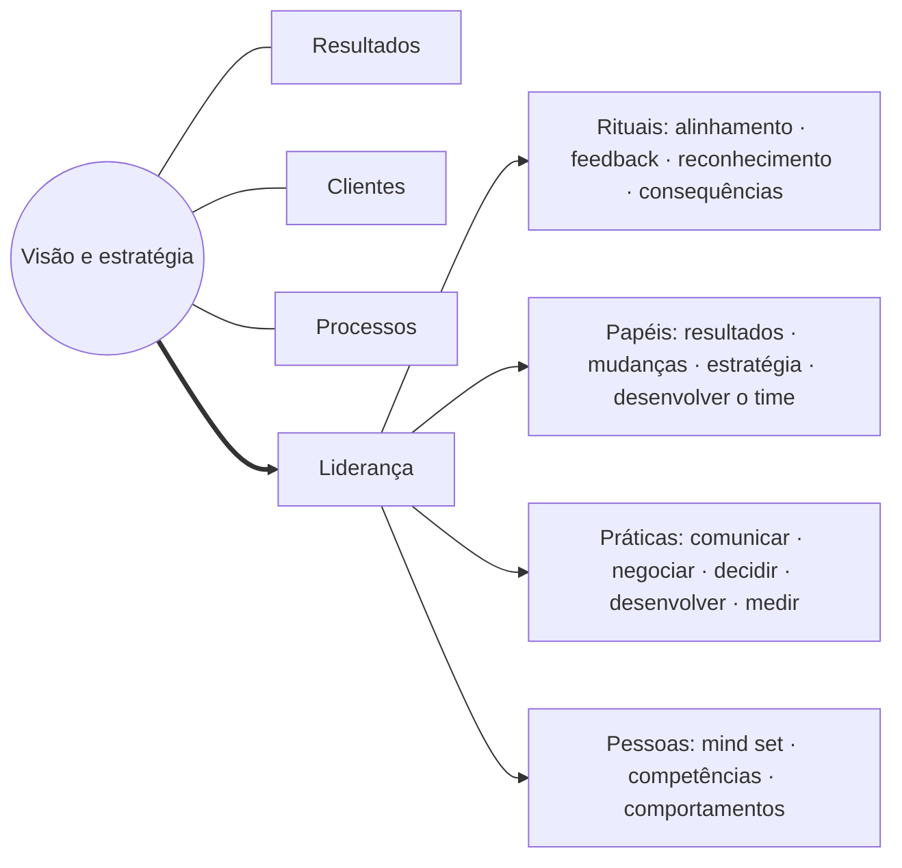
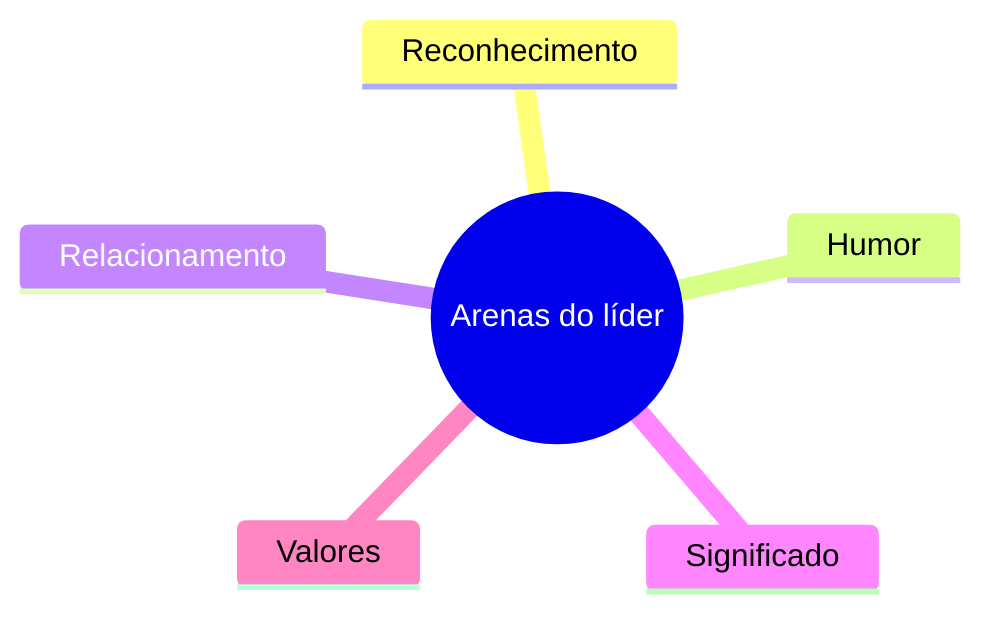
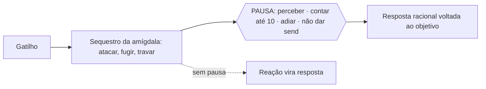
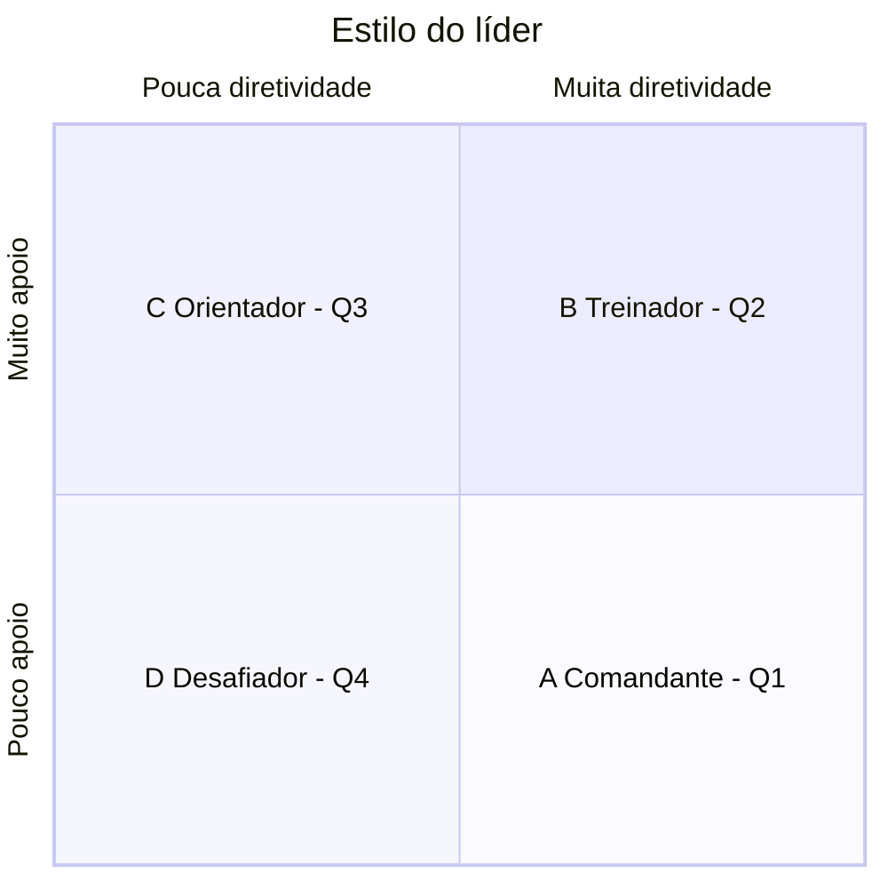
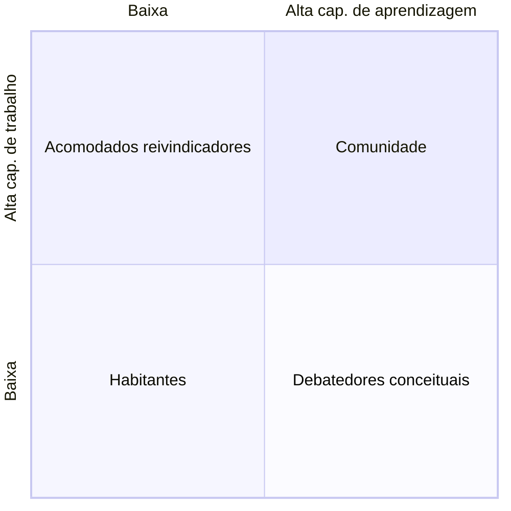
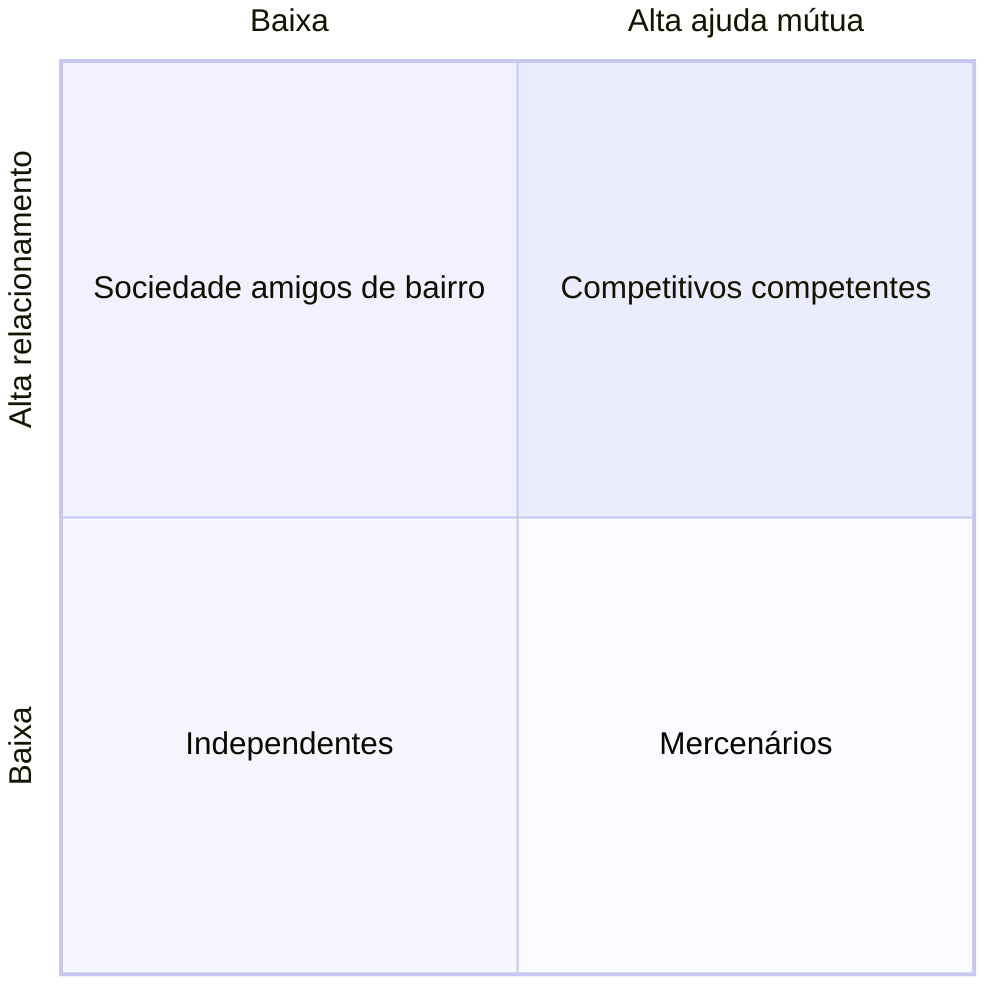
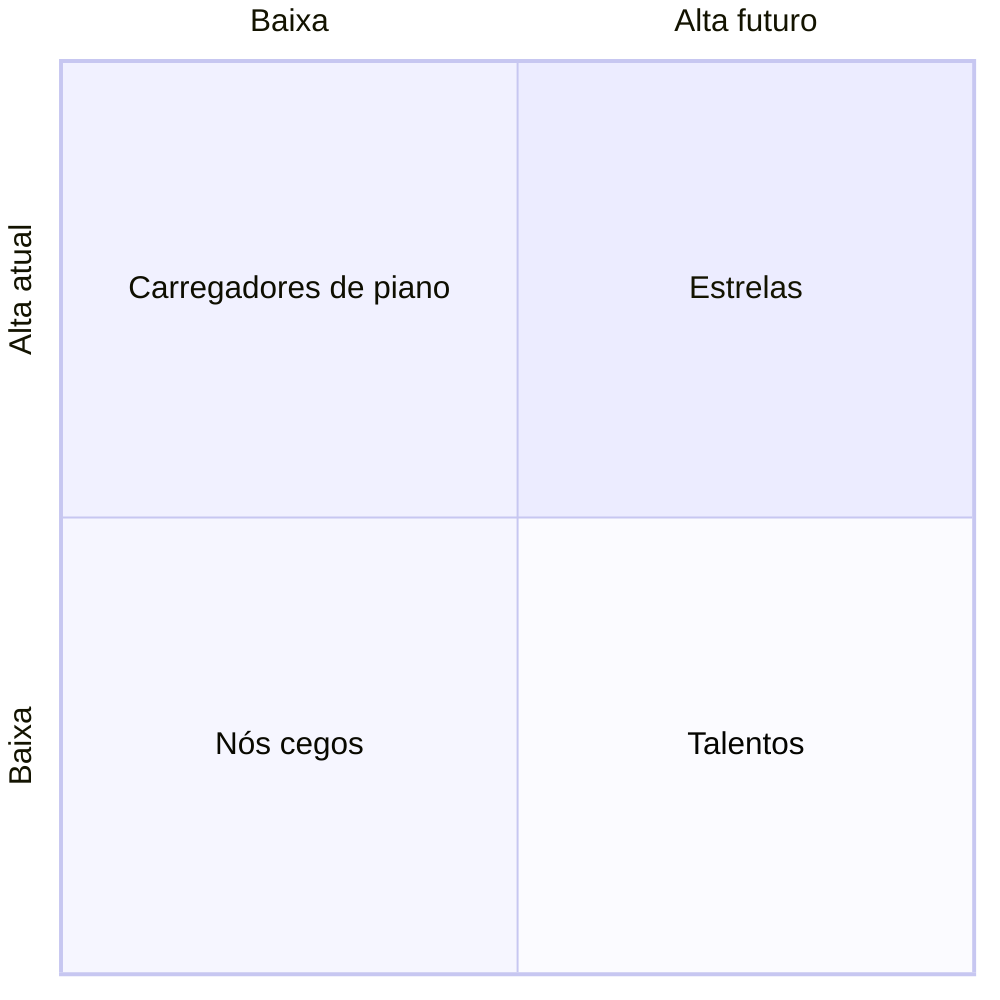

# claude/mo-6-lideranca-e-gestao.md

---
tipo: manual-operacional-lideranca
área: shopping-centers
status: v3.2-para-validacao
criado: 2026-10-19
atualizado: 2026-10-19
versão: "3.2"
documento: 6
tags: [manual-operacional, shopping-center, allos, lideranca, pdl, gestao, fundamentos]
aliases: [Liderança e Gestão, Apêndice de Liderança, PDL, MO 6]
---

# 6 · Liderança e Gestão

> [!abstract] Para que serve
> Ferramentas de liderança para gerentes e, em especial, coordenadores e supervisores — o **Apêndice de Liderança** (base PDL), praticado nas rotinas 20.08–20.13 do [[MO 2 - Manual Operacional#Etapa 20 · Gente e Performance (Gestão de Colaboradores)|Manual Operacional]] — mais o resumo do **PDL** e os **fundamentos de gestão** que explicam por que o Manual está desenhado assim.

## Índice

- [[#Apêndice A · Liderança]]
- [[#PDL — Programa de Desenvolvimento das Lideranças]]
- [[#Fundamentos: o Manual a serviço do objetivo do shopping]]

---

## Apêndice A · Liderança

> [!abstract] Para gerentes — e especialmente para coordenadores e supervisores
> Este apêndice é o manual de bolso de quem lidera gente no shopping. O Manual Operacional diz o que fazer em cada rotina; este apêndice ajuda a responder outra pergunta: como conduzir cada pessoa para que ela execute bem — inclusive quando acabou de chegar. É escrito para gerentes, mas especialmente para coordenadores e supervisores, que estão mais perto do piso, das equipes orgânicas e terceirizadas e das trocas de turno. Os conceitos vêm do PDL (Programa de Desenvolvimento das Lideranças) e das obras em que ele se baseia; as rotinas 20.08 a 20.13 do Capítulo 20 são a forma de colocar tudo isso em prática e verificar.

### Quem usa o quê

| Você é | Seu desafio | Leia primeiro | Suas rotinas |
|---|---|---|---|
| Gerente | Lidera coordenadores; responde pelo resultado da área e pela maturidade do time. | A.1 Papel do líder · A.6 Equipe · A.5 Situacional com coordenadores · calibração e PDI | 20.08 · 20.11 · 20.12 |
| Coordenador | Lidera analistas, supervisores e, muitas vezes, contratos de terceiros; é quem mais sente a troca de pessoas. | A.5 Situacional (o coração) · A.2 Confiança · A.3 Arenas · 1:1 e handoff | 20.08 · 20.09 · 20.10 · 20.13 |
| Supervisor | Lidera a equipe de campo, orgânica e terceirizada, por turno; faz o briefing e vive o piso. | A.4 Gestão emocional · A.5 Situacional no turno · A.3 Reconhecimento · rituais curtos | 20.09 (versão curta) · 20.10 |

### Por onde começar

| Situação | O que ler |
|---|---|
| Tenho 10 minutos | Leia A.5.3 (os quatro estilos) e A.5.6 (erros). Já muda o próximo 1:1. |
| Tenho 30 minutos | A.5 inteiro + o template de 1:1 (A.5.8). |
| Vou receber alguém novo | A.5.7 (exemplos) e A.7 (continuidade). Todo novo começa em Q1 nas rotinas da posição. |
| Meu time está em conflito | A.6 (estágios de equipe) e A.4 (gestão emocional). |

---

### A.1 O papel do líder

Duas camadas: na **estratégica**, visão e estratégia se desdobram em resultados, clientes e processos; na **execução**, pessoas só entregam se a liderança conectar tudo por **rituais, papéis e práticas**.



| Elemento | O que é | Inclui | Exemplo no shopping (ilustrativo) |
|---|---|---|---|
| Rituais | Os momentos fixos em que o time percebe a liderança | Alinhamento, feedback, reconhecimento, gestão de consequências | Briefing de turno do supervisor; alinhamento semanal do coordenador; feedback no 1:1 mensal; elogio público ao vigilante que conteve uma ocorrência |
| Papéis | O que se espera do líder além da própria tarefa | Entregar resultado, conduzir mudanças, traduzir a estratégia, desenvolver o time | Explicar ao time por que o checklist de limpeza mudou; preparar o sucessor da coordenação |
| Práticas | As habilidades usadas no dia a dia | Comunicação, negociação, decisão, desenvolvimento, medição de performance | Negociar escala com a empresa terceira; decidir a prioridade de OS no sábado; acompanhar o indicador da Etapa |

> [!question] Reflexões
> - Sei o que é esperado da minha área além das metas?
> - Entendo como o meu trabalho vira resultado para o cliente e para o lojista?
> - Domino os processos da minha área e respondo pela evolução deles?
> - Meu time tem o mind set certo e está preparado para o desafio?
> - Pratico todos os rituais — e meus liderados percebem isso?
> - Diferencio os rituais por pessoa?
> - Qual papel meu está mais apagado hoje? O que vou fazer?

---

### A.2 Confiança como fundamento

> [!quote] Definição
> **Confiança é acreditar que aqueles de quem dependemos irão cumprir com nossas expectativas.**

```
CONTROLE ◄──────────────────────────────────────────► EMPOWERMENT
micro-gestão        [ zona de confiança: controle ∝ maturidade ]        abandono
```

| Componente | O que significa | Na prática (ilustrativo) |
|---|---|---|
| Crença | "Crer para ver": quem lidera precisa dar o primeiro voto de confiança — com acompanhamento. | Delegar a primeira ronda de inspeção ao supervisor novo, combinando o retorno. |
| Dependência, vulnerabilidade e risco | Confiar é se expor: se o liderado falhar, o líder também falha. | O coordenador que delega o fechamento do checklist assume o risco junto — por isso revisa antes do envio nos primeiros meses. |
| Expectativas explícitas | Expectativas nunca são óbvias. O que não foi dito não pode ser cobrado. | Dizer: "registro no mesmo dia, foto antes/depois, OS fechada em D+1" — e não "capricha na OS". |
| Controle × empowerment | Controle demais vira micro-gestão; liberdade sem acompanhamento vira abandono. A dose depende da maturidade (A.5). | Novo analista: revisão diária. Analista Q4: revisão por amostra. |

**Checklist da expectativa explícita**

- [ ] O que exatamente deve ser entregue (rotina NN.KK, padrão de registro)
- [ ] Até quando (prazo, frequência)
- [ ] Com que qualidade (critério de validação da rotina)
- [ ] Como vou acompanhar (estilo combinado)
- [ ] O que acontece se não sair (consequência coerente)

---

### A.3 As arenas do líder



| Arena | Pergunta-chave | Sinal de alerta (ilustrativo) | O que fazer (ilustrativo) |
|---|---|---|---|
| Reconhecimento | Tenho tratado diferente os diferentes? O critério é claro e justo? | Elogio genérico para todos ("valeu, time!") ou só para os mesmos | Reconhecer o fato específico: "a OS da bomba fechada com laudo em D+1 evitou parar a praça" |
| Humor | Meu humor e o do time facilitam alta performance? | Líder que chega irritado e o turno inteiro trava | Chegar 10 min antes do briefing; separar o problema da pessoa; cuidar da própria energia |
| Relacionamento | Trato as pessoas como gente ou como coisa? | Falar com o terceirizado só para cobrar | Saber o nome de cada um da equipe de campo; perguntar antes de mandar |
| Significado | As pessoas entendem por que o trabalho delas importa? | "Faz porque está no checklist" | Ligar a rotina ao objetivo: "a ronda antes da abertura é a primeira impressão do cliente" |
| Valores | Sou coerente com os valores da empresa e com o que digo? | Cobrar pontualidade e chegar atrasado | Dar o exemplo nas rotinas ⚠️; admitir o próprio erro na frente do time |

---

### A.4 Gestão emocional

> [!quote] Definição
> **Equilíbrio emocional é a capacidade de lidar com as emoções — próprias e alheias — de maneira a favorecer o atingimento dos objetivos.**

| Palavra-chave | Por que importa |
|---|---|
| Capacidade | pode ser desenvolvida — não é "jeito de ser" |
| Emoção | nos move (moção) na direção certa ou errada |
| Próprias e alheias | influenciar a si e aos relacionamentos |
| Objetivo | a emoção não pode ficar entre a pessoa e o objetivo |

#### Os quatro quadrantes

|  | **Eu vejo** (percepção) | **Eu faço** (ação) |
|---|---|---|
| **Comigo** | Autopercepção | Autocontrole |
| **Com os outros** | Empatia | Articulação |

| Quadrante | Eixo | O que é | Pessoas fortes nele | Como evoluir |
|---|---|---|---|---|
| Autopercepção | Comigo · eu vejo | Entender as próprias emoções, a capacidade de resposta e a autoconfiança | Reflexivo, ouve feedback, presta atenção em si | Observar-se; monitorar sinais físicos; depois de cada episódio, anotar a conclusão; descobrir comportamentos que se repetem. Admitir o problema é o 1º passo. |
| Autocontrole | Comigo · eu faço | Canalizar impulsos na direção dos objetivos, com flexibilidade e foco em resultado | Aberto a mudanças, ponderado, confiável | Perceber o sequestro da amígdala; contar até 10; adiar; sair de cena; não dar "send"; ensaiar novos hábitos antes de situações difíceis. |
| Empatia | Com os outros · eu vejo | Detectar emoções nos outros — não é simpatia nem apatia | Sensível, sem pré-julgamento, bom mentor, cria sintonia | Prestar atenção a palavras, tom e postura; tratar pessoas como pessoas; registrar impressões e checar se acertou. |
| Articulação | Com os outros · eu faço | Liderar (seguidores voluntários), influenciar, comunicar, ler o contexto e criar vínculos | Credível, visto como líder, preocupado com o impacto | Ampliar a rede; não falar só de problemas; abrir mão da autoria para ganhar apoio; preocupar-se menos com "gostar ou não gostar". |

#### O sequestro da amígdala



#### Disfunções emocionais comuns

| Disfunção | Como aparece (ilustrativo) | Antídoto (ilustrativo) |
|---|---|---|
| Arrogância | não ouve, desqualifica a opinião do time | perguntar antes de afirmar |
| Perfeccionismo | refaz o trabalho dos outros, atrasa decisões | definir o "bom o suficiente" pelo critério da rotina |
| Chatice | cobra o mesmo ponto sem parar, sem priorizar | escolher as 3 prioridades do mês |
| Síndrome de Urtigão | mal-humorado, resmunga, afasta as pessoas | cuidar da própria energia; ritual de abertura positivo |
| Indeciso / medroso | empurra decisões para cima, o time fica parado | decidir dentro da alçada e assumir |
| Prolixo | briefings longos, mensagem se perde | três pontos por briefing |
| Monossilábico | o time não entende o que se espera | explicitar expectativas (A.2) |
| Mal-humorado / negativo | contamina o turno | separar o problema da pessoa |
| Querer aparecer | assume o crédito do time | reconhecer em público quem fez |
| Indiferente | não reage nem ao acerto nem ao erro | feedback mensal obrigatório (20.09) |
| Exagerado | trata tudo como crise | classificar pela gravidade real |
| Agressivo | grita, expõe, humilha | pausa (A.4.3) e conversa em particular |
| Bonzinho | evita conflito, não dá consequência | gestão de consequências com critério |

---

### A.5 Liderança situacional

> [!important] Princípio
> Estilos diferentes para situações diferentes. O quadrante é da pessoa **na tarefa**, nunca da pessoa.

#### Quadrantes do liderado

| Quadrante | Nome | Atitude | Preparo | Desempenho | Estilo | Frase | O que precisa |
|---|---|---|---|---|---|---|---|
| Q1 | Incauto Motivado | Alta — animado, confiante, otimista | Baixo — não está pronto e acha que "vai ser moleza" | Ainda não entrega sozinho | Comandante | "Faça assim" | Expectativas e metas claras; plano tarefa a tarefa; treino no posto de trabalho; acompanhamento frequente; o líder toma as decisões críticas |
| Q2 | Limitado Frustrado | Baixa — decepcionado, desmotivado, com medo | Algum — evoluiu, mas ainda é insuficiente | Não atende às expectativas | Treinador | "Vamos juntos" | Ser ouvido; encorajamento; feedback; apoio para resolver problemas; plano feito depois de ouvir; mostrar o caminho; prestígio quando acerta; espaço para tentar |
| Q3 | Capaz Inseguro | Variável — cuidadoso, às vezes inseguro | Médio-alto — conhece e aplica | Atende às expectativas | Orientador | "Pode ir, estou aqui" | Remoção de obstáculos; ser ouvido; encorajamento para assumir riscos; apoio nas decisões principais; demonstração de confiança |
| Q4 | Realizador Independente | Alta — seguro, consistente, positivo | Alto — proficiente, pronto | Supera as expectativas | Desafiador | "Vai sozinho" | Espaço para empreender; oportunidades e desafios; ser notado pela organização; ensinar outros |

| Quadrante | Sinais (ilustrativo) |
|---|---|
| Q1 | Faz muitas perguntas "de como", quer começar logo, subestima prazos, comete erros de procedimento sem perceber |
| Q2 | Justifica atrasos, evita o líder, sumiu das reuniões, diz "isso não funciona aqui", repete o mesmo erro |
| Q3 | Entrega, mas pede validação de tudo; evita decisões com risco; demora a enviar o checklist "para conferir mais uma vez" |
| Q4 | Antecipa problemas, propõe melhorias, ensina colegas, não precisa ser lembrado das rotinas |

#### Os quatro estilos (diretividade × apoio)



| Dimensão | Comandante | Treinador | Orientador | Desafiador |
|---|---|---|---|---|
| Objetivos | O líder estabelece e dirige | O líder ouve e estabelece, ensinando o porquê | Mais consensuais | Mais pelo colaborador |
| Acompanhamento | Próximo e justo | Um pouco de espaço, mas próximo | Definido em conjunto | Eventual, quando necessário |
| Treinamento | Intenso, básico, passo a passo, no posto | Ainda intenso, mas exige respostas | Não necessário | O colaborador treina outros |
| Coach | Feedback frequente | Atua no desânimo; elogio e encorajamento | Resolve questões emocionais | O colaborador é coach de outros |
| Decisão | O líder decide | Pergunta, ouve e decide ensinando | Em conjunto | Mais pelo colaborador |

**Impulsionadores de diretividade/treinamento:** Definir objetivos e metas · Tomar decisões · Acompanhar e controlar · Esticar o desempenho (desafiar) · Definir prioridades e prazos · Ensinar

**Impulsionadores de apoio/orientação:** Escutar · Elogiar e reconhecer · Dar feedback · Compartilhar responsabilidades · Buscar envolvimento e participação · Resgatar a confiança · Entender problemas de atitude · Mostrar-se disponível

#### Os três erros clássicos

| Erro | Causa | Como acontece | Consequência |
|---|---|---|---|
| Micro-gestão | Excesso de diretividade | Tratar um Q4 como Q1: conferir tudo, decidir por ele | O bom profissional se desmotiva ou sai |
| Distanciamento | Falta de diretividade ou de apoio | Tratar um Q1 como Q4: "o Caderno está aí, qualquer coisa me chama" | É a causa clássica de descontinuidade quando alguém novo assume |
| Superproteção | Excesso de apoio | Fazer pelo liderado Q3 o que ele já consegue fazer | Impede o Q3 de virar Q4 |

#### Exemplos no shopping (ilustrativos)

| Pessoa | Rotina | Quadrante | Estilo e o que fazer |
|---|---|---|---|
| Analista comercial recém-contratado | Calcular os 4 argumentos e o LSR (18.09) | Q1 | Comandante: sentar junto no simulador nas três primeiras renovações, explicar o porquê de cada argumento, revisar antes do comitê. |
| O mesmo analista | Atualizar o controle de notificações (08.05) | Q3 | Orientador: já sabe fazer (fazia no emprego anterior); combinar a entrega e só conferir por amostra. |
| Supervisor de limpeza com 2 meses de checklists falhando | Checklists diários de limpeza (02.18) | Q2 | Treinador: ouvir o que trava (equipe terceira? app?), refazer o plano junto, reconhecer cada semana sem quebra. |
| Coordenadora de ambiência experiente | Notificar loja âncora fora do padrão (07.03) | Q3 | Orientador: remover o obstáculo (alinhar com o gerente comercial antes), encorajar e apoiar a decisão. |
| Supervisor de segurança veterano | Rondas e briefing de turno (03.01) | Q4 | Desafiador: dar o projeto de revisão do POP de ocorrências (03.04) e pedir que treine os novos vigilantes. |
| Coordenador de operações promovido de supervisor | Fechamento do SLA das facilities (02.14) | Q1 | Comandante na rotina nova, mesmo sendo Q4 nas rotinas antigas: passo a passo até o primeiro dia 10. |

#### Template de preparação (copie para cada liderado)

```
Liderado: 
Situação / projeto / tarefa (código NN.KK): 
Nível de competência percebido: 
Evidências (checklist, registros, indicadores): 
Quadrante do liderado (Q1–Q4): 
Estilo a adotar: 
Diretividade — atividades: realizações · resultados
Treinamento — atividades: realizações · resultados
Apoio — atividades: realizações · resultados
Orientação — atividades: realizações · resultados
```

#### Roteiro do 1:1 (25 min)

| Tempo | Bloco | Conteúdo |
|---|---|---|
| 5 min | Resultados do mês | checklist da posição, pendências, indicador da Etapa |
| 10 min | Conversa no estilo combinado | Q1/Q2: ensinar e decidir prazos · Q2/Q3: ouvir, reconhecer, resgatar confiança · Q4: desafio novo |
| 5 min | Feedback | um fato, o impacto, o próximo passo |
| 5 min | Combinados | até 3: o quê, até quando — registrar |

---

### A.6 Liderando a equipe

**Equipe madura:** Alta confiança mútua e compromisso com os objetivos da área · Baixa dependência do líder — libera tempo para o que importa · Destaque natural: quem sabe mais tem mais autonomia naquele assunto · Usam sempre dois chapéus: o da própria função e o do todo · Sem oposição sistemática: concordam e discordam sem pessoalidade · Têm mecanismos de autocorreção: dedicam tempo à autoavaliação · Resultados superiores e reconhecidos pela organização

```
Desempenho
  Participação ─╮                                   ╭─ Responsabilidade compartilhada
                 ╰─ Sub-agrupamento        Diferenciação ─╯
                          ╰── Confrontação ──╯
      (a queda acontece sozinha)     (a subida exige esforço do líder)
```

| Variável | Participação | Sub-agrupamento | Confrontação | Diferenciação | Resp. compartilhada |
|---|---|---|---|---|---|
| Confiança e compromisso | Baixos, verbais | Desconfiança velada entre subgrupos | Controle aumenta; confiança só dentro do subgrupo | Sinais de compromisso real | Alta entre todos; compromisso genuíno |
| Autonomia e foco | Alta dependência do chefe | Subgrupos disputam espaço | Manobras por poder | Autonomia diferenciada por assunto | Ampla autonomia, sem intervenção |
| Comunicação | Intensa mas rasa | Focada no subgrupo | Mais franca e defensiva | Abertura e coragem para feedback | Excelente, rápida, feedback aberto |
| Tomada de decisão | Pelos mais extrovertidos | Impasses; chefe interfere | Jogo de poder; informação vira arma | Participação ampla | Consensual ou individual conforme o domínio |
| Visão do todo | Baixa e confusa | Em segundo plano | Usada quando convém | Discutida abertamente | Metas do todo priorizadas |
| Clima | Calmo, polido, sentimentos ocultos | Ótimo no subgrupo | Hostil, áspero | Diferenças aceitas; ajuda mútua | Alta solidariedade |
| Autogerenciamento | Inexistente | Discutido em pequenos grupos | Usado como arma | Ciclotímico | Presente; libera o líder |
| Resultado da área | Bom, mas dependente do líder | Subáreas ok, todo satisfatório | Perde atenção; culpa nos outros | Notável melhora | Excelente e reconhecido |

| Estágio | Ação do líder (ilustrativo) |
|---|---|
| Participação | Explicitar objetivos e papéis; dar visão do todo; não se encantar com o clima polido |
| Sub-agrupamento | Misturar subgrupos em rotinas compartilhadas (ex.: Operações + Comercial no mapa de CRD); metas comuns |
| Confrontação | Mediar com fatos (indicadores, checklist); regras claras de decisão; feedback individual sem plateia |
| Diferenciação | Dar autonomia por assunto a quem domina; ritual de autoavaliação do time |
| Responsabilidade compartilhada | Proteger o que funciona; novos desafios; preparar sucessores |

#### Capacidade de trabalho × capacidade de aprendizagem



| Quadrante | O que significa | O que o líder faz (ilustrativo) |
|---|---|---|
| Comunidade | entrega e aprende — o ideal | proteger e desafiar |
| Acomodados reivindicadores | entregam, mas não aprendem; resistem a mudança | mostrar o porquê da mudança; envolver na solução |
| Debatedores conceituais | aprendem e discutem, mas não entregam | metas e prazos claros; transformar ideia em rotina |
| Habitantes | nem entregam nem aprendem | urgente: diretividade e plano com prazo |

#### Relacionamento × ajuda mútua



| Quadrante | O que significa | O que o líder faz (ilustrativo) |
|---|---|---|
| Competitivos competentes | se dão bem e se ajudam no trabalho — o ideal | manter rituais de time |
| Sociedade amigos de bairro | se dão bem, mas não se cobram nem se ajudam no trabalho | metas compartilhadas e feedback entre pares |
| Mercenários | ajudam por interesse, sem vínculo | construir significado e relacionamento |
| Independentes | cada um por si | rotinas que exigem cooperação; reconhecer ajuda |

#### Desempenho atual × desempenho futuro (por pessoa)



| Quadrante | O que significa | O que o líder faz (ilustrativo) |
|---|---|---|
| Estrelas | entregam hoje e têm futuro | desafio, visibilidade, sucessão |
| Talentos | ainda não entregam, mas vão | treinar (Q1/Q2) e dar tempo |
| Carregadores de piano | entregam hoje, sem perspectiva de crescer | valorizar e reter na função |
| Nós cegos | nem hoje nem amanhã | atenção urgente: plano com prazo e consequência |

---

### A.7 Rotina do líder e continuidade

| Quando | O quê | Rotina |
|---|---|---|
| Diário (supervisor) | Briefing de turno de 5–10 min: prioridades, rotinas ⚠️ do dia, reconhecimento rápido | 20.10 |
| Semanal | Alinhamento do time (15–30 min) | 20.10 |
| Mensal | 1:1 com template por liderado; feedback e reconhecimento | 20.09 · 20.10 |
| Semestral | Mapa de quadrantes; diagnóstico de equipe; autoavaliação e PDI do líder | 20.08 · 20.11 · 20.12 |
| Por evento | Admissão, promoção, transferência ou saída: mapa em ≤ 15 dias e handoff situacional | 20.08 · 20.13 |

- Todo novo ocupante é Q1 nas rotinas da posição — mesmo que seja experiente. Use estilo Comandante/Treinador, com o Caderno de Etapas e o checklist da posição como roteiro.
- Acompanhamento semanal até o primeiro fechamento mensal completo; só então reavalie o quadrante.
- Na saída de alguém: além do handoff das rotinas (00.06), registre o quadrante do sucessor e o plano das 4 primeiras semanas.
- Na troca de líder: o líder que sai entrega o mapa de quadrantes, os últimos 1:1, o diagnóstico de equipe e os combinados em aberto (20.13).

#### Para supervisores (ilustrativo)

| Tema | Como aplicar |
|---|---|
| Quem lidera | Equipe orgânica e terceirizada (limpeza, vigilância, manutenção, estacionamento) por turno |
| Estilo | Aplique o situacional normalmente: o vigilante novo é Q1 em ronda com QR-code, mesmo que seja experiente em outro shopping |
| Feedback e reconhecimento | Valem para todos; para terceiros, use o reconhecimento do time de campo (20.06) e registre no SLA da empresa |
| Consequência | Para terceiros, a consequência formal passa pelo contrato/SLA com a empresa (02.14, 14.02) — nunca diretamente |
| Ritual | Briefing de turno curto e fixo; é o seu 1:1 coletivo |

#### Autoavaliação rápida (0–10)

- [ ] Sei, para cada liderado, em que quadrante ele está nas rotinas críticas — __/10
- [ ] Combinei com cada um como vou gerenciá-lo — __/10
- [ ] Fiz 1:1 com todos no último mês, com template — __/10
- [ ] Minhas expectativas estão escritas e claras — __/10
- [ ] Reconheço de forma específica e justa — __/10
- [ ] Dou consequência com critério, sem "bonzinho" nem agressividade — __/10
- [ ] Percebo quando sou sequestrado pela emoção e faço a pausa — __/10
- [ ] Meu time sabe por que o trabalho dele importa — __/10
- [ ] Não faço micro-gestão com quem já é Q4 — __/10
- [ ] Quem chegou nos últimos 3 meses tem plano de acompanhamento — __/10

#### Glossário

| Termo | Significado |
|---|---|
| Liderança situacional | ajustar o estilo à maturidade do liderado em cada tarefa |
| Q1–Q4 | quadrantes de maturidade: Incauto Motivado, Limitado Frustrado, Capaz Inseguro, Realizador Independente |
| Diretividade / treinamento | definir, decidir, ensinar, acompanhar |
| Apoio / orientação | escutar, reconhecer, dar feedback, envolver, encorajar |
| Empowerment | dar autonomia com responsabilidade |
| Sequestro da amígdala | reação emocional que toma o lugar da razão |
| Gestão de consequências | resposta coerente e registrada a desvios recorrentes |
| 1:1 | conversa individual mensal entre líder e liderado |
| Handoff situacional | passagem de bastão que inclui o "como liderar" cada pessoa |

#### Referências

- Kaplan, R. S. & Norton, D. P. A Estratégia em Ação: Balanced Scorecard. Campus, 1997.
- Beatty, R. W.; Huselid, M. A.; Schneier, C. E. "New HR Metrics". Organizational Dynamics, Elsevier, 2003.
- Goleman, D. Trabalhando com a Inteligência Emocional.
- Blanchard, K. Liderança de Alto Nível.
- PDL — Programa de Desenvolvimento das Lideranças, Mandelli Consultores Associados (resumo no vault).

> [!warning] Nota
> Conceitos vêm do PDL e de suas bases. Exemplos, sinais, antídotos e ações marcados "ilustrativo" são aplicação ao shopping, a validar com Gente & Performance.

---

---

## PDL — Programa de Desenvolvimento das Lideranças

> [!info] Compatibilização (v3.2 · out/2026)
> Este documento faz parte do conjunto de 7 documentos do Manual Operacional Allos (ver [[MO 1 - Guia de Utilizacao|Guia de Utilização]]). A referência vigente é o [[MO 2 - Manual Operacional|Manual Operacional (Documento 2)]]: 20 Etapas em 4 pilares + 3 alicerces, 178 rotinas. Correspondências: capítulo do Book = Etapa do Manual (mesmo número; não existe 12); item do checklist do Book (122) → rotina NN.KK; planilhas → [[Base Única - Manual Operacional.xlsx|Base Única]].

-----

title: “PDL - Programa de Desenvolvimento das Lideranças”
source: “Apresentação Mandelli Consultores Associados”
type: “resumo”
tema: “liderança”
created: 2026-05-17
tags:

- liderança
- desenvolvimento
- gestão-de-pessoas
- inteligência-emocional
- liderança-situacional
- cia
- pdl
  aliases:
- PDL3
- Desenvolvimento de Lideranças Cia

-----

> [!info] Sobre este documento
> Resumo do programa **PDL** conduzido pela **Mandelli Consultores Associados**. Combina três grandes referenciais: [[Balanced Scorecard]] (Kaplan & Norton), métricas de RH (Beatty, Huselid & Schneier) e [[Liderança Situacional]] (Ken Blanchard), além da abordagem de [[Inteligência Emocional]] de Daniel Goleman.

### Mapa do conteúdo

1. [[#1. Papel da Liderança]]
2. [[#2. Confiança como Fundamento]]
3. [[#3. Arenas de Luta do Líder]]
4. [[#4. Gestão Emocional]]
5. [[#5. Estilos Gerenciais — Liderança Situacional]]
6. [[#6. Liderando a Equipe — 4 Perspectivas]]

-----

### 1. Papel da Liderança

> [!abstract] Estrutura conceitual
> Adaptado do **Balanced Scorecard** (Kaplan & Norton, 1997) e de **Beatty, Huselid & Schneier** (*The New HR Metrics*, Elsevier, 2003).

O papel do líder se organiza em duas camadas:

**Camada estratégica (externa):**

- **Visão e estratégia** no centro
- **Resultados**, **Clientes**, **Processos** orbitando

**Camada de execução (interna):**

- **Pessoas** — mind set, competências, comportamentos
- **Liderança** — conectada a:
  - **Rituais** → alinhamento, [[feedback]], reconhecimento, gestão de consequências
  - **Papéis** → resultados, mudanças, estratégia, desenvolver o time
  - **Práticas** → comunicação, negociação, decisão, desenvolvimento, medição de performance

#### Reflexões propostas

> [!question] Estratégia e Visão
> 
> - Tenho me posicionado quanto ao direcionamento futuro da empresa?
> - Sei o que é esperado da minha área além das metas?
> - Entendo como meu trabalho vira resultado e impacto no cliente?
> - Domino meus processos e sou responsável pela evolução deles?

> [!question] Pessoas
> 
> - Tenho liderados com mind set alinhado?
> - Sinto-me responsável por ter time preparado e disposto compatível com o desafio?

> [!question] Rituais, Práticas e Papéis
> 
> - Pratico todos os rituais e meus liderados percebem isso?
> - Os rituais são diferenciados por indivíduo?
> - Quais práticas precisam de mais prioridade?
> - Quais papéis estão mais ofuscados e o que fazer?

-----

### 2. Confiança como Fundamento

> [!quote] Definição
> **Confiança é acreditar que aqueles de quem dependemos irão cumprir com nossas expectativas.**

**Componentes:**

- **Crença** — “crer para ver” (inversão da lógica “ver para crer”)
- **Dependência, vulnerabilidade e risco** — confiar implica se expor
- **Expectativas** — nunca são óbvias; precisam ser explicitadas
- **Tensão Controle × [[Empowerment]]**

#### Reflexões propostas

- Como anda sua confiança no time? E a deles em você?
- Suas expectativas são claras e explícitas?
- Pontos a melhorar em **resultado**, **preocupação** e **integridade**?
- Como está o nível de controle vs empowerment? Como anda a complacência?

-----

### 3. Arenas de Luta do Líder

As cinco frentes onde o líder atua emocional e simbolicamente:

1. **Construir reconhecimento**
2. **Elevar e sustentar o humor**
3. **Valorizar o relacionamento**
4. **Construir significado**
5. **Trabalhar com valores**

#### Reflexões por arena

> [!question] Reconhecimento
> Tenho tratado diferente os diferentes? O critério de justiça é claro? Meu reconhecimento é específico e diferenciado a ponto das pessoas quererem dar seu 100%?

> [!question] Humor
> Meu humor e o do time facilitam alta performance? Como anda minha energia? “Camisa vermelha e calça marrom?” (metáfora para incoerência/dissonância)

> [!question] Relacionamento
> Trato as pessoas como gente ou como coisa? Qual meu esforço para conquistar os liderados?

> [!question] Significado
> As pessoas percebem significado no trabalho? Qual meu esforço pessoal para que cada liderado aprenda?

> [!question] Valores
> Sou propagador de valores da empresa, pessoais e de formação?

-----

### 4. Gestão Emocional

> [!info] Base teórica
> Adaptado de **Daniel Goleman**, *Trabalhando com Inteligência Emocional*.

#### 4.1 Conceito

> [!quote] Equilíbrio Emocional
> **Capacidade de lidar com as emoções (próprias e alheias) de maneira a favorecer o atingimento dos objetivos.**

**Palavras-chave:**

- **Capacidade** → pode ser desenvolvida
- **Emoção** → nos move (moção) na direção certa ou errada
- **Próprias e alheias** → influenciar a si e aos relacionamentos
- **Objetivo** → a emoção não pode ficar entre a pessoa e o objetivo

#### 4.2 Três fatores que pressionam o equilíbrio

```
Personalidade ←→ Inteligência ←→ Equilíbrio Emocional
```

Personalidade, inteligência e equilíbrio emocional interagem — e os limites/desculpas costumam recair sobre o equilíbrio emocional.

#### 4.3 Disfunções emocionais comuns

> [!warning] Disfunções listadas
> Arrogância · Perfeccionismo · Chatice · Síndrome de Urtigão · Indeciso/medroso · Prolixo · Monossilábico · Mal-humorado/negativo · Querer aparecer · Indiferente · Exagerado · Agressivo · Bonzinho

Cada uma tem impacto direto no [[engajamento]] do time.

#### 4.4 Os 4 Quadrantes do Equilíbrio Emocional

|              |**Eu Faço** (ação)|**Eu Vejo** (percepção)|
|--------------|------------------|-----------------------|
|**Comigo**    |[[Auto-Controle]] |[[Auto-Percepção]]     |
|**Com Outros**|[[Articulação]]   |[[Empatia]]            |

##### Auto-Percepção

**Entendimento de si próprio** → emoções, capacidade de resposta, **confiança**.

|Características evidentes          |O que fazer para evoluir                                        |
|-----------------------------------|----------------------------------------------------------------|
|Reflexivas (aprendem com vivências)|Observar a si mesmo com atenção; reconhecer emoções e impactos  |
|Dedicam tempo a ouvir feedback     |Monitorar sinais físicos; após ocorrências, registrar conclusões|
|Prestam atenção em si mesmas       |Descobrir comportamentos reincidentes; agir preventivamente     |

> Admitir o problema é o **1º passo**.

##### Auto-Controle

**Capacidade de canalizar impulsos emocionais na direção dos objetivos.** Inclui flexibilidade/adaptabilidade e orientação para resultado.

> [!tip] Conhecer a amígdala cerebral
> “Sequestro da amígdala” → reação emocional que toma o lugar da racionalidade.

|Características   |O que fazer para evoluir                                                 |
|------------------|-------------------------------------------------------------------------|
|Abertas a mudanças|Perceber o sequestro da amígdala; retomar a parte racional; contar até 10|
|Ponderadas        |Adiar; sair de cena; não dar “send”                                      |
|Confiáveis        |Cuidar dos maus hábitos; ensaiar novos; preparar-se antes para mudanças  |

##### Empatia

**Capacidade de detectar emoções em outras pessoas. Não é simpatia nem apatia.**

- Atenção e preocupação com o outro
- Ler o não-verbal e o verbal não-explícito
- Gostar de gente

|Características           |O que fazer para evoluir                           |
|--------------------------|---------------------------------------------------|
|Sensíveis, perceptivas    |Atenção a palavras, tom de voz, mensagens          |
|Conscientes das diferenças|Atenção a corpo, expressões, posturas              |
|Não pré-julgam            |Tratar pessoas como pessoas, não como coisas       |
|Bons mentores/orientadores|Registrar impressões como treino; aferir veracidade|
|Criam sintonia            |Errar faz parte — é parte do aprendizado           |

##### Articulação

Envolve **liderança** (seguidores voluntários), **influência** (ser ouvido e aceito), **comunicação** (ser entendido), **leitura de contexto** e **relacionamento** (elos de ajuda mútua).

|Características              |O que fazer para evoluir                                          |
|-----------------------------|------------------------------------------------------------------|
|Alta credibilidade           |Ampliar rede de contatos; ocupar mais seu espaço                  |
|Vistos como líderes          |Não focar apenas em problemas                                     |
|Muitas vezes carismáticos    |Não ter orgulho de autoria para obter mais apoio; liderar mudanças|
|Preocupados em causar impacto|Preocupar-se menos com gostar/não gostar                          |

-----

### 5. Estilos Gerenciais — Liderança Situacional

> [!info] Base teórica
> Adaptado de **Ken Blanchard**, *Liderança de Alto Nível*.

#### 5.1 De onde vem o estilo praticado

Três fontes alimentam o “estilo de conforto”:

- **Características pessoais** — introversão/extroversão, detalhista/generalista, lógica/emoção, perceptivo/intuitivo
- **Vivências como liderado** — bons e maus exemplos
- **Vivências como líder** — sucessos e fracassos

E ele precisa se ajustar a:

- **Situação da área/empresa**
- **Situação dos liderados**

> [!important] Princípio central
> **Estilos diferentes para situações diferentes. É necessária uma resposta dinâmica.**

#### 5.2 Avaliação do colaborador

**Conhecimento:**

- Técnico formal e informal
- Gestão (transferíveis e específicos)

**Atitudes:**

- Motivação
- Auto-confiança
- Engajamento/comprometimento

A combinação posiciona o liderado em um dos quatro quadrantes (Q1 → Q4).

#### 5.3 Os 4 Quadrantes de Maturidade do Liderado

|Quadrante|Nome                       |Atitude                                    |Preparo                                         |Desempenho             |
|---------|---------------------------|-------------------------------------------|------------------------------------------------|-----------------------|
|**Q1**   |[[Incauto Motivado]]       |Alta — animado, confiante, otimista        |Baixo — não está pronto, acha que vai ser moleza|Não entrega sozinho    |
|**Q2**   |[[Limitado Frustrado]]     |Baixa — decepcionado, desmotivado, com medo|Algum — evoluiu mas insuficiente                |Não atende expectativas|
|**Q3**   |[[Capaz Inseguro]]         |Variável — às vezes inseguro, cuidadoso    |Médio-alto — conhece e aplica                   |Atende expectativas    |
|**Q4**   |[[Realizador Independente]]|Alta — seguro, consistente, positivo       |Alto — proficiente, pronto                      |Supera expectativas    |

#### 5.4 Curva de evolução do liderado

```
Atitude (alta) ──┐
                  ╲ "Gap da Inconsequência"
Q1                 ╲   ↓
Incauto Motivado    ╲  Q2 "A dura realidade"
                     ╲  Limitado Frustrado
                      ╲ ↑ atitude despenca
Competência ─────────────╲────────────────→
sobe linearmente          ╲  Q3 Capaz Inseguro
                           ╲    (insegurança = gap)
                            ╲  Q4 Realizador Independente
Tempo →                      MATURIDADE = gap zero
```

> Maturidade = quando competência e atitude se alinham (Q4).

#### 5.5 Os 4 Estilos do Líder (matriz Apoio × Diretividade)

```
        Apoio/Orientação ↑
              │
       +  ┌────────────┬────────────┐
          │   C        │    B       │
          │ ORIENTADOR │ TREINADOR  │
          │ Capaz      │ Limitado   │
          │ Inseguro   │ Frustrado  │
          │ "Pode ir,  │ "Vamos     │
          │ estou aqui"│ juntos"    │
          ├────────────┼────────────┤
          │   D        │    A       │
          │ DESAFIADOR │ COMANDANTE │
          │ Realizador │ Incauto    │
          │ Indepen.   │ Motivado   │
          │ "Vai       │ "Faça      │
          │ sozinho"   │ assim"     │
       -  └────────────┴────────────┘
              -                    +
              Diretividade/Treinamento →
```

#### 5.6 Impulsionadores

**Diretividade/Treinamento (Q1 e Q2):**

- Definir objetivos e metas
- Tomar decisões
- Acompanhar/controlar
- Esticar desempenho (desafiar)
- Definir prioridades e prazos
- Ensinar

**Apoio/Orientação (Q2 e Q3):**

- Escutar
- Elogiar/reconhecer
- Dar [[feedback]]
- Compartilhar responsabilidades
- Buscar envolvimento/participação
- Resgatar confiança
- Entender problemas de atitude
- Mostrar-se disponível

#### 5.7 Tabela detalhada dos 4 estilos

|Dimensão          |1. Comandante                             |2. Treinador                               |3. Orientador                |4. Desafiador                |
|------------------|------------------------------------------|-------------------------------------------|-----------------------------|-----------------------------|
|**Objetivos**     |Líder estabelece e dirige                 |Líder ouve e estabelece, ensinando o porquê|Mais consensuais             |Mais pelo colaborador        |
|**Acompanhamento**|Próximo e justo                           |Um pouco de espaço, mas próximo            |Definido em conjunto         |Eventual quando necessário   |
|**Treinamento**   |Intenso, básico, passo a passo, on the job|Ainda intenso, mas exige respostas         |Não necessário               |Colaborador treina outros    |
|**Coach**         |Feedback frequente                        |Atuação no desânimo, elogios, encorajamento|Resolver problemas emocionais|Colaborador é coach de outros|
|**Decisão**       |Líder decide                              |Pergunta, ouve e decide ensinando          |Em conjunto                  |Mais pelo colaborador        |

#### 5.8 Erros principais no uso dos estilos

> [!warning] Os 3 erros clássicos
> 
> - **Micro Gestão** — excesso de diretividade
> - **Distanciamento** — falta de diretividade ou de apoio
> - **Superproteção** — excesso de apoio

#### 5.9 Trabalhando em cada quadrante

##### Q1 — Incauto Motivado → estilo **Comandante**

**Como ele é:** disposto, quer aprender rápido, acha que vai abafar, ansioso, inexperiente, não percebe que não está pronto.

**O que precisa:** expectativas claras, metas claras, planejamento detalhado tarefa-a-tarefa, treinamento on-the-job, acompanhamento frequente, tomada de decisões críticas pelo líder.

##### Q2 — Limitado Frustrado → estilo **Treinador**

**Como ele é:** desanimado, distante, dá justificativas, desengajado, desiste fácil, negativo, esconde-se da guerra.

**O que precisa:** encorajamento, aconselhamento, feedback, ser ouvido, apoio na resolução de problemas, planejamento após ser ouvido, mostrar o caminho, prestígio quando acerta, espaço para tentar.

##### Q3 — Capaz Inseguro → estilo **Orientador**

**Como ele é:** preocupado com resultado, inseguro, já sabe a maior parte, receoso de comprometer, evita risco, preocupado com credibilidade.

**O que precisa:** remoção de obstáculos, ser ouvido, encorajamento a tomar riscos, apoio nas decisões principais, demonstração de confiança, energia e inspiração, prestígio do desempenho.

##### Q4 — Realizador Independente → estilo **Desafiador**

**Como ele é:** consistente, proativo, auto-confiante, proficiente, pronto para ensinar outros, assume riscos, alta credibilidade.

**O que precisa:** espaço para empreender, oportunidades e desafios, ser notado pela organização.

#### 5.10 Template de Preparação para Liderança

> [!example] Template para uso prático
> 
> ```
> Liderado:
> Situação/Projeto/Tarefa:
> Nível de Competência Percebido:
> Evidências:
> Quadrante do Liderado:
> Estilo a ser Adotado:
> 
> Diretividade (Atividades):     Realizações    Resultados
> Treinamento (Atividades):      Realizações    Resultados
> Apoio (Atividades):            Realizações    Resultados
> Orientação (Atividades):       Realizações    Resultados
> ```

#### Reflexões — Gerenciamento Um a Um

- Nota de 0 a 10 no gerenciamento um a um?
- Estou dando diretividade/treinamento + apoio/suporte na medida certa para cada liderado em cada tarefa?
- Exemplos bem-sucedidos e mal-sucedidos do uso da ferramenta?
- Casos de microgestão ou distanciamento?
- Usei o template para planejar? Combinei a forma de gerenciar com os liderados?
- Em que quadrante eu mesmo me encontro e do que preciso para evoluir?

-----

### 6. Liderando a Equipe — 4 Perspectivas

#### 6.1 Características de equipes maduras / alto desempenho

- **Alta confiança mútua e compromisso** com os objetivos da área
- **Baixa dependência** — libera tempo para o que importa
- **Destaque natural** — quem sabe mais tem mais autonomia
- **Usam sempre dois chapéus** (o do papel funcional + o do todo)
- **Sem oposição sistemática** — apoios e discordâncias sem pessoalidade
- **Mecanismos de autocorreção** — dedicam tempo a autoavaliação
- **Resultados superiores reconhecidos** por toda a organização

#### 6.2 Perspectiva 1 — Estágios de Maturidade da Equipe

```
Desempenho ↑
            Participação ──╲
                           ╲ "geração espontânea do caos"
                Sub-agrupamento ╲
                                ╲
                          Confrontação (fundo do vale)
                                  ╱
                                 ╱ "presença de esforço de liderança"
                          Diferenciação
                                    ╲
                              Responsabilidade Compartilhada ↑
                                                                    Tempo →
```

> [!tip] Insight crítico
> A queda da curva (caos) **acontece sozinha**. A subida (diferenciação → responsabilidade compartilhada) **só acontece com esforço deliberado de liderança**.

##### Variáveis-chave por estágio

|Variável                   |Participação                      |Sub-agrupamento                    |Confrontação                                       |Diferenciação                                                    |Responsabilidade Compartilhada                 |
|---------------------------|----------------------------------|-----------------------------------|---------------------------------------------------|-----------------------------------------------------------------|-----------------------------------------------|
|**Confiança e compromisso**|Baixos, verbais                   |Desconfiança velada entre subgrupos|Controle aumenta, confiança alta dentro do subgrupo|Sinais de compromisso real, ruptura da confiança cega no subgrupo|Alta confiança entre todos; compromisso genuíno|
|**Autonomia e foco**       |Alta dependência do chefe         |Subgrupos disputam espaço          |Discussões e manobras por poder                    |Autonomia diferenciada por assunto                               |Ampla autonomia; sem intervenção               |
|**Comunicação**            |Intensa mas rasa                  |Focada no subgrupo                 |Mais franca e defensiva, mas insuficiente          |Abertura crescente, coragem para feedback                        |Excelente, rápida, feedbacks abertos           |
|**Tomada de decisão**      |Pelos mais extrovertidos          |Impasses, chefe interfere          |Jogo de poder, informação vira arma                |Participação ampla com apoio                                     |Consensual ou individual conforme domínio      |
|**Visão abrangente**       |Baixa e confusa                   |Em segundo plano                   |Usada quando convém ao subgrupo                    |Discutida abertamente                                            |Metas abrangentes priorizadas                  |
|**Clima**                  |Calmo, polido, sentimentos ocultos|Ótimo no subgrupo, normal no todo  |Hostil, áspero                                     |Diferenças aceitas, ajuda mútua surge                            |Alta solidariedade, desacordos resolvidos      |
|**Autogerenciamento**      |Inexistente                       |Discutido em pequenos grupos       |Usado como arma                                    |Ciclotímico                                                      |Presente e funcional, libera o líder           |
|**Resultado da área**      |Bom mas dependente do líder       |Subáreas ok, todo satisfatório     |Perde atenção, culpa nos outros                    |Notável melhora, baixo desgaste                                  |Excelente e reconhecido                        |

#### 6.3 Perspectiva 2 — Capacidade de Trabalho × Aprendizagem

```
Capacidade de trabalho ↑
       │
   +   │ Acomodados        Comunidade
       │ reivindicadores
       │
   -   │ Habitantes        Debatedores
       │                   conceituais
       └────────────────────────────→
            -              +
            Capacidade de aprendizagem
```

> Equipe ideal: **Comunidade** (alta capacidade de entregar + alta capacidade de aprender).

#### 6.4 Perspectiva 3 — Relacionamento × Ajuda Mútua

```
Relacionamento ↑
       │
   +   │ Sociedade         Competitivos
       │ Amigos de Bairro  Competentes
       │
   -   │ Independentes     Mercenários
       │
       └────────────────────────────→
            -              +
            Ajuda Mútua
```

> Equipe ideal: **Competitivos Competentes** (alto relacionamento + alta ajuda mútua).

#### 6.5 Perspectiva 4 — Desempenho Atual × Futuro

```
Atual ↑
       │
   +   │ Carregadores      Estrelas
       │ de piano
       │
   -   │ Nós Cegos         Talentos
       │
       └────────────────────────────→
            -              +
            Futuro
```

- **Carregadores de piano**: entregam hoje, sem futuro
- **Nós cegos**: nem hoje nem amanhã (atenção urgente)
- **Talentos**: ainda não entregam, mas vão
- **Estrelas**: o ideal — entregam hoje e têm futuro

-----

### 7. Síntese Integrada

> [!summary] Modelo PDL 3 em uma página
> O programa articula 4 grandes blocos que se sustentam mutuamente:
> 
> 1. **O papel do líder** se exerce em rituais, práticas e papéis, conectando estratégia a pessoas.
> 2. **Confiança** é o fundamento — sem ela, controle vira micro-gestão e empowerment vira abandono.
> 3. **Inteligência emocional** (auto-percepção, auto-controle, empatia, articulação) é a competência que sustenta a liderança.
> 4. **Liderança situacional** é a aplicação prática: estilo adequado ao quadrante de maturidade de cada liderado em cada tarefa.
> 5. **Visão de equipe** complementa: a maturidade coletiva passa por caos antes de chegar a responsabilidade compartilhada — e só evolui com esforço deliberado do líder.

-----

### Conceitos para virar notas próprias no Obsidian

- [[Balanced Scorecard]]
- [[Inteligência Emocional]]
- [[Liderança Situacional]]
- [[Auto-Percepção]]
- [[Auto-Controle]]
- [[Empatia]]
- [[Articulação]]
- [[Empowerment]]
- [[Feedback]]
- [[Engajamento]]
- [[Incauto Motivado]] · [[Limitado Frustrado]] · [[Capaz Inseguro]] · [[Realizador Independente]]
- [[Sequestro da Amígdala]]
- [[Gestão de Consequências]]

### Referências citadas no material

- Kaplan, R. S. & Norton, D. P. *A Estratégia em Ação: Balanced Scorecard*. Campus, 1997.
- Beatty, R. W.; Huselid, M.; Schneier, C. *The New HR Metrics* (Organizational Dynamics). Elsevier, 2003.
- Goleman, Daniel. *Trabalhando com Inteligência Emocional*.
- Blanchard, Ken. *Liderança de Alto Nível*.

-----

**Tags adicionais:** #moc #liderança/situacional #liderança/emocional #equipe/maturidade #cia/pdl

---

## Fundamentos: o Manual a serviço do objetivo do shopping

> [!abstract] Em uma frase
> O plano de 90 dias e o formato 3·30·5 continuam válidos como **mecânica**. O que estava faltando era a **lógica**: por que cada capítulo existe em relação ao objetivo do shopping, quem de fato executa na estrutura real da Allos, como o book conversa com o que já existe (Handbook de Operações, Farol de Metas) e quais alavancas de cultura sustentam a adesão quando o PMO sair de cena. Esta nota fecha essas lacunas com o que está no seu vault — EPSO, Portfólio Inteligente, Handbook, Disney — e propõe 12 decisões.

**Fontes lidas no vault:** [[Estratégia Operacional- Resumo EPSO - Stanford]] · [[EPSO - Stanford GSB - Strategy and Organizational Design - Aula - Jesper B. Sørensen]] · [[EPSO - Stanford GSB - Resumo - Executive Program Strategy Organization- 2022]] · [[EPSO - Stanford GSB - Ambidextrous Organization - Aula - Charles A. O'Reilly III]] · [[EPSO - Stanford GSB - Leading from Different Psychological Distances - Aula - Nir Halevy]] · [[EPSO - Stanford GSB - Strategic Leadership - Aula - Jesper B. Sørensen]] · [[EPSO - Stanford GSB - Program Close - Aula Jesper B. Sørensen]] · [[EPSO - Stanford GSB - Rapid Bonding - Aula - S. Christian Wheeler]] · [[Handbook Operações Allos 2024]] · [[Projeto PES BRMALLS + Book de Renovações|Projeto Cia + Book de Renovações]] · [[Manual Operacional Allos - Antigo PES|Manual Operacional Allos (versão antiga)]] · [[Descritivo Funções de Liderança em Shoppings]] · [[Operational Conversion Cockpit - Shopping Inteligente OS]] · [[STRATEGIC PLAN EVALUATION & CRITIQUE ENGINE]] · [[Skill — Análise de Performance de Lojas]] · [[Disney's Approach to Quality Service]] · [[Black Belt - Integração das Ferramentas da Qualidade ao Sistema de Gestão]] · [[RMR Supers - Junho26]] · [[Shopping inteligente]]

---

### 1. O argumento estratégico do book (o que faltava dizer)

Sørensen: *"o argumento estratégico tem que ser válido e disponível a todos os membros"* — e o teste é se **3 pessoas do time explicam em 60 segundos**. O book tem 132 slides e nenhum parágrafo que diga por que ele existe em relação ao objetivo. Proposta de texto, para abrir o vídeo de abertura e o cartão de bolso:

> [!quote] Argumento estratégico do Book (v1)
> O shopping cria valor quando **fluxo × conversão × ticket** crescem com **segurança** e a um **custo de ocupação** que o lojista sustenta. Cada macroprocesso do book move uma dessas variáveis ou protege o ativo que as torna possíveis: **Segurança e SSMA** protegem a licença de operar e a confiança do cliente; **Operações, Estacionamento e SAC** convertem fluxo em encantamento e recorrência; **Comercial, Renovações, Comitês de Performance e Marketing** sustentam fluxo, mix e ticket; **Financeiro, Garantias, Auditoria, Jurídico, Fornecedores, TI e Gente** protegem o NOI e a continuidade. Executamos esses processos de forma **verificável** (evidência mensal) porque só assim conseguimos **inferir o que funciona** em cada ativo e recalibrar — em vez de depender da memória de quem está no cargo.

- [ ] Testar no kickoff: 3 superintendentes explicam o argumento em 60 s, sem ler.

---

### 2. Linha de visão: capítulo → variável → vetor do objetivo

Do [[Operational Conversion Cockpit - Shopping Inteligente OS]] (Master Equation) e do Teste 3 do [[STRATEGIC PLAN EVALUATION & CRITIQUE ENGINE]]: *diretriz que não move nenhuma variável nem reduz custo/risco é decoração.* Aplicado ao book:

| Variável / proteção | Capítulos que a movem | Vetor do objetivo | Peso proposto no score |
| --- | --- | --- | --- |
| **Fluxo** (atratividade do shopping) | 08 Comercial · 09 Marketing/Eventos · 05 Estacionamento · 02 Operações (ambiência, climatização) · 03/04 (segurança percebida) | Frequência de visita · experiência | 1,2 |
| **Conversão** (atendimento e lojista) | 07 Lojistas · 16 Comitês de Performance (1:1 com lojas críticas) · 06 SAC · 09 Programa de Benefícios | Venda do lojista · encantamento | 1,2 |
| **Ticket** (mix e sortimento) | 08 (plano de mix) · 18 Renovações (mix vivo) · 09-PB (segmentação) · 16 | Ticket médio · venda do lojista | 1,2 |
| **Proteção do ativo e da licença de operar** | 03 Segurança · 04 SSMA · 11 Jurídico · 14 Fornecedores (risco solidário) | Segurança · ROI de longo prazo | 1,5 |
| **Proteção do NOI** | 10 Financeiro · 15 Garantias · 17 Auditoria · 19 Contencioso · 13 TI · 01 Governança · 20 Gente · 00 CAB | ROI de longo prazo | 1,0 |

Consequências: (a) o score do book deixa de tratar os 122 itens como iguais — o peso do pilar entra no cálculo (aba *Linha de Visão* da Base Única, editável; na v3.1 os três alicerces — Governança e Gestão, Gente e Liderança, Parceria com Lojistas — entram com peso 1,0); (b) cada cartão de bolso ganha uma linha "**move: Fluxo / Conversão / Ticket / Risco**"; (c) a devolutiva 1:1 começa pela variável em que o shopping está pior no Farol, não pelo capítulo.

> [!warning] Os pesos são proposta minha. A hierarquia entre eles vem do próprio book (ordem dos pilares) e de Disney (§4); os valores numéricos são para calibrar.

---

### 3. Meios × Fins: o book é a metade que faltava do Farol

O [[Projeto PES BRMALLS + Book de Renovações|Projeto Cia + Book de Renovações]] pontuava **500 meios + 500 fins**. O book v1.1 mede só **meios** (o rito aconteceu). Os **fins** já existem na Allos: o **Farol de Metas** (NOI, Risco, Mix, GMV, TO, Spending, Balanceamento, VGLi — [[RMR Supers - Junho26]]). Hoje são dois mundos.

**Decisão proposta:** uma página por shopping com **Score do Book (meios) × Farol (fins)**, em quatro quadrantes:

| | Farol positivo | Farol negativo |
| --- | --- | --- |
| **Book ≥ 80%** | *Executa e entrega* — padrão a documentar e replicar | *Executa e não entrega* — **a hipótese do book está errada para este capítulo/ativo**: recalibrar pesos ou o processo (Barnett: métrica de pivotagem) |
| **Book < 60%** | *Entrega sem executar* — checar sustentabilidade e **dispersão** (declarado ≠ auditado) | *Prioridade de reforço* — devolutiva presencial |

É o ciclo **Intuir → Racionalizar → Agir → Inferir** de Sørensen aplicado ao book: a evidência mensal existe para **inferir**, não só para cobrar. Sem os fins ao lado, o book vira ritual — como já aconteceu com programas anteriores em alguns ativos.

---

### 4. Hierarquia dos pilares como regra de desempate (Disney)

Em [[Disney's Approach to Quality Service]] (exercício feito na Cia em 2015): *padrões de qualidade em ordem de prioridade para evitar "empates" incompatíveis* — Segurança → Cordialidade → Show → Eficiência. O book lista os 4 pilares na mesma ordem (Segurança, Hospitalidade, Atratividade, Eficiência) mas **não diz que é uma hierarquia**. Tornar explícito:

> [!important] Regra de desempate
> Quando dois itens do book conflitam por tempo, verba ou decisão, vence o pilar mais alto: **Segurança > Hospitalidade > Atratividade > Eficiência**. Um evento (Atratividade) não acontece sem alvará (Segurança); uma economia de condomínio (Eficiência) não corta ronda (Hospitalidade/Segurança).

Isso também define o que é **tight** e o que é **loose** (§6).

---

### 5. Quem executa de verdade: a estrutura real tem 9 posições, não 15

O book usa papéis genéricos (Gerente de Segurança, Coordenador SSMA, Coordenador de SAC, Gerente Financeiro, Jurídico, TI, Suprimentos, Gente…). O [[Descritivo Funções de Liderança em Shoppings]] mostra a estrutura real por ativo: **Superintendente + 3 gerentes (Negócios, Marketing, Operações) + 5 coordenadores (Negócios, Marketing, Operações, Mall/Segurança, Ambiência)**. Jurídico, Controladoria/Auditoria, TI, Suprimentos e Gente & Performance são **matriciais**.

Consequências (implementadas na Base Única, aba Rotinas: colunas *Posição (dono)* e *Escopo*):

| Capítulo | Dono real no ativo | Escopo |
| --- | --- | --- |
| 00 · 01 | Superintendente | Local |
| 02 · 05 · 14 (facilities) | Coord. Operações (A: Ger. Operações) | Local |
| 03 · 04 (AVCB, brigada, CIPA, PM) | Coord. Mall | Local |
| 06 · 07 (obras, vistorias, caderno técnico, notificações) | Coord. Ambiência (A: Ger. Marketing / Ger. Operações) | Local |
| 08 · 16 · 18 | Ger. Negócios + Coord. Negócios | Local |
| 09 · 09-PB | Ger. Marketing + Coord. Marketing | Local (PB compartilhado com CRM corporativo) |
| 10 · 15 (cobrança, garantias, comitê de inadimplência, forecast NOI, Farol) | Coord. Negócios (A: Ger. Negócios) | Compartilhado com Tesouraria/Controladoria |
| 11 · 19 | Jurídico corporativo | Matricial (Ger. Negócios participa) |
| 13 | TI/BI corporativo | Matricial (Super valida dashboards) |
| 17 | Controladoria/Auditoria | Matricial (Coord. Negócios faz input e triangulação) |
| 20 | Gente & Performance | Matricial (Super conduz onboarding, PDI, avaliação) |

- O checklist mensal **do shopping** passa a conter só os itens *Local* e *Compartilhado* (~85 dos 122). Os itens *Matriciais* têm checklist próprio, pontuado nas áreas corporativas — **acabou a cobrança do superintendente por processo que não é dele**.
- As trilhas do Kit foram refeitas para as **9 posições reais** (Kit v2). Coord. Negócios concentra 10, 15, 16, 17-local, 18 — é o papel mais carregado do book e o menos visível no v1.1.
- O AVCB aparece nos cap. 02 e 04 com donos diferentes; o dono real é um só (Coord. Mall). Unificar.

> [!warning] Validar com RH: o descritivo é de 2026-09-20 e marca 9/10 de confiança; o book pode ter ativos com estrutura enxuta (P) onde um coordenador acumula funções.

---

### 6. Tight onde protege, loose onde cria (Gelfand / O'Reilly)

Da nota do EPSO 2022: implantar o book é **apertar** uma cultura loose — o modelo **SECURE** (Set benchmarks · Establish structure · Centralize · Uphold oversight · Reinforce reliability · Enforce rules). O CAB é exatamente isso. O risco documentado é o trade-off: tightness traz *closed-mindedness, conventionality, cultural inertia* — e os capítulos de **Atratividade** precisam de variância (Barnett: *build deep*, experimentos, "escute de onde vem o buzz e corra na direção contrária").

**Decisão proposta — dois regimes no mesmo book:**

| Regime | Capítulos | Regra de score | Exemplo |
| --- | --- | --- | --- |
| **Tight** (Segurança, Eficiência, legal) | 00 · 01 · 02 · 03 · 04 · 05 · 10 · 11 · 13 · 14 · 15 · 17 · 19 · 20 | Meta = 100%; item ⚠️ pendente = alerta ao sponsor; sem exceção não documentada | AVCB, conciliação diária, garantias |
| **Loose estruturado** (Atratividade, Hospitalidade) | 06 · 07 · 08 · 09 · 16 · 18 | Meta em **faixa** (≥ 80%); itens "experimento" declarados não pontuam contra; **métrica de pivotagem** obrigatória por experimento | Evento novo, mix inédito, campanha de PB |

O'Reilly (organização ambidestra): o **explore** — os agentes do [[Shopping inteligente]] (Hunter, Farmer, Entertainer…) — fica separado do **exploit** (o book), integrado pelo topo (o Diretor de Portfólio) e alimentando os mesmos comitês (§9). O book não deve pontuar contra o experimento; deve exigir que o experimento tenha KPI e kill criteria.

---

### 7. As 5 alavancas de cultura — o que sustenta o book quando o PMO sair

Sørensen (PARC): o book é **Arquitetura & Rotinas**. Sem **Pessoas** e **Cultura** alinhadas, a rotina dura até a troca de gestor — exatamente o risco que o Cap. 0 tenta mitigar. O'Reilly lista 5 alavancas; aplicadas:

| Alavanca (O'Reilly) | O que já existe | O que falta e proposta |
| --- | --- | --- |
| **Ações da gestão** — o que o líder olha vira prioridade | Devolutiva 1:1 mensal (plano) | Daniel abre a **RMR dos Supers** com Meios × Fins de 1 shopping por mês (5 min). O que o diretor pergunta, a organização faz |
| **Participação** | — | Superintendentes co-decidem a **recalibração** trimestral de pesos e itens (Marquet/Sørensen: *give control, create leaders*) |
| **Sinais claros** — histórias, heróis | — | "**Rito que salvou**": 1 caso/mês em que o book evitou perda (AVCB renovado a tempo, renovatória evitada aos 18 meses) — contado em 2 min na RMR e no vídeo do capítulo |
| **Recompensas** — reconhecimento, não dinheiro grande | **Premiallos** (Handbook Ops) · Selo Bronze/Prata/Ouro (book) | Ligar os dois: time com selo Ouro entra no Premiallos; **sem ranking entre ativos** (regra do book mantida) |
| **Seleção e socialização** | Descritivos de função · Onboarding 30/60/90 (Cap. 20) · Programa Start | Book entra no D0–D5 e no PDI; competência "executa com evidência" nos descritivos; **handoff** de 12 meses é item do checklist do sucessor |

E a evidência científica para a regra "**Feito sem evidência = Pendente**": O'Reilly cita comportamento *visível* com 90% de adesão vs. *não visível* com 16% (estudo BYU, atribuição não verificada na sua nota). A evidência torna o comportamento visível. Não é burocracia — é o mecanismo de adesão.

---

### 8. Distância psicológica: quem fala o quê (Halevy)

**Construal fit**: líder distante comunica o **porquê** (abstrato); líder próximo comunica o **como** (concreto). Aplicado ao formato 3·30·5:

- **Diretor de Portfólio** (distante dos 10 ativos): vídeo de abertura, argumento estratégico, hierarquia dos pilares, "rito que salvou". Nunca o checklist item a item.
- **Dono corporativo do capítulo** (intermediário): o **o quê** — vídeo do capítulo e dojo.
- **Superintendente e coordenadores** (próximos): o **como** — cartão de bolso, agenda, evidência.

**Wise contracting** (Nordstrom): cláusulas de **coordenação concretas** (prazo do checklist, tipo de evidência, dias da Semana de Comitês) + cláusulas de **controle abstratas** ("o book não substitui julgamento; documente a exceção"). O book v1.1 já tem a segunda frase — o plano precisa parar de tentar concretizar tudo.

**Rituais e recompensas relacionais**: a devolutiva 1:1 é o rito; a escuta de alta qualidade (Kluger) é o que faz o superintendente contar o pendente em vez de esconder. Wheeler: *criar coisas juntos* e *exposição repetida* — o dojo em turmas de 5 superintendentes, sempre os mesmos 5, cria o vínculo que o portfólio não tem hoje.

---

### 9. Um calendário só: book + Handbook + Governance & KPI Monitor

Três fontes de ritos hoje competem pelo mesmo mês:

1. **Book** — 6 comitês mensais (01, 08, 10, 16, 17, 19) + 39 ritos do Anexo D.
2. **Handbook de Operações 2024** — auditoria com rubrica *Ótimo/Bom/Razoável/Ruim*, ferramenta `operacoes.allos.co`, SLA de facilities até o dia 10, balancete Parking no 5º dia útil, reunião semanal com a Parking, reunião mensal da brigada.
3. **Governance & KPI Monitor** (skill do Portfólio Inteligente) — comitê semanal de Deal Conversion, fórum quinzenal de vacância, fórum mensal de cluster experience, revisão trimestral de KPIs, semestral de estratégia por cluster.

**Decisão proposta:** a **Semana de Comitês** vira o único trilho e absorve os três:

| Semana do mês | Rito | Absorve |
| --- | --- | --- |
| Toda semana | Reunião de Superintendência (01) · Deal Conversion (Governance) · Parking (Handbook) | — |
| S2 (D12–D14) | Performance de Lojas (16) → Auditoria e Performance (17) → Comercial: novas locações, renovações **e vacância** (08/18 + fórum de vacância) | fórum quinzenal de vacância |
| S3 (D16–D18) | Jurídico/Contencioso (19) → Inadimplência (10) → **Cluster experience** (09 + Entertainer + PB) | fórum mensal de cluster experience |
| S4 (D20) | Comitê gestor (01) — consolida e fecha o plano de ação do mês | — |
| Trimestral | Recalibração do book + revisão de KPIs (Governance) + auditoria amostral (Cap. 17) | revisão trimestral |

E o **score**: os capítulos 02, 03, 04, 05, 06 e 10 já são auditados pelo Handbook com rubrica. Mapear *Ótimo/Bom/Razoável/Ruim → 100/80/60/0* e **importar** para o painel em vez de declarar duas vezes. **Um shopping, um score.** (Mapeamento é proposta; validar com Operações corporativo.)

---

### 10. SDCA e PDCA: o que o book é e o que a devolutiva é (Black Belt)

Da sua nota [[Black Belt - Integração das Ferramentas da Qualidade ao Sistema de Gestão]]: **SDCA** (padronizar) para procedimentos operacionais; **PDCA** para problemas crônicos. O CAB é SDCA. A devolutiva mensal precisa ser PDCA:

1. **Meta** — o item pendente ou a variável do Farol em vermelho.
2. **Análise de fenômeno** — Pareto das pendências: quais itens ficam pendentes em 5+ shoppings? (aba *Pareto* da Base Única). Item pendente em 1 shopping é problema do ativo; em 6, é problema do processo ou do book.
3. **Análise de processo** — por que (5 porquês) — na devolutiva, não no formulário.
4. **Plano** — 5W2H, no máximo 5 ações, no painel.

Pendências crônicas (3 meses em 5+ ativos) viram **projeto trimestral** com dono corporativo — não continuam sendo "Pendente" no checklist.

---

### 11. Liderança no campo, não no painel (Disney + Handbook)

Disney: *líderes passam 70–80% do tempo no campo; o gestor monta semanalmente a agenda de posições do time; o sistema é desenhado para ser seguido 100% do tempo.* O Handbook de Operações já tem o **round diário** com locais obrigatórios. O book tem "Round operacional matinal (Super + Ops)" no Anexo D.

- [ ] Transformar o round em **agenda semanal de posições** do superintendente e dos 3 gerentes (onde cada um estará, quanto tempo em KPI/plano de ação) — 1 planilha, mesma nos 10 ativos.
- [ ] A **auditoria amostral** (Cap. 17) inclui 3 itens observados **no piso**, não só evidência digital — é a "dispersão": declarado vs. observado.
- [ ] Recuperação de serviço (Disney): o SAC (06) ganha a regra "**propósito > tarefa**" — o atendente pode sair do script para reconciliar o relacionamento, com alçada definida. Isso é conteúdo de dojo, não de checklist.

---

### 12. IA a serviço do book: o Copiloto (Portfólio Inteligente)

Na sua nota [[Manual Operacional Allos - Antigo PES|Manual Operacional Allos (versão antiga)]] você já escreveu: *"Rodar IA para aprimorar modelo · Incorporar sistema shopping inteligente IA · base única de dados evitando retrabalho (plan comercial / estratégico / simulador / renovações / RAC / RMR / auditoria)"*. Três usos com retorno imediato, na ordem:

1. **Copiloto do Book** (skill — proposta enviada junto): lê o export do painel e (a) escreve o rascunho da devolutiva individual no formato *Meios × Fins*; (b) aponta evidências suspeitas (repetidas, sem data, iguais em dois shoppings) = **dispersão preditiva** antes da auditoria; (c) responde "como faço o item X" a partir do cartão de bolso; (d) monta o Pareto de pendências e sugere o projeto trimestral.
2. **Performance de Lojas** (skill que já existe no vault): alimenta o Comitê de Performance (16) e a seleção por risco da Auditoria (17) — o book exige "alerta do Cap. 16 → auditoria 100%"; a skill já calcula o score de risco de subdeclaração.
3. **Strategic Plan Evaluation Engine** (skill que já existe): roda **na revisão anual do book** — cada capítulo passa pelos 7 testes (alinhamento ao objetivo, mecanismo econômico, mensurabilidade, executabilidade, kill criteria). Hoje o book falharia no Teste 7 (não tem critério de kill/pausa para item que parou de discriminar).

---

### 13. Métricas de pivotagem do próprio plano (Barnett)

*"Quando lançar uma estratégia, tenha em mente quais métricas farão você pivotar ou abandonar."* Para a implantação:

| Sinal | Limiar (proposta) | Ação |
| --- | --- | --- |
| Tempo médio para evidenciar um item | > 5 min (medido no dojo) | Simplificar modelo de evidência ou cortar item |
| Dispersão (declarado vs. auditado) | > 15% em 2 ativos | Reabrir checklist; reforço presencial; rever incentivo |
| Book ≥ 80% e Farol negativo por 2 trimestres na variável correspondente | — | Hipótese do capítulo errada → recalibrar pesos/processo (§3) |
| Item pendente em ≥ 6 ativos por 3 meses | — | Sair do checklist → projeto trimestral corporativo (§10) |
| Score cai ≥ 15 p.p. no mês de troca de gestor | — | Handoff falhou → onboarding reforçado (Cap. 20) |
| Superintendentes não conseguem explicar o argumento em 60 s | < 7 de 10 no M2 | Reformular vídeo de abertura e cartões |

---

### 14. O que muda nos entregáveis anteriores

- [ ] **Plano de 90 dias** — mantém ondas, CAB, auditoria; adiciona §3 (Meios × Fins), §5 (dono real), §9 (calendário único), §13 (pivotagem). Slide de princípios ganha a hierarquia dos pilares.
- [ ] **Formato 3·30·5** — mantém; trilhas refeitas pela estrutura de 9 posições (Kit v2); vídeo de abertura narrado pelo Diretor de Portfólio com o argumento estratégico; dojos em turmas fixas de 5.
- [x] **Painel → Base Única** — abas: *Linha de Visão* (pesos por pilar), *Dono real* e *Escopo* nos itens, *Score local* (só o que é do shopping), *Meios × Fins* (Farol), *Dispersão*, *Pareto de pendências*.
- [ ] **Cartões de bolso** — v2 com a linha "move: Fluxo/Conversão/Ticket/Risco", dono real e regime (tight/loose). *(a gerar após validação do mapeamento de donos)*
- [ ] **Semana de Comitês** — reescrita para absorver Handbook e Governance & KPI Monitor (§9).

---

### 15. Decisões que só você pode tomar (para o kickoff)

- [ ] Adotar **Meios × Fins** com o Farol como metade do painel — implica alinhar com quem é dono do Farol (Planejamento/Controladoria).
- [ ] Confirmar o **mapeamento de donos reais** com RH e com os 3 diretores de área; decidir quem responde pelos itens matriciais.
- [ ] Aceitar o **regime loose** para Atratividade (itens-experimento não pontuam contra) — é uma escolha de cultura, não de planilha.
- [ ] Autorizar a **importação do Handbook** (rubrica → score) em vez de dupla declaração — requer acordo com Operações corporativo.
- [ ] Definir o **peso dos pilares** (hoje 1,5 / 1,2 / 1,2 / 1,0) e os limiares de pivotagem.
- [ ] Decidir se o Diretor de Portfólio grava pessoalmente o vídeo de abertura (Halevy: é o líder distante que deve falar o porquê).

---

---

---

> [!info] Como usar esta nota no Obsidian
> Os 7 documentos do Manual são notas separadas na mesma pasta: os `[[links]]` entre elas apontam para a nota e, quando há `#`, para a seção. Cada **Etapa** e cada **posição** é uma seção autocontida — use *Note Composer → Extract heading* para gerar a nota de um cargo. Os `- [ ]` dos Checklists de Bolso são o template mensal de cada posição (copie para a nota do mês com Templater). A consulta Dataview ao final lista tarefas abertas e notas relacionadas. Os arquivos .xlsx/.pptx/.ics/.pdf linkados ficam na mesma pasta.

> [!success] Nível de confiança: **8/10**
> O Apêndice e o resumo do PDL seguem o material do PDL (Mandelli) e as obras citadas; a aplicação às rotinas 20.08–20.13 e os fundamentos (pesos, Tight/Loose, hipótese Meios × Fins) são proposta.

## Conexões (Dataview)

```dataview
TASK
FROM [[]]
WHERE !completed
GROUP BY header
```

```dataview
LIST
FROM #manual-operacional
SORT file.mtime DESC
```

