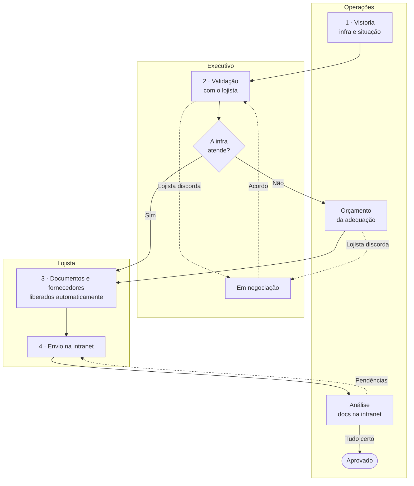
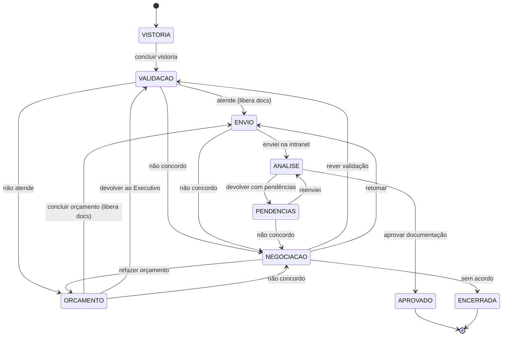

# D4 · Triagem separada por blocos de responsável

**Problema:** quem abre o app hoje encontra um formulário único com 6 seções e não sabe
quais perguntas são suas, em que etapa a obra está, para quem a informação vai depois
nem quando ela volta.

**Proposta em uma frase:** a triagem deixa de ser um formulário e vira uma **trilha de 4
etapas**. Cada etapa tem **um dono**, só o dono preenche, e a obra mostra o tempo todo
**"Etapa X de 4 · agora é com: Fulano"**.

| Bloco | Cor | O que faz |
|---|---|---|
| **Operações** | terracota | Vistoria a loja, orça adequações e analisa os documentos |
| **Executivo** | roxo | Valida com o lojista se a infra atende e conduz negociações |
| **Lojista** | azul | Recebe documentos e fornecedores, envia tudo pela intranet e corrige pendências |

As cores são as do fluxograma de referência. Todos os campos de triagem citados aqui
**já existem** em `public/obras.html`. A seção 3 mostra para onde cada um vai.

---

## Situação da implementação (fase 1, 27/10/2026)

A fase 1 está no app (`public/obras.html`), com as premissas P2 a P11 da tabela
abaixo. Como usar está em [[OTIMIZADOR-DE-OBRAS#Trilha da triagem (D4)]].
Ajustes feitos ao implementar, em relação ao texto da proposta:

- **"Altera sprinkler / detecção" saiu da lista do que existe na loja.** Não é
  infraestrutura existente. A lista de Operações tem os outros 9 itens, e a
  pergunta sobre sprinkler continua na validação.
- **Operações pode preencher o nome do lojista** ao abrir a obra, para ela não
  aparecer sem nome na fila. O Executivo completa ou corrige na validação.
- **Itens a adequar sem repetição.** Quando a carga em kVA já mostra a
  diferença, o item genérico "carga elétrica reforçada" não entra de novo.
- **Ficha do lojista mais curta.** Ela não pergunta mais AVCB, alvará, licença
  sanitária, ART nem projeto na engenharia: esses itens viraram documentos.
- **Lembrete e escalonamento** ficaram em 2 e 5 dias úteis, como sugerido, e
  aparecem como aviso no indicador e no Painel. O envio do lembrete é um botão
  ("Cobrar"), porque sem servidor nada sai sozinho.
- **Não implementado nesta fase:** relatório em PDF da negociação e os demais
  itens do backlog (seção 9), além das fases 2 e 3.

Testes: 59 verificações de ponta a ponta com três navegadores separados
(Operações, Executivo e lojista), incluindo links adulterados, permissões,
mensagem do lojista aplicada duas vezes e migração das obras antigas.

## 0. Perguntas antes de decidir

Você pediu para listar as dúvidas antes de assumir. A proposta inteira foi desenhada
para funcionar com qualquer resposta. Onde a resposta muda o desenho, segui com a
premissa da última coluna e marquei no texto como **(P1)**, **(P2)** etc.

| # | Pergunta | Por que muda o desenho | Premissa usada |
|---|---|---|---|
| **P1** | Os três perfis vão compartilhar a mesma base de dados (servidor com login) ou seguimos sem servidor, passando a obra por link como a ficha do lojista faz hoje? | Hoje **cada navegador tem sua própria base**. Operações registrar e o Executivo ver na hora exige servidor. Aviso automático de verdade também. | **Fase 1 sem servidor**, com link de passagem a cada troca de dono. Arquitetura pronta para a Fase 2 com servidor. |
| **P2** | Quem é o "Executivo"? É o executivo comercial (Negócios/Comercial no fluxo de 30 etapas)? Um por shopping ou um por loja? | Define quem recebe as notificações e quem encerra negociações. | Executivo comercial responsável pela loja, um por obra. |
| **P3** | "Definir o investimento do projeto de execução" (etapa 2) é confirmar o **orçamento do lojista** (campo que já existe) ou é um valor do **shopping**? | Se for do shopping, é campo novo. | Confirmar os campos existentes "Orçamento total da obra" e "Reserva para imprevistos". |
| **P4** | Quem cria a obra no app e em que momento? | Define a tela inicial de cada perfil. | Operações cria ao agendar a vistoria. O Executivo completa a identificação do lojista. |
| **P5** | A ficha atual que o lojista preenche no celular continua existindo? | Ela é a fonte do "o que a loja vai precisar", base da validação. | Continua. O Executivo envia antes da etapa 2, ou preenche junto com o lojista na reunião. |
| **P6** | O orçamento da adequação precisa de aceite do lojista? Quem paga a adequação? | Um aceite cria um passo a mais. "Quem paga" seria campo novo. | Sem aceite formal, como no fluxograma: o orçamento libera os documentos sozinho. Se o lojista discordar, abre negociação. |
| **P7** | Negociação tem prazo máximo? Pode terminar "sem acordo"? O que acontece com a obra nesse caso? | Define os desfechos possíveis e os alertas. | Lembrete a cada 2 dias úteis. Três desfechos: retomar, refazer orçamento ou encerrar sem acordo. |
| **P8** | A intranet tem integração ou avisa quando o lojista sobe um arquivo? | Sem integração, o app não sabe sozinho que o lojista enviou. | Sem integração. O lojista toca em "Enviei na intranet" e Operações confirma ao analisar. |
| **P9** | O lojista pode ver **nomes** de fornecedores indicados? Quantos por disciplina? | Indicação de fornecedor pelo shopping pode gerar responsabilidade. Hoje a prévia do lojista mostra só o escopo, sem nomes nem notas. | Até 3 credenciados com documentação em dia por disciplina obrigatória, sem nota, com aviso de que a indicação não é obrigatória. |
| **P10** | As 30 etapas do fluxo de obras e inauguração continuam como visão completa? "Aprovado" aqui significa obra liberada para começar? | Evita dois acompanhamentos paralelos competindo. | Sim e sim. A trilha D4 marca sozinha as etapas correspondentes do fluxo de 30 (seção 6.4). |
| **P11** | Existe limite de rodadas de pendência? | Define o alerta de escalonamento. | Sem limite. A partir da 3ª rodada, o Executivo é avisado. |

---

## 1. O novo fluxo em uma imagem



Três ideias guiam o desenho:

1. **Uma vez de cada um.** A obra está sempre com uma pessoa só. Só ela edita. Os outros
   veem, mas não mexem. Isso acaba com o "quem preenche isso?" e evita duas versões da
   mesma obra.
2. **Passar a vez é um botão.** Cada etapa termina com um botão de conclusão, e é ele
   que avisa o próximo. Ninguém precisa lembrar de mandar mensagem.
3. **O que pode ser automático é automático.** A lista de documentos e os fornecedores
   indicados saem sozinhos assim que a infra é resolvida, com a regra que o app já usa
   hoje.

---

## 2. Navegação por perfil

### 2.1 Como cada pessoa entra

- **Operações e Executivo** abrem o mesmo link do app. No primeiro acesso, escolhem
  "Sou de Operações" ou "Sou Executivo". O app lembra a escolha e ela pode ser trocada
  no rodapé. Na Fase 1 isso **não é controle de acesso**, só organiza a tela **(P1)**.
- **Lojista** nunca vê o app interno. Ele recebe um link da própria obra, que abre a
  página "Minha loja". É a evolução da ficha `#lojista` que já existe.

### 2.2 Abas antes e depois

| Hoje (todos veem igual) | Operações | Executivo | Lojista |
|---|---|---|---|
| Triagem · Obras · Fornecedores · Painel | **Minha fila** · Obras · Fornecedores · Painel | **Minha fila** · Obras · **Negociações** · Painel | **Minha loja** (página única) |

- **A aba Triagem deixa de existir.** Os campos dela passam a morar dentro das etapas
  (seção 3). "Enviar ficha" vira um botão da etapa 2.
- **Minha fila** é a nova tela inicial. Mostra só as obras em que a vez é sua, da mais
  antiga para a mais nova.
- **Obras** continua com todas as obras e a busca de hoje. Ao abrir uma obra, aparece a
  trilha de 4 etapas no topo e as 30 etapas logo abaixo.
- **Fornecedores** e **Painel** continuam como estão. O Painel ganha a visão por etapa
  da trilha (seção 5).

### 2.3 O que cada perfil vê e faz

| Perfil | Vê | Faz | Não vê |
|---|---|---|---|
| **Operações** | Todas as obras, vistoria, validação, orçamento, documentos, histórico completo | Etapa 1, orçamento da adequação, análise dos documentos, cadastro de fornecedores | Nada fica oculto |
| **Executivo** | Todas as obras, a vistoria registrada por Operações (só leitura), histórico completo | Etapa 2, envio da ficha ao lojista, negociações | Edição da vistoria, da análise e da base de fornecedores |
| **Lojista** | Situação da própria loja, o que é preciso agora, lista de documentos, fornecedores indicados, orçamento da adequação, pendências e motivos | "Enviei na intranet", "Reenviei", "Não concordo" | Outras obras, notas de fornecedores, comentários internos do time |

---

## 3. Para onde vai cada campo atual

Nenhum campo de triagem foi criado ou removido. Só mudou **quem preenche** e **em que
etapa**. A coluna "Seção hoje" segue a numeração do formulário atual.

| Seção hoje | Campo | Vai para | Quem preenche |
|---|---|---|---|
| 1 Identificação | Ponto / LUC | Abertura da obra | Operações |
| 1 Identificação | Lojista / marca · Contato · Segmento · Tipo de operação | Abertura da obra | Executivo (pode completar até concluir a etapa 2) |
| 2 A loja | Área · Testada de vitrine · Como o ponto é entregue | **Etapa 1 · Vistoria** | Operações |
| 2 A loja | Tipo de obra · Carência de obra · Data alvo de inauguração | **Etapa 2 · Validação** | Executivo (são dados do contrato) |
| 3 Padrão e materiais | Padrão de acabamento · Materiais primordiais · Manual da marca | **Etapa 2** | Lojista pela ficha, ou Executivo junto com ele **(P5)** |
| 4 Instalações | Os 10 itens de "O que a loja vai precisar" + carga solicitada (kVA) | **Etapa 2** | Lojista pela ficha, ou Executivo junto com ele |
| 4 Instalações | **A mesma lista de 10 itens**, lida como "O que já existe na loja" + carga disponível (kVA) | **Etapa 1** | Operações |
| Vistorias (lista do app) | Arquitetura · Elétrica · SPK · Detecção · Hidráulica · Cozinha/FTR · Manta e forro · Estanqueidade de gás · Dados condominiais | **Etapa 1**, como lista de "vistoriado" | Operações |
| 5 Segurança | AVCB / CLCB | **Etapa 1** (é um dado do prédio) | Operações |
| 5 Segurança | A obra altera sprinkler, detecção ou rota de fuga? | **Etapa 2** (depende do projeto) | Executivo com o lojista |
| 5 Segurança | Projeto na engenharia · Alvará · Licença sanitária · ART/RRT | **Lista de documentos** (etapas 3 e 4) | Situação atualizada por Operações na análise |
| 6 Investimento | Orçamento total · Reserva para imprevistos | **Etapa 2** ("investimento do projeto de execução") **(P3)** | Executivo com o lojista |
| 6 Investimento | Forma de contratação · Experiência em obra · Já tem projeto · Já tem gerenciadora | **Etapa 2** | Lojista pela ficha, ou Executivo |
| Obras | Anotações do time de obras | Toda etapa, como "Comentário interno" | Operações e Executivo |

**Por que usar a mesma lista de 10 itens duas vezes.** Operações marca o que **existe**.
O lojista marca o que **vai precisar**. Na etapa 2, o app cruza as duas e mostra a
diferença pronta (wireframe 8.3). Assim, a pergunta "a infra atende?" chega ao Executivo
já respondida pela metade, sem criar campo novo.

### 3.1 Campos de fluxo (novos, exigidos pelo processo)

Estes não são perguntas de triagem. Sem eles não dá para registrar quem decidiu o quê.

| Campo | Onde | Preenchido por |
|---|---|---|
| Decisão: a infra atende / não atende | Etapa 2 | Executivo |
| Data da validação com o lojista | Etapa 2 | Executivo |
| Orçamento da adequação: itens (vêm preenchidos), valor em R$, prazo em dias, observação | Orçamento | Operações |
| Situação de cada documento: liberado, enviado, aprovado, pendente | Etapas 3 e 4 | Lojista (enviado) e Operações (aprovado/pendente) |
| Motivo da pendência, por documento | Análise | Operações |
| Negociação: assunto, motivo, comentários, desfecho | Negociação | Lojista abre, Executivo conduz |
| Histórico: data, pessoa, perfil, o que mudou | Automático | O app |

---

## 4. Etapa por etapa

Cada etapa responde às mesmas cinco perguntas.

### Etapa 1 · Vistoria · **Operações**

| | |
|---|---|
| **Quem preenche** | Operações |
| **O que preenche** | LUC, área, testada, como o ponto é entregue, os 10 itens de infra que existem, carga disponível, AVCB/CLCB, lista de vistorias feitas, comentário |
| **Botão que conclui** | "Concluir vistoria e enviar ao Executivo". Exige: área, condição de entrega, AVCB e os 10 itens revisados (marcados ou confirmados como "não existe") |
| **Quem é avisado** | Executivo |
| **O que o app mostra enquanto aguarda** | Operações: "Etapa 1 de 4 · Vistoria · agora é com você". Executivo: a obra aparece em "Acompanhando" com "aguardando Operações há N dias" |

### Etapa 2 · Validação com o lojista · **Executivo**

| | |
|---|---|
| **Quem preenche** | Executivo, em conjunto com o lojista (reunião ou ficha enviada) |
| **O que preenche** | Identificação do lojista, dados do contrato, padrão e materiais, o que a loja vai precisar, sprinkler, investimento, experiência. Pode enviar a ficha atual ao lojista para ele mesmo responder |
| **O que o app faz sozinho** | Monta a tabela **"Precisa × Existe"** e sugere a decisão: se todo item necessário existe e a carga cabe, sugere "Atende" |
| **Botões que concluem** | "A infra atende" ou "A infra não atende". Exigem a data da validação com o lojista. "Não atende" vem com os itens a adequar já marcados |
| **Quem é avisado** | Atende: lojista (documentos e fornecedores) e Operações (informativo). Não atende: Operações (orçar) e lojista (informativo) |
| **O que o app mostra enquanto aguarda** | Executivo: "Etapa 2 de 4 · Validação · agora é com você". Se a ficha foi enviada e não voltou: "aguardando a ficha do lojista desde dd/mm" |

### Orçamento da adequação · **Operações** · só quando a infra não atende

| | |
|---|---|
| **Quem preenche** | Operações |
| **O que preenche** | Itens a adequar (já vêm da etapa 2), valor, prazo, observação |
| **Botões que concluem** | "Concluir orçamento" libera os documentos ao lojista. "Devolver ao Executivo" serve para quando a adequação é inviável, com motivo obrigatório |
| **Quem é avisado** | Lojista (documentos liberados e resumo do orçamento) e Executivo (informativo) |
| **O que o app mostra enquanto aguarda** | "Etapa 2 de 4 · Orçamento da adequação · agora é com Operações" |

### Etapa 3 · Documentos e fornecedores · **automático**

| | |
|---|---|
| **Quem preenche** | Ninguém. O app libera sozinho assim que a etapa 2 ou o orçamento é concluído |
| **O que libera** | A lista atual de documentos, com a regra atual de quando cada um se aplica, e os fornecedores indicados para cada disciplina obrigatória **(P9)** |
| **Quem é avisado** | Lojista |
| **O que o app mostra** | A etapa aparece como concluída na hora. A vez passa direto ao lojista na etapa 4 |

**Lista de documentos, com a prioridade que o app já sabe calcular.** Cada item do
checklist atual já tem a etapa do fluxo em que é cobrado. Isso vira a matriz de
prioridade pedida no backlog, sem regra nova.

| Documento (texto atual do app) | Etapa do fluxo hoje | Prioridade mostrada ao lojista |
|---|---|---|
| Projeto de arquitetura e layout aprovados pela engenharia | 15–16 | **Antes de iniciar a obra** |
| Projetos complementares com ART/RRT | 15–16 | **Antes de iniciar a obra** |
| Acessibilidade (NBR 9050) no layout | 15 | **Antes de iniciar a obra** |
| Documentação dos fornecedores: ART, seguro de obra, NRs e ASO | 16 | **Antes de iniciar a obra** |
| Plano de trabalho: horário, tapume, carga e descarga, entulho | 16–18 | **Antes de iniciar a obra** |
| Combate a incêndio: sprinkler, detecção e rota de fuga | 20 · 23 | Antes de inaugurar |
| AVCB / CLCB | 21 | Antes de inaugurar |
| Alvará de funcionamento | 21 | Antes de inaugurar |
| Licença sanitária (só alimentação e saúde) | 21 | Antes de inaugurar |
| Vistoria final e liberação | 23–25 | Antes de inaugurar |
| CA · seguro · PMOC | 29 | Depois de inaugurar |

"Aprovado" nesta trilha cobra só o grupo **antes de iniciar a obra** **(P10)**. Os outros
aparecem para o lojista como "próximas entregas", sem travar nada agora.

### Etapa 4 · Envio na intranet e análise · **Lojista**, depois **Operações**

| | |
|---|---|
| **Quem preenche** | Lojista sobe os arquivos **na intranet** e toca em "Enviei na intranet" no app **(P8)** |
| **Quem é avisado** | Operações |
| **Análise** | Operações marca cada documento como aprovado ou pendente. Pendente exige motivo |
| **Botões que concluem** | "Aprovar documentação", liberado quando todos os itens "antes de iniciar" estão aprovados. "Devolver com pendências", que exige pelo menos um item pendente com motivo |
| **Quem é avisado** | Pendências: lojista recebe só os itens pendentes, com o motivo. Aprovado: lojista e Executivo |
| **O que o app mostra enquanto aguarda** | "Etapa 4 de 4 · Envio dos documentos · agora é com o lojista". Depois "Em análise · agora é com Operações". Na volta: "Pendências · 2ª rodada · agora é com o lojista" |

### Negociação · **transversal** · **Executivo**

| | |
|---|---|
| **Quando abre** | O lojista toca em "Não concordo" na página dele, ou o Executivo registra uma divergência. Pode abrir durante a validação, o orçamento ou as pendências |
| **O que acontece** | A obra **pausa onde estava** e a vez passa ao Executivo. Nada se perde |
| **Como aparece** | Selo "⏸ Em negociação" no cartão, no topo da obra e na página do lojista. Contador de dias. Aba **Negociações** do Executivo lista todas |
| **Registro** | Assunto (validação, orçamento ou pendência), motivo do lojista (obrigatório), conversa em comentários com data e autor, e desfecho |
| **Desfechos** | "Acordo: retomar de onde parou" · "Acordo: refazer o orçamento" · "Acordo: rever a validação" · "Encerrar sem acordo" **(P7)** |
| **Apoio** | Botão "Gerar relatório (PDF)" com vistoria, Precisa × Existe e orçamento, para levar à conversa (item do backlog) |

---

## 5. Indicador de progresso e responsável atual

Uma linha, sempre no mesmo formato, em todos os lugares onde a obra aparece: cartão da
lista, topo da obra, página do lojista e Painel.

```
Etapa 2 de 4 · Validação · agora é com: Executivo · há 3 dias
●━━━━━━●━━━━━━○━━━━━━○
Vistoria  Validação  Documentos  Intranet
```

| Situação | Como aparece |
|---|---|
| Vistoria em andamento | Etapa 1 de 4 · Vistoria · agora é com: Operações |
| Validação | Etapa 2 de 4 · Validação · agora é com: Executivo |
| Ficha enviada ao lojista | Etapa 2 de 4 · Validação · aguardando a ficha do lojista |
| Orçamento | Etapa 2 de 4 · Orçamento da adequação · agora é com: Operações |
| Documentos liberados | Etapa 4 de 4 · Envio dos documentos · agora é com: Lojista |
| Em análise | Etapa 4 de 4 · Em análise · agora é com: Operações |
| Pendências | Etapa 4 de 4 · Pendências (2ª rodada) · agora é com: Lojista |
| Negociação | Etapa 2 de 4 · ⏸ Em negociação · agora é com: Executivo · há 5 dias |
| Aprovado | ✓ Aprovado em dd/mm · obra liberada para iniciar |

Regras do indicador:

- **A cor da linha é a do dono atual.** Bate o olho e sabe com quem está.
- **"Há N dias" conta desde a última troca de dono**, não desde a criação da obra.
- **Atraso fica vermelho** a partir do prazo de lembrete da seção 7. O app já marca obra
  parada há 14 dias ou mais no fluxo de 30 etapas, e essa regra continua.
- **O lojista vê a mesma linha**, com "agora é com você" quando for a vez dele.

O **Painel** ganha um quadro "Trilha da triagem" com quantas obras estão em cada etapa e
com cada perfil. Ele reaproveita o quadro "Com quem está a bola" que já existe.

---

## 6. Estados e transições

### 6.1 Estados

| Código | Nome na tela | Etapa | Agora é com |
|---|---|---|---|
| `VISTORIA` | Vistoria | 1 de 4 | Operações |
| `VALIDACAO` | Validação | 2 de 4 | Executivo |
| `ORCAMENTO` | Orçamento da adequação | 2 de 4 | Operações |
| `ENVIO` | Envio dos documentos | 4 de 4 (a 3 conclui sozinha) | Lojista |
| `ANALISE` | Em análise | 4 de 4 | Operações |
| `PENDENCIAS` | Pendências (N-ésima rodada) | 4 de 4 | Lojista |
| `NEGOCIACAO` | ⏸ Em negociação | mantém a etapa onde pausou | Executivo |
| `APROVADO` | Aprovado | concluída | ninguém |
| `ENCERRADA` | Encerrada sem acordo | concluída | ninguém **(P7)** |

### 6.2 Transições

| De | Botão / evento | Quem pode | Exige | Para | Avisa |
|---|---|---|---|---|---|
| (nova) | Abrir obra | Operações **(P4)** | LUC | `VISTORIA` | — |
| `VISTORIA` | Concluir vistoria | Operações | Área, entrega, AVCB, 10 itens revisados | `VALIDACAO` | Executivo |
| `VALIDACAO` | A infra atende | Executivo | Necessidades preenchidas, orçamento, data da validação | `ENVIO` (libera docs) | Lojista · Operações (info) |
| `VALIDACAO` | A infra não atende | Executivo | Itens a adequar, data da validação | `ORCAMENTO` | Operações · Lojista (info) |
| `ORCAMENTO` | Concluir orçamento | Operações | Valor e prazo | `ENVIO` (libera docs) | Lojista · Executivo (info) |
| `ORCAMENTO` | Devolver ao Executivo | Operações | Motivo | `VALIDACAO` | Executivo |
| `ENVIO` | Enviei na intranet | Lojista (ou Operações registrando) | — | `ANALISE` | Operações |
| `ANALISE` | Devolver com pendências | Operações | ≥ 1 item pendente com motivo | `PENDENCIAS` (rodada + 1) | Lojista · Executivo a partir da 3ª rodada |
| `PENDENCIAS` | Reenviei na intranet | Lojista | — | `ANALISE` | Operações |
| `ANALISE` | Aprovar documentação | Operações | Todos os "antes de iniciar" aprovados | `APROVADO` | Lojista · Executivo |
| `VALIDACAO`, `ORCAMENTO`, `ENVIO`, `PENDENCIAS` | Não concordo | Lojista, ou Executivo registrando | Motivo | `NEGOCIACAO` (guarda a etapa de origem) | Executivo · Operações se o assunto for orçamento ou pendência |
| `NEGOCIACAO` | Acordo: retomar | Executivo | Comentário de fechamento | Etapa de origem | Todos os envolvidos |
| `NEGOCIACAO` | Acordo: refazer orçamento | Executivo | Comentário | `ORCAMENTO` | Operações · Lojista |
| `NEGOCIACAO` | Acordo: rever validação | Executivo | Comentário | `VALIDACAO` | Lojista · Operações (info) |
| `NEGOCIACAO` | Encerrar sem acordo | Executivo **(P7)** | Motivo | `ENCERRADA` | Todos os envolvidos |
| Qualquer etapa já concluída | Reabrir etapa | Dono daquela etapa | Motivo | A etapa reaberta | Quem estava com a vez |

**Editar sem mudar de etapa** (item "botão de editar" do backlog): o dono pode corrigir
um campo da própria etapa a qualquer momento. A obra não muda de estado e o histórico
registra "campo X alterado por Fulano em dd/mm". Se a correção muda uma decisão, como
a de "atende", é preciso usar "Reabrir etapa".

### 6.3 Diagrama de estados



### 6.4 Ligação com as 30 etapas

A trilha D4 marca sozinha as etapas correspondentes do fluxo completo, para não haver
dois acompanhamentos paralelos **(P10)**.

| Quando a trilha D4… | Marca no fluxo de 30 etapas |
|---|---|
| conclui a Vistoria | 4 · Vistoria e entrega de chaves e 6 · Vistorias gerais |
| conclui a Validação | 14 · Informações operacionais (viabilidade técnica) |
| libera os documentos | 13 · Kick off de obras (orientações, fornecedores, documentos) |
| recebe "Enviei na intranet" | 15 · Envio de documentos e projetos |
| aprova a documentação | 16 · Início de obra (validação documental) |

Depois de "Aprovado", a obra segue normalmente nas 30 etapas, a partir da 17.

---

## 7. Regras de notificação

### 7.1 Regras gerais

1. **Avisa quem recebe a vez**, sempre, com o que precisa fazer e o link direto.
2. **O lojista é avisado de toda mudança que o afeta**, em linguagem simples, sem termos
   internos.
3. **Quem passou a vez não recebe aviso.** O app confirma na tela: "Enviado ao Executivo".
4. **Edição sem mudança de etapa não gera aviso.** Fica só no histórico.
5. **Lembrete** ao dono atual depois de 2 dias úteis sem ação. **Escalonamento** ao
   Executivo depois de 5 dias úteis. Os dois prazos são sugestão e dependem de você.

### 7.2 Canal por fase

| Fase | Como o aviso chega |
|---|---|
| **Fase 1, sem servidor** | Ao tocar no botão de conclusão, o app abre "Avisar agora" com a mensagem pronta para WhatsApp ou e-mail, já com o link. É **um toque**, mas é humano. A lista de documentos é montada sozinha, sem ninguém escolher item por item |
| **Fase 2, com servidor** | E-mail automático e aviso dentro do app na "Minha fila" |
| **Fase 3, PWA** | Notificação no celular, com o app instalado |

Sem servidor, **não existe aviso 100% automático**. Se a exigência "não depender de
liberação manual" incluir o envio da mensagem, a Fase 2 é obrigatória **(P1)**.

### 7.3 Mensagens

| Evento | Para | Mensagem sugerida |
|---|---|---|
| Vistoria concluída | Executivo | "A vistoria da loja {LUC} foi concluída. Agora é com você: validar a infraestrutura com {lojista}. {link}" |
| Infra atende | Lojista | "Boa notícia: a infraestrutura da sua loja atende ao projeto. A lista de documentos e os fornecedores indicados já estão disponíveis: {link}" |
| Infra não atende | Operações | "A loja {LUC} precisa de adequação: {itens}. Agora é com você: fazer o orçamento. {link}" |
| Infra não atende | Lojista | "A infraestrutura da sua loja precisa de adequação em {itens}. Nossa equipe vai orçar e você recebe a lista de documentos assim que o orçamento sair." |
| Orçamento concluído | Lojista | "O orçamento da adequação ficou em {valor}, com prazo de {dias} dias. A lista de documentos e os fornecedores indicados já estão disponíveis: {link}" |
| Enviei na intranet | Operações | "{lojista} informou que enviou os documentos na intranet. Agora é com você: analisar. {link}" |
| Pendências | Lojista | "Encontramos {n} pendência(s) nos seus documentos: {lista com motivo}. Corrija na intranet e toque em 'Reenviei'. {link}" |
| 3ª rodada de pendências | Executivo | "A loja {LUC} está na 3ª rodada de pendências. Vale uma conversa com {lojista}. {link}" |
| Aprovado | Lojista e Executivo | "Documentação aprovada. A obra da loja {LUC} está liberada para começar." |
| Negociação aberta | Executivo | "{lojista} não concordou com {assunto}: '{motivo}'. Agora é com você. {link}" |
| Negociação encerrada | Todos os envolvidos | "Negociação da loja {LUC} encerrada: {desfecho}. {próximo passo}" |
| Lembrete | Dono atual | "A loja {LUC} está com você há {n} dias úteis em {etapa}. {link}" |

---

## 8. Wireframes em texto

### 8.1 Operações · Minha fila

```
┌──────────────────────────────────────┐
│ Otimizador de Obras    [Operações ▾] │
│ Minha fila · Obras · Fornec. · Painel│
├──────────────────────────────────────┤
│ AGORA É COM VOCÊ (3)                 │
│ ┌──────────────────────────────────┐ │
│ │ Café Aurora · L-142              │ │
│ │ Etapa 4 de 4 · Em análise        │ │
│ │ ●━━━●━━━●━━━◐   há 2 dias        │ │
│ │                    [Analisar ▸]  │ │
│ └──────────────────────────────────┘ │
│ ┌──────────────────────────────────┐ │
│ │ Tech Zone · L-150                │ │
│ │ Etapa 2 de 4 · Orçamento         │ │
│ │ ●━━━◐━━━○━━━○   há 4 dias  ⚠     │ │
│ │                    [Orçar ▸]     │ │
│ └──────────────────────────────────┘ │
│ ┌──────────────────────────────────┐ │
│ │ L-233 · vistoria agendada        │ │
│ │ Etapa 1 de 4 · Vistoria          │ │
│ │                  [Vistoriar ▸]   │ │
│ └──────────────────────────────────┘ │
│ ACOMPANHANDO (5)               ver ▾ │
│ [+ Abrir obra]                       │
└──────────────────────────────────────┘
```

### 8.2 Operações · Etapa 1 · Vistoria

```
┌──────────────────────────────────────┐
│ ◂ L-142 · Café Aurora                │
│ Etapa 1 de 4 · Vistoria              │
│ agora é com: você (Operações)        │
├──────────────────────────────────────┤
│ A LOJA                               │
│ Área (m²)            [ 180 ]         │
│ Testada (m)          [ 9   ]         │
│ Como o ponto é entregue              │
│ (●) Casca crua (○) Infra básica      │
│ (○) Loja existente                   │
│                                      │
│ O QUE JÁ EXISTE NA LOJA              │
│ [✓] Ar-condicionado próprio          │
│ [ ] Exaustão / coifa (cozinha)       │
│ [ ] Instalação de gás                │
│ [✓] Ponto de água / esgoto           │
│ [ ] Carga elétrica reforçada         │
│ ... (10 itens, os mesmos de hoje)    │
│ Carga disponível (kVA)  [ 40 ]       │
│                                      │
│ AVCB / CLCB                          │
│ (●) Sob o do shopping (○) Próprio    │
│                                      │
│ VISTORIAS FEITAS                     │
│ [✓] Arquitetura   [✓] Elétrica       │
│ [✓] SPK           [ ] Detecção       │
│ ... (9 itens, os mesmos de hoje)     │
│                                      │
│ Comentário interno                   │
│ [                                  ] │
├──────────────────────────────────────┤
│ [ Concluir vistoria e enviar ao    ] │
│ [ Executivo ▸                      ] │
└──────────────────────────────────────┘
```

### 8.3 Executivo · Etapa 2 · Validação

```
┌──────────────────────────────────────┐
│ ◂ L-142 · Café Aurora                │
│ Etapa 2 de 4 · Validação             │
│ agora é com: você (Executivo)        │
├──────────────────────────────────────┤
│ VISTORIA DE OPERAÇÕES (só leitura)   │
│ 180 m² · casca crua · AVCB shopping  │
│ concluída em 20/10 por Ana  [ver ▾]  │
│                                      │
│ NECESSIDADES DO LOJISTA              │
│ [Enviar ficha ao lojista ▸]          │
│ ou preencha junto ▾                  │
│                                      │
│ PRECISA × EXISTE                     │
│ Ar-condicionado    precisa  existe ✓ │
│ Exaustão           precisa  falta  ✗ │
│ Gás                precisa  falta  ✗ │
│ Carga (kVA)        60       40     ✗ │
│ ──────────────────────────────────── │
│ Sugestão do app: NÃO ATENDE          │
│ (3 itens a adequar)                  │
│                                      │
│ INVESTIMENTO (com o lojista)         │
│ Orçamento total   [ 1.500.000 ]      │
│ Reserva (%)       [ 12 ]             │
│ Validado com o lojista em [27/10]    │
├──────────────────────────────────────┤
│ [ A infra atende ]                   │
│ [ A infra não atende ▸ Operações   ] │
│ Registrar divergência do lojista     │
└──────────────────────────────────────┘
```

### 8.4 Operações · Orçamento da adequação

```
┌──────────────────────────────────────┐
│ ◂ L-142 · Café Aurora                │
│ Etapa 2 de 4 · Orçamento             │
│ agora é com: você (Operações)        │
├──────────────────────────────────────┤
│ ITENS A ADEQUAR (vindos da validação)│
│ • Exaustão / coifa                   │
│ • Instalação de gás                  │
│ • Carga elétrica: 40 → 60 kVA        │
│                                      │
│ Valor (R$)        [ 142.000 ]        │
│ Prazo (dias)      [ 25 ]             │
│ Observação        [              ]   │
├──────────────────────────────────────┤
│ [ Concluir orçamento ▸ libera docs ] │
│ Devolver ao Executivo                │
└──────────────────────────────────────┘
```

### 8.5 Executivo · Negociação

```
┌──────────────────────────────────────┐
│ ◂ L-142 · Café Aurora                │
│ Etapa 2 de 4 · ⏸ Em negociação       │
│ agora é com: você · há 3 dias        │
├──────────────────────────────────────┤
│ ASSUNTO: orçamento da adequação      │
│ Lojista, 24/10:                      │
│ "O valor da exaustão está acima do   │
│ que cotei com meu fornecedor."       │
│                                      │
│ CONVERSA                             │
│ Você, 25/10: Pedi revisão a Op.      │
│ Ana (Op.), 26/10: Revisado: 128 mil  │
│ [ Escrever comentário...         ]   │
│ ( ) interno  (●) visível ao lojista  │
│                                      │
│ [Gerar relatório PDF]                │
├──────────────────────────────────────┤
│ Desfecho                             │
│ [ Acordo: retomar de onde parou ]    │
│ [ Acordo: refazer o orçamento   ]    │
│ [ Acordo: rever a validação     ]    │
│ Encerrar sem acordo                  │
└──────────────────────────────────────┘
```

### 8.6 Lojista · Minha loja · documentos liberados

```
┌──────────────────────────────────────┐
│ Sua loja no shopping · Café Aurora   │
│ Etapa 4 de 4 · Envio dos documentos  │
│ agora é com: VOCÊ                    │
│ ●━━━●━━━●━━━◐                        │
├──────────────────────────────────────┤
│ O QUE FAZER AGORA                    │
│ 1. Reúna os documentos abaixo        │
│ 2. Envie todos na intranet           │
│ 3. Volte aqui e toque em "Enviei"    │
│                                      │
│ ANTES DE INICIAR A OBRA              │
│ □ Projeto de arquitetura e layout    │
│ □ Projetos complementares + ART/RRT  │
│ □ Acessibilidade (NBR 9050)          │
│ □ Docs dos fornecedores e seguro     │
│ □ Plano de trabalho                  │
│ PRÓXIMAS ENTREGAS (não travam agora) │
│ ○ AVCB · Alvará · Licença sanitária  │
│                                      │
│ FORNECEDORES INDICADOS               │
│ Exaustão: Exaust Pro, ClimaTech      │
│ Gás: Gás Seguro, HidroMax            │
│ Indicação opcional. Você pode        │
│ contratar outro credenciado.         │
│                                      │
│ ADEQUAÇÃO DA INFRA                   │
│ R$ 142 mil · 25 dias  [ver detalhe]  │
├──────────────────────────────────────┤
│ [ Enviei na intranet ✓ ]             │
│ Não concordo com algo                │
└──────────────────────────────────────┘
```

### 8.7 Lojista · Pendências

```
┌──────────────────────────────────────┐
│ Etapa 4 de 4 · Pendências (2ª)       │
│ agora é com: VOCÊ                    │
├──────────────────────────────────────┤
│ 2 documentos precisam de correção:   │
│                                      │
│ ✗ Projetos complementares + ART      │
│   "ART de climatização sem a         │
│   assinatura do responsável."        │
│                                      │
│ ✗ Plano de trabalho                  │
│   "Falta a rota de carga e descarga."│
│                                      │
│ ✓ 3 documentos já aprovados  [ver]   │
├──────────────────────────────────────┤
│ [ Corrigi e reenviei na intranet ✓ ] │
│ Não concordo com algo                │
└──────────────────────────────────────┘
```

### 8.8 Operações · Análise dos documentos

```
┌──────────────────────────────────────┐
│ ◂ L-142 · Café Aurora                │
│ Etapa 4 de 4 · Em análise (1ª)       │
│ agora é com: você (Operações)        │
├──────────────────────────────────────┤
│ Lojista enviou na intranet em 30/10  │
│                                      │
│ Projeto de arquitetura   (✓) ( ✗ )   │
│ Complementares + ART     ( ✓) (✗)    │
│   Motivo: [ART sem assinatura...]    │
│ Acessibilidade           (✓) ( ✗ )   │
│ Fornecedores e seguro    (✓) ( ✗ )   │
│ Plano de trabalho        ( ✓) (✗)    │
│   Motivo: [Falta rota de carga...]   │
├──────────────────────────────────────┤
│ [ Devolver com 2 pendências ▸ ]      │
│ Aprovar (libera quando tudo ✓)       │
└──────────────────────────────────────┘
```

---

## 9. Backlog secundário: onde cada item se encaixa

Nada disto entra agora. O desenho só reserva o lugar.

| Item | Onde entra | Observação |
|---|---|---|
| Seguro de obras na triagem | Vira documento próprio na lista "antes de iniciar a obra" | Hoje está junto em "Documentação dos fornecedores: ART, seguro de obra, NRs e ASO". A etapa 17 do fluxo de 30 já cuida da notificação do seguro do shopping |
| Percentual permitido de mezanino | Etapa 1, como dado do ponto. Na etapa 2, o app compara com o mezanino pedido | É campo novo, por isso fica no backlog |
| Botão de editar informações | Já previsto: "Editar" na própria etapa e "Reabrir etapa" com motivo (seção 6.2) | Substitui o "Reabrir triagem" atual |
| Relatório PDF para negociação | Botão na tela de negociação (8.5) | Pode usar a impressão do navegador, sem biblioteca nova |
| Regra do AVCB | Etapa 1 | **Hoje o app trata qualquer AVCB que não seja "sob o do shopping" como pendência**, inclusive quando a loja já tem o próprio. Proposta: separar "Próprio, já vigente" de "Próprio, precisa obter" e só cobrar no segundo caso |
| ART de arquitetura no checklist | Lista de documentos, separada de "Projetos complementares com ART/RRT" | Prioridade "antes de iniciar a obra" |
| Matriz de prioridade de documentos | Já entra na etapa 3, derivada da etapa do fluxo de cada documento | Pode ganhar um terceiro critério depois, como "bloqueia acesso de fornecedor" |

---

## 10. Arquitetura preparada para o futuro

O que muda por dentro, em linguagem simples, para que a Fase 2 e o PWA não exijam
refazer tudo.

1. **Uma única porta de entrada para mudar de etapa.** Toda troca de estado passa por
   uma função só, que confere quem pode, o que é exigido, grava o histórico e dispara o
   aviso. Os botões só chamam essa função. É a tabela 6.2 transformada em código.
2. **A obra guarda a própria trilha.** Cada obra passa a ter estado atual, dono atual,
   desde quando, rodada de análise, negociação aberta e histórico. O registro de obra
   atual já tem identificador, datas e etapas. A migração automática de obras antigas
   já existe no app e seria estendida.
3. **O armazenamento fica atrás de uma camada.** Hoje é o navegador. Na Fase 2, a mesma
   camada passa a falar com o servidor, sem mexer nas telas.
4. **Cada tela tem um endereço próprio**, por exemplo uma obra específica ou a página
   de um lojista. Isso serve tanto ao link de passagem da Fase 1 quanto ao PWA.
5. **PWA:** o manifesto e os ícones do app já existem. Falta o service worker, para
   funcionar offline e receber notificação no celular.

---

## 11. Riscos e decisões que dependem de você

| Risco | Impacto | Como a proposta reduz | Decisão sua |
|---|---|---|---|
| **Dados não compartilhados** entre perfis na Fase 1 | Operações e Executivo podem ficar com versões diferentes da obra | Só o dono da vez edita, e o link de passagem leva a obra inteira | P1: quando ir para a Fase 2 |
| **Aviso não é automático sem servidor** | O "não depender de liberação manual" fica parcial: a lista é automática, o envio é um toque | Mensagem pronta e link direto | P1 |
| **Custo da Fase 2** (banco de dados, login, e-mail) | Pode envolver contratação de serviço | Só avanço com a sua confirmação, duas vezes, conforme sua regra | Orçamento e fornecedor |
| **App não enxerga a intranet** | O lojista pode esquecer de tocar em "Enviei", e Operações analisaria às cegas | Operações também pode registrar o recebimento | P8 |
| **Indicação de fornecedor ao lojista** | Responsabilidade do shopping se o fornecedor falhar | Aviso de "indicação opcional", só credenciados com documentação em dia, sem nota | P9, com Jurídico |
| **Dados do lojista em link** | Os links de hoje carregam os dados codificados, não criptografados. Quem tiver o link consegue ler | Enviar só por canais diretos e, na Fase 2, trocar por link com login | LGPD |
| **Dois acompanhamentos** (trilha D4 e 30 etapas) | Confusão de novo | A trilha marca as 30 etapas sozinha (6.4) | P10 |
| **Adoção** | Se Operações não concluir a vistoria no app, nada anda | Minha fila, lembretes e escalonamento | Prazos de lembrete (7.1) |
| **Perfil escolhido sem login** | Qualquer pessoa pode se dizer "Operações" | Só organiza a tela. Controle de acesso de verdade vem com a Fase 2 | P1 |

---

## 12. Fases sugeridas

| Fase | Entrega | Depende de |
|---|---|---|
| **1 · Reorganização** | Trilha de 4 etapas, perfis, Minha fila, indicador, negociação, pendências, links de passagem com mensagem pronta. Tudo no app atual, sem servidor | Respostas P2 a P11 |
| **2 · Base compartilhada** | Login, mesma obra para todos, avisos por e-mail automáticos | P1 e decisão de custo |
| **3 · PWA** | App instalável, offline e notificação no celular | Fase 2 |
