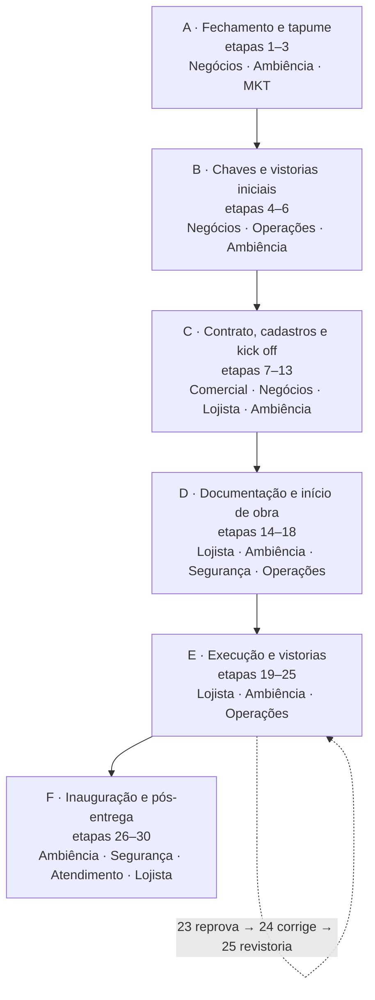

# Fluxo de Obras e Inauguração

> [!abstract] Do fechamento da operação anterior à inauguração da nova loja
> Processo em **30 etapas**, do comunicado de fechamento da operação que sai até
> a inauguração da que entra, passando por entrega de chaves, contrato, obra,
> vistoria final e liberação.
>
> Cada etapa tem um **responsável nomeado** — Negócios, Ambiência, Comercial,
> Segurança, Operações, Atendimento ou o próprio Lojista. É o que transforma o
> fluxo em algo cobrável: toda etapa tem dono.
>
> Ferramenta que executa a parte de triagem e fornecedores:
> [[OTIMIZADOR-DE-OBRAS|Otimizador de Obras]].

## Mapa do fluxo

> [!note] Os blocos A–F são leitura minha, para organizar a nota
> O PDF traz uma **numeração corrida de 1 a 30**, em duas colunas ligadas por um
> conector — sem blocos ou fases nomeadas. Agrupei em seis blocos só para a
> leitura; a sequência e os textos estão fiéis ao original.

## Índice

| # | Etapa | Responsável | O que acontece |
|---|-------|-------------|----------------|
| 1 | Comunicado de Fechamento | NEGÓCIOS | Data último dia de operação · instalação do tapume · entrega das chaves |
| 2 | Tapume — Planta | AMBIÊNCIA | Envio da planta de tapume |
| 3 | Tapume — Instalação | AMBIÊNCIA / MKT | Programar instalação do tapume e adesivo na mesma data |
| 4 | Vistoria e entrega de chaves | NEGÓCIOS / OPERAÇÕES | Vistoria inicial · fotos · termo de recebimento |
| 5 | Abertura de porta e cadastro de chaves | NEGÓCIOS | Abrir porta interna · cadastrar tipo e quantidade de chaves |
| 6 | Vistorias gerais | AMBIÊNCIA / OPERAÇÕES | Arquitetura · elétrica · SPK · detecção · hidráulica · cozinha · dados condominiais |
| 7 | Negociação da loja | COMERCIAL | Negociação e contrato |
| 8 | Conclusão de assinatura | COMERCIAL | Notificar conclusão da assinatura |
| 9 | Informações contratuais | NEGÓCIOS | Vigência · carência · LUC · autorização de obras |
| 10 | Informações Intranet Mall | LOJISTA | Dados para criação do login |
| 11 | Criação de login Intranet Mall | NEGÓCIOS | Criação do login |
| 12 | Criação da Obra | AMBIÊNCIA | Cadastro da obra na Intranet Mall |
| 13 | Kick Off de Obras | AMBIÊNCIA | Orientações · fornecedores · contatos · documentos |
| 14 | Informações operacionais | LOJISTA | Demandas · primeiro acesso à Intranet OBRAS · avaliar viabilidade técnica se necessário |
| 15 | Envio de documentos e projetos | LOJISTA | Documentos e projetos para análise |
| 16 | Início de obra | AMBIÊNCIA | Validação documental · autorização · comunicado de início |
| 17 | Notificação do seguro shopping | SEGURANÇA | Notificação do seguro |
| 18 | Fechamento dos registros setoriais | OPERAÇÕES / TERCEIRAS | Fechamento dos registros setoriais |
| 19 | Andamento da obra | LOJISTA | Execução da obra · atualização semanal |
| 20 | Vistorias de obra | AMBIÊNCIA | Manta · forro · SPK · estanqueidade de gás |
| 21 | Envio de documentos para inauguração | LOJISTA | Documentação necessária para inauguração |
| 22 | Impressão de projetos | LOJISTA | 2 vias dos projetos para vistoria final |
| 23 | Vistoria final de obra | AMBIÊNCIA / OPERAÇÕES | Arquitetura · elétrica · SPK · detecção · hidráulica · cozinha/FTR |
| 24 | Correção de pendências | LOJISTA | Correção das pendências da vistoria |
| 25 | Revistoria final de obra | AMBIÊNCIA / OPERAÇÕES | Nova vistoria das disciplinas |
| 26 | Retirada do tapume | AMBIÊNCIA | Programação para retirada · inauguração da loja |
| 27 | Entrega do botão de pânico e orientações | SEGURANÇA | Entrega e orientações |
| 28 | Cadastro da loja | ATENDIMENTO | Cadastro no Spot Mall |
| 29 | Acompanhamento de documentações pendentes | SEGURANÇA | CA · seguro · PMOC |
| 30 | Feedback de fornecedores | LOJISTA | Cadastro e avaliação de fornecedores |

Atalhos: [[#Bloco A — Fechamento da operação e tapume]] ·
[[#Bloco B — Entrega de chaves e vistorias iniciais]] ·
[[#Bloco C — Contrato, cadastros e kick off]] ·
[[#Bloco D — Documentação e início de obra]] ·
[[#Bloco E — Execução e vistorias de obra]] ·
[[#Bloco F — Inauguração e pós-entrega]]

---

## Bloco A — Fechamento da operação e tapume

Etapas 1–3. A loja que sai desocupa o ponto e o ponto some do campo de visão do
cliente. Tapume e adesivo entram juntos: parede nua em corredor de shopping é
vacância à vista.

### 1 · Comunicado de Fechamento — `NEGÓCIOS`
Data último dia de operação · instalação do tapume · entrega das chaves.

### 2 · Tapume — Planta — `AMBIÊNCIA`
Envio da planta de tapume.

### 3 · Tapume — Instalação — `AMBIÊNCIA / MKT`
Programar instalação do tapume e adesivo **na mesma data**.

## Bloco B — Entrega de chaves e vistorias iniciais

Etapas 4–6. O shopping retoma a posse do ponto e registra em que estado ele
está. As fotos e o termo de recebimento são a prova documental do "como
recebemos" — o que evita discussão de responsabilidade depois.

### 4 · Vistoria e entrega de chaves — `NEGÓCIOS / OPERAÇÕES`
Vistoria inicial · fotos · termo de recebimento.

### 5 · Abertura de porta e cadastro de chaves — `NEGÓCIOS`
Abrir porta interna · cadastrar tipo e quantidade de chaves.

### 6 · Vistorias gerais — `AMBIÊNCIA / OPERAÇÕES`
Arquitetura · elétrica · SPK · detecção · hidráulica · cozinha · dados
condominiais.

## Bloco C — Contrato, cadastros e kick off

Etapas 7–13. O ponto é negociado e o novo lojista entra nos sistemas. Termina no
**Kick Off de Obras**, a reunião em que o lojista recebe orientações,
fornecedores e contatos — o ponto natural de entrada do
[[OTIMIZADOR-DE-OBRAS|Otimizador de Obras]].

### 7 · Negociação da loja — `COMERCIAL`
Negociação e contrato.

### 8 · Conclusão de assinatura — `COMERCIAL`
Notificar conclusão da assinatura.

### 9 · Informações contratuais — `NEGÓCIOS`
Vigência · carência · LUC · autorização de obras.

### 10 · Informações Intranet Mall — `LOJISTA`
Dados para criação do login.

### 11 · Criação de login Intranet Mall — `NEGÓCIOS`
Criação do login.

### 12 · Criação da Obra — `AMBIÊNCIA`
Cadastro da obra na Intranet Mall.

### 13 · Kick Off de Obras — `AMBIÊNCIA`
Orientações · fornecedores · contatos · documentos.

## Bloco D — Documentação e início de obra

Etapas 14–18. Nada começa antes da validação documental. É aqui que a obra ganha
autorização formal, seguro e o fechamento dos registros setoriais.

### 14 · Informações operacionais — `LOJISTA`
Demandas · primeiro acesso à Intranet OBRAS · avaliar viabilidade técnica se
necessário.

### 15 · Envio de documentos e projetos — `LOJISTA`
Documentos e projetos para análise.

### 16 · Início de obra — `AMBIÊNCIA`
Validação documental · autorização · comunicado de início.

### 17 · Notificação do seguro shopping — `SEGURANÇA`
Notificação do seguro.

### 18 · Fechamento dos registros setoriais — `OPERAÇÕES / TERCEIRAS`
Fechamento dos registros setoriais.

## Bloco E — Execução e vistorias de obra

Etapas 19–25. O trecho mais longo e o único com **laço de correção**: a vistoria
final (23) aponta pendências, o lojista corrige (24) e a revistoria (25) confere.

### 19 · Andamento da obra — `LOJISTA`
Execução da obra · atualização semanal.

### 20 · Vistorias de obra — `AMBIÊNCIA`
Manta · forro · SPK · estanqueidade de gás.

### 21 · Envio de documentos para inauguração — `LOJISTA`
Documentação necessária para inauguração.

### 22 · Impressão de projetos — `LOJISTA`
2 vias dos projetos para vistoria final.

### 23 · Vistoria final de obra — `AMBIÊNCIA / OPERAÇÕES`
Arquitetura · elétrica · SPK · detecção · hidráulica · cozinha/FTR.

### 24 · Correção de pendências — `LOJISTA`
Correção das pendências da vistoria.

> [!info] Ponto de correção
> O rodapé do fluxograma original destaca esta etapa: *"A etapa 24 funciona como
> ponto de correção antes da revistoria final."*

### 25 · Revistoria final de obra — `AMBIÊNCIA / OPERAÇÕES`
Nova vistoria das disciplinas.

## Bloco F — Inauguração e pós-entrega

Etapas 26–30. O tapume sai, a loja aparece e o shopping fecha os cadastros de
operação e segurança. Termina com a avaliação dos fornecedores — o insumo que
realimenta a base de credenciados.

### 26 · Retirada do tapume — `AMBIÊNCIA`
Programação para retirada · inauguração da loja.

### 27 · Entrega do botão de pânico e orientações — `SEGURANÇA`
Entrega e orientações.

### 28 · Cadastro da loja — `ATENDIMENTO`
Cadastro no Spot Mall.

### 29 · Acompanhamento de documentações pendentes — `SEGURANÇA`
CA · seguro · PMOC.

### 30 · Feedback de fornecedores — `LOJISTA`
Cadastro e avaliação de fornecedores.

---

## Quem faz o quê

No original cada responsável tem uma cor. Mantida aqui como referência para quem
for reproduzir o fluxograma.

| Responsável | Etapas | Qtde | Cor no PDF |
|-------------|--------|------|------------|
| LOJISTA | 10, 14, 15, 19, 21, 22, 24, 30 | 8 | `#36648B` |
| AMBIÊNCIA | 2, 12, 13, 16, 20, 26 | 6 | `#488263` |
| NEGÓCIOS | 1, 5, 9, 11 | 4 | `#1F3049` |
| AMBIÊNCIA / OPERAÇÕES | 6, 23, 25 | 3 | `#488263` |
| SEGURANÇA | 17, 27, 29 | 3 | `#B24848` |
| COMERCIAL | 7, 8 | 2 | `#C97E38` |
| AMBIÊNCIA / MKT | 3 | 1 | `#488263` |
| NEGÓCIOS / OPERAÇÕES | 4 | 1 | `#1F3049` |
| OPERAÇÕES / TERCEIRAS | 18 | 1 | `#5F6973` |
| ATENDIMENTO | 28 | 1 | `#5F6973` |

**Ambiência é a dona do processo** (10 etapas somando as compartilhadas) e o
**lojista responde por 8** — quase um terço. Toda etapa do lojista é candidata a
atraso fora do controle do shopping, e é exatamente onde a triagem prévia paga:
etapas 14, 15, 21, 22 e 24 dependem de o lojista ter projeto, fornecedor e
documentação em ordem.

## Relação com o Otimizador de Obras

[[OTIMIZADOR-DE-OBRAS|A ferramenta]] é organizada em torno deste fluxo: cada
obra do banco percorre as 30 etapas, com dono e data por etapa, e o painel
mostra em que bloco cada obra está e com quem está a bola. Onde cada trecho do
fluxo aparece nela:

| Etapa do fluxo | Onde a ferramenta entra |
|----------------|-------------------------|
| 1–30 · todas | Aba **Obras**: caixa por etapa (com data), etapa atual, responsável, bloco A–F, progresso e alerta de obra parada (14+ dias sem etapa concluída) |
| 6 · 20 · 23 · Vistorias | Quadro *O que o shopping vistoria nesta loja*: disciplinas de cada vistoria marcadas como aplica / não se aplica |
| 9 · Informações contratuais (carência) | Campo *carência de obra concedida*: o prazo estimado é comparado com ele |
| 13 · Kick Off de Obras | Triagem do lojista e da loja · pacote de fornecedores por disciplina · registro de quem foi contratado |
| 14 · Informações operacionais | Diagnóstico de experiência do lojista em obra e de viabilidade de orçamento |
| 15 · Envio de documentos e projetos | Escopo obrigatório e checklist de regularização, cada item com a etapa em que precisa estar resolvido |
| 16 · Início de obra (validação documental) | Trava de credenciamento: fornecedor sem documentação em dia não passa de 62 pontos |
| 24 → 25 · Correção e revistoria | Laço de correção representado no fluxo da obra; o checklist aponta 23–25 para a vistoria final |
| 29 · CA · seguro · PMOC | Item do checklist; PMOC sinalizado quando a loja tem climatização própria |
| 30 · Feedback de fornecedores | *Registrar na base*: a nota volta para o fornecedor (média histórica) e soma uma obra no shopping — alimenta o próximo kick off |
| Painel | Obras por bloco, obras por responsável da etapa atual, etapas mais frequentes, obras paradas |

O **lojista**, na ficha que preenche pelo celular, vê as **8 etapas que dependem
dele** (10, 14, 15, 19, 21, 22, 24 e 30).

## Pontos a confirmar

Leitura minha sobre o fluxograma, não conteúdo dele — vale checar com quem
desenhou o processo:

1. **Ordem das etapas 7–9.** Negociação (7), assinatura (8) e informações
   contratuais (9) aparecem *depois* da entrega de chaves e das vistorias gerais
   (4–6). Na prática costumam correr em paralelo com o fechamento da operação
   anterior. O fluxograma é sequencial e não mostra paralelismo — confirmar se é
   sequência real ou só a ordem em que foi desenhado.
2. **O que acontece se a revistoria (25) também reprovar.** O PDF não desenha
   seta de retorno. Convém explicitar se volta para a etapa 24 e quantas vezes.
3. **Etapa 18 — "OPERAÇÕES / TERCEIRAS".** Não está claro se "terceiras"
   significa empresas terceirizadas ou operações de terceiros; o rótulo veio
   assim do original.
4. **Prazo de cada etapa.** O fluxograma não traz SLA. Sem prazo por etapa não
   dá para medir onde a obra trava — é a informação que mais falta para o fluxo
   virar indicador.

## Como usar no Obsidian

1. Copie esta nota (ou a pasta `docs/`) para dentro do seu vault.
2. As tags `#obras`, `#inauguracao` e `#vistoria` agrupam esta nota com as demais
   do processo de shopping; `#moc` a marca como nota de índice.
3. Os atalhos do [[#Índice]] usam âncoras de cabeçalho — funcionam no Obsidian
   sem plugin.
4. O diagrama usa **Mermaid nativo** do Obsidian: nada a instalar.
5. Notas relacionadas: [[OTIMIZADOR-DE-OBRAS|Otimizador de Obras]] ·
   [[RADAR-QUIOSQUES|Radar Quiosques]] · [[RADAR-OPERACOES|Radar de Operações]].

## Fonte

Transcrição integral do PDF **`Fluxograma_Obras_Profissional.pdf`**
("FLUXOGRAMA — PROCESSO DE OBRAS E INAUGURAÇÃO"), enviado em 12/09/2026. O
próprio arquivo declara no rodapé: *"Fluxo estruturado a partir da planilha
enviada."*

Os títulos, responsáveis e descrições das 30 etapas estão **literais**. O que é
acréscimo meu está marcado como tal: o agrupamento em blocos A–F, os parágrafos
de abertura de cada bloco, a tabela *Quem faz o quê*, a seção *Relação com o
Otimizador de Obras* e os *Pontos a confirmar*.

> [!warning] Separador das descrições
> No PDF, os itens de cada descrição são separados por um caractere sem
> codificação definida (`0x7F`, que não existe no WinAnsi). Interpretei como
> ponto separador e escrevi `·`. Se no arquivo original era outro símbolo, é só
> substituir.
