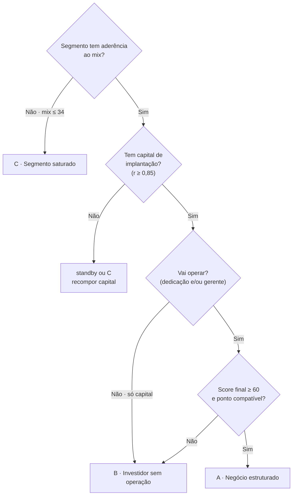

# Decisão — Qual é o perfil do lead?

> [!abstract] O nó do fluxo
> Com a [[Etapa-2-Triagem-Previa|triagem]], o [[Perfil-do-Cliente|perfil]] e a
> [[Etapa-3-Analise-de-Viabilidade|viabilidade]] na mão, o lead vai para **uma**
> das três saídas. A decisão é registrada com **motivo** — é o que elimina
> retrabalho na próxima conversa.

⬅ [[Etapa-3-Analise-de-Viabilidade|Etapa 3]] · 🏠 [[Fluxo-de-Qualificacao-de-Leads|Índice]]

## Árvore de decisão

## Critérios objetivos

| Saída | Critérios simultâneos |
|---|---|
| [[Saida-A-Negocio-Estruturado\|A · Negócio estruturado]] | Score final ≥ 60 · capital de implantação atendido (`r ≥ 0,85`) · há ponto compatível ou em negociação · lead opera (ou contrata gerente para operação delegável) |
| [[Saida-B-Investidor-sem-Operacao\|B · Investidor sem operação]] | Capital disponível **sem** marca/operação definida, ou score 42–77 por falta de operação/experiência, ou marca do lead sem aderência mas perfil financeiro bom |
| [[Saida-C-Segmento-Saturado\|C · Segmento saturado]] | Segmento já ocupado e fora do mix desejado (`mix ≤ 34`) · marca já presente no shopping · público fora do perfil da praça |

> [!warning] Casos de fronteira
> - **Capital ok, segmento saturado:** vai para C, mas com convite explícito para
>   a lista de oportunidades da B — não perca o capital.
> - **Segmento com lacuna, capital insuficiente:** `standby` com data de revisão,
>   não descarte. Ofereça formato menor ou quiosque ([[RADAR-QUIOSQUES|Radar Quiosques]]).
> - **Marca desejada pelo shopping, score médio:** trate como A com plano de
>   mitigação (giro, gerente, suporte da rede) — marca desejada compensa fricção.

## Registro da decisão (editável)

- **Data da decisão:** 
- **Score final:** 
- **Saída escolhida:** [ ] A [ ] B [ ] C [ ] standby [ ] descarte
- **Motivo em uma frase:** 
- **Responsável:** 
- **Próxima ação e prazo:** 
- **Data de revisão (se standby):** 

## Comunicação ao lead

- [ ] Retorno dado em até 5 dias úteis da triagem
- [ ] Motivo explicado com dado (mix, ponto, capital), não com evasiva
- [ ] Alternativa oferecida quando a resposta é não
- [ ] Lead atualizado no CRM com `status` e `proxima_acao`
