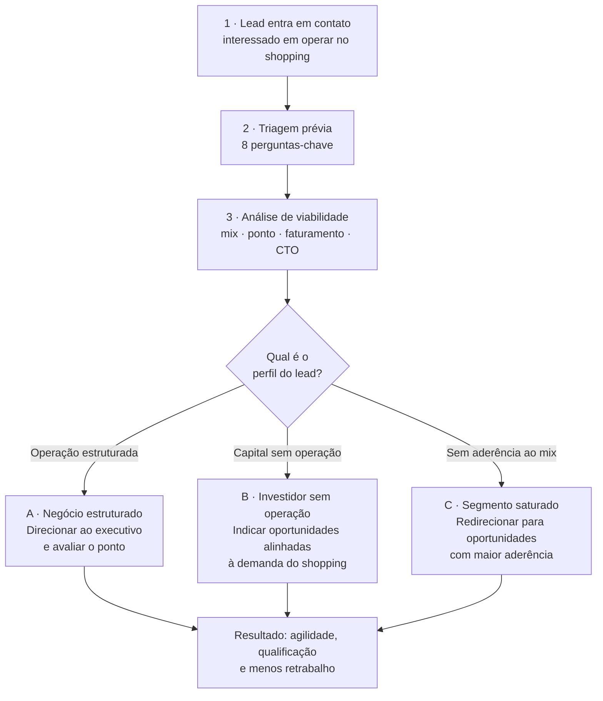

# Fluxo de Qualificação de Leads

> [!abstract] Da entrada do interessado ao direcionamento comercial
> Workflow **editável** para o executivo comercial de shopping conduzir um lead
> desde o primeiro contato até o direcionamento correto: negócio estruturado,
> investidor sem operação ou segmento saturado.
> O detalhamento de **[[Perfil-do-Cliente|perfil do cliente]]** usa a mesma lógica
> de triagem do [[RADAR-QUIOSQUES|Radar Quiosques]] — capital de implantação,
> capital de giro, dedicação, quem opera, experiência prévia — só que aplicada a
> **loja / operação de shopping**.
>
> **Resultado esperado:** mais agilidade, melhor qualificação e menos retrabalho
> para o executivo.

## Mapa do fluxo



## Índice

| # | Etapa | Nota |
|---|-------|------|
| 1 | Lead entra em contato | [[Etapa-1-Lead-Entra-em-Contato\|Etapa 1 — Lead entra em contato]] |
| 2 | Triagem prévia (8 perguntas) | [[Etapa-2-Triagem-Previa\|Etapa 2 — Triagem prévia]] |
| 2.6 | **Perfil do cliente (detalhado)** | [[Perfil-do-Cliente\|Perfil do cliente — detalhamento]] |
| 3 | Análise de viabilidade | [[Etapa-3-Analise-de-Viabilidade\|Etapa 3 — Análise de viabilidade]] |
| 4 | Decisão: qual é o perfil do lead? | [[Decisao-Perfil-do-Lead\|Decisão — Qual é o perfil do lead?]] |
| A | Saída · negócio estruturado | [[Saida-A-Negocio-Estruturado\|Saída A — Negócio estruturado]] |
| B | Saída · investidor sem operação | [[Saida-B-Investidor-sem-Operacao\|Saída B — Investidor sem operação]] |
| C | Saída · segmento saturado | [[Saida-C-Segmento-Saturado\|Saída C — Segmento saturado]] |
| ✔ | Resultado e indicadores | [[Resultado-e-Indicadores\|Resultado e indicadores]] |
| 📄 | Ficha por lead (template) | [[Template-Ficha-de-Lead\|Template — Ficha de lead]] |

## Ferramenta que executa este fluxo

> [!tip] Radar de Varejo — `public/operacoes.html`
> Versão executável deste workflow: faz as 8 perguntas, **enquadra o formato**
> (quiosque · loja satélite · megaloja) pela área necessária e pelo capital
> disponível, calcula CTO e faturamento estimados, pontua as operações e devolve
> a saída A/B/C. Guia: [[RADAR-VAREJO|Radar de Varejo]].
> Online após o merge: `https://radarbazin1.vercel.app/operacoes.html`

## Como usar no Obsidian

1. Copie a pasta `docs/workflow-qualificacao-leads/` para dentro do seu vault
   (ou abra a pasta `docs/` como vault). Esta nota é o **índice (MOC)** — fixe-a
   nos favoritos.
2. Em **Configurações → Núcleo → Modelos**, aponte a pasta de modelos para esta
   pasta. Para cada novo lead: `Ctrl/Cmd + P` → *Inserir modelo* →
   [[Template-Ficha-de-Lead|Template — Ficha de lead]].
3. Salve a ficha como `Lead - <Nome> - <AAAA-MM-DD>.md`. O frontmatter já vem
   com os campos indexáveis (`status`, `perfil`, `segmento`, `score`,
   `proxima_acao`, `data_contato`).
4. As etapas são **editáveis**: os campos são linhas `**Campo:** ` e caixas
   `- [ ]`. Edite direto na nota da etapa quando o processo mudar, ou na ficha
   do lead quando for atendimento.

> [!tip] Painel de leads (plugin Dataview)
> Com o plugin **Dataview** instalado, a consulta abaixo lista todos os leads
> abertos, ordenados por score:
>
> ````
> ```dataview
> TABLE status, perfil, segmento, score, proxima_acao
> FROM #lead
> WHERE status != "descartado" AND status != "fechado"
> SORT score DESC
> ```
> ````

## Legenda de status

| Status | Significado |
|--------|-------------|
| `novo` | Lead entrou, ainda sem triagem |
| `triagem` | Em coleta das 8 perguntas |
| `viabilidade` | Em análise de mix / ponto / CTO |
| `proposta` | Direcionado ao executivo, com proposta em curso |
| `standby` | Aguardando vaga, projeto ou capital do lead |
| `fechado` | Contrato assinado |
| `descartado` | Sem aderência — com motivo registrado |

## Relacionadas

- [[Shopping-Inteligente|Shopping Inteligente]] — o conceito guarda-chuva
- [[Agente-Farmer-e-Conector-de-Quiosques|Agente Farmer e Conector de Quiosques]]
- [[RADAR-VAREJO|Radar de Varejo]] — a ferramenta que executa este fluxo
- [[RADAR-QUIOSQUES|Radar Quiosques]] — motor de score que inspira o perfil
- [[SIMULADOR-ESTRUTURA-SHOPPINGS|Simulador de Estrutura de Shoppings]]
